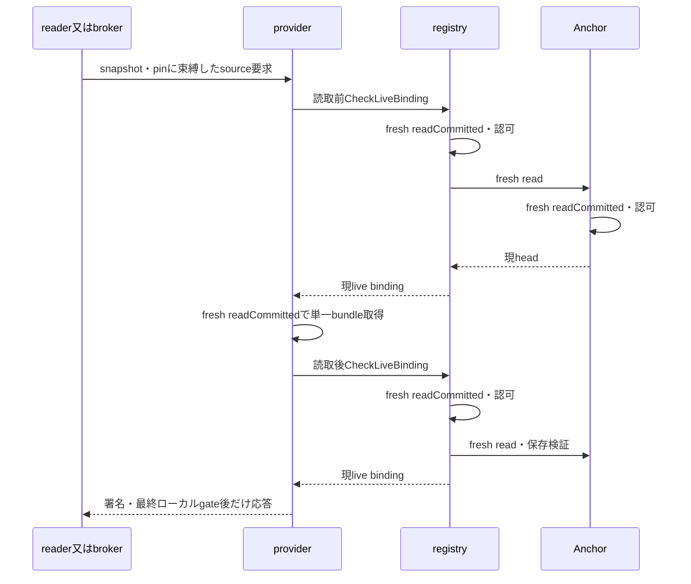

# Gradle precompiled Kotlin／標準kotlin-dslの宣言元登録

設計・公開API実証日: 2026-11-01。基準revision: cc40e4c（7ef3922からの差分は文書の修正のみ）。本書は本番対応を拡張する前の設計とtest-only実証である。既存のcontract v3／graph v3／adapter v5と、本番のKotlin未対応判定は変更しない。従来の明示JavaExec `compileProofKotlin`と、標準Kotlin Gradle pluginのcompileを区別する。

## 1. 対象と完了条件

- consumer Groovy／Kotlin × Gradle 8.11.1／9.2.1 × producer buildSrc／独立included build × binary Kotlin／precompiled Kotlin、計16構成を対象とする。
- producerはboundary内のroot project `:`。両方式ともproducerのbuild.gradle.ktsで標準の`kotlin-dsl`を適用する。precompiledは`.gradle.kts`、binaryは`Plugin<Project>`の`.kt`を使う。consumerのDSLがKotlinというだけではこの条件を満たさない。
- 実証artifactはJAR。directoryの本番対応、producer子project、外部配布plugin、plugin ID alias、settings／init plugin、plugin間委譲・内部catalogはこの実証へ含めない。
- 公開Plugin実体・descriptor・同一invocationの構築JAR・公開CodeSource元の全JAR内容を結び、追加信頼下の採用候補を示す。実行中の変換済みclass bytesを独立観測した証拠にはしない。

Gradle公式文書ではprecompiled scriptのIDをファイル名・packageから導出し、buildSrc／included buildへ配置する。kotlin-dslはGradle版と対応するplugin版を使う。[precompiled script](https://docs.gradle.org/current/userguide/implementing_gradle_plugins_precompiled.html)、[Kotlin DSL primer](https://docs.gradle.org/current/userguide/kotlin_dsl.html)。本実証では実際に解決したartifact版を記録し、最新版を推測しない。

## 2. 宣言元と二段階登録の契約

binaryはapply内でbeginPlugin(specId, this)、precompiledはbeginPrecompiled(specId)を使う。後者でscriptのthisを渡さない。plugin ID適用前に公開withPlugin observerを登録し、適用完了後のfindPluginで得た実Pluginをpending sessionへ結ぶ。precompiledの生成class名をfilenameから推測して確定せず、構築JARのdescriptorと実classを照合する。

物理sourceから生成adapterへの対応は作者manifestへ明示する。declared_inは元のsrc/main/kotlin/*.gradle.ktsまたは*.ktで、build/generated以下、descriptor、consumerのplugins blockへの置き換えは行わない。consumer scriptにも同じGAVの追加があれば両物理sourceを保持する。

scope・sourceMapping・application・同期追加／Provider追加の双方向被覆は既存と同じ。遅いbegin、未終了、failed、重複begin（先行終了後も含む）、未知handle、出自・record IDの不整合は宣言一覧全体を不完全とする。登録不足だけなら検証済みrelation／introduced_byは保持する。

## 3. 公開APIで取得する構築証拠

KotlinCompileはGradleのAbstractCompileとして捕捉できるとは限らない。標準Kotlin compileへ従来のtask名compileProofKotlinを代用しない。

| 段階 | 実証で観測する公開情報 | 必須の対応 |
| --- | --- | --- |
| plugins block抽出 | Task.inputs／outputs | 元scriptと抽出出力 |
| 外部plugin spec生成 | Task.inputs／outputs | 承認classpathと生成source |
| plugins block compile | Task.inputs／outputs | 抽出source／specと生成class |
| accessor生成 | Task.inputs／outputs | 元script・plugins block classと生成source／metadata |
| adapter生成 | Task.inputs／outputs | 元scriptと生成Plugin adapter source |
| Kotlin compile | KotlinCompile.libraries、公開kotlinCompilerClasspath構成、Task.inputs／outputs | 元source・生成adapterのhashとcompile出力 |
| descriptor／resource／JAR | 公開Task.inputs／outputs、Jar.archiveFile | descriptor、compile出力、最終artifact |
| plugin適用・ロード元 | withPlugin、findPlugin、Class／ProtectionDomain／CodeSource | descriptorの実装class、実Plugin、構築artifact、runtime snapshot |

実証では内部precompiled task classをimport／castしない。公開Task APIを使い、観測した既知task名を役割へ対応付ける。名前が同じというだけで本番で任意taskをcompilerとして信頼しない。Kotlinの公開compile APIについては[compiler options文書](https://kotlinlang.org/docs/gradle-compiler-options.html)も参照する。

Task.inputsには元libraryだけでなくGradle cacheのclasspath snapshotなどの派生入力も現れる。librariesと同一bytesとして照合してはならない。実証のexternalInputObservationsはこれらをderived-or-unapproved-task-inputとして別記録する。この棚卸しは事後観測で、compilerがそのbytesを実際に消費したことや、内部変換の完全性の独立証明ではない。

## 4. toolchain・変換の信頼と責任分離

作者はproducerのsettings／build、物理source、resource、独自dependency・processor・生成入力を列挙する。利用者はGradle、kotlin-dsl plugin、Kotlin Gradle plugin、compiler・標準library・compiler依存、実JDKを確認してprofileを承認する。plugin固有dependencyを大きいという理由だけでtoolchainへ移さない。

実証profileは選択したGradle配布物、生成gradle-api、明示したKotlin ecosystemのcache JAR、JDKのjava／modules／releaseをhash化する。実行後も再hashし、公開java.homeとjava.runtime.versionを選択JDKと照合する。Kotlin compiler classpathとlibrariesは承認済み実fileへ対応付ける。未対応のclasspathは黙って除外しない。compiler daemon、独自compiler plugin、KAPT／KSP、追加transform・agentは今回の範囲外。

本番案では既存toolchain／loader信頼に加え、標準Kotlin構築pipelineへの明示opt-inを独立させる。提案設定はOSV_MCP_GRADLE_KOTLIN_PIPELINE_TRUST=registered-kotlin-dsl-build-v1とOSV_MCP_GRADLE_KOTLIN_PIPELINE_PROFILES。起動時固定のallowlistとし、graph由来のdigestを自己承認しない。名前とschemaは将来案で、今回は設定を実装しない。

実証profileのdigestは既存test-only proofDigest（JSON.stringifyのbyte列）を使う。本番pluginProfileDigestのkey整列方式とは異なる。本番schema案では既存のcanonical digestを維持し、test-only digestをそのまま本番allowlistへ流用しない。

pipeline profileはtoolchainProfileDigest、Gradle／kotlin-dsl／KGP版、対応するplugin・compiler artifactのentry ID、stage roleと許可した公開入力経路、compiler実行方式、cache／parallel設定を持つ。作者manifestはsource→generated adapter→compile→packageのmappingと、列挙していない構築入力がないことを表明する。派生classpath snapshotの対応は承認したGradle／KGP経路への表明として扱い、hash一致だけで独立検証済みにしない。追加信頼なしではsource一覧を採用しない。

既存approved-gradle-loader-v1は実行時ロード／変換の契約であり、Kotlin構築pipelineの信頼を暗黙に兼ねない。prepared-output-only-v1をloader-attestedへ自動変更せず、未確認変換のある実runtimeはstrictで引き続き拒否する。

## 5. 本番入出力案・完全性判定

既存schemaへ黙ってfieldを追加せず、将来contract v4／graph v4／adapter v6としてstrictに版管理する案とする。

- producer.buildMethod=standard-kotlin-dsl-v1、sourceMappingsのkind=binary-kotlin／precompiled-kotlin、pipelineProfileDigest、物理sourcePaths、生成adapterに対応する明示mapping IDを入力に追加する。パスはboundary相対、sourceとproducerを混同しない。
- exportはstage receiptにproducer／invocation／task／role、実行状態、物理入力hash、生成入力・出力の完全集合、libraries、compilerClasspath、派生入力の種別・hash・表明を保持する。task自身の出力だけを記録する。
- generation receiptは元sourceのhashに結び、compile receiptは同じgenerated adapterのhashに結ぶ。Kotlin出力rootの全fileをpackage入力とJARの同名entryへhash照合し、classの集合も完全一致させる。descriptorが指す実装classはcompile出力・JAR entry・ロード元classの三者でhashを一致させ、archive pathとJAR全体hashも同じpackage receiptへ束縛する。実Plugin／CodeSource／runtime snapshotは既存規則で照合する。生成class名の一致だけでは採用しない。
- JARの全entry（class以外のdescriptor、resource、MANIFEST、kotlin_module等を含む）を、記録したstage出力（pluginDescriptors、processResources、compile等）とpackage入力へ対応付け、どのstageにも由来しないentryがあれば拒否する。今回の実証はclassだけを照合しており、これは本番化で実装する。
- source／toolchain／生成物／構築artifact／snapshotの欠落・改変・別invocation・別producerとの混同はgraph採用を拒否する。pipelineの信頼無効／profile未承認は宣言元だけを省略する。
- cache hit／up-to-date／no-sourceで実行証拠がない段階を今回の成功receiptへ昇格させない。再利用receiptの鮮度契約は別設計とし、初期は明示再構築を要求する。
- declared_inは全contributing contextの完全性AND。同じGAVのscript側だけや、他contextの一部sourceだけを返さない。pluginを使わないscopeへ追加信頼を要求しない。

metadata案はkotlin_pipeline_trust_status、pipeline profile ID、source／generated lineage状態、compiler方式、既存plugin source_artifact_status／transform_status／comparisonと組み合わせる。limitationsにkotlin_build_pipeline_author_attested、kotlin_derived_classpath_inputs_not_independently_bound、plugin_classpath_transient_changes_not_detectableを明示する。実証用assessKotlinStagesのcompleteは限定したsource→adapter→compile manifestの整合性であり、この本番全体の完全性や派生入力の検証完了を意味しない。

## 6. 実証ハーネスと回帰条件

src/test/gradle/kotlinPlugin.integration.test.tsとtest-only init script gradle-kotlin-plugin.init.gradleを使用する。本番init script、MCPの取込／trust設定は変更しない。各fixtureにplain／control／registered、script-only、late／unfinished／failed／duplicate／duplicateClosedのsubprojectを設ける。

実証ledgerのbridgeはpluginSource(instance, pluginId, sourcePath)／beginPrecompiled(pluginId, sourcePath)と終了tokenを使う既存のtest-only APIで、本番のspec ID・session・pluginSource(session, mappingId)をそのまま実行したものではない。公開Gradle APIによる実体対応と登録挙動の成立性を調べる。本番helper・schemaへの移植とその回帰は次段階である。

| 条件 | 期待 |
| --- | --- |
| binary this、precompiled pending | 適用後の実Pluginとdescriptorへ結ぶ |
| 同値のscript／plugin追加 | 別recordを保ち、両sourceを返す候補 |
| 同期Action、使用／未使用Provider | plain／control／registeredでgraph・trace・評価回数一致、未使用0回 |
| late／未終了／failed／重複begin | 構築証拠を保持し、宣言一覧全体を省略 |
| helper・loader信頼無効／旧trust／profile不足 | 追加信頼の採用条件を満たさない |
| compile／class／package欠落、別producer、source変更、compile後のclass差し替え | stage完全性を拒否 |
| adapter欠落、hash相違、生成順序逆転、他producerの出力 | 物理source→generated adapterの対応を拒否 |
| JAR snapshot改変 | 再照合で拒否し、復元後に元hash確認 |
| cache／JDKのsymlink・/tmp経由の指定 | canonical pathで同じ実fileへ照合 |
| strict policy | 変換不明を陽性とせず不採用 |

nativeのplain／control比較はconsumerの依存Provider・Actionの挙動を対象とする。Task.inputsの観測で一切の内部Provider評価が変わらないと独立証明したものではない。producer compileは同じ一回の構築で共有し、比較用に独自compilerへ置き換えない。

KotlinStagesの単体回帰は生成manifestの構造を検証する。ディスクの改変拒否はJARのnative対照と既存safe reader／snapshot回帰で分担する。合成manifestテストを、実コンパイラの変換観測と読み替えない。

実証の照合対象はKotlin出力root配下のfileとJARのclass集合で、descriptor／resource／MANIFEST／kotlin_module等の非class entryはstage出力へ束縛していない。descriptorの内容は、ロードしたclass名との一致で間接的に確認するだけである。§3の表の「descriptor／resource／JAR」の対応のうち、非class entryは未検証の限界として残す。

## 7. 再現

まず信頼できる環境で公式kotlin-dsl依存を取得し、標準kotlin-dslを使う小さいproducerのjar taskを各Gradle版で一度実行してcacheを準備する。実証そのものはofflineで行い、cache不足を成功扱いしない。

```sh
JAVA_HOME=/trusted/jdk-21 \
GRADLE_USER_HOME=/trusted/prepared-gradle-cache \
OSV_MCP_TEST_GRADLE=/trusted/gradle-8.11.1/bin/gradle \
OSV_MCP_GRADLE_KOTLIN_OUTPUT=/tmp/gradle-kotlin-proof \
npx vitest run src/test/gradle/kotlinPlugin.integration.test.ts
```

9.2.1も同じ方法で別output prefixを使う。cache／JDKのpath alias照合を確認するときは、`GRADLE_USER_HOME` を `/tmp` 経由（macOSでは `/private/tmp` へのsymlink）で、`JAVA_HOME` をJDKへのsymlinkで指定する。テスト自体はaliasを作らないため、実際の指定は各観測JSONの `pathAliases`（cache／jdk）で確認する。通常npm testではnative matrixをskipする。temp fixtureとsnapshotはafterAllで削除し、指定prefixの観測JSONだけを保存する。

## 8. 検証結果

最終native matrixと通常回帰の実行結果、source hash、実toolchain・loader profile、stage receipt、applicationとpolicy判定をvalidation/gradle-kotlin-plugin-2026-11-01.jsonへ記録する。これは設計・公開API実証であり、本番adapter／静的取込・3ツールOSV実接続への対応完了ではない。観測JSONのassessment.inputVerifiedは元sourceと既存のlibraries／compiler classpath検査、policies.attestedは既存test-only loader判定の値である。新しいpipeline信頼設定や全派生入力の完全性を検証した値ではなく、productionAdoptionEligibleはfalseとして記録する。


### 初回実行結果（レビュー修正前）

[観測データ](validation/gradle-kotlin-plugin-2026-11-01.json)に16構成、2組のtoolchain／loader profileとsource hashを保存した。JDK 21.0.13+9-LTS、macOS arm64で実行した。

| Gradle | compilerClasspathで観測したcompiler | fixture | native成功 | 時間 |
| --- | --- | --- | --- | --- |
| 8.11.1 | kotlin-compiler-embeddable 2.0.20 | 8 | 144 | 215.30秒 |
| 9.2.1 | kotlin-compiler-embeddable 2.2.20 | 8 | 144 | 243.32秒 |

- 全構成で実Plugin／descriptorが一致し、precompiledはbegin→end→after-applyの順でpendingを解消した。元sourceと生成adapterのhashがcompile入力へ対応し、生成classを持つcompile／packageを観測した。
- JAR全内容の比較は8.11.1でentry-content-exact、9.2.1でraw-exactだった。strictは未確認変換の前提によって全て不採用。比較結果だけで独立した実行bytecode観測としない。
- 有効なregisteredの宣言元候補は元plugin source＋consumer scriptの2件。生成adapterは一覧へ含めない。plain／control／registeredでgraph、Action traceとProvider評価が一致し、使用Providerは1回、未使用は0回だった。
- late／unfinished／failed／duplicate／duplicateClosedでは候補一覧全体を省略。JAR snapshot変更は16構成とも拒否し、復元後のhash一致を確認した。
- 単体回帰12件が成功。通常回帰はnative compileとの並行時に既存の時間依存3件が失敗したが、native終了後にmaxWorkers=2で単独再実行し、1,784件成功／1,027件skipとなった。時間上限や本番コードは変更していない。typecheck・buildも成功。

保存JSONのpreReviewに初回のsource hashと検証集計を保持し、case本文は以下の修正後の観測に更新した。同じprofile本文を参照へまとめた観測記録で、snapshot archive自体は含まない。各caseのprofileRef／loaderProfileRefを上位辞書から復元できる。test-only候補化の条件が成立した範囲と、本番pipeline完全性が未成立の範囲をscopeとproductionAdoptionEligible=falseで区別する。

次はこの設計のレビュー、派生classpath入力を含むpipeline manifestと信頼設定の具体化、成立した範囲の本番helper／exporter／静的取込である。directory、daemon／out-of-process compiler、cache再利用・並行export、第三者compiler pluginは別の実証を要する。


### レビュー修正: compileからpackageへの束縛とpath alias

compile出力にclassがあるだけで候補化していた判定を修正し、Kotlin出力全fileのhashをpackage入力・JAR entryへ結ぶ。JARのclass集合に過不足がある場合、descriptor実装classのロード元hashが異なる場合も拒否する。source→adapterだけでなく、compile→package→load元までの内容対応を確認する。独立した実行bytecode観測や派生compiler入力の完全性を保証する範囲は広げない。

cache・JDK・toolchain file・agentの照合キーをrealpathへ統一する。/tmpと/private/tmpの違い、JDKのsymlink指定を別toolchainとして誤判定しない。正常構成の内容とfingerprintは実体のpathを基準とし、表示用診断にもcanonical rootを使う。

回帰にはcompile／package入力／JAR entry／ロード元classの不一致と余分なclassを追加する。またjar taskのdoFirstで有効な未使用classの文字列定数を変更し、コンパイル済み出力とJARだけが異なる実ディスク負例を追加する。pluginの適用とロード元JAR照合自体は成功しても、宣言元候補を省略する。


レビュー修正後の再検証は、正常16構成と実class差し替え4構成の計20観測を保存した。両Gradle版とも188件成功（正常8 fixtureの184件＋実ディスク負例2 fixtureの4件）。8.11.1はcacheを/tmp経由、JDKをsymlink経由で指定した全10 fixtureで成功。9.2.1はcanonical path指定の全10 fixtureで成功した。正常fixtureではcompile出力全fileとpackage入力・JAR entryが一致し、descriptorの実装classをロード元hashへ結べた。実ディスク負例ではロード元JARの全内容比較は成功したまま、kotlin_compile_package_mismatchを理由に宣言元候補を省略した。

単体回帰は16件成功。今回追加したcompile hash・package入力・JAR entry・ロード元classの不一致4件は、修正前に失敗・修正後に成功を確認した。各正常native fixtureでも5種類の観測改変（計80対照）を拒否した。cache aliasの修正前対照は同じcacheで12件のclasspathを未確認とし10テスト失敗、修正後は両root alias指定でもtoolchain／loader照合を維持した。

最終の通常回帰は単独実行で1,788件成功／1,071件skip（78 files成功／11 files skip）。build・typecheck、20観測のsource hashとprofile参照・compile/package対照の整合性を確認した。実行時間は8.11.1が375.44秒、9.2.1が423.57秒、通常回帰84.93秒。負荷条件が異なるため初回との性能比較としては扱わない。


### 6e1d969レビュー修正: 拒否理由の明示と順序対照の独立化

stage単体のmutationとnativeの5種類の観測改変は、`complete=false` だけでなく期待する拒否理由を確認する。従来の `generator-after-compile` はtask列全体を逆順にしたため、package段の不一致が同時に発生し、adapter生成順の判定を削除しても成功していた。generatorだけをcompileの後ろへ移し、compile→packageの順序を保ったまま `kotlin_adapter_lineage_missing` を確認する。判定を外すと当該テストが失敗することも確認した。compile重複、package artifactのproducer／invocation／archivePath／hash不一致、余分なclassの単体対照を追加し、stage単体は22件となった。判定ロジックとinit scriptは変更していない。

修正後の再検証: native integrationは両Gradle版とも188件成功（8.11.1はcacheを/tmp経由、JDKをsymlink経由で指定、9.2.1はcanonical path）。通常回帰は単独実行で1,794件成功／1,071件skip、typecheck成功。観測caseは再生成せず、検証JSONのpostReviewRevisionに新しいsource hashと結果を記録した。


## 9. Kotlin構築pipelineの信頼契約・入力manifest具体案

2026-11-01追補。§4〜5の提案を具体化し、矛盾する将来要件は本節を優先する。**設計のみで、本番schema・helper・collector・reader・設定は未実装。既存20観測を、本節の派生入力対応や非class entry被覆の成功証拠へ読み替えない。** 次の公開API実証で成立したrecipe／version tupleだけを本番へ移植する。

### 9.1 採用範囲と責任

初期対象は境界内buildSrc／included buildのroot project、標準kotlin-dslによるbinary Kotlin／precompiled Kotlin、JAR、in-process compiler、configuration cache・parallel・build cacheなしの明示再構築。Gradle 8.11.1／9.2.1を別々のprofileで確認する。KGP／compiler／kotlin-dslの版は実際に選択されたartifactへ結び、Gradle版からの推測や、cacheに同じ版が存在することだけでは確定しない。

| 担当 | 必須責任 | 独立証明しないこと |
| --- | --- | --- |
| 作者 | 全物理入力、生成stage、source mapping、resource、package期待集合を登録 | 列挙外入力がないこと・元sourceが正しい追加箇所であることは作者表明を含む |
| 信頼済みexport環境の利用者 | 実toolchainとpipeline recipeを事前確認して別々に承認。実行設定・入力不変を表明 | hashやprofileはcompilerの忠実性・実行bytecodeの証明／署名ではない |
| exporter | 公開APIから実体・集合・順序・hash・stageイベントを記録し、現在bytesと対応を検査 | KGP内部transformの独立追跡、全内部Providerの非干渉、復元された一時変更は保証しない |
| MCP reader | 境界内のmanifest・blob・参照・完全性・許可profileを再検証 | Gradle／KGPの実行、外部cacheへの追跡、OSVへのsource送信は行わない |

Kotlinのclasspath snapshotはlibraryのABI情報を表す派生物で、JARのcontent hashとは異なる。[Kotlin公式説明](https://kotlinlang.org/docs/gradle-compilation-and-caches.html)が区別するsnapshot方式を、単なるbyteコピーと扱わない。Gradleの[Artifact View／transform API](https://docs.gradle.org/current/userguide/artifact_transforms.html)を別途解決しても、それだけでKGPが実際に利用した既存transform結果との対応にはならない。

### 9.2 独立した信頼設定とprofile

必要条件は既存helper信頼、`local-plugin-loader-attested-v2`、承認toolchain／loader、および次のpipeline信頼・profileのすべて。catalogを使うscopeには既存catalog信頼も必要。strict load policyを自動でattestedへ変更しない。

| 設定 | 値と判定 |
| --- | --- |
| OSV_MCP_GRADLE_KOTLIN_PIPELINE_TRUST | `registered-kotlin-dsl-build-v1`だけを許可。未設定・空はdisabled、未知値は警告＋設定invalidとして宣言元を省略 |
| OSV_MCP_GRADLE_KOTLIN_PIPELINE_PROFILES | 小文字hex64桁digestのcomma区切り、最大32件。重複・不正値はこの集合だけを無効化し警告 |

設定は起動時固定。pipeline設定の不正で、非Kotlinのhelper／catalog／plugin許可を無効化しない。graphのprofile本文やproducerが指定したpathを、MCPが読み込んで自己承認することは禁止する。

`KotlinPipelineProfile` schemaVersion=1の全fieldを以下で定義する。objectはすべてstrictで未知fieldを拒否する。digestは本番`pluginProfileDigest`のcanonical方式で本文全体へ計算し、本文自身にdigestを含めない。物理pathは利用者が渡す別のexport設定に置き、profileには論理entry IDだけを保存する。

| field | 型・制約 |
| --- | --- |
| schemaVersion／policy | `1`／`registered-kotlin-dsl-build-v1`固定 |
| toolchainProfileDigest | 既存toolchain profile本文のSHA-256。KGP・kotlin-dsl実装／driver／compiler推移的依存は明示した`compiler`等のentryへ登録し、group名から自動承認しない |
| versions | gradle、kotlinDsl、kgp、compiler、jdkIdentityの非空文字列。実行時に選択した実装・compilerClasspath・JDK receiptと一致 |
| implementations | kotlinDsl／kgp／compilerの各`{entryIds:[ID...]}`。必要な全JARを含め、toolchainへの参照切れ・重複・未観測実装を拒否 |
| collector | `{recipeSetId, implementationSha256}`。配布collectorの確認済みrecipe集合と実コードdigest。未確認IDをgraphから動的に追加できない |
| execution | compilerStrategy=`in-process`、fallback=`error`、compilation=`full-rebuild`、incremental=`false`、outputReuse=`forbid`、configurationCache／parallel／buildCache=`false`。public option recipeと明示設定の照合ができないtupleは未対応 |
| stageRecipes | `{id, role, publicCollectorId, implementationEntryIds, inputRoles, outputRoles}`の配列。role／collector IDは静的registryの閉じたenum。task名だけで型・実装を信用しない |
| derivedPolicies | `{id, kind:"attested-classpath-cohort-v1", captureRecipeId, bindingKind:"aggregate", sourceRole}`の配列。sourceRoleは`libraries`／`plugins-block-classpath`の閉じたenum（§9.4.1） |
| packagePolicy | manifest=`profile-literal-v1`、resources=`byte-copy-v1`、duplicates=`fail`、signatures=`unsupported`。`manifestLiteral={id,bytesBase64,size,sha256}`に期待bytesとsize／SHA-256を保持 |
| attestations | pipelineReviewed、allStageInputsRegistered、inputsImmutableDuringStages、noUnregisteredCompilerPlugins、publicObservationReviewedをすべて明示true。derivedBindingScope=`cohort-not-per-artifact` |

generator stageの登録元pluginを公開APIだけで完全に特定したとは扱わない。確認した公開TaskProviderへの明示登録と承認plugin modelとの対応は追加契約に含め、`kotlin_stage_role_registration_author_attested`をlimitationsへ加える。Kotlin compileは公開KotlinCompile型／libraries APIを確認し、独自の同名taskを同一recipeへ昇格させない。

`implementations`は選択したplugin implementation／driverの実bytesを、公開APIで確認できる範囲でtoolchain receiptへ結ぶ。実装のロード元やversionの観測が未成立なら`recipe_unsupported`とし、artifactファイル名や座標だけで陽性化しない。既存実証profileのようにcacheのKotlin関連JAR全件を集める方式は、本番profileの選択実装確認の代用にしない。

`execution`はrequested設定と観測結果を分ける。既存実証の`requested-in-process`だけでは条件達成としない。利用する公開option／runtime観測と、fallback・compiler plugin・free compiler argsの許可範囲をtuple別recipeへ固定する。観測不能な動作は表明の範囲を明示し、recipe未実証のまま有効にしない。KAPT／KSP、daemon／out-of-process、独自compiler plugin、混在Java／Groovy compile、任意transformは初期対象外。

### 9.3 作者manifestとexport schema

contractVersion=4、graph schemaVersion=4、declaration adapterVersion=6を予約する。既存v1〜v3契約／adapter v2〜v5の意味は変えず、新fieldを旧schemaで許可しない。contract v4の非Kotlin plugin specは既存形を保ち、Kotlin specだけにbuildMethod=`standard-kotlin-dsl-v1`とpipelineIdを必須とする。

固定manifest `osv-mcp-gradle-declarations.json` に`kotlinPipelines`を追加する。一つのentryは次の全fieldを持つ。`assertions` object自体は必須で、mapping subkeyだけを下記のとおりoptionalとする。

| field | 内容 |
| --- | --- |
| id／producer／pluginSpecIds | pipeline ID、既存producer tuple、関係する全spec ID。producerをまたぐ共有禁止 |
| pipelineProfileDigest | §9.2のprofile digest。specのtoolchain digestとprofile内のtoolchain digestも一致 |
| inputManifest | `{files:[{id,path,role}], absentCandidates:[{id,path}]}`。settings／build／適用script／source／resource／lock／設定・明示した独自依存を列挙。roleはsource、build-script、resource、plugin-library、configurationの閉じたenum |
| stagePlan | `{id,role,taskPath,recipeId,inputSlots,outputRoots}`。各rootは`{id,path,role}`。roleはpackage-candidate、intermediate、local-state、archive。実rootの用途をrecipeで固定 |
| sourceMappings | `{mappingId,pluginSpecId,sourceKind,physicalSourceId,adapterStageId}`。sourceKindはbinary-kotlin／precompiled-kotlinで、specのregistrationFormと一致。binaryはadapterStageId=null。precompiledは生成adapterへの参照必須。physicalSourceIdはbaselineの元.kt／.gradle.ktsのみ |
| cohorts | `{id,consumerStageId,sourceRole,captureRecipeId,policyId}`。sourceRoleはconsumer stageのroleで決まり、kotlin-compileは`libraries`、plugins-block-compileは`plugins-block-classpath`。consumer stageごとに別cohortとし、stageをまたいで共有しない。実collectionのcaptureを予約し、登録時にProviderを評価しない |
| packagePlan | `{stageId,terminalRootIds,descriptorBindings,resourceMappings,manifestPolicyId}`。descriptorBindingsはpluginSpecId／pluginId／implementationClass、resourceMappingsは入力ID→出力相対pathの明示copy関係 |
| assertions | buildInputs=`all-plugin-build-inputs-listed`とmutation=`immutable-during-export`は必須literal。mappingはoptionalで、値は`source-artifact-mapping-reviewed`／`not-asserted`のenum。省略は未表明。既存scope／Provider表明を代替しない |

inputSlotsは`{id,role,sourceRef}`、receipt inputsは`{slotId,refs:[logicalRef...]}`の配列とする。roleはphysical、generated、libraries、compiler-classpath、derived、registered-scalar、profile-literal、package-literal-fileで、slotのcardinalityと許可ref kindをrecipeへ固定する。入力refの省略・role交換・二重所有を禁止する。sourceMappingの元sourceは既存spec.sources／sourcePathsとの集合対応も検査する。

物理filesと既存plugin specのinputPathsはproducer内の和集合で一致させ、片側だけに入力を隠さない。absentCandidatesは評価前に不在を捕捉し、後の出現をstaleとする。生成入力はphysical fileへ偽装せず、原則stage-output参照にする。唯一の例外は§9.6.1のpackage-literal-fileで、既定MANIFESTの専用slotだけに許可する。未登録generatorが作った.ktを宣言元へ昇格させない。

graph v4には`kotlinPipelineEvidence`を必須とし、`{evidenceVersion:1, invocationId, inventoryComplete, profiles, producers}`を持たせる。非使用でもinventoryComplete=trueと空配列を明記する。producer evidenceは`{pipelineId,producer,manifestDigest,profileDigest,physicalInputs,stages,sequences,cohorts,packageInventory,state,reasons}`。同一invocation内のIDは一意とし、全参照をproducer／invocation／stageへ束縛する。

stage roleのenumはextract、external-spec、plugins-block-compile、accessors、adapter、kotlin-compile、descriptor、resources-copy、package、non-contributing-java-compile。binaryでは少なくともkotlin-compile／descriptor／resources-copy／packageの4 roleを実行し、precompiledでは全roleをplanへ載せる。extract／adapter／kotlin-compile／descriptor／resources-copy／packageはprecompiledの必須実行role。plugins blockがない場合のcompile／accessors等の非使用は、下記の閉じた条件だけで認める。

各stage receiptは`{id,role,taskPath,recipeId,ordinal,state,inputInventoryComplete,inputs,scalars,outputs,observationPhase}`。実行時stateはexecuted／not-applicable／unavailableのtagged unionとする。

- executedにはexecuted=true、didWork=true、skipped=false、failure=falseと実input／output集合が必須。ordinalのDAGで生成前使用・循環・同じstageの重複を拒否する。
- not-applicableはそのsource kindでrecipeが任意と定めたstageだけ。空入力集合・非使用の根拠を必要とし、必須Kotlin compile／packageへ使えない。
- cache hit／up-to-date／no-source／failedを成功receiptへ変換しない。必要stageが実行されなければunavailable。binaryとprecompiledのstage必須集合をprofileへ固定する。
- file参照は`physical-input`、`stage-output`、`toolchain-entry`、`derived-snapshot`、`package-literal-file`のunion。最後の型は§9.6.1の条件に限定し、一般の生成物の分類先にしない。scalarは公開option／plugin model／固定profile literal、および§9.6.1専用のpublic-locationをrecipeごとに許可し、任意のJSONを入力証拠にしない。
- 出力所有者は一つ。classes root内のfileをlocal-stateへ付け替えて除外できない。source／generated sourceはintermediate、Kotlin classes rootの全fileはpackage-candidate、compiler cacheは明示local-stateとして区別する。Jar自身の出力はarchiveとし、terminalRootIdsには含めず、ちょうど一つのarchiveRefへ結ぶ。

not-applicable条件は、binaryのprecompiled source集合が空、または確認済みextract stageのplugins-block出力と次stageのpublic source slotが両方空で、消費する生成物もない場合に限定する。型ごとに許可したstageだけへ適用し、空配列の自己申告、単なるno-sourceフラグ、過去の生成物の残存では非使用としない。

標準kotlin-dslのproducerには、保存済み20観測のすべてで`:compileJava`（didWork=false、noSource=true）が現れる。これは`non-contributing-java-compile` roleとして扱い、次の条件をすべて満たす場合だけstate=not-applicableを認める。

- Java source rootの候補pathを評価前のabsentCandidatesで捕捉し、export終了まで不在のまま（または空のdirectoryのまま）である。
- そのtaskの公開outputs（Java classes root）が空で、package入力にもJAR entryにも現れない。
- recipeがこのtask pathと公開型を確認済みで、didWork=false／noSource=trueを観測した。noSourceフラグだけでは根拠にしない。

Java sourceが一件でも存在する、出力rootが空でない、Java classes rootのfileがpackage入力へ届く場合は、混在Java compileとして`kotlin_pipeline_recipe_unsupported`にする。このroleはKotlin compile／packageの代替にならず、ほかのno-source stageへ拡張しない。

入力・出力ともpath／kind／size／SHA-256または完全tree digestを保存する。pathは境界相対で既存safe-reader規則を用い、IDを返却時のsanitize後の値で照合しない。group ID等の新しい論理IDはASCII `[a-z][a-z0-9._-]{0,127}`。SHA-256は小文字hex64、sizeはsafe integer。未知field、duplicate JSON key、参照切れ、二重分類を拒否する。

#### 9.3.1 mapping未表明のschemaと宣言採用条件

contract v4のstandard-kotlin-dsl分岐では、pipeline entryの`assertions.mapping`と、そのpipelineを参照するKotlin plugin specの`assertions.mapping`を同じoptional enumにする。旧plugin spec schemaをそのまま呼び出して、Kotlin spec側にだけ必須literal判定を残さない。非Kotlin specおよびcontract v1〜v3のschema・挙動は変更しない。

| raw mapping値 | schema | 宣言用の表明状態 |
| --- | --- | --- |
| `source-artifact-mapping-reviewed` | 有効 | reviewed |
| `not-asserted` | 有効 | unasserted |
| mapping subkeyの省略 | 有効 | unasserted |
| null、boolean、その他の文字列 | 不正 | kotlin_pipeline_schema_invalid |
| assertions object自体の省略／不正型、buildInputs／mutationの必須literal不正 | 不正 | kotlin_pipeline_schema_invalid |

たとえば次の二つはmappingについて同じ未表明状態を表す。これはschemaの部分例で、その他のmanifest必須fieldは通常どおり必要。

```json
{
  "assertions": {
    "buildInputs": "all-plugin-build-inputs-listed",
    "mapping": "not-asserted",
    "mutation": "immutable-during-export"
  }
}
```

```json
{
  "assertions": {
    "buildInputs": "all-plugin-build-inputs-listed",
    "mutation": "immutable-during-export"
  }
}
```

省略をunassertedへ解釈するのは宣言判定の内部処理だけ。manifestをrewriteしたり、hash計算前にdefaultを埋めたりしない。`manifestDigest`と評価前baselineは元のUTF-8 file bytesのSHA-256に結ぶ。mappingを削除・変更したmanifestへ古いcompanionを組み合わせた場合は、正当にstale／digest不一致となる。未表明の正常対照は、新しいmanifestと整合した新exportで作る。

各contributing contextの`source_mapping_attestation`は、pipelineとそのcontextで必要な全Kotlin specの両方が明示reviewedの場合にだけreviewed、それ以外はunassertedとする。片側だけのreviewed、承認済みpipeline profileのpipelineReviewed、graph内のaccepted flagでは補完しない。MCPが固定raw manifestから再計算し、exportされた診断値があっても採用の根拠にしない。

未表明でもsourceMappings配列、物理source ID、adapter／compile edge、implementationClass、producer／invocation、全hashは必須である。未表明を理由にこれらの検証をskipしたり、空sourceへ置き換えたりしない。全input integrity検査が通過した場合だけ、`input_status=verified`を保って`kotlin_source_mapping_assertion_missing`／missing_assertionとし、contributing GAVの宣言元一覧全体を省略する。relation／introduced_byとlock由来coverageは維持する。

参照切れ・不正型・hash不一致が同時にあれば、それぞれの入力エラーを優先する。mapping未表明で入力破損をdeclaration-onlyへ格下げしない。Kotlinを使わない独立scopeにはこの新しいoptional判定を持ち込まない。

### 9.4 派生classpath snapshotの対応付け

初期方式は**一つのconsumer stageの、順序付きlibrary集合から、明示したsnapshot集合へのaggregate対応**である。個別JARと個別.binの一対一対応を主張しない。多対多を許す代わりに、全sourceと全derived memberを取りこぼさない閉じたcohortを要求する。

runtime cohortの参照形は次のとおり。各refの本文はproducer evidence内の別inventoryへ置く。

```json
{
  "id": "classpath-main",
  "consumerStageId": "compile-main",
  "sourceRole": "libraries",
  "sourceSequenceRef": "libraries-main",
  "derivedCollectionRef": "snapshot-files-main",
  "captureRecipeId": "kgp-snapshot-collection-v1",
  "policyId": "attested-classpath-cohort-v1",
  "bindingKind": "aggregate",
  "bindingAssurance": "author-attested",
  "observationPhase": "post-task",
  "inputInventoryComplete": true
}
```

`kgp-snapshot-collection-v1`は**将来のregistry IDであり、公開collectionが既に取得できるという実証結果ではない**。採用するtupleで、安全に再観測できるpublic collectionと取得recipeの成立を別途証明する。成立しなければ`kotlin_derived_capture_unavailable`とし、汎用Task.inputsの残りやcacheの走査から推測して埋めない。

1. 登録helperはstage IDと静的に許可したpublic collection handleを保持する。任意path配列・作者のmap・Providerの値をcapture済みhandleとして受け入れない。登録時のget／isPresent／mapや追加ArtifactView解決は禁止する。
2. public `KotlinCompile.libraries`から得た順序を`orderBasis=public-file-collection-iteration`として保存する。各要素はordinal、論理input ref、size／hashまたはtree digestを持つ。別に観測したcompilerClasspathも独立sequenceとし、librariesへ混ぜない。実効compiler引数の内部順まで独立証明したとはしない。
3. 既に実行されたstageの確認済みpublic collectionからsnapshot集合を取得する。collectionを取得するための新しいresolutionやsupplier評価が起きるrecipeは、非干渉対照が成立するまで未対応。private task field・build operation・transform cache metadataの解析へfallbackしない。
4. public Task.inputsの全fileを、既知のphysical／generated／toolchain／derived slot、またはpackage stageだけの専用package-literal-file slotへ一意に割り当てる。未知の残りは`input_unclassified`。`.bin`拡張子、`transforms/`以下の位置、元JARに似たbasename、同じcontent hashはcohort所属の根拠にしない。
5. cohortのsourceSequenceはそのstageのlibrariesとrole・順序・重複を含めて一致する。derivedCollectionもpublic collectionのiteration順を保持し、そのfile inventoryと完全一致させる。sequenceのordinalは連続し、公開APIに存在した同じrefの繰返しは勝手にdedupしない。derived memberの欠落・追加・他stage／producer／invocationからの流用を拒否する。snapshot個数とlibrary個数の一致は要求しない。
6. `sourceSequenceDigest`と`derivedCollectionDigest`を別々に計算し、cohort ID／consumer／policy／profile／invocationを含む`bindingDigest`へ結ぶ。これは集合の固定用で、変換関数の正しさや個別artifact由来の独立証明ではない。
7. 各snapshotの実bytesを境界内へ保存し、export終了前に元bytesのsize／hashと再照合する。MCPは保存blobだけを再検証し、生の外部cache pathへアクセスしない。外部cacheのexport後の変更を検出したとは扱わない。

sourceが空なのにderivedが存在する、derivedなしをpolicyが許可しないのに空集合にする、二つのcohortが同じconsumerの同じinputを二重所有する場合は不完全。byte blobの共有は可能だが、論理file／consumerの被覆は省略しない。個別artifact対応の公開APIが今後確認できても、別のbindingKind／recipeとして版管理し、aggregateをper-artifactへ読み替えない。

#### 9.4.1 plugins block compileの派生入力

保存済み観測では、9.2.1のprecompiled構成の`:compilePluginsBlocks`に`derived-or-unapproved-task-input`が20件ある（8.11.1では0件）。初期方式はKotlinCompile.librariesだけでは閉じないため、plugins-block-compile stageにも同じaggregate cohortを独立に定義する。

- sourceRoleは`plugins-block-classpath`。そのstageで公開APIから取得できるclasspath集合をsourceSequenceとし、kotlin-compileのlibrariesとは別sequence・別cohortにする。片方のcohortのderived memberを他方へ付け替えない。
- 取得recipe（予約ID `kgp-plugins-block-snapshot-collection-v1`）は、対象tupleで公開collectionと非干渉の実証が成立した場合だけ有効にする。名前や型の推測、Task.inputsの残りからは作らない。
- 実証が成立しないtupleでは、そのprecompiled構成をkotlin_pipeline_recipe_unsupportedとして初期対象外とする。8.11.1のように派生入力がない構成でも、空のcohortを要求せず、公開入力の完全分類だけを要求する。
- KP01の正常構成数は、成立したrecipeの範囲で数える。9.2.1 precompiledのcohortが未成立なら、正常構成は12（9.2.1 precompiled 4構成はrecipe_unsupported）とする。

### 9.5 capture時刻・鮮度・予算と保存

physical input baselineとmanifest hashは、全producerを含め最初のsettings評価前に捕捉する。stageの開始イベントにはstage／ordinalと、静的manifestで既に登録された出力rootの空状態だけを記録し、入力観測のために未評価Providerを先行実現しない。実証可能なpost-task recipeでstage input／outputのsnapshotを作り、packageとexport終了時に再検証する。`observationPhase=post-task`をcompile開始前・実際の消費時刻と偽らない。

full-rebuildでは公開option recipeでincremental=falseを確認し、各producerのKotlin classes rootがcompile開始前に空であることを有界に検査する。--rerun-tasksやdidWork=trueだけでは、以前のclassの再利用がない証拠にしない。必要なcleanは利用者が信頼した準備操作でproducerごとに明示実行し、exporter／MCPが独断で出力を削除しない。再export時も同じ条件を必要とし、非空rootはkotlin_pipeline_previous_outputs_presentで不採用にする。この新条件を、既存の再export実証だけで達成済みとしない。

元sourceの評価中変更・stage間変更、生成adapterのcompile前差し替え、compile後のclass変更、resourceのpackage前変更は、baseline／生成元snapshot／次stage入力／JARのedge照合で拒否する。観測の間で変更して復元した入力や、未知の実行時読取は検出保証外。`inputsImmutableDuringStages`はその限界に対する追加信頼であり、hashが独立に保証する事実ではない。

保存済み観測のexternalInputObservationsには、8.11.1の18,451,885 bytes、9.2.1の18,858,585 bytesのgradle-api snapshotがある。ただしこれは`derived-or-unapproved-task-input`の診断記録で、cohort対応の陽性証拠ではない。4 MiB/file制限を一律適用すると標準構成を扱えないため、次の専用経路を予約する。

| 区分 | 上限と扱い |
| --- | --- |
| 通常source・plugin固有入力・生成物・JAR | 既存4 MiB/file・共有64 MiB/scan。大きいという理由でtoolchainへ移さない |
| 元toolchain binary | 既存512 MiB/file・2 GiB/export・1 MiB bufferのstreaming照合。MCPは元外部pathを読まない |
| 大きいderived snapshot | **cohortの全sourceが明示したtoolchain-entryの場合だけ**64 MiB/file・共有256 MiB/exportおよびscan。1 MiB chunk、最大64 chunks/file、buffer最大1 MiB |
| mixed／plugin由来derived | 通常4 MiB/file・共有64 MiBを消費。独自libraryを含むaggregateをtoolchain-onlyへ分類変更しない。安全に分割できない大きいmixed cohortは初期未対応 |
| manifest・work | profile／作者契約は各1 MiB、profile最大32、producer最大100、stage合計2,000、通常file／directory entry合計10,000、derived file合計2,000、chunk参照合計4,096。companion各16 MiB／共有64 MiB、既存2,000,000 work予算を共有 |

上限はprofileから増やせない。大きいderived区分を使うには、source分類・完全性・対応profile・policyの構造が有効であることが必要。**利用者のallowlist承認がない場合も同じ入力検証は行う**。単なるtrust無効／profile未承認をsize不正としてgraph拒否へ変えない。一方、toolchain-onlyを立証できないmixed sourceの偽装は入力不正として拒否する。

保存prefixは`.osv-mcp/kotlin-pipeline/<invocationId>/`とし、manifestは`producers/<pipelineId>/manifest.json`、内容blobは`blobs/<sha256>`へ置く。`FileSnapshot`は`{size,sha256,chunks:[{size,sha256}]}`。chunkは1 MiB以下で最後以外は1 MiB、合計size・順序付き結合hash・blob名・現在bytesをすべて照合する。0-byte fileだけはchunks=[]とし、空fileの正しいSHA-256を要求する。

blobの重複読取はcacheできるが、file size上限・論理参照数・workは参照ごとにも検査する。通常区分と大きいderived区分を区別したcache key／予算を使い、shared blobやcontext順序で4 MiB制限を迂回しない。全consumerがtoolchain-onlyかは各refで再判定する。大きいderivedの再検証はchunkを順次読み、検証済みdigestだけをcacheし、256 MiB全体をメモリへ保持しない。

既存safe-readerと同じ境界・symlink・特殊file・開いたfileの同一性検証を使い、cache／JDK／agentの実pathはexport側でcanonical化する。外部rootは利用者が事前に許可したものだけ。staging内で全manifest／blobを検証し、既存同digest blobも照合後にatomic publishする。公開prefixのfile集合も全producer manifestとblob参照の和集合へ一致させ、未参照blob・余分なfile・staging残骸を拒否する。全producerの保存完了後にだけcompanionを更新する。不正な既存blobを上書きして成功扱いせず、途中失敗では前のcompanionを保つ。

取得失敗と保存領域の不整合は区別する。export時に公開slotから実fileやcollectionを取得できない場合は、型ごとの`*_capture_unavailable`（unverifiable）とする。export時に元bytesと捕捉bytesが一致しない場合は、型ごとのstale理由（`kotlin_derived_snapshot_stale`等）とする。MCPが読むときに、manifestが参照するblob・chunkが欠落・改変・順序交換・size不一致の場合は、型（physical-input、stage-output、toolchain-entry、derived-snapshot、package-literal-file）を問わず`kotlin_pipeline_snapshot_storage_mismatch`（invalid）とする。保存領域の不整合を取得不能へ格下げしない。

### 9.6 JAR全entryと生成元stageの対応

`PackageInventory`は`{producer,invocationId,packageStageId,archiveRef,entries}`。entriesは全非directory ZIP entryのpath・size・SHA-256・originを一件ずつ持つ。MCPは現在JARを安全にparseし、その実集合とinventory集合の完全一致を要求する。directory entryはpayloadなしの構造として検査し、file／directory衝突・未知ZIP形式・重複名を許可しない。

originは次の閉じたunionとし、JARから逆に作った「生成元hash」だけでは被覆と認めない。

| origin | 必須のedgeと検査 |
| --- | --- |
| stage-output | producer／invocation／stage／root／相対file ref。生成元snapshot→必要なcopy stage→package入力→JAR entryのsize／hashがすべて一致 |
| profile-literal | profile digest／literal ID／package stage ref。**JARを読む前からprofileに固定された期待bytes**とJAR entryを照合。初期はdefault MANIFESTだけ |

各entryのownerはちょうど一つ。package root候補の全fileは、ちょうど一つのentryへ届く必要がある。生成.kt等のintermediateやcompiler local-stateはrecipeで明示して除外するが、未知entryをauxiliaryと付け替えて採用しない。複数元fileの同名path、重複copy、サービス定義の連結・merge・filtering、曖昧renameは初期拒否する。

| entry種別 | 元stage・入力 |
| --- | --- |
| `.class` | Kotlin compileのclasses root。全class集合の完全一致と全file hashを要求。descriptor実装classはcompile／JAR／ロード元classのhashも一致 |
| `.kotlin_module`等 | Kotlin compileがそのrootへ出力したmetadata。拡張子だけで無視せず、compilerのmoduleName等のscalar inputを含むreceipt→package入力→entryへ結ぶ |
| `META-INF/gradle-plugins/<id>.properties` | pluginDescriptors→processResources→package。公開plugin modelのplugin ID／implementationClass集合をregistered scalar inputとして固定。descriptor集合は登録plugin集合と一致し、実装classも照合 |
| 通常resource／`META-INF/services/*` | baseline resource input→processResourcesのbyte-copy→package。source→出力pathの明示mappingと全size／hash一致。入力側で同じtargetへ二重登録しない |
| `META-INF/MANIFEST.MF` | entry originはpackage stageのprofile-literal。公開入力に現れる一時fileは別途package-literal-fileとして同じliteralへ結ぶ。literal・入力file・entryの三者一致を要求し、空入力から任意manifestを信用する例外にしない |

plugin modelの生成入力は、公開APIで観測したplugin declarationのID／implementationClassの完全な集合と、producerのbuild/settings baselineへ結ぶ。descriptor bytesは構築stageが生成した実fileとして保存し、propertiesの重複keyや未知plugin ID、class参照不一致を拒否する。descriptor名が一致しただけでresourceの生成元を確定しない。

MANIFEST初期policyは、既定manifestの固定literalだけを許可する。期待bytesはbase64からdecodeしてsize／SHA-256も再計算し、公開確認したGradle tupleのpackage設定と照合する。初期registryはそのtupleの既定MANIFESTの期待bytesを固定し、profileが別のliteralを指定しても承認だけでcustom manifestへ拡張しない。JAR entryを読み、その内容でprofile literalや入力receiptを生成するのは禁止。Jar.manifestの再serializeがProvider評価や生成処理を追加する場合、その出力を事前stageの証拠にしない。

custom／動的manifest、merge・属性追加、manifest Class-Path等の独自処理は初期未対応。今後は専用の明示生成stageと確認済みserialization recipeが必要になる。署名entry（.SF／.RSA／.DSA／.EC等）、multi-release JAR、任意追加CopySpec・entry名変換も、現policyでは許可しない。resource改変をliteralへ付け替えることも禁止する。

package receiptのarchive path・size／hashと現在JAR、runtime snapshotの全file内容を別々に照合する。runtime側が構築JARと同じでも、構築stageへのedgeが欠けていれば拒否する。同内容のresourceがあるだけで、異なるpath／producerの所有権を流用しない。

#### 9.6.1 一時MANIFESTを固定literalへ結ぶfile入力型

保存済み20観測すべてのJar公開入力に、`<producer>/build/tmp/jar/MANIFEST.MF`が存在する。このfileは評価前baselineにも先行stage出力にもない。これをphysical-inputへ加えたり、同じpackage stageのstage-outputを入力元にしたりせず、専用の`package-literal-file`として扱う。

以下がこのfile参照型の全fieldで、未知fieldは拒否する。`content`は§9.5のFileSnapshotであり、新しい外部path readerを導入しない。

| field | 型・制約 |
| --- | --- |
| kind | `package-literal-file`固定 |
| id | invocation内で一意な論理file ID |
| producerRef／invocationId | 対応するproducer evidenceのpipelineIdと、今回のexport ID |
| packageStageId／inputSlotId | このfileを公開入力に持つpackage stageと、専用slotのID。他stageへの共用不可 |
| captureRecipeId | 確認済みregistryの`gradle-jar-manifest-input-v1`。将来のrecipe IDで、現時点の取得実証ではない |
| profileDigest／literalId | 同じpipelineの承認対象profile本文と、packagePolicy.manifestLiteral.idへの参照 |
| temporaryRootRef | 同じpackage stageのpublic-location scalar ID。Jarの公開temporary directoryから捕捉したroot以外を参照しない |
| path | collectorが取得した境界相対の実file path。作者が任意fileを指定する入力ではない |
| content | `{size,sha256,chunks}`。通常4 MiB/file・共有64 MiBの区分。大きいderived／toolchainの例外は使えない |
| observationPhase | `post-task`固定。compile前やJar action前に取得したと偽らない |

対応するinput slotはrole=`package-literal-file`、sourceRef=`{profileDigest,literalId}`、refsのcardinality=1とし、この型だけを許可する。profileのpackage recipeに同じslot・captureRecipeIdを登録する。scalarのprofile-literal slotと、観測したfile入力のslotを区別し、scalar値があるだけで実fileを分類済みにしない。

専用public-location scalarは`{id,kind:"public-location",locationKind:"jar-temporary-directory",path,captureRecipeId}`。pathは境界相対で、同じproducerの実Jarからpost-taskに捕捉する。readerはtemporaryRootRefのownerを照合し、file pathがそのrootとregistry固定suffix（初期はMANIFEST.MF）の結合に一致することを検査する。これはpackage output rootや新しいgeneration stageではない。

public collectionと一時fileの結び付けはtuple別のcapture recipeで確認する。実Jar／Taskの公開APIから得た実体・temporary directory・既に存在する公開inputsのmemberを照合し、profileが許可した一時MANIFESTだけを選ぶ。basename、作者指定のpath、同じbytesの別fileだけでは認めない。recipeの公開API・観測の非干渉が未確認なら`kotlin_package_literal_capture_unavailable`とし、汎用の残りfileやJAR entryから逆算しない。

literalの期待bytesはprofile準備時に固定され、package実行前から存在する。file記録は**その定数を具現化した一時入力の観測**であって、package stageが先に生成した出力というDAG edgeではない。packageStageIdはconsumerの識別子として検証し、generationの親stageとしてDAGへ追加しない。従来のstage-output edgeの順序検査は緩めず、この例外を任意の同stage入出力へ拡張しない。

検証順は次のとおり。

1. profile literalをdecodeし、registry既定bytes・size／hashと一致させる。literalの作成に一時fileやJARの現在内容を使わない。
2. `producerRef`／invocation／package stage／slot／recipe／profile／literalを照合する。literal ID、stage、公開memberと異なるpathへの付け替えは`kotlin_package_literal_binding_invalid`。境界外・symlink等は既存unsafe_path判定を優先する。
3. 公開slotで実fileを取得してsnapshotを保存し、export前にも元fileと照合する。export時の取得不能は`kotlin_package_literal_capture_unavailable`。MCPが読むときの保存blob欠落・不一致は§9.5の`kotlin_pipeline_snapshot_storage_mismatch`。保存bytes・size／hashが固定literalと異なれば`kotlin_package_literal_file_mismatch`。
4. 現在のJAR内`META-INF/MANIFEST.MF`のsize／hashも、同じ固定literalと照合する。entryだけの不一致は`kotlin_package_entry_mismatch`。一時fileとJARを同じ悪いbytesへ変えても、固定literalとの比較で拒否する。
5. 一時fileには通常のpublic-input分類を一件与えるが、package-candidateやarchive出力へ重複計上しない。JARのMANIFEST entryのownerは引き続き一つのprofile-literalで、input fileを二つ目のentry ownerにしない。

MCPは保存されたcontentを読み、この型のchunk参照も保存prefixの正当な参照集合へ含める。一時pathとtemporary rootはexport時の所有元・観測診断であり、baseline物理入力にはしない。exporterはcapture時の境界・symlink・特殊fileを検査し、MCPはpathの構造とowner関係を検査するが、一時pathを再open／再生成しない。保存blobには通常のsafe-reader検証を適用する。export完了後に一時fileが消えても、保存snapshot・profile literal・現在JARがすべて検証できればそれだけではstaleにしない。逆にsnapshotを省略してJARから再生成することは禁止する。

他resource、descriptor、compiler snapshot、任意の.tmp fileにはこの型を使えない。登録したMANIFEST slot以外の残り入力は従来どおりinput_unclassified。専用型を外すだけで正常Jarが拒否される対照と、専用型へ偽装した無関係fileが拒否される対照を両方必要とする。

### 9.7 取込・完全性・信頼metadataの判定順

1. 固定作者manifestを独立に読み、新pipelineの必要性を判定する。v4／standard-kotlin-dslが必要なmanifestに、旧graph・旧adapter・空pipeline配列を合わせても検証を省略しない。manifestが壊れて必要性を確定できなければ保守的に不採用とする。
2. profile本文のschemaとdigest、producer／invocation、登録集合、全stage／input／cohort／package edge、保存snapshotの現在bytesを検査する。信頼設定が無効・未承認でも省略しない。
3. 入力integrityがverifiedの場合にだけ、helper／plugin／pipeline／必要なcatalog信頼、各allowlist、raw manifestから求めたmapping表明状態、登録sessionとscopeの完全性を判定する。許可済みprofileのdigestがgraphにあるだけで、破損bytesを通さない。
4. 同一GAVの全contributing context／lockの宣言元を完全性ANDで併合する。一つでもKotlinの宣言被覆が不完全なら、script側だけの一覧も返さない。verifiedなgraphのrelation／introduced_byは維持する。

| 条件 | input_status | pipeline trust／宣言元 | graph・coverage |
| --- | --- | --- | --- |
| 全証拠が整合し全信頼・承認あり | verified | accepted、登録も完全なら採用 | 検証済みrelation／introduced_byを採用 |
| pipeline trustなし／旧plugin trust／profile未承認 | verified | disabled／disabled_for_required_policy、宣言元全省略 | graphを信頼設定だけで失効させない |
| consumer設定の未知値・不正allowlist | verifiedなら維持 | invalid＋設定理由、宣言元省略 | 非Kotlinの設定へ伝播させない |
| mappingが有効な未表明状態（省略／not-asserted）、またはsessionだけが不完全 | verified | missing_assertion、一覧全省略 | relation／introduced_byは維持。型・参照・hash不正とは分離 |
| 必要collection取得不能、未知入力、stage被覆不足 | unverifiable | unverifiable、一覧省略 | 影響graphを不採用 |
| hash・参照・schema・producer不一致 | invalid | invalid、一覧省略 | 影響graphを不採用 |

profile「未承認」と、本文欠落・digest不一致・実装tuple不一致を区別する。前者はconsumer policy、後者は入力integrityの失敗。原因producer／contextを特定できない破損は全文書のmetadataを不採用にする。どちらもlockfileの脆弱性検出を止めず、metadata不足だけでlock由来のcoverageを下げない。producer自身のlock不足等、別のcoverage警告は維持する。

metadataにはproducer／contextごとに`kotlin_pipeline_trust_status`、profile ID、`input_status`、`source_mapping_attestation=reviewed|unasserted`、`derived_binding_assurance=cohort-author-attested`、stage／package completeness、`reasons`を出す。最上位statusはinvalid > unverifiable > missing_assertion > disabled_for_required_policy > disabled > acceptedで併合する。設定不正もtrust_status=invalidだが、graph採否は常に独立したinput_statusから決める。declared_in完全性はstatusだけでなく全必要条件をANDする。pipelineの宣言採用条件がすべて成立するときだけassuranceを`author-attested-kotlin-pipeline-and-structurally-checked`とし、それ以外はnullとする。独立した既存helperのassuranceを上書きせず、既存loader等のstatus・limitationsも失わない。

必須limitationsは`kotlin_build_pipeline_author_attested`、`kotlin_derived_classpath_inputs_not_independently_bound`、`kotlin_effective_compiler_inputs_author_attested`、`kotlin_stage_role_registration_author_attested`、`plugin_classpath_transient_changes_not_detectable`、既存のsource mapping／runtime transform／loaded bytesの限界。これらの表示だけで欠落した集合や壊れたedgeをacceptedへ昇格させない。

### 9.8 拒否理由の契約

下表は将来実装のreason ID。schema検証失敗を後続の一般的なmissing理由へ丸めず、確認できた最も具体的な理由を保持する。複数独立原因は安定した順序でuniqueに併記する。親edgeが無効なため検査不能な子のエラーを捏造しない。

| reason | 条件・分類 |
| --- | --- |
| kotlin_pipeline_trust_disabled | 新trust未設定。policyのみ、graph維持 |
| kotlin_pipeline_trust_config_invalid | 未知trust／不正profile allowlist。policyのみ |
| kotlin_pipeline_profile_not_approved | 整合した本文がallowlistにない。policyのみ |
| kotlin_pipeline_required_policy_missing | 旧plugin trust等で新pipelineに必要な別信頼がない。policyのみ |
| kotlin_source_mapping_assertion_missing | v4 Kotlinのmapping省略／not-asserted。宣言のみmissing_assertion、inputが整合すればgraph維持 |
| kotlin_pipeline_schema_invalid | 未知version／field、duplicate key、不正型。mappingのnull／boolean／未知文字列、assertions object欠落も含む。許可したmapping subkeyの省略は除く。input invalid |
| kotlin_pipeline_inventory_incomplete | 必要pipeline／producer／stage／inputの被覆欠落。input unverifiable |
| kotlin_pipeline_profile_mismatch | 本文digest、toolchain参照、実装entry／version／実行設定が不一致。input invalid |
| kotlin_pipeline_previous_outputs_present | full-rebuildを要求したclasses rootに前回出力が残る。input unverifiable |
| kotlin_pipeline_recipe_unsupported | 必要な公開recipe／実装tuple未確認。input unverifiable |
| kotlin_pipeline_producer_mismatch | producer／spec／stageの所有者不一致。input invalid |
| kotlin_pipeline_invocation_mismatch | 別exportのsnapshot／receipt参照。input invalid |
| kotlin_pipeline_inputs_stale | baseline物理入力・不在候補・元toolchain照合不一致。input invalid |
| kotlin_pipeline_input_unclassified | public入力に未知の残り・二重分類。input unverifiable |
| kotlin_derived_capture_unavailable | 実snapshot集合を安全に取得できない。input unverifiable |
| kotlin_derived_cohort_mismatch | source role／順序／consumer／policy／digest不一致。input invalid |
| kotlin_derived_inventory_incomplete | derived集合の欠落・追加・空集合偽装。input unverifiable |
| kotlin_derived_snapshot_stale | export時に元snapshotと捕捉bytesのsize／hashが不一致。input invalid |
| kotlin_pipeline_snapshot_storage_mismatch | MCPが読むときに参照blob・chunkが欠落・改変・順序交換・size不一致（全file型共通）。input invalid |
| kotlin_derived_source_classification_invalid | mixed入力をtoolchain-onlyに昇格、大きい区分の不正使用。input invalid |
| kotlin_stage_receipt_incomplete | 必須stageの未実行・skip・failure・不正なnot-applicable。input unverifiable |
| kotlin_stage_lineage_mismatch | 入力と生成元、生成順、stage出力rootの対応不一致。input invalid |
| kotlin_package_origin_incomplete | 未束縛entry・未収録terminal file・複数owner。input unverifiable |
| kotlin_package_entry_mismatch | stage出力／copy／package入力／entryのpath・size・hash不一致。input invalid |
| kotlin_package_archive_mismatch | archive path・size／hash・package参照不一致。input invalid |
| kotlin_descriptor_mapping_invalid | 未知／重複plugin ID、properties、実装class対応不一致。input invalid |
| kotlin_package_literal_capture_unavailable | export時に一時MANIFESTの確認済みpublic slotから取得できない。input unverifiable |
| kotlin_package_literal_binding_invalid | literal fileのslot／recipe／profile／literal／consumer stage不一致、他用途への流用。input invalid |
| kotlin_package_literal_file_mismatch | 一時fileのsnapshot／blob／size／hashが固定literalと不一致。input invalid |
| kotlin_manifest_policy_unsupported | 動的manifest・未承認literal・custom serialize等。input unverifiable |
| kotlin_pipeline_budget_exceeded | いずれかの累積・file・entry・work上限超過。input unverifiable |
| kotlin_pipeline_unsafe_path | 境界外・symlink・特殊file・危険なZIP path。input invalid |

既存登録sessionの未終了・failed・重複・出自不一致は、既存plugin declarationの理由とmissing_assertion判定を継承する。Kotlinの入力不正と混同して原因を置き換えない。署名／multi-release／独自compiler plugin等の範囲外処理はrecipe_unsupportedへ分類する。

### 9.9 回帰テスト条件（KP01〜KP47）

次の条件は未実装のテスト仕様で、既存22件／188件を達成件数に加算しない。静的対照は対象edge以外を有効に保ち、期待reasonまで確認する。検査を削除すると対象テストだけが失敗する対照を用意する。

| ID | 条件 | 期待する主reason／結果 |
| --- | --- | --- |
| KP01 | 両consumer DSL×両Gradle×両producer×binary／precompiled、全stage実行 | 正常16構成。全entry被覆・宣言元・信頼metadata採用。9.2.1 precompiledのplugins-block cohort recipe（§9.4.1）が未成立なら、その4構成はkotlin_pipeline_recipe_unsupportedとし正常12構成 |
| KP02 | helper／plugin／pipeline／必要catalog trustを個別に無効化、旧trust | input検証は実行、宣言元全省略、relation維持。必要policyの理由 |
| KP03 | toolchain／loader／pipeline profileを個別に未承認、設定未知値・重複・不正digest、起動後env変更 | 未承認／設定不正のみではgraph不採用にしない。起動時固定 |
| KP04 | profile本文だけ変更、digest／選択実装／compiler版／JDK／option不一致 | kotlin_pipeline_profile_mismatch。別版のcache存在で通さない |
| KP05 | 標準Kotlin manifestに旧graph／adapter、空pipeline／entry／record、script-origin化 | kotlin_pipeline_schema_invalid／kotlin_pipeline_inventory_incomplete。Kotlin必要性を迂回しない |
| KP06 | malformed固定manifest、未知field、duplicate JSON key、参照切れ | kotlin_pipeline_schema_invalid。不要扱いへfallbackしない |
| KP07 | 別producer／invocationの一つのstage・cohort・blob refだけ流用 | kotlin_pipeline_producer_mismatch／kotlin_pipeline_invocation_mismatch |
| KP08 | begin前baseline後のsettings評価／先行taskでsource更新、不在入力出現 | kotlin_pipeline_inputs_stale。評価後の初回hashをbaselineにしない |
| KP09 | public libraries順序変更、compilerClasspathとrole交換、source要素の欠落・追加 | kotlin_derived_cohort_mismatch。集合が同じでも順序を無視しない |
| KP10 | 同じbasenameの異なるJAR／bin、cache layout変更、同bytes別path | 内容一致だけでownerを流用しない。明示cohortならlayoutへ依存しない |
| KP11 | library数とsnapshot数が異なる正常aggregate、確認済みpublic collection | cohort-author-attestedとして採用。一対一対応とは表示しない |
| KP12 | derived member欠落・追加・空集合、consumer内の重複所有 | kotlin_derived_inventory_incomplete。全部別cohortへ逃がさない |
| KP13 | public snapshot collection取得不能、未知Task.inputsの残り、別ArtifactViewで代用 | kotlin_derived_capture_unavailable／kotlin_pipeline_input_unclassified。診断collectionを採用しない |
| KP14 | source／derived digestは同じでもstage・policy・profileを交換 | kotlin_derived_cohort_mismatch。bindingDigestを再計算 |
| KP15 | export前に元cacheを変更、保存したderived blob／chunkの変更・削除・順序交換・size偽装 | export時の不一致はkotlin_derived_snapshot_stale、保存領域の不整合はkotlin_pipeline_snapshot_storage_mismatch。妥当な他fieldで検査対象へ到達 |
| KP16 | 18 MiB相当（64 MiB以内）のtoolchain-only snapshot、共有context多数 | 専用streaming経路で再検証、元外部pathはMCPが開かない |
| KP17 | 同じ大きいsnapshotをmixed／plugin入力cohortへ付け替え | kotlin_derived_source_classification_invalidまたはkotlin_pipeline_budget_exceeded。小さい区分の上限を維持 |
| KP18 | 4／64 MiB/file、256 MiB累積、通常64 MiB、chunk／entry／work境界±1 | 上限は通過、超過はkotlin_pipeline_budget_exceeded。profileで上限拡張不可 |
| KP19 | 同bytesの共有chunk、大きい区分→小さい区分の解析順と逆順 | 小さいrefの上限をcacheで迂回しない。結果・declared_inは順序非依存 |
| KP20 | cache／JDK／agentのalias、原pathのsymlink／特殊file／root外参照 | 正規化で同じ実体を照合。安全規則違反はkotlin_pipeline_unsafe_path |
| KP21 | adapter hashだけ変更、generatorだけcompile後へ移動、compile重複 | kotlin_stage_lineage_mismatch／kotlin_stage_receipt_incomplete。package順を同時に壊さない |
| KP22 | 必須compile／packageのskip・cache hit・failed、前回class残存、任意stageの正当非使用 | 必須はkotlin_stage_receipt_incomplete、出力残存はkotlin_pipeline_previous_outputs_present。確認したnot-applicableだけ許可 |
| KP23 | compile後に実class定数を変更、削除、extra class追加 | kotlin_package_entry_mismatch／kotlin_package_origin_incomplete。runtime JAR一致だけでは採用しない |
| KP24 | .kotlin_moduleだけcompile後変更、entryを未束縛へ変更 | kotlin_package_entry_mismatch／kotlin_package_origin_incomplete。class一致で通さない |
| KP25 | descriptorを生成後／processResources後に変更、未知ID／重複key／class不一致 | kotlin_package_entry_mismatch／kotlin_descriptor_mapping_invalid。元stageの正当性も検査 |
| KP26 | 通常resource・servicesを変更／追加／削除、同名2source、source pathを交換 | kotlin_package_entry_mismatch／kotlin_package_origin_incomplete。JAR集合の過不足を拒否 |
| KP27 | JAR内MANIFESTだけ一byte変更、literalをJAR内容から逆生成、任意attribute追加 | kotlin_package_entry_mismatch／kotlin_manifest_policy_unsupported。固定profile値から検証。一時file側の対照はKP37〜KP40 |
| KP28 | signed／multi-release JAR、独自CopySpec変換、resource merge／filter | kotlin_pipeline_recipe_unsupported。class以外を例外扱いしない |
| KP29 | package archiveだけpath／hash変更、runtime snapshotだけ変更 | kotlin_package_archive_mismatchと既存snapshot理由を対象検査ごとに確認 |
| KP30 | 同じclass/resource bytesの別stage／producer、所有元の重複、local-state偽装 | kotlin_package_origin_incomplete／kotlin_pipeline_producer_mismatch。hashだけでsourceを同一視しない |
| KP31 | 同一projectを明示clean・非incrementalで再export、元source／resource更新、古いstage／blob参照混入 | 新invocationは採用、旧refは拒否。前回artifactを現在compile出力へ混ぜない |
| KP32 | 途中保存失敗、既存同digest blob破損、companion更新前の中断 | 旧companion維持。破損blobを上書きして成功にしない |
| KP33 | plain／control／registeredのAction／依存Provider／未使用Provider、recipeが観測するsupplierの対照 | 可観測trace／回数／phase一致。成立しないrecipeは未対応 |
| KP34 | 復元された一時入力変更、内部transformの未観測動作 | 検出を保証せずlimitationsを維持。陽性証明へ数えない |
| KP35 | 複数context／lockのscript＋Kotlin、1 contextだけtrust／登録不足、非Kotlin単独scope | 部分declared_inを返さず、独立scopeに不要なpipeline trustを要求しない。mapping未表明の独立対照はKP41〜KP44 |
| KP36 | 本番実装後の3ツール、候補OSV再照会、trust無効／未承認／入力改変 | metadataと脆弱性coverageを分離。入力本文／snapshotをOSVへ送らない |
| KP37 | 両Gradle・両producerでJar公開入力に一時MANIFESTがあり、baseline／先行stage出力にはない正常系 | package-literal-fileで採用。自己stageの生成edge・循環・input_unclassifiedを発生させない。JAR entryのownerはprofile-literal一つ |
| KP38 | 一時MANIFESTをstage-output／physical-inputとして偽装、無関係file／resource／別Jar入力を専用型へ付け替え | kotlin_package_literal_binding_invalid。この型を外した対照だけが正常系を失敗させ、一般のDAG検査は維持 |
| KP39 | 一時fileだけを変更、JAR entryだけを変更、両方を同じ誤bytesへ変更、保存blobを削除 | file側はkotlin_package_literal_file_mismatch、entryだけはkotlin_package_entry_mismatch、保存blob削除はkotlin_pipeline_snapshot_storage_mismatch。固定literal不変、ZIP／他hashは対象検査まで整合させる |
| KP40 | public slot取得不能、別stage／recipe／literal ID参照、境界外path、export後の一時file削除 | 未取得はkotlin_package_literal_capture_unavailable、binding不一致はkotlin_package_literal_binding_invalid、危険pathはkotlin_pipeline_unsafe_path。保存snapshot・literal・JARが正常ならexport後のtemp削除だけでは失効しない |
| KP41 | pipeline／Kotlin specのmappingをそれぞれ省略／not-assertedとした新manifestで整合した新export | 有効schema、input_status=verified、missing_assertion、kotlin_source_mapping_assertion_missing。宣言元全省略・relation／introduced_by／coverage維持。defaultをmanifestへ書き戻さない |
| KP42 | mapping=null／false／未知文字列、assertions object欠落、buildInputs／mutation不正、旧schemaのmapping省略 | v4 Kotlinの不正値はkotlin_pipeline_schema_invalid。mapping subkey省略との独立対照。非Kotlin／v1〜v3は現行schema挙動を維持 |
| KP43 | mapping未表明に、source ID欠落／参照切れ／stage hash不一致を一つずつ追加。mapping変更前のcompanionも別対照 | schema不正はkotlin_pipeline_schema_invalid、edge破損はkotlin_stage_lineage_mismatch、baseline／古いmanifest digest不一致はkotlin_pipeline_inputs_stale。未表明でinput検査を短絡しない |
| KP44 | pipelineとspecの片側だけreviewed、graph診断だけreviewedへ変更、一つのcontributing contextだけ未表明、非Kotlin独立scope | raw manifestからAND再計算し、未表明contextのkotlin_source_mapping_assertion_missingを保持。scriptだけの部分一覧を返さず、独立scopeの既存信頼を変更しない |
| KP45 | 9.2.1 precompiledのplugins-block-compileの派生入力をplugins-block-classpath cohortで束縛、cohortを外す、kotlin-compileのcohortへ付け替える | recipe成立時は採用。cohortなしはkotlin_pipeline_input_unclassified、付け替えはkotlin_derived_cohort_mismatch。recipe未成立ならkotlin_pipeline_recipe_unsupported |
| KP46 | NO-SOURCEのcompileJava（Java source不在・出力空）、Java sourceを一件追加、Java classes rootのfileをpackage入力へ追加、他taskをこのroleへ偽装 | 正常系はnon-contributing-java-compileとして採用。それ以外はkotlin_pipeline_recipe_unsupported、偽装はkotlin_stage_lineage_mismatch |
| KP47 | physical／stage-output／toolchain／derived／package-literal-fileの各保存blobを削除・改変、export時の取得不能を別対照 | 保存領域はどの型もkotlin_pipeline_snapshot_storage_mismatch、取得不能は型ごとのcapture_unavailable。両者を混同しない |

KP09〜KP20の公開collection／recipeの成立、全非class entryの対応、一時MANIFEST専用slot（KP37〜KP40）とnon-interferenceは新しいnative実証を必要とする。静的manifest操作だけで公開APIの取得可能性を証明しない。新実証では正常・不採用・未取得を別々に保存し、recipe／profile本文、元sourceとcollectorのhash、選択実装、実行設定、実際のcapture phase、reason、予算実測を記録する。

この設計の次工程はrecipeとpackage entry被覆の公開API実証、そのレビュー、成立範囲だけの本番v4／v6実装、最後に3ツール実接続。現行188件／版や22件のsource hash・検証JSONは今回変更しない。


### 9.10 設計レビュー2件の反映範囲

§9.6.1で一時MANIFESTを事前固定literalへ結ぶpackage専用file型を追加し、public入力の完全分類とDAGの循環禁止を両立させた。§9.3.1でmapping未表明の有効なschemaを定義し、表明不足と参照・hash・型の破損を分離した。拒否理由3種と未表明理由1種、KP37〜KP44を追加した。今回も設計とテスト条件のみで、本番schema・collectorの実装、新規API実証、既存観測JSONの更新は行っていない。

### 9.11 9fbd9edレビュー3件の反映範囲

保存済み観測との照合で見つかった3件を反映した。§9.4.1で9.2.1 precompiledのplugins-block-compileの派生入力に別cohortを定義し、recipe未成立時は当該構成を初期対象外とする。§9.3で全観測に現れるNO-SOURCEのcompileJavaをnon-contributing-java-compileとして閉じた条件で扱う。§9.5でexport時の取得不能と、MCPが読むときの保存領域の不整合を分け、共通のkotlin_pipeline_snapshot_storage_mismatchを追加した。KP45〜KP47を追加し、合計47条件。設計とテスト条件のみで、本番コード・実証コード・観測JSONは変更していない。


### 9.12 具体化した契約の公開API実証（2026-11-01）

以下は初回実証の結果。レビュー修正後の再検証は§9.13を参照する。検証JSONの主観測は再検証で更新し、初回のsource hash・観測件数等は`preReview`へ保持する。

**現方式は新pipeline契約への採用不可。** KGPの公開collectionからsnapshotを取得できることと、評価時刻・実行回数を維持できることを分離した。両Gradle版の独立supplier対照で、post-taskの`libraries.files`／snapshot collectionの読み取りを加えると、libraries supplierがcompile後に一回余分に評価された（control 3回、observer 4回）。したがって`kgp-snapshot-collection-v1`は取得可能性の実証に留まり、非干渉のrecipeとしては未成立。固定profileを承認するだけではこの差を無視できない。

本番adapter・reader・schema・起動時信頼設定は変更していない。新しい実証はtest-onlyで、既存helper／loaderの宣言元候補が成立しても新契約の採用には数えない。検証JSONの`contractDecision.adopted=false`を参照する。既存の`gradle-kotlin-plugin-2026-11-01.json`は変更しない。

#### 取得と対応付けで確認した事項

| 対象 | 観測と判定 |
| --- | --- |
| compile-classpath | KGP 2.0.20／2.2.20の公開`KotlinCompile.libraries`と`classpathSnapshotProperties.classpathSnapshot`をpost-taskで取得。公開iteration順をそのまま記録し、basenameによる一対一対応は推定しない。実際にlibrariesとsnapshotの個数は異なる |
| 選択実装 | 実際に適用されたPlugin instanceのclass／CodeSourceを記録。KotlinPluginWrapper／KotlinDslPluginを準備済みtoolchainの実fileへ対応付け、compilerClasspathも別の公開Configurationから記録。cacheに存在する全JARだけで選択を推定しない |
| 実行設定 | 実タスクのincremental=false、executionStrategy=IN_PROCESS、fallback=falseを確認。compile直前のclasses rootは空。旧collectorのstage実行・元source／生成adapter／archive／load検査も実行 |
| 大きいderived file | Gradle API snapshotを1 MiB単位で読み、hash付きchunkへ保存して独立再読込。外部cacheの元pathを静的再検証側が開かない。大きいrefを通常4 MiB区分へ付け替える対照は拒否 |
| 非class entry | `.kotlin_module`、plugin descriptor、通常resource、services、MANIFESTを含む全entryを棚卸し。descriptorの公開plugin ID／implementationClass、生成descriptor→processResources→Jarの対応も照合。MANIFESTを除く各entryはcompile／resources出力に対応し、resourcesはbaselineまたはdescriptor出力へ遡る |
| 一時MANIFEST | 実Jarのpublic temporaryDir、public input membership、post-taskのfileを照合。`Manifest-Version: 1.0\r\n\r\n`を実行前に固定し、fileとJAR entryを別々に検証。fileはbaseline／先行stageの出力ではなく、自己DAG edgeを作らない |
| 保存内容 | snapshotの改変・削除をnative fixtureの実保存fileで拒否。別の静的対照でchunk順序・size・hash不一致を`kotlin_pipeline_snapshot_storage_mismatch`へ分類 |
| NO-SOURCE Java | compileJavaの実noSource、Java source不在、Java classes出力空を記録。任意のskipを成功compileへ昇格させない |
| plugins-block | Gradle 9.2.1 precompiledの役割付きsource／derived collectionを取得する公開recipeは未成立。internal Task型のgetterやTask.inputsの未分類残りをcohortへ偽装しない。対象4構成はこれも追加の不採用理由 |
| mapping | 新contract用assertion specimenでpipeline／contributing specのAND、mapping省略／not-asserted、null／boolean／未知値、必須assertions不正、入力破損との分離を検証。本番v4 schema parser・raw manifest digest照合・複数context併合の実装ではない |

公開getterの存在は[KGP 2.0.20の実装](https://github.com/JetBrains/kotlin/blob/v2.0.20/libraries/tools/kotlin-gradle-plugin/src/common/kotlin/org/jetbrains/kotlin/gradle/tasks/KotlinCompile.kt)と[KGP 2.2.20の実装](https://github.com/JetBrains/kotlin/blob/v2.2.20/libraries/tools/kotlin-gradle-plugin/src/common/kotlin/org/jetbrains/kotlin/gradle/tasks/KotlinCompile.kt)を照合した。`@Internal`というGradle入力annotationと、Kotlinのinternal可視性は区別する。利用したsnapshot getterはpublicで、非公開の`$kotlin_gradle_plugin_common` getter、Gradle internal task型、追加ArtifactViewは使っていない。APIが公開であることだけではsupplierの非干渉を保証しない。

#### 実行結果

[機械可読の検証記録](validation/gradle-kotlin-pipeline-2026-11-01.json)には、Groovy／Kotlin consumer × buildSrc／included root producer × binary／precompiled Kotlin × 両Gradle版の正常16観測と、実class差し替え4観測を保存した。新規pipeline検査を有効にしたnative回帰は各版284件（既存188件を含む）、独立supplier対照は各版1件が成功した。「テスト成功」は不採用の検出を含み、新契約の成立件数ではない。

| Gradle | libraries／snapshots | 最大snapshot | 保存読込bytes／chunk参照 | 新契約採用 |
| --- | --- | --- | --- | --- |
| 8.11.1 | 25／23 | 18,451,885 bytes | 28,184,803 bytes／47 | 0／8 |
| 9.2.1 | 22／20 | 18,858,585 bytes | 29,312,702 bytes／44 | 0／8 |

静的specimenは29件、通常の全体テストは1,823件成功・native opt-in等1,072件skip。型チェックとbuildも成功した。

表の読込予算はderivedと一時MANIFESTの専用observer分。旧collectorのtoolchain／stage hash読込を含む全exportの総費用ではない。各数値は正常fixtureごとに一致した。

#### 回帰条件との対応と未実証範囲

今回の実証はKP01〜KP47すべての達成ではない。次の「部分」は各条件の一部の対照のみで、本番readerの成立へ読み替えない。

| 条件 | 今回の範囲 |
| --- | --- |
| KP01、KP11、KP13、KP45 | matrixの取得・全entry対応と正常入力を観測。全構成の新契約採用は非干渉gateで不可。9.2.1 precompiledにはplugins-blockの公開recipe不足もある |
| KP15〜KP19、KP47（部分） | derivedのstreaming保存・再検証、約18 MiB実入力と19 MiB合成入力、通常区分の上限維持、改変・削除・順序・size・hash対照。全入力型・全予算境界・全context順序は未実装 |
| KP22、KP23、KP46（部分） | 空classes root、NO-SOURCE Javaを観測。既存の実class差し替え4 fixtureも新設定で再実行。全skip／reuse／Java追加／role偽装対照は未実装 |
| KP24〜KP27、KP30（部分） | 実JAR全entry対応と、解析済みentry一覧のmetadata／descriptor／resource／service／MANIFEST hash変更・未所有entry追加を拒否。非classを実disk上で変更する各stageのnative対照は未実施 |
| KP33 | matrix内の依存Provider／Actionの旧対照を維持。独立したpublic FileCollection supplier対照は両版とも追加評価を検出し、recipe非干渉は不成立。対照が再現したのはlibraries／snapshot collectionの読み取りだけで、実observerの`Task.inputs.files`・`kotlinCompilerClasspath`・`project.plugins`・Jarの`Task.inputs.files`は含まない（§9.14）。snapshot内部supplierすべてのtraceは観測していない |
| KP37〜KP40（部分） | 一時MANIFESTのnative public slot、固定literal三者照合、別stage／recipe／slot／root／public input不足、fileのみ／entryのみ／両者同じ誤bytesの拒否。生産schemaのproducer／invocation／profile bindingとexport後temp削除は未実装 |
| KP41〜KP44（部分） | assertionの小さいspecimenのみ。省略と型不正の分離、片側未表明、入力検証の非短絡。生産manifest、参照edge、旧schema、graph／coverage／context併合の対照は未実装 |
| その他（KP02〜KP10、KP12、KP14、KP20〜KP21、KP28〜KP29、KP31〜KP32、KP34〜KP36） | 新v4契約としては未実施。旧実証のprofile／loader／registration検査を新契約の成立証拠へ流用しない |

snapshot保存先は実証専用の`.proof/pipeline-blobs`であり、§9.5の本番保存schema・atomic companion更新・全型の安全なpath検証・全予算実装を証明しない。mapping specimenも完全なschema validatorではない。load済み実行bytecode、内部transform、途中で変更して復元された入力は引き続き独立観測できない。

#### 再現

JDK 21と対象Gradle、対応する標準kotlin-dsl／KGP／compiler依存を準備し、キャッシュ済み状態で実行する。`GRADLE_USER_HOME`を共有するnative検証と通常の全体テストは分ける。次をGradle 8.11.1／9.2.1それぞれで実行する（環境変数には各環境の実pathを設定）。

```sh
OSV_MCP_KOTLIN_PIPELINE_PROOF=1 OSV_MCP_GRADLE_KOTLIN_OUTPUT=/tmp/kotlin-pipeline-proof npx vitest run src/test/gradle/kotlinPlugin.integration.test.ts --maxWorkers=1 --hookTimeout=120000
OSV_MCP_KOTLIN_SUPPLIER_OUTPUT=/tmp/kotlin-supplier-9.2.1.json npx vitest run src/test/gradle/kotlinPipelineSupplier.integration.test.ts --maxWorkers=1 --hookTimeout=120000
```

supplier出力のsuffixは実行版に合わせる。`OSV_MCP_TEST_GRADLE`、`JAVA_HOME`、`GRADLE_USER_HOME`を設定しない実行をnative証拠へ数えない。両版の出力をまとめる手順と静的テストは次のとおり。

```sh
node src/test/manual/gradleKotlinPipelineResults.mjs /tmp/kotlin-pipeline-proof /tmp/kotlin-supplier docs/validation/gradle-kotlin-pipeline-2026-11-01.json
npx vitest run src/test/gradle/kotlinPipeline.test.ts
```

集約ハーネスは正常16観測と両版のsupplier結果の存在、観測collector／verifierのsource hash一致を確認し、旧候補と新契約の不採用を別々に記録する。sourceを変更した場合は元観測を再取得する。次工程は、supplierを追加評価しない取得契約の再設計・実証とplugins-block用公開recipeの検討。非干渉の対照は、再設計後のobserverと同じ読み取りをすべて行って取る。そのレビュー前に本番v4／v6を有効化しない。


### 9.13 公開API実証レビュー2件の修正・再検証（2026-11-01）

#### 期待entryの欠落

package検証は、コピー後の出力に存在するfileだけを起点にしない。baselineの`src/main/resources`、生成descriptor、compile出力から期待entryを組み立て、対応するprocessResources出力・Jar入力・JAR entryを照合する。MANIFESTは事前固定literalの必須entryとして、ちょうど一つ存在することも検査する。期待したresourceがコピーされず、出力・Jar入力・entryがすべて欠けた場合も`kotlin_package_origin_incomplete`になる。実際のコピー出力だけを減らして期待集合も縮めることはできない。

静的対照では、修正前にMANIFEST欠落と、通常resource／services／descriptorの未コピーを再現して失敗を確認し、修正後に拒否を確認した。native matrixでは正常な実観測を複製してMANIFEST・resource・services・descriptor・`.kotlin_module`・classを個別に欠落させる。resource系はbaseline／生成descriptorを残し、コピー出力・Jar入力・entryを同時に削る。各対照の拒否理由を`pipeline.expectedEntryRejections`へ保存する。非classを実diskで欠落させる各stageのnative対照まで追加したものではなく、公開API実観測に基づくinventory対照である。

#### supplier観測の実行版・source hash・trace

独立supplierハーネスは、実際にprecompiled pluginを適用するGroovy／Kotlin consumerと、included `build-logic` producerを作る。各consumerでcontrol／observerを実行し、信頼された呼出し側が各runの前にproducer出力を明示的に削除する。

- 実行前にharness・collector・共有verifier・型宣言のsource hashと、consumer／producerの物理入力hashを固定し、run前後にも照合する。
- Gradle collector自身が実`gradle.gradleVersion`、run UUID、observe設定、collector hash、実fixture fileのhash、traceを観測時に保存する。consumer DSLは実行中のGradle状態の観測ではなく、consumer rootに`build.gradle.kts`があるかどうかから判定する（fixture fileのhashは別途照合する）。run UUIDを照合し、前回のreportを流用しない。
- `osv-mcp.kotlin-supplier-proof-v2`に観測を保持し、両DSLを持つ`osv-mcp.kotlin-supplier-matrix-v2`へまとめる。単なる出力ファイル名から版を付け直さない。
- native実行と集約ハーネスは同じ`verifySupplierProof`／`verifySupplierMatrix`を使う。実版・起動mode・source hash・fixture hash・runの一意性と、compile前後の厳密なtraceを照合する。
- controlの3評価とobserverの4評価、compile前からcompile終了まで同じprefix、compile後の追加1評価を要求する。任意の異なるtrace、phase欠落・重複、compile中の追加評価、旧report、別版、古いsource hashは拒否する。集約時の現在hashを過去のsupplier結果へ書き込んで鮮度確認済みにしない。

これらは信頼された検証runnerの来歴・再現性の確認であり、署名された実行証明ではない。sourceや実行bytecodeの一時変更・復元、KGP内部supplierすべてのtraceは独立観測できない。compile-classpathのgetter追加評価は引き続き契約不成立で、全構成の新pipeline採用は0件。9.2.1 precompiledのplugins-block用公開recipe不足も維持する。mappingは§9.12の限定したassertion specimenのままで、本番v4 parser・raw digest／context併合の実装へ範囲を広げない。

#### 再現と検証データ

§9.12のnativeコマンドを各版で再実行する。supplier出力は同一版の両DSLの結果を一つのファイルへ保存するため、`-t`で片方だけ実行したreportを正常matrixとして集約しない。集約は旧reportや不足したDSLを拒否し、source hashが変わった場合は観測を再取得する。

```sh
npx vitest run src/test/gradle/kotlinPipeline.test.ts src/test/gradle/kotlinSupplierProof.test.ts
```

[検証JSON](validation/gradle-kotlin-pipeline-2026-11-01.json)の主観測は修正後のsource hashへ更新する。`preReview`は初回のsource hash・観測件数・元JSONのhashを保持する要約で、初回supplier結果に実行時の版／source hashの結び付けがなかったことも明記する。初回の検証JSONはコミットしていないため、`preReview.recordSha256`はリポジトリ内の記録と照合できない参考値である。


#### 修正後の実行結果

| 検証 | 結果 |
| --- | --- |
| Gradle 8.11.1 matrix（両consumer DSL・両producer・両Kotlin形式） | 332件成功、終了処理も成功 |
| Gradle 9.2.1 matrix（同上） | 332件成功、終了処理も成功 |
| supplier観測（各版のGroovy／Kotlin consumer） | 各版2件成功。4組ともcontrol 3回／observer 4回 |
| 期待entry欠落の保存結果 | 正常16観測×6種類、計96対照を拒否 |

8.11.1の初回再検証は機能検査332件が通過したが、終了時のfixture削除が既定の10秒を超えてsuiteは失敗した。`--hookTimeout=120000`で単独再実行し、終了処理を含めた332件成功を確認した。失敗した実行を成功件数へ二重計上しない。更新した主観測の8.11.1データはこの単独再実行の結果である。

静的なpackage／supplier／集約回帰は計56件、通常全体は1,850件成功・native opt-in等1,073件skip。型チェック・buildも成功。本番adapter・reader・schema・信頼設定の変更はなく、採用0件の判定を維持する。


### 9.14 340facdレビュー修正（2026-11-01）

#### supplier対照の範囲

§9.13の独立supplier対照がcompile後に読むのは`KotlinCompile.libraries.files`と`classpathSnapshotProperties.classpathSnapshot.files`だけである。実際のpipeline observerはcompileKotlinで`Task.inputs.files`・`kotlinCompilerClasspath`・`project.plugins`も読み、Jarでも`Task.inputs.files`を読む。`Task.inputs.files`にはlibrariesも含まれるため、実observerでの追加評価は「3回→4回」より多い可能性がある。この結果は追加評価の下限であり、実observer全体の回数ではない。

現recipeの不採用は変わらない。次の再設計で非干渉を主張するには、そのobserverが行う読み取りをすべて対照で再現し、control／observerのtraceを比べる。読み取りの一部だけを再現した対照で非干渉を成立扱いにしない。

#### 期待entry欠落の保存内容

native回帰は、assertが通った後に固定の理由文字列を保存していた。集約ハーネスはその定数を照合するだけで、実際の判定を確かめていなかった。修正後は、各対照の`assessPipelinePackage`の結果（`complete`と`reasons`）をそのまま`pipeline.expectedEntryRejections`へ保存する。集約側は6種類それぞれについて`complete=false`かつ`reasons`に`kotlin_package_origin_incomplete`が含まれることを要求する。固定理由だけの旧形式、受理された結果、別の理由だけの結果は拒否する。

Gradleは再実行していない。保存済みの正常16観測に対し、native回帰と同じ欠落操作を静的に適用して`assessPipelinePackage`を再計算した。96対照すべてが`complete=false`、理由は`kotlin_package_origin_incomplete`のみで、検証JSONの`postReviewRevision.expectedEntryRejectionsRecomputed`に保存した。主観測の`expectedEntryRejections`は旧形式のまま残し、書き換えない。

#### 集約ハーネスの実行場所

集約ハーネスはリポジトリ内のsourceと`git rev-parse`をcaller側の作業ディレクトリから解決していた。修正後はハーネス自身の位置からリポジトリrootを求める。引数の観測・supplier・出力pathは従来どおりcaller基準である。

#### 検証

| 検証 | 結果 |
| --- | --- |
| 静的なpackage／supplier／集約回帰 | 59件成功（リポジトリ外を作業ディレクトリとする集約4件と、期待entry証拠の形式3件を含む） |
| 修正前の集約ハーネスでの対照 | 作業ディレクトリ依存の4件と、固定理由の受理1件が失敗することを確認 |
| 保存済み観測からの再計算 | 正常16観測×6種類、計96対照を拒否 |

native matrixとsupplierは再実行していない。統合テストと集約ハーネスのsource hashが変わったため、主観測は修正前sourceの結果として扱う。新しく集約し直すにはnative観測を再取得する。supplierのsourceは変更しておらず、supplier観測は引き続き有効である。


### 9.15 全observerを対象とする入力取得方式の再設計（2026-11-01）

以下は初回v1実証の記録。レビュー修正後のv2再検証は§9.16を参照する。検証JSONの主観測はv2へ更新し、初回のsource hash・件数の要約を`preReview`へ保持する。

#### 透過的な取得とproducerが宣言する固定化契約を分離する

通常のlive FileCollectionをexport時に読み直す方式では、supplierを追加評価しないことを一般には保証できない。observerから`finalizeValue()`／`finalizeValueOnRead()`を呼ぶ対処も、元のbuildの評価回数・変更可能期間を変え得るため、透過的な取得とはしない。`Provider.map`等で既存Providerを包み替えたり、内部のtask input snapshotへアクセスしたり、別ArtifactViewで値を取り直す方式も採用しない。

今回の候補は、**producer自身が入力を作成するときに、最初の自然な読取で固定化する契約を明示する方式**である。同じproducer設定を持つcontrolとobserverを比較し、observerは公開getterの読取・物理fileのhash取得だけを行う。固定化設定はobserverの有効／無効から独立し、observerの実行前から両方に存在する。通常buildに設定を注入して「非干渉になった」とは扱わない。

公開APIの[`HasConfigurableValue.finalizeValueOnRead()`](https://docs.gradle.org/current/javadoc/org/gradle/api/provider/HasConfigurableValue.html#finalizeValueOnRead())は、次の読取で値を計算してsourceを追跡しなくする。ただし値のdeep immutabilityやfile内容の不変を保証しない。今回のfixture factoryはconcreteな空file listを返す計測用supplierと、標準kotlin-dslが持つ実際の非空classpath／snapshot／source／Jar入力を併用する。任意のFileTree・入れ子のlive collection・任意pluginのProviderへ保証を一般化しない。

| 条件 | Producer設定 | observerの処理 | 判定の意味 |
| --- | --- | --- | --- |
| raw | liveな計測用file collections | reader全体を実行 | 追加評価を検出する負例。通常buildの透過対応は成立扱いにしない |
| owned | 計測用collectionsを作成時に`finalizeValueOnRead()`で宣言。fixtureではinit scriptが注入し、KGPのlibraries／snapshot collectionは既存collectionへの事後固定化（§9.17） | 同じreader全体を実行。readerは固定化・置換・wrapを行わない | 同じowned baselineに対する、計測したsupplier／callbackの非干渉候補 |
| tainted | ownedに未固定のTask.inputs／Jar source Providerを混在 | 実験上はreader全体を実行して差を検出 | 登録完全性を仮定できない入力の負例。本番で未知の入力を試し読みする設計ではない |

#### 登録adapterの契約案

将来のproducer helperは、既存Providerの事後wrapではなく、producerが所有するfile collectionの作成時に登録する。最低限、producer／task／role、実collectionへのhandle、sourceの許可形式、最初の自然な読取で固定化するlifecycle、宣言元とsource hash、profile digest、完全列挙・export中不変の作者表明を結ぶ。supplierの戻り値として許可する具体的なfile値と、liveな入れ子・treeを許可しない条件もprofileへ定義する必要がある。

固定化してもfile bytesは変わり得るため、従来のbaseline・stage・package hash照合とsnapshotの保存／再検証は維持する。librariesとderived snapshotの対応は引き続きaggregateであり、個別JAR由来を推定しない。

`Task.inputs.files`から、未登録のsupplierが存在しないことを値の取得前に独立検証する公開APIは今回確立していない。したがって作者による完全列挙と、レビュー済みproducer source／toolchain／recipe profileへの追加の信頼が必要になる。登録漏れ・未知のCopySpec・profile未承認時には、本番の設計上はgetterを試し読みせずcapture unavailableとし、宣言元を省略する。現行信頼設定の意味を拡張したり、単なる`mode=owned`を本番の採用証拠にしたりしない。

今回の登録処理はfixture内の試作で、一般向けadapter、起動時設定、新manifest schema、本番v4／v6を実装・有効化したものではない。旧条件を満たしたことにして本番へ進めず、追加契約のレビューを先に行う。

#### 実際に実行するreader全体

`gradle-kotlin-observer.init.gradle`の`readTask`を実observerそのものとし、全modeで同じ関数を呼ぶ。対照だけの縮小版は作らない。source hashを固定するため、readerを変更した場合は対照を取り直す。

| 対象 | 公開API／物理取得 |
| --- | --- |
| compileKotlin | incremental／executionStrategy／fallback、libraries、classpathSnapshot、kotlinCompilerClasspath Configuration、project.pluginsの型／CodeSource、Task.inputs.files、Task.outputs.files |
| Jar | public temporaryDirと一時MANIFEST、archiveFile、Task.inputs.files、Task.outputs.files |
| pluginDescriptors | gradlePlugin.pluginsのID／implementationClass、Task.inputs.files／outputs |
| processResources・他の実行stage | Task.inputs.files／outputs。inputsは元collectorと同様didWork時だけ取得 |
| compileJava NO-SOURCE | state・公開outputs、物理Java出力の不在。成功compileへ昇格させない |
| compile直前 | 物理classes root・Java sourceの棚卸し |

public APIで列挙したfileを1 MiB bufferでhashする。同じ物理fileのhash結果はstat付きで再利用するが、API getterの呼出しを抜いて対照を成立させることはしない。このproofはdigest receiptを作る試作で、§9.5の本番chunk storage・全共有予算を実装したものではない。

#### 対照・phase・来歴

対象はGroovy／Kotlin consumer、included-build rootのbinary Kotlin plugin、標準kotlin-dsl、Gradle 8.11.1／9.2.1。producer DSLはKotlin固定。buildSrc・precompiled Kotlin・plugins-blockの新しい取得方式まで確認したmatrixではない。

7種類の計測用supplier（libraries、compilerClasspath、compile input／output、Jar source／input／output）、未使用Provider、task Action、plugin適用、declaration実体化を記録する。taintedでは未固定input／Jar sourceも記録する。control／observerのtrace全体、phase、順序、生成JARの全entry内容を比較する。ownedのcontrolとrawのcontrolも比較し、固定化が元の評価回数を変えた事実を隠さない。

初期の広い対照で、Gradle 8.11.1のcompile中に別taskが進み、共有phase変数が上書きされることを確認した。最終計測はthreadごとのcontext stackでtask終了時に元のcontextへ戻し、worker数1・parallel無効を固定して実値を記録・検証する。`configuration-or-unbound`はtask contextがないことを示し、内部workerのengine phaseを推測しない。評価時刻の比較はこのcontextと順序であり、wall-clock時刻の一致ではない。

harness・reader・verifierと依存helperのsource hashをrun前後に照合し、Gradle自身の実版・collector hash・mode・run UUID・fixture hash・worker条件を保存する。consumer DSLはfixture fileからの判定であり、実行中のGradleモデルからの独立検証とは区別する。集約側は自身の位置からrepo rootを求め、実版とsource hash、全6条件／版、実際のtraceから判定を再計算する。

計測用compiler依存を単純追加した初期試行は、KGPのdefault compiler依存を抑制してbuildが失敗したため除外した。修正後は公開`withDependencies` callbackで既定依存の後に計測用file依存を追加する。順序の調査では[Gradle 9.2.1の実装](https://github.com/gradle/gradle/blob/v9.2.1/platforms/software/dependency-management/src/main/java/org/gradle/api/internal/artifacts/configurations/DefaultConfiguration.java)も参照したが、実行するcollectorは内部APIを呼ばない。

#### 再現

JDK 21、該当Gradleと標準kotlin-dsl／KGPのoffline cacheを準備し、`OSV_MCP_TEST_GRADLE`・`JAVA_HOME`・`GRADLE_USER_HOME`を指定する。nativeは通常の全体テストと分けて実行する。次を各Gradle版で実行し、出力suffixを実版に合わせる。

```sh
OSV_MCP_KOTLIN_OBSERVER_OUTPUT=/tmp/kotlin-observer-8.11.1.json npx vitest run src/test/gradle/kotlinObserver.integration.test.ts --maxWorkers=1 --hookTimeout=120000
node src/test/manual/gradleKotlinObserverResults.mjs /tmp/kotlin-observer docs/validation/gradle-kotlin-observer-2026-11-01.json
npx vitest run src/test/gradle/kotlinObserver.test.ts
```

`OSV_MCP_OBSERVER_MODES`や`-t`で絞った実験は診断用で、正常な全matrixへ数えない。失敗時の`.raw.json`は診断用であり、集約は両版の完全なmatrixだけを受け付ける。

計測したcallbackの非干渉が成立しても、すべてのGradle／KGP内部supplierの実行回数・内部transform・実行bytecode・一時的なfile改変と復元を独立観測したことにはならない。追加契約の適用可能性、完全な登録inventory、buildSrc／precompiled、snapshot保存、mapping／context併合、本番schema／readerと3ツール／OSVは引き続き別gateである。


#### 実証結果

[機械可読結果](validation/gradle-kotlin-observer-2026-11-01.json)に、両Gradle版×両consumer DSL×3条件の12対照、計24回のcontrol／observer buildを保存した。各版のnative回帰8件、静的回帰28件が成功。通常全体は1,881件成功・native opt-in等1,081件skipで、型チェック・buildも成功した。

| 条件 | 4組（両Gradle×両DSL）の結果 | 本番採用 |
| --- | --- | --- |
| raw | 全組でlibraries・compilerClasspath・Jar sourceに各1回の追加評価 | 0 |
| owned | 全組でtrace完全一致。計測用7 supplierはcontrol／observerとも各1回。JAR全entry内容も一致 | 0（追加producer契約の条件付き候補4組） |
| tainted | 全組で未固定compile input・Jar input・Jar sourceに各1回の追加評価 | 0 |

rawのcontrolではlibrariesが3回、compilerClasspathが2回、Jar sourceがGradle 8.11.1で4回・9.2.1で3回で、observer有効時はそれぞれ1回ずつ増えた（libraries 4回、compilerClasspath 3回、Jar source 8.11.1で5回・9.2.1で4回）。ownedはこれらも1回へ固定されており、元のbuildの評価契約と同じではない。同じfixture source・同じJAR entry内容であっても、この差を透過的と呼ばない。native回帰でもraw／ownedのcontrolの回数差を確認する。

Task.inputs.files・compilerClasspath・plugins・Jar入力だけを抜き出した縮小対照ではなく、記録したreader全体を実行した結果である。ただし計測用callbacks以外のすべての内部supplierを観測した保証はない。一般向けの完全登録adapter、source形式の強制、profile承認とfail-closed判定、本番入力manifest／snapshot取込は未実装である。次は、この限定したproducer契約を採用するかの設計レビューを行い、必要ならnonempty／入れ子・treeの制限、buildSrc・precompiledの対照へ進む。既存の信頼設定や本番schemaは変更しない。


### 9.16 producer固定化実証レビュー2件の修正・再検証（2026-11-01）

#### compilerClasspathを含む全登録区間の評価拒否

7種類のsupplierそれぞれに`registration:begin/end:<role>`を設け、compilerClasspathのfactoryとcallback登録も`policy:begin/end:compilerClasspath`で囲む。共有verifierは、対応するpolicy内に登録区間が一つずつあり、task実行前の同じcontextで閉じ、区間内にsupplier評価がないことを要求する。登録終了より前のsupplier呼出しも拒否し、owned／taintedの登録済みsupplierは各1評価であることを確認する。

以前はcompilerClasspathのfactoryがcompileKotlin／Jarのpolicy区間外にあり、`finalizeValueOnRead()`を`finalizeValue()`へ変えても回帰が通過していた。今回はfixture専用の`eagerCompiler` fault injectionで同じ変更を実際に行う。control／observerのtraceが同じでも、登録中の評価を`observer_policy_early_evaluation`として拒否する。flagの有無だけで負例を成立させず、実traceの登録区間に対してこの判定が発生することを検証する。

両Gradle版・両consumer DSLの4負例で、各々control／observerをbuildして全receiptを取得する。共有matrix verifierと集約は負例のproofを再検証し、同じ早期評価理由で拒否されることを要求する。証拠欠落等の別理由による失敗を早期評価の成功へ数えない。

#### 全observerの必須証拠

共有verifierへnative test内だけにあった検査を移した。compileKotlin／Jarの一部の配列だけで候補判定せず、このbinary fixture profileでは次を必須にする。

| receipt | 必須の証拠・条件 |
| --- | --- |
| pre-compileKotlin | classesとJava sourceの棚卸しが存在し、いずれも空 |
| compileKotlin | didWork／noSource、非incremental・IN_PROCESS・fallback無効、libraries／snapshots／compilerClasspath／plugins／Task inputs・outputs |
| compileJava | NO-SOURCE・didWork=false、Task inputs・outputs、Java出力の棚卸しが空 |
| pluginDescriptors | 実行状態、ID=proof／implementationClass=proof.Proof、Task inputs・outputs。file入力は空でも配列の存在が必要 |
| processResources | 実行状態、非空のTask inputs・outputs |
| Jar | 実行状態、temporaryRoot・manifest・archive、Task inputs・outputs。manifestのhash／sizeをpublic inputとJAR entryに結び、archiveのhashをpublic outputへ結ぶ |

receiptの欠落・重複、必要field／readSlotsの欠落は`observer_read_inventory_incomplete`、不正な実行設定・残存出力・不整合なfile証拠等はそれぞれの理由で拒否する。control側にはobserver receiptを要求せず、追加読取を入れて対照を汚染しない。

通常12対照それぞれで23種類の必須証拠を削り、計276件の拒否をnativeハーネス内で確認した。各`evidenceRejections`は実際のverifierの返却／例外から`accepted`と`reason`を記録し、集約側でも同じ欠落操作とverifier呼出しを再計算する。単なる保存済み理由文字列の照合で終わらせない。旧compile／Jarだけの縮小証拠を受理する対照と、compilerClasspathの早期評価対照は修正前に失敗を確認した。

これは固定fixtureの証拠検証であり、一般向けの本番manifest parser・全入力所有権の独立検証へ範囲を広げない。登録完全性、任意のlive tree／内部supplierの非干渉、buildSrc／precompiled、snapshot保存・静的取込等の未成立条件は維持する。

#### v2の記録と実行結果

case／run／matrixを`v2`へ更新し、source hashと実版に加えて実際の`eagerCompiler`設定、登録区間、全receiptを結ぶ。通常6条件／版と早期評価負例2条件／版が揃わないmatrix、旧形式、負例の別理由失敗は集約しない。[検証JSON](validation/gradle-kotlin-observer-2026-11-01.json)の主観測は修正後のsourceで再取得した結果である。`preReview`のv1要約は履歴であり、現在の成立証拠として流用しない。

| 検証 | 結果 |
| --- | --- |
| Groovy／Kotlin consumer × Gradle 8.11.1／9.2.1 | 各版native 10件成功、終了処理も成功 |
| 通常のraw／owned／tainted | 12対照・24 build。ownedの条件付き4候補、raw／taintedは追加評価あり |
| compilerClasspath早期評価 | 4負例・8 build、すべて正しい理由で拒否 |
| 全必須証拠の欠落 | 23種類×12対照、計276件を拒否・集約で再計算 |

合計32 native build。今回も、既存buildへの透過対応は未成立、本番採用は0件である。再現コマンドは§9.15と同じで、通常実行には早期評価負例も含む。静的テストは`src/test/gradle/kotlinObserver.test.ts`を実行する。

静的回帰76件、通常全体1,929件成功・native opt-in等1,083件skip。型チェック・buildも成功した。固定化方式の一般化や本番採用へ範囲を拡張したものではない。


### 9.17 2f232c9レビュー修正（2026-11-01）

Gradleは再実行していない。§9.15・§9.16の主観測とsource hashは変更せず、説明の訂正と制限の明記だけを行う。検証JSONには`postReviewRevision`を追記した。

#### 固定化方針の宣言元と適用対象

§9.15・§9.16でproducer固定化と呼んだ設定は、producerのbuild source（`build-logic/build.gradle.kts`）にはない。試験用init script（`gradle-kotlin-observer.init.gradle`）が`gradle.beforeProject`でbuild-logicへ注入し、controlとobserverの両方に同じものを適用している。そのため、§9.15の登録adapter案にある「宣言元とsource hash」の結び付けは再現していない。fixtureの`fixtureInputsSha256`にこの方針は含まれず、方針のsourceを結んでいるのはcollector hashだけである。

適用対象は次の二種類に分かれる。

| 対象 | 実際の処理 | §9.15の契約との関係 |
| --- | --- | --- |
| 計測用7 collection（libraries・compilerClasspath・compile input／output・Jar source／input／output） | init scriptが`p.files(provider)`を作成し、登録区間内で`finalizeValueOnRead()`を宣言してから各slotへ追加 | 作成時の登録という形は再現。ただし宣言元はproducer sourceではなくinit script |
| KGPの`KotlinCompile.libraries`と`classpathSnapshotProperties.classpathSnapshot` | `tasks.configureEach`の中で、KGPが作った既存collectionへ`finalizeValueOnRead()`を事後に適用 | 「既存Providerの事後wrapではなく作成時に登録」に反する。契約の範囲外 |

ownedの条件付き候補4組は、この二点の制限付きの記録である。init scriptによる注入とKGP collectionの事後固定化を、producer自身の宣言と同じものとして扱わない。rawのcontrolでlibrariesが3回から1回へ減った差（§9.15）にも、KGP collectionの事後固定化の影響が含まれる。

次の工程で固定化契約を検証する場合は、方針をproducerのbuild sourceへ置き、そのsource hashをfixture入力として結ぶ。KGPが所有するcollectionには、producerによる作成時登録がない。事後固定化以外で扱えないなら、capture unavailableとして宣言元を省略する。

#### archive hashの結び付け

`verifyReceipts`は、Jar receiptの`archive.sha256`とpublic outputのhashを照合している。ただし、どちらもobserver自身が報告した値である。ハーネスはJAR bytesを読んで`jarEntries`を作るが、archive全体のhashは記録していない。したがって現在の照合は、observer receiptの内部整合と、全entry内容のcontrol／observer一致にとどまる。ハーネスが読んだarchive bytesとobserver報告値の一致は確認していない。次にnative観測を取り直すとき、ハーネスでarchiveのsha256を記録し、共有verifierで照合する。

#### 欠落対照の一覧

23種類の欠落対照は、native test（`kotlinObserver.integration.test.ts`）と集約ハーネス（`gradleKotlinObserverResults.mjs`）の二か所に同じ一覧がある。集約側は件数・名前の集合を照合するので、片方だけ変えると集約を拒否する。共有の`gradleKotlinObserverProof.mjs`へ移すとobserver sourceのhashが変わり、32 buildの主観測が古くなる。このため今回は移さず、次のnative再取得で上記のarchive hashと一緒に行う。

#### 数値の訂正

§9.15のJar sourceの回数を訂正した。Gradle 8.11.1のraw controlは4回、observer有効時は5回であり、3回→4回なのは9.2.1だけである。libraries（3回→4回）とcompilerClasspath（2回→3回）は両版で同じ。raw／taintedの追加評価が各組3件という判定は変わらない。


### 9.18 producer所有入力の登録契約・完全性判定（設計、2026-11-01）

§9.17の制限を前提とする次工程の設計。**本節は未実装・未実証で、本番採用を増やさない。** §9.15のinit script注入、KGP所有collectionの事後固定化、空supplierの対照を本契約の成立証拠へ読み替えない。§9.2〜9.11の入力integrity・mapping・package被覆条件は引き続き必要。本節の登録はそれらに先行するcapture可否のgateであり、所有権の独立証明ではない。

#### 9.18.1 責任と初期範囲

producerが自分のbuild sourceからhelperを呼び、collectionの作成・固定化方針の宣言・slotへの接続を行う。export用init scriptは観測器の導入だけを行い、入力の作成、置換、固定化、既存Providerのwrapは行わない。同じhelperとproducer sourceを通常のcontrolでも使う。sourceは入力manifestに載せ、実行前後のhashをfixture入力と本番baselineへ結ぶ。適用script／convention pluginから呼ぶ場合は、その全sourceと実行artifactを既存plugin契約で結べる場合だけ許可する。

| 入力区分 | 所有者・登録方法 | 初期判断 |
| --- | --- | --- |
| producerが作る追加file collection | 作成時helperがhandleを発行。producerが明示的にslotへ接続 | 次の公開API実証対象 |
| KGP／Gradleが作るlibraries・derived snapshot・compiler Configuration等 | toolchain所有。作者のhandleで所有を偽装しない | 承認された専用recipeがないslotはunavailable |
| 固定物理入力・stage生成物 | manifest参照・stage edgeと承認済み公開recipeで取得 | 全getterの非干渉条件を満たす場合のみ許可 |
| Task.inputs／outputs、CopySpec全体 | 複数所有者のaggregate。追加collectionの登録だけでは被覆しない | 全構成を閉じたprofileで承認できるまで取得しない |

特に、producer作成collectionをKGP slotに追加しても、元のcollectionとその内部supplierを所有したことにはならない。producer helperだけで標準kotlin-dslのcapture成立を宣言しない。KGP所有slotに作成時登録または別の非干渉recipeが成立しなければ、初期binary Kotlinでも宣言元の本番採用は0件のままとする。

#### 9.18.2 helper入出力とlifecycle

以下は提案APIの概念形であり、実在する公開Gradle API名ではない。Gradle型の実装は次の実証で確定する。

| 操作 | 入力 | 出力・制約 |
| --- | --- | --- |
| beginInputs | pipelineId、producer tuple、profile digest、方針source IDとhash、実TaskProviderごとのrole plan | invocation専用session。ID再利用・重複beginはsession全体を不完全化 |
| createOwnedFiles | session、registrationId、許可されたsource kind、producerが所有するsupplier | opaque handleと新しいConfigurableFileCollection。内部で作成時にfinalizeValueOnReadを宣言。supplierを登録時に実行しない |
| attach | handle、実TaskProvider、slot role、承認された接続recipe ID | attachment token。task名だけの指定、別producer、handle交換を拒否。接続先stageはread planで実行必須と定めたものに限る |
| sealInputs | session、期待registration／attachment ID集合、完全列挙・export中不変の作者表明 | sealed ledger。receiptやfile集合はまだ取得しない |
| capture | sealed ledger、承認済みobserver recipe | 全gateと全handleの自然評価正常完了を非評価で確認した後だけ公開getterを読む。取得不能はunavailable、正常だけstage receiptを発行 |

handleは同一invocationの実collection identityに結び、serializableなIDだけで別collectionを登録し直せない。複数slotへ共有する場合は全attachmentを明記し、各slotのroleとstage関係を検証する。別producer／別invocationへの共有は禁止。TaskProviderへのAction登録だけではtaskをrealizeしない。helperの実装がget／files／iterator／provider評価や依存解決を登録中に呼ばないことをnative対照で確認する。

状態はopen → sealed → executing → captured／unavailable。sealは承認recipeに定めた最初のtask入力読取より前でなければならず、単にtask Actionより前であるだけでは足りない。境界を公開APIで確認できないtupleは未対応とする。登録中のsupplier評価、seal前の自然評価、seal後の追加・削除・接続変更、二重seal、異なるprofileへの差し替えは当該pipelineを不完全化する。失敗から再登録して完全へ戻さない。

違反は、helperが防止できるものと記録しかできないものに分けて扱う。

- **記録のみ（buildは失敗させない）**: 登録中の評価とseal前の自然評価。helperは所有supplierの呼出し時にsession状態を見て記録できるが、呼出し自体は防げない。export用helperがユーザーの通常buildを失敗させないため、`owned_input_early_evaluation`を記録し、pipeline全体をcapture unavailableにする。
- **防止（buildを失敗させる）**: helper所有collectionのseal後変更と、宣言済みsource kindと実値の不一致（§9.18.3）。sealでは、helperが自身の作成したcollectionへ公開APIの`disallowChanges()`を適用する。seal後の`setFrom`／`from`はその呼出し箇所で失敗し、helperは`owned_input_late_mutation`として診断する。これはhelperが所有するcollectionに限った作者承認済みの契約であり、下記で禁止する既存Providerへの`disallowChanges()`による代替とは別である。
- **検出不能（表明に依存）**: toolchain所有slotやTask.inputs／CopySpec等のaggregateへの、seal後の接続・変更。公開APIで独立に検出できないため、§9.18.4の作者表明と承認profileに依存する。検出したと主張しない。

handleごとに、session状態と独立した自然評価状態を保持する。状態は`not-evaluated` → `evaluating` → `ready`／`failed`。helperが所有supplierの呼出し開始・戻り値の検証と防御的copyの正常完了・例外を記録する。`ready`はseal後に、observerとは独立した通常buildの読取で評価が正常完了した場合だけ付与する。開始eventだけ、taskのdidWork、別handleの完了、過去invocationの成功を代用しない。seal前評価は既述の契約違反とし、readyへ昇格させない。失敗後の再試行成功でfailedを回復させない。追加評価・再入も契約違反として採用不可とする。

capture準備確認はledger内の状態を読むだけとし、Provider.get／isPresent、files／iterator、task input／output getter、probe用の評価・再試行を行わない。全read planが参照する全owned handleを確認してから、最初の対象getterへ進む。同じhandleを複数slotが共有する場合も実identityに結んだ同じ評価状態を確認する。一つでもnot-evaluated／evaluating／failedならpipeline全体をcapture unavailableとし、正常なhandleだけを先に読んで部分receiptを作らない。自然評価の完了を待つためのgetter呼出しや、captureからのsupplier実行は禁止する。

この状態はhelper所有supplierについてだけ観測できる。toolchain所有slotは別の承認recipeに、observerが初回評価を起こさない準備完了条件と非評価の確認方法を要求する。owned handleのreadyをKGP aggregateや内部supplierへ拡張しない。readyでもfile bytesの不変や全入力の登録完全性は保証せず、後続のintegrity検査と追加信頼は維持する。

helperは既存collectionへsetFrom／fromして所有者にならず、既存Providerへのmap・wrap、finalizeValue、disallowChangesによる代替もしない。作成時固定化で通常buildの評価契約が変わることは作者が明示承認する。observer無効のcontrolと同じ契約で比較し、未変更buildに透過的とは表現しない。

#### 9.18.3 許可するsource値とfile内容

初期source kindは`concrete-files-v1`のみ。supplierは新規の具体的なList<File>を返す。各要素は通常fileの絶対pathに限定し、返却値をhelperが防御的にcopyする。初回の自然な評価の内側で型・上限・path境界を検証し、検証のためにsupplierを先に呼ばない。空だけでなく、異なる内容を持つ複数の非空fileで実証する。logical IDと順序・重複の扱いはslot recipeへ固定し、librariesのsequenceとTask.inputsの集合を混同しない。

初期対象外はProvider／Closure／Callableを要素に持つ戻り値、FileCollection、FileTree、Directory、入れ子list、遅延Iterable、可変live tree、任意のObjectからのGradle path変換。戻り値を再帰的に展開して陽性化しない。未知kindは登録gateで拒否し、宣言済みkindと実値の不一致は最初の自然な評価内でbuildを失敗させる。正しいfile listへ途中変換して対照を通すことは禁止する。

concrete file listの固定化はbytesの固定化ではない。symlink／directory／境界外fileはこのsource kindでは拒否する。toolchain fileは別の承認済みsnapshot経路に限定し、producer入力をtoolchainへ分類変更して境界・容量制限を迂回しない。stage前後のhash、file集合、package edge、保存blobとMCP読取時の再検証を維持する。削除・追加・内容変更を検出したら採用不可。一時変更が元に戻る場合を完全検出できるとは主張せず、export中不変の追加表明を残す。

#### 9.18.4 読取前gateと完全性の根拠

Task.inputs.filesから未知supplierの不存在を安全に独立判定する公開手段は未成立である。「読み取る前に登録漏れを拒否」は、値を走査して漏れを発見するという意味ではない。以下の静的ledgerと追加信頼を検証し、根拠が欠けるときに一切の対象getterを呼ばないという契約である。

1. 利用者が起動時に追加の`producer-owned-inputs-v1`信頼を有効化し、toolchain／collector／producer方針source／接続recipeのdigestを別途承認していること。これは既存pipeline信頼に追加するgateであり、既存の信頼値だけで自動許可しない。設定名・構文は本番schema実装時に確定し、graphから自己承認しない。
2. 承認profileの全stage・全読取slot一覧がobserverの静的read planと一致すること。compileJava NO-SOURCE、descriptor、resources、Jar metadata、設定・plugin実装の観測も含め、compile／Jarのfile入力だけへ縮小しない。
3. 各slotにowner kind、実handleまたは承認済みtoolchain recipe、全attachment、方針source参照が揃い、期待ID集合とledgerが双方向一致すること。重複・余剰・欠落・role交換を拒否する。空集合にも明示的な非使用根拠を要求する。
4. 作者が、Task.inputs／outputs・CopySpec・pluginからの追加を含む全構成の列挙と、seal後の構成不変を表明し、その構成source全体が承認profileの対象であること。未知plugin／scriptや未承認source変更はgateを閉じる。公開mutation callbackだけで全変更を独立検出したとは扱わない。
5. 全read planで参照するowned handleが同一invocation内でseal後の自然評価を正常完了し、状態がすべてreadyであることをledgerだけで確認すること。未評価・評価中・評価失敗をgetterで調べたり回復させたりしない。
6. toolchain所有slotがすべて実証済みrecipeで被覆され、各recipeの非評価でのcapture準備完了条件も満たすこと。未対応のKGP collectionが一つでもあれば、producer登録が完全でもgetterを試さずunavailableにする。

gate検査自体でTaskProvider.get、Task.inputs.files、compiler Configuration.files、CopySpec走査、plugins列挙など実observer対象のgetterを呼ばない。非評価での実体照合が不可能な項目は推測せず未対応にする。公開getterを使う実装型／実行設定照合は、承認済みread planのcapture段階へ置く。

この完全性は`author-attested-and-profile-reviewed`であり、`independently-proven`ではない。悪意ある未申告変更を一般に防ぐsandboxではない。承認されたsource・toolchainを信頼できない環境には採用しない。

#### 9.18.5 export証拠・判定・静的取込

将来のv4証拠へ`ownedInputRegistration`を追加する案とする。strictなversioned objectにsession／invocation／producer、policy source hash、profile digest、read-plan digest、registrations、attachments、seal event、handleごとの自然評価状態と開始／正常完了／失敗event（invocation・順序・通常build／observerの由来を含む）、per-slot owner kind／recipe、完全性表明、state／reasonsを記録する。readyにはseal後の対応する開始・正常完了eventが必要で、失敗・追加評価eventと矛盾する証拠を拒否する。実handleはexport中だけに保持し、JSONに復元可能な実体handleを装わない。各stage receiptは対応slot IDを参照し、profileと期待集合をMCPでも再照合する。旧schemaへfieldだけ追加して新契約を許可しない。

| 状態・理由案 | export時 | MCPでの扱い |
| --- | --- | --- |
| owned_input_trust_disabled／profile_not_approved | 対象getterを呼ばずcapture unavailable | integrity検査可能な既存graphのrelation・introduced_by・lock由来coverageを維持し、contributing GAVのdeclared_in一覧全体を省略 |
| owned_input_registration_incomplete／recipe_unsupported／stage_not_executed | 不完全なledgerからcaptureしない。実行中発覚なら成功receiptへ変換しない | 有効なunavailable状態なら宣言元を全体省略。部分的なsource一覧を返さない |
| owned_input_early_evaluation | 登録中・seal前の評価を記録し、buildは継続。対象getterを呼ばずpipeline全体をcapture unavailable | 有効なunavailable状態として宣言元全体を省略。早期評価eventとready状態が矛盾する証拠はintegrity拒否 |
| owned_input_not_evaluated／evaluation_in_progress／evaluation_failed | ledgerのみで判定し、対象getterを一つも呼ばずpipeline全体をcapture unavailable | 有効なunavailable状態として宣言元全体を省略。失敗をreadyに書き換えた証拠やinvocation不一致はintegrity拒否 |
| owned_input_late_mutation／source_kind_mismatch | helperが防止する契約違反。変更箇所または最初の自然な評価でbuildを失敗させ診断。成功exportを発行しない | 古いexportを新しい成功結果として使わない。既存の鮮度判定に従う |
| 不正schema・参照・source hash・receipt／blob改変 | graphを書き出すならinvalidを明記し、採用可能としない | 証拠不整合としてgraphを拒否。信頼無効やmapping未表明でintegrity検査をskipしない |
| 全gate・stage・package検査成功 | input_status=verified。mappingの表明は別判定 | 追加信頼・limitationsと完全性をmetadataへ残した場合だけdeclared_in候補 |

必須limitationsは、作者による入力登録完全性、producer方針による元buildの評価契約変更、計測外の内部supplierの非干渉未証明、fileの一時変更の検出限界を区別する。追加信頼をloader／compilerの独立証明へ昇格させない。catalogを含むscopeには既存catalog信頼も必要。configuration cache・並行実行・compiler daemon・build cache再利用・任意CopySpec／filteringは引き続き初期対象外。

#### 9.18.6 次の公開API実証・回帰条件

以下をOI01〜OI16とし、**すべて未実施**。Groovy／Kotlin consumer × Gradle 8.11.1／9.2.1を必須とし、producer DSL・producer種別・binary／precompiledを個別に記録する。初期included root binaryでの結果をbuildSrc／precompiledへ流用しない。

| ID | 条件・期待結果 |
| --- | --- |
| OI01 | 方針とhelper呼出しをproducer sourceへ置き、control／observerで同一source hash。init scriptが固定化した対照は契約不成立 |
| OI02 | 非空の複数fileを返す所有supplierで全observerを実行。各handleがseal後の通常buildで自然評価を正常完了しreadyになることを要求。登録時評価0、自然評価のphase・回数・順序とAction／Provider traceが一致。開始だけ・別handle／別invocationの成功でreadyにしない。JAR期待entry被覆も一致 |
| OI03 | KGP libraries／snapshotへの事後固定化を禁止。専用recipe未成立ならgetter呼出し0でunavailable。producerセンサーだけの成功でcandidateにしない |
| OI04 | compilerClasspathを含む全登録区間へ早期finalizeValue負例。traceがcontrolと同じでも`owned_input_early_evaluation`でcapture unavailableとし、buildは成功したまま対象getter呼出し0・宣言元全体省略を確認 |
| OI05 | 未承認profile・source hash変更・信頼無効・全slotの欠落／余剰／role交換に加え、not-evaluated／evaluating／failedのhandleを個別に混在。全対象getter sentinelが発火せず、supplier回数も増えず、対応する準備未完了理由と宣言元全体省略を確認。状態確認でget／isPresent／files／iteratorを呼ぶ実装は失敗させる。read planで実行必須としたstageの実行が保証されない接続（NO-SOURCE、onlyIf等で読まれ得ないslot）は登録gateで`owned_input_stage_not_executed`として拒否する |
| OI06 | 重複begin／ID／seal、seal前自然評価、seal後のattach／変更、別producer／invocation handleを拒否。後の再登録で回復しない。seal後の`setFrom`／`from`は`disallowChanges()`により変更箇所でbuildが失敗し`owned_input_late_mutation`と診断されること、seal前の自然評価は`owned_input_early_evaluation`でbuildを失敗させずunavailableになることを区別して確認 |
| OI07 | 非空listの返却後のlist変更を防御的copyで隔離。各file bytes変更・削除・想定外追加はintegrity拒否。順序／重複規則も検証 |
| OI08 | 入れ子list・Provider要素・Closure・FileCollection・FileTree・遅延Iterable・directory・symlink・境界外pathを正確な理由で拒否。拒否のための追加評価を行わない |
| OI09 | unknown CopySpec／plugin／scriptと未固定supplierの混在はgateでunavailable。独立発見ではなく、どの表明／profile不一致で拒否したか保存 |
| OI10 | Task.inputs／outputs、libraries／snapshots、compilerClasspath、plugins、設定、Java precheck、descriptor／resources、Jar metadataを含む全read planで非干渉を比較。controlでは一度も評価されないhandle、評価開始後の再入capture、評価失敗を捕捉した後のcaptureを負例にし、getter呼出し0で拒否。readyな別handleを先に読まず、再試行・別slot共有・別invocation成功でも迂回できないことを確認。toolchain slotにもrecipe別の準備条件を検証。実行必須stageが実際には実行されずhandleがnot-evaluatedのまま残る場合も、getter呼出し0でunavailable |
| OI11 | 全必須receipt・field・slotを欠落させ共有verifierと集約の双方が拒否。欠落対象一覧は共有定義に一本化し、両方の検査集合を一致させる |
| OI12 | ハーネス自身が読んだarchive bytesのSHA-256を保存し、observer archive／public outputと束縛。entry一致のままarchive報告hashだけ偽装しても拒否。control／observer間のarchive hash一致自体は要求しない |
| OI13 | 保存blob・source・profile・read plan・producer／invocation参照の改変、旧schemaへのdowngradeを拒否。mapping未表明でもintegrityを検査 |
| OI14 | scope／contextの一部がunavailableならdeclared_inの部分一覧を出さず、検証済みrelation／introduced_byとlock由来coverageを保持 |
| OI15 | buildSrcとprecompiledを別matrixで確認。plugins-block用recipeが未成立のtupleは明示unavailable。consumer DSLの違いをproducer DSL実証へ読み替えない |
| OI16 | raw／所有／未固定混在を比較し、元buildとの評価契約差と所有baseline内の非干渉を別記。実版・run UUID・helper／observer／verifier／producer source hashをrun前後で照合 |

正常な全pipeline候補には、toolchain所有slotを含む全read planの成立が必要である。まずhelper所有入力だけの実証とKGP未対応時のno-read拒否を行い、それを全pipeline採用と数えない。その後、toolchain所有slotの非干渉recipeを別途成立させる。本番adapter／reader・snapshot storage・3ツール／OSV実接続は、この設計レビューと実証の後工程とする。


#### 9.18.7 061ed46レビュー修正

設計のみの修正で、実装・native実行・検証JSONは変更していない。

- 早期評価の扱いを統一した。§9.18.2では「pipelineを不完全化」、§9.18.5の表では「buildを失敗」としていた。helperは早期評価を記録できるが防止できないため、`owned_input_early_evaluation`は記録してcapture unavailableとし、buildは失敗させない。OI04をこれに合わせた。
- seal後変更の検出方法を定めた。helper所有collectionにはsealで`disallowChanges()`を適用し、変更箇所でbuildを失敗させて`owned_input_late_mutation`と診断する。toolchain所有slotやaggregateへのseal後変更は独立に検出できず、作者表明に依存すると明記した。§9.18.5の表では、防止するもの（late_mutation・source_kind_mismatch）と記録のみのもの（early_evaluation）を別の行に分け、OI06に両者を区別する確認を加えた。
- 実行されないstageへの接続規則を追加した。attachの接続先をread planで実行必須とした場合に限り、実行が保証されない接続は登録gateで`owned_input_stage_not_executed`として拒否する。OI05／OI10に負例を加えた。


### 9.19 producer所有helper・capture準備条件の公開API実証（2026-11-01）

以下は初回v1実証。getter計測・必須event検証のレビュー修正後は§9.20を参照。検証JSONの主観測はv2へ更新し、初回のsource hash・集計はpreReviewへ保持する。

§9.18のうち、producer sourceからの作成時登録、非空file値、handle単位の自然評価とno-read拒否をtest-onlyで実装した。**全pipelineのcapture成立、本番adapter／readerの対応を意味しない。** KGP所有slotのrecipeは未対応のまま、getter呼出し前に拒否する。

#### helperとfixture

`gradle-owned-inputs-helper.gradle`をproducerのbuild sourceから明示的にapplyし、`installOwnedProof`を呼ぶ。export init scriptからの入力注入はない。Groovy／Kotlin双方のproducer build source・適用helper・Kotlin source・非空入力2 fileをfixture入力hashに含め、control／observerのrun前後で検証する。helper／共有verifier／型宣言／native harnessのsource hashもrun前後で照合する。

prototypeはhelper内部のcreateOwnedFiles／attach／sealInputsとcapture closureで構成する。createは新しい公開ObjectFactory.fileCollectionとProviderFactory.providerを使い、その場でfinalizeValueOnReadを宣言する。既存のKGP collectionは固定化・置換・wrapしない。attachは実TaskProvider.configureでtask入力に接続し、sealは期待handle／attachmentの集合と未評価状態を確認する。新規ArrayList<File>の複数要素を自然評価内で検査・copyし、通常file・境界内・非symlinkを確認する。一般向けopaque APIや全登録完全性adapterへの移植は未実施。

main handleは実行するcustom taskの入力に接続する。auxiliaryは正常／KGP未対応条件では同じ実行taskへ、それ以外では実行しないtaskへ接続する。これにより未評価条件は実際にcontrolでも評価0回であり、単なる状態flagの差し替えではない。評価中は通常task Actionがauxiliaryを読むsupplierの内側からcaptureへ再入し、評価失敗はsupplierの例外を通常Actionが捕捉した後にcaptureする。いずれも追加評価を起こすprobeは行わない。

captureは全handle状態とrecipe可否を先に検査し、未準備のhandleがあればmainも含めて一つもgetterを呼ばない。準備が揃う正常条件だけ、両owned collectionのfiles getterを読む。各handleの開始／正常完了／失敗eventとcapture時の状態snapshotを保存し、共有verifierはevent順と理由を再検証する。評価中の拒否は後でreadyになっても覆さない。拒否後のsupplier再試行は行わない。

KGP未対応条件は、両owned handleがreadyでも`recipe_unsupported`にする。公開KotlinCompileのlibraries／classpathSnapshot、kotlinCompilerClasspath Configuration、compileKotlin Task.inputsの4 reader closureを用意し、read直前のcounterをすべて0と確認する。これらは実standard kotlin-dsl producerの実taskを参照するが実行しない。承認recipeが存在することや、KGP内部supplierの非干渉は実証していない。

#### matrixと証拠

Groovy consumer＋Groovy producer、Kotlin consumer＋Kotlin producerをGradle 8.11.1／9.2.1で実行する。producerはincluded build rootのbinary Kotlin、標準kotlin-dslを使う。consumer／producer DSLの全4交差、buildSrc、precompiledは対象外。各DSL・版でcontrol／observerを別buildとして実行し、producer出力を削除してoffline・rerun・cacheなし・worker 1・parallelなしで再構築する。各build内で5条件を実行するため、4対照×5条件＝20条件対照、native buildは8回である。

| 条件 | 通常buildのauxiliary評価 | observerでの期待結果 |
| --- | --- | --- |
| ready | 1回・正常完了 | 両handleを各1回読取。2 file×2 handleのhashを独立したfixture入力hashへ結ぶ |
| not-evaluated | 0回 | owned_input_not_evaluated、全owned getter 0回 |
| evaluating | 1回・supplier内からcaptureに再入 | owned_input_evaluation_in_progress、全owned getter 0回。自然評価完了後も拒否を維持 |
| failed | 1回・例外発生、通常taskが捕捉 | owned_input_evaluation_failed、全owned getter 0回、再試行なし |
| kgp-unsupported | 1回・正常完了 | recipe_unsupported、owned／KGP getterとも0回 |

control／observerの登録・supplier・Actionのevent列と最終handle状態／実行回数を比較する。正常条件も、observerが読む前に両handleの自然評価がseal後に正常完了していなければ共有verifierが拒否する。run UUID・実Gradle版・DSL・source hash・fixture hash、全5条件と準備状態snapshotの欠落、非空file hashの不一致、getterの追加読取も拒否する。

[機械可読結果](validation/gradle-owned-inputs-2026-11-01.json)と`gradleOwnedInputsResults.mjs`へ主観測と再検証方法を保存する。sourceを変更したらnativeを再取得し、現在のhashで古い観測を再ラベルしない。

#### 再現手順

JDK 21、対象Gradleと標準kotlin-dsl依存のoffline cacheを用意する。JAVA_HOME／GRADLE_USER_HOMEを設定し、次を8.11.1／9.2.1でそれぞれ実行する。出力suffixは実行版に合わせる。

```sh
OSV_MCP_TEST_GRADLE=/path/to/gradle-8.11.1/bin/gradle OSV_MCP_OWNED_INPUT_OUTPUT=/tmp/owned-input-8.11.1.json npx vitest run src/test/gradle/ownedInputs.integration.test.ts --maxWorkers=1 --hookTimeout=120000
node src/test/manual/gradleOwnedInputsResults.mjs /tmp/owned-input docs/validation/gradle-owned-inputs-2026-11-01.json
npx vitest run src/test/gradle/ownedInputs.test.ts --maxWorkers=1
```

#### OI条件との対応と残るgate

OI01のsource帰属とOI02／OI05／OI10の**所有handle準備判定部分**を対象とする。OI02／OI10の全observer非干渉は未達で、今回のobserverはowned collectionの読取のみ。未承認profile／未知入力の本番読取前gate、OI全条件、任意List型の負例、完全登録・追加信頼設定、toolchain入力の準備recipe、snapshot保存／静的取込、context併合、JAR独立hash照合は後工程である。過去の全observer実証を組み合わせて、本契約の全read planが成立したとは扱わない。

本番採用0件・全pipeline候補0件を維持する。helperの限定候補と未対応KGPのno-read拒否を分離し、次は本実証レビューとtoolchain所有slotの取得recipe検討へ進む。


最終検証: Gradle 8.11.1／9.2.1のnative各10件成功（各DSLの5条件）、8 build・20条件対照を保存した。正常helper候補4組、no-read拒否16組、全pipeline候補／本番採用はともに0件。静的回帰15件、通常全体1,944件成功・native opt-in等1,093件skip。typecheck・buildと差分検査も成功。試作中のplugin版指定不足・Groovy変数スコープの失敗、検証器変更中のsource hash不一致を成功観測へ数えず、最終sourceで両matrixを取り直した。


### 9.20 producer所有helperの読取計測・必須event検証の修正（2026-11-01）

§9.19のレビュー2件を修正した。**所有helperの限定実証であり、全observer・toolchain recipe・本番採用の未成立は維持する。** 修正前の共有verifierに、未評価条件のtraceへのgetter:main挿入と、両runの登録／Action event全削除を与え、いずれも受理してしまうことを静的回帰で確認してから修正した。

#### 共通readerとgetter証拠

adapter自身のowned collection読取を`readOwned`へ集約する。正常capture、通常Actionによる明示読取、故障注入も同じ経路を使い、observer読取はgetter:<handle> eventとcounter、通常Actionの明示読取はnatural-getter:<handle> eventを記録する。KGPの4 readerも共通の`readKgp`を通し、kgp-getter:<role>とcounterを結ぶ。Task.inputsを通じてGradleが自然に行う読取はsupplier eventで観測する。あらゆる内部getterを独立interceptしたとは扱わない。

共有verifierは、observer getterがcapture:gateより前にあればcounterや採否理由に関係なく`owned_proof_getter_before_gate`で拒否する。正常条件ではmain／auxiliary各1回・この順序・observer phase・gate後であることとcounter一致を要求する。拒否条件とcontrolではgetter eventもcounterも0を要求する。KGPもeventとcounterを照合し、未対応の4 readerを一つでも呼べば不成立にする。eventだけ追加、counterだけ変更、event欠落、phase変更、gate後の拒否handle読取も回帰対象とする。

native fault injection `osv.owned.preGateRead=true`は、not-evaluated条件でmainがreadyであるとき、capture冒頭からreadOwned(main)を**実際に**呼び、その後でgateへ進む。この読取はcachedなためsupplier回数やfile内容を変えなくても検出される。両DSL・両Gradle版でobserverの故障buildを追加し、元のcontrolと組み合わせたproofを共有verifierへ渡す。正確なgetter-before-gate理由で拒否されることを要求し、単にflag=trueやschema不正で失敗した負例を成功として扱わない。

#### 登録・Actionの必須inventory

各条件・各runにmain／auxiliaryのregistration:begin/end、seal、action:begin/endをそれぞれ一つ要求する。登録4境界→seal→Action開始→終了の順序と、登録／sealのregistration phase、Actionのnatural phaseを検証する。observerのgateは1回、controlには0回。評価中条件だけgateをAction内に要求し、他の条件はAction終了後に要求する。自然Actionで読むauxiliaryのeventも評価中／失敗条件で各1回・Action内に要求し、不明event名・phaseを許可しない。

欠落対象は共有verifier moduleの`ownedInputBoundaryEvents`／`ownedInputEvidenceTargets`へ置き、nativeと集約で同じ定義を使う。2 run×5条件×7境界＝70対照を、通常の各DSL・版のproofへ適用する。4 proof合計280件で実際の例外理由を保存し、集約側も同じ削除を再実行して理由一致を確認する。静的回帰では欠落に加えて重複・不正phase・順序逆転も拒否する。

#### v2の記録と再検証

case／run／matrix／experimentをv2へ更新し、実preGateRead設定と故障proof・拒否理由、event欠落対照を保存する。集約は通常4 proofだけでなく両DSL・両Gradle版の故障4 proofを要求し、同じ共有verifierで再検証する。現在のsource hashと一致しない観測は採用しない。再現コマンドは§9.19と同じで、通常のnativeテスト実行が故障buildも含む。

今回もobserverはowned collectionだけであり、KGP captureはunsupportedのno-read拒否である。全pipeline候補・本番採用は0件。buildSrc・precompiled、全read planの非干渉、完全登録adapter・追加信頼設定・静的取込・snapshot保存・OSV実接続の範囲は拡張していない。


| 再検証 | 結果 |
| --- | --- |
| Groovy／Kotlin × Gradle 8.11.1／9.2.1 | 各版native 14件成功、終了処理も成功 |
| 通常control／observer | 8 build・20条件対照。所有helper候補4組、準備未完了／KGP未対応のno-read拒否16組 |
| gate前のready handle実読取 | observer故障buildを4回追加。4 proofすべてgetter-before-gateで拒否、main supplierは各1評価のまま |
| 必須event欠落 | 70種類×4 proof＝280件を拒否し、集約で再計算 |
| 静的回帰 | 64件成功。登録／Action境界の欠落・重複・phase・順序、getter event／counter不一致を含む |

合計12 native build。保存したv2観測と現在のsource hashを照合し、旧v1要約は履歴としてのみ保持する。

最終確認: 通常全体1,993件成功・native opt-in等1,097件skip。型チェック・build・差分チェックも成功。今回の変更はtest-onlyの実証・検証器・記録で、本番採用0件を維持する。


### 9.21 38d0b2aレビュー修正・v3再検証（2026-11-01）

§9.19・§9.20のレビュー4件を修正し、両Gradle版のnativeを取り直した。**所有helperの限定実証とKGP未対応のno-read拒否という範囲は変えず、全pipeline候補・本番採用は0件のままである。**

#### KGP readerの実呼出し負例

修正前は、`kgp-unsupported`ではgateが必ず`recipe_unsupported`を返すため、gate後にKGP readerを呼ぶ行へ到達しなかった。「KGP getter 0回」は呼べない経路を数えた結果であり、KGP readerのevent・counter記録とverifierの拒否は実測されていなかった。到達しない行を削除し、native fault injection `osv.owned.preGateKgpRead=true`を追加した。この故障buildでは、`kgp-unsupported`条件のcapture冒頭で公開`KotlinCompile.libraries`のreaderを**実際に**一度呼び、その後gateへ進む。両DSL・両Gradle版の4 buildすべてで`kgp-getter:libraries`が1件・counter 1と記録され、共有verifierが`owned_proof_getter_before_gate`で拒否した。故障を名乗りながら実際にreaderを呼んでいない証拠は`owned_proof_fault_not_reproduced`、故障の設定と承認が一致しない証拠は`owned_proof_identity_mismatch`で拒否する。

故障の種類は共有verifier moduleの`ownedInputFaults`（`owned-pre-gate`／`kgp-pre-gate`）にまとめ、nativeと集約で同じ定義を使う。集約は各DSL・版で両方の故障proofを要求し、同じverifierで理由を再現する。

#### sealでの変更禁止

§9.18.2で定めたとおり、`sealInputs`はhelper所有の各collectionへ`disallowChanges()`を適用し、その事実をcaseごとの`changesDisallowed`に記録する。共有verifierは全条件・全runで`changesDisallowed=true`を要求する。ただし、seal後に実際に`setFrom`／`from`を呼んでbuildが失敗することを確かめるnative負例（OI06のlate mutation）はまだない。適用の記録はhelper自身の報告であり、late mutationの診断（`owned_input_late_mutation`）も未実装である。

#### 集約値の計算

集約ハーネスは、`helperCandidates`・`nativeBuilds`・`observerRejections`・`eventOmissionRejections`などの集計値を、固定値ではなく検証済みのmatrixから計算する。`nativeBuilds`は通常のcontrol／observer runと故障buildの合計である。gate前の読取の負例は、owned分と`kgpPreGateReadRejections`を別々に数える。

#### 過去記録の扱い

集約は、置き換えた記録を`preReviews`配列に一件ずつ要約として追加する。v1とv2の要約が入っている。v1のJSONはコミットしておらず、v1要約の`recordSha256`はリポジトリ内の記録と照合できない参考値である。v2要約の`recordSha256`は38d0b2aでコミットした記録のhashと照合できる。

#### v3の再検証結果

| 検証 | 結果 |
| --- | --- |
| Groovy／Kotlin × Gradle 8.11.1／9.2.1 | 各版native 16件成功、終了処理も成功 |
| 通常control／observer | 8 build・20条件対照。所有helper候補4組、no-read拒否16組 |
| gate前のowned handle実読取 | 故障4 buildすべてgetter-before-gateで拒否 |
| gate前のKGP reader実呼出し | 故障4 buildすべてkgp-getter 1件・counter 1を記録し、getter-before-gateで拒否 |
| 必須event欠落 | 70種類×4 proof＝280件を拒否し、集約で再計算 |
| 静的回帰 | 68件成功（KGP故障・偽の故障・承認不一致・変更禁止の欠落を含む） |

合計16 native build。case／run／matrix／experimentをv3へ更新し、主観測は修正後のsourceで再取得した結果である。再現コマンドは§9.19と同じで、通常のnative実行が両方の故障buildを含む。KGP readerの実呼出しは負例としてだけ行う。KGP所有slotの取得recipe・内部supplierの非干渉は引き続き未実証である。


### 9.22 KGP所有入力のcapture準備契約（設計、2026-11-01）

§9.18〜9.21に追加する設計。**実装・native実証・本番採用は行わない。現在の全pipeline候補／本番採用は0件で、4 slotすべて既定unsupportedを維持する。** producer所有handleのreadyや、過去の事後固定化実験をKGP所有入力のreadyへ転用しない。v3実証のKGP getter故障は拒否経路の実証であり、安全な取得方式の実証ではない。

#### 9.22.1 公開APIから分かることと不足すること

2026-11-01に、手元のGradle 8.11.1／9.2.1のgradle-core-api JARの公開シグネチャをjavapで照合した。HasConfigurableValueはfinalizeValue／finalizeValueOnRead／disallowChanges／disallowUnsafeReadを公開するが、汎用のisFinalized／isNaturallyEvaluated照会を持たない。FileCollectionとTaskInputsの公開シグネチャにも、全supplierの自然評価完了tokenや、既存materialized input snapshotを取得するAPIはない。これは当該interfaceの確認であり、KGPを含む全公開APIの不存在の独立証明ではない。

確認対象は各Gradle配布物の`lib/gradle-core-api-<版>.jar`である。JDK 21の`javap -cp <JAR> <class>`の出力から`Compiled from`行と閉じ括弧行を除き、行頭空白を削って並べ替えたもののSHA-256を記録した。method数は`(`を含む行の数である。

| 対象 | Gradle 8.11.1 | Gradle 9.2.1 |
| --- | --- | --- |
| JARのSHA-256 | `8abc5c441eec849e658981f573356ef0c1bd32e2293cc0b5335967ccb0abf682` | `37054573063abb60c5401d761491c17c404f2eb875485274c9087185f6fb9445` |
| `org.gradle.api.provider.HasConfigurableValue` | 4 method、出力digest `1c404618769a268a1ddd74bc81359c12ea2b83f6be3d21e0725ccb4bba0297a8` | 同一 |
| `org.gradle.api.file.FileCollection` | 13 method、出力digest `4712cca1aa904a06b11fcbe8b3596cf5e919add5a6fabe13f4184c2388fd0df5` | 同一 |
| `org.gradle.api.tasks.TaskInputs` | 10 method、出力digest `5a4380d6934179de0da11cb37819f1c036d48ebf528d5116d498bd6fbffefe50` | 同一 |

HasConfigurableValueの4 methodは両版とも`finalizeValue`・`finalizeValueOnRead`・`disallowChanges`・`disallowUnsafeRead`である。KGPの公開API（kotlin-gradle-plugin-api等）はこの確認に含まれず、§9.22.6のslot別調査で別に記録する。

Gradleの[HasConfigurableValue契約](https://docs.gradle.org/current/javadoc/org/gradle/api/provider/HasConfigurableValue.html)は、遅延固定化の要求と値の取得、値自体の不変性を区別する。[TaskInputs契約](https://docs.gradle.org/current/javadoc/org/gradle/api/tasks/TaskInputs.html)は入力FileCollectionを返すが、その内部supplierの完了照会は提供しない。これらのcurrent文書を版別成立証拠にせず、8.11.1／9.2.1の実API・実KGP artifactで別々に確認する。KGPの[公式snapshot説明](https://kotlinlang.org/docs/gradle-compilation-and-caches.html)に従い、classpath snapshotをlibrary bytesのコピーと扱わない。

禁止する推論は、taskが始まった／成功した／didWork=trueだから全slotが自然評価済み、ConfigurationがRESOLVEDだからfilesの全supplierがcached、afterResolveが発火したから全artifactが取得済み、snapshot fileが存在するから当該compileが消費済み、というもの。Provider.isPresent、FileCollection.isEmpty／contains／elements.get／iterator／files／asPath、TaskInputs.propertiesも準備確認のprobeに使わない。observerからのfinalizeValue／finalizeValueOnRead／disallowChanges、既存Providerのmap・wrap、別ArtifactView、reflection／internal APIでのsnapshot取得も禁止する。

#### 9.22.2 取得方式を二つに限定する

| captureMode | 値の取得と準備根拠 | 未成立時 |
| --- | --- | --- |
| owner-materialized-receipt-v1（優先） | 所有者が通常buildで既に計算した同一の具体file列を、その自然な消費経路から登録済みbridgeへ渡す。bridgeはsourceを再評価せず具体列の防御的copyと自然消費時点の内容証拠（§9.22.8）を保存。observerは元のKGP getter・Providerを読まず、receiptと、receiptに記された実fileのbytesだけを読む | 同一値を渡す公開hook／所有者協力がない場合はunsupported。afterTaskでgetterを読み直してreceiptを作らない |
| public-stable-reread-v1（限定候補） | 対象tupleの公開契約が、特定slotの自然消費とその後の再読取の非評価性を保証し、承認recipeがその前提をruntimeで非評価確認できる場合のみ、全slot gate後に既存getterを読む | 公開保証・自然消費の根拠・非評価のruntime確認のいずれかが不足したらunsupported。実験で一度traceが一致しただけでは承認しない |

owner-materializedのbridge APIは将来の概念形`beginSlot(binding)`／`completeSlot(token, concreteFiles, contentBindings)`／`failSlot(token, reason)`とする。begin／completeはobserverを有効にしたときだけ挿入せず、同じ所有者側の処理をcontrolでも使う。completeは所有者が自然な計算で得た具体列と、同じ自然消費時点に束縛した内容証拠を渡す。bridge内でSupplier／Provider／FileCollectionを受け取り直して展開しない。内容証拠の生成は所有者の自然処理側で行い、全体gateまで遅延させない。所有者が新たな公開拡張点を提供する必要がある場合は、その追加契約を明示する。現在の標準KGPにこのhookが実在すると仮定しない。

public-stable-rereadはrecipe作者の表明だけで公開保証を代替しない。必要な証拠は、正確な公開型・property・自然消費箇所と公開契約の根拠、固定化／安定性が元の所有者の通常処理で成立すること、返却値のdeepな再評価がない範囲、対象source形・変更制限、全observer対照である。taskの成功callbackだけでtokenを発行せず、recipeが定める全前提のwitnessを必要とする。§9.12〜9.17で追加評価または事後固定化を確認した既存recipeは、このmodeの承認対象にしない。

二方式とも、既存build無変更で全入力を透過取得する保証にはしない。所有者協力によるreceipt生成が通常buildの評価契約を変える場合、その差を別途記録して利用者が承認する。sourceの再評価ゼロとfile bytes不変、compilerの忠実性、全入力登録完全性は別の条件である。

#### 9.22.3 slot別のbinding・準備条件

| slot | 必須bindingとreadyの根拠 | 根拠にしてはいけない情報／現状 |
| --- | --- | --- |
| libraries | 実KotlinCompile instance・当該property role・producer／invocation／stage・採用recipeへ束縛。owner receiptはcompileが通常経路で消費する順序付きlibrary列を渡し終えたこと。再読取modeは当該propertyの公開安定性保証と自然消費witnessを別途必要とする | compiler開始／終了、inputの一部であること、producerが追加したcollectionのreadyでは不足。既存collectionの事後固定化は不許可。現在unsupported |
| classpath snapshot | 同じconsumer stageのlibraries sequence digest、sourceRole、派生collectionの具体列、aggregate cohort IDへ束縛。自然なtransform／compile消費経路のreceipt、または同じ派生collectionを安定再読取できる公開recipeが必要 | cache directoryの走査、別ArtifactViewでの再解決、単一JARとの推定対応、前runのfileでは不足。役割付き公開hook未成立ならunsupported。librariesだけreadyでも不可 |
| compilerClasspath | 実Configuration／compile consumerのidentity・選択済みcompiler実装profile・順序付き実file列へ束縛。所有者による自然なartifact/file値の消費完了receipt、または全file sourceに関する安定再読取の公開保証を必要とする | Configuration.state、beforeResolve／afterResolve、dependency graphの解決だけでは不足。これらcallback内でfilesを読んで自然消費を作らない。現在unsupported |
| Task.inputs | 実Task instance・当該stage・全input role／source登録とread-plan digestへ束縛。所有者が自然に列挙したaggregateのreceipt、または全入力の安定性と自然消費を保証する専用公開recipeが必要 | hasInputs／didWork、named propertyの一部、libraries等の和集合だけで実aggregateの完全性を推定しない。未知supplier／CopySpec／live treeが残ればunsupported。現在unsupported |

Task.inputsの完全なreceiptが他slotを含んでも、slot別のrole・順序・派生対応の証拠を代替しない。逆に他の3 slotがreadyでもTask.inputsはreadyにならない。物理fileの重複は許可したrole間で参照共有できるが、各slotのstate・binding・完全性を共有して省略しない。Task.outputs、設定、plugins、descriptor／resources、Jar等の残るread planも既存のgateを維持する。

#### 9.22.4 tokenと非評価の準備判定

bindingは`{producer, invocationId, pipelineId, stageId, slotId, ownerKind, recipeId, captureMode, profileDigest, readPlanDigest, ownerInstanceId, propertyRole}`。ownerInstanceIdは自然な所有者登録callbackで受け取った実instanceをinvocation内のidentity ledgerへ結んだ参照であり、task path／Configuration名やJSON上のIDだけでは発行しない。observerがTaskProvider.get／KGP getter／Configuration解決を呼んでownerを探すことは禁止。非評価での登録経路がなければbinding未成立とする。

slot状態はunbound → registered → materializing → ready、またはfailed／invalidated／unsupported。tokenはledger発行のopaque identityとし、readyは以下をすべて満たしたときだけ付与する。

1. recipe・信頼profile・runtime bindingが承認tupleと一致し、登録とsealが自然消費より前に閉じている。
2. 同一bindingで自然処理のbeginと正常complete、またはpublic-stable-rereadの全witnessが揃う。開始だけ、別slotの成功、task成功だけ、前invocation／別producerのreceiptでは不可。
3. owner-materializedは具体的なFile値の列だけを受け取り、許可されたsource形・順序・重複・上限・境界・所有roleを検証し防御的copyを完了している。Listの中のProvider／Closure／FileCollection／FileTreeや未知Iterableを展開しない。各fileの自然消費時点のsize／SHA-256と、保存bytesまたは検証済みbaseline参照が§9.22.8に従って揃い、保存証拠が検証済みになっている。File列だけやdigestだけでreadyにしない。派生snapshotとtoolchain fileは既存の専用boundary／storage予算規則を適用する。
4. receipt／witnessの欠落、重複begin／complete、再入、追加消費による値不一致、評価失敗、seal後の構成変更がない。失敗後の再試行・ID変更でreadyへ回復させない。実体への変更防止が公開APIでできない範囲は既存の作者表明と承認sourceに依存し、独立検出と区別する。

capture準備確認はledgerのstate・token・承認済みdigest・immutable receipt参照だけを読む。確認中にfile hash取得・file existence probeを含む対象collectionの探索を行わず、slotが準備できたかを試し読みしない。実instanceから新たに公開propertyを取得する照合もgate後のcapture recipeへ限定し、ready判定をその照合結果に循環依存させない。

全read planのowned handleとKGP slotを一括preflightし、一つでも未準備なら**既にreadyな他slotも含めてsource getter 0回**でunavailableとする。owner receiptは既に自然処理で生成された証拠であり、その存在はobserverのsource読取ではない。preflight中に新しいreceiptを生成しない。成功時もowner-materialized modeは元のKGP getterを呼ばない。自然処理で確定済みの内容証拠を使い、保存された具体pathの現在bytesをその証拠と照合する。captureで初めて取得したhash／snapshotを自然消費時点の証拠へ昇格させない。public-stable-reread modeだけが承認済みのgetterを共通reader経由で呼ぶ。

#### 9.22.5 信頼・manifest・metadataと拒否理由

既存pipeline／loader／producer-ownedの信頼を満たした上で、承認profileに`kgpCaptureRecipes`をstrictなversion付き要素として追加する案とする。各要素はslot role、captureMode、tuple（Gradle／kotlin-dsl／KGP／compiler／JDK identity）、公開API根拠、bridge／collector code digest、owner source／artifact digest、token issuer、自然消費phase、必要witness、許可source形・mutation制限、storage policyを含む。新しいmode・API・pluginはruntimeでgraphから動的登録しない。profile digestの承認は起動時固定で、producerが自己承認しない。schemaと環境設定の実装は別工程とする。

新しいexport証拠案`kgpInputReadiness`に全slotのbinding、state／reason、token ID、begin／complete／failureの順序と由来、receiptまたはwitnessの参照、runtime実装／profile digest、capture開始・getter event inventoryを保存する。public-stable-rereadには公開根拠とwitness、owner-materializedには自然消費時点の内容証拠を含む実具体列receiptが必須で、modeを交換して不足証拠を迂回しない。MCPはnative tokenの実体を再実行・復元せず、保存された来歴・参照・hash・許可profileを検証する。token自体を署名／独立証明と扱わない。

| reason案 | exportでの処理 | 取込結果 |
| --- | --- | --- |
| kgp_capture_recipe_unsupported／profile_not_approved／trust_disabled | gateを閉じ、対象source getterを呼ばない | 有効なunavailable証拠ならcontributing GAVのdeclared_in全体を省略。検証済みrelation／introduced_by・lock由来coverageは維持 |
| kgp_capture_not_evaluated／evaluation_in_progress／evaluation_failed | probe・待機用読取・再試行をせず全体unavailable | 部分的な宣言元一覧を返さない |
| kgp_capture_binding_incomplete／inventory_incomplete／invalidated | 非評価で発覚した不完全登録・未知sourceはcaptureしない | 有効なunavailable状態は省略。不正参照・自己矛盾・改変証拠は別途graph拒否 |
| kgp_capture_getter_before_gate／unapproved_getter | 実際の読取をevent＋counterで記録し、成功receiptを採用不可にする | 非干渉違反として採用しない。読取による副作用を元に戻せるとは主張しない |
| 不正schema・別invocation参照・receipt／blob hash不整合 | 成功証拠を発行しない | graphを拒否。信頼無効・mapping未表明でもintegrity検査をskipしない |
| kgp_capture_content_evidence_unavailable | 承認recipeに自然消費時点の内容取得hookがない、または自然処理での取得がI/O失敗・容量超過で完了しなかった。readyを発行せず、gateを閉じてsource getter 0 | 有効なunavailable証拠として宣言元全体を省略。合法な未対応状態として扱う |
| 内容証拠の意図的な欠落・自己矛盾（ready済みなのにcontentBindingsが無い、件数・fileId対応が合わない等） | 成功証拠を発行しない | schema／証拠不整合としてgraphを拒否。unavailableへ格下げしない |
| receipt後・capture前の内容変更（stale） | 最初のcaptureから自然時のsize／digestと照合し、不一致なら採用不可。capture時のhashで置き換えない | slotの型に従う既存理由。libraries・compilerClasspath・Task.inputs内のtoolchain／baseline物理fileは`kotlin_pipeline_inputs_stale`、classpath snapshot等の派生fileは`kotlin_derived_snapshot_stale`。Task.inputsは含まれる各fileの型で判定する。いずれもinput_status=invalidとし、宣言元は採用しない |
| 保存blob・chunkが自然時digestと不一致 | 成功証拠を発行しない | `kotlin_pipeline_snapshot_storage_mismatch`でgraphを拒否。capture unavailableへ格下げしない |

metadataにはcaptureMode／recipe／profile、slot別のinput_statusとready根拠、`kgp_readiness_owner_or_recipe_attested`、未観測の内部supplier・一時変更の検出限界を残す。owner receiptの取得可能性だけでsource mappingや全pipeline完全性をverifiedにしない。snapshotのaggregate対応・JAR全entry・一時MANIFEST・既存loader信頼・context併合の条件は独立に適用する。

#### 9.22.6 公開APIでの採用条件と次の実証

各slot・mode・tupleごとに次の条件を満たすまでregistryへ載せない。

- exact versionの公開型・method・hookが実在し、登録だけではtask realize／Provider評価／解決／transformを起こさない。既存KGP classpathSnapshotProperties等を別KGP版へ名前だけで流用しない。
- owner-materializedは実際の所有者の自然消費と同じ値をpublic hookから受け取れること。専用synthetic taskでのbridge動作は仕組みの実証に留め、実KGP recipeの採用へ数えない。public hookが見つからなければunsupportedの結論も保存する。
- public-stable-rereadは公開保証、非評価のruntime readiness判定、実KGP＋非空入力での全observer非干渉をすべて示す。compilerClasspathがRESOLVED等のproxyや、追加信頼だけで保証を補わない。
- controlは同じowner integrationを持ちobserverだけ無効。元build無変更のbaselineとも比較し、評価契約の変更は別記する。全observerと同じread planで、計測supplier／Provider／Action／解決／transformのphase・回数・順序とartifact内容を比較する。全内部supplierの観測保証は主張しない。
- 全slot・stage・metadata・package整合が成立した構成だけを全pipeline候補とする。1 slotの成功や故障readerの拒否を全体採用へ数えない。

初回調査はGradle 8.11.1／9.2.1 × Groovy／Kotlinの同DSL consumer・producer、included root binary Kotlinを別tupleで扱う。buildSrc／precompiled／plugins-block・全DSL交差は後続matrixに分け、未対応tupleへ陽性結果を流用しない。公開API調査とsynthetic receipt実証、実KGP owner hook／安定性recipe実証、全observer対照を段階別に記録する。

#### 9.22.7 回帰条件（KI01〜KI26、すべて未実施）

| ID | 条件・期待結果 |
| --- | --- |
| KI01 | 4 slotそれぞれで公開hook／公開保証と実版・実artifactを確認。API不在・未承認tupleはunsupported、対象getter／評価／解決0。internal APIで代替しない |
| KI02 | binding登録だけでTaskProvider.get・slot getter・Provider・依存解決・transformが実行されない。source／collector hashをrun前後で照合 |
| KI03 | 各slotの未評価・評価中・評価失敗で、readyな他slotも含む全source getter 0。状態照会のget／isPresent／isEmpty等probeを故障として拒否 |
| KI04 | task成功／didWork／NO-SOURCE／up-to-date／cache hitだけでreadyにしない。自然消費を省いたtaskでも成功する負例を含める |
| KI05 | ConfigurationがRESOLVED、afterResolve発火でもfile sourceの自然消費未完了ならcompilerClasspathを拒否。独立したartifact値の遅延評価を含める |
| KI06 | snapshot fileが前runから残る、別consumer stageが作る、別ArtifactViewだけ成功、librariesだけreadyの各負例を拒否 |
| KI07 | owner-materializedの非空・異なるbytesの複数file列と自然消費時点のsize／SHA-256・保存bytesまたはbaseline参照をready前に保存・検証。元source getter再読取0。内容証拠を得るためだけの追加collection読取を拒否 |
| KI08 | public-stable-rereadは公開保証とwitnessが揃ったtupleのみ許可。trace一致だけ・作者assertionだけ・事後固定化での成立を拒否 |
| KI09 | 同名task／Configuration、別実instance・slot role・stage・producer・invocation・profileのtokenを拒否。handle IDの文字列一致で回復させない |
| KI10 | begin／complete／failure欠落・重複・順序逆転・seal前完了・評価中再入・失敗後再試行を拒否。必須event一覧をnative／集約で共有 |
| KI11 | 返却listの変更をcopyで隔離。Provider要素・入れ子・live tree・未知Iterable・境界外入力は自然処理内で拒否。拒否のための追加評価0 |
| KI12 | libraries sequenceと派生snapshotのaggregate sourceSequenceを結び、順序・重複・別cohort・個別JAR対応への偽装を拒否 |
| KI13 | compilerClasspathの実file列と選択compiler profileを結ぶ。toolchainへの誤分類で境界／容量制限を迂回できない |
| KI14 | Task.inputsの未知property／supplier／CopySpec、部分slotの和集合だけの証拠はinventory不完全。未知入力を試し読みせず拒否 |
| KI15 | 全preflight完了前にreadyなowned handleまたはKGP readerを実際に読む故障を追加。cached読取でsupplier回数が不変でもevent＋counterで拒否 |
| KI16 | modeごとにgetter許可一覧を強制。owner receipt modeでの元getter読取、再読取modeでの未承認getter、event／counter不一致を拒否 |
| KI17 | 必須token／witness／receipt／slot inventoryを削除、mode交換、旧schemaへdowngrade。未表明を完全扱いにしない |
| KI18 | receipt完了後・最初のcapture前に派生fileを同pathで変更し、同size・mtime復元の場合も自然消費時点の証拠とのdigest不一致でstale拒否。削除・想定外追加・snapshot blob改変・容量超過も拒否。captureで初めて取ったhashを基準に成功させない（§9.22.8、KI23〜KI26） |
| KI19 | 信頼無効・profile未承認・recipe不足は有効unavailableとして宣言元全体省略。不正hash・別invocation参照はgraph拒否。relation／introduced_by維持と区別 |
| KI20 | 全observerの同一read planでcontrol／observerを比較。一部getterを省いた対照、空sensorだけ、別版・古いsource・偽の故障flagでは成立扱いにしない |
| KI21 | 一つのcontext／scope／slotが未準備ならdeclared_inの部分一覧を出さない。正常slotのreceiptだけで完全としない |
| KI22 | buildSrc・precompiled・plugins-block・DSL交差・cache／parallel等は別matrixで採否を記録。未実施をskipのまま成功件数や全pipeline候補へ加算しない |
| KI23 | receipt-bytes／baseline-refの両経路で、自然消費時点のsize／digest・保存証拠・時刻束縛の各欠落を拒否。path列だけ、digestだけ、capture後生成の証拠ではreadyにしない |
| KI24 | baselineが前invocation／別producer／slot／fileを参照、natural時再検証を欠く、古いsize／digestを流用、blobを欠く負例を拒否。承認toolchainの共有blobでも現invocationの自然時照合証拠を要求 |
| KI25 | receipt完了と最初のcaptureの間にnative側で実際の派生fileを改変。保存bytes／baseline-ref両経路、両DSL・両Gradle版でstale理由を確認。source getter 0、元の保存証拠を変更後bytesで上書きしない。改変は使い捨ての`GRADLE_USER_HOME`、または派生fileのコピー上で行い、他の検証と共有するcacheを変更しない |
| KI26 | 自然処理のhash／copy中の変更・保存失敗・容量超過でreadyを発行しない。保存bytes単独改変／sourceと保存blob両方の改変も元digestへ照合して拒否。戻した一時変更は検出限界として区別。改変・保存失敗の注入もKI25と同じく隔離したcache上で行う |

本節で確認したのは公開interfaceのシグネチャと設計上の不足条件だけである。KI01〜KI26のnative実証、KGPの実owner hook、再読取の公開安定性保証はいずれも未成立。次はこの設計のレビュー後、slot別の公開API調査と、成立しなければno-readのままunsupportedを維持する実証へ進む。


#### 9.22.8 receipt時点のfile内容の束縛（レビュー修正、設計のみ）

具体的なFile列のcopyはpath集合を固定するだけで、自然消費時点のbytesを保存しない。receipt後に生成snapshotが同pathで置換され、captureで初めてhashを取得した場合、消費時と異なるbytesを成功として保存する穴がある。このためowner-materialized modeでは、以下をcompleteの必須入力とする。

`contentBindings`はconcreteFilesの全要素へ順序・logical file ID・実path identity・roleを双方向対応させる。各entryは`{fileId, role, naturalObservation, size, sha256, storage}`を持つ。sizeは非負safe integer、sha256は小文字hex64桁、空fileにも正しいdigestを要求する。naturalObservationは同じproducer／invocation／stage／slot／tokenと、owner-natural-materialization phase、begin／end ordinal、所有者の消費との対応を記録する。後のcapture eventをnatural時刻としてラベルし直さない。

| storageの型 | 必須証拠と成立条件 |
| --- | --- |
| receipt-bytes | 自然消費経路で得た具体fileを安全にopenし、同時点のsize／SHA-256と内容bytesを有界streamingで取得する。保存済みFileSnapshotのsize／結合digest／全chunkを照合し、検証済みのstaging内immutable参照をcompleteへ渡す。元のpath列やdigestだけでは不足 |
| baseline-ref | 既存のphysical／stage-output／toolchain／derived baseline内のfile IDと、既に検証されたsize／digest・保存bytes参照を指定する。**同じ自然消費時点で実fileを再検証して一致した証拠**を必須とする。古いbaselineの存在、profileに期待digestがあること、mtime／size一致だけでは代用しない。参照先のbytesが保存されていない場合は不可 |

どちらの経路も、自然処理で既に具体化されたpathを使う。内容証拠作成のためにKGP getter・Provider・FileCollectionを追加読取しない。物理fileのhash／copyは所有者側の承認recipeに組み込み、controlでも同じ処理を行って非干渉を実証する。preflightは完成した証拠参照だけを検査し、そこでhash／copyを始めない。適切な自然処理hookや消費時刻との結び付けがない場合はunsupportedのままとし、事後読取で補わない。

baseline-refもproducer／invocation／stage／slotとの自然時照合参照を現invocationへ束縛する。profileで承認されたtoolchainの共有content blobを使う場合でも、参照先の検証・現invocationの実fileとの自然時一致を省略しない。別slot／別producerのdigestが偶然同じでも、内容blobの共有と来歴の共有を混同しない。単なるstage開始前baseline参照だけでは自然消費時点への束縛にならない。

内容の取得・保存には§9.5のsafe-reader、開いたfileの同一性、境界・symlink・特殊file拒否、1 MiB buffer／chunk、区分別上限・共有予算を適用する。directory等は承認recipeと全tree内容証拠が別途成立した場合だけ扱い、regular fileのentryへ偽装しない。hash／copy中の変更、I/O失敗、参照切れ、容量超過ではcomplete成功・readyを発行しない。通常入力をtoolchain-onlyへ移して上限を回避しない。ready時点では証拠が検証済みstaging内に保存されている必要があり、全体exportのatomic publish前にこれを外部の成功graphとして公開しない。

全体gate通過後のcaptureは、元collectionを再評価せず、receiptに保存した具体pathの現在bytesをnaturalObservationのsize／digestと照合する。**最初のcaptureでもこの比較が必要**で、capture時hashを新baselineとして登録し直さない。package・export終了時も既存の再検証を続ける。MCPは境界内の保存証拠と参照・chunk・digestを検証し、外部の元pathを追跡しない。sourceの現状確認はexport側の責任である。

自然時証拠と現在bytesの不一致は既存の型別stale理由（派生snapshotならkotlin_derived_snapshot_stale）で採用不可にする。保存blob／chunkがnatural時digestと一致しない場合はkotlin_pipeline_snapshot_storage_mismatchでgraph拒否し、capture unavailableへ格下げしない。自然時証拠が未取得ならready不可であり、後で取得したhashで埋め合わせない。不正schema・意図的な証拠欠落と、合法な未対応状態は区別する。receiptそのもののhash・bindingも保存証拠へ結び、sourceとblobを一緒に変更しても元のdigestを書き換えて成功にしない。

この方式もcompilerが実際に読んだ全bytesの独立証明ではない。自然消費hookと検証区間の対応、消費中不変は承認recipe／所有者契約に含める。観測の間に変更して元bytesへ戻す一時変更は検出保証外と明記する。実施済みv3観測は内容receipt方式の証拠へ流用せず、KI07／KI18と新規KI23〜KI26はすべて未実施とする。


#### 9.22.9 6e1ac6cレビュー修正（設計のみ）

- §9.22.5の理由表へ、§9.22.8で定めた結果を加えた。自然消費時点の内容証拠を取得できない合法な未対応（`kgp_capture_content_evidence_unavailable`、宣言元全体を省略）と、ready済みなのに証拠が欠ける・矛盾する不整合（graph拒否）を別の行に分けた。receipt後・capture前の変更はslotの型で既存のstale理由へ対応付けた（toolchain／baseline物理fileは`kotlin_pipeline_inputs_stale`、派生fileは`kotlin_derived_snapshot_stale`）。保存blob不一致は`kotlin_pipeline_snapshot_storage_mismatch`でgraphを拒否する。
- §9.22.1に、javapで確認したgradle-core-api JARのSHA-256、対象interface、method数、出力digestと手順を記録した。3 interfaceのシグネチャは両版で同一だった。KGPの公開APIはこの確認に含まれない。
- §9.22.2のowner-materializedの説明を、observerが元のKGP getter・Providerを読まず、receiptと記載された実fileのbytesだけを読む、と§9.22.4／§9.22.8に合わせた。
- KI25／KI26の改変注入を、使い捨ての`GRADLE_USER_HOME`か派生fileのコピー上で行う条件にした。共有cacheは変更しない。

実装・native実行・検証JSONは変更していない。4 slotの既定unsupportedと、全pipeline候補・本番採用0件の判断は維持する。


### 9.23 KGP所有4入力の取得可能性調査・公開API診断（2026-11-01）

初回v1の記録。API binding・故障trace検証の修正後の主観測は§9.24のv2を参照する。初回要約は検証JSONのpreReviewsへ保持する。

§9.22の最初の工程として、実KGPの4 getterの診断読取と、全slot unsupported時のno-read拒否を新しいtest-onlyハーネスで確認した。**自然消費時の内容束縛receipt・承認済み再読取recipeは未成立。全pipeline候補／本番採用は0件のまま。** KI01〜KI26の全達成や、本番captureの実装完了を意味しない。

#### 対象と公開API調査

Groovy consumer＋Groovy producer、Kotlin consumer＋Kotlin producer、included build rootのbinary Kotlin、標準kotlin-dslをGradle 8.11.1／9.2.1で実行した。実際に適用されたKotlinPluginWrapperのCodeSourceから選択JARを記録し、ハーネスと集約でdigestを独立照合した。8.11.1はkotlin-gradle-plugin-2.0.20-gradle85.jar、9.2.1はkotlin-gradle-plugin-2.2.20-gradle813.jarだった。ファイル名・cacheの存在だけで選択実装を決めず、nativeで得たCodeSourceとhashを起点に調査した。compilerの全実装選択・toolchain完全性を独立検証したものではない。

`gradleKgpAvailabilityResults.mjs`は、選択KGP JARと対応API JAR、対象Gradleのcore-api JARのhash、および14 public JVM型のjavap -public出力を保存する。調査対象はHasConfigurableValue、ConfigurableFileCollection、FileCollection、TaskInputs、Configuration、ResolvableDependencies、Task、KotlinCompile、ClasspathSnapshotProperties、AbstractKotlinCompile、AbstractKotlinCompileTool、KotlinCompileTool、KotlinCompilerArgumentsProducer、KotlinJvmCompileである。javapはofflineのAPI調査にのみ使い、native observerからreflectionやmangled internal methodを呼んで入力を取得しない。JVM上のpublic可視性を、安定した公開拡張点の保証と混同しない。

この調査範囲では、自然消費した同一の具体file列を渡す所有者hookと、全4 slotの準備完了を非評価で確認するrecipeを確立できなかった。これはKGP全公開APIを網羅した不存在の証明ではない。KotlinCompilerArgumentsProducerやserialized argumentsのmethod名があるだけで、具体値receiptの非評価取得を可能と判定しない。Configurationの解決callbackもfile列の自然消費完了tokenとは扱わない。

snapshot getterの詳細annotationは両KGP版で@Classpath／@Incremental／@Optionalだった。Gradleの[HasConfigurableValue契約](https://docs.gradle.org/current/javadoc/org/gradle/api/provider/HasConfigurableValue.html)にあるtask propertyの固定化は、限定再読取recipeの次の調査候補である。ただしこの注釈と今回の追加評価0だけでは、実instance／propertyの非評価binding、全前提のruntime witness、deepな再評価の不存在、消費時点の内容束縛まで成立しない。snapshotだけをsupportedへ変更しない。

#### native診断の方法

新しい`gradle-kgp-availability.init.gradle`は、同じ未固定sensorをcontrol／diagnostic／unsupportedへ入れる。libraries・snapshot・compilerClasspath sensorは空の具体list、Task.inputs sensorは非空の実fileを返す。既存KGP collectionにfinalizeValue／finalizeValueOnRead／disallowChangesを呼ばず、Providerの事後wrapや置換も行わない。sensor追加自体は試験用の構成変更であり、元build無変更での透過取得実証にはしない。

実compile成功後のdiagnosticだけ、libraries → classpath snapshot → compilerClasspath → Task.inputsの順に、公開getterを一度ずつ実際に読む。すべてのadapter読取を共通のreadSlotへ集約し、getter eventとslot別counterを照合する。getter直前／直後のsensor回数と、そのread phase中のeventを結び、実file集合をhashする。snapshot・compilerの空sensorがあっても、取得した元collection自体はすべて非空である。これは**順序付きの取得診断であり、slotごとに独立したbuildや本番observerと同じ全read planではない**。先行getterによる状態変化を除去した独立の非干渉保証にはしない。

unsupportedは承認recipe一覧が空であることだけで全4 slotを拒否する。getter closureをprobeしない。通常compileに必要なGradle／KGPの自然評価・解決は実行されるので、0なのは追加のobserver source getterである。自然評価そのものを止めた結果ではない。controlとの自然supplier・Action・task・解決event列一致を共有verifierで確認する。さらにfaultSnapshotRead故障では、unsupportedのsnapshot gateでreadSlotを実際に呼ぶ。この故障buildには先行diagnostic読取がなく、snapshot read phaseの計測supplier追加評価は0だった。それでもgetter eventとcounter 1によりkgp_availability_no_read_violatedで拒否する。集約でも実getter event 1件と追加計測supplier 0件を確認する。flagだけで故障を主張した記録や、故障flagの承認不一致は成立証拠にしない。

#### 実測結果と採否

| slot | 実collectionの要素数（8.11.1／9.2.1、各DSL共通） | 対応sensorの診断中の追加評価 | 判定 |
| --- | --- | --- | --- |
| libraries | 25／22 | +1 | このraw getter再読取は非干渉でない。unsupported |
| classpath snapshot | 23／20 | 0 | 今回の順序付き対照では追加を観測せず。準備recipe・内容receipt未成立のためunsupported |
| compilerClasspath | 8／7 | +1 | afterResolveが既に自然処理で発火していても追加評価あり。unsupported |
| Task.inputs | 39／35 | +1 | task成功後でも未固定の入力sensorを再評価。unsupported |

対応sensor以外の診断中deltaは全組0だった。control／unsupportedの自然評価回数は、libraries各3回、snapshot各2回、compilerClasspath各2回、Task.inputsは8.11.1で4回・9.2.1で3回だった。unsupportedでは全4 getter eventが0、全4 slotにkgp_capture_recipe_unsupportedを記録した。

通常は4 fixture×3 mode＝12 native build。さらにunsupportedでsnapshot getterを実際に呼ぶ故障4 buildを追加し、合計16 native buildとする。4 slot×4 fixture＝16診断と16 no-read拒否、実snapshot読取4負例を保存する。各build後にハーネスがJAR bytesからarchive SHA-256と全entryを取得し、3 modeのentry内容一致を確認する。故障proofは通常control／diagnosticと故障runを組み合わせ、集約でも同じno-read理由を再検証する。archive hashそのもののmode間一致は要求しない。このarchive記録をKGP消費入力の内容束縛証拠へ読み替えない。

#### 記録・検証器・再現

[検証JSON](validation/gradle-kgp-availability-2026-11-01.json)にnative run・実版・run UUID・mode・選択実装／source／fixture hash・compile状態・supplier delta・全診断file inventory・no-read拒否・JAR entry・API調査を保存する。共有`gradleKgpAvailabilityProof.mjs`をnativeと集約で使い、記録済みcounterとtrace、必須mode／slot／event、compile失敗、no-read違反、実装変更、artifact内容変更、偽のadoptionを拒否する。現在sourceと一致しない観測を再ラベルしない。

JDK 21と標準kotlin-dsl依存cacheを用意し、JAVA_HOME／GRADLE_USER_HOMEを設定する。次を対象2版で実行する。runtime rootにはgradle-8.11.1／gradle-9.2.1を含むdirectoryを指定する。

```sh
OSV_MCP_TEST_GRADLE=/path/to/gradle-8.11.1/bin/gradle OSV_MCP_KGP_AVAILABILITY_OUTPUT=/tmp/kgp-availability-8.11.1.json npx vitest run src/test/gradle/kgpAvailability.integration.test.ts --maxWorkers=1 --hookTimeout=120000
OSV_MCP_GRADLE_RUNTIME_ROOT=/path/to/runtime node src/test/manual/gradleKgpAvailabilityResults.mjs /tmp/kgp-availability docs/validation/gradle-kgp-availability-2026-11-01.json
npx vitest run src/test/gradle/kgpAvailability.test.ts --maxWorkers=1
```

#### 成立範囲と次工程

KI01の公開API調査と未対応拒否、KI05の解決後でもcompiler file再評価が起こる対照、KI15／KI16に関する診断／no-readの計測を部分的に確認した。opaque binding／owner token、自然消費時内容receipt、KI23〜KI26の保存bytes／baselineの実改変対照は未実装である。全observer非干渉、未知入力の本番登録gate、buildSrc／precompiled／plugins-block、DSL全交差、本番schema／adapter／readerは未検証のまま。

次は本調査のレビュー後、snapshot propertyに限定した公開固定化契約・自然消費witness・非評価bindingの成立性を詳しく調べる。または所有者が自然消費値を渡す公開hookを具体的に特定する。いずれも成立しなければunsupportedを維持し、synthetic bridge実証や過去の事後固定化結果だけで本番採用しない。


最終検証: Gradle 8.11.1／9.2.1は両DSL合わせて各14件成功、終了処理も成功。16 native build、16 slot診断、16 no-read拒否、snapshot実getter負例4件を保存した。静的回帰31件、通常全体2,028件成功・native opt-in等1,113件skip。typecheck・build・差分チェックも成功。初回の型チェックで見つかった静的fixtureの未定義可能なcounter更新は修正して再確認した。本番採用0件・全pipeline候補0件を維持する。


### 9.24 KGP取得診断レビュー修正・API bindingと故障trace（2026-11-01）

§9.23のレビュー2件を修正した。修正前に、8.11.1用directoryへ9.2.1のcore-api JARを置いたAPI調査と、故障getter／追加supplierを不正phaseへ移したtraceが集約で受理されることを再現した。新しい回帰テストでも、異なるAPI artifact・不正phase・getter区間外の追加評価が拒否されないことを確認してから修正した。変更はtest-onlyで、本番採用・全pipeline候補はともに0件のままとする。

#### 実ロード元とAPI調査対象の照合

nativeでTaskInputsのClass CodeSource（Gradle API）と、実KotlinPluginWrapperのclassloaderがロードしたKotlinCompileToolのCodeSource（KGP API）を記録する。各々の公開型名・canonical artifact path・SHA-256を`apiArtifacts`へ保存し、control／diagnostic／unsupported／故障runで一致を要求する。ClassLoaderによる型のロード元確認はmetadata調査だけに使い、reflectionでinput propertyや内部snapshotを取得しない。KGP本体のCodeSource記録も維持する。

ハーネスと集約は実fileのhashを独立再検証する。集約のGradle runtime directoryは、core-api候補が一つだけあることに加え、realpathとdigestがnativeの記録と両方一致することを要求する。版を示すdirectory名・JAR名だけで採用しない。別Gradle API、同名にrenameした異なるbytes、候補の曖昧さはkgp_availability_api_artifact_mismatchで拒否する。正しい実体へのdirectory／symlink aliasはcanonical化して許可する。

KGPの補助API JARもcache内の同版候補を列挙して選ぶ方式を廃止し、実ロードされたKotlinCompileToolのartifactだけを調査classpathへ入れる。調査は実KGP本体・実KGP API・nativeと照合したGradle APIの3 artifactへ束縛する。どの型にも汎用の自然評価完了hookがないと網羅的に証明した扱いにはしない。

#### getter区間と故障証拠の検証順

native readerは各slotのslot:begin/endと、実getterのgetter:<slot>／getter:end:<slot>を記録する。endはfinallyで記録し、順序・件数・counter・phaseを共有verifierが照合する。診断のbefore／after counterもphase名のfilterではなく、対応getterのevent index区間にある全supplier eventから再計算する。違うphaseへ移したsupplierを無視してdelta 0と判定しない。

故障proofでもschema・実版・source／fixture hash・実装／API binding・compile状態・全slot／task／Action境界・gate順序・file／artifact証拠・自然traceの一致を先に検証する。その後で、snapshot getterが一度実行された期待故障をkgp_availability_no_read_violatedとして認定する。最初のgetterを見つけた時点で検証を終了しない。

不明phaseはkgp_availability_trace_phase_invalid、gate／diagnostic phaseのsupplierが実getter開始〜終了の外にあればkgp_availability_supplier_outside_getterで拒否する。正常なnatural phaseへ移した追加評価も、controlとのevent列不一致で拒否する。getter内に本当に追加評価がある場合はkgp_availability_fault_extra_evaluationとして、今回のcached-read故障の成立へ数えない。slot区間・getter区間・task区間を混同せず、event名だけ正しい不正な位置も拒否する。

通常のGradle task graph準備では、登録終了後・最初のtask開始前にsupplierが評価される。このconfiguration phaseは登録処理中の評価とは別で、当該範囲のsupplier eventだけ許可する。最初の再検証ではこの通常処理も不正phaseとして拒否してしまったため、旧v1 traceで範囲を確認し、専用回帰を追加した。故障読取後の追加評価をconfigurationとラベルし直しても、その範囲外なので拒否する。

#### 共有回帰・v2記録

故障改変の14条件を`kgpAvailabilityRegressionTargets`で定義し、native／静的テスト／集約で共用する。不正なgetter開始／終了phase、不正phaseのsupplier、getter前後・slot前後への移動、configurationへの偽装、natural列への追加、必須区間欠落、故障artifact欠落、API binding不一致、getter内の実追加評価を含む。nativeが実際に得た例外理由を保存し、集約でも全改変を再実行して理由一致を要求する。期待したno-read理由なら何でも良い、という判定にはしない。

API不一致の純粋照合に加え、異なるGradle版のAPI JARを置いたdirectory、正しい実fileへのaliasを使うfile-system回帰を追加した。nativeで記録したKGP APIのbindingをGradle APIのbindingの代わりに照合し、拒否されることも確認する。これは記録済みの2つのbindingを交換した静的対照であり、native buildへ別artifactを実際に読み込ませた負例ではない。

case／run／matrix／experimentはv2へ更新する。主観測を修正後sourceで取り直し、旧v1要約をpreReviewsへ保存する。v1は未コミットのためrecordSha256は参考値で、リポジトリ内のコミット済み原本との照合証拠とはしない。再現コマンドは§9.23と同じで、通常native実行が新しい回帰も含む。

取得診断の採否は変えない。libraries／compilerClasspath／Task.inputsはraw再読取で追加評価あり、snapshotは限定した計測で追加評価0でも準備recipe・消費時内容receiptが未成立なのでunsupported。全observer、owner-materialized receipt、buildSrc／precompiled等を成立したものとして扱わない。


| v2再検証 | 結果 |
| --- | --- |
| Groovy／Kotlin × Gradle 8.11.1／9.2.1 | 各版native 18件成功、終了処理も成功。成功した最終16 buildを保存 |
| 取得診断／no-read | 各16件、実snapshot getter故障4件。getter区間と全証拠を再検証 |
| 故障traceの改変 | 14条件×4組＝56件を拒否、集約で全件再計算 |
| runtime API不一致 | 記録済みbindingを交換した静的対照4件に加え、実8.11.1／9.2.1のcore-api directoryを相互に提示した2件を拒否 |
| 静的回帰 | 56件成功。異なるAPI directory・同pathのbytes変更・正当なalias・不正phase／区間外評価等 |

通常全体2,053件成功・native opt-in等1,117件skip。typecheck・build・差分検査も成功。現在source／API artifactのhash照合と故障回帰の再計算を確認した。初回の過剰拒否で失敗したnative実行は成功件数に含めず、修正後の両版結果を採用した。snapshotの採用未成立、本番採用・全pipeline候補0件の判断は維持する。


### 9.25 5149117レビュー修正・記録pathの可搬化（2026-11-01）

#### 端末固有pathの除去

§9.23・§9.24の検証JSONは、選択KGP JAR・KGP API JAR・Gradle core-api JARの位置を、検証した端末のcache／runtimeの絶対pathのまま保存していた（82か所）。公開する記録に端末固有のpathを含めない方針に反し、集約の再検証もその絶対pathに依存していた。

集約ハーネスは、native記録の絶対pathで従来どおり全artifactのhashを再検証した後、公開する記録だけをtokenへ置き換える。`$GRADLE_USER_HOME`は`GRADLE_USER_HOME`、`$GRADLE_RUNTIME`は`OSV_MCP_GRADLE_RUNTIME_ROOT`の値と実path（realpath）の両方を置換元とし、全run・API調査・別版directory対照に同じ規則を適用する。書き出し前に記録全体を走査し、置換後も絶対pathが残れば`kgp_availability_record_path_not_portable`で書き出さない。記録の`pathTokens`がtokenと環境変数の対応を示す。

tokenから実pathへ戻す`resolveRecordedPath`は、対応する環境変数が絶対pathとして設定されている場合だけ解決し、`..`・空要素・tokenのない絶対pathを拒否する。補助moduleは`src/test/manual/kgpRecordPaths.mjs`で、検証用sourceとして`verificationSourcesSha256`へ含める。native観測のsource（`kgpAvailabilitySources`）は変更していない。

#### 再集約と観測時点の保持

Gradleは再実行していない。§9.24で保存したv2のnative生出力を同じ集約ハーネスで再集約した。tokenへの置換を除き、matrices・API調査・別版directory対照・preReviews・source hash・scopeは修正前の記録と一致した。native run IDの集合が前の記録と同じ場合、集約は観測時の`recordedAt`と`baselineRevision`（fdddf81）を保持し、再集約の時刻とrevisionを`reconsolidatedAt`／`reconsolidatedRevision`に別記する。

静的回帰に3件を加えた。cache／runtime pathと`jar:file:`内のpathの置換、置換対象外の絶対pathの検出、tokenの解決・拒否規則、公開記録全体に端末固有pathがないことである。最後の回帰は、修正前にコミットした記録では失敗することを確認した。

#### 表現の訂正と範囲

§9.24の「native別API artifact対照」は、記録済みのGradle APIとKGP APIのbindingを交換して照合する静的対照だった。native buildに別artifactを読み込ませた負例ではないため、そのとおりに訂正した。

5149117のcommit自体には絶対pathが残る。取得診断の採否、全4 slotのunsupported、本番採用・全pipeline候補0件の判断は変わらない。


### 9.26 snapshot限定の実参照binding・実行完了witness（2026-11-01）

初回v1の実証記録。cached preflight読取とTaskState検証のレビュー修正後の主観測は§9.27のv2を参照する。初回要約はpreReviewsへ保持する。

§9.23〜9.25のsnapshot追加評価0という観測を、**producer協力型の参照登録と実行完了witness**へ進めるtest-only実証を追加した。新しい本番recipeを承認したものではなく、全4入力の既定unsupported・全pipeline候補／本番採用0件は維持する。`conditionalRereadWitness`は以下の限定fixtureで条件と観測が揃ったことを示すだけで、public-stable-reread-v1の全採用条件を満たした意味ではない。

#### 公開契約と登録時刻

公開[HasConfigurableValue契約](https://docs.gradle.org/current/javadoc/org/gradle/api/provider/HasConfigurableValue.html)はtask propertyの実行開始時の暗黙固定化を説明する一方、値そのもののdeep immutabilityとは区別する。[9.2.1の公開interface source](https://raw.githubusercontent.com/gradle/gradle/v9.2.1/subprojects/core-api/src/main/java/org/gradle/api/provider/HasConfigurableValue.java)でもこの記述を確認した。8.11.1の同tag source本文は取得できていないため、current文書・正確な版のAPI注釈・実挙動を根拠として区別して保存し、8.11.1固有source本文を検証済みとは主張しない。

実KGP artifactに対して、KotlinCompile.getClasspathSnapshotPropertiesの@Nestedと、ClasspathSnapshotProperties.getClasspathSnapshotのConfigurableFileCollection／@Classpathをjavapで確認した。注釈調査はnativeが記録した実Task型のCodeSource・KGP API・Gradle APIへ束縛する。実行時にreflectionでfile inputを取得したり、内部のfinalized flagを照会したりしない。

初回試行では、producer build.gradleでplugins適用後にhelperを適用すると、snapshot collectionへのsensor追加が既に変更禁止として失敗した。これを解除せず、producer settingsのgradle.beforeProjectからhelperを適用し、tasks.configureEachをKGPのtask構成前に登録する形へ変更した。settings／build／適用helperすべてのsource hashをfixture入力へ結ぶ。export用init scriptから方針を注入した実証ではない。ただし既存build無変更の透過対応でもない。

#### 実参照の登録と非評価preflight

`gradle-snapshot-readiness.gradle`をproducerが適用し、installSnapshotProofを呼ぶ。Gradleが通常に実現するcompileKotlinのconfigure callbackで、実Task・nested owner・snapshot propertyのobject参照をprivate ledgerへ登録する。対照用に同じTaskのlibraries propertyと、通常task graphへ含めた別の実Task（snapshotDecoy）も保持する。TaskProvider.getは呼ばない。登録時の公開property accessorはobject handleの取得で、FileCollection.files／iterator／Provider.getによる値列挙はしない。API artifact hashと登録sourceのレビューを前提とし、任意のgetterについて非評価性を一般保証しない。

snapshotにはconcreteな空listを返すsensorを一つ追加する。元のKGP collectionへfinalizeValue／finalizeValueOnRead／disallowChangesを追加適用せず、置換・wrapもしない。実snapshot列は非空である。sensor登録も含む同じproducer設定をcontrol／observeに使う。未変更buildとの評価契約一致や全入力登録完全性は未実証で、closed source profileは作者表明・対象source／toolchainの信頼を含む。

preflightは、承認した実API digest、保持済みTask／property参照のidentity、閉じたsource kind、ledgerに記録したTask実行結果・Action境界・sensor自然評価完了を確認する。値getterやfile probeでreadyを調べない。TaskStateの成功だけで採用せず、次をすべて必要とする。

- 正しい実Taskと登録済みのsnapshot propertyが対応し、対象の公開Task型・property型が確認されている。
- `executed`・`didWork`、Action開始／終了、正常なafterTaskが揃い、skipped／noSource／failureでない。
- 登録終了後の通常処理でsensor評価が開始・正常完了している。sensor呼出しは元の全KGP内部supplierの独立観測ではない。
- source kindが固定したfixture profileの範囲である。未知のlive FileTreeは実行成功でも拒否する。

値列挙はこのpreflight後だけ行う。その直前に公開property accessorで現在の参照を再取得し、登録した実propertyとidentityが一致することを確認してからfilesを一度読む。このmetadata再確認はgate後の処理として別counterにし、preflightの成功根拠へ循環利用しない。task-1等の公開記録IDはrun ID内の表示labelであり、文字列から実object identityを復元・証明するtokenではない。

#### 対照と拒否条件

Groovy consumer＋Groovy producer、Kotlin consumer＋Kotlin producer、included rootのbinary Kotlin／標準kotlin-dslを両Gradle版で実行した。consumerはpluginを適用せず、included buildのsnapshotProof → jarを実行する。これによりcompileKotlinを意図的にskipした負例も、壊れたpluginをconsumerへ適用せず検証できる。

| mode／classifier | 実処理と結果 |
| --- | --- |
| control | 同じ登録・sensor・通常compileを実行し、値を読まない |
| observe | 正常compile後、保持済みbindingと実行witnessを確認。snapshot propertyを再読取し、sensorの追加評価0 |
| early | observe buildのdoFirst内で、実行未完了のledgerを分類。task_not_complete、値読取0 |
| wrong-task／wrong-property | observe buildのafterTaskで、実decoy Taskまたは実libraries propertyを候補bindingとして分類。対応するbinding_mismatch、値読取0 |
| skipped | 別buildでcompileKotlin.enabled=false。準備時のsensor評価があってもstage_not_executed、値読取0 |
| unknown-source | 別buildでsensorがlive FileTreeを返す。source_kind_unsupported、値読取0。sourceを列挙して未知か調べない |
| freeze-diagnostic | 別buildのcompile完了後に、実propertyへfrom(File)を一度試行。全4組でIllegalStateExceptionとなり変更を拒否。通常reader・preflightではこのmutation probeを行わない |

early／wrong bindingは、読み取り専用のpreflight分類器を実状態・実参照で試す負例である。失敗した本番capture sessionを後から回復して採用する実装ではなく、sessionの不可逆invalid化を含む本番adapterは未実装である。同じobserve buildで最後に行う正常読取と、これらの分類器テストを混同しない。

変更試行の拒否は、disallowChangesと値の最終化を独立に区別する公開isFinalized照会ではない。特に初回の設定時点でも変更が拒否されたため、事後の変更拒否だけを暗黙固定化の原因証明に使わない。公開契約・注釈・実binding・Task lifecycleと再読取traceに整合する限定witnessとして扱う。FileCollectionやfile bytesのdeepな不変を証明しない。

#### 保存結果・回帰・再現

[検証JSON](validation/gradle-snapshot-readiness-2026-11-01.json)に、実API sourceとhash、producer source／collector hash、run UUID、binding確認、Task state、sensor／Action／getter event、分類結果、診断変更試行、JAR entryとarchive hashを保存する。source pathは既存kgpRecordPaths moduleでtokenへ変換し、絶対pathの残存を拒否する。API承認digestの参照元は既存KGP取得診断の検証JSONへhashで束縛する。

共有verifierはsource／API不一致、登録・Task・Action・gateの欠落、binding不一致、gate以前のwitness count不一致、値読取の混入、再読取phaseのsupplier評価、非空snapshot証拠欠落、未実行stageの偽装、実mutation試行欠落を拒否する。control／observeの自然sensor・Action・Task event列と、通常compileを行う各modeのJAR entry内容を照合する。skip buildのJARは以前のclassを再利用せず、意図的に比較対象を分ける。

JDK 21と標準kotlin-dsl依存cacheを用意し、JAVA_HOME／GRADLE_USER_HOMEを設定する。次を対象2版で実行し、suffixを実版に合わせる。

```sh
OSV_MCP_TEST_GRADLE=/path/to/gradle-8.11.1/bin/gradle OSV_MCP_SNAPSHOT_READINESS_OUTPUT=/tmp/snapshot-readiness-8.11.1.json npx vitest run src/test/gradle/snapshotReadiness.integration.test.ts --maxWorkers=1 --hookTimeout=120000
OSV_MCP_GRADLE_RUNTIME_ROOT=/path/to/runtime node src/test/manual/gradleSnapshotReadinessResults.mjs /tmp/snapshot-readiness docs/validation/gradle-snapshot-readiness-2026-11-01.json
npx vitest run src/test/gradle/snapshotReadiness.test.ts --maxWorkers=1
```

#### 採用判定と残課題

4組で実binding＋実行完了＋非空snapshot再読取の条件付きwitnessを観測した。sensorはcontrol／observeとも各2評価、snapshotの値読取による追加は0、実snapshot列は8.11.1で23 file・9.2.1で20 fileだった。skipではsensorが準備中に1回評価されても正常完了と判定せず拒否した。5 mode×4 fixture＝20 build、early／wrong-task／wrong-property／skip／未知sourceの分類拒否は5種類×4組＝20件。4つの変更診断buildはすべて実変更を拒否した。

承認済みrecipe 0・全pipeline候補0・本番採用0は維持する。自然消費時点のsize／digest・保存bytesはなく、今回のfile hashは事後観測である。public-stable-reread-v1の本番承認、未知sourceを独立に発見する仕組み、全observer、残り3入力、既存build無変更baseline、buildSrc／precompiled等は未成立。次は本実証のレビューと、承認条件の不足を整理したうえで自然時内容receipt／入力鮮度を別に実証する。


最終確認: Gradle 8.11.1／9.2.1は両DSL合わせて各16件成功、終了処理も成功。成功した最終20 buildから条件付きwitness 4組・no-read分類拒否20件・変更試行の拒否4件を保存した。静的回帰29件、通常全体2,085件成功・native opt-in等1,133件skip、typecheck・build・差分検査も成功。最初のplugins適用後の登録失敗を成功へ数えず、producer settingsでの事前登録へ修正した両版結果を採用した。承認済みrecipe・本番採用は0件のままである。


### 9.27 snapshot witnessレビュー修正・cached preflight読取とTaskState（2026-11-01）

§9.26のレビュー2件を修正した。修正前は、一時コピーのpreflightへ実行完了後のcached files読取を加えてもGroovy／9.2.1の8テストが通り、getterCalls=0という分類結果を保存できた。またnoSource=trueやnoSource／skippedの欠落・非boolean値を共有verifierが受理した。TaskStateの9拒否対照が修正前に失敗することを確認してから変更した。

#### primitive factsと共通readerへの分離

preflightの分類ロジックをstaticなSnapshotPreflightClassifierへ分離した。分類器へは、profileApproved、taskIdentity、propertyIdentity、sourceKnown、stageObserved、stageCompleteというbooleanと、naturalCallsという非負Integerだけの変更不能Mapを渡す。実Task／FileCollection／Provider、private ledgerの参照は渡さない。キー集合と型を分類器でも検証する。実参照のidentity比較は呼出し側で行い、その結果だけを渡す。

値読取はprivateなreadSnapshot brokerへ集約し、正常captureと故障注入が同じ経路を使う。brokerは呼出しごとにcounterとgetter:begin/endを記録し、endはfinallyで閉じる。各分類にはpreflight:begin/endとgateを置く。共有verifierは各getterをcapture区間または対応preflight区間へ結び、counter・phase・順序と各check.getterCallsを照合する。source中の公開値getterを自由に呼べる一般sandboxを実装したのではなく、レビュー対象の固定helperで実参照と値読取を分離したものである。

故障flag `osv.snapshot.preflightReadFault=true`は、通常compile完了後のwrong-task分類で、拒否理由を判定する前にbrokerから登録済みsnapshotを**実際に**読む。値はcachedでsensorの追加評価は0でも、preflight区間のgetter event・counter 1によりsnapshot_readiness_preflight_readで拒否する。flagだけで読取しない記録、counter／event不一致、fault artifact欠落、source／API不一致を同じ成功負例へ数えない。

通常5 modeは維持し、故障は別のobserve buildを両DSL・両Gradle版へ一つずつ追加する。通常controlと通常の他modeを共有する故障proofを作り、全schema・API／source・TaskState・binding・event・artifact・自然traceを検証した後に、意図したpreflight-read違反を認定する。既存20 build＋故障4 build＝24 native buildとなる。

#### TaskStateを型と実行事実から再検証

observed／executed／didWork／skipped／noSource／failed／completedの全fieldを必須booleanにする。undefined・null・文字列・数値・object・arrayはsnapshot_readiness_stage_flags_invalidで拒否する。completedの申告値だけを使わず、observed・executed・didWorkがtrue、skipped・noSource・failedがfalse、Task区間内のAction開始／終了が揃うことから正常完了を再計算して照合する。不整合なbooleanの組合せはsnapshot_readiness_stage_invalidとする。

このfixtureのskipped modeはenabled=falseであり、skipped=true／didWork=false／completed=false／noSource=falseを期待する。noSourceによるskipとは区別する。正常modeのnoSource=trueも、skippedの欠落で条件式をすり抜ける状態も許可しない。分類器のstageComplete・naturalCalls等のprimitive factsは、同時点のledger eventと最終TaskState／Actionに照合する。

noSource／skippedの各々について、欠落、null、文字列、0、1、object、array、期待booleanの反転を5 modeで試す。80条件をsnapshotStateTargets／mutateSnapshotState／snapshotStateRegressionsで共用し、nativeが実際の拒否理由を確認して保存する。集約は全対照を再実行し、保存結果と一致しなければ出力しない。その他のTaskState fieldの欠落、completedの矛盾、factsへのobject混入なども静的回帰へ含める。

#### v2記録と範囲

case／run／matrix／experimentをv2へ更新し、実preflightReadFault値、primitive facts、preflight／getter区間、故障proofと観測、TaskStateの拒否対照を保持する。現在sourceと一致するnative結果で取り直し、旧v1は未コミットの要約としてpreReviewsへ保存する。旧recordSha256をコミット済み原本への参照と扱わない。path token化とAPI artifactの実file hash照合も維持する。再現コマンドは§9.26と同じで、新しいnative実行は故障buildも含む。

条件付きwitnessと本番採用の区別は変更しない。正しいbindingと実行完了を使う通常再読取4組は計測supplier追加0回のまま、preflight拒否20件も値読取0を確認する。故障4組の実preflight読取は別に拒否し、正常なno-read件数へ加えない。自然消費時のbytes束縛、全observer、任意live sourceのdeepな不変、承認済みrecipe／本番adapterは未成立である。


最終再検証: Groovy／Kotlin × Gradle 8.11.1／9.2.1の4組を実行し、両DSL合わせて各Gradle版20テストが成功した。通常20＋故障4＝24 native buildから、条件付きwitness 4組、cached preflight読取の拒否4件、TaskState改変の拒否80条件×4組＝320件、正常なno-read分類拒否20件を保存・集約側で再検証した。静的回帰132件、通常全体2,188件成功・opt-in等1,137件skip、typecheck・build・差分検査も成功。承認済みrecipe・本番採用は0件のままである。


### 9.28 48055fdレビュー修正・公開記録の静的再検証（2026-11-01）

§9.26／§9.27の検証JSONは集約時だけ検証され、通常のテストでは読まれていなかった。検証器・source・参照記録が後から変わっても、公開記録との不一致を検出できなかった。

- `snapshotReadiness.test.ts`へ公開記録の再検証を追加した。source／検証source／API参照記録のhash、両版・両DSLの判定、TaskState拒否80条件、故障観測、scope件数を現在の検証器で再計算して照合し、絶対pathの残存も拒否する。古い判定、別control runとの組合せ、run IDの再利用、scopeの水増し、source hashの不一致、絶対pathの6負例を追加した。修正前の記録では検証sourceの不一致で失敗することを確認した。
- 故障proofは、自身のobserve run以外のrunとcase identityが通常caseと完全に一致し、故障runのrun IDが通常runと異なることを必須にした（`snapshotReadinessRecord.mjs`、集約と静的テストで共用）。
- 同じnative run集合の再集約では、観測時の`recordedAt`／`baselineRevision`を保持し、再集約時点を`reconsolidatedAt`／`reconsolidatedRevision`へ別記する（§9.25と同じ方針）。
- `jarEntries`を算出する`gradlePluginJarProof.ts`とその依存`gradlePluginLoadProof.ts`を`verificationSourcesSha256`へ加えた。

Gradleは再実行せず、§9.27で保存したv2のnative出力を再集約した。run集合・判定・scopeは変わらず、変化は検証source hashと再集約時点だけである。条件付きwitness 4組、承認済みrecipe・全pipeline候補・本番採用0件の判断は変わらない。


### 9.29 snapshot内容束縛・capture鮮度の公開API境界実証（2026-11-01）

以下のv1結果はレビュー前の履歴である。現在のv2結果と計測・拒否条件は§9.30を参照する。

#### 取得方式と採用条件

§9.22.8の自然消費時receiptと、公開Task lifecycle境界での内容観測を区別する。採用可能なowner receiptは、同一invocation／実Task／snapshot property／slotの具体列を所有者が自然消費する経路から渡し、全fileのsize／SHA-256と保存bytesまたは自然時に検証したbaselineへ結ぶ必要がある。元getterを追加で呼んで自然消費と称することは禁止する。消費中不変と観測区間の対応はrecipe契約として別途必要である。

今回の公開API候補は、producer settingsでKGP構成前に実参照を登録し、Task.doFirstでsnapshotの具体列を一度取得する方式とした。doFirstはTask actionの前へ処理を追加する公開境界であり、KGP内部のcompiler消費callbackではない。Gradleの入力処理後にcached列を読めても、compilerが実際に読んだbytesと同一だった証拠にはならない。したがって以下はboundary content observationであり、owner-materialized receiptの成立やpublic-stable-reread-v1の承認へ昇格させない。

1. 実Taskとnested propertyを参照identity、実行時Gradle／KGP API artifact digestへ束縛する。単一worker・parallel無効・必須compileの再実行を固定する。
2. doFirstのgetter区間で列を取得し、非空snapshot全件の相対path、size、SHA-256、保存bytesを記録する。登録・Task・Action・boundary・getter・supplier eventを記録し、getterをcached読取でも計数する。
3. 正常Task完了後、保持済み具体pathから内容を再検査する。boundaryとpost-actionの集合・内容が一致しなければ候補を採用しない。両端一致は途中の変更・復元やcompilerの実読取の証明ではない。
4. 最初のcaptureは元KGP getterを呼ばず、保存bytesのsize／digestを先に検証し、保持済みpathの現在内容と元の証拠を照合する。capture時のhashでbaselineを作り直さない。保存bytes不一致はkotlin_pipeline_snapshot_storage_mismatch、現在file不一致はkotlin_derived_snapshot_staleとする。
5. 内容証拠がない場合はkgp_capture_content_evidence_unavailableとしてgetter 0で拒否する。snapshot境界候補が成功しても、自然消費時の内容証拠が不足する本番gateはunsupportedのままとする。

#### 隔離・故障対照・回帰条件

実派生fileの変更は、通常cacheから独立にcopy-on-write複製した検証専用GRADLE_USER_HOME内だけで行う。専用markerのないcacheはhelperが起動時に拒否する。対象はそのhome配下の実fileに限定し、afterTaskで変更、最初のcapture後にfinallyで復元し、復元digestも照合する。コピーや復元を共有cacheの保護・全競合の保証と混同しない。

| mode | 確認内容 |
| --- | --- |
| control | 同じ登録・空concrete sensor・通常compile、snapshot値読取なし |
| boundary | doFirst全file内容とpost-actionが一致し、最初のcaptureも一致 |
| mutate-same-size | compile完了後、非空の実派生fileを同sizeで1byte変更。最初のcaptureでstale |
| mutate-size | 同じ区間で実fileを1byte増加。最初のcaptureでstale |
| delete | 同じ区間で実file削除。最初のcaptureでstale |
| blob-corrupt | 元fileを変えず保存bytesだけ変更。storage mismatch |
| no-receipt | compile成功でも内容receiptを作らず、captureは元getter 0でunavailable |

共有verifierで全必須event・phase・getter数、TaskStateの必須boolean、binding／API、fixture source、集合と保存bytesのdigest、変更対象・復元を照合する。自然supplier／Action traceとJAR全entryをcontrolに比較する。境界／captureでの追加supplier評価、必須境界欠落、証拠欠落、再baseline化、偽の採用状態を拒否する。native・集約は同じ改変対照一覧を再実行する。

#### 範囲と残課題

この実証はincluded rootの標準kotlin-dsl binary Kotlin producerを、Groovy/Groovy・Kotlin/Kotlinのconsumer／producerで検証する。全observer、残り3入力、未知supplierの独立発見、既存build無変更baseline、buildSrc／precompiled／DSL全交差、本番schema／adapter／信頼設定は対象外である。KI23相当の証拠欠落、KI24相当の実派生file変更、KI26相当の保存bytes破損に関する境界候補の診断であり、自然消費receiptを前提にしたKI01〜KI26の全面達成ではない。

次に必要なのは、KGP所有者が自然消費した具体列と内容を渡す公開hook、または消費中を含めて同じbytesを拘束する承認可能なproducer／toolchain契約である。doFirst／afterTaskの両端hashだけではこの不足を埋めない。承認済みrecipe・自然消費内容束縛・本番採用は0を維持する。


#### 再現と保存形式

共有依存cacheを直接使わず、専用homeへ独立copy-on-write複製（macOSでは`cp -cR`）または通常copyを作り、`osv-content-isolated-cache`という検証専用markerを置く。hardlink copyや共有cacheへのmarker追加で代用しない。JDK 21、両Gradle実行環境、標準kotlin-dsl依存のoffline cacheを使う。

```sh
JAVA_HOME=/path/to/jdk GRADLE_USER_HOME=/path/to/isolated-cache OSV_MCP_TEST_GRADLE=/path/to/gradle-8.11.1/bin/gradle OSV_MCP_SNAPSHOT_CONTENT_OUTPUT=/tmp/snapshot-content-8.11.1.json npx vitest run src/test/gradle/snapshotContent.integration.test.ts --maxWorkers=1 --hookTimeout=120000
# 9.2.1も同様に実行し、binaryと出力suffixを変更する。cacheへの改変実行を並列化しない。
JAVA_HOME=/path/to/jdk GRADLE_USER_HOME=/path/to/isolated-cache OSV_MCP_GRADLE_RUNTIME_ROOT=/path/to/runtime node src/test/manual/gradleSnapshotContentResults.mjs /tmp/snapshot-content docs/validation/gradle-snapshot-content-2026-11-01.json
npx vitest run src/test/gradle/snapshotContent.test.ts src/test/gradle/snapshotContentRecord.test.ts --maxWorkers=1
```

保存時は全bytesを内容アドレス付きgzip blobへ重複排除し、receiptのblobRefと分離してJSON内へ収録する。解凍後size・SHA-256をblobRefと照合し、元のrunを復元して共有verifierを再実行する。保存bytes破損負例ではblobの実digestとreceiptの期待digestが異なる状態を保持し、圧縮・再保存で正常化しない。source hash、fixture hash、実行API artifact／公開Task method、run ID、区間event、TaskState、JAR全entry、native拒否対照を保存する。API承認digestは既存KGP取得診断recordのhashへ結び、集約時には実artifactも再照合する。端末固有pathはtoken化し、残存絶対pathを拒否する。

今回も`kotlin.incremental=false`、in-process compiler、offline・rerun-tasks・cache再利用無効の限定条件である。Gradleによるsnapshot入力評価とKGP compiler内部での実消費は同義ではなく、incremental有効時・cache hit時・並列時の保証へ拡張しない。保存bytes全件の追加I/Oは発生しており、「追加評価0」は登録した空concrete sensorの計測値に限定する。


#### 実行結果

Groovy／Kotlin × Gradle 8.11.1／9.2.1で各版16テスト、7 mode×4組＝28 buildが成功した。boundaryの全23 file（8.11.1、28,184,778 bytes）／20 file（9.2.1、29,312,677 bytes）を保存した。controlを含め全modeの空concrete sensorは各2評価で、getter／boundary／capture区間への追加評価は0。boundaryのgetterは1回、captureでは0回、no-receiptは全区間で0回であった。自然supplier・Action traceとJAR全entryもcontrolと一致した。

実派生fileの同size変更・サイズ変更・削除12件を最初のcaptureでkotlin_derived_snapshot_stale、保存bytes破損4件をkotlin_pipeline_snapshot_storage_mismatch、receipt未取得4件をkgp_capture_content_evidence_unavailableとして拒否した。27種類×4組＝108件の記録改変対照をnativeと集約で再検証した。静的・保存記録再生63テストが成功し、検証JSON内の全blobを復元して判断・拒否対照を再計算した。

初回8.11.1はhelperのbyte配列操作／finally内の二次例外で失敗した。配列操作をArrays.copyOfへ変更し、復元時の診断record未作成を安全に扱った後、両版を最後まで取り直した。失敗buildを上記成功件数へ含めず、検証JSONは最終source hashと一致する成功matrixだけを保存する。承認済みrecipe・自然消費時内容束縛・全pipeline候補・本番採用は引き続き0である。

最終確認: 通常全体2,258テスト成功・native opt-in等1,153件skip。typecheck・build・差分検査も成功。検証JSONの実証source 4 fileと検証source 7 fileのhashは現在のファイルに一致した。


### 9.30 snapshot内容実証のレビュー修正・cached読取とsupplier区間（2026-11-01）

§9.29の2指摘を修正した。修正前の一時コピーでは、captureとno-receiptに実cached getterを追加してもGroovy／9.2.1の8テストが成功した。またsupplier対をgetter内へ移しphaseをnaturalにしてcontrol側traceも対応させると、case全体を追加評価0として受理した。新しい区間対照7件が修正前に失敗することを確認した（うち2件は拒否したが理由が区間評価違反と異なった）。

#### 共通readerと実cached読取の故障対照

KGP propertyの値読取をreadSnapshot brokerへ集約し、全呼出しにgetter:begin/endとcounterを記録する。通常boundaryと故障読取は同じbrokerを使い、endはfinallyで閉じる。通常のcontent処理は保持した具体file列から取得し、KGP propertyを再列挙しない。この固定helperの計測であり、任意sourceの公開getterを自動捕捉する一般sandboxではない。

`osv.content.readFault=capture`はboundary modeのcapture区間で、`no-receipt`はreceiptを作らないmodeの拒否前に、同じ登録済みpropertyを実際に読む。通常7 modeとは別に2 build／fixtureを実行する。cached読取でsupplier評価が増えなくても、getter eventとcounterで検出し、snapshot_content_no_read_violatedとする。

故障の期待拒否は、schema／run ID／API／source／binding／TaskState／event／artifact／内容・改変判断をすべて検査した後に認定する。flagだけで実読取がない場合はfault_not_reproduced、counter／event不一致、artifact欠落、未承認flagは別に拒否する。故障run IDは通常run・他故障と異なる必要がある。通常対応modeとの内容・trace・binding・fixture・JAR entryの一致を検査する（run ID、fault flag、捕捉した追加getter、JAR全体hashを除く。JAR全体hashは各buildの実bytesから別々に算出する）。

#### supplierのphaseと位置を独立に照合

宣言されたphaseがconfiguration／natural／actionでも、それだけで許可しない。registration:end、task:begin/end、action:begin/endの位置から合法な自然評価区間を判定する。configurationは登録後・Task開始前、naturalはTask内・Action外、actionはAction内を要求する。そのうえでboundary、post-action、capture、mutation、restoreのobserver区間との重複をphaseに関係なく拒否する。getterはboundary内に位置するため同じ規則で拒否される。

supplier対の開始／終了、同phase、counterも照合する。observer区間の評価はsnapshot_content_extra_evaluation、observer外でもphaseと位置が一致しないものはsnapshot_content_supplier_phase_invalidとする。Task終了後のcapture評価を単にTask区間外として扱わず、observer違反として分類する。

共有改変対照へ、3種のphase×5位置（boundary開始直後、getter内、getter終了後のboundary内、post-action内、capture内）の15件を追加した。既存27件と合わせ42件／fixtureをnative・集約で再実行する。さらに全modeのsupplier対を同時移動しcontrolのtraceも合わせる3種のcase対照を共用し、全体比較だけでは通ってしまう不正な記録を拒否する。

#### v2記録と範囲

run／case／matrix／experimentをv2へ更新し、readFault、実故障run、故障判定、case単位の対照を保存する。blob保存／復元は故障runも対象とし、公開記録テストは通常結果と故障・全拒否対照を再計算する。旧未コミットv1はpreReviewsにhash付き要約として残すが、コミット済み原本への参照や現在の証拠とは扱わない。JAR entry parserと依存、API照合helperも検証source hashへ含める。

通常の境界観測4組と実file改変拒否12件、保存bytes破損4件、receipt未取得no-read拒否4件は維持する。故障buildの実読取8件を正常なno-read件数に加えない。Task境界観測と自然消費bytesの区別、限定sensor・incremental無効・単一workerという範囲は不変であり、自然消費時内容束縛・承認済みrecipe・全pipeline候補・本番採用は0のままである。


最終native再検証: Groovy／Kotlin × Gradle 8.11.1／9.2.1の各版20テストが成功した。通常28＋故障8＝36 buildを保存し、実cached読取8件は計測supplier追加0でもno-read違反として拒否した。42対照×4組＝168件と、controlを含む同時trace移動3対照×4組＝12件をnative・集約で再計算した。静的・公開記録再生106テストも成功し、source 4 file・検証source 11 fileのhash一致、故障を含む保存blob復元、旧v1履歴要約1件を確認した。

通常全体の最終確認: 2,301テスト成功・native opt-in等1,157件skip。typecheck・build・差分検査も成功。


### 9.31 503f25cレビュー修正・公開記録の保存bytes縮小（2026-11-01）

503f25cの検証JSON（v2）は、全run・全fileのboundary bytesを内容アドレス付きgzip blobとして収録し、11.3MB（blob 42件、展開94.8MB）だった。中身はgradle-api、kotlin-stdlib／reflect、groovy、javaparser等の第三者JARから生成されたKGP classpath snapshotである。公開記録から再生する判定のうち実bytesを要するのは保存bytes破損（blob-corrupt）だけで、stale／receipt未取得の判定はsize／SHA-256だけで足りる。

#### 保存方式の分離

- 共有verifierへstorage modeを追加した。`native`（既定）は全receipt entryのbytesを必須とし、nativeと集約時の照合で使う。`published`は`bytesOmitted: true`でbytesを省いたentryを許すが、blob-corruptで破損させたfileのbytesはどちらのmodeでも必須とする。bytesを省いたentryについては、公開記録から保存bytesを再照合できない。
- 集約はnative modeで全bytesを検証した後、blob-corruptの破損file以外のbytesを除き、published modeで判定・記録改変対照・同時trace対照を再計算する。結果がnativeと一致しなければ書き出さない。公開記録テストは、保持しているbytesがこの方針どおりであることと、未使用blobがないことを確認する。
- helperの改変対象（同size変更・サイズ増加・削除・保存bytes破損）を、最初の非空fileから「最小の非空file」（size、同sizeなら相対path順）へ変更した。verifierはこの選択を照合する。破損証拠のbytesを小さく保つための変更で、判定条件は変えていない。
- 記録改変対照に、native modeでbytesを省いた記録の拒否を加えた（43対照／fixture）。

#### その他の修正

- 同じnative run集合を集約し直す場合は、観測時の`recordedAt`／`baselineRevision`を残し、再集約時点を`reconsolidatedAt`／`reconsolidatedRevision`へ別記する（§9.25、§9.28と同じ方針）。
- scopeの件数を、mode数からの固定計算ではなく各runの判定理由から数えるようにした（`contentRecordCounts`）。
- 公開記録テストに改ざん負例6件を追加した（古い判定、未使用blob、方針外のbytes保持、件数の水増し、source hashの不一致、絶対path）。v2記録に対して失敗することを確認した。

#### 再実行と記録

helperとverifierが変わるため、両DSL・両Gradle版でnativeを取り直した（各版20テスト成功、通常28＋故障8＝36 build）。experimentをv3へ更新し、v2はコミット済み原本（503f25c）のhash付き要約としてpreReviewsへ残した。検証JSONは789KBで、保持blobは1件（破損させた446 bytesのgradle-installation-beacon snapshot。4組で同一bytesのため重複排除）である。

境界候補4組、実file改変拒否12件、保存bytes破損拒否4件、receipt未取得no-read拒否4件、実cached読取拒否8件、記録改変拒否172件（43対照×4組）、同時trace移動拒否12件を保存し、公開記録から再計算した。503f25cの履歴には11.3MBの記録が残る。Task境界観測と自然消費bytesの区別、および自然消費内容束縛・承認済みrecipe・全pipeline候補・本番採用0件の判断は変わらない。


### 9.32 snapshot自然消費hookの調査・producer所有契約と打切り条件（2026-11-01）

以下のv1結果はレビュー前の履歴。現在のguard検証・artifact証拠の束縛とv2再実行は§9.33を参照する。

§9.29〜9.31のTask境界観測を自然消費receiptへ昇格させる条件を調査した。対象は既存tuple（Gradle 8.11.1／KGP 2.0.20、Gradle 9.2.1／KGP 2.2.20）。**現対象の既存KGPへ採用できる自然消費hookを確立できなかったため、透過取得recipeはunsupportedのまま打切る。BTAの公開入力型は別driverの候補であり、今回の承認recipe・自然消費内容束縛・本番採用は0件。** 全KGP公開APIについて不存在を証明したという結論ではない。

#### 9.32.1 調査の根拠と範囲

[調査JSON](validation/gradle-snapshot-owner-survey-2026-11-01.json)へ、14公開型×2 tupleのsignature・選択JAR／class digest、公式tag sourceとdigest、KotlinCompileの対象methodのbytecode、公開BTA constructorの実行結果を保存する。実Gradle／KGP artifactは既存取得診断recordのhashへ照合し、javap -sysinfoで各型の実解決元も照合する。公開methodでも`$kotlin_gradle_plugin_common`等のmangled内部実装をsupported extension pointと扱わない。

公式sourceは[2.0.20](https://github.com/JetBrains/kotlin/blob/v2.0.20/libraries/tools/kotlin-gradle-plugin/src/common/kotlin/org/jetbrains/kotlin/gradle/tasks/KotlinCompile.kt)／[2.2.20](https://github.com/JetBrains/kotlin/blob/v2.2.20/libraries/tools/kotlin-gradle-plugin/src/common/kotlin/org/jetbrains/kotlin/gradle/tasks/KotlinCompile.kt)のKotlinCompile.ktを取得した。原headerを含むbytesとApache-2.0の由来を記録する。tag sourceと実artifactの対象bytecodeは相互の補強証拠であり、reproducible buildによる全source一致の証明ではない。bytecodeのprivate methodは静的診断だけに使い、reflection／private呼出し／task差替えは行わない。

| 候補・確認した公開面 | 得られるもの／不足 | 現判定 |
| --- | --- | --- |
| KotlinCompile／ClasspathSnapshotProperties | 公開collection参照。getClasspathChangesはprivateで、呼出し元はKotlin内部のcompiler環境構築。自然消費済みの具体列・bytesを渡すcallbackをこの範囲で確立できず | existing KGP unsupported |
| Task.doFirst／doLast、TaskInputs、InputChanges | action順序、入力collection、変更情報。消費readerの具体値・bytes receiptではない | Task境界候補の範囲を維持 |
| BuildEventsListenerRegistry、TaskFinishEvent、TaskSuccessResult | Task完了通知・結果。完了状態は消費値を渡さない | ready発行根拠にしない |
| TransformAction | transform所有者の生成処理。既存KGP transformの消費後callbackへ観測器を追加するAPIではない。別transformでの再生成は別入力になる | consumer receiptとして不採用 |
| KotlinCompilerPluginSupportPlugin、KotlinCompilerArgumentsProducer | compiler plugin設定／引数生成。既に自然消費された派生snapshot列・bytesを渡す契約ではない。引数生成の手動呼出しも消費済みwitnessにはならない | 不採用 |
| BTA CompilationService、JvmCompilationConfiguration、ClasspathSnapshotBasedIncrementalCompilationApproachParameters | callerがcompiler・IC入力を渡す公開API。既存KGPに登録してその入力を横から受け取るhookとは異なる | 新しいowner driverの設計候補のみ |

[現行Kotlin文書のBTA説明](https://kotlinlang.org/docs/build-tools-api.html)や[compiler plugin説明](https://kotlinlang.org/docs/custom-compiler-plugins.html)を、旧tupleの成立証拠へ流用しない。今回のBTA JARは対象版cacheから一意に選択しdigestを固定した**利用可能なAPI artifact**である。既存KGPの実compileで選択されたBTA実装・compiler artifactと証明したものではない。Java probeが実際にロードしたBTA／stdlibのCodeSourceとdigestは別に照合した。

#### 9.32.2 compiler分岐と既存実証の位置付け

両tag sourceと対応する実KotlinCompile bytecodeで、callCompilerAsyncからgetClasspathChangesへの呼出しはisIncrementalCompilationEnabledの条件下にあり、無効側ではincremental environmentがnullになる。getClasspathChanges内でsnapshotのfiles列を取得する。検証器は対象methodを分離し、guardのifeq先が当該呼出しを飛び越えてaconst_nullへ到達することを確認する。単なるmethod名の存在や別method内の同じoffsetを根拠にしない。

したがって、これまでのincremental無効・in-processという条件で、非空snapshotがGradle入力として評価されたことを、compiler環境がその派生bytesを消費した証拠にできない。今回も実compilerの全readを計測したのではなく、限定したsource／bytecode制御経路の診断である。incremental有効へ変えるだけでも消費中不変・hook・追加評価の不足は解消しないため、設定だけを切り替えてrecipeを承認しない。

#### 9.32.3 BTA公開constructorの実証

両版の公開ClasspathSnapshotBasedIncrementalCompilationApproachParametersへ、非空のsynthetic regular fileを含むList<File>を渡すstandalone Java probeを実行した。実行版BTA JAR／stdlibのCodeSourceとhashを指定artifactへ照合した。

- 可変Listを渡した後に元Listへ追加すると、parameterの取得列も増えた。取得列への追加も可能だった。constructorの存在だけでは列の防御的copy・sealを保証しない。
- callerがListを防御的copyし、Collections.unmodifiableListで包んでから渡すと、元Listの変更は反映されず、取得列への変更も拒否した。これはcallerが作ったcopyとwrapperの性質であり、BTAがcopyやsealを行ったことを示さない。BTA自体について観測したのは、渡されたListを参照のまま保持すること（alias）と、取得列が変更可能なことだけである（§9.34で訂正）。
- これは同一の具体File列をAPI引数として保持する仕組みの実証に限る。Fileはpath参照であり、Listの固定はfile bytesを固定しない。probe fileは正規KGP snapshotではなく、compileJvm・snapshot生成・compiler呼出しは0回。既存KGPの採用証拠やGroovy／Kotlin native matrixへ加算しない。

#### 9.32.4 producer所有の二つの契約案

新しいdriverを作る場合も、以下を別mode・別profileとして扱い、暗黙に既存KGP recipeを置換しない。本節は設計であり、本番helper／schema／環境設定の実装ではない。

**A. owner-consumer-receipt（自然消費receipt候補）**

登録は§9.22のbindingにdriverKind、driver source／実行artifact digest、compiler／BTA実装とclasspath、execution strategy、snapshot format／generator digest、libraries sequence digest、storage policyを加える。実driver instanceとinvocation／stage／slotを自然な構成経路で結び、seal前に登録を閉じる。KGP task pathだけで新driverのidentityを代用しない。

beginSlot／completeSlotはproducerが所有する実消費経路から発行する。具体列は防御的copy＋変更不能にし、slot内の順序・重複・logical IDを固定する。bytesはconsumerの実readと同じ経路で有界streaming保存し、同じopen実体・size／digest・保存bytesをcompleteへ渡す。readerの共有が公開APIで成立しない場合は、このmodeを登録しない。Task開始、BTA parameter構築、compiler呼出し直前／直後、成功戻り値で自然時のreadを推定しない。

実行が非同期ならworker／daemonの消費完了までtokenをreadyにしない。失敗・再入・異なる列の追加消費・保存失敗・予算超過は不可逆にfailed／invalidatedとし、別tokenや再試行で回復しない。captureは完成receiptだけを使い、元KGP getterを呼ばず、最初のcaptureから元内容証拠へ再照合する。

**B. owner-sealed-offered-inputs（提供入力の固定候補）**

BTAのFile引数を受け渡すだけの初期候補はこのmodeとする。producerが生成したsnapshotをprivate stagingへ保存し、実regular fileの安全なopen、完全なinventory、generator／libraries対応、size／digest／保存bytesを固定する。その同じpath列を防御的copyしてBTA parameterへ渡し、consumerが終わるまでstagingを変更・削除・再利用しない。前後のhashも記録する。

ただしFile引数にはimmutable bytesの公開保証がなく、read-only permissionやadvisory file lockだけでは他writerを排除したことにならない。writer集合、process境界、symlink／path置換、mmapやworkerの読取終了、再利用cacheとの分離をsource監査とproducer／toolchain profileへ明示する必要がある。BTA API自体がこの保証を与えたとは扱わない。

このmodeで得られるのは提供した入力の証拠であり、compilerがその全snapshotを消費したreceiptではない。skip／incremental no-op／非incremental経路も区別し、compileJvmの成功だけでconsumedへ遷移しない。実消費との対応を公開契約・承認済みrecipeで別途確立できるまでは、offered-inputs-onlyとして保存し、自然消費slotのready・declared_in完全性の根拠には使わない。AとBのmode交換で不足証拠を回避しない。

将来のreceipt metadata案はconsumptionStatus（unsupported／offered-inputs-only／receipt-complete）、observationKind（owner-read／before-call／after-call／task-boundary）、driver／consumer binding、read interval、contentBindings、producer／toolchain追加信頼とlimitationsを保持する。状態と証拠が矛盾するreceipt-completeはgraph拒否、合法な未対応はno-readのunavailableとして宣言元全体を省略する。relation／introduced_by・lock由来coverageや既存のintegrity検査をこの省略で迂回しない。

#### 9.32.5 採用と打切りの条件

1. exact tupleに、同じ自然消費値・bytesを渡すsupported public hook、またはその対応を保証する公開契約が見つからない → **既存KGPの透過recipe調査を現対象で打切り、unsupportedを維持**。Task callbackを増やす反復で代用しない。上流API・対象version・明示owner integrationが変わる場合だけ再開する。
2. 候補がprivate／internal／mangled public method、reflection、既存collectionの事後固定化、別ArtifactView・再transform・再評価を必要とする → 不採用。追加信頼だけで禁止APIを許可しない。
3. BTAのcaller側でのみ成立する → 既存KGPへの透過対応を止め、**新owner driverの別工程**へ分ける。既存KGP実行artifactの証拠とBTA利用可能artifactの証拠を混ぜない。
4. 列のsealだけでbytes不変、消費中不変、消費完了の根拠がない → offered-inputs-only止まり。自然receiptをreadyへしない。
5. 将来native実証を行う場合は、正規非空snapshotを生成する実owner driver、実BTA／compiler実装・引数対応、消費中変更とreceipt後変更の拒否、全observerの追加評価、既存buildとの差を両DSL・両Gradle版で検証する。synthetic parameter probeを陽性matrixへ数えない。
6. snapshotが将来成立しても残り3 slot・全stage・package／loaderの条件が未成立なら、全pipeline候補・本番採用は0。

#### 9.32.6 回帰条件と今回の実施範囲

| 条件 | 検証対象／次の実証条件 |
| --- | --- |
| SO01 | exact source・artifact／API classのbinding、source guardとbytecode branch。別Gradle API・KGP／BTA artifact、改変source・signature・bytecodeを拒否（今回静的対照） |
| SO02 | Task callback、Task成功、非空fileを自然hookへ昇格しない。内部methodをpublic hookとしない（今回source／bytecode診断。全API不存在の証明ではない） |
| SO03 | BTA mutable parameterのaliasとcaller defensive copyを実測。file bytesや実compilerの消費を成立としない（今回2 standalone probe） |
| SO04 | BTAのcache候補をruntime選択済みと偽装、synthetic pathを正規snapshotと偽装、未実行compiler／DSL matrix・recipeの水増しを拒否（今回静的対照） |
| SO05 | 新driver登録とsealが自然消費前、同じowner／invocation／library cohort・実compiler tupleを拘束。既存KGPと別ownerのreceipt交換を拒否（未実施） |
| SO06 | Aの実消費readerから同一bytesを取得し、Provider／FileCollectionをobserverが呼ばない。hook不在はsource getter 0で打切る（新driver未実施） |
| SO07 | Bのprivate stagingの完全性、path置換・writer追加・worker継続・一時変更、実消費との対応を検証。両端hashだけでAへ移行しない（未実施） |
| SO08 | receipt／保存blob／baseline参照の欠落・不整合、消費中変更・最初のcapture前変更・保存失敗・容量超過を拒否。再baseline化・別tokenへの回復禁止（新driver未実施。既存Task境界負例の陽性流用禁止） |
| SO09 | 新driverのcontrol／全observerと未変更buildを比較し、評価・解決・transform・artifact差を記録。両DSL・両版、incremental／cache／parallelを別matrixにする（未実施） |
| SO10 | offered-inputs-only、別slot未準備、信頼未承認ではdeclared_in部分一覧を返さない。schema不正・integrity違反は省略へ格下げしない（本番未実施） |

今回追加したGradle build／compiler実行は0。14型×2 tupleの静的API／bytecode調査、公式source 2件、standalone公開constructor probe 2件であり、既存の36 buildを再実行・追加計上していない。次に実装へ進める候補はBの新owner driverの限定実証であるが、それだけで自然消費対応は完了しない。Aに必要なconsumer側hookまたは同等の公開保証が成立しなければ、自然消費receiptの取得は打切りを維持する。

再現には対象Gradle配布物、既存cache、JDK 21と、上記raw tag URLから取得したKotlinCompile-2.0.20.kt／KotlinCompile-2.2.20.ktを用意する。ハーネス自体はネットワーク取得を行わず、source digestを固定照合する。

```sh
JAVA_HOME=/path/to/jdk GRADLE_USER_HOME=/path/to/cache OSV_MCP_GRADLE_RUNTIME_ROOT=/path/to/runtime node src/test/manual/gradleSnapshotOwnerSurvey.mjs /path/to/tag-sources docs/validation/gradle-snapshot-owner-survey-2026-11-01.json
npx vitest run src/test/gradle/snapshotOwner.test.ts --maxWorkers=1
```

最終確認: 14型×2 tupleの実artifact解決元・source／bytecode分岐と、BTA公開constructor probe 2件を現sourceで再取得した。公開記録のsource 7 fileのhashを照合し、scope・artifact・source・signature・bytecode・probe・判定の改変負例を含む通常全体2,339テストが成功（native opt-in等1,157件skip）。typecheck・build・差分検査も成功。新しいGradle build／compiler実行・自然消費内容束縛・承認recipe・本番採用は0件である。


### 9.33 owner調査レビュー修正・guard範囲とartifact別の固定期待値（2026-11-01）

§9.32の2指摘を修正した。修正前はgetClasspathChangesの読取offsetをguardより前へ変更しても同じfactsを返し、signature／bytecodeとその自己hashを一緒に変えた記録も受理した。両対象版の8負例が修正前に失敗することを確認した（その時点の公開記録再生1件は、テストsource更新による既存hash不一致でも失敗した）。

#### guardと命令列

対象method内のisIncrementalCompilationEnabled呼出し、直後のifeq、getClasspathChanges読取、無効側の飛び先を別々のoffsetとして取得し、`guard call < ifeq < read < false target`を要求する。false targetが同じmethodのaconst_nullであることも照合する。caller／private readerはそれぞれ命令offsetがsafe integerで厳密に増加する必要があり、重複・逆順・別methodのoffsetを混ぜた証拠を拒否する。

実際の呼出し行を前へ移す対照に加え、offset自体は単調増加しているがreadがguardより前にあるsynthetic命令列も拒否する。これにより順序エラーだけでなくguardの下限検証を試す。任意JVM bytecodeの完全なcontrol-flow／verifier解析を実装したのではなく、対象tupleの固定bytecodeとの一致を次の独立照合で要求する。

#### artifactから独立に固定した期待表

修正前のcollectorを用い、両対象版の実JARを既存reference digestへ照合し、各型のjavap -sysinfo解決元を実JARへ確認した結果を新たに取得した。この実artifact由来の値を、レビュー対象の承認データ`gradleSnapshotOwnerExpected.mjs`へ固定した。旧公開記録の自己申告値をそのまま承認したのではない。

期待表はtuple別の7 artifact digestと、artifact digestをkeyにした14型×2 tupleのclass digest／public signature digest、KotlinCompileの対象method列のbytecode digestを保持する。既存referenceのGradle／KGP digest照合も維持する。記録側は、固定期待値との一致と、保存文字列を再hashした自己整合の両方を満たす必要がある。class digestがhex64であるだけ、artifact digestの文字列を併記しただけでは受理しない。

自己hashを更新したpublic accessor削除・改名、bytecodeのreceiver改変、整形式の別class digest、signatureとclass digestの同時置換を両対象版で拒否する。collectorはこの期待表を読み取るだけで更新しない。未知のartifact／class／signature／bytecodeは失敗とし、追加tupleや変更を許可するには実artifactの再調査と期待表の明示レビューが必要である。

期待表はJDK 21.0.13+9で実取得したjavap出力に対応する。artifactが同じでも表示形式が変わる別toolchainを自動的に同等とせず、必要なら期待profileを別にレビューする。これはrepository内の承認データによる証拠照合であり、電子署名や任意に改変された実行環境への独立証明ではない。期待表自体のhashも他の検証sourceと同じく公開記録へ束縛する。

#### 再実行と範囲

experimentをv2へ更新し、旧未コミットv1はpreReviewsにhash付き要約として残す。現在の調査・公開API実証を両対象版で取り直し、14型×2 tupleのsignature／実artifact解決元、公式sourceとbytecode分岐、BTA公開constructor probeを同じ検証器で再照合する。再現コマンドは§9.32と同じ。期待表の自動生成・更新コマンドを通常collectorへ組み込まない。

BTAで確認したのはmutable Listのaliasと防御的copyによる列固定であり、file bytesや実compiler消費の保証へ拡張しない。追加Gradle build／compiler実行は0、standalone constructor probeは各対象版1件ずつである。既存KGPのhook未成立によるunsupported・打切り、BTAには別owner driverが必要という結論、SO05以降の未実施範囲、自然消費内容束縛・承認recipe・本番採用0件は不変。

最終再実行: Gradle 8.11.1／KGP 2.0.20、Gradle 9.2.1／KGP 2.2.20の14型ずつと、BTA公開constructor probe 2件を現sourceで取り直した。28型の固定期待値・tuple別artifact・guard分岐との一致を確認し、公開記録をv2へ更新した。旧v1履歴要約は1件、source hashは期待表を含む8 fileに一致する。回帰41テストが成功した。ここで追加実行0とするcompilerはKotlin compiler（compileJvm等）であり、probe用のjavac／javaの実行とは区別する。

通常全体の最終確認: 2,353テスト成功・native opt-in等1,157件skip。typecheck・build・差分検査も成功。自然消費内容束縛・承認recipe・本番採用0件の判断は不変。


### 9.34 96f7da8レビュー修正・JDK profileの束縛とsource抜粋化（2026-11-01）

- 固定期待表は「JDK 21.0.13+9のjavap出力」に対応するが、記録の`jdkTools`は検証されていなかった。javapの版・hashの改変や`jdkTools`の欠落も受理していた。期待表へjava／javac／javapの版文字列とhashを`ownerJdkProfile`として固定し、verifierで一致を必須にした。
- 調査JSONはKotlinCompile.ktのtag source全文（2.0.20で22KB、2.2.20で26KB）をbase64で収録していたが、ヘッダが参照する`license/LICENSE.txt`本体は含まず、`license`欄も検証していなかった。公開記録は全文を再配布せず、全文のSHA-256・取得元URL・Apache-2.0・LICENSEへのURL・原著作権表示（notice）と、判定に使う3か所（`isIncrementalCompilationEnabled`の分岐ブロック、`private fun getClasspathChanges(`の宣言行、`classpathSnapshot.files.toList()`の読取行）の行番号付き抜粋だけを保持する。collectorは全文のdigestを固定値と照合してから抜粋を作る。抜粋はsource内で一意であることを要求し、tuple別に抜粋のdigestを固定する。verifierは抜粋から判定を再計算し、license・notice・URLとkey集合も照合する。
- §9.32.3の防御的copyの記述を訂正した。BTAについて観測したのはaliasと取得列の可変性だけで、copy後の固定はcaller側のcollectionの性質である。
- 内容が同じsurveyを再収集した場合は観測時の`recordedAt`／`baselineRevision`を残し、再収集時点を`reconsolidatedAt`／`reconsolidatedRevision`へ別記する。survey本体（JDK profileと両tuple）のtoken化後digestで同一性を判定する。
- 改ざん負例7件を追加した（抜粋の改変・行番号の移動、全文bytesの再収録、license改変、notice欠落、JDK profileの改変・欠落）。抜粋抽出の一意性・notice必須の単体検査と、全文を再収録しないことの確認も加えた。v2記録で失敗することを確認した。

Gradle build・Kotlin compiler（compileJvm等）の実行は0のまま、javapとprobe用のjavac／javaで両対象版の調査を取り直した。tag sourceは前回取得したfileをdigest照合して再利用し、新たな取得はしていない。記録はv3（105KB）で、v2はコミット済み原本（96f7da8）のhash付き要約、旧v1要約とともにpreReviewsへ残す。既存KGPのhook未成立によるunsupported・打切り、BTAには別owner driverが必要という結論、承認recipe・自然消費内容束縛・本番採用0件は変わらない。96f7da8の履歴にはtag source全文が残る。


### 9.35 producer所有BTA driverの限定実証（2026-11-02）

§9.32のB（owner-sealed-offered-inputs）の最小driverをtest-onlyで追加した。既存KGP task・Provider・compiler runnerを変更せず、producerがJavaCompileで専用Java driverを構築し、JavaExecで実BTAを呼ぶ。**提供した入力の束縛・前後の鮮度と実コンパイルを確認する実証であり、自然消費receipt・既存KGPの透過対応・承認recipe・本番採用へ昇格させない。**

#### 構成と入力・artifactの対応

Gradle 8.11.1／BTA・Kotlin compiler 2.0.20と、Gradle 9.2.1／2.2.20を別profileにする。Groovy build.gradleとKotlin build.gradle.ktsは共通のGroovy adapterをapplyし、同じJava driverを呼ぶ。両DSLのproject wrapperの実証であり、Kotlinで別実装したadapter、buildSrc／precompiled plugin／既存build無変更の実証ではない。

runtimeは`gradleBtaDriverRuntime.mjs`の座標・相対path・SHA-256で固定した閉じた集合とする。compiler／BTA／scripting／stdlib／reflect等は同じKotlin版を指定し、reflectはcompiler POM既定の1.6.10から同版へ明示的に揃えた独自profileである。必要なcoroutines・annotations、2.0.20ではbuild-common・trove4jも含める。cache全JARの走査やMavenの既定解決結果と同一とは主張しない。既存KGPが選んだcompiler classpathの証拠にも流用しない。

nativeハーネスはprofileの全file hashを実行前後に照合する。driverは実classpath全件と、public CompilationService API、ロードしたservice implementation／proxy、K2JVMCompiler classのCodeSource／digest、service.getCompilerVersionを記録する。専用driver classの全inventoryは実JavaCompile出力と照合する。固定classpathに別版compilerを追加することや、座標名だけで実装一致とすることは許可しない。class originは閉じたruntimeの実装対応の証拠であり、全内部classloaderやcompiler全readの独立証明ではない。

| stage | public API・成果物と対応 |
| --- | --- |
| library | 自作Library.ktを実compileJvmでcompileし、dep/Library.classとmodule metadataを生成。driverが固定entry時刻のlibrary.jarへ格納。ハーネスがJAR全entryとclass出力を照合 |
| snapshot | library.jarと同版stdlib.jarをcalculateClasspathSnapshot(CLASS_MEMBER_LEVEL)へ渡す。返却された正規snapshotをsaveSnapshotで保存し、非空file・class数・元JAR digest・生成snapshot digestを記録。library側は1 classを要求 |
| seal／offer | snapshotをproducer専用のprivate rootのstagingに置き、evidenceへ同じbytesを保存。具体File列を一度選択し、防御的copy＋unmodifiable Listにする。IC stateも同じprivate rootへ置く |
| warm | 同じ具体snapshot列でpublic IC parameterを作り、SourcesChanges.Unknownを使ってconsumer v1をcompile。先行出力を独立したstageとして記録 |
| consumer | sourceをv2へ変更し、SourcesChanges.Knownでmodified sourceを明示。元のsnapshot列を再評価せず同じ具体列をpublic parameterへ渡してcompile。実行結果、引数、source hash、snapshot ID列、全出力を記録 |
| execution | ハーネスが生成consumer classとlibrary.jar・stdlibで実プログラムを実行。consumer完了時はlibrary-value:v2、gate拒否でwarm出力しかない場合はv1と明示。先行出力を最終compileの成功証拠へ流用しない |

consumer compileはwarm時とは別のclass digestになる必要がある。library source／JAR entry、snapshotの元入力digest、consumerのclasspath引数とsnapshot ID、compiler実装、各stageのsource／出力と実行結果を照合する。private IC cacheのinventoryも診断として保存するが、これをcompilerの全入力manifestや自然消費bytesの完全性とは扱わない。

#### private staging・改変拒否

private root、staging、evidenceはowner-onlyのrwx------で作成する。safeBytesは親directoryの実path、NOFOLLOW_LINKSでのregular file、fileKey、size／mtimeの前後一致を確認して、1 MiB buffer・1 file最大32 MiBで取得する。既存shared cacheのsnapshotを変更せず、自作project内の派生fileだけを故障注入する。runtime JARはread-onlyの入力としてhashを照合する。

consumer前のgateは保存evidenceのsize／digestを先に検証し、次にstaging内の具体pathを元のseal digestへ照合する。保存bytes不一致はkotlin_pipeline_snapshot_storage_mismatch、source不一致はkotlin_derived_snapshot_staleでconsumer呼出しを止める。consumer後にも同じ検査を行い、改変があればcompile成功・出力が存在していても候補を採用しない。captureで新しいbaselineを作り直さない。

owner-only permissionと前後hashは他writerの不存在や消費中不変を保証しない。特に同じuser／processによる変更と復元、mmap、consumer内部の読取範囲は未検証である。private stagingを自然消費receiptの代用にしない。

| mode | 実処理・期待結果 |
| --- | --- |
| control | 同じdriver・生成・gate・warm／consumer・post検査を行い、observerを無効にする |
| observe | concrete ledgerのobserverとconsumer後のcaptureを追加。提供入力と最終出力が整合 |
| mutate-before | warm後・最終consumer gate前にlibrary.snapshotを同sizeで1byte変更。consumerは呼ばずstale。残るv1出力は最終成功に数えない |
| mutate-after | consumer成功後・post検査前に同snapshotを変更。v2出力を実行できてもstaleとして候補を拒否 |
| blob-corrupt | evidence側だけを同sizeで変更。staging sourceを読む前にstorage mismatch。最終consumerは呼ばない |
| source-fault | Gradle側のobserver区間でowned Providerを実際に追加get。BTA・出力検証も行ったうえで追加評価違反として拒否 |

#### 追加評価の計測

Gradleのowned Providerは非空の固定runtime file列を返す。各supplierのbegin/end・phase・回数、target Task／Actionの境界、故障readerのbegin/end・counterを記録する。phaseとイベント位置を照合し、controlと各modeの自然traceを比較する。source-faultの実読取だけはobserver区間へ結び、自然trace比較から分離する。flagだけで読取がなければfault_not_reproducedとして拒否する。

Java側は具体snapshot列の選択をowner-offerで一度だけ行う。observer／captureにはGradle ProviderやKGP collectionを渡さず、保持済みdescriptor／具体pathを使う。selection begin/endとcounter、compile・snapshot生成・gate・post・captureの区間を厳密に照合する。control／observeでlibrary／snapshot／warm・最終consumer出力が一致することも要求する。

追加評価0は、このowned Gradle Providerと具体列selectionの計測範囲に限定する。captureのfile hash／保存evidence読取は追加I/Oであり、0 I/Oという意味ではない。BTA／compiler内部の全supplier・全observerの非干渉、既存KGPとの透過的な非干渉は未成立である。

#### 保存記録・再現・採用範囲

[検証JSON](validation/gradle-bta-owned-driver-2026-11-02.json)には全stage・event・digest・JAR entry・program実行結果・拒否対照と、source／検証source hashを保存する。staging／evidenceの全bytesはnative実行中の使い捨てproject内で照合し、公開JSONにはsnapshotのsize／digest／class数だけを保持する。第三者stdlib由来snapshot bytesは公開しない。公開記録から再生できるのは保存metadataの整合性・判定であり、元snapshot bytesの再照合やcompiler再実行ではない。

nativeと集約・通常テストは同じverifierと改変対照一覧を使う。runtime交換、元library source／JAR entry／snapshot対応の破壊、選択の追加評価、mutable List、必須event／compile欠落、snapshot引数の省略、先行出力流用、最終出力・実行結果の偽装、TaskState欠落、supplier phase偽装、偽の故障を拒否する。端末固有pathは既存のtoken方式へ変換し、残存を拒否する。

```sh
JAVA_HOME=/path/to/jdk21 GRADLE_USER_HOME=/path/to/cache OSV_MCP_TEST_GRADLE=/path/to/gradle-8.11.1/bin/gradle OSV_MCP_BTA_DRIVER_OUTPUT=/tmp/bta-owned-8.11.1.json npx vitest run src/test/gradle/btaDriver.integration.test.ts --maxWorkers=1 --hookTimeout=120000
# 9.2.1もbinary・出力suffixを変更して実行する。
JAVA_HOME=/path/to/jdk21 GRADLE_USER_HOME=/path/to/cache OSV_MCP_GRADLE_RUNTIME_ROOT=/path/to/runtime node src/test/manual/gradleBtaDriverResults.mjs /tmp/bta-owned docs/validation/gradle-bta-owned-driver-2026-11-02.json
npx vitest run src/test/gradle/btaDriver.test.ts --maxWorkers=1
```

これは§9.32のBの限定実証であり、SO05のowner binding、SO07のstagingと前後検査、SO08の改変拒否、SO09の限定control／observerの部分確認である。Aの実消費hook、SO06の自然消費receipt、全writer排除、全read-plan・残り3 slot、本番helper／schema／静的取込・追加信頼は未成立。既存KGPのunsupported・打切りは維持する。BTA native実行が成功しても、offered-inputs-onlyをreceipt-completeやdeclared_in完全性へ昇格させない。

BTA driverのJDK対応は、Gradle daemon側java／javacと、実JavaExec child側javaの版・実行file hashを固定JDK 21.0.13+9 profileへ独立に照合する。record側のapproval hashを同時に書き換えても未知JVMを受理しない。


最終native結果: Groovy／Kotlin × Gradle 8.11.1／9.2.1の各版16テスト成功。最終matrixの24 buildでcompileJvm 64回（library 24、warm 24、consumer 16）、正規snapshot生成48回を確認した。source／保存証拠の改変によりconsumer前で止めた8 buildでもwarmのv1出力を実行し、最終consumerのv2成功へ流用していない。提供入力候補はcontrol／observeの8件、stale拒否8件・storage mismatch拒否4件・実追加評価の拒否4件。共有改変21対照×4組＝84件をnative・集約で再検証した。

全4組でGradle owned supplierはcontrol／observeとも3評価、Java具体列の選択は1回だった。source-faultではsupplierが4評価となり、observer区間の実get 1回を検出した。captureの追加I/Oは別に発生する。30件の静的／公開記録回帰テストも成功し、実証source 6 fileと検証source 8 fileのhash一致を確認した。

最初のstandalone試行ではIC outputDirsにworking directoryが不足し、初回Gradle試行ではJavaCompileのsource／targetCompatibilityが未設定で失敗した。設定を明示してから取り直し、失敗・試行段階のbuildを上記最終matrixへ加算していない。JVM identityの補強後も両版を再実行し、現在sourceに一致する最終結果だけを検証JSONへ収録した。

最終確認: 通常全体2,391テスト成功・native opt-in等1,173件skip。typecheck・build・差分検査も成功。


### 9.36 BTA configuration／snapshot parameterの実参照束縛（2026-11-02）

§9.35の初期v1記録では、snapshot ID列の検証と、最終compileJvmへ渡すconfigurationの対応が不足していた。現在の実証はv2へ更新し、旧v1は検証JSONのpreReviewsへhash付きの参考要約として残す。§9.35末尾の件数は初期検証の履歴であり、現在の結果は本節を用いる。

専用driver内のIdentityHashMapと非公開Bindingで、実service・project・configuration・snapshot parameterの参照を対応付ける。公開useIncrementalCompilationの実receiverと実parameterを呼出し完了後に登録する。descriptorはparameterの実snapshot File列をstaged列とpath単位で照合し、対応するsealed entryのsize／digestを写したものである（sealed-by-path）。照合時にsnapshot bytesを読み直さないため、snapshot内容の保証はpreflight／postflightの検査が担う。独立した報告用入力列だけでcompile成功を検証しない。libraryの非IC configurationも明示登録する。

compile直前に、登録済みconfigurationの実参照、期待Binding、service／project、stage、source／出力path、引数、source hash、実parameter参照とsnapshot descriptorを照合する。Bindingは一度だけ使用可能で、検証に成功してから実BTAを呼ぶ。ただしnative負例はconfiguration実体の差替え3種だけであり、Bindingの再使用、context不一致、parameterのpath不一致の拒否は記録改変対照でのみ確認している。path不一致は拒否記録を残さずdriverの例外終了になる。BTA内部fieldのreflectionは用いない。この保証は固定sourceの専用broker経路に限定し、任意の呼出し元を隔離する機構とは扱わない。

| native負例 | 最終consumerへ実際に渡す値 | 結果 |
| --- | --- | --- |
| default-config | 新しい既定configuration。IC parameterなし・未登録 | configuration_unregisteredとしてBTA呼出し前に拒否 |
| unregistered-config | 実useIncrementalCompilation済みだが未登録のconfiguration | configuration_unregisteredとして拒否 |
| foreign-config | 同じstage・source・引数・snapshot値で別途登録したconfiguration／parameter | configuration_binding_mismatchとして実参照不一致を拒否 |

3負例×両DSL×両Gradle版の12件すべてで、最終consumerのcompileJvm呼出しは0回、最終出力一覧は空である。残るwarm出力v1はwarmとして実行・記録し、最終consumerの成功へ流用しない。別configurationが値として同じsnapshot列を持っていても、期待するconfiguration／parameter実体を代用できない。

再現方法は§9.35と同じで、9 modeを各DSL・各Gradle版で実行する。program・case・run・matrix／experiment記録はv2とし、configurationの生成・useIncrementalCompilation・登録・直前検証を必須証拠に追加した。証拠欠落、receiver／parameter／消費configurationの交換、snapshot変更、拒否記録欠落も共有改変対照で拒否する。

再検証結果はGradle 8.11.1／9.2.1で各28テスト成功。全36 buildで実compileJvm 88回（library 36、warm 36、consumer 16）、正規snapshot 72個を生成した。提供入力候補8件、stale拒否8件、保存破損拒否4件、実追加評価拒否4件、configuration拒否12件。共有記録改変29対照×4組＝116件を再検証し、静的／公開記録44テストも成功した。control／observeのowned supplierは各3回、Java具体列selectionは1回で一致する。

自然消費receipt、全writer排除、compiler内部全supplierの非干渉、既存KGPへの透過対応は引き続き未成立である。承認recipe・自然消費内容束縛・本番採用はすべて0件を維持する。

最終確認（§9.36）: 通常全体2,405テスト成功・native opt-in等1,185件skip。両Gradle版のnative各28テスト、typecheck・buildも成功。

#### 9.36.1 fd66e03レビュー修正・公開記録v3（2026-11-02）

native実行・driver・verifierは変更せず、同じnative集計を公開記録v3へ再集約した。`btaSources`はnative実行時のhashへ束縛されているため、公開形式の検証は別moduleの`btaDriverRecord.mjs`へ置く。

- 記録の`bindingSemantics`に、descriptorの出所（sealed-by-path）、内容保証（preflight／postflight）、native未実証の拒否3種を固定値で記録し、欠落・改変・旧schemaを拒否する。
- private IC cacheの全inventory（各run 66件）は公開せず、entry数・総size・inventory digest・shrunk snapshot entryだけを残す。再生時はshrunk entryだけを持つnative viewへ戻し、元のverifierと記録改変対照を再実行する。全inventoryの再収録や要約の改変は拒否する。記録は1.74MBから1.21MBになった。
- native観測のdigest（`observationSha256`）が同じ場合は`recordedAt`／`baselineRevision`を保持し、再集約時点を`reconsolidatedAt`／`reconsolidatedRevision`へ分けて記録する。v2はfd66e03のcommit済み原本としてhash付き要約を`preReviews`へ残す。
- 失敗log（native harnessが一時領域へ書くfile）の位置は`btaSources`内のため今回は変更せず、次回のnative再実行時に扱う。

再集約は2回行い、2回目は再集約時刻以外が一致した。旧v2記録では静的テスト55件中52件が失敗することを先に確認した。結論・件数（36 build、実compileJvm 88回、configuration拒否12件、記録改変拒否116件）と、自然消費receipt・承認recipe・本番採用0は変わらない。


### 9.37 producer所有driverの提供入力証拠・採用範囲と信頼契約（設計、2026-11-02）

本節は§9.35〜9.36の実証を将来の本番取込へ接続する契約案である。本番helper・schema・設定・承認profileは未実装であり、以下の名称も設計上の識別子とする。今回、新規native実行・承認recipe・本番採用は0件。現在のtest-only profileを本番の承認一覧へ自動転記しない。

#### 9.37.1 採用する情報と禁止する昇格

対象は明示的に導入したproducer所有BTA driverが、snapshot slotへ提供した入力の証拠である。既存KGPへ透過的に追加するobserverではない。取込成功時もconsumptionStatusはoffered-inputs-only、observationKindはbefore-call-and-after-call、naturalContentBindingはfalseとする。全snapshotの実消費、自然消費時点のbytes、消費中不変、全writer排除を表明しない。

§9.35〜9.36のtest記録とは語の割当てが異なる。test記録の`observationKind:offered-inputs-only`は本envelopeの`consumptionStatus`に当たり、本envelopeの`observationKind`（before-call-and-after-call）はtest記録のpreflight／postflightの組に当たる。test記録のfieldを本envelopeの同名fieldとして読まない。

利用先は独立した診断metadataに限る。自然消費slotのready、Kotlin構築pipelineの完全性、実行artifactと宣言sourceの完全な対応、declared_inの採用／補完、coverage.completeの改善には使わない。既存経路で独立に成立したdeclared_inはその経路の根拠で判定し、この証拠を混ぜて不足部分を埋めない。relation／introduced_by・lock由来coverage・脆弱性照会は既存の判定を維持する。

#### 9.37.2 helperの境界と登録・完了契約

将来のhelperはowned driverのcompile broker内だけに置く。beginOfferはcaller指定のdriver instance、invocation、stage、slot、project、承認profile IDと、所有済みの具体値・manifest参照を受け取り、外部から作成できないhandleを返す。Provider／FileCollection／任意callbackを受け取らず、登録のためにKGP getterを呼ばない。source／runtime／入力manifestのseal後、対象compileの前に登録を閉じる。

bindConfigurationは実service・project・configuration・IC parameterを§9.36の実参照で拘束する。公開useIncrementalCompilationの実receiver／parameterと呼出し完了をbrokerが記録し、getterの具体snapshot列をseal時の順序・重複を含む列へ照合する。照合不一致（件数・path・順序）はbinding拒否としてfailedに記録し、BTA呼出し前に止める。§9.36.1のtest driverのように例外終了で拒否記録を欠く実装は本契約を満たさない。path照合はsnapshot内容の保証ではなく、内容はseal時の保存証拠とprecheck／postcheckが担う（sealed-by-path）。登録後のconfiguration変更は禁止する。公開APIだけで内部mutationを検出できない場合は、configurationを外へ公開せずbrokerだけが生成・設定・使用することをprofileの信頼前提とする。任意callerへ渡したconfigurationは対象外。

compile直前gateはhandleの状態、登録締切、実参照、stage／source／引数／出力先、snapshot列、保存証拠とstagingの一致を確認する。gate成功と同時にhandleを使用済みにし、失敗したBTA呼出しも再利用しない。再compileは別invocation・別登録とする。既定・未登録・別configuration、別parameter、別service／project、別stage、再入・重複使用はBTA呼出し前に拒否する。

completeOfferは同期BTA呼出しの正常終了と前後の検査、および予定したcaptureの全完了が揃った場合だけ、提供入力の診断候補を完了する。postcheck成功後・capture完了前は中間状態（postchecked）であり、envelopeへcompletedとして出力しない。completedは終端状態で、以後の検査結果で書き換えない。completedは「束縛したBTA呼出しと前後検査の完了」を意味し、compiler内部の実作業や自然消費の完了を意味しない。BTA失敗・例外・保存失敗・検査失敗はfailedへ不可逆遷移させ、再seal・baseline更新で回復しない。現在の候補範囲はin-processの同期呼出しで、worker／daemon・parallel・外部cache復元は未対応とする。

BTAの成功戻り値・出力の存在・Task実行だけでは、内部incremental no-opを判別しない。現契約はexecutionEvidence=bta-call-only、compilerWorkStatus=unknownを必須とし、内部no-opの可能性を含む。BTAを呼ばないTask skip／cache復元はcompletedにできないが、正常終了した実BTA呼出しは内部no-opが不明でも提供入力証拠としてcompletedにできる。これを「実コンパイル確認済み」と表示・集計しない。将来compilerWorkStatus=performedを採用するには、公開APIに基づくwitnessの取得点・実invocationへの束縛・判定条件と、変更なし再呼出しのnative対照を別profileで実証する必要がある。source変更や出力digest差は診断の補助情報であり、全snapshotの実消費receiptや普遍的なno-op判別器とは扱わない。

#### 9.37.3 保存する証拠とmanifest

本番用のenvelope案をosv-mcp.gradle-owned-offer-v1とする。既存のtest用program／run-v2を本番schemaとみなさない。producerStateはcompleted／failed／unavailableの判別unionとする。下表はcompletedの必須証拠であり、他状態へ一律に要求しない。必須の非空列を空配列で代用しない。自然な空出力inventoryは許可するが、それを実コンパイルの証拠にはしない。

全状態にschema、graph／export ID、producer project、invocation／stage／slot、要求profile ID、producerState、limitations、naturalContentBinding=falseを要求する。未取得の実体ID・digestは成功値として埋めず、phaseに従って省略する。reader側の信頼判定は別のimportStatusで保持し、producerStateを上書きしない。envelope欠落はreaderがunavailableを返す場合であり、存在する不正envelopeを欠落扱いしない。

| producerState | 必須・許可する証拠 | 禁止・省略条件 |
| --- | --- | --- |
| completed | 下表の全証拠、正常なBTA終了、pre／post検査成功、executionEvidence=bta-call-only、compilerWorkStatus=unknown | failure／unavailable reasonは禁止。未実行・未検査項目をsuccessで補完しない |
| failed | failureReason、failurePhase、最後に完了したphase、そこまでの必須証拠と失敗event。呼出し開始済みなら開始記録、呼出しが戻ったなら終了結果を要求 | failurePhase以降の未到達証拠は省略し、後続success・completed結果を禁止。失敗phaseで未生成の値は明示的なnot-producedとする |
| unavailable | unavailableReason、blockedBeforePhase、実施済みphase一覧（空も可）、no-read範囲。合法な未対応理由に限定 | 未実施のconfiguration／compile／検査証拠は省略。既知の失敗・改変を未対応に置換しない |

phase順はregistration→generation→seal→binding→precheck→call→postcheck→captureとする。各phaseにbegin／success／failureを区別し、failedでは成功したprefixと最初のfailureを必須にする。call失敗では終了error／例外記録を要求するが、未生成の最終出力一覧・post検査を要求しない。binding／precheck拒否ではcall開始を禁止する。storage失敗は実際の発生phaseへ結び付ける。captureはinvocation開始時に回数を固定する0回以上の追加検査であり、completedはpostcheck成功と予定capture全件の成功を必須とする。capture失敗はpostchecked→failed（failurePhase=capture）であり、completed→failedの遷移は存在しない。予定回数と実施回数の不一致は構造不正とする。過去completedを現候補へ流用しない。phase前後の証拠不足・順序矛盾は構造不正である。

| 区分 | 必須内容と照合 |
| --- | --- |
| identity | graph／export ID、driver instance、invocation、stage、slot=snapshot、producer project、configuration／parameterのrun-local ID。実参照の保証はbrokerが担い、静的readerはIDだけで再証明しない |
| producer | driver source・構築入力manifest・実行class inventoryのdigest、broker実装版、適用profile digest。sourceと実行classの対応を承認profileの構築条件へ結ぶ |
| runtime | Gradle／JDK／BTA／compiler版と実artifact digest、閉じたclasspathの順序・全inventory、実CodeSource、executionStrategy=in-process。選択候補と実ロードartifactを区別 |
| generation | library cohortの順序・logical ID・JAR digest、snapshot generatorの実artifact／設定、正規生成の結果、元libraryからsnapshotへの全対応 |
| content | 非空snapshot列のlogical ID・具体path・size／digest、seal時の保存bytesまたは内容参照、staging inventory・storage policy。順序・重複を維持 |
| invocation | source manifest digest、引数の順序・classpath、出力先、実configuration／parameter登録・直前gate・compile開始／終了・post検査の順序、結果と出力inventory、executionEvidence／compilerWorkStatus |
| observation | control／observerの承認済み計測範囲・結果、追加評価の有無、capture履歴、制約の固定集合。未計測を0としない |

run-local IDやrecordの自己hashは真正性を保証しない。静的取込にはproducerを明示的に信頼する必要があり、未知のproducerが期待digestを自己申告しても採用しない。export内容全体とmanifestのdigestを結び、別graph・別export・別stageの証拠交換を拒否する。

保存bytes／baseline参照はseal時に固定し、以後のcaptureで再基準化しない。baseline参照は許可された証拠root配下のregular fileと期待size／digestを必須にし、絶対path・root逸脱・symlink・未記録fileを拒否する。readerは有界に検証し、上限超過を部分成功にしない。公開検証JSONのdigest-only縮約は参考記録として許容するが、本番の完全な内容検証用envelopeとして採用しない。

取込時には保存証拠と、現exportが参照するstaging／source／library／runtime manifestを再照合する。過去runの時点記録はhistoryとして区別できるが、現runの診断候補へ流用しない。前後hashが一致しても区間内変更の不存在を証明したとは扱わない。

#### 9.37.4 追加信頼とprofileの責任

将来設定案はtrustOwnedBtaOfferedInputs（既定false）とapprovedOwnedBtaProfilesの併用とし、既存の宣言元・Provider・catalog・plugin・Kotlin pipeline向け信頼で代用しない。設定をrecord側から有効化できない。追加信頼が許可するのは、所有producerの登録・実参照検査・保存処理についての表明を診断用途で受け入れることだけである。

承認profileは独立に管理する固定manifestとし、対象tuple、JDK、閉じたruntimeとdriver構築artifact、実行方式、snapshot generator／format、storage条件、計測範囲、必須limitations、対応schema／broker版を拘束する。現在の実証対象はGradle 8.11.1／Kotlin 2.0.20とGradle 9.2.1／Kotlin 2.2.20、固定JDK 21.0.13+9、共通Groovy helperとJava driverである。版番号一致だけで別digestを許可せず、未知版・未知driver・Kotlin製の別helper・buildSrc等へ承認を一般化しない。

固定limitationsは、offered-inputs-only、no-natural-consumption-receipt、no-all-writer-exclusion、no-compiler-internal-supplier-proof、no-transparent-kgp-integration、snapshot-slot-only、no-compiler-work-witnessとする。削除・緩和やreceipt-completeへの変更を追加信頼で許可しない。現profileのnative成功は候補の実証であり、未実施のstaging・実行条件の検証を埋めない。本番承認前には§9.32のSO07〜SO10と本節の条件を満たす必要がある。

#### 9.37.5 gate順序と拒否理由

静的readerは最初に有界parse・schema／必須証拠の構造検証を行う。producerState別の必須・禁止項目とphase順を検証し、構造不正を「信頼無効」へ格下げしない。その後の読取前gateで設定と独立したprofileを確認し、承認されない場合はproducerのsource getter・staging・baseline・runtimeへアクセスしない。既に読んだenvelope内で判明する矛盾も拒否し、gateが閉じているため未実行のfile検査を成功と記録しない。gate通過後だけpath安全性・内容・鮮度・bindingを検証する。

理由はproducerがenvelopeへ記録するものと、readerが判定するものに分ける。producerが自ら検出して記録した拒否は、そのproducerが契約どおり停止した証拠であり、graph拒否の理由ではない。graph拒否はenvelopeの表明とreaderの検証結果が矛盾する場合に限る。

| producerState | producerが記録する理由案 | readerの扱い |
| --- | --- | --- |
| unavailable | unavailableReason: execution_unsupported／evidence_unavailable（producer側で取得不能な実行方式・証拠） | 構造が正しければimportStatus=producer_unavailable。診断候補なし、自然消費readyはfalse |
| failed | failureReason: binding_mismatch／configuration_unregistered／configuration_reused／ic_state_mismatch／storage_identity_mismatch／storage_inventory_mismatch／path_invalid／content_mismatch／stale／storage_failed／budget_exceeded／compile_failed／extra_evaluation（§9.46で実装へ合わせた） | 構造が正しく、gate通過後の再照合で記録と矛盾しなければimportStatus=producer_failed。診断候補なし。graphは拒否しない。readerが再読取で確認するのはstale／content_mismatchだけで、identity・IC・保存境界の拒否はproducerの表明として受理する |
| completed | なし | 全検証成功時だけimportStatus=accepted（offered-inputs-only） |

| readerの判定 | 理由案（importStatus） | 扱い |
| --- | --- | --- |
| 信頼・承認なし | owned_offer_trust_disabled／owned_offer_profile_unapproved／owned_offer_envelope_missing | importStatus=unavailable。producerStateを書き換えず、gate後の読取は行わない |
| task action未実行（§9.43） | owned_offer_action_not_executed | importStatus=unavailable、executionEvidence=not-called。envelopeの構造は検証するが内容は読まない。非対応strategyのexecution_unsupportedとは区別する |
| 実行witness不正（§9.43） | owned_offer_execution_invalid | 呼出側が渡したwitnessの欠落・状態矛盾・期待ID不一致。graphを拒否する |
| 構造不正 | owned_offer_schema_invalid／owned_offer_required_evidence_missing | graphを拒否。必須非空列の空配列・未知status・必須limitations欠落・状態とphaseの矛盾を含む |
| integrity違反 | owned_offer_profile_mismatch／owned_offer_claim_mismatch／owned_offer_content_mismatch／owned_offer_path_invalid／owned_offer_inventory_mismatch（§9.46） | graphを拒否。completedなのに再照合で内容が合わない場合はcontent_mismatch、producerが記録したstale等の拒否をreaderが確認できない場合はclaim_mismatchとする（§9.48）。binding・鮮度が合わない場合、failedのfailureReason・failurePhaseが証拠と食い違う場合、記録された拒否を別理由・別phaseへ付け替えた場合、実行済みwitnessの下でenvelopeが別のexecutionIdを持つ場合（§9.43）を含む。部分metadataやdeclared_inへ縮退させない |

未知profile IDはunapprovedだが、既知承認profile IDを名乗って実artifactが異なる場合はmismatchとする。未定義の「省略可能な証拠mode」は設けない。合法なfailed／unavailableは上記unionで判定し、未到達証拠の省略だけでgraphを拒否しない。completedを表明して必須証拠が欠ける場合や、failed／unavailableの状態・phaseに矛盾する証拠がある場合は構造不正である。producerが記録したfailureReasonはreaderのintegrity理由へ昇格させず、readerのintegrity違反をproducer_failedへ格下げしない。本理由は設計案であり、§9.36のtest fixtureの既存reason文字列を今回変更しない。

#### 9.37.6 回帰テスト条件（未実装）

| ID | 条件 |
| --- | --- |
| OO01 | 明示信頼＋独立承認profile＋全証拠の正常系のみ診断候補。statusはoffered-inputs-only、自然readyはfalse |
| OO02 | 信頼無効・profile未承認・未対応strategyでfile／getter読取0。completed／failed／unavailable各unionの正常構造をgate前に受理し、状態別の必須欠落・禁止項目・不正phaseは信頼無効でも拒否。importStatusとproducerStateを混同しない |
| OO03 | 既定・未登録・同値の別configuration、別parameter／service／project／stageを実nativeで拒否。自己申告IDの一致で回避不可 |
| OO04 | 重複begin・締切後登録・再入・使用済みhandle・失敗後再利用・登録後mutationを拒否。broker外公開configurationは未対応 |
| OO05 | 別export／graph／invocationの交換、source／構築class／runtimeの変更を拒否。未知profileと既知profile不一致を区別 |
| OO06 | snapshotの空列・順序／重複変更、別library cohort・generator・format・parameter列への交換を拒否。parameterのpath列不一致はnativeでbinding拒否（failed記録、BTA呼出し0）になることを必須とし、例外終了・記録欠落は不合格 |
| OO07 | staging／baselineのroot逸脱・symlink・path置換・未記録file・保存bytes改変・容量超過を拒否。digest-only公開recordは本番候補に不可 |
| OO08 | seal後・最初のcapture前・post検査前の改変を拒否。capture複数回でも元baselineへ照合し再sealで回復しない |
| OO09 | 変更なしでBTAを実再呼出しするnative対照を両DSL・両版に追加。正常終了してもbta-call-only／unknownでありperformedや自然消費へ昇格不可。BTA未呼出しのskip／外部cache復元、compile失敗・worker継続はcompleted不可。warm出力を最終成功へ流用しない。将来の実作業witnessは別profileで検証 |
| OO10 | control／全対象observerの追加評価・区間偽装・必須event欠落を拒否。未計測内部supplierを0と表明不可 |
| OO11 | limitations削除・status昇格、offered証拠から自然ready・declared_in補完・coverage改善を行う変換を拒否 |
| OO12 | 未対応で宣言元の部分一覧を生成しない。独立した既存宣言元の判定、relation／introduced_by・lock coverageは維持 |
| OO13 | precheck拒否・binding拒否・seal中storage失敗・call例外・postcheck失敗・capture失敗・未対応unavailableの正常unionをproducer_failed／producer_unavailableとして受理し、graphを拒否せず未到達証拠を要求しない。到達済み必須証拠欠落、失敗後success、precheck拒否後call、偽failureReason／failurePhase、postchecked状態のcompleted出力、予定capture数の不一致、completed→failed・failed→completed／unavailable、reader integrity違反のproducer_failedへの格下げ、producer記録拒否のgraph拒否への誤昇格を拒否。readerのimportStatusとproducerStateを別fieldで検証 |
| OO14 | 両DSL・両対象版を個別profileで検証し、未実施strategy・残り3 slot・全pipelineへ実証範囲を拡張しない |

次工程はこの契約に対するproducerの状態機械・envelopeの限定実証と、未実施staging条件の検証である。本番取込・承認profileの有効化はそれらの結果をレビューしてから別工程で行う。


### 9.38 producer所有helper・状態別envelopeの限定実証（2026-11-02）

§9.37の次工程1として、test-onlyの`BtaOfferProbe.java`、共通Groovy wrapper、`btaOfferContract.mjs`の静的readerを追加した。本番adapter・scanner・設定・schema validatorには接続していない。Groovy／Kotlinのproject wrapperから同じJava brokerを呼ぶ実証であり、Kotlinで別実装したhelperや既存KGPの透過対応ではない。

#### 実configurationと状態遷移

brokerの非公開Handleはowner、実service／project／configuration／IC parameterを保持する。configurationとparameterはbroker内で作成・設定し、具体snapshot列は変更不能なcopyにする。source hash、引数copy、出力先、snapshot descriptorを対応付け、public useIncrementalCompilationが返ってからbinding成功を記録する。registrationを閉じた後だけconsumerを許可し、precheck成功時に使用済みへ遷移する。call中の再入・完了後再使用・失敗後再使用は追加BTA呼出し前に拒否する。

状態eventはphaseごとのbeginとsuccess／failureを持つ。未到達の証拠を埋めず、実callの失敗にはBTAのerror resultまたは例外種別を保存する。静的readerは状態union・成功prefix・最初のfailure・phase順・必須／禁止項目・固定limitationsを、信頼gateより前に検証する。failedだからといってintegrity違反を省略へ格下げしない。ただしこの初期readerは、producerが自ら記録したstale／binding拒否もgraph拒否として扱っており、§9.37.5（b48427a）の分類と食い違っていた。現行の判定は§9.40による。

| native case | 実処理・検証 |
| --- | --- |
| completed | 正規非空snapshot 2個をpublic IC parameterへ渡し、実BTAでconsumerを呼び、pre／post検査成功。completedはbta-call-only／compilerWorkStatus=unknown |
| storage-failed | 保存済みbaselineへCREATE_NEWで再書込し、実FileAlreadyExistsExceptionを捕捉。sealでfailedとし、未到達のbinding／call／postを要求しない |
| call-failed | 不正Kotlin sourceを実BTAへ渡す。error resultとcall failureを記録し、出力／post成功を補わない |
| post-failed | BTA正常終了後にstagingのsnapshotを変更。postcheckのstaleをfailedとして記録（初期readerはgraph拒否。§9.40でproducer_failedへ修正） |
| foreign-config／foreign-project／foreign-parameter | 実public configuration、別ProjectId、同じsnapshot値を持つ別parameterを渡し、実参照不一致をprecheckで拒否 |
| stale-precheck／source-changed | snapshotまたはsourceをbinding後に実変更し、call前に拒否 |
| unsupported | registration前に止まる合法なunavailable。実consumerの成功へ数えない |

別に、重複begin、call中再入、完了handle再使用、完了後の不正phase、failed handle再使用、締切後登録を実行し、操作前後のBTA call counterが変化しないことを検証する。context・parameter拒否はmetadataの書換えだけでなく、実BTAオブジェクトを使ったnative対照である。今回のforeign-configは既定configurationで、同値の別登録configurationは§9.36の別matrixが根拠となる。

#### 静的gate・保存内容・profile

readerはgraph／export identityを照合し、信頼無効・profile未承認・非対応strategyでは渡されたfile readerを呼ばない。信頼設定とprofileはenvelope外から渡す。nativeケースごとに、呼ばれると例外になるreaderでもgate結果を検証する。既にenvelope内で判明するintegrity違反はgate前に拒否し、その際もfile読取0である。

承認されたcompletedだけ、元sealのbaselineとstagingをsize／digestへ再照合する。nativeで実bytesを読み、改変対照では最初の読取から元digestへ照合する。readerのテスト用上限はenvelope 1 MiB、1 snapshot 32 MiB、baselineとstaging合計128 MiB。配列・文字列・phase数にも上限を設け、pathは相対pathとして検証する。symlink／path置換への完全なnative検証、全inventory、競合writer・消費中変更の保証は次工程に残す。

profileは既存の固定BTA runtime manifestとJDK profileを使う独立したtest用値であり、本番承認ではない。nativeハーネスは実runtime全JAR、Gradle親java／javacとchild java、実JavaCompileのclass inventory、fixture sourceを照合する。registrationにはproducer source／runtime manifest／profileのdigestを結ぶ。producerSha256は`BtaOwnedDriver.java`と`BtaOfferProbe.java`の2 sourceのhashだけから作り、Gradle wrapper・runtime-profile・readerの実装を含まない。本番で必要な完全なproducer構築・入力manifestのschema／静的再照合をすべて実装したものではなく、今回のreaderは状態・gate・参照証拠の限定prototypeである。§9.37のenvelope名も仮称のままで、本番取込用の完成schemaとは扱わない。

#### 結果・再現・残る範囲

[検証JSON](validation/gradle-bta-offer-contract-2026-11-02.json)へ、source／検証source hash、実class inventory、全envelope・拒否記録・gate判定を保存した。Gradle 8.11.1／9.2.1 × Groovy／Kotlinの4 build、各版24テスト成功。BTA呼出し16回（library 4、consumer 12）、正常終了12回・意図したcompile失敗4回、正規snapshot 8個。completed 4、failed 32（うちintegrity拒否24）、unavailable 4、handle操作の拒否24件を確認した。成功呼出し数はcompiler内部の実作業回数・自然消費回数を意味しない。

静的／公開記録再生50テストで、正常なfailed／unavailable prefix、状態別の証拠欠落・不正phase・limitations削除・configuration／parameter交換・誤ったwork表明・信頼gate内読取・profile不一致・改変を確認した。公開JSONはmetadata再生用であり、正規snapshot bytesを収録していない。native中に実施した内容再照合を、公開metadataだけで再実行したと扱わない。実証sourceはnative実行前後と集約時に照合し、保存記録と現在sourceの不一致をテストで拒否する。

```sh
env JAVA_HOME=/path/to/jdk21 GRADLE_USER_HOME=/path/to/cache OSV_MCP_TEST_GRADLE=/path/to/gradle-8.11.1/bin/gradle OSV_MCP_BTA_OFFER_OUTPUT=/tmp/bta-offer-8.11.1.json npx vitest run src/test/gradle/btaOffer.integration.test.ts --maxWorkers=1
# 9.2.1もbinaryと出力suffixを変えて実行する。
node src/test/manual/gradleBtaOfferResults.mjs /tmp/bta-offer docs/validation/gradle-bta-offer-contract-2026-11-02.json
npx vitest run src/test/gradle/btaOffer.test.ts --maxWorkers=1
```

初回のJavaCompile設定不足と、最初のハーネスでのsnapshot読取用child processのbuffer不足は修正し、最終sourceで取り直した4 buildだけを記録に含めた。試行buildは上記件数へ加算していない。

OO01〜OO05・OO08・OO10〜OO14のうち状態／gate／handle／metadataに関する部分を実証したが、全条件達成とはしない。OO06〜OO08の完全な入力manifest・storage／path安全性・容量故障のnative対照、全observerの評価計測、OO09の変更なしBTA再呼出しは未実施である。今回はProvider／KGP getterをobserverへ渡さず、readerの呼出し回数を検証したが、compiler内部全supplierの追加評価0は表明しない。本番helper・静的取込・profile承認、自然消費receipt、declared_in／coverageへの昇格は行っていない。

最終確認（§9.38）: 通常全体2,466テスト成功・native opt-in等1,209件skip。typecheck・build・差分検査も成功。


### 9.39 状態別envelopeのレビュー修正・call結果とcase別期待値（2026-11-02）

§9.38の初期実証には、call失敗のdetailが非空文字列なら成功値・未知値も受理する問題と、保存記録のcase別期待状態を検証せず件数を固定で返す問題があった。修正前に成功／未知result、storage-failed／call-failedをunavailableへ変更して全判定も更新する4対照が失敗することを確認した（別途、source fingerprintの旧記録不一致も検出）。

- callのfailureはreason=compile_failedを要求する。errorKind=resultでは、対象API artifactのenumを照合したCOMPILATION_ERROR／COMPILATION_OOM_ERROR／COMPILER_INTERNAL_ERRORだけを許可し、COMPILATION_SUCCESS・未知値をschema不正として拒否する。errorKind=exceptionは例外記録として区別する。既知error 3種の受理は静的対照であり、OOM／内部errorをnativeで発生させた実証ではない。
- 全10 caseについてproducerState、failedのfailurePhase／failureReason、unavailableの理由／blockedBeforePhaseを独立した期待表へ固定する。call-failedのnative対照には実COMPILATION_ERROR resultを要求する。記録とtrusted／gate判定を同時に書き換えてもfailed→unavailableへ変更できない。
- producerの報告をprobe-v2へ更新し、libraryの実結果・source／JAR digest・出力inventoryと、実snapshot生成descriptorを保存する。snapshot生成を各offerのgeneration記録へ照合し、libraryと固定runtimeのstdlib／generator artifactに対応付ける。
- 完了／失敗／未対応は検証済みproducerStateから、consumer呼出し・正常終了は検証済みcallのbegin／successから集計する。library呼出しは検証済みlibrary結果、snapshot数は検証済み生成descriptor、handle拒否は理由・操作前後counterを検証したauditから算出する。producer側counterとの不一致も拒否し、caseの数だけから実行回数を推定しない。build数は検証したnative caseの数であり、内部compiler作業回数ではない。

検証記録はexperiment-v2へ更新した。旧未コミットv1はhash・観測時点・scope付き参考要約をpreReviewsへ残し、現sourceに合う新規native結果だけを現在のmatrixとして収録する。両DSL・Gradle 8.11.1／9.2.1を取り直し、各版24テスト成功。最終matrixは4 build、BTA呼出し16回・正常終了12回、snapshot 8個、completed 4／failed 32／unavailable 4、handle拒否24／integrity拒否24である。前回実行分との累積値ではない。

静的／公開記録再生は62テスト成功。成功・未知call結果の拒否、既知error 3種の受理、storage-failed／call-failedからunavailableへの全判定同時変更、失敗phase／理由の変更、library／consumer／snapshot counterの不一致を追加対照とした。再現コマンドは§9.38と同じ。

本番取込・承認profile・自然消費receipt・内部no-op判別の実証は追加していない。bta-call-only／compilerWorkStatus=unknownと、§9.38の未実施範囲を維持する。

最終確認（§9.39）: 通常全体2,478テスト成功・native opt-in等1,209件skip。typecheck・build・差分検査も成功。公開文書の再現例から個人用proxy接頭辞を除去し、文書検査も通過した。


### 9.40 a6d5409レビュー修正・producer記録拒否とcapture計画（2026-11-02）

§9.38〜9.39のreaderは、producerが自ら記録したstale／binding_mismatch等をgraph拒否としていた。§9.37.5（b48427a）の分類と食い違うため、readerを契約どおりに直し、両DSL・両Gradle版のnativeを再実行した。

- producerが記録したfailedは、構造が正しければ`importStatus=producer_failed`として受理し、graphを拒否しない。producerの理由は`producerReason`に分け、readerの理由（`reason`）と混ぜない。unavailableは`producer_unavailable`とし、信頼無効・profile未承認・非対応strategyだけをreader側の`unavailable`とする。
- stale／content_mismatchは信頼gate通過後にreaderが再読取し、snapshotのbaseline／stagingまたはsourceの不一致を自ら観測した場合だけ受理する。内容が一致すれば`owned_offer_claim_mismatch`でgraphを拒否する。identityの拒否（binding_mismatch等）はbroker内の実参照比較の表明であり、静的readerは再証明しない。この理由同士の付替え（staleからbinding_mismatchへ）は検出できない。
- 理由ごとに記録可能なphaseを固定し、不可能なphaseへの付替えは`claim_mismatch`とする。graph／exportの不一致もproducer用のbinding_mismatchではなく`claim_mismatch`とする。
- envelopeに`plannedCaptures`（invocation開始時に固定、上限8）を追加した。brokerは初期状態をpendingとし、postcheckと予定capture全件の成功後にだけcompletedを書く。completedのcapture数不一致、予定なしのcapture失敗、pendingの出力を拒否する。unavailableはbinding以前に限る。
- nativeに`capture-failed`（予定1回のcapture前にsnapshotを変更）と`foreign-paths`（path列を逆順にした別parameter）を追加した。後者は例外終了ではなくprecheckのbinding拒否としてfailedに記録され、BTA呼出しは0回である。同じparameterのままpath列だけを変える経路は、不変Listのため到達できない。

Gradle 8.11.1／9.2.1で各版30テスト成功。最終matrixは4 build、BTA呼出し20回（library 4、consumer 16）・正常終了16回、snapshot 8個、completed 4／failed 40／unavailable 4、handle拒否24件。producer記録拒否32件はすべて`producer_failed`で、うちstale 16件はreaderの再読取（各5 file）で不一致を確認した。readerによるgraph拒否は0件である。前回の件数との累積ではない。

検証記録はexperiment-v3とし、v2はa6d5409のcommit済み原本としてhash付き要約を`preReviews`へ残した。静的／公開記録再生は83テスト成功。修正前のreaderとv2記録では、83件中32件が失敗することを先に確認した。公開記録ではstale再読取の結果を記録値として照合するだけで、snapshot bytesを持たないため再読取そのものは再実行できない。

本番取込・承認profile・自然消費receipt・内部no-op判別の実証は追加していない。bta-call-only／compilerWorkStatus=unknownと、§9.38の未実施範囲を維持する。


### 9.41 OO09・変更なしBTA再呼出しと実Task skip／cache対照（2026-11-02）

§9.40のhelper実証を拡張し、変更なしの実BTA再呼出しと、BTA task actionを実行しないGradleの対照を追加した。test-onlyの共通Groovy wrapper／Java brokerを両project DSLから使用し、既存KGPや本番adapterは変更しない。

#### 変更なし再呼出しの束縛

completedの直後に別invocation／別Handleのunchangedを登録済みの計画に従って実行する。source・library・snapshotを再生成／再書込せず、同じproject実参照、source path／bytes、snapshotのpath列とsealed descriptor、IC directory／shrunk snapshot、引数、出力先を再利用する。configuration／IC parameterは新しく生成し、別の実参照であることを記録する。projectのfinishは両呼出しの後まで遅延し、同じserviceとprojectで連続実行する。

最初はSourcesChanges.Unknown、再呼出しは公開SourcesChanges.Knownのmodified／removedを両方空にして渡す。bindingにはsourceChangesとincrementalStatePathを追加し、期待するknown-empty、初回とのsource・引数・IC／出力先・projectの一致、configuration／parameter IDの相違を独立に検証する。unchangedEvidenceは実参照比較・呼出しcounterの増分・前後の出力inventoryを保存し、envelopeのbinding／call証拠と照合する。

両対象版で正常終了し、出力inventory／digestは初回と一致した。ただし成功戻り値・既存出力・同一digestからcompiler内部のno-opを認定しない。再呼出しもexecutionEvidence=bta-call-only、compilerWorkStatus=unknown、naturalReady=falseである。今回確認したのは「変更なしと表明した具体入力・IC状態で実BTAをもう一度呼び、正常終了した」ことであり、compiler内部の作業・read・全supplierの有無ではない。

#### 実Taskの未実行・復元対照

各DSL／版の一時projectで次の3 buildを順に実行する。cacheはproject専用のlocal directoryを使い、remote cacheへは接続しない。JavaExecのcache許可とfixture／runtime入力・出力の指定はこの閉じた実証用であり、一般のBTA taskを安全にcache可能と認定する設定ではない。

| build | 実処理と期待証拠 |
| --- | --- |
| seed | offerProofのJavaExec actionを実行。実BTA matrixとreportを生成し、local build cacheへ保存 |
| skip | onlyIf=falseで同じtaskを実SKIPPEDにする。seedの成功reportは残っているがactionは実行しない |
| cache | reportとbuild/proof出力を削除して再build。実FROM-CACHEで元出力が復元され、actionは実行しない |

TaskStateのdidWork／skipped／noSource／failure／skipMessage、doFirstのaction counter、各build固有executionIdをcache対象外のafterTask reporterから取得する。cache外のaction logにはseed executionIdが1回だけ残り、skip／cache buildで増えないことを別に確認する。実行されていない状態の欠落・不正値・action実行との矛盾は拒否する。

classifyOfferExecutionはこのfresh witnessを検証し、seedは「今回のenvelopeを検査可能」とするだけで実コンパイルを認定しない。skip／cacheはexecutionEvidence=not-called、importStatus=unavailable、理由execution_unsupportedとする。ハーネスはそれらをcurrent envelopeとしてreadOwnedOfferへ渡さない。残存／復元reportのSHA-256を元のseed reportと照合してhistoryとして保持するが、その中のcompletedを新しいBTA呼出し・新しいHandleの完了へ数えない。既存readerの信頼／profile gateやproducer_failedの取扱いは維持する。

#### 結果・記録・回帰条件

probeはv3、native matrixはv3、[検証JSON](validation/gradle-bta-offer-contract-2026-11-02.json)はexperiment-v4へ更新した。旧commit済みv3はhash・scope・観測時点・commit付き参考要約をpreReviewsへ残す。native source／fixture／runtime／親child JDK／実class inventoryを実行前後と集約時に照合し、公開metadataは同じ検証器で再生する。第三者snapshot bytesやlocal cache bytesは公開しない。

Groovy／Kotlin × Gradle 8.11.1／9.2.1で各版36テスト成功。最終matrixは12 build（seed 4、SKIPPED 4、FROM-CACHE 4）、変更なし実再呼出し4件、実BTA呼出し24回（library 4、consumer 20）・正常終了20回、snapshot生成8個。completed 8／failed 40／producer unavailable 4、handle拒否24、producer記録拒否32、readerによるcontent拒否再確認16、reader graph拒否0。skip／cacheの8 buildはBTA呼出しを加算しない。数値は今回の最終matrixであり、前節と累積しない。

静的／公開記録再生103テスト成功。unchangedのsource・引数・project・IC path変更、configuration／parameter ID再使用、known-emptyのunknownへの付替え、skip／cacheの成功採用、TaskState必須field欠落、FROM-CACHEとaction実行の矛盾を拒否する。source fingerprint不一致を更新だけで隠さず、現sourceで両版のnativeを再取得した。

再現コマンドは§9.38と同じ（各版のハーネスが3 build×2 DSLを実行する）。OO09の変更なし再呼出し・実Task skip／cache復元の区別は今回の範囲で実証した。compiler内部no-opの判別・実消費receipt、worker／daemon・parallel、全observerの追加評価計測、未実施staging／完全な構築入力manifest、本番取込・profile承認は引き続き未成立。offered-inputs-onlyをdeclared_in完全性やcoverage改善へ昇格させない。

最終確認（§9.41）: 通常全体2,519テスト成功・native opt-in等1,221件skip。typecheck・build・差分検査も成功。


### 9.42 OO09レビュー修正・IC内容束縛と取込入口の実行gate（2026-11-02）

§9.41にはIC状態をpathだけで比較する不足と、実行classifierがreaderから独立している不足があった。レビュー用の一時コピーでは、初回完了後にIC内容を消去してもunchangedがcompletedとなり、sameIcPath=trueのまま通過した。採用gateの回帰対照でも、修正前はSKIPPED／FROM-CACHEをreaderへ渡すとfile readerが呼ばれることを確認した。

#### IC内容の観測点と拒否

初回のpostcheckと予定captureを終えた後、completedへ遷移する前に、IC directoryの完全なsnapshotを保持する。rootのfileKey、全directory／regular fileの相対path・種類・fileKey、fileのsize／SHA-256を保存し、再呼出しのprecheckで新たに取得したsnapshotと照合する。shrunk snapshotを含む非空の先行状態を必須とし、snapshotを再呼出し側の内容で作り直さない。

取得はNOFOLLOW_LINKSの属性照合と既存safeBytesを使い、symlink／非regular entryを許可しない。上限は4,096 entry、1 file 32 MiB、合計128 MiB。directoryのmtimeやsizeのような自然に変わる値は比較せず、fileの内容と実体を照合する。これは初回完了後から再呼出し直前までの二観測点の対応であり、区間内の変更・復元や全writer不存在の証明ではない。

正常なunchangedとは別に、ic-delete-seed／ic-modify-seed／ic-reset-seedを実BTAで先行成功させ、それぞれの状態を固定する。各retryは新しいHandle／configuration／parameterを持ち、対応するseedと同じsource・snapshot・project・引数・出力先・IC pathを使い、Knownのmodified／removedは空である。別caseの自然なIC更新によって拒否されただけにならないよう、各対照は独立したIC directoryを持つ。

| native負例 | 実変更と期待結果 |
| --- | --- |
| ic-delete | seed後にshrunk-classpath-snapshot.binを削除。inventory欠落をprecheckで拒否 |
| ic-modify | 同fileを同sizeで1byte変更。digest不一致をprecheckで拒否 |
| ic-reset | IC directory全体を削除して空directoryを再作成。状態の再初期化をprecheckで拒否 |

いずれもproducerState=failed、failurePhase=precheck、failureReason=ic_state_mismatchを記録し、BTA retryのcall eventは生成しない。理由はproducer自身の拒否としてgate通過後にproducer_failedで受理する。静的readerが実参照や過去IC状態を再証明したとは扱わない。公開記録では、独立したseed baselineとpre-call snapshotの対応・内容・matched・call counter、caseごとの期待変更を検証する。

#### 実行witnessを必須とする取込入口

公開するtest用取込入口readOwnedOfferは、設定側の期待executionIdとexecutionWitnessを必須とする。独立したclassifierを呼出側で使い忘れても採用できない。ただしwitnessと期待IDはどちらも呼出側が渡す値であり、readerはその真正性を検証できない。偽のwitnessに古いenvelopeと同じIDを与えれば採用される。witnessの真正性は呼出側（ここではハーネスと、producerと同じbuild logicが書くGradle afterTask reporter）に依存する（§9.43）。witnessの必須field・状態整合性・期待IDを検証した後、action未実行ならenvelopeの成功状態へ進まず、executionEvidence=not-called／importStatus=unavailable／fileReads=0を返す。ここでの0はsnapshot／sourceのfile reader呼出し数で、ハーネスが読むreportやTaskStateなどのmetadata I/Oを含まない。

action実行済みの場合も、envelopeのexecutionIdがfresh witnessのexecutionIdと一致することを、内容読取前に要求する。childへはdoFirst内で実行IDを環境変数として渡し、brokerが全envelopeとreportへ格納する。このIDは実行metadataとしてtask action時に設定し、local cache keyには加えない。FROM-CACHEのreportは元seed IDのままであり、新しいbuild IDへ付け替えない。

nativeハーネスは各buildの残存／復元されたcompleted envelopeを実際にreadOwnedOfferへ渡す。seedでは通常の内容検証を行い、実SKIPPED／FROM-CACHEでは呼ばれると失敗するfile readerを渡して、入口自身が追加読取0で採用を止めることを確認する。分類結果だけでなく取込判定、実file reader counter、envelopeの元executionIdも記録・再検証する。freshな実行済みwitnessを使って古い成功を採用する試み、witness欠落、期待ID不一致も拒否する。

#### 再検証結果と保存記録

両DSL・Gradle 8.11.1／9.2.1で各版42テスト成功。最終matrixは12 build（seed／SKIPPED／FROM-CACHE各4）、正常な変更なしretry 4件、IC状態拒否12件、未実行buildでの成功envelope採用拒否8件。実BTA呼出しは36回（library 4、consumer 32）、正常終了32回・意図したcompile失敗4回、snapshot生成8個。追加したIC負例用seedを含めcompleted 20／failed 52／producer unavailable 4、handle拒否24、producer記録拒否44、content拒否のreader再確認16、reader graph拒否0。IC retry拒否とskip／cacheのbuildはBTA呼出しへ加算しない。

probe／native matrixはv4、[公開検証記録](validation/gradle-bta-offer-contract-2026-11-02.json)はexperiment-v5へ更新した。旧未コミットv4はhash・観測時点・scope付き参考要約としてpreReviewsへ残し、現sourceで取り直した結果だけを現在のmatrixに収録する。IC inventoryはmetadataだけを保持し、cacheや第三者snapshotのbytesは公開しない。公開記録の再生でnative時のfile読取・実体比較を再実行したと扱わない。

静的／公開記録再生121テスト成功。IC baseline欠落・pre-call snapshot欠落・digest改変・拒否を一致へ変更・削除後の再baseline化・検査中の追加BTA call、skip／cacheの採用表明・file reader追加・復元IDの付替えを拒否する。再現コマンドは§9.38と同じ。bta-call-only／compilerWorkStatus=unknown、自然消費receipt・本番採用0、未実施staging／完全な入力manifest／全observer計測の範囲は維持する。

最終確認（§9.42）: 通常全体2,537テスト成功・native opt-in等1,227件skip。typecheck・build・差分検査も成功。


### 9.43 c555f4fレビュー修正・実行gateの理由と公開IC記録（2026-11-02）

§9.42のreaderとIC記録について、実行witnessの信頼前提、reader理由の分類、公開記録の端末固有値と重複を直し、両DSL・両Gradle版のnativeを再実行した。

- 実行witnessの真正性は呼出側に依存することを§9.42に明記し、偽のwitnessで古いenvelopeが採用されることを静的テストで固定した。readerが保証するのは、witnessの構造・状態整合性と、期待ID・envelopeのexecutionIdの一致だけである。
- task action未実行は`owned_offer_action_not_executed`とし、非対応strategyの`execution_unsupported`と分けた。戻り値は他の結果と同じ形（producerState・producerReason・fileReads等）にし、未実行でも保持されたenvelopeの構造は検証する（file reader呼出しは0）。実行済みwitnessの下でenvelopeのexecutionIdが異なる場合は、readerが検出した表明の矛盾として`owned_offer_claim_mismatch`とする。§9.37.5の表へ両理由を追加した。
- IC inventoryの`fileKey`／`rootKey`は、broker内で実体の同一性を比較したうえで、run内の`key-N`へ置き換えて記録する。device番号・inode番号は記録しない。`icChecks`から基準の複写を除き、基準は`icBaselines`だけに置く。記録は1.49MBから1.13MBになった。
- `sameIcContents`は該当invocationのIC検査から取り、modesの並び順に依存しない。`preReviews`の`committedIn`は短縮hashへ揃えた。

両DSL・Gradle 8.11.1／9.2.1で各版42テスト成功。件数は§9.42と同じ（12 build、BTA呼出し36回・正常終了32回、completed 20／failed 52／unavailable 4、IC状態拒否12、未実行buildでの採用拒否8、reader graph拒否0）。probe／native matrixはv5、検証記録はexperiment-v6とし、v5はc555f4fのcommit済み原本として要約を`preReviews`へ残した。静的／公開記録再生は126テスト成功。修正前のreaderとv5記録では126件中7件が失敗することを先に確認した。

bta-call-only／compilerWorkStatus=unknown、自然消費receipt・本番採用0、§9.38〜9.42の未実施範囲は変わらない。


### 9.44 staging・保存証拠の境界検証とcapture前後の改変拒否（2026-11-02）

次工程1として、test-onlyのBtaOfferStorage.javaを追加し、producerのstagingとevidenceを独立した保護領域として検証する。既存のhelper・実行gate・IC内容束縛・producer記録拒否の分類は維持する。本番adapterや汎用の静的filesystem readerの実装ではない。

#### 保存・seal・検査の契約

生成された非空snapshotの具体列から保存する名前・size／digestを固定し、CREATE_NEWでstagingとevidenceへ書き込む。上書き・再baseline化は許可しない。保存成功後のsealで、project rootから各保存rootまでの全lexical ancestor、root本体、全direct entryの種類と実体をNOFOLLOW_LINKSで検査する。領域はsnapshot 2 fileだけのflat inventoryとし、未記録fileを許可しない。親directory・root・fileのidentityはnative内で比較し、公開記録ではrun-local key-Nだけを保持する。

seal以降のprecheck／postcheck／captureは同じledgerへ照合する。repeatは親seedのledgerを継承し、現在のfileからledgerを作り直さない。directory／fileのsymlink、非regular entry、名前一覧の不一致、祖先・root・fileの実体変更、容量超過を内容読取より前に拒否し、実体が同じ場合だけ安全なbounded readでsize／digestを照合する。内容読取後にも祖先・file identityを再確認する。

標準上限は1 file 32 MiB、領域合計128 MiB、1 root 16 entry。保存時はsourceのsizeと累積書込量を検査してから開き、検査時も属性値で上限を確認してから内容を読む。負例用の閉じたprofileではtotal上限1 KiB、entry上限1を別に用いる。これらを本番の承認profileとは扱わない。

保存途中の例外はsealのfailedへ不可逆に遷移させる。storage-failedは正常な保存処理のevidence書込先へdirectoryを先置きし、実CREATE_NEWのFileAlreadyExistsExceptionを検出する対照へ置き換えた。保存成功後の無関係な重複書込で失敗を代用しない。未完成の保存領域からbindingやBTA callへ進まない。実証した保存I/O故障はこの衝突であり、実disk-fullや全種類のI/O故障を発生させたという意味ではない。

#### native負例

| 対照 | 操作・拒否 |
| --- | --- |
| staging／evidenceのfile symlink | 元fileを保護領域外の同project内へ移動し、同じbytesへ向くlinkを作成。path_invalid、内容読取0 |
| staging／evidenceのroot symlink | rootを退避してlinkへ差替え。path_invalid、内容読取0 |
| staging／evidenceのfile置換 | 同じbytesの新fileをatomic moveで差替え。storage_identity_mismatch、内容読取0 |
| staging／evidenceのroot置換 | rootを退避し、同内容の新directory／fileを作成。storage_identity_mismatch、内容読取0 |
| staging／evidenceの未記録file | unregistered.txtを追加。storage_inventory_mismatch、内容読取0 |
| staging／evidenceのfile容量超過 | sparse fileを32 MiB＋1 byteへ拡張。budget_exceeded、内容読取0 |
| 合計容量・entry超過 | 実snapshotが1 KiBのtotal上限を超える保存、2 entryが上限1を超えるseal。budget_exceededとしてBTA前に拒否 |
| capture前の内容改変 | stagingまたはevidenceを1 byte変更し、capture開始後の検査でstale |
| capture処理後の内容改変 | 最初のcapture検査の後にstagingまたはevidenceを変更し、capture成功前の後検査でstale |
| capture処理後の置換・未記録file | 同bytesのfile置換またはfile追加を行い、後検査でidentity／inventory拒否 |

上表の追加20 caseを各DSL／版で実行する。captureは予定1回をbegin→前検査→処理後の後検査→successとして扱い、後検査が失敗すればcaptureのfailureだけを記録してcompletedにしない。capture-failed等の既存内容改変対照も同じ検査経路へ移行した。単にcapture後へfailure flagを追加したものではなく、実file操作と元ledgerへの再照合で拒否する。

producer側のpath_invalid／storage_identity_mismatch／storage_inventory_mismatch／budget_exceeded／storage_failedは、正しいphaseで記録されたproducer_failedとして受理する。staleは既存契約どおり信頼gate後にreaderが内容不一致を再確認する。producerの拒否と、readerが表明の矛盾を検出してgraphを拒否する場合を混同しない。

#### 証拠・回帰・再検証結果

storageSealsは最初のledgerを一度だけ保存し、storageChecksはphase・前後のcall counter・理由・読取数・上限・観測digestを持つ。成功時はledgerのdigestとの一致を検証し、観測全体の複写を保存しない。拒否時は原因の検証に必要な観測metadataを保持する。書込失敗には実error種別・完了書込量・試行sizeも記録する。新しい公開検証器btaOfferStorageProof.mjsは、sealと生成descriptorの対応、全検査の順序、captureの前後、理由に対応する実体／inventory／容量／内容の不一致を検証する。

Groovy／Kotlin × Gradle 8.11.1／9.2.1の最終sourceで各版82テスト成功。12 build（seed／SKIPPED／FROM-CACHE各4）、実BTA呼出し60回（library 4、consumer 56）・正常終了56回、snapshot生成8個。captureの拒否対照にも実BTAの先行成功を要求し、precheck・sealでの拒否はcall eventなしとする。completed 20／failed 132／producer unavailable 4である。

保存領域の拒否は96件（新規20 case×4組＝80、実保存失敗4、既存のpostcheck／capture／precheckの内容改変12）。IC状態拒否12、未実行buildでの成功envelope採用拒否8、handle拒否24、producer記録拒否124、readerによる内容拒否再確認32、reader graph拒否0。前節との累積ではなく、現在のmatrixから検証済み証拠を集計した値である。

静的／公開記録再生158テスト成功。ledger／audit欠落、基準digestやidentityの変更、拒否の成功化、unsafe fileの読取、拒否中の追加BTA call、capture前検査の削除を拒否する。symlinkをregular fileへ偽装、容量違反を消去し観測の自己hashも更新する対照も拒否する。変更前には必須storage auditの欠落を検出できないことを先に確認した。

probe／native matrixはv6、[検証記録](validation/gradle-bta-offer-contract-2026-11-02.json)はexperiment-v7へ更新。旧commit済みv6はhash・観測時点・scope・commit付き要約をpreReviewsへ残した。再現方法は§9.38と同じで、追加Java helperも同じJavaCompileから構築する。runtime／JDK／class inventory・sourceの一致をnativeと集約で検証する。公開記録にsnapshotやlocal cacheのbytesは含めず、metadata再生をnativeのread再実行とは扱わない。

今回保証するのは、閉じたproducer経路の保存・検査時点と、capture処理前後の観測である。全writer排除、区間内の変更と復元、compilerが自然消費したbytes、terminal completed後のあらゆる競合を保証しない。汎用の静的path／storage manifest取込、全observerの追加評価計測、本番profile承認・本番採用は別工程に残す。内部no-opはunknown、自然消費receipt・本番採用0を維持する。

最終確認（§9.44）: 通常全体2,574テスト成功・native opt-in等1,267件skip。typecheck・build・差分検査も成功。


### 9.45 保存境界レビュー修正・書込前symlink拒否と列挙上限（2026-11-02）

§9.44のwriteは保存先の祖先／root検証より先に書き込み、rootViewはsort後にlimitを適用していた。レビュー時の一時コピーでは、project外を指す保存root symlink経由でfileを作成し、その後のsealで初めてpath_invalidとなった。また、maxEntries=16でも200 entryを全件列挙してから拒否していた。両問題を修正し、現在sourceで両DSL・両Gradle版を再実行した。

#### 書込前の両保存先gate

writeの最初に、staging・evidence両方がproject配下の正規化済みlexical pathであることと、project rootから各保存rootまでの全componentがNOFOLLOW_LINKSでdirectoryであることを確認する。一方のrootが不正な場合に、他方へ先に部分保存しない。source snapshotの読取より前に両保存先を検証し、最初のdirectory実体を保持する。各file書込の直前と保存処理終了時にも、両保存先と最初の実体の一致を確認する。最終fileはCREATE_NEW／WRITE／NOFOLLOW_LINKSで開く。

新規native対照はstaging-before-write-symlink、evidence-before-write-symlink、parent-before-write-symlinkの3種。project外に専用directoryと既知のsentinelを用意し、空の保存rootまたは共通祖先をそのdirectoryへのsymlinkにして、実際のwrite入口を呼ぶ。いずれもsealのwriteでpath_invalidとなり、snapshot sourceの読取0、保存write試行0、保存byte 0で拒否する。領域外の相対file inventory／size／digestが前後で同じことも独立に確認する。

領域外directoryとsentinelの作成は故障準備であり、上記0件は検証対象のproducer保存処理の書込を指す。故障用directoryとlinkは観測後に元へ戻し、テストが作った領域外directoryを削除する。絶対pathは公開証拠に含めない。先行symlinkの拒否を実証したもので、検証とopenの間に任意writerが祖先を入れ替える競合を完全に排除する保証ではない。

#### sortより前の列挙予算

rootViewはdirectory streamのsource側で受け取ったentryを計数し、最初のmaxEntries＋1件だけを保持する。上限超過ならそこでbudget_exceededとし、sort・entry属性検査・内容読取へ進まない。上限内の場合だけ、最大maxEntries件をsortして従来のinventory／実体／内容検証を行う。

各listingにrole・実列挙数・上限を保存し、全storageChecksでcount≦maxEntries＋1を要求する。成功する検査では内容読取前後の各root listingも照合する。これはJava directory streamから検査が受け取るentry数であり、filesystem providerやOS内部のbuffer／syscall数を計測したものではない。

staging-many-entries／evidence-many-entriesは、通常の2 snapshotに200 fileを実追加した202-file directoryを使う。maxEntries=16に対して17件で停止し、内容読取0でprecheckのbudget_exceededとなる。故障準備・Gradleのcache出力走査をこのlistingの計測へ含めない。上限1の既存entry-budget対照も2件で止まる。

#### 検証結果・記録

Groovy／Kotlin × Gradle 8.11.1／9.2.1で各版96テスト成功。書込前symlink拒否は12件で、保存処理の領域外write 0。202-file directoryの列挙上限拒否は8件、各17件で停止した。全listingも上限＋1以内であることを検証した。BTA前に止める新規5 caseのため、BTA実行回数は前節と同じである。

最終matrixは12 build、BTA呼出し60回・正常終了56回、snapshot生成8個、completed 20／failed 152／producer unavailable 4、保存領域拒否116件。IC状態拒否12、未実行buildの成功envelope採用拒否8、handle拒否24、producer記録拒否144、内容拒否のreader再確認32、reader graph拒否0。前節との累積ではない。

probe／native matrixはv7、[検証記録](validation/gradle-bta-offer-contract-2026-11-02.json)はexperiment-v8へ更新した。旧未コミットv7はhash・観測時点・scopeを持つ参考要約としてpreReviewsへ残す。native source／実class／runtime／親child JDKを照合し、現在sourceの最終matrixだけを収録する。再現方法は§9.38と同じ。

静的／公開記録再生177テスト成功。新規probe・列挙counterの欠落を修正前に見逃すことを先に確認し、領域外file追加、拒否前のwrite試行・保存byte・source読取、列挙202件への変更、counter削除、故障fixture数の偽装を回帰対照に追加した。write前の拒否も必須の観測metadataとphaseへ結び付け、単に後段でseal失敗となった場合を同じ成功対照として扱わない。

内部no-opはunknown、自然消費receipt・本番採用0を維持する。全writer排除、汎用の構築／入力manifestと静的path取込、全observerの追加評価計測は別工程である。

最終確認（§9.45）: 通常全体2,593テスト成功・native opt-in等1,281件skip。typecheck・build・差分検査も成功。


### 9.46 a5be821レビュー修正・取込み時のbounded readerと理由表（2026-11-02）

§9.44〜9.45の保存境界の保護はproducerの保存・検査時点だけに働き、readerが取込み時に基準fileを読むcallbackはsymlinkを辿り、lexicalなpath検査しか行っていなかった。completed後にstagingのfileを同じbytesへのsymlinkへ差し替えても`accepted`となり、§9.37.3（OO07）のreader側要件を満たしていなかった。

- contractに取込み用の`boundedOfferReader(root)`を追加した。rootをrealpathで固定し、各componentをlstatでsymlinkでないdirectory、最後をregular fileと確認する。O_NOFOLLOWで開いたfileの実体（dev／ino／size）がlstat時と同じことも確認する。違反は`owned_offer_path_invalid`、32 MiB超は`owned_offer_budget_exceeded`である。
- readOwnedOfferは各基準fileを、そのdirectoryに登録された名前一覧と一緒にreaderへ渡す。bounded readerは上限16＋1件までの一覧が登録名と一致することを要求し、登録外entryを`owned_offer_inventory_mismatch`で拒否する。nativeハーネスの全読取（seed取込・全case判定・stale再確認）をこのreaderへ置き換えた。
- nativeでは各DSL／版で、completed後に実storageを改変して取込みを試すprobeを追加した。stagingのfileを同bytesへのsymlinkへ差替え、evidence rootをproject外へ移してsymlinkで置換、登録外fileを追加の3種で、いずれも取込みで拒否する。復元後のcontrolは元の判定と一致する。reader側の拒否は12件である。
- §9.37.5の理由表を実装へ合わせた。producer理由に`ic_state_mismatch`／`storage_identity_mismatch`／`storage_inventory_mismatch`／`path_invalid`を加え、未実装の`parameter_mismatch`を除いた。producerの`path_invalid`（failureReason）と、readerが検出する`owned_offer_path_invalid`（graph拒否）は別の判定である。readerが再読取で確かめるのはstale／content_mismatchだけで、保存境界・IC・identityの拒否はproducerの表明として受理する。failedは診断候補にならないため、偽の拒否は採用を増やさない。
- §9.44の記録縮小（祖先列の共有化）は見送った。祖先列は記録2.92MBのうち約0.19MBで、残りは主にcase数に比例するenvelopeと保存検査記録である。

Java producerは変更していない。両DSL・Gradle 8.11.1／9.2.1で各版104テスト成功。件数は§9.45と同じ（12 build、BTA呼出し60回、completed 20／failed 152／unavailable 4、保存領域拒否116、reader graph拒否0）に、取込み時のreader境界拒否12を加えた。native matrixはv8、検証記録はexperiment-v9とし、v8はa5be821のcommit済み原本として要約を`preReviews`へ残した。静的／公開記録再生は189テスト成功。修正前のreaderとv8記録では189件中13件が失敗することを先に確認した。

検査とopenの間に任意writerがcomponentを入れ替える競合、全writer排除、汎用の静的path／manifest取込は引き続き未成立である。bta-call-only／compilerWorkStatus=unknown、自然消費receipt・本番採用0を維持する。


### 9.47 producer所有driverの構築・入力manifest契約（設計、2026-11-02）

§9.37のmanifest要件を、§9.38〜9.46の限定実証から次の公開API実証へ進められる形へ具体化する。本節は設計であり、新規collector／本番schema／承認profileの実装・native実行は行っていない。既存のtest記録のsource hash・実class inventory・runtime manifestを、以下の全要件に適合したmanifestへ読み替えない。

#### 9.47.1 完全性の範囲と採用する表明

completenessDomainはowned-recipe-inputsとし、独立に承認したrecipeが構築・起動・snapshot生成・BTA呼出しへ渡す入力集合を対象にする。Gradle全体、任意plugin／buildSrc／applied script、compilerの内部read-plan、KGP所有4入力全体の完全性ではない。対象recipeの入力を列挙できない場合、その範囲はunavailableであり、既知の入力だけをcompleteとして出さない。

状態は区別して保持する。manifestStructureは構造と参照閉包、inputCompletenessは承認recipeの必須role・directory inventory・入力宣言との一致、currentContentMatchはreaderが確認した現在の内容一致、producerBuildAssuranceはtrusted-recipe-receipt、executionAssuranceはcaller-witness、loaderAssuranceはapproved-loader-policyとする。どれか一つの成功を他の成功へ変換しない。run-local ID、自己hash、CodeSourceのpath、同じclass名、現在のfile内容だけでは過去の実行bytecodeや実消費bytesを再証明できない。

採用先は引き続き診断metadataだけで、consumptionStatus=offered-inputs-only、executionEvidence=bta-call-only、compilerWorkStatus=unknown、naturalContentBinding=falseとする。manifestが完全でも自然slotのready、declared_in補完、coverage.complete改善、全Kotlin構築pipelineの採用条件を満たしたことにはしない。

#### 9.47.2 bundleと参照の形式

仮称osv-mcp.gradle-owned-manifest-bundle-v1を、将来のoffer envelopeから参照する別objectとする。既存test用envelopeのv1やexperiment記録のversionは今回変更しない。bundle headerの共通必須fieldはschema、completenessDomain、graphId／exportId／project／context／executionId／invocation、要求profileId／recipeId、coreGraphDigest、producerState、completedThrough、approvalStatus、evidenceIndexRef、limitationsとする。成功stageのrefは一律に要求せず、次の状態・到達stageのunionで決める。null・空文字列・全0 digest・架空objectで未生成refを埋めない。

stage順はprepare→build→runtime-selection→snapshot-generation→offerとし、completedThroughは必要な成功receiptが揃った連続prefixの終端（noneを含む）とする。prepareでsealするinputManifestRefはdriver構築用の入力manifestであり、まだ生成されていないclass／snapshotのdigestを含めない。後続stageは、そのstage用の入力manifestと上流output refを自分のreceiptへ保持する。§9.47.3の全roleはこの閉包全体で満たすもので、prepare時に未来の出力を列挙する要求ではない。

| completedThrough | 必須の成功ref（累積） | 禁止する未到達の成功ref |
| --- | --- | --- |
| none | なし | inputManifestRef・buildReceiptRef・runtimeSelectionRef・generationReceiptRef・offerReceiptRef |
| prepare | inputManifestRef | buildReceiptRef・runtimeSelectionRef・generationReceiptRef・offerReceiptRef |
| build | 上記＋buildReceiptRef | runtimeSelectionRef・generationReceiptRef・offerReceiptRef |
| runtime-selection | 上記＋runtimeSelectionRef | generationReceiptRef・offerReceiptRef |
| snapshot-generation | 上記＋generationReceiptRef | offerReceiptRef |
| offer | 上記＋offerReceiptRef | なし |

| producerState | 到達stageと追加必須field／ref | 禁止・省略条件 |
| --- | --- | --- |
| completed | completedThrough=offer。表の成功ref全件。approvalStatus=approved、profileDigest／recipeDigest必須 | failureStage／failurePhase／failureReason／failureReceiptRef、blockedStage／unavailableReason／unavailableEvidenceRefを禁止 |
| failed | completedThroughはnone〜snapshot-generation。failureStageは直後のstage、failurePhase／failureReason／failureReceiptRef必須。approvalStatus=approved、profileDigest／recipeDigest必須 | 失敗stage自身と以降の成功refを禁止。failureReceiptへ実施済みsubphase・結果／例外・部分出力・not-producedを記録し、それを成功refへ代用しない |
| unavailable | completedThroughはnone〜snapshot-generation。blockedStageは直後のstage、unavailableReason／unavailableEvidenceRef必須。成功prefix分のrefだけを要求 | blockedStage以降の成功refとfailure用field／refを禁止。合法な未対応だけを許可し、既知の失敗を未対応へ付け替えない |

approvalStatus=approvedはproducer側で独立したprofile／recipeを解決したという記録で、reader設定の追加信頼や承認を有効化しない。unavailableでも既に解決済みならprofileDigest／recipeDigestを要求する。解決前はapprovalStatus=unavailable、producerState=unavailable、completedThrough=none、blockedStage=prepareに限り、両digestと全成功refを禁止して要求IDだけを保持する。未承認profileの自己申告digestで解決済みを装わない。

evidenceIndexRefは全状態で要求するが、既に保存できたobjectだけを列挙するmetadata indexである。failureReceiptRef／unavailableEvidenceRefはbinding・理由・観測済みprefixを持つ独立した小さいobjectとして保存し、indexにはこれらと存在する成功objectのrefを入れる。index自身とbundleへの逆参照を置かない。未生成の入力／成果物を要求せず、読取未実施を成功として記録しない。状態object／indexそのものを保存できなければ、成功bundleを作らずexport失敗として扱う。

例えばprepare中の入力改変はcompletedThrough=none＋failureStage=prepare＋failureReceiptRefだけで合法なfailedとなる。構築失敗はprepareの成功refとbuildのfailure receipt、snapshot生成失敗はruntime-selectionまでの成功refとgenerationのfailure receiptを要求する。未承認toolchainはprepare前のunavailable、build成功後の未対応loaderはbuildまでのprefixを持つunavailableとして表す。これらへ未到達refの欠落を理由にschema拒否を行わない。

共有する上流構築receiptは元のbuildInvocationId／artifact IDを維持し、このofferからの利用refとして結ぶ。prefixを満たしても、新しいofferのたびにcompilerを実行したとは数えない。readerはstage別のbinding対応を照合し、共有refで別構築や別contextの出力を混在させない。

各refはrole・objectDigest・byteLengthを持ち、型が一致する保存objectだけを参照できる。file参照はrootIdと相対path、size、raw SHA-256を持ち、rootIdはreader設定側の承認root registryで解決する。manifestの絶対pathやURLで新しい読取rootを許可しない。artifact cacheの座標や表示名はidentityの代用にしない。root registryはproject／source／build evidence／approved toolchain image／approved runtime artifactを役割別に分ける。

object digestは、typed schemaの既知ASCII field名を昇順にし、配列の順序・重複を維持する再帰的canonical JSONのUTF-8 bytesから算出する。文字列はJSON.stringifyと同じescaping、整数は非負のsafe integerのみ、lone surrogate・未知field・重複JSON keyを拒否する。logical pathのcase・Unicode・空白・percent文字を変換しない。fileのraw digestはBOM／改行／encodingを正規化しない。canonical JSONのcross-language test vectorを実装前に固定する。JSON.stringifyは`\b`・`\f`と、その他のU+0000〜U+001Fを`\u00xx`（小文字hex）でescapeし、U+007F以上は原文のまま出力する。既存test fixtureの`BtaOwnedDriver.json()`はbackslash・引用符・`\n`・`\r`・`\t`だけをescapeするため、この規則を満たさない。collectorやreceiptのdigest計算へ流用しない（§9.48）。

循環hashを作らないため、将来のgraph wrapperをcoreGraphとownedOfferBundlesへ分け、coreGraphにはbundleへの参照を置かない。offer envelopeとbundleの間も参照の向きを一方に固定する（§9.48）。envelopeはbundleのdigest・refを持たず、bundleの`offerReceiptRef`はenvelopeとは別のoffer receipt objectを指す。offer receiptはenvelopeのdigestを含んでよいが、envelope・offer receiptのどちらもbundle digestを含めない。envelopeとbundleの対応は、`ownedOfferBundles`の各entryが両方のdigestを組として持つことで結ぶ。readerはその組と、bundle内のoffer receiptが持つenvelope digestの一致を照合する。coreGraphDigestはcoreGraph全体のcanonical digestで、trusted callerが期待する値へ照合する。bundle digestはheaderとrefのcanonical bytesから算出し、bundle自身のdigestをheaderへ入れない。各receiptも上位bundle digestを含めず、共通binding IDと上流のobject refを保持する。class／JAR／compiler出力のinventoryは実際の成果物rootだけを対象とし、receipt・manifestは別evidence rootへ保存して自己参照を避ける。未知の循環参照・参照先のrole違反はschema不正とする。

#### 9.47.3 必須入力roleと生成の対応

| role | 必須証拠・完全性条件 |
| --- | --- |
| driver-sources | 実compilerへ渡す全sourceの順序・raw bytes／保存参照・encoding、source directoryの全inventory。内側classも含む構築結果へsource集合として結ぶ。SourceFile属性だけでclass単位の宣言元を断定しない |
| driver-build-recipe | 所有executorの実装artifact／source、compilerの実起動方式、実行file／toolchain image、引数列・cwd・明示environment・system property、compile classpath／module path、source path、processor／plugin／生成source policy |
| driver-build-inputs | response fileの元bytesと展開列、明示resource・生成sourceの上流receipt、構築に使う追加file／literal。未登録のgenerator・自動探索・暗黙source探索を許可しない |
| driver-output-set | §9.47.4の新規・空の専用rootの開始証拠、compiler正常終了、同じroot実体の終了証拠とclass／nonclass全inventory・size／digest。余分なclass、欠落、後付けresourceを拒否。JARへ格納する場合はpackaging receiptと全entryの対応も要求 |
| execution-environment | 独立に承認したJDK imageとGradle／launcher、loader policy、起動引数、明示env／property、実行strategy。bin/java／javacのhashだけでJDK全体を完全としない |
| runtime-classpath | 実BTA childへ渡す全directory／JARの順序・重複・全内容digest、API／impl／compiler／stdlib等のrole。承認profileの閉じた集合と一致。親loader・service provider選択もpolicyの範囲へ含む |
| library-cohort | BTAのcompile classpathとsnapshot generatorへ渡すlibrary列の順序・重複・logical ID・内容digest。自作libraryは構築receipt、外部artifactは独立承認artifactとの一致が必要 |
| snapshot-generation | 実generator instance／実行artifact・format／granularity／設定、元libraryの各occurrence、実save先、返却結果、保存size／digest。一括生成ならbatchの全入力・全出力と対応granularityを明示し、曖昧な1対1対応を捏造しない |
| offer-inputs | consumer source集合、実引数列・classpath・出力先、実configuration／parameterへのbinding、snapshot列、IC基準とKnown／Unknown changes。初回完了後→repeat前のIC内容束縛を維持 |
| storage-and-observation | §9.44〜9.46の保存ledger・capacity policy・読取root・保存bytes参照、予定capture、phase順と全observerの承認済み計測範囲。未計測を0と表明しない |

同じartifactを複数roleで使う場合も各roleとoccurrenceを残す。content objectの保存は共用できるが、classpathやsnapshotの配列をdeduplicate／sortして意味を変えない。input directoryはrecipeで閉じたrootとし、checkout全体を無条件に走査しない。登録名との全inventory照合で完全性を確認し、見つけたfileだけを一覧にしてcompleteとしない。

JARはraw file全体のdigestをprimary identityにし、entry inventoryは欠落・追加とstage対応の検証に用いる。class entryはcompilerのoutput-set ref、resourceは登録file refまたは承認generatorのoutput ref、MANIFEST等の固定metadataはrecipeに固定したliteral bytes refへ結ぶ。未知のnonclass entryを「tool生成」と自己申告するだけでは許可しない。entry名の重複、path traversal、絶対path、file／directory衝突、展開予算超過を拒否し、名前を正規化して危険なentryを合法化しない。JARを検証するために展開・実行しない。

#### 9.47.4 構築receiptと信頼境界

最初の実証候補は、所有executorが具体的なsource／classpath／引数を固定してjavacを起動する閉じたrecipeとする。annotation processingは-proc:none、暗黙source探索は明示sourcepathと-implicit:none等の固定policyで禁止する。Kotlin compilerやprocessorを使う別recipeは、独自の入力closureと実証が必要。今回のJavaCompileが成功したことだけでその全入力closureを確認したとは扱わない。

初期driver構築recipeのoutput rootは、buildInvocationIdごとに所有executorが承認output parent配下へ新規作成する専用directoryとする。既存rootは空でも再利用しない。候補pathが既存file／directory／symlinkの場合はoutput_root_exists、祖先のsymlink・root逸脱・別実体への置換はoutput_root_invalidとして、compilerを起動せずbuildのfailedに記録する。caller所有pathを削除・掃除して新規とみなす処理は禁止する。

root作成直後とcompiler呼出し直前の2点で、同じroot実体であることとdirect entry数0を検証する。class／resource／隠しfile／symlink／空の子directoryもentryとして数え、一つでもあればoutput_root_not_emptyで止める。空判定は最初の1 entryで拒否でき、directory全件を走査・sortしない。rootの所有buildInvocationId、承認parent、lexical path、nativeでの実体token、作成・直前検査の順序と空inventoryを開始証拠へ保存する。outputはsource root、登録済み入力directory、compile classpath／module path／source pathと包含・alias関係を持たないことを検証し、旧driver出力を暗黙のcompiler探索先に入れない。

compiler終了後は同じroot実体へ全output inventoryを対応付け、必要なdriver entrypointとpackaging用の登録entryが揃うことを確認する。実体変更は失敗とし、現在の別rootを今回のoutputとして採用しない。JARを作る場合も新規archiveをCREATE_NEWで作り、fresh output-setと登録resource／literalだけから全entryを構成する。compile成功後にpackagingが失敗した場合はbuild失敗であり、成功buildReceiptRefは発行しない。

compiler失敗時の部分outputはfailureReceiptの診断証拠に限り、実行・packaging・成功output集合へ利用しない。再試行には新しいbuildInvocationIdと新しい空rootを要求する。最初のrecipeでは増分構築・既存outputへの上書き・build cache復元を新規driver構築として認めない。将来の増分recipeは親output manifest、削除／継承規則、書込結果の帰属を含む別契約と実証を必要とする。

この空root条件は実際にdriverをjavacで構築するstageへ適用する。構築済みdriver artifactの上流ref利用や、OO09のBTA consumer出力／IC状態の再利用を禁止するものではない。それらは元build receiptまたは親consumer／IC基準に結び、新しいdriver構築へ数えない。fresh rootと検査点は過去のclass混入を防ぐ開始条件であり、任意の同時writerの不存在を独立証明する機構ではない。outputへの書込を所有compilerと承認packagerに限定するproducer信頼も必要である。

source capture・sealは、所有producerが実行する具体invocationの構成完了後、実compiler呼出しの直前に置く。configuration時点の先行hashやTask.inputs.filesへの追加getで代用しない。自然に完成した具体値／保存済みbytesだけを受け取り、Provider・FileCollection・任意callbackを追加評価しない。compiler終了後の出力inventoryへbuild receiptを発行し、起動前と終了後の入力を元sealへ照合する。変化した入力は同じreceiptの新baselineへ置き換えず、failedにする。

receiptは実compiler instance／process、source集合、実引数・environment、toolchain、全入力ref、結果、output-set ref、時系列を結ぶ。静的readerはこの結び付けを再実行・再コンパイルして証明せず、承認済みexecutorの表明として受理する。構築されたdriver classが対応source集合の出力であることと、そのclassが実行されたというloaderの表明は別のassuranceである。CodeSource現在値だけでロード／変換前後のbytecode一致を保証しない。追加信頼で未承認transformer・agent・loaderを許可しない。

JDKは実行file以外のmodule／library／設定を含む承認imageへ結ぶ。初期候補はtrusted provisionerが承認・固定したimage inventoryと現在のimageの一致を確認できるものに限り、archive digestの自己申告だけでは採用しない。image内linkを許す場合は別の明示policyと閉包が必要で、現在のbounded readerのsymlink拒否を暗黙に緩和しない。対応を確立できなければtoolchain image assuranceはunavailableである。

起動env／propertyは所有launcherが明示的に構成する。JAVA_TOOL_OPTIONS等のagent／任意引数注入、未登録argfile・classpath追加、未承認native／service-provider入力を受理しない。完全な環境値やsecretを公開manifestへ列挙せず、承認した非secret値は保存値へ、秘密入力が必要なrecipeは別の保護された証拠契約へ結ぶ。未定義secretをhashだけ保存してcompleteとしない。

Gradleのsettings／init／build script・convention pluginを構築制御へ使う場合、実際に評価／ロードされた実体と対応付ける既存の承認済みprovenance契約が必要である。事後にscriptの現在bytesをhashするだけでは、評価したbytesとの一致を証明できない。最初のmanifest実証が保証するのは所有compiler recipeの入力であり、未証明のhost script評価や任意Gradle build全体へ完全性を拡張しない。

#### 9.47.5 seal・静的取込・鮮度

prepareでdriver用入力manifestを構成してsealし、build→runtime-selection→snapshot-generation→offerで各stage用の入力manifestとreceiptを上流refへ順に結ぶ。bundleの必須ref・失敗／未対応の省略は§9.47.2のunionに従う。各stageは自分の入力がreadyであることを確認してから進み、出力生成前の不明refを成功値で埋めない。planned captures、IC基準、storage ledgerは各invocation開始時に固定する。offer内部の失敗phase・未到達証拠の省略は§9.37を維持し、bundleのstage順と混同しない。

readerは有界parseでschema・ref型・DAG・必須role・binding／状態の構造矛盾を検証し、trusted callerのgraph／export／context／execution／invocationへ照合する。信頼無効・未知profile・未知recipe・Task未実行では、構造検証を維持しつつ入力file／artifact／KGP getterへ進まない。既存の実行gateとbounded readerを迂回してmanifest参照を開かない。readerはGradle・compiler・generatorを実行しない。

gate通過後は承認rootだけからobject／fileをbounded streamingで読み、size／digest・全inventory・保存bytes・元sealとの対応を照合する。source・driver class・library・runtime・snapshotの現在値をそれぞれ対応するseal／receiptへ確認し、内容一致だけでreceiptの真正性や現在の実行を証明したとしない。run-local identity tokenは同一native観測内の実体比較に限り、別process／再取込の実inodeへ読み替えない。

snapshot領域の32 MiB／128 MiB／16 entryをruntime JARやtoolchain inventoryへ流用しない。新artifact用readerはprofileに固定した別budgetとし、初期案は1 file 512 MiB、全raw file 4 GiB、inventory 65,536 entry、metadata object 8 MiB。listingは上限＋1で停止し、上限内だけsortする。JAR展開byte・entry数・compression比・object参照総数・depth・全context合計のbudgetも固定し、同じobjectへの重複refで無限に再読取しない。実装・native実証で妥当性を確認するまで、この数値を本番の承認値としない。

過去runの証拠はhistoryとして区別する。現在のcoreGraphやsourceが変わったのに古いmanifestへ一致を表明、fresh witnessへ古いenvelopeを付替え、他contextのoutputを混在させる場合はreader integrity拒否である。過去のcurrentContentMatchを再取込時に再使用せず、最初の読取から元sealへ確認する。元の証拠が不足する場合に現fileから再baseline化しない。

#### 9.47.6 未対応・失敗・拒否の分類

以下のowned_manifest_*は設計上の理由案であり、既存のfixture reasonや公開APIは今回変更しない。producerの記録理由とreaderのgraph拒否理由を分離する。

| 条件 | 分類と扱い |
| --- | --- |
| 対応外recipe／image／loader、入力closureの取得方法未成立 | producer unavailable。必須証拠未取得と読取しなかった範囲を明示し、completeを出さない |
| 取得不能な入力を含めcompletedと表明、必須ref欠落、循環・role不正、未知schema | reader schema_invalid／required_evidence_missing。信頼無効でも構造矛盾を拒否 |
| producerが記録したinput_changed／inventory_mismatch／storage_failed／budget_exceeded／build_failed／output_root_exists／output_root_invalid／output_root_not_empty | 合法なphase・証拠と一致すればproducer_failedとして保持し、診断候補にしない。未到達の後続receiptは要求しない |
| caller信頼無効、profile／recipe未承認、Task action未実行 | reader unavailable。入力読取0、producerStateを上書きしない |
| 既知profileを名乗る別digest、現在内容と成功表明が不一致、別binding・古いreceiptの交換、authority自己申告 | reader profile_mismatch／claim_mismatch／content_mismatch。graph拒否し、producer_failedや部分的な診断へ格下げしない |
| path逸脱・symlink・登録外entryをreaderが検出 | reader path_invalid／inventory_mismatch。producerのpath_invalidとは別の判定 |

bundleや状態objectの欠落は、readerから見た状態で分ける（§9.48）。

| 状態 | 分類と扱い |
| --- | --- |
| envelopeとbundleがともにない（index・状態objectを保存できなかったexport失敗を含む） | reader unavailable（owned_offer_envelope_missing）。producerStateを推測せず、入力を読まない |
| bundleを必須とするprofileで、envelopeだけがありbundleがない | reader required_evidence_missing。構造不正としてgraphを拒否する |
| bundleはあるがindex・failure／unavailable証拠の参照先がない | reader required_evidence_missing |
| bundleを必須としない現行test profile（§9.38〜9.46） | bundleの有無を判定へ使わない。§9.37の判定を維持する |

合法な未対応と、成功表明に必要な証拠の欠落を取り違えない。新しい理由がどのstageで合法かをschemaに固定し、未知reason・失敗後のsuccessを拒否する。failedの内容拒否をreaderが再確認する範囲は承認recipeに明記し、実参照や過去の実行artifactとの関係を静的readerが独立に再証明したと扱わない。

#### 9.47.7 回帰条件と次の公開API実証（未実装）

| ID | 条件 |
| --- | --- |
| BM01 | canonical JSONのobject順・配列順／重複・日本語／空白path・raw sourceのBOM／CRLFをcross-language vectorで確認。U+0000〜U+001F・U+007F・U+2028／U+2029・surrogate pairを含む文字列でJava／Node.jsのbytesが一致し、lone surrogateを両方で拒否する。別内容の正規化による同一視を拒否 |
| BM02 | completedの全ref、failed／unavailableの各completedThroughと次stageの正常unionを受理。prefix分の必須ref欠落、未到達の成功ref、null／空／全0 digestによる穴埋め、解決前のprofile／recipe digest、failure／unavailable refの混在を拒否。evidence indexは存在するobjectだけを参照し、未知field・循環・self digest・receiptを含む成果物inventoryも拒否 |
| BM03 | coreGraph変更、graph／export／context／execution／invocation交換と上位refの自己更新を、trusted callerの期待値から拒否 |
| BM04 | source追加／欠落／変更、seal後・最初の構築前の改変、事後hashへの再baseline化を拒否。構築後も元sealへ照合 |
| BM05 | implicit source探索、processor／pluginの自動検出、未登録generator・生成source・argfileを拒否。追加評価なしで取得不能な入力はno-readのunavailable |
| BM06 | 新規・空の専用driver output root→source集合→実compiler invocation→正常終了→同じrootの全outputを実証。既存の空root、class／resource／隠しfile／空子directory／symlink混入、作成後〜起動前の追加、root置換・入力rootとのaliasをcompiler呼出し0で拒否。内側classを含むbuild1の後、削除したsourceのbuild2を新rootへ構築して古いclassがないことと旧root不変を確認。旧root再使用・失敗後の部分output再利用・後付けresource・別構築output交換を拒否。consumer／IC再利用は独立に正常系を維持し、class単位source対応へ水増ししない |
| BM07 | JAR全entryとcompiler output／file／literal／generator stageの対応。余分なresource・欠落MANIFEST・未登録生成物、重複名・traversal・展開予算超過を拒否 |
| BM08 | javac／javaが同じでもJDK module／library／設定が異なるimageを拒否。未承認image/link policy・実image未照合はunavailableで停止 |
| BM09 | runtimeの追加／欠落／順序・重複変更、API／impl／compiler／stdlibのrole交換、service provider・loader policy不一致を拒否 |
| BM10 | CodeSourceだけを実行bytecodeの独立証明に昇格、未承認agent／transformer・parent loader入力、環境注入を拒否 |
| BM11 | library occurrenceの順序・重複・digestとsnapshot生成／save結果を実BTAで照合。別cohort・format・generator・parameter列の交換を拒否 |
| BM12 | 変更なしrepeatは新Handleと同じIC基準・source／snapshot／引数を使用。IC削除・改変・再初期化とsnapshot再baseline化を拒否 |
| BM13 | seal後・precheck／postcheck／capture前後・初回reader capture前の改変、保存bytes欠落／破損を拒否。履歴証拠で現入力を補わない |
| BM14 | 全rootのwrite前symlink拒否・read時symlink／path置換・未記録file・保存失敗・容量超過。大directoryで列挙上限＋1とartifact streaming上限を確認 |
| BM15 | 信頼無効・profile／recipe未承認・Task未実行でartifact／source reader・KGP getter読取0。保持された不正schemaはgate前に拒否 |
| BM16 | SKIPPED／FROM-CACHEの成功receiptを新しい構築・BTA実行へ数えない。fresh witness＋古いenvelope、偽のwitnessだけでは真正性を保証しない範囲も固定 |
| BM17 | prepare中の入力改変、buildのroot割当／空判定／compiler／packaging失敗、snapshot生成失敗、offer失敗、prepare前toolchain未対応・build後loader未対応の合法prefixを受理。未到達receiptは要求せず、部分classはfailure receiptだけに保持し実行不可。index／状態証拠の保存失敗で成功bundleを生成しない。failed→completed／unavailable、飛び越したstage・偽のcompletedThrough／failureStage／phase／理由、成功ref付替え、失敗後旧rootへの再試行と固定件数の水増しを拒否 |
| BM18 | controlと全承認observerを比較し、supplier評価・解決・transform・file I/Oを区別。manifest収集の追加評価、計測欠落、区間偽装を拒否 |
| BM19 | 未対応secret／host script評価・buildSrc等の不完全なclosureを、既知fileの一覧だけでcompleteにしない。policy別必須証拠欠落を拒否 |
| BM20 | 完全なmanifestを自然消費receipt・compilerWorkStatus=performed・declared_in補完・coverage改善へ変換することを拒否 |

実証は、(a) schema／canonical digest／状態別の静的contract、(b) 所有compiler recipeの構築と実class対応、(c) 実runtime／library／snapshot／offerのref閉包と鮮度、の順に進める。nativeはGroovy／Kotlin wrapper × Gradle 8.11.1／9.2.1を別tupleで実行し、採用条件・fixture hash・実artifact・拒否数・実compiler／BTA呼出し数を保存する。JavaCompile／既存buildの透過対応、承認imageやloader policyが未成立なら未成立として結果に残す。全observer・manifestが揃うまで本番profile承認・本番取込を有効化しない。


### 9.48 13af673レビュー修正・参照の向き・reader理由・欠落時の分類（2026-11-02）

§9.47の設計について、次の4点を文書だけで直した。実装・native実行・承認profileは0件のままである。

- offer envelopeとbundleの参照の向きを固定した。envelopeはbundleを参照せず、bundleの`offerReceiptRef`はenvelopeとは別のoffer receiptを指す。両者の対応は`ownedOfferBundles`のdigestの組で結ぶ。これで、bundle→offer receipt→envelope→bundleの循環hashを避ける。
- §9.37.5のreader integrity理由に`owned_offer_content_mismatch`を加えた。completedを再読取して内容が合わない場合（実装済み）と、producerが記録した拒否をreaderが確認できない場合（`claim_mismatch`）を分ける。
- envelopeとbundleの欠落、bundleだけの欠落、index参照先の欠落をreaderがどう分類するかを§9.47.6へ加えた。現行test profileではbundleを判定に使わない。
- canonical JSONのescape規則を具体化した。既存の`BtaOwnedDriver.json()`はこの規則を満たさず、collectorへ流用しないことを明記した。BM01へ制御文字・U+2028／U+2029・surrogateのvectorを加えた。

§9.47の記述が前提とする§9.46（取込み時のbounded reader）は62ca4f0でcommitした。

### 9.49 manifestの静的contract実装（2026-11-02）

§9.47末尾の実証(a)として、`src/test/fixtures/ownedManifestContract.mjs`へbundleのtyped union、canonical JSON、保存metadataの参照閉包検証を実装した。これはtest用の静的contractであり、本番adapter／readerを有効化しない。返却する`structure_verified`はこの層の構造検証結果であり、`diagnosticEligible=false`・`naturalContentBinding=false`を維持する。

#### 入出力とschema

`verifyManifest({coreGraph,bundle,envelope,entry,objects}, expected)`は、渡されたbytesのみを扱い、project fileの読取・Provider評価・compiler／BTA呼出しを行わない。entryは`{bundleDigest,envelopeDigest}`、objectsは`{objectDigest,bytes}[]`である。expectedには呼出側が独立保持するgraph／export／project／context／execution／invocation、profile／recipe ID・digest、coreGraphDigest、共有上流のbuildInvocationId、許可するlogical rootIdsを渡す。coreGraph自身の意味的妥当性と実行witnessの真正性はこのAPIの保証に含まれず、既存の上位検証の責任である。

bundleは§9.47.2の`osv-mcp.gradle-owned-manifest-bundle-v1`を使い、共通header・累積成功ref・failed／unavailable固有fieldを厳密に区別する。未知field、必須field欠落、未到達ref、未解決なのに付いたprofile／recipe digest、null／空／全0 digestを拒否する。approvedは独立したexpected digestへ一致させるだけで、追加信頼を有効にしない。

この段階の保存objectは`osv-mcp.gradle-owned-object-static-v1`で、schema／role／binding／refs／filesを共通必須とする。bindingはinvocationを除く共通IDであり、共有上流構築をofferごとの新規構築と数えない。roleごとの追加fieldと参照は次の通り固定する。

| role | 必須追加field・ref |
| --- | --- |
| input-manifest | buildInvocationId、非空のsource file列。上流object refなし |
| build-receipt | buildInvocationId、対応input-manifestへの単一ref |
| runtime-selection | buildInvocationId、対応build-receiptへの単一ref |
| generation-receipt | buildInvocationId、対応runtime-selectionへの単一ref |
| offer-receipt | invocation／envelopeDigest、対応generation-receiptへの単一ref |
| failure-receipt | invocation／stage／phase／reason／completedThrough、bundleと一致する成功prefixのref列 |
| unavailable-evidence | invocation／stage／reason／completedThrough、bundleと一致する成功prefixのref列。phaseは禁止 |
| evidence-index | 存在するprefix objectと状態objectのrefのみ。重複・自分自身・bundleへの参照は禁止 |

fileは`{rootId,path,size,sha256}`で、許可logical root、相対path、非負safe integer、非0 SHA-256を要求する。絶対path・drive path・backslash・空component・`.`／`..`・NUL、evidence／receipt／manifest rootを成果物として列挙することを拒否する。実rootの実体確認やsymlink拒否はこの静的検証では行わず、後続のbounded readerへ残す。

envelopeは本番形式とは別の`osv-mcp.gradle-owned-envelope-static-v1`で、共通ID・producerState・completedThrough・naturalContentBinding=falseのみを持つ。envelopeからbundleへの逆参照は認めず、completedのoffer receiptにあるenvelopeDigestとentryの組を照合する。既存offer envelopeや旧profileの契約は変更しない。この最小object schemaには§9.47.3の全入力role・構築output・artifact inventoryの実証をまだ含めない。将来それらのschemaと実証を加えるまで、この構造結果を「完全な入力manifest」や本番採用へ昇格させない。

#### canonical digest・閉包・拒否

Node側はduplicate keyを検出するJSON parserとcanonical encoderを分離した。UTF-8不正、lone surrogate、負数・小数・負0・unsafe integer、配列のhole、深さ超過を拒否する。object keyを辞書順に並べ、配列の順序・重複、文字列のUnicode・空白・percent・BOM／CRLFを保持する。保存objectはcanonical bytesそのものを要求し、refのrole・byteLength・SHA-256を照合する。

参照探索は状態別に必要な全objectがindexに収録されることを要求し、未収録・余分なobject、role違反、重複index、循環を拒否する。循環検査は未検証の自己申告digestを信じる前に行い、その後で各保存objectの実bytesを再hashする。上限は1 object 1MiB・object総量8MiB・128 objects・4096 ref探索・JSON深さ32・100000 nodesである。

失敗phase／理由も任意文字列にしない。prepareのcapture／seal、buildのallocate-output／verify-empty／compiler／packaging、runtime-selectionのselect、snapshot-generationのgenerate、offerのbinding／precheck／call／postcheck／captureと、実装の`failureCases`に固定した理由の組だけを認める。unavailableはprepareのtoolchain_unsupported／profile_unapproved／recipe_unsupported、buildのbuild_unsupported、runtime-selectionのloader_unsupported、snapshot-generationのgenerator_unsupported、offerのconsumer_unsupportedに限定する。この表は静的fixtureの初期語彙であり、既存native producerの理由全件を新形式へ移行したという意味ではない。

構造不正は`owned_manifest_schema_invalid`、循環はcycle、欠落はrequired_evidence_missing、独立expectedとの不一致はbinding_mismatch、保存bytes／digest不一致はcontent_mismatch、状態receiptとbundleの主張矛盾はclaim_mismatchとして拒否する。envelopeとbundleが両方ない場合だけはowned_offer_envelope_missingのunavailableを返す。ここでの理由は静的contract用で、本番readerのproducer_failed／producer_unavailableや信頼gateの代替にはしない。

#### 回帰テスト・再現・判定

`src/test/gradle/ownedManifest.test.ts`にBM01・BM02・BM03・BM17の104テストを追加した。正常prefixと失敗phaseの組、必須／禁止ref、空・偽ref、index／状態object欠落、未知field、循環、file path、親refも更新したcontext・build・envelope交換と状態claim改変を確認する。BM17の構築失敗は合法な静的metadataを表すfixtureであり、実compilerの失敗・root新規作成・保存失敗・再試行を今回新しくnative実証したものではない。

`src/test/manual/gradleOwnedManifestResults.mjs`をNodeで実行すると、固定hashのJDK 21.0.13で独立した`ManifestCanonicalProbe.java`を構築し、Nodeとの12 vector（正常6・拒否6）のbytes一致を確認する。制御文字全域、DEL、U+2028／U+2029、surrogate pair、lone surrogate、BOM／CRLF、数値境界を含み、既存`BtaOwnedDriver.json()`は使用しない。probeはJSON parserの共用による循環した検証を避けるため、型付きbinary vectorから独立にJSONを生成する。duplicate JSON keyの拒否はNode parserの回帰で確認する。

[検証データ](validation/gradle-owned-manifest-contract-2026-11-02.json)には実JDK／javac・probe class・sourceのhash、12 vectorと36行の正常union／失敗phase検証結果を保存した。再生テストで現在sourceのhashと結果を照合する。Gradle／Kotlin DSLのnative matrix、実driver構築、BTA呼出しは今回0。単独canonical probeのjavac／java各1回をdriver構築やBTAの実行件数へ加えない。

型検査・build・全体テストの結果はDESIGN_TODOへ記録する。次は実証(b)の所有compiler recipe、source→新規output→実行artifactの対応と、実証(c)の実runtime／library／snapshot／offerの入力閉包・鮮度である。toolchain image、loader／executorの独立承認、全observer、自然消費receipt、本番採用は未成立を維持する。

#### 451b629レビュー修正（2026-11-02）

静的contractをすり抜ける3種の入力を直した。Gradle・BTA・ダウンロードは0で、canonical oracleのjavac／javaを各1回だけ再実行した。

- 承認状態とunavailable理由を対応させた。approvalStatus=unavailable（profile未解決）はprepareの`profile_unapproved`だけを許し、解決済み（approved）では`profile_unapproved`を禁止する。修正前は、approvedのまま`profile_unapproved`を名乗るbundleや、未解決のまま`toolchain_unsupported`を名乗るbundleを受理していた。
- object field名を、空でない印字可能ASCII（U+0020〜U+007E）に限った。修正前はASCII以外のkeyを受理してUTF-16順に並べていた。Java oracleもUTF-16順のため一致していたが、code point順で並べる実装とは結果が変わる。encoder・parser・Java oracleの三者で同じ拒否を行い、vectorを4件追加した（拒否3、ASCII順の正常1）。
- bundle・envelope・coreGraphにも、保存objectと同じくcanonical bytesそのものを要求する。修正前は`123.0`・`1e0`・余分な空白・key順の変更を、parse後のdigestが同じなら受理していた。非canonicalな入力は`owned_manifest_content_mismatch`で拒否する。
- 再生テストで、記録のjava／javac hashを固定JDK profileへ照合する。記録へ`recordedAt`／`baselineRevision`を加え、schemaをv2とした。v1は451b629のcommit済み原本として要約を`preReviews`へ残した。

静的テストは104件から126件になった。修正前のcontractでは126件中19件が失敗することを先に確認した。Java／Nodeのcanonical比較は16 vectorで一致した。structure_verifiedの意味と、本番採用・自然消費receipt0は変わらない。

### 9.50 所有javac recipeの構築manifest・新規output・実行artifactの限定実証（2026-11-02）

§9.47の実証(b)として、閉じたjavac recipeを所有するtest用executorと、構築入力／output-set／JAR／構築receiptのtyped contractを追加した。source集合から新規outputを作り、全classを新規JARへ収録して、そのJARから`Driver`と`Driver.Inner`を実際にロード・実行した。Groovy／Kotlinのwrapper × Gradle 8.11.1／9.2.1で同じ条件を確認した。

#### recipeと構築manifest

`ownedJavacExpected.mjs`の`owned-javac-closed-v1`を初期recipeとする。実行は`ownedJavacProducer.mjs`が所有し、GradleのTask actionはJDK公開APIのProcessBuilderでこのexecutorを起動する。Kotlin wrapperも既存の実証と同様に共通Groovy scriptをapplyする。Kotlin sourceをjavacへ渡す実証や、KGP taskの入力を透過的に採取する方式ではない。

compilerは固定hashのJDK 21.0.13の`bin/javac`を、具体的な引数列・cwd・明示envで起動する。sourceはUTF-8、`--release 21`、`-proc:none`・`-implicit:none`・`-g:none`を固定し、classpath／sourcepathを所有する空directoryへ限定する。modulepath・processor・generator・resource・argfileの追加は初期recipeで認めない。compiler／Java childのenvはLANG=C・LC_ALL=C・TZ=UTCのみにし、親のCLASSPATH・JAVA_TOOL_OPTIONS等を継承しない。

新しい`osv-mcp.gradle-owned-javac-input-v1`は、buildInvocationId、独立したrecipeDigest、source directory全inventory（directory名・file名・raw bytes・size・SHA-256）、明示env・引数列、空入力の列、java／javac hash、executor source群とNode executable／versionの情報を持つ。日本語／空白pathは配列要素の値として保存し、ASCII以外のobject keyへ変換しない。source順とoutput inventoryは別に保持し、compilerへ渡したsource集合からoutput集合への対応を表す。class単位のsource帰属をSourceFile属性から推定しない。

構築時の型は§9.49の最小stage objectとは別のtest schemaである。input manifest・output-set・build receipt・evidence indexをcanonical digestで結び、output-setはbuildInvocationId・専用rootのrun内実体token・全inventoryへ対応させる。caseの`buildState=completed`はこの所有Java構築の完了だけを意味し、offerのproducerState=completedや、本番bundleの全stage完了を意味しない。旧static-v1の全stage objectを実BTAへ移行したものでもない。

#### seal・空root・outputとartifact

source capture後に入力manifestを別evidence rootへCREATE_NEWで保存し、compiler前と正常終了後の現在inventoryを、最初のsealへ比較する。差分を新しいbaselineへ置き換えない。seal後のsource変更・追加・欠落はcompiler呼出し前に、終了後の変更はpackaging前に拒否する。未登録sourceの混入もcapture時に拒否する。

outputは承認したworkspace内のoutput parentへbuildInvocationIdごとに新規作成する。既存の空directory・file・symlinkも再使用しない。ancestor symlink・source rootとのaliasを割当前に拒否し、作成直後とcompiler直前に同じroot実体とdirect entry数0を確認する。直前検査は最初の1 entryで拒否し、class／resource／隠しfile／空directory／symlinkの混入時にはcompilerを呼ばない。root置換も同様に拒否する。

正常終了後の同じrootから、内側classを含む全inventoryを取得する。初回は`Driver`・`Driver$Inner`・`Driver$Removed`と`Retired`・`Retired$Nested`を構築する。次の構築で`Retired.java`を実際に削除し、DriverからRemovedの宣言も除去する。新規outputとJARはDriver／Innerだけになり、元outputの全bytesは不変である。削除sourceのdigestと前回source cohortも照合する。

JARは所有packagerが新規fileへCREATE_NEWで作る。classはoutput-set ref、META-INF/MANIFEST.MFはrecipeに固定したCRLF literalへ結び、全entryとoriginを照合する。JAR全体のraw SHA-256を主identityとし、entry inventoryは代用にしない。readerは抽出せずにlocal／central header・CRC・名前・順序・内容を照合し、未知resource、MANIFEST欠落／別literal、重複名、traversal、file／directory衝突、展開予算超過を拒否する。予算対照は実際に圧縮した大きなentryを用い、展開前のsize上限で止める。

`java -cp <artifact> Driver <artifact>`の直前と直後に同じJARのraw digestを照合する。mainはouter／inner両classのCodeSourceが引数のJAR URIと一致することを確認し、内側classのmethodを実行する。構築receiptはsource seal・output-set・JAR digest・正常compiler終了・限定Java main実行scopeを結ぶ。これは所有executorの実行表明であり、CodeSourceをロード済みbytecodeの独立証明へ昇格させない。

#### failed prefix・部分output・保存失敗

2 sourceのうちGood.javaは正常、Broken.javaは未解決methodを含む負例で、実javacがGood.classを生成して非0終了することを確認した。この部分outputはfailureの診断inventoryだけに残し、packaging・Java実行・成功receiptを禁止する。同じrootでの再試行は、旧rootの内容を変えずcompiler呼出し0で拒否する。別のbuildInvocationId・新規rootでの正常再試行も検証し、Good.classを混在させない。

失敗phaseまでのcompiler記録・空root検査・元sealとの比較・output inventory等を必須にし、終端の理由だけを残して到達済み証拠を削る改変を拒否する。理由／phase／buildStateはcase別の独立した期待表へ照合する。実CREATE_NEWのpackaging保存失敗では既存artifactが不変であることを確認する。index／状態保存先をdirectoryにして実保存を失敗させる対照では、exported=falseとし成功receipt・indexを公開しない。この2 caseは保存前にJava mainを実行済みなので、実行件数から除外しない。

#### 検証結果と再現

[検証データ](validation/gradle-owned-javac-construction-2026-11-02.json)は、4 tuple・各39 case（合計156）、実javac呼出し76回、JARからのJava main実行20回、正常構築12件、拒否144件を保持する。今回のBTA呼出し・自然消費receipt・本番採用は全て0である。件数は保存された各caseを検証してから計算する。開発中の中間試行をこの最終matrixの件数へ混ぜない。

BM04〜BM07・BM17について、`javacBuild.integration.test.ts`は両DSLで各版78テスト、`javacBuild.test.ts`は210テストで現在source hash・実API artifact・JDK pins・Task実行witness・native証拠を再生する。改変対照には自己hashも更新したsource／recipe／output交換、時刻付替え、未知field、失敗後success、部分outputの実行表明、成功証拠欠落、JAR entryの出自変更、保存失敗のexport成功化、件数水増しを含む。

再現時はJDK 21.0.13とGradle cacheを用意し、各版について次を実行する。公開recordへ絶対pathは保存しない。

```bash
env JAVA_HOME=<jdk-home> GRADLE_USER_HOME=<gradle-cache> \
  OSV_MCP_TEST_GRADLE=<gradle-8.11.1-or-9.2.1>/bin/gradle \
  OSV_MCP_JAVAC_OUTPUT=/private/tmp/owned-javac-<version>.json \
  npx vitest run src/test/gradle/javacBuild.integration.test.ts --maxWorkers=1
node src/test/manual/gradleOwnedJavacResults.mjs /private/tmp/owned-javac \
  docs/validation/gradle-owned-javac-construction-2026-11-02.json
```

#### 採用判定と残る範囲

閉じたrecipeでのsource seal→fresh output→JAR→限定Java mainの対応は実証できた。一方、JDK／Nodeのimage全体の独立承認、loader／transformerの完全な証拠、host scriptの評価bytes、任意の同時writer排除は未成立である。現在内容のhash・run内token・callerが保持したTask witnessを、過去の実行の独立認証として扱わない。

Node executorは具体的なsource／引数／保存bytesだけを扱い、Gradle Provider／FileCollection／KGP getterを追加評価しない。ただし全observerのsupplier・resolution・transform・file I/Oを計測した実証ではない。実BTA runtime／library／snapshot／offerのmanifest閉包・鮮度、信頼無効／profile未承認時の本番no-read gate、既存buildへの透過対応は次段階へ残す。本番profile承認や取込を有効化せず、declared_in・coverage・compilerWorkStatusへ昇格させない。

#### cd2b982レビュー修正（2026-11-02）

構築を担う所有executor（Node）の起動環境、inventoryの並び順、記録した診断の3点を直し、両DSL・Gradle 8.11.1／9.2.1のnativeを再実行した。BTA呼出し・ダウンロードは0である。

- Gradle recipeはexecutorの環境変数を全て消し、`TZ=UTC`だけを渡して`node -- producer`で起動する。修正前は`NODE_OPTIONS`（`--require`等）を含むGradleの環境をexecutorがそのまま受け継いでいた。javac／javaの子processは修正前から固定環境である。nativeハーネスは毎回`NODE_OPTIONS`でpreload scriptを渡し、それがexecutorで実行されない（marker fileが作られない）ことを記録・検証する。
- executorの実環境は、固定値（`TZ`）の値と、それ以外の変数の名前だけを記録する。macOSは空環境で起動しても`__CF_USER_TEXT_ENCODING`（値にuser IDを含む）を加えるため、darwinに限りこの名前だけを許可し、値は記録しない。`execArgv`は空であることを要求する。
- source／output inventoryを、ICUのcollationに依存する`localeCompare`ではなくUTF-16 code unit順に並べ、verifierでもその順序を必須にした。並べた配列は入力manifest・output set・receiptのdigestへ入るため、Node／ICUの版で順序が変わるとdigestが変わりうる。
- 記録するjavac／javaの出力で、長いpathから先に`<artifact>`／`<output>`／`<case>`／`<workspace>`へ置き換える。修正前はrootを先に置換していたため、内側の3 tokenが一度も現れなかった。javacに`-J-Dstdout.encoding=UTF-8`／`-J-Dstderr.encoding=UTF-8`を渡し、LANG=Cのままでも日本語pathの診断を`???`へ失わずに記録する。
- 記録の重複（各caseのsource・class・JARの全bytes）の縮小は見送った。

記録はproof-v2とし、`baselineRevision`を加えた。v1はcd2b982のcommit済み原本として要約を`preReviews`へ残した。件数は変わらない（156 case、javac 76回、artifact実行20回、completed 12／refused 144、BTA 0）。静的テストは216件から217件になり、修正前の実装と記録では8件が失敗することを先に確認した。executor binaryのhashは引き続きexecutor自身の自己申告であり、Node imageの承認は未成立である。

### 9.51 所有javac driverと実BTAのmanifest接続・鮮度の限定実証（2026-11-02）

§9.47の実証(c)として、所有javacで構築したJARを実BTA runtimeへ接続し、source→fresh output→driver artifact→runtime→library cohort→snapshot generation→configuration／parameter→offerの対応を保存した。Groovy／Kotlin wrapper × Gradle 8.11.1／9.2.1で実行したtest-onlyの実証である。本番adapter・scan系toolへの取込は有効にしない。

#### 構築からruntimeへの対応

`OwnedBtaManifestDriver.java`を所有executor `ownedBtaManifestProducer.mjs`が直接javacで構築する。§9.50の空classpath recipeとは別に、`gradleBtaDriverRuntime.mjs`の閉じたtest profile（Kotlin 2.0.20／2.2.20）へ一致する非空classpathを明示する。profileの全JARをprivate runtime rootへコピーし、coordinate・raw SHA-256・size・occurrence・pathを保持する。stdlibの同一artifactを末尾にもう一度入れ、重複を消さないことも確認する。

sourceのraw bytes、具体的なjavac引数・固定env、java／javac hash、executor source群を入力manifestへsealする。output rootは新規作成し、作成直後とcompiler直前に空と同じ実体tokenを確認する。終了後の入力を元sealへ照合し、内側Binding classを含む全classを新規JARへ収録する。MANIFESTは固定literal、class entryはoutput-setへ結ぶ。build receiptはinput／output／JARのdigestを持つ。Node自体はGradleのProcessBuilderで環境を消しTZ=UTCだけを渡して起動し、Node optionsを継承しない。javac／java childのenvはLANG=C・LC_ALL=C・TZ=UTCに限定する。

Java childのclasspathはdriver JARを先頭に、manifestと同じruntime occurrence列を渡す。childは実`java.class.path`を照合し、driver・BTA API・implementation・Kotlin compilerのCodeSourceと現在のraw JAR hashを記録する。runtime順序変更・重複削除・private runtime JAR改変・driver JAR改変の4件は、childを起動せず拒否する。実行後もdriver／runtime／sourceを元sealへ照合する。原本のGradle cacheは変更しない。

#### library・snapshot・configuration／parameter

実BTAで旧libraryと現在libraryを各1回構築する。source集合・BTA引数・configuration・正常終了・全outputを保存し、新規library JARの全entryをcompiler outputへ対応付ける。未知resourceを自己申告で許すpolicyは設けない。library JARのraw digestをprimary identityとする。

cohortは`library, stdlib, library`の3 occurrenceである。各library入力のdigestを保持したまま、実`calculateClasspathSnapshot(..., CLASS_MEMBER_LEVEL)`と`saveSnapshot`で3 snapshotを生成する。旧／現在で計6回であり、同じartifactの重複も独立したoccurrenceとsave先として保持する。generation receiptはsource・library output／JAR・cohort digest・各snapshotのsize／digest・generatorの実artifact・format／granularity・上流driver build receiptを結ぶ。旧libraryと現在libraryのJARおよびlibrary snapshotのdigestが異なることを確認する。

offerは私有stagingと保存evidenceへsnapshotをコピーし、元generation receiptを変更しない。public BTA APIで作成したconfigurationとparameterを実参照で登録し、成功した`useIncrementalCompilation`のreceiver・parameter・snapshot path列・SourcesChangesを保存する。呼出し直前には、登録済みconfiguration／binding／parameter、service所有project、source hash、引数、generation、cohortの対応を検査する。JSONのID文字列だけでは呼出しを認可しない。

正常offerは実`compileJvm`へ渡し、consumer class等の出力を確認する。変更なしrepeatでは同じsource・引数・snapshot path・IC基準を使い、configuration／parameter／bindingは新しく作る。ICの前回成功後inventoryとrepeat前inventoryを照合する。内部no-opの判別は行わず、成功してもexecutionEvidence=bta-call-only・compilerWorkStatus=unknownを維持する。

#### 鮮度確認と拒否範囲

全19 offer caseを次の独立した期待表へ照合する。失敗理由をproducerの自己申告だけから期待値へ採用しない。

| 検証 | 結果 |
| --- | --- |
| 正常offer・変更なしrepeat | 実BTA正常終了、offered-inputs-only |
| staging改変・snapshot交換・旧snapshot bytesの流用 | snapshot_stale、consumer呼出し前に拒否 |
| 保存evidence改変 | snapshot_storage_mismatch、consumer呼出し前に拒否 |
| generation receipt交換 | generation_binding_mismatch |
| library JAR改変 | library_stale。拒否時の破損bytesも別fileへ保存してreaderが照合 |
| cohortの順序変更・重複削除 | cohort_binding_mismatch |
| default／別登録configuration | configuration_unregistered／configuration_binding_mismatch |
| 別parameter・parameterへのsnapshot順序変更 | parameter_binding_mismatch |
| project・引数交換 | context_binding_mismatch |
| 登録後のconsumer source変更 | source_stale |
| BTA戻り後のsnapshot改変 | postflightでsnapshot_stale。実BTA呼出しは件数へ含める |
| postflight後・capture前の改変 | captureでsnapshot_stale。過去の成功で補わない |

保存evidence→staging→libraryの内容をpreflight／postflight／captureで元generationへ照合する。Java child終了後、Node readerも各caseの保存snapshot・staging・consumer sourceを実際に再読取し、最後に観測された状態へ一致させる。元generationのsource・library JAR・全output・snapshotも最初のreader captureで再照合する。library改変の対照だけは共用libraryを次case用に復元するため、拒否時に保存した破損fileで過去の拒否を確認し、現在の復元済みlibraryをstaleと判定しない。

#### proof bundle・保存証拠

`owned-bta-proof-bundle-v1`はこの実証専用の参照DAGである。canonical bytesの各objectへrole／objectDigest／byteLengthを付け、input manifest・output-set・build receipt・runtime selection・2 generation receipt・19 offer／failure receiptを結ぶ。indexは既存objectだけを列挙し、自身・上位bundleへ逆参照しない。header自身のdigestも別fieldに置く。readerは独立に検証したnative証拠から期待するDAGを照合し、追加／欠落・role交換・循環や自己参照への変更を拒否する。

このschemaは本番`osv-mcp.gradle-owned-manifest-bundle-v1`への採用ではなく、構築・runtime・generation・offerの閉包を検証するtest用表現である。graphのcoreGraphDigest／追加信頼／profile承認／envelopeとの組を含む本番取込の契約は後続に残す。offer／failure receiptのproducerStateは今回の限定executor内の結果であり、scanのcoverage・declared_inへ変換しない。

[検証データ](validation/gradle-owned-bta-manifest-2026-11-02.json)へ、実JDK／Gradle API・executor／fixtureのhash、source／class／JAR bytes、runtime occurrence、generationとbinding・全観測、proof bundleを保存する。collectorは保存native証拠を検証してから件数を算出する。公開recordに絶対pathや秘密environment値は入れない。

#### 検証結果・再現

最終4 buildでjavac 4回・driver Java child 4回、実BTA compileJvm 24回（library 8・consumer 16）、snapshot生成24回を確認した。offerは76件でcompleted 8／failed 68、runtime起動前拒否16を加えた拒否は84件である。BTA後の失敗8件も実consumer呼出し16回へ含める。自然消費receipt・本番採用は0を維持する。開発中の中間実行はこの最終matrixへ加算しない。

`btaManifest.integration.test.ts`は各版48テスト（各DSL24）、`btaManifest.test.ts`は133テストで記録を再生し、source／runtime／generation／binding・到達済み証拠の欠落、最初のreader観測の差分、参照交換、偽の成功化、件数水増しを拒否する。再現は既存JDK／runtime cacheを使い、各版について以下を実行する。

```bash
env JAVA_HOME=<jdk-home> GRADLE_USER_HOME=<gradle-cache> \
  OSV_MCP_TEST_GRADLE=<gradle-8.11.1-or-9.2.1>/bin/gradle \
  OSV_MCP_BTA_MANIFEST_OUTPUT=<output-prefix>-<version>.json \
  npx vitest run src/test/gradle/btaManifest.integration.test.ts --maxWorkers=1
node src/test/manual/gradleOwnedBtaManifestResults.mjs <output-prefix> \
  docs/validation/gradle-owned-bta-manifest-2026-11-02.json
```

#### 採用判定

所有recipeでsourceから実BTA入力までのmanifest対応と、限定caseでの鮮度確認・拒否を実証した。保証の根拠は承認候補executorの表明とcallerの実行witnessであり、公開recordの再生だけで過去の実行・ロード済みbytesを独立認証したとは扱わない。JDK／Node image全体、loader／transformer、host script評価bytes、任意の同時writer排除、全observerの追加評価計測は未成立である。

KGP所有getterやGradle Provider／FileCollectionを追加評価しない所有driver方式を維持するが、既存KGPの自然消費bytes receiptや透過取得が成立したという結果ではない。次はtoolchain／loader／executorの追加信頼・profile・読取前gateと、このproof manifestから本番adapter／静的取込へ渡す採用条件の具体化である。現時点で本番profile承認・scan系toolでの診断採用・coverage／declared_in補完を有効にしない。

#### 9c978e1レビュー修正（2026-11-02）

公開記録の実体token、executorへの注入対照、件数の算出、再現例のpathを直し、両DSL・Gradle 8.11.1／9.2.1のnativeを再実行した。ダウンロードは0である。

- output rootの実体tokenを、run内で振る`entity-N`に置き換えた。修正前は`dev:ino:birthtimeNs`のsaltなしSHA-256の先頭16桁で、総当たりでdevice・inode番号・作成時刻を逆算できた。§9.43の「device番号・inode番号は記録しない」方針に合わせ、比較はnative内で行い、hash化した値も公開しない。
- §9.50と同じく、nativeハーネスが毎回`NODE_OPTIONS`でpreload scriptを渡し、executorで実行されない（marker fileが作られない）ことを記録・検証する。Gradle recipeは`node -- producer`の形で起動する。
- 1 tupleあたりの件数（javac・driver Java・library BTA呼出し・snapshot生成）を固定値ではなく、検証済みのcompiler／launch記録・library段階の呼出し・generationごとのsnapshot数から算出する。
- 再現例のpathを`<output-prefix>`へ置き換えた。

記録はproof-v2とし、`baselineRevision`を加えた。v1は9c978e1のcommit済み原本として要約を`preReviews`へ残した。件数は変わらない（javac 4、driver Java 4、実BTA 24、snapshot生成24、offer 76でcompleted 8／refused 84）。静的テストは133件から137件になり、修正前のverifierと記録では5件が失敗することを先に確認した。

### 9.52 所有BTA manifestの本番採用契約・profile・読取前gate（設計、2026-11-02）

本節は§9.37・§9.47〜9.51を本番実装へ渡すための追加設計である。以下の設定・schema・authority store・採用APIは未実装。今回profileを承認せず、既存test profileや9c978e1の記録を承認registryへ転記しない。新規native／BTA実行・本番採用は0。本番対応に必要な未成立条件を明記し、受理可能なrecordを自己生成するだけで採用を有効にしない。

#### 9.52.1 採用scopeとassuranceの責任

採用modelを`owned-bta-offered-inputs-v1`、completenessDomainを`owned-recipe-inputs`に固定する。acceptedでも`consumptionStatus=offered-inputs-only`、`observationKind=before-call-and-after-call`、`naturalContentBinding=false`、`compilerWorkStatus=unknown`である。snapshot全件の自然消費、全writer排除、loaded bytecodeの独立認証、既存KGPの透過取得へ昇格させない。§9.37の固定limitationsは全件必須とし、image／launcher／loaderへの依存もmetadataで明示する。

判定fieldを分離する。`manifestStructure=verified`は渡されたmetadataの構造・digest・閉包、`inputCompleteness=verified`は承認recipeの必須roleと登録集合の照合、`currentContentMatch=matched`は今回のreader読取、`producerBuildAssurance=trusted-recipe-receipt`は所有executorの構築表明、`executionAssurance=caller-witness`は独立callerの実行記録、`loaderAssurance=approved-loader-policy`は承認launcher／loaderの表明である。未読取は`not_checked`、取得不能は`unavailable`とし、他fieldの成功から埋めない。

公開先は独立した`owned_bta_offered_inputs`診断metadataとする。既存のrelation／introduced_by・lock由来coverage・既に独立成立したdeclared_inを変更しない。owned証拠が全contextでacceptedでもdeclared_inの不足を補わず、coverage.completeやKotlin pipeline全体のreadyを上げない。構造不正なcompanion graphを採用できない場合の既存fallbackは維持し、owned拒否を理由に有効なlockの脆弱性照会まで中止しない。本節の「graph拒否」は、そのexportのowned診断（`owned_bta_offered_inputs`）を一件も出さず、理由を記録することを指す（§9.53）。coreGraphの採否は、v1〜v3と同じ既存の検証だけで決め、ownedOfferBundles／ownedOfferObjectsの不正を理由にcoreGraph・declared_in・relation・coverageを捨てない。wrapper v4自体が既存の構造規則（必須field・coreGraphのschema）を満たさない場合だけ、既存のcompanion graph不正と同じfallbackになる。

#### 9.52.2 設定と独立承認registry

将来のconsumer設定を以下に固定する。reader起動時に読み、graph・環境変数の文字列を返すproducer・profile本文のattestationから設定を書き換えない。§9.37のtrustOwnedBtaOfferedInputs／approvedOwnedBtaProfilesはこの設定をparseした内部値の名称とする。

| 設定 | 契約 |
| --- | --- |
| OSV_MCP_GRADLE_OWNED_BTA_TRUST | 未設定・空はdisabled。`owned-bta-offered-inputs-v1`だけを許可。未知値は設定invalid・警告・owned採用disabled |
| OSV_MCP_GRADLE_OWNED_BTA_PROFILES | 本番profile本文の小文字hex64桁canonical SHA-256、comma区切り最大32件。空は承認0件。重複・不正値でこの集合を無効化し警告 |

profile本文・image仕様・recipe・authority・root registryはoperatorが管理する別のstartup設定／組込みregistryから取得する。設定のdigest集合にあり、かつ独立registryに正しい本文が存在する場合だけapprovedとなる。graphが提示した本文・path・URLを読んでregistryへ追加しない。署名なしのrecordが自分のissuerやrootを承認することも認めない。registry設定fileの読取はstartup metadata I/Oであり、artifact読取の許可を意味しない。

旧helper／catalog／plugin／Kotlin pipelineのtrustは代用不可。本設定の不正で独立した旧経路を無効化しない。既知profile digestと本文の不一致・同じprofileIdの別本文はregistry invalidとし、候補digestへ自動更新しない。IDだけ既知でもdigest未承認ならunapproved。旧test-only profile、proof-v1／v2のrecord、未知schema・recipeを本番profileとして読まない。

#### 9.52.3 OwnedBtaAdoptionProfileの必須field

schemaを`osv-mcp.gradle-owned-bta-profile-v1`とする。以下はすべてstrict objectであり、未知field・未知enum・重複ID・空の必須列・0 digestを拒否する。profileDigestは§9.49のASCII key・canonical JSON方式で本文全体へ計算し、本文に自身のdigestを入れない。子profileはdigestで参照し、独立registry内で閉じたDAGにする。operator承認はこの本文digestを固定する行為であり、booleanの自己表明だけでは成立しない。

| field | 必須値・参照先 |
| --- | --- |
| schema／model／purpose | 上記schema／owned-bta-offered-inputs-v1／diagnostic-only固定 |
| profileId／tuple | profileId、OS・architecture、Gradle・JDK・Node・BTA API／impl・Kotlin compiler版。版番号の一致だけでは承認しない |
| schemas | graph wrapper v4、coreGraph v1〜v3の明示集合、offer envelope v2、manifest bundle v1、object schema version集合。registryにないschemaを動的登録しない |
| recipeRegistryId／recipes | reader配布物の確認済みrecipe registry ID。prepare・javac-build・packaging・runtime-selection・library-build・snapshot-generation・offer・captureの各recipeDigest。各role・入力／出力・phase・理由enumを固定 |
| executorProfileDigest | 下記executor／launcher policyと実装closure。source・module・runtimeの対応、登録締切と実参照brokerを含む |
| jdkImageProfileDigest／nodeImageProfileDigest／platformProfileDigest | provisionerが承認したimage・platform仕様。実行file以外の内容も含める |
| loaderProfileDigest／hostControlPolicy | 下記owned child loader契約。初期hostControlPolicyはdata-only-broker-v1。host scriptをowner内で評価する方式は初期対象外 |
| runtimePolicy | API／impl／compiler／stdlib等の閉じたartifact entry、raw JAR digest、role、occurrence列、service provider選択、generator artifact／format／granularity。順序・重複を保存 |
| executionPolicy | synchronous、BTAはowned JVM child内in-process、fallback=error、parallel=false、configurationCache=false、driverBuildCache=false。worker／daemon／任意loaderへの切替不可 |
| sourcePolicy／packagePolicy | 登録source・生成元・literal／resourceの型、encoding、引数／env／propertyの許可集合。fresh driver output、proc:none、implicit:none、未知argfile／generator禁止。JAR全entryのstage対応 |
| storagePolicy／budgets | root role別policy、sealed bytes／baseline、write前検証、reader予算と全context合計。数値は承認profileに必須 |
| authorityId／observationProfileDigest | 独立callerのwitness authorityと、全対象observer・区間・評価種別・control比較・no-read計測の確認済みrecipe |
| requiredLimitations／reviewAssertions | §9.37固定limitationsとproducer-build／caller-witness／loader-attestedへの依存。inputsClosed、brokerOwnsConfiguration、noUnregisteredAgents、publicObservationReviewedを明示true |

子profileやrecipeは親のadoption profile digestを本文へ戻さず、承認仕様のhash循環も禁止する。Node imageはruntime image、entrypointとアプリmodule closureはexecutor profileが所有し、相互を自己参照させない。driver自体のsource bundle／entrypointはexecutor profileでdigest固定する。任意のproject Java sourceをdriverとして実行する承認にはしない。consumer／library sourceは別のdata入力roleである。

reviewAssertionsがtrueでも対応するimage・loader・observation証拠は省略できない。§9.51のnative成功はrecipe候補の証拠であり、image・authority・全observerのprofileを満たしたことにはしない。候補tupleは既存4組に限るが、いずれも本節の新条件が実装・実証されるまではapproved profileを配布しない。

#### 9.52.4 image・executor・loaderごとの必須証拠

証拠は「独立承認した仕様」「今回の実体を結ぶreceipt」「readerによる現在照合」の三つに分ける。仕様と現在fileのhashだけから、過去の使用実体を推定しない。

| 対象 | 独立仕様と今回の必須証拠 | それだけでは不足するもの |
| --- | --- | --- |
| JDK image | provisioner-sealed-image-v1。java／javac、release、lib/modules、native library、conf／security等を含む全file／directory inventory、raw size／digest、platform依存closure。承認root・image ID・lease ID、起動前／終了後の同一image照合、各processの実行file・argv・env／property・image leaseへの束縛 | bin/java／javac hash、archive名／版、展開前archive digestのみ |
| Node image | 同policy。Node executable、実行に使うbuiltin／module source closure、ICU／OpenSSL等のデータ・設定、動的library／addonの許可集合とplatform closure。実argv／execArgv・env、entrypoint／import graph・実ロード元とimage lease。初期addon・require/import preload・任意loaderは空集合 | process.execPathの自己hash、Node版、entrypoint fileだけ |
| platform | OS／architectureと承認platform image・native dependency仕様。image外のlibrary／設定／探索pathを閉じる。locale／timezone／encoding・tmp領域等の許可ambient条件を明示し、未登録探索を禁止。nonce等はcaller発行の具体literalとして束縛 | OS名の自己申告、未確認の動的依存列、secretをhashだけ保存した一覧 |
| executor／launcher | 固定runtime上でロードする全module・native bindingのdigest／順序・loader recipe、今回実行instance、entrypoint、source seal、process start／exit、入力／fresh root／output・packaging receipt。解決済み具体値だけを受け、Provider／FileCollection／callbackを実行しない | disk上のJSの事後hash、stdout内の成功文字列、Task名だけ |
| JVM child loader | owned-jvm-child-loader-attested-v1。実classpath occurrenceと全JAR／directory inventory、system／parent loader、サービスdescriptorと選択impl、起動argv・module設定・transform policy。brokerに閉じたconfiguration／parameterの生成・useIncrementalCompilation・直前照合と一回使用 | CodeSource、class名、現在JAR digestだけによるloaded bytecodeの独立証明 |
| observation | observer全件のID／実装digest、対象getter・supplier／resolution／transform／file I/O別の承認計測範囲、登録からcaptureまでの必須event、controlとの比較と区間検証 | getterを呼ばなかったというboolean、未計測内部supplierを0とした数値 |

image inventoryは独立provisionerが承認済みrootから発行する。provisioning receiptはissuer・profileDigest・inventoryDigest・root role・image lease・検証時点を束縛し、producer record内の任意issuer宣言から作らない。readerは承認済みissuer／leaseのreceiptを検証する。初期imageはregular file／directoryのみでsymlinkを許さず、既存bounded readerを緩和しない。実環境にlinkや外部dependencyが必要で、別policyの実証がなければimage_unsupportedで止める。

image leaseはimmutable-through-runというprovisionerの管理表明であり、任意writer排除やOS全体の独立証明ではない。readerによる現在照合とも別に表示する。外部native依存・ambient inputを閉じる方法が確認できないplatformではcompleteとしない。receiptの実装方法・issuer真正性が未成立の現状を、profileのtrue値で回避しない。

loaderの初期transform policyはnone、agents・custom classloader・patch-module／upgrade-module-path・追加service providerは空集合とする。JAVA_TOOL_OPTIONS／JDK_JAVA_OPTIONS／_JAVA_OPTIONS、NODE_OPTIONS／NODE_PATH、--require／--import／loader、agentlib／agentpath等の注入を許可しない。Gradle host自身の既知agentはowned childへの承認に含まれず、子へ継承してはならない。許可する別policyは別profileと実証を必要とする。

hostControlPolicy=data-only-broker-v1では、独立callerが所有するbrokerだけが承認recipeを起動する。Gradle build logicは具体的な入力要求を提出できるが、任意code／callback／起動envをbrokerへ持ち込めない。brokerは要求を承認recipe・root・scopeへ照合し、外部authorityから実行記録を得る。Gradle scriptを単に現在hashしただけでは評価bytesの証拠にならない。hostがexecutor内でscript／pluginを評価・ロードして構築を制御する方式は別のhost-controlled policyと既存provenance契約の証拠を必要とし、初期未対応とする。coreGraphが従来どおりtrusted build由来である前提を、この診断scopeの信頼で拡張しない。

#### 9.52.5 caller authority・実行witnessとfreshness

reader API案は`inspectOwnedBtaExport(transport, policy, trustedCaller, readOwnedFile)`とする。policyとtrustedCallerはoperator／アプリ側から渡す。transportのwitness JSONをそのままtrustedCallerへ代入するAPIは設けない。

trustedCallerはbeginExportSessionでgraphId／exportId／executionId・nonce・project root registry・許可context／invocation集合を発行する。graph解決後にcoreGraphの構造・lock／入力対応を既存経路で検証し、canonical coreGraphDigestをsessionへ固定する。owned stageをこの固定値へ結び、後でcoreが変わったら新exportへやり直す。現在hashを古いreceiptの新baselineにしない。

初期authority backendはcaller-owned-receipt-store-v1とし、build directory外でtrusted brokerだけが書ける別storeをoperatorが設定する。project fileやrecordがstore path／issuerを指定できない。backendはisolationEvidenceRefを必須とし、別OS principalまたは同等の検証済み隔離境界で、build logic／producer childがregistry・store・authority credentialを書き換えられないことを確認する。単なる別directory・同一UIDのfile permission・afterTask reporterではこの条件を満たさない。認証済みIPCを使う場合もissuerと接続先をoperator側で固定し、projectからendpoint／鍵を追加しない。この隔離・通信方式が実装・実証されるまではbackendを利用可能としない。別hostへの可搬receiptは別の署名／issuer policyが必要で、単なる署名fieldやproducer発行鍵は承認にならない。

final witnessの必須内容はauthorityId、sessionId／nonce、graph／export／execution ID、coreGraphDigest、project／context／invocation、Task／action ID、actionCalls、executed／didWork／skipped／noSource／failed／skipMessage、broker／child process instance、stage開始／終了と結果、起動したimage／executor／loader lease、予定capture・実施capture、producerState、最終bundle／envelopeのdigestの組である。buildやgeneratorを共有した場合は元のexecution／invocation IDとreuse関係も保存する。

witnessはcommon headerとstageExecutions配列を持つtyped unionにする。commonはauthority／session／nonce・core／scope・Task／action状態・planned capturesとterminal status。process instance・image lease・call開始／終了・結果は実際に到達したstageExecutionsだけに要求する。未到達は空列または対応entry省略とし、childCalls=0へ架空process IDを入れない。export seal済みterminalだけに最終pairを要求し、abort／export失敗のlookupにはpairを要求しない。

witnessIdはauthority内の照合キーであり真正性の証明ではない。witness本体はexportの参照DAG外の独立storeで確定する。envelopeはwitnessIdだけを持ち、witnessDigestや最終bundle digestを持たない。authorityがenvelope・bundle確定後に両digestを記録するため循環hashを作らない。readerは生のTaskState JSONではなくstoreの検証済みlookup結果と独立したsession期待値を使う。

lookupはverified／not-executed／unavailable／invalidの判別union。API引数欠落・不正型はexecution_invalid。適正なlookupが「receipt未取得／backend未対応」を返す場合はwitness_unavailableで入力読取0とする。これは不正witnessを欠落扱いする例外ではない。verifiedでID・digest・状態が合わない場合はgraph拒否する。

実行済みの正常witnessはactionCalls=1・executed／didWork=true・skipped／noSource／failed=false・skipMessage=nullを要求する。producerが正常にfailed記録を出した場合も外側Taskは成功してexportがsealされている必要がある。Task例外中断はauthorityがsealed success witnessを発行せずexecution_abortedのunavailableへ分類する。Task failedなのにsealed successを名乗るwitnessはinvalidである。

SKIPPED／FROM-CACHE／UP-TO-DATE／NO-SOURCEはactionCalls=0でnot-executedとし、残存・復元envelopeを今回の成功へ採用しない。この場合、envelope内で明らかな構造矛盾は拒否するが、古いexecutionIdを今回IDへ一致させるために入力を開かない。実行済みwitnessへ古いenvelopeを付けた場合はclaim_mismatch。build前の合法なfailed／unavailableはchild launch 0でよく、completedだけに必要なBTA呼出しwitnessを一律に要求しない。

「今回」はtrusted callerが当該project／scopeへ選んだcurrent sessionで決め、mtime・producerのcreatedAt・最大timestampで選ばない。storeのcurrent／superseded／revoked状態を確認する。reader再起動後も独立storeと有効leaseがなければwitness_unavailable。過去のacceptedをcacheから復元せず、再取込では現在内容を再読取する。witnessはcallerの真正性に依存し、任意に偽造したcaller入力から過去の実行を独立認証できるとは表明しない。

#### 9.52.6 本番transport・coreGraphDigestと参照の向き

現行graph v1〜v3のstrict schemaへ未知fieldを足さない。将来のwrapperをschema=osv-mcp.gradle-graph、schemaVersion=4とし、必須fieldを`schema, schemaVersion, graphId, exportId, coreGraph, ownedOfferBundles, ownedOfferObjects`に限定する。coreGraphは完全な既存v1／v2／v3 objectで、owned field・wrapperへの参照を持たない。既存parserのlock／project／context／edge対応を検証し、canonical bytes全体をhashする。object順はcanonical化するが配列の順序を変更しない。

ownedOfferBundlesのentryは`{project,context,invocation,bundleRef,envelopeRef}`。project／contextはcoreGraphの実IDと1対1に対応させ、同じキーの重複を拒否する。entryから新contextを作らない。owned scopeのないcontextはentry不要。省略したentryを理由に既存宣言・脆弱性coverageを不完全へ変更しないが、owned診断候補は生成しない。

初期transportでは全metadata objectをownedOfferObjects内に`{role,objectDigest,bytes}`としてinline収録する。bytesはcanonical JSONのUTF-8文字列、全refは`{role,objectDigest,byteLength}`。binaryのsource／JAR／snapshot／imageは承認rootのfile refに分離する。gate前に任意sidecarを開いてmetadata closureを完成させる方式は採らない。全状態のbundle／envelope／index／状態objectの欠落・循環・role違反をinline parseだけで判定できるようにする。ownedOfferObjectsは全entryから到達するobjectの和集合とし、orphan・重複digest・同じdigestへのrole付替えを拒否する。bundleごとのindexは当該prefixと状態／観測証拠の閉包だけを列挙し、別context用objectの混入を許さない。共有objectの物理保存は1件でよいが、各use receiptとindexからの参照は残す。

本番bundleは§9.47のosv-mcp.gradle-owned-manifest-bundle-v1、envelopeは本番用osv-mcp.gradle-owned-offer-v2とする。v1のtest helperと§9.51のowned-bta-proof-*はそのまま受理せず、producerが本番契約を満たして新規生成する。schema名だけの置換・旧成功記録の後付けラップを禁止する。

参照の向きは次の通り固定する。

1. coreGraphをfreezeし、callerがcoreGraphDigestを固定する。
2. stageの入力・build／runtime／generation・offer内部のcall／observation objectを作る。objectは上流refだけを持つ。
3. envelope v2を終端状態で確定する。共通binding・coreGraphDigest・要求profile／recipe ID、解決済みなら両digest、witnessId、状態field、offer phaseの証拠refを保持する。bundleや終端receiptへのrefは持たない。
4. completedならofferReceipt、failedならfailureReceipt、unavailableならunavailableEvidenceがenvelopeRefと上流／観測証拠を持つ。failed／unavailableでもenvelopeとの対応を直接検証できるようにする。
5. evidence indexを作る。存在するstage／観測／状態objectとenvelopeを列挙するが、index自身とbundleは列挙しない。
6. bundleを確定し、wrapper entryにbundleRef／envelopeRefの組を置く。authority storeが最終pairを独立記録する。

offerReceiptが持つenvelopeRefはentryのenvelopeRefと一致させる。失敗／未対応では対応する状態objectのenvelopeRefへ照合する。全objectのbindingKindに応じたbindingと、entry・envelope・bundleの状態／coreGraphDigestを検証し、自己hashと上位refを全部更新してもcallerの期待pair・session・core digestと異なれば拒否する。bundle自身のdigestやwitness本体をenvelopeへ戻さない。

buildの共有は初期policyで同一session・project・profile／recipe・image lease内だけに限定する。共有objectは`bindingKind=shared-build`のtyped schemaで元のbuildExecutionId／buildInvocationId・許可scopeを保持する。現在のcontext／invocationからは`bindingKind=offer-context`のbuild-use receiptで参照し、callerが承認したscope集合へ照合する。generation共有も同じ方法でgeneration-use receiptを作り、cohort／generator／format／元sealを一致させる。単にcontext bindingを削除して共有扱いにしない。別export／projectの流用や共有artifactの再構築件数への加算は初期禁止である。

#### 9.52.7 状態別必須証拠とstage／phaseの対応

bundleのstageはprepare→build→runtime-selection→snapshot-generation→offerのまま、completedThroughは連続成功prefixの最後である。profileDigest／recipeDigest、evidenceIndexRef、状態とentryの共通bindingは§9.47のunionを維持する。

| 完了stage | 本番で成功refが要求する中身 |
| --- | --- |
| prepare | 入力role全件、source／引数／env／property／classpath／生成元、image／executorを今回へ束縛する準備証拠、元sealと保存bytes参照。未生成outputのdigestは禁止 |
| build | fresh outputの開始・直前空判定、compiler開始／終了と結果、同じrootの全output、入力の元sealへの終了後照合、JAR全entryのstage対応、build／packaging receipt |
| runtime-selection | 実起動argv・env、driver JAR／runtime occurrence、image lease、loader／service providerの選択と実行instance、元build-use receipt |
| snapshot-generation | library source／構築receiptまたは独立承認外部artifact、全cohort occurrence、generator実体／format／granularity、save結果、size／digest・元seal、generation-use receipt |
| offer | 登録締切、実service／project／configuration／parameterのbinding、呼出し前gate、BTA開始／正常終了、postcheck、予定capture全件、元IC／source／snapshotへの照合、envelopeRefを持つofferReceipt |

| producerState | 必須・禁止条件とreader結果 |
| --- | --- |
| completed | completedThrough=offer、全成功ref・承認解決済みdigest・終端envelope・authority witness。failure／unavailable fieldなし。G0〜G4全成功時だけaccepted |
| failed | completedThroughはnone〜snapshot-generation、failureStageは直後、failurePhase／failureReason・独立failureReceiptとenvelopeRef、成功prefixと失敗時点までの観測。失敗stage以降の成功ref、偽出力、後続successを禁止。合法ならproducer_failed |
| unavailable・解決済み | approved、profile／recipe digestと実際の成功prefix、blockedStageは直後、理由・notAttemptedRoles／取得不能範囲を持つunavailableEvidenceとenvelopeRef。未到達stageのfile／実参照／出力は要求しない。合法ならproducer_unavailable |
| unavailable・profile未解決 | approvalStatus=unavailable、completedThrough=none、blockedStage=prepare、理由profile_unapprovedのみ。要求ID、最小index／状態object／envelopeは必要。解決前の両digest・全成功refは禁止 |

approvedはproducerが独立profileを解決済みという記録だけで、consumer設定を有効化しない。approvedのままprofile_unapprovedを名乗ることを禁止する。元のimage仕様を解決できても実imageのlease／証拠が得られなければ、prepare成功refを作らずimage_unsupportedのunavailableとする。別途既知の改変を検出済みならfailedであり、unsupportedへ付け替えない。

v2のoffer内部phaseをregistration→generation-binding→seal→binding→precheck→call→postcheck→captureとする。generation-bindingは上流generation-use receiptとの照合であり、各offerでgeneratorを再実行した証拠ではない。v1 fixtureのgenerationというfieldを意味を変えてコピーしない。到達した各phaseのbegin／success／failureと観測参照、開始時に固定した予定capture数を要求する。offer未到達のfailed／unavailableではphase列は空でよく、未到達phaseのbeginや成功を補わない。postcheckedは中間状態でありcompleted envelopeを発行しない。

call前の失敗はBTA開始を禁止し、call開始後の失敗は開始記録と、戻った場合は実result／例外を要求する。正常resultはCOMPILATION_SUCCESSだけ、非成功result／例外はfailed。内部no-opの判定はunknownのまま。postcheck／capture失敗はcall-only witnessを保持するが、offer成功refを作らない。失敗したcompilerの部分output・未完JARはfailureReceiptのdiagnostic evidenceのみで、runtime／成功inventoryへ利用しない。index／状態objectの保存失敗は成功bundleを発行せずexport失敗とする。

#### 9.52.8 readerのG0〜G4・no-readの定義

| gate | 実施内容・閉じた場合の扱い |
| --- | --- |
| G0 metadataのみ | 上限付きparse、重複key／未知field／非canonical bytes、schema／state union、inline ref closure／role／DAG・全pair、coreGraphの既存構造と計算digestを検査。既知の独立profile本文と既読metadataで判明する不一致も拒否する。ただしprofile本文の参照は、G1で検証するconsumer設定とregistryが有効な場合に限る（無効・未設定ならprofile照合をG1の判定へ送り、G0では行わない）。artifactを開かず、providerを評価しない。trustがdisabledでもG0は実行するが、その違反はowned診断を出さない理由と警告の記録だけに使い、coreGraphの採否へ影響させない（§9.53） |
| G1 consumer設定 | trust・registry／allowlistを確認。invalid／disabled／unapproved／unsupported recipeはunavailable。G0の不正をdisabledに格下げしない。適正なunresolved profile unionはconsumerにも未承認ならここで止まる |
| G2 authority／実行 | trustedCallerのcurrent session・coreGraphDigest・scopeとauthority lookupを検証。not-executed／未取得／abortなら入力読取0。実行済みなら全ID・pair・状態・capture計画・process／lease対応を照合。不正／矛盾はexecution_invalidまたはclaim_mismatch |
| G3 承認と状態ごとの読取計画 | profileに必要な証拠・image／loader／executor／observation capabilityをmetadata上で確認。初期未対応capabilityは閉じる。状態別prefixと理由に従って必要なroot・ref・保存baselineだけの計画を作る。合法なfailed／unavailableでは、未到達stageのimage lease／process／observationを要求しない。capability_unsupportedはreader／registryの実装方式が未対応の場合であり、状態union上合法な未取得を証拠欠落へ変更しない。過去の全inventoryを無条件に読む計画は禁止 |
| G4 bounded content | operator root registryだけから読む。image→executor／source→build／runtime→library／snapshot→source／IC／observationsを必要な到達範囲で照合。全inventory・size／raw digest・元seal・保存bytesと現在値を検証。readerはGradle／compiler／generatorを起動しない |

no-readはreadOwnedFile／owned artifact・source・baseline・image resolverの呼出し0、KGP getter／supplier評価0を意味する。既読のexport JSON・独立startup metadata／authority store I/Oや、従来のcoreGraph検証用I/Oとは分けて計数する。既存経路が同じfileを読んでいても、gate閉鎖中のowned currentContentMatchをmatchedにしない。

G0では全metadataをinlineで検証するため、missing index／状態objectを確かめるためにgateを迂回してfileを開かない。知らないrootIdはG4で探索せずpath_invalid。profile／graphから新しい読取rootを認可しない。alias・symlink・path置換・未記録entry・file／directory衝突を拒否し、O_NOFOLLOWとopen実体照合、上限＋1で止まるlisting、bounded streamingを要求する。

初期実装のhard ceiling案はmetadata全体64 MiB・1 object 8 MiB・1024 objects・16384 ref・深さ32・1000000 JSON nodes、snapshotは既存の1 file 32 MiB／slot合計128 MiB／16 entry、一般artifactは1 file 512 MiB／全context合計4 GiB／inventory 65536 entryとする。JAR展開bytes／entry／compression比もprofileに明示上限を要求し、reader配布物のhard ceilingより緩いprofileは無効。これらはまだ承認値ではなく、実装・性能／native実証後に固定する候補である。

同一file／objectのhashを1 import内で再利用する場合も、各root／scopeの権限・path／実体・seal対応を先に検証し、occurrence列をdeduplicateしない。cache keyにprofile／recipe／authority session・lease・root registry世代を含める。別scanへ過去のcontent matchを流用しない。予算超過は部分acceptedにしない。

#### 9.52.9 reader／producerの拒否理由とgraphへの影響

本節のreader理由は将来の本番名`owned_manifest_*`に統一する。旧test helperのowned_offer_*／owned_bta_*は変更しない。初期schemaの理由列挙を以下に固定し、理由から別stageへ暗黙変換しない。

| reader理由 | 分類・判定 |
| --- | --- |
| trust_disabled／configuration_invalid／profile_unapproved／recipe_unapproved | G1 unavailable。producerState保持、owned入力読取0 |
| envelope_missing | G0 unavailable。entryに対するenvelopeとbundleがともにない（index・状態objectを保存できなかったexport失敗を含む）。producerStateを推測せず入力を読まない。envelopeだけある・dangling refはrequired_evidence_missing（AP29、§9.53） |
| witness_unavailable／action_not_executed／execution_aborted | G2 unavailable。自然ready=false、not-calledまたは未確認を維持。偽のwitnessは含めない |
| capability_unsupported | G3 unavailable。registryで未実証のimage／loader／observation recipe等。completedの必須ref欠落をこの理由へ置き換えない |
| schema_invalid／required_evidence_missing／budget_exceeded | 構造・状態・必要ref・metadata上限の違反。graph拒否。file予算超過もreader拒否でありproducer_failedへ格下げしない |
| profile_mismatch | 承認済み仕様／digest／tuple・image／runtimeと主張が不一致。graph拒否 |
| execution_invalid | caller API／witnessの欠落・不正型・状態矛盾。graph拒否 |
| claim_mismatch | 実行済みwitnessとのID／pair／scope／core digest矛盾、状態とreceiptの不一致、後述のstale拒否を確認できない。graph拒否 |
| content_mismatch／path_invalid／inventory_mismatch | 非canonical bytes／object raw digest不一致、completed等の現在照合の不一致、読取境界違反、登録集合不一致。graph拒否 |

接頭辞を含む正式名は例としてowned_manifest_profile_mismatch、owned_manifest_action_not_executed。known profileの実artifact不一致を「未知profile」としてunavailableへ逃がさない。configuration_invalidはoperator設定の不正であり、malformed graphのschema_invalidとは区別する。G0の優先順はparse／上限→typed schema・state→role／DAG／必須ref→canonical bytes・digest／pair→core／既知profileとのmetadata照合とする。source／staging等の現在file欠落はcontent_mismatch、必須保存baselineの欠落はrequired_evidence_missing、許可root外・symlink・アクセス境界違反はpath_invalidとする。

producer側のunavailable理由と合法なblockedStageは、prepareのprofile_unapproved（未解決のみ）／recipe_unsupported／image_unsupported／host_control_unsupported、buildのbuild_recipe_unsupported、runtime-selectionのloader_unsupported、snapshot-generationのgeneration_unsupported、offerのexecution_unsupportedに限定する。成功prefixのrefは保持し、それ以降の成功を捏造しない。notAttemptedRolesには未読取の範囲だけを記録し、一部imageを検査済みなのに全入力no-read=trueとは表明しない。

producer failedは、prepareのcapture／seal、buildのallocate-output／verify-empty／compiler／verify-inputs／collect-output／packaging、runtime-selectionのselect／verify、snapshot-generationのlibrary-build／generate／save／verify、offerの上記内部phaseへ結ぶ。input_changed、inventory_mismatch、storage_failed、budget_exceeded、build_failed、output_root_exists／invalid／not_empty、runtime_binding_mismatch、generation_binding_mismatch、configuration_unregistered／configuration_binding_mismatch、parameter_binding_mismatch、context_binding_mismatch、ic_state_mismatch、snapshot_stale／snapshot_storage_mismatch、library_stale、compile_failed、extra_evaluationのstage／phase許可表をrecipe registryへ固定する。field名を見て任意phaseへ許す実装は禁止し、unknown reason／phaseはschema_invalidとする。具体的な初期許可表は次項に定義する。

合法なproducer拒否はimportStatus=producer_failed／producer_unavailableで保持し、graph拒否へ自動昇格させない。completedはG4全成功時だけaccepted。identity・実参照・過去IC・write失敗・過去のpath拒否等は承認brokerの表明として扱い、readerが過去の実体を再証明したと表示しない。

snapshot_stale／snapshot_storage_mismatch／library_stale／input_changedの内容拒否は、承認recipeが`claimVerification=current-or-saved-observation`を持つ場合に限り受理する。readerは元sealと、拒否のphase・role・occurrence・期待／観測size／digestに束縛された保存bytes／observationを比較する。現在fileが復元済みなら、拒否時保存bytesの現在内容を元sealへ照合してproducer_failedを確認できる。拒否時の観測digestだけでは不足。currentも保存観測も一致していて不一致を確認できない場合、保存観測欠落、理由／phaseの付替えはclaim_mismatch／required_evidence_missingで拒否する。この規則をwrite前のsymlink拒否等のidentity表明へ拡張して、未生成fileを読ませない。

#### 9.52.10 初期failed理由のstage／phase許可表

表にない組は不正。状態objectは失敗event・元prefix・観測済みref・not-produced項目を要求する。保存障害は実際に発生したphaseだけに許す。予算・追加評価の失敗も、該当phaseの計測／limit証拠なしでは合法にならない。

| stage | phase | 許可するfailureReason |
| --- | --- | --- |
| prepare | capture／seal | input_changed、inventory_mismatch、storage_failed、budget_exceeded、extra_evaluation |
| build | allocate-output | output_root_exists、output_root_invalid、storage_failed |
| build | verify-empty | output_root_not_empty、output_root_invalid、budget_exceeded |
| build | compiler | build_failed、extra_evaluation |
| build | verify-inputs | input_changed、output_root_invalid、budget_exceeded |
| build | collect-output | inventory_mismatch、output_root_invalid、storage_failed、budget_exceeded |
| build | packaging | build_failed、inventory_mismatch、storage_failed、budget_exceeded |
| runtime-selection | select／verify | runtime_binding_mismatch、input_changed、inventory_mismatch、storage_failed、budget_exceeded |
| snapshot-generation | library-build | build_failed、input_changed、inventory_mismatch、storage_failed、budget_exceeded、extra_evaluation |
| snapshot-generation | generate／save／verify | generation_binding_mismatch、input_changed、inventory_mismatch、storage_failed、budget_exceeded、extra_evaluation |
| offer | registration | storage_failed、budget_exceeded、extra_evaluation |
| offer | generation-binding | generation_binding_mismatch、context_binding_mismatch、storage_failed、budget_exceeded |
| offer | seal | snapshot_storage_mismatch、input_changed、inventory_mismatch、storage_failed、budget_exceeded、extra_evaluation |
| offer | binding | configuration_unregistered、configuration_binding_mismatch、parameter_binding_mismatch、context_binding_mismatch、storage_failed、budget_exceeded |
| offer | precheck | configuration_unregistered、configuration_binding_mismatch、parameter_binding_mismatch、context_binding_mismatch、ic_state_mismatch、snapshot_stale、snapshot_storage_mismatch、library_stale、input_changed、inventory_mismatch、budget_exceeded、extra_evaluation |
| offer | call | compile_failed、extra_evaluation |
| offer | postcheck／capture | snapshot_stale、snapshot_storage_mismatch、library_stale、input_changed、inventory_mismatch、storage_failed、budget_exceeded、extra_evaluation |

§9.51のtest用native理由は、本番の表へ次のとおり対応させる（§9.53）。理由名だけを機械的に置換せず、本番producerが対応するphaseと観測証拠を新たに記録する。

| §9.51の理由 | 本番のstage／phase・理由 |
| --- | --- |
| source_stale（登録後のconsumer source変更） | offer／precheck・input_changed（role=consumer-source） |
| cohort_binding_mismatch（cohortの順序変更・重複削除） | offer／generation-binding・generation_binding_mismatch（cohort occurrence不一致） |
| runtime_stale（private runtime JARの改変） | runtime-selection／verify・input_changed（role=runtime-classpath） |
| driver_stale（driver JARの改変） | runtime-selection／verify・input_changed（role=driver-artifact） |
| configuration_unregistered／configuration_binding_mismatch／parameter_binding_mismatch／context_binding_mismatch／generation_binding_mismatch／snapshot_stale／snapshot_storage_mismatch／library_stale／runtime_binding_mismatch | 同名。表の許可phaseに限る |

readerのpath_invalid／inventory_mismatchは表のproducer理由と混同しない。初期producerの安全な読取がpath違反を検出した場合は、上記inventory_mismatchに詳細`boundaryFailure=path_invalid`と対象role／phase・実施済み操作を記録する。既存fixtureのpath_invalidを本番で無条件に同名変換せず、boundaryFailureを持つ型付き失敗証拠の生成が必要である。

#### 9.52.11 回帰テスト条件（AP01〜AP32、すべて未実施）

本節の本番契約向け条件であり、§9.51の133テストや4 buildを実施済みとして数えない。metadata静的contract→独立authority／image／gate→本番producer／reader→3 toolの順に進める。native条件はGroovy／Kotlin × Gradle 8.11.1／9.2.1を別tupleで記録する。

| ID | 条件・期待結果 |
| --- | --- |
| AP01 | trust既定off／未知値／空allowlist／不正digest／重複。ownedのみdisabled、他trustと既存graph経路を維持。自己設定・graphのprofile path／URLで有効化できない |
| AP02 | 独立registryの本文hash・profile ID・子profile DAG。既知IDの本文交換、自己更新digest、test profile／未知recipe／revoked profileを拒否。profile bodyをprojectから探索しない |
| AP03 | java／javacは同じでもlib/modules・conf／native libraryが異なるJDKを拒否。image receipt／lease・image全inventory欠落をacceptedにしない |
| AP04 | Node executableが同じでもimport module・ICU／native依存・preloadが異なる場合を拒否。NODE_OPTIONS／NODE_PATH／execArgv注入をnativeで遮断し、markerとsource読取0を確認 |
| AP05 | image symlink・外部dependency・未知platform policyはunsupported。未計測のimage closureをarchive自己hash／true attestationで承認できない |
| AP06 | current provisioner receiptを別process／root／leaseへ交換、失効・終了前後差分、未承認issuerを拒否。同一UIDのbuildからauthority store／credentialを書き換える試行を遮断できなければbackend unsupported。現在一致だけで過去使用実体を証明しない |
| AP07 | loader／service provider・agent／patch-module／parent loader追加を拒否。CodeSource現在値とclass名が一致してもloader receipt欠落は不合格 |
| AP08 | 外部caller brokerのdata-only要求。host callback・任意script／plugin・env／argfileをownerへ持ち込む試行を拒否。host-controlled方式を既存scriptの事後hashで代用できない |
| AP09 | trust off・未承認profile・未対応recipe／capability・witness未取得・Task未実行でowned reader／image／source／baseline callback 0、KGP getter／supplier 0。metadata／既存graph I/Oと別計数 |
| AP10 | G0はtrust offでも未知schema／field・duplicate key・非canonical bytes・欠落index／状態object・role違反・循環を拒否。補完sidecarを開かない |
| AP11 | caller API欠落・witness型不正・Task状態矛盾はexecution_invalid。正式なlookup unavailableとの違い、producerStateをreaderが変更しないことを確認 |
| AP12 | SKIPPED／FROM-CACHE／UP-TO-DATE／NO-SOURCEへ残存成功envelopeを渡してunavailable。action未実行で古いexecutionIdを検証するためのartifact読取を行わない |
| AP13 | 実行済みfresh witness＋古いenvelope／別pair／別scope、偽のauthority store path、producer作成witnessを拒否。witnessId一致だけでは採用しない |
| AP14 | reader再起動・current session supersede／revoke・profile変更で過去accepted cacheを失効。mtime／timestamp変更だけでは新sessionを選べない |
| AP15 | coreGraphにowned参照を入れた循環、edge／lock／source等の変更、core digest自己更新をcaller期待値から拒否。新wrapperは旧schemaへ黙ってstripしない |
| AP16 | envelope→terminal receipt／bundleの逆参照、offerReceiptとentryのenvelope交換、failed／unavailable pair交換を拒否。indexはenvelopeを含む既存objectのみで自身を含めない |
| AP17 | build共有の元ID／artifact・same session／project／image leaseを検証。contextごとのuse receipt欠落、別export／project流用を拒否し、新規compiler件数へ加えない |
| AP18 | generation共有のcohort／generator／format／元sealとuse receipt。library順序／重複削除・旧snapshot bytes・generation改名やref自己更新を拒否 |
| AP19 | completedの全stage証拠・正常BTA結果・post／予定capture全件。output存在・Task成功・内部no-op不明だけで完了としない。performed／自然readyへ昇格しない |
| AP20 | failedの全合法stage／phaseのprefixを受理。未到達ref・null／0 digest・後続success・部分classの実行・理由付替えを拒否 |
| AP21 | unavailableの解決前／後、stageごとの合法理由を受理。approved＋profile_unapproved、解決前digest、未取得imageをprepare成功扱いするunionを拒否 |
| AP22 | call失敗result／例外はfailed、開始・終了が必要。unknown result／開始後の記録欠落・捕捉前completed・失敗後再使用を拒否 |
| AP23 | 完了後のsource／runtime／library／snapshot改変を最初のreader読取で拒否。過去currentContentMatchや新baselineへ付替えできない |
| AP24 | producerの内容拒否をcurrentまたはphase-bound保存bytesで確認。復元済み現file＋正しい拒否時bytesはproducer_failed、観測digestだけ／一致bytesしかない場合はgraph拒否 |
| AP25 | write前symlink／空root／実体／保存失敗等のbroker拒否は未生成fileを要求せずproducer_failed。readerで新たに見つけた境界違反をproducer_failedへ格下げしない |
| AP26 | source／JAR／snapshot／imageのroot role交換・alias・symlink・未記録file・hard ceiling超過。listing上限＋1・streaming byte上限をnative確認し、部分acceptedにしない |
| AP27 | 全context合計budgetと重複ref cache。hashを共有しても権限／scope／path確認を省かず、occurrenceは維持。別scanへのcache持越しで鮮度を迂回できない |
| AP28 | controlと全observerのsupplier／resolution／transform／file I/O別比較。event欠落・登録区間外への移動・phase偽装・未計測0表明を拒否 |
| AP29 | evidence index／状態保存失敗ではbundle成功発行なし。両方欠落はreader unavailable、envelopeだけ・dangling refはrequired_evidence_missing |
| AP30 | accepted／producer_failed／producer_unavailable／reader unavailable／invalidをmetadataで区別し、limitations・assurance軸を保持。独立declared_in／relation／introduced_by・lock coverageへ混ぜない |
| AP31 | known profileの不一致はprofile_mismatch、未知profileはunapproved。故障原因が検査可能なmetadata上にある場合、gate閉鎖を口実に隠さない |
| AP32 | 本番実装後のscan_project／scan_java_project／suggest_fixとOSV再照会。入力本文／image／snapshot／sourceをOSVへ送信しない。trust off・未承認・改変・有効証拠の各対照を記録 |

今回の成果は設計の追加だけである。次の実装単位はG0の本番transport／pair／state contractと、independent registry／authority lookupのno-readテスト。image／loader receiptの公開API／管理方式と全observerの実証が揃うまでは、本番profile承認・診断採用を有効化しない。


### 9.53 be8ec20レビュー修正・graph拒否の範囲・理由の対応（2026-11-02）

§9.52の設計について、次の4点を文書だけで直した。実装・native実行・profile承認は0件のままである。

- 「graph拒否」の範囲を定義した（§9.52.1）。owned部分の不正は、そのexportのowned診断を出さない理由にとどめる。coreGraph・declared_in・relation・coverageは、v1〜v3と同じ既存の検証だけで採否を決める。owned機能を使わない利用者が、producerの壊れたowned部分によってGradle依存グラフ全体を失わないようにする。
- G0がprofile本文を参照するのは、consumer設定とregistryが有効な場合に限った。trustがdisabledでもG0は実行するが、違反は警告とowned診断を出さない理由の記録に使うだけである（§9.52.8）。
- reader理由に`envelope_missing`を加えた（§9.52.9）。envelopeとbundleがともにない場合のG0 unavailableで、AP29の期待に対応する。
- §9.51のnative理由（source_stale／cohort_binding_mismatch／runtime_stale／driver_stale）から本番のstage／phase・理由への対応表を§9.52.10へ加え、`binding_mismatch`の略記を`configuration_binding_mismatch`へ直した。

§9.52が前提とする9c978e1のレビュー修正（実体tokenとexecutor注入対照）は70dc261でcommitした。

### 9.54 G0本番transport・状態／pair／閉包contractの実装（2026-11-02）

§9.52〜9.53の最初の実装単位として、`src/utils/gradleOwnedManifest.ts`の`parseGradleExport`をGradleGraphCacheへ接続した。v4 wrapperからcoreGraphを取り出し、既存のv1〜v3 parserとlock／入力hash・catalog／plugin／宣言の検証へ渡す。既存exporterをv4へ変更する作業、本番profile／authority／G1〜G4、producer・読取採用は今回の対象外である。

#### wrapperとowned部分の分離

`gradleExportJson.ts`はroot fieldをtokenで区切り、各値の元textを保持する。coreGraphはそのtextを従来のduplicate-key・schema・参照検証へ渡し、ownedOfferBundles／ownedOfferObjectsは別の上限付きparserへ渡す。owned内部のduplicate key・未知field・過大depthが、既存parserへ波及して正常coreを消さない。root fieldの重複・必須field欠落・未知root field、core自体の不正・未対応版、読めない／上限を超えるtransportは従来と同じcompanion fallbackの対象である。壊れたrootの境界を推測してcoreを拾う方式ではない。

coreGraphのarray順を保持したcanonical digestをbundle／envelopeのcoreGraphDigestへ照合する。wrapper外側の空白やJSON表現はobject digestの対象にせず、refの対象となるinline objectのbytesはcanonicalそのものを要求する。callerが保持する独立sessionの期待digestとの比較はG2に残し、G0内で全hashを自己更新した別exportを真正な現在実行と認証しない。

#### 追加した本番G0 schema

`gradleOwnedSchema.ts`にbundle v1・offer envelope v2・object v1・ref・carrier・wrapper entryをstrict schemaとして追加した。旧static-v1／proof用objectは受理しない。共通bindingはgraph／export／project／context／execution／invocation、profile／recipe ID、coreGraphDigestで、entryのproject／contextは実coreの対応へ照合する。

object v1の共通fieldは`schema, role, binding, refs, evidence`、終端receiptだけが`envelopeRef`を持つ。roleはinput-manifest／build-receipt／runtime-selection／generation-receipt／offer-receipt／failure-receipt／unavailable-evidence／evidence-index／evidenceの閉じた集合とした。carrierは`role, objectDigest, bytes`で、bundle／envelopeも同じinline storeへ置く。refのrole・objectDigest・byteLength、index自身を除く閉包、orphan／重複digest・entry・不正role・循環を検証する。indexに書かれた一覧を正解とせず、stage・phase・終端refから閉包を独立に求めて照合する。

G0のevidence recordはinventory／process／binding／observation／failure／unavailableのtyped unionで、任意のdata objectを許可しない。inventoryはinputRole・file ref列・directory列、processはoperation／instance／開始終了／result、bindingは実参照の記録ID・source／引数／snapshot列、observationはphase・matchedとfile列を持つ。file refはrootId／相対path／size／raw SHA-256で、pathやURLで読取rootを追加できない。processのBTA callはconfiguration／parameter IDを必須にしてbindingへ照合する。snapshot列の順序と同一fileの重複occurrenceを保持し、勝手にsort／deduplicateしない。

これはmetadataの文法・参照・状態を検査する初期本番schemaであり、image／loader／executorの全必須証拠がprofileに従って揃ったことを保証するものではない。profile固有の全role／receipt・authority／observationの採用検証と、必要な追加record型は後続に残す。共有build／generation用bindingKind・use receiptもまだ受理せず、現object v1はoffer-contextの完全なbindingを要求する。未実装の共有形式をcontext field削除だけで通さない。

#### state・phase・canonicalの検証

completedThroughの累積prefix、failedの直後stage／phase／reason、解決前・後unavailableの理由とdigestの有無を検証する。失敗／未到達の成功ref、null・0 digest、failure／unavailable混在、bundleとenvelope／終端receiptの状態不一致を拒否する。§9.52.10の初期stage／phase理由表をコード化した。

envelopeのbegin／success／failure順、callのCOMPILATION_SUCCESS、事前binding、postcheckと予定capture全件を要求する。failedでは最終failure以降のsuccessを禁止する。unavailableのofferはblockedBeforePhaseを必須とし、成功したBTA callより前で止まる。offer未到達のprefixはphase列を空にし、prepareのcaptureというphase名とofferの予定capture回数を混同しない。

`gradleOwnedJson.ts`はduplicate key・非ASCII field名・lone surrogate・負0／負数／小数／unsafe integerを拒否する。object keyだけを並べ、array順／重複、文字列のUnicode・空白・percent・BOM／CRLFを保持する。既存の独立Java／Node canonical vectorの保存bytesとも照合する。source／JAR等のraw bytesを正規化する処理はない。

G0の上限はtransport 64MiB、inline object 8MiB／1024件、ref探索work 16384、depth 32、decoded metadata全体1000000 JSON nodesとした。coreの既存index／traversal budgetとは別に計数する。GradleGraphCacheのscan全体のtransport読取budgetも有限のままにし、巨大で読めないwrapperを無制限に回復させることはしない。

#### 出力と採用の閉鎖

結果は既存GradleMetadataの`owned_manifest`に構造状態・importStatus・固定理由を記録し、既存reasonsにも警告理由を追加する。`owned_bta_offered_inputs`の診断payloadは発行しない。正常G0でもmanifestStructure=verified／importStatus=unavailable／owned_manifest_capability_unsupported、diagnosticEligible=false、currentContentMatch=not_checked、naturalContentBinding=false、compilerWorkStatus=unknown、ownedFileReads=0である。

両pair欠落・owned entryなしはenvelope_missing、片方だけ／dangling refはrequired_evidence_missing。構造不正・内容digest不一致・binding矛盾等もownedだけをinvalidにし、coreGraphのrelation・introduced_by・既存declared_in・coverage判定は変更しない。core自体のstale input／lockやplugin不一致は引き続き従来の経路で拒否する。

この入口にprofile loader・authority lookup・owned file reader・KGP getter・process実行は存在しない。将来のtrust環境変数を設定しても、今回の実装だけで診断採用が有効にならない。G0 verifiedは承認済み実行／入力完全性／現在内容一致を意味せず、G1〜G4へ持ち越せる過去の成功cacheでもない。

#### 回帰と今回の実証範囲

`gradleOwnedManifest.test.ts`の176テストで、全state prefix／初期failed理由表、pair・role・byteLength・閉包・循環・orphan、必須／禁止ref、未知field、自己hashも更新したbinding交換、canonical、深い／重複keyを含むowned JSON、phase／capture・重複snapshotを確認する。

既存cache・declaration・pluginのテストには計6件を追加し、core v1〜v3のrelation・introduced_by・trusted declared_inとplugin assurance、coverageを維持すること、通常のcore freshness違反は拒否すること、owned sourceの現在bytesが違ってもG0で開かないことをspyで確認した。3 toolテスト2件ではscan_project／scan_java_project／suggest_fixのパッケージ・候補・hintと宣言元がlegacy coreと同一であることを確認した。OSV runnerはmockであり、実接続・native Gradle／BTAの追加実行は0。

AP10・AP15・AP16・AP20・AP21・AP29・AP30等のmetadata部分を進めたが、AP01〜AP32全体の完了とは扱わない。独立profile／authority・image／loader・no-read設定gate・全observer・実接続と本番採用は引き続き未成立である。次はG1の設定／独立registryとG2のauthority lookupのcontract・読取前gateを実装し、G0 invalidと設定disabledを区別する。

#### ed8def5レビュー修正（2026-11-02）

v4 wrapperの追加に伴って、既存v1〜v3 companionの扱いが一緒に変わっていた点と、公開出力の文書を直した。nativeの再実行は不要である。

- 1 fileの読取上限64MiBをv4 wrapperだけに限り、wrapperでないv1〜v3 companionは従来の16MiB上限へ戻した。超過時は従来どおり`metadata_too_large`とし、読み込んだ分をscan全体の予算へ返す。
- root sliceで読めない文書は、従来のlegacy parserへそのまま渡して以前と同じ理由で扱う。`schemaVersion: 4`なのにwrapperの形でない文書は、汎用の`invalid_or_over_budget_metadata`ではなく専用の`invalid_graph_wrapper`で報告する。v5以上は従来どおり`unsupported_schema_version`である。
- root sliceで`SyntaxKind.Unknown`や不正escapeの値を受け付けず、その場で拒否する。
- companionのtextを不正なUTF-8のまま置換して読む動作はやめ、拒否する。READMEに明記した。
- READMEのGradle節に、v4 wrapperの形、`owned_manifest`の意味、owned理由がpackages・relation・introduced_by・declared_in・coverage.completeを変えないこと、正常なG0でも`owned_manifest_capability_unsupported`が付くことを追記した。
- G0の状態はexport単位で一つにまとめる。entryの1件でもrefを持たなければ、ほかのentryが検証できてもexport全体を`envelope_missing`とする。entry単位の報告は後続のG1以降で扱う。

cacheのテストへ4件を加えた（16MiB上限と予算の返却、v4非wrapperの理由、v5の従来理由、root sliceのUnknown拒否）。修正前の実装では、このうち3件が失敗することを先に確認した。

### 9.55 G1: consumer信頼設定と独立profile registry（2026-11-02）

G0の構造検証に続くG1を本番readerへ実装した。`gradleOwnedPolicy.ts`はfile／URL／processを読み込まず、operator側の独立したin-memory registryだけを受ける。通常起動は空registryであり、承認済みprofileは配布しない。graph内の本文・path・issuerから登録する入口はない。

- `OSV_MCP_GRADLE_OWNED_BTA_TRUST`は未設定・空でdisabled、`owned-bta-offered-inputs-v1`のみ有効。
- `OSV_MCP_GRADLE_OWNED_BTA_PROFILES`は小文字hex64桁の非zero digestをcomma区切りで最大32件。空は承認0件、重複・空要素・空白・大文字・不正digestは設定全体をinvalidにする。起動時snapshotを固定し、未知設定には内容を含めない警告を出す。旧信頼設定は代用しない。
- `createOwnedRegistry`は独立側の`profiles / pins / recipeRegistries`をcanonical JSONで複製し、有界parseする。profile本文のdigest、strict schema、profileId／pin ID／recipe IDの重複、子参照の閉包・循環・深さ、recipeのstage対応を確認する。失敗時はregistry全体をinvalidとし、digestを自動更新しない。
- 子specificationは`osv-mcp.gradle-owned-profile-pin-v1`の`id / kind / specificationDigest / dependencies`で固定する。kindはexecutor・jdk-image・node-image・platform・loader・observation・recipe、recipeだけに`recipeRoles`を必須とする。これは独立した仕様のpinであり、仕様の実装・今回のimage receipt・実行真正性を検証した結果ではない。後続G2〜G4の証拠を代替しない。
- adoption profileは§9.52.3の全必須fieldをstrict化した。tuple、schema version、runtime artifact occurrence、execution制限、source／package policy、storage・数値予算、authority、固定7 limitationsとproducer／caller／loaderへの3依存、reviewAssertionsを明示する。runtime occurrenceの順序・重複を保持し、未知artifact参照・欠落を拒否する。予算はreader hard limitを超えられない。

判定順はG0→G1を維持する。G0 invalidは設定無効で隠さない。G1は`configuration_invalid / trust_disabled / profile_unapproved / recipe_unapproved`をunavailableにし、独立registryで承認済みdigestに対するprofileId／recipeDigestの不一致だけを`profile_mismatch`・owned import invalidにする。構造はverifiedのまま、coreGraphのrelation・introduced_by・declared_in・coverageを保持する。既知IDでもdigest未承認ならunapproved。設定・registryが不正なときはprofile比較を行わない。

G1を通過しても`witness_unavailable`で停止する。`diagnosticEligible=false / ownedFileReads=0 / currentContentMatch=not_checked / naturalContentBinding=false / compilerWorkStatus=unknown`を維持し、診断payloadを出さない。G2のauthority・session・実行witness、G3の実体証拠、G4の現在内容照合とproducerは未実装である。

検証は静的unit／cache／既存3ツール回帰に限定する。AP01（設定）、AP02（独立registryのmetadata部分）、AP09（G1 no-read）、AP10（G0優先とcore保持）、AP31（未承認と既知claim不一致）を部分的に具体化した。image・authority・全observerの実証、registry file loader、native Gradle／BTA、OSV実接続は今回実施せず、これらを完了扱いにしない。synthetic test registryは本番承認ではない。

検証結果: G1 policy 60件・cache追加3件の回帰を追加。型検査・build成功、全体94 files／3,336 tests成功、21 files／1,415 tests skipped。新規native／OSV実行・承認profile・診断採用は0。

### 9.56 G2: 独立callerのsession・実行witness contractと読取前gate（2026-11-02）

§9.52.5／9.52.8のG2を静的contractとして実装した。`gradleOwnedExecution.ts`はoperator／アプリが渡したsessionと同期lookupだけを検証し、file・URL・process・Providerを開かない。`parseGradleExport`の第4引数、`GradleGraphCache`の最終引数へ明示的に渡す内部APIであり、MCPのproject入力やtransportからcallerを生成する入口はない。通常起動のadapterは`{backend:"unsupported"}`、独立registryは空のままである。

#### sessionとauthority境界

`osv-mcp.gradle-owned-session-v1`はauthorityId、sessionId／nonce、graph／export／execution ID、固定coreGraphDigest、rootRegistryDigest、isolationEvidenceRef、current／superseded／revoked、許可scope列とlease列を必須にする。scopeはproject／context／invocation、Task／Action／broker instance、profile／recipe digest、plannedCapturesを束縛する。同じscope key・lease IDの重複は拒否する。leaseはid／kind／profileDigest／holderId／activeまたはrevokedで、Node・executor・platformはbroker、JDK・loaderはprocess instanceへ照合する。

profile registryから返すauthorizationはauthority IDとJDK／Node／platform／executor／loaderの独立pinだけに限定する。sessionのauthority・scope・digestと照合し、current以外ではlookupを呼ばずwitness_unavailable。lookupにはsessionから作る凍結済みrequestとenvelopeの照合キーwitnessIdだけを渡し、root path／store URL／credentialsをgraphから持ち込ませない。

isolationEvidenceRefは独立callerの管理証拠への参照であり、文字列が存在するだけで隔離を認証したとはしない。別principal／認証IPC・receipt storeの実装とnative実証は未実施である。`caller-owned-receipt-store-v1`を名乗る内部test adapterを実backend採用と数えない。実backendを配布・有効化するまで、通常起動ではunsupportedを維持する。

#### lookupと状態別判定

lookupはstrictなverified／not-executed／unavailable／invalidのunionとする。session・結果は1 object 8 MiB、既存canonical／depth／node上限でsnapshotを作り検証する。API欠落・不正型・未知field／enum・非同期Promiseをexecution_invalidとする。lookupが例外を投げた場合はreceipt storeの障害としてwitness_unavailableに分類し、例外messageを公開しない（§9.56の199d16cレビュー修正）。正式なreceipt-missing／backend-unsupported／session-unavailableだけをwitness_unavailableへ分類する。

- verified: `osv-mcp.gradle-owned-execution-witness-v1`を要求。authority／session／nonce／root世代／scopeとTask・Action・broker、全実行ID、core digest、witness ID、最終bundle／envelopeのdigest pair、producer状態、予定／成功capture数を照合する。TaskはactionCalls=1、executed／didWork=true、skipped／noSource／failed=false、skipMessage=null。
- not-executed: SKIPPED／FROM-CACHE／UP-TO-DATE／NO-SOURCEとactionCalls=0を要求し、didWork／failed=false、skipMessageと理由、noSourceの整合を確認する。current lookupのbinding／scopeは必要だが、残存exportの古いexecution IDやpairを今回へ合わせるためにartifactを開かずaction_not_executedにする。
- unavailable・execution-aborted: current bindingと実行開始済み・failedなTask状態を要求し、sealed pairを要求しない。正常成功Taskの付替えを拒否する。合法ならexecution_aborted。
- invalid: execution_invalid。verifiedのID・digest・状態の不一致はclaim_mismatchであり、未取得へ格下げしない。

verifiedはcommon headerとstageExecutionsに分けた。成功prefixと失敗stageはG0 metadataから導く。unavailableのblocked stageは実際に開始された場合だけ必要とし、未開始では省略可能、child processを捏造しない。stage／processのbegin・endは正のsequenceで順序と包含を要求する。process recordのoperation・instance・result・開始終了・configuration／parameterは到達済みinline証拠の全occurrenceと一致させ、leaseのkind・独立pin・holder・有効状態を照合する。未到達stageのprocess・leaseを一律要求しない。

この照合は独立callerの真正性に依存する。自己申告のsession・store recordから過去の実行やimageを独立認証したとは表明しない。G3のimage／executor／loader／全observer証拠とG4のfile照合は依然必要である。共有build／generationのuse receiptは未実装で、既存のper-context bindingを緩和しない。

#### G0／G1、cache、metadata

G0の全entry構造検証、G1の全claim承認が通るまではauthority lookup 0。G0 invalidやprofile_mismatchをcallerの状態で隠さない。G2不正はmanifestStructure=verifiedのままowned importStatus=invalidとし、既存coreGraphのrelation／introduced_by／declared_in／coverageへ波及させない。

`owned_manifest.executionWitness`をnot_checked／verified／unavailable／invalidへ分離した。G2正常でもcapability_unsupportedでG3を閉じ、diagnosticEligible=false／ownedFileReads=0／currentContentMatch=not_checked／naturalContentBinding=false／compilerWorkStatus=unknownを維持する。producer_failed／producer_unavailable／acceptedへはまだ昇格しない。

GradleGraphCacheはinline metadataの解析を共有できるが、G2判定を確定cacheしない。再captureでは独立session／lookupを再確認し、receipt欠落・supersede／revokeを反映する。内部`refreshOwnedExecution`はこの再判定用で、外部toolのmetadataには関数・session・witness・source bytesを載せない。別scanへのwitness検証済み状態の持越しも行わない。

#### 検証範囲と残るgate

AP09／AP11〜AP15／AP19〜AP22／AP30のG2 metadata部分を回帰化。全状態prefix、Task skip／cache／abort、必須booleanの欠落・型違反、current session・最終pair交換、自己hash再計算後のcore変更、stage／process／configuration／parameter／lease交換、no-read、再capture時の失効を検証する。G1のsynthetic profile fixtureを共通化したが、本番profile承認にはしない。

今回は静的contractと本番readerへの接続に限定する。隔離backend・認証通信・session発行／store保存、実image leaseとprovisioner、G3／G4、本番producer、Groovy／Kotlin × 両Gradle版のnative、OSV実接続は未実施。これらの採用条件が揃うまで本番診断採用0を維持する。

検証結果: G2 contract 134件＋cache追加3件、計137件を追加。型検査・build成功。全体95 files／3,473 tests成功、21 files／1,415 tests skipped。新規Gradle／BTA native・OSV実接続・実authority採用・本番profile承認・診断採用は0。

#### 199d16cレビュー修正（2026-11-02）

G2 contractのcaller APIと分類を3点直した。nativeの再実行は不要である。

- `TrustedOwnedCaller`は、自身のpropertyがbackend・session・lookupの3つだけのplain objectに限る方針を維持し、型のJSDocと本節に明記した。class instance（lookupがprototype上にある）やloggerなど追加fieldを持つadapterは`execution_invalid`である。これを固定するテストを加えた。
- lookupの例外を`execution_invalid`から`witness_unavailable`へ変えた。receipt storeの一時的な障害を、producerの表明の不正（owned invalid）と区別する。例外messageは引き続き出力に含めない。非同期Promiseを返すlookupはAPIの誤用として`execution_invalid`のままである。
- adoption profileのauthorityIdとcaller sessionのauthorityIdの不一致を、`claim_mismatch`から`configuration_invalid`（unavailable）へ変えた。producerの表明ではなく、operator設定どうしの不整合である。

READMEの「witness検証が未実装」という記述は、199d16cで既に「isolated authority backendがない」へ直されていた。G2のテストは132件から137件になり、修正前の実装では3件が失敗することを先に確認した。

### 9.57 G2隔離authority backend: 信頼境界・session lifecycle・保存／取得／失効契約（設計、2026-11-02）

本節は§9.56の静的contractを実backendへ接続するための追加設計である。backend IDは`caller-owned-receipt-store-v1`を維持するが、IDを名乗るobjectだけでは採用しない。実装・隔離native実証・承認profileは未成立であり、通常起動のunsupported、G3停止、owned読取0、本番診断採用0は変更しない。以下のAB01〜AB42もすべて未実施の回帰条件である。

#### 9.57.1 採用単位と信頼境界

初期対象は単一host上の、operatorが配置したauthority service・独立caller・固定recipe brokerである。別hostへのreceipt可搬、projectが選ぶendpoint／鍵、buildが起動した「authority」、同一UIDの別directoryだけの隔離は対象外とする。OS／配置方式ごとに隔離profileを承認し、証拠がないplatformではbackend-unsupportedを返す。Groovy／KotlinやGradle版の対応実績からOS隔離の成立を推定しない。

| 主体 | 許可 | 禁止・境界 |
| --- | --- | --- |
| operator／provisioner | authority・transport・隔離profile、recipe／image／root registry、接続先・peer identity・世代を独立配置 | graph・project環境・receipt本文から承認対象を追加しない |
| 独立caller／reader | 選択sessionのbegin／bind／activate・lookup／失効要求、既存core検証、将来のG3／G4・結果公開 | producerのTaskStateや自己署名recordをtrusted lookupへ代入しない。storeを直接編集しない |
| authority service | 許可主体の認証、session／event ledger／terminal recordの唯一の書込、current pointer・失効・監査のtransaction管理 | compiler・Gradle script・任意callbackをservice内で実行しない。host requestを実行witnessへ自動変換しない |
| 固定recipe broker／承認observer | scopeごとの限定capabilityで、所有processの起動・結果と承認範囲の観測eventを送る | session承認・current変更・他scopeへの登録・registry／store／認証情報の書換えは不可 |
| Gradle host／build logic／producer child | data-only要求と有界export proposalを提出する。scopeに許されたdata入出力だけを使う | service管理API、署名／MAC鍵、store・checkpoint・reader memory・認証handleの読取／変更／継承は禁止 |
| 攻撃者としてのbuild依存code | 偽のstore／socket／issuerの作成、file改変、古いbytesや通信の再送を試行する | OS隔離・承認済みservice／caller自体・operatorを侵害できないことが採用前提。これらの侵害を防ぐと表明しない |

readerとbuildを同じprincipalで動かし、buildからreaderのmemory・handle・権限を取得できる配置は不採用である。別principalも名前だけでは足りず、親directory・mount・IPC endpoint・process制御・認証handleの継承・設定注入まで、承認profileが列挙する迂回経路をnativeで試す。未検証のdebug／管理権限がbuild側に残ればunsupportedとする。試験のためにhost全体の保護設定を緩めない。

`isolationEvidenceRef`は独立registry内の隔離仕様と検証記録を結ぶ。必須内容はplatform／配置版、主体と権限の対応、service／broker／reader実装closureのpin、store／checkpoint／credential／IPC境界、実際の拒否試験結果と適用範囲である。pathやbooleanだけでは有効にしない。profile digest・隔離配置世代が変われば旧sessionを失効し、再検証まで採用を停止する。

#### 9.57.2 各事実の発行権限と観測責任

認証された送信者であることと、その送信者が事実を確認できることを分ける。authorityはfieldごとの発行権限・承認observer recipe・対象instance／scopeを照合する。

| 事実 | 根拠となる主体／観測 | 不足する根拠 |
| --- | --- | --- |
| session ID／nonce／scope／Task・Action・broker ID | 独立callerの要求をauthorityが認可・新規発行した台帳 | projectが選ぶID、exportのcreatedAt |
| coreGraphDigest／rootRegistryDigest | callerの既存core構造・lock／入力対応検証と独立root registry snapshot | producerが自己hashを更新したgraph、現在fileから作り直したbaseline |
| process instance／開始終了／結果 | 承認brokerが自分で起動・待機したchildの記録。instanceはrun内発行のopaque IDで、PIDだけにしない | stdoutの成功文字列、外部processを名乗るpayload |
| image／executor／loader lease | 独立provisioner／brokerの承認recipeが発行し、profile・holder・今回のsessionへ束縛 | 現在hash・CodeSource・自己申告のimage名だけ |
| Task／Actionの状態・回数・skip理由 | 当該Gradle executionを対象にした独立した承認Task observer | build principalで走るafterTask、TaskState JSON、broker childが1回起動した事実だけ |
| configuration／parameter・予定captureと実施event | 実参照を所有する承認broker／observerの閉じたrecipe | hostが渡すhandle ID文字列だけ、未計測supplierを0とする表明 |
| 最終bundle／envelope pair | event ledgerと有界G0 metadataの整合を確認したauthorityのterminal commit | 任意digestへのsign要求、producerによる「成功」申請だけ |

特に、storeを別principalへ置くだけではhost内のTask状態を独立観測できない。初期backendの保存・認証実証が成功しても、Task observerの発行根拠が未成立ならverified／not-executedを発行しない。未知のTask状態をSKIPPEDへ推定せず、session-unavailableで止める。syntheticな所有Actionの試験はprotocolの陽性対照に限定し、実Gradle Taskのwitness採用証拠とは別に数える。G3の全observer・image検証も省略しない。

#### 9.57.3 独立設定・認証transportと入力上限

operator設定にbackend profile digest、authorityId、service実装pin、transport policy、接続先とpeer／role、隔離証拠、store／checkpoint配置、root registry世代、予算を固定する。設定不正・未承認policyはownedだけを無効化し、projectに探索・修復させない。MCPのscan引数・transportにendpoint／store path／鍵／authority bodyを受け取るfieldは追加しない。

接続先は承認配置で固定し、接続の両端を認証する。loopbackであること、socket名、UIDや証明書の自己申告だけを認証の代わりにしない。OS主体と起動instance・roleを承認配置へ結び、scope限定capabilityを別途確認する。childへ管理credentialをenv／argv／継承handleで渡さない。serviceの入出力はdata-onlyで、callback、module、任意実行file、任意file読取要求を解釈しない。

通信の外枠を`osv-mcp.gradle-owned-authority-wire-v1`として独立schemaにする。必須fieldはprotocolVersion、authorityId／authorityInstanceId、storeEpoch、connectionId、requestId、fresh challenge、operationId、operation、scope binding、payload digest、sequence、payloadと認証情報である。認証情報の生成・検証は承認transport実装が行い、graph由来鍵・自己署名は使わない。応答はrequest digest／challengeとtransaction revisionを束縛し、別接続・別要求の応答を再使用できない。外枠のfieldを既存session v1／witness v1へ黙って追加しない。

初期hard ceilingは1 frame 8 MiB、1 transaction内canonical payload合計64 MiB、深さ32・JSON nodes 1,000,000、1 session 2,000 scopes・256 leases、1 scope 1,024 process records、待機request 32件、1 sessionのevent 16,384件・ledger 64 MiB・生存時間10分とする。生存時間10分は性能実証前の仮の値であり、実際のbuildがこれを超えた場合は、期限切れのsessionを延長せず、未確定のscopeをunavailableで閉じて診断を出さない（§9.58）。参照はscopeごとにも数え、超過は処理前に拒否する。session v1／witness v1の既存上限が小さい箇所は小さい方を採る。通信待機は1要求（put-metadata-chunkでは1 chunkの要求）ごとに5秒・自動retry 0、期限超過は明示unavailableとし、起動・保存・sealを無断で再実行しない。性能実証で上限を変える場合はprofile改訂と再承認を必要とする。

#### 9.57.4 session lifecycleとcurrentの選択

authority内の**session lifecycle**、**scope lifecycle**、**有効性**を別軸で管理する。§9.56のsession.statusはcurrent／superseded／revokedという有効性の投影であり、以下の実行進捗・terminal種別・producerStateの代わりにしない。未activate・期限切れ・未回復のsessionからcurrent snapshotを発行しない。

| session lifecycle／操作 | 必須条件と固定する内容 |
| --- | --- |
| begin → draft | 認証済みcallerのみ。authorityが再使用しないsession／graph／export／execution IDと256-bit nonce、core用uploadIdを発行。consumer instance・scanRun ID・project root identity・operator設定世代・scope要求digestを保存。旧currentは変更しない |
| bind-core: draft → core-bound | callerが既存core検証を完了し、§9.57.5のcoreMetadataRefで実canonical core bytesを渡す。authorityも既存v1〜v3構造とdigestを検証し、core snapshot、root registry digest、確定scope集合、pin、Task／Action／broker ID、capture計画を固定。以後in-place変更不可 |
| activate: core-bound → active | current slotに期待する直前revisionでCAS。旧sessionを全scopeまとめてsupersededにする。勝者の確定scopeはplannedとして開始し、敗者へ実行capabilityを出さない |
| scope進行中: activeのまま | 1件でもplanned／registered／executing／sealingのscopeがあればactiveを維持する。1 scopeのseal・commit・abortで他scopeの登録・実行・event追記・sealを停止しない |
| 全scope terminal: active → committed | 確定scope集合の全memberがterminalになったtransactionでのみ移る。成功・未実行・abort・invalidが混在してよい。committedは全scope成功や診断採用を意味しない。currentで有効なterminalだけをscopeごとに取得できる |
| session abort／expire: active等 → closed | 対象はsession全体。未確定scopeを根拠付きabort／unavailableのterminalへ閉じ、scopeへの新規operationを止める。過去terminal bytesは変更しない。閉じたsessionからcurrentなverifiedを復元しない |
| session supersede／revoke | lifecycleとは独立した有効性を全scopeまとめて失効させる。未確定scopeを閉じ、実行・seal・新規read grantを禁止。既存terminalのbytesと監査履歴は保持する |

sessionにはsealing状態を設けない。event列を閉じるのは次表の**対象scopeだけ**である。親sessionのcommitted／closedは集約・全体停止であり、scopeのterminal種別はそれぞれ保持する。

| scope lifecycle／操作 | 必須条件・許可／禁止 |
| --- | --- |
| planned → registered | register-scopeで確定memberを一度だけ登録し、予約witnessId・seal用uploadId・一回実行capability・genesis digestを発行。scope／Task／Action／brokerの追加・交換不可 |
| registered → executing | 正規のstartとcapability消費をdurableに確定してから実行。stage／process／phaseの開始終了、実参照・captureを対象scopeのledgerへ追記する |
| registered → sealing | 独立Task observerが未実行を確定した場合だけ、Action開始なしで進める。未実行terminalに架空process・pairを要求しない |
| executing → sealing | ledger headを固定し、そのscopeへの新規実行・event追記を禁止する。未終了process・Task／capture未確定ならverifiedへ進めず、未完了を仮eventで補完しない。親sessionはactiveのまま、別scopeの進行は継続可能 |
| sealing → terminal | 完全なG0 seal metadataと固定ledgerが整合するverified、または根拠に応じたnot-executed／execution-aborted／unavailable／invalidをdurableに確定。verifiedは合法なproducer failed／unavailableを含められるが、readerの診断採用とは別 |
| scope abort／expire／revoke → terminalまたは有効性失効 | 対象scopeだけを閉じる。Task例外を独立観測済みならexecution-aborted、根拠不明ならunavailable。確定済みterminalは書換えずtombstoneで失効する。他scopeに同じleaseの失効等が波及する場合だけ、その依存関係に従って追加失効する |

scopeへのlate event・二度目のseal・再openは拒否する。同operationId・同payloadのseal retryは元のterminalを指す履歴ackだけを返し、新しいterminalや実行権限を作らない。session全体の失効とscope commitが競合した場合は同じauthority transaction順で決め、失効後にscope単独で再有効化できない。

例としてA／Bの2 scopeがある場合、Aのsealing→verified terminal後もsessionはactiveであり、Bはevent追記・正常完了またはabortできる。Bもterminalになった時点でsessionがcommittedへ移る。AのterminalはBの結果で書換えず、BのabortだけではAを無効化しない。session全体のrevokeならAの取得・permitも失効させる。A／Bの完了順を逆にしても各scopeのterminalと有効性は同じになる。

同じslotで並行scanを行う初期方式ではactivateの勝者だけをcurrentにする。敗者・旧sessionのwitnessを後から選ばない。複数currentを許す将来方式は別policyとする。leaseのpin／holder／sessionは不変、active／revokedとそのrevisionは独立管理する。失効したleaseのIDを新しいimageへ再割当てしない。

APIの役割を分離する。callerだけにbegin／bindCore／activate／register-scope／revoke、broker・observerだけに自分のscopeへのappendEvent／seal proposal、readerだけに選択sessionのlookup／将来のread permit・final validationを認可する。各要求はoperationIdとpayload digestを持つ。同じoperationId・同じpayloadのretryは前回ackを返すだけで実行回数を増やさない。同じoperationIdで別payload、終端後のbegin相当操作、sequenceの巻戻しは拒否する。新しいwire challengeで正規retryを行うことと、古い認証frameのreplayを区別する。

操作payloadは別schema `osv-mcp.gradle-owned-authority-operation-v1`のstrict unionとし、operation enumはbegin／put-metadata-chunk／bind-core／activate／register-scope／append-event／seal-scope／abort／revoke／lookup／acquire-snapshot／grant-read／final-validateに閉じる。各payloadにschema version・operationId・expectedRevisionを要求する。expectedRevisionは対象session／scope／uploadのrevisionであり、対象kindをoperation unionで固定する。scope操作は自身のrevisionと親current世代・失効を同じtransactionで検査し、別scopeの進行によるglobal commit revision更新だけでは拒否しない。別sessionの管理権限を同じscope capabilityで代用しない。

| 操作 | payloadの追加必須入力 | 成功応答 |
| --- | --- | --- |
| begin | scanRun ID、consumer instance、operator設定digest、project rootの独立ID、要求scope集合digest | authority発行ID／nonce、draft revision。実行権限なし |
| put-metadata-chunk | authority発行uploadId、purpose／session／scope binding、予定total size／digest、chunk ordinal／raw size／digest／base64 bytes | 有界metadata uploadの受理ordinal／revision。最終chunkで完全snapshotをfreeze |
| bind-core | draft ID／nonce、coreMetadataRef、検証済みcore digest、root registry digest、確定scope／pin／capture計画 | core snapshot refとimmutable manifest digest、core-bound revision |
| activate | core-bound manifest digest、current slot、期待する前session／revision | 新current revision、旧sessionのsupersede記録 |
| register-scope | active session、plannedの事前確定scope、Task／Action／broker binding | 予約witnessId、seal用uploadId、限定された一回実行capability。新scope追加は不可 |
| append-event | scope capability、issuer role／instance、sequence／previous digest、typed event | 受理ledger headとsequence。権限のないfieldは拒否 |
| seal-scope | 対象scope／witnessId、固定ledger head、合法terminal種別。verifiedではsealMetadataRef・selected pairを必須とし、他terminalでは禁止 | 対象scopeだけのimmutable terminal ID／digest、公開可能commit revision |
| abort／revoke | 対象session／scope／lease、期待revision、closed enumの理由 | tombstone revision。producerの状態を書換えない |
| lookup／acquire-snapshot | callerが選んだsession、完全scope binding、claim集合、fresh request challenge | 認証済みtransaction snapshot／結果、内部read revision |
| grant-read／final-validate | 一回permit、claim／計画digest、対象openまたは観測結果digest | revision付きの一回許可／結果確定。現段階では未対応 |

begin時点のscopeは要求であり、承認済み確定scopeにするのはbind-coreである。nonceはfreshnessの識別子であって認証鍵ではない。scope登録は確定済みmemberの実行準備だけを行う。同じscopeへの別operationIdによる二重登録は、実行前でも拒否し、witnessIdを再発行しない。eventの最初のprevious digestは、domain／session／scope／immutable manifest digestを持つcanonical genesis objectのhashとし、0 digestや親への循環参照を使わない。record自身のdigest／認証tagは保存外枠へ分け、payloadが自分のdigestを含まない形でcanonical化する。

process起動は外部副作用なので、store transactionだけでexactly-onceを保証したとはしない。authorityが一回capabilityの消費とlaunch reservationをdurableに確定してからbrokerへ起動を許す。同じcapabilityは消費済みなら起動できない。消費後・起動前のcrashでは起動0回、起動後のack喪失では0回か1回の未確認として閉じ、自動再起動しない。復旧時に実instanceの確認ができなければ未確定／中断のままで、新sessionによる明示再試行だけを許す。旧childが生存する場合の終了／隔離確認も必要で、成功eventを推測しない。

期限はauthority instanceの単調な経過時間へ束縛する。service再起動で旧期限をwall-clockから延長せず、旧connection・permitを無効にする。保管上限到達時は新規sessionを拒否し、active record・失効tombstone・rollback anchorを削って採用を継続しない。履歴整理はoperatorの明示maintenanceとして行い、削除済みsessionをcurrentへ戻せないretired epochを独立checkpointに保持する。

#### 9.57.5 witness保存・terminal commit

保存対象を次の4種へ分離する。配置はoperatorが与え、論理IDから固定schemaで解決する。requestの任意pathを連結して開かない。

1. immutable session manifestとmetadata snapshot: bind-coreで固定した実core bytes／coreMetadataRef、全binding・設定／隔離profile・scope・pinと初期世代。verified terminalにはsealMetadataRefと選択entryも保存する。
2. append-only event ledger: authority instance／store epoch／session／scope／発行role・instance／sequence／前event digest／payload digestを束縛する。eventの認証と内容に関する発行権限を両方確認する。
3. immutable terminal record: current session・scope・witnessId、state、Taskとstage／process／lease／capture、最終pairまたはpair不要の理由、ledger head、record digestを束縛する。
4. mutable transaction indexと失効tombstone: current slot／revision、terminal参照、session／leaseの有効性、失効理由・操作主体、独立checkpointの位置。これはrecordの過去bytesを置き換えない。

verifiedのseal proposalは、以下の完全なmetadata受渡しを経てauthorityがG0検証と固定ledgerとの照合を行う。bundle／envelopeのbytesやdigestだけを受けてverifiedを発行する入口は設けない。

**実core bytesの登録。** beginで発行するcore用uploadIdはcaller専用・当該draft専用で、purpose=coreに固定する。callerは既存検証済みv1〜v3 graph全体のcanonical UTF-8 bytesをmetadataとして渡す。authorityは既存core parserとcanonical digest計算を独立して行い、要求coreGraphDigestと一致したsnapshotだけをbind-coreで消費する。coreMetadataRefは`{uploadId,purpose,byteLength,rawSha256}`のstrict objectであり、scopeやfile path／URLを持たない。rawSha256は実canonical core bytesのhashで、payload自身に自己digestを含めない。bind後のsource変更を新coreのbaselineへ更新しない。

**scope単位のseal snapshot。** register-scopeでauthorityが発行するseal用uploadIdはpurpose=seal、session／scope／予約witnessId、固定core snapshot refに束縛する。upload内容は`osv-mcp.gradle-graph` schemaVersion=4のG0 wrapperから、coreGraphの本体を除いたseal projectionとする（§9.58）。必須root fieldはschema／schemaVersion／graphId／exportId／coreMetadataRef／ownedOfferBundles／ownedOfferObjectsで、coreMetadataRefはbind-coreで固定したcore snapshotへの参照に限る。authorityはこの参照からfreeze済みのcore bytesを展開して完全なwrapperを組み立て、G0を検証する。scopeごとにcore本体を再送・再保存しない。ownedOfferBundlesは対象scopeのentryを**ちょうど1件**、ownedOfferObjectsはそのentryのbundle・envelope・evidence indexと参照閉包の全carrierの**過不足ない集合**に限定する。他scopeの未完了metadataを待つ必要はなく、別scopeのobjectをorphanとして混ぜない。

各carrierは既存の`{role,objectDigest,bytes}`で、bytesは実canonical object文字列、refのrole／digest／byteLengthも実値へ一致させる。carrier配列はobjectDigestのASCII昇順・重複なしとし、coreの配列・phase・cohort・occurrenceの順序は変更しない。body内のfile refは検証対象metadataであり、authorityがfileを開く許可ではない。sealMetadataRefは`{uploadId,purpose,byteLength,rawSha256}`だけのstrict refで、core本体を除くscopeのseal projection snapshotを指す。uploadId単体やproject側のcached pathをsnapshot refとして扱わない。

**転送・freeze・保持。** put-metadata-chunkはpurposeで分岐するstrict unionとする。coreはcallerのdraft権限だけに許し、scope／witnessIdを禁止する。sealは当該scopeのbroker／observerの限定権限とscope／予約witnessIdを必須にする。uploadIdは照合キーであり、それだけで書込権限にはならない。別purposeのfieldを足してroleを迂回できない。1 frame 8 MiBより大きいmetadataも扱えるように、put-metadata-chunkのraw chunkを1 MiB以下にする。各chunkは認証済みuploadに対して順番に受理し、初回に固定したtotal raw size／digest、ordinal、各raw size／digestを検証する。base64表現にもframe上限を適用する。同じoperationの同じchunk retry以外の重複・欠落・順序違反・宣言size超過・session／purpose交換を拒否する。最後まで受理して全raw bytesのdigest・UTF-8・canonical JSON・構造を確認するまでsnapshot refを発行しない。中途uploadはsealやbindの入力にならない。

coreは既存上限16 MiB、core本体を除くseal projectionは1件48 MiB、objectは8 MiB・1024 carriers・16384 refs・深さ32・1,000,000 nodesを上限とする。個別上限に加え、session内のraw保存量はcore snapshotを1回だけ数え、それに全scopeのseal projection合計を足して64 MiB以下とする（§9.58）。同時未完了upload数は32、待機期限は各chunk要求ごとに5秒とし、upload全体の期限ではない。1 wrapperが上限内でも合計超過なら拒否し、保存できないmetadataを省略して採用しない。ledger予算とmetadata予算は別計数し、同じauthority保存領域は1 session合計256 MiBを上限とし、terminal／index／一時chunkを含めた実保存量もprofileへ明示する。frame／sessionの小さい方の予算は維持する。圧縮・外部sidecar・任意pathからの補完は初期対象外とする。

freeze後のsnapshotはauthority所有metadata store内にimmutableに保存し、session／scope／purpose／uploadId／raw digest／byteLengthで解決する。保存完了と参照発行はdurable commitに含め、後で同uploadIdの内容を交換・追記・別sessionへ再利用できない。これはmetadata I/Oであり、owned artifact／image／sourceの読取とは分ける。破損・欠落したfreeze済みsnapshotをproducerへの再取得や現在fileのhashで修復しない。

**sealの検証順。** scopeのledger headと候補snapshotを固定し、(1) refと認証済み保存bytes、(2) session／scope／witnessId／purpose、(3) coreの実canonical bytes・digestがbind済みsnapshotと一致、(4) 全carrierのcanonical bytes／role／digest／byteLengthと既存G0のstate・pair・index閉包・循環／orphan検証、(5) selected entryのpairと要求pair、(6) Task／Action・process／lease・capture・producer stateと独立ledgerの対応、を順に確認する。全hashを自己更新した別core／別scopeや、別uploadの正しいmetadataでも固定先が違えば拒否する。失敗時は対象scopeをinvalid等の根拠に応じたterminalへ閉じ、snapshotを実行証拠へ昇格せず、他scopeのledgerを閉じない。未完了を埋めるartifact読取は0とする。

G0検証はmetadata専用の内部段階APIで行い、authorityからG1／G2 lookupを再帰実行しない。これにより、G0 parserが必要なcoreと全objectはauthority内で完結する。所有processの成功eventがあってもmetadata closureを省略できず、完全metadataがあっても独立Task観測や実行ledgerを省略できない。build前の合法なproducer failed／unavailableには、その合法prefixに必要なmetadataだけを要求し、未到達process・image leaseは要求しない。

**最終の複数scope exportとの対応。** 各scopeをsealする時点のsingle-entry wrapperは検証用投影であり、最終exportの全scope完了を装うものではない。最終wrapperは同じgraph／export／coreを用い、確定scopeのentryと検証済みcarrierの和集合を過不足なく収録する。個々のbundle／envelope／object bytesはseal済みsnapshotと同一であり、後から再hashしてpairを変えない。readerは最終wrapper全体のG0を改めて検証し、各entryのauthority terminalへ照合する。未確定・abortしたscopeの成功entryを作らず、G0上の省略を既存lock coverageの欠落へ変換しない。共有build／generationのtyped use receiptは引き続き未実装で、他scopeのbindingを外して共有objectを流用しない。

verifiedのterminalだけに最終pairを必須とする。not-executedは独立Task状態を保存してpairを持たず、abortもpairを必要としない。export失敗・保存失敗でpairを確定できなければverifiedを発行せず、receipt-missingまたはsession-unavailableへ閉じる。保存失敗後に残った部分recordを成功として探索しない。

terminal recordの保存とindex参照・commit revisionの公開は一つのdurable transactionにする。ackは、recordとledgerが永続化され、indexがそのrecordだけを指し、独立checkpointへcommitが確認された後に返す。部分write・容量超過・disk full・同期失敗・途中crashはack前に停止する。再起動時は認証済みcommitだけを公開し、sealedを名乗る未確定record、dangling index、同じwitnessIdの別bytesはquarantineしてinvalid-receiptにする。path置換・symlink／hardlink alias・未記録entry・世代違いのstore rootも拒否する。nativeでこの保存意味を確認できないstorage policyはunsupportedとする。

canonical digestやhash chainは内容整合の検査であり、発行者認証でもrollback防止でもない。record認証に使う鍵／handleはauthorityが保護し、buildへ渡さない。store全体を古い正しいbackupへ戻す攻撃には、DBと一緒に巻き戻せない独立caller管理のcheckpointを要求する。checkpointはauthorityId／storeEpoch／commitRevision／head digestを認証し、compare-and-swapでのみ進む。local durable commit後にcheckpointを進め、確認前のcommitをreaderへ公開しない。両者の更新間でcrashした場合は、旧anchorと一致するprefix＋未公開local commitを照合してから再認証・再確定する。checkpointより古いDB・異なるheadが確認できた場合はinvalid-receipt、checkpoint自体の取得不能・未確認の復旧はsession-unavailableとして閉じる。ローカル最大timestampから復旧しない。

checkpointの隔離・耐久性が未実証なら、再起動後に旧sessionを復元してverifiedを返さない。storeEpochを新規発行して新sessionを要求するだけでは、偽の古いserviceへの接続を防げないため、readerが信頼するauthority instance／epochの更新認可も独立設定側で行う。世代を自動採用しない。

#### 9.57.6 取得contractと現在の同期readerへの接続

初期backendはsession選択とlookupを同じ認証済みtransaction snapshotへ束縛する。requestの完全キーはauthority／store epoch／選択session／nonce／root registry世代／graph／export／execution／core／project／context／invocation／witnessIdである。serverはcallerの選択sessionと要求scopeを先に認可し、witnessIdだけで全storeを検索しない。

| authorityの結果 | readerへ渡す条件・投影 |
| --- | --- |
| verified | current session、合法なsealed terminal、未失効の使用lease、認証済みledger／record／index／checkpointが一致。既存witness v1を返す。G3／G4採用は別 |
| not-executed | current scopeの独立Task観測がAction未実行を確定。古いenvelopeのwitnessIdで古いrecordを探索せず、current Taskのbinding・理由だけを返す |
| unavailable | 正式なreceipt未確定・backend未対応・session失効／未取得。Task例外中断は根拠付きexecution-aborted variant。期限・接続切断もfreshな取得が成立しない理由として閉じる |
| invalid | 認証・record／index／checkpointの整合違反、別scope／別issuer、実行済みscopeに古い／別witnessIdを付けた要求、未知protocol・破損record。欠落扱いへ格下げしない |

正規の繰返しlookupは読取操作として許す。ただし毎回current revision・失効・lease・request challengeを検証し、過去のverified応答をfreshな結果へ再ラベルしない。reader再起動・profile／root registry変更・session切替では以前のsnapshotを失効する。

現在の`parseGradleExport`／`inspectOwnedExecution`は同期APIである。実IPCをそのcallback内で暗黙に開始したり、Promiseを同期結果として渡したりしない。将来のscan orchestrationへ明示的なasync取得段を設け、G0／G1が通った候補だけについて`acquireOwnedCallerSnapshot(selectedSession, exactClaims)`を呼ぶ。authority wireの認証・revision・challenge・全scopeの取得を完了してから、既存のstrict session v1＋同期lookupへ投影する。外枠のstore epoch・read revision等はadapterのclosureへ保持する。公開する同期adapterは§9.56の修正どおりbackend／session／lookupだけのplain objectとし、追加propertyやprototype methodで契約を拡張しない。認証・破損など確認済み不正は明示invalid結果へ投影し、transport障害だけをlookup例外／正式unavailableとして扱う。例外messageは出さず、profileとsessionの設定済みauthority不一致はconfiguration_invalidに分離する。coreを二度parseして予算を二重消費する実装にせず、G0／G1後に候補を保持する内部段階APIを追加する。

snapshotは一回のimport・完全なclaim集合・reader connectionへ固定し、共有cacheから再利用しない。§9.56のrefreshOwnedExecutionを呼ぶだけでは新しいIPC取得の代わりにならない。再captureはasync取得もやり直す。取得から適用までのsession切替・失効は後述のpermit／final validationで扱う。adapterの取得・失効APIを本番orchestrationへ接続するまでは、testの同期lookupだけでbackend採用済みとしない。

#### 9.57.7 失効・競合・読取の線形化点

失効対象はsession、scope、image／executor／loader lease、authority／隔離profile、root registry世代、reader接続である。operator・認可callerだけが理由付きrevokeを要求でき、authorityはcurrent index・有効lease・tombstoneを同一transaction revisionで更新する。profile／隔離配置変更は関連sessionをまとめて失効させる。現実装の起動時固定G1設定をその場で書き換える意味ではなく、新設定で新sessionを選ぶ必要がある。

lookupの線形化点はauthorityがcurrent／失効とterminal参照を同一transactionで読み、応答revisionを確定した時点とする。失効commitより後に開始したlookupへ旧verifiedを返さない。失効と同時実行の要求はtransaction順で一意に決め、mtime・wall-clockだけで勝敗を選ばない。

将来G3／G4を開くには、snapshotに加えてauthority発行の一回のread permitを必要とする。permitはsession／revision／claim集合digest／最終pair／全使用lease世代／reader connection／読取計画digest／有効期限を束縛し、graphへ保存しない。G3完了前にはartifact読取権限を出さない。readerは各新規openの許可と、結果公開前の`finalValidate(permit, observedResultDigest)`を確認する。capture全体のpermitの下に、読取計画のentryとopenOrdinalへ束縛する一回のchild grantを発行する。同じordinalの二度目のopenは拒否し、同じopenからのbounded streamingは許す。全予定entryの完了・未完了をauthorityへ記録し、finalValidateでcapture permitを一回だけ消費する。単なるsnapshot TTLを失効検知の代用にしない。初期permitは発行から30秒以内、延長・再発行で同じcaptureを密かに続けず、期限切れは今回の判定を破棄する。30秒も仮の値であり、読取予算（全context合計4 GiB等）を期限内に読み終えない場合は、途中のbytesを破棄して`witness_unavailable`相当のunavailableで止め、部分的な結果を採用しない（§9.58）。

revoke commitと新規read grant／finalValidateはauthority上で直列化する。revokeが先なら後続grant・結果確定を拒否し、途中結果を診断へ採用しない。finalValidateが先なら、そのrevision時点の結果として完了した事実は残すが、後のscanへacceptedをcacheしない。既に許可・開始されたOS readや過去に公開済みの結果を取り消せるとは表明しない。gate閉鎖時の読取0は、失効が読取許可より先に確定したケースで検証する。実行中の失効は追加grant停止・途中bytes破棄・結果不採用として別計数する。

通信断・service再起動・lease期限切れ・checkpoint確認不能ではpermitを更新せず停止する。再接続時は新しいconnection challengeとfreshな取得を要求し、古いpermitや復元したcallbackを引き継がない。今回G3／G4は閉じているため、このpermit APIも未実装・全owned読取0である。

#### 9.57.8 拒否理由と既存coreへの影響

backend内部の監査理由は認証・権限・replay・sequence・storage・rollback・失効を区別し、request／scope／revisionと関連付ける。credential・任意path・source bytes・認証tokenはログやMCP応答へ出さない。readerへのprojectionでは次の区分を維持する。

| 条件 | reader理由／状態 |
| --- | --- |
| profileとsessionの設定済みauthority不一致 | configuration_invalid。producerの不正へ分類せずownedのみunavailable |
| 未承認配置・未成立の隔離／Task observer・未取得／失効session・通信期限切れ／lookup障害例外 | 正式なunavailableとしてwitness_unavailable。診断採用false |
| current Taskの独立した未実行観測 | action_not_executed。残存envelopeを今回の実行へ採用しない |
| 独立したTask例外中断 | execution_aborted。sealed successを作らない |
| 不正API／未知wire／認証失敗／replay／破損・矛盾record | invalid-receiptを経てexecution_invalid。攻撃者に再設定・fallbackを委ねない |
| 認証済みwitnessと固定core／scope／pair／stateの比較不一致 | claim_mismatch |
| 全G2条件を満たすがG3未実装 | capability_unsupported。executionWitness=verifiedは独立caller contractへの対応の確認に限定 |

失効は過去recordの内容が不正になったこととは区別する。正規のsupersede／revokeをinvalid-receiptへ変更せず、内容改変や認証不正を単なるunavailableへ隠さない。失効後の古い認証frameをfresh要求として再送する行為は別のreplay違反である。G0 invalid・G1無効は常に先行し、backendへ接続するためのsidecar探索を行わない。ownedの失敗は既存coreのrelation／introduced_by／declared_in／coverageへ波及させない。

#### 9.57.9 公開API・native実証の採用条件

実証を三段階に分ける。Aはprotocol／durable storeとfault injection、Bは実principal・実IPC・敵対buildによる隔離、Cは実Gradle Taskと所有broker／observerの事実対応である。Aのunit成功をBへ、synthetic Taskの成功をCへ数えない。公開APIで必要なTask観測を成立させられなければ、その配置はC未成立のunsupportedとして打ち切り、内部APIやhostの自己申告で穴埋めしない。

Bの陽性対照は認可caller／brokerだけが許可operationを行えること、陰性対照は同じ要求bytesをbuild principal・child・未認可peerから送ることとする。protected store・checkpoint・credential・socket親・reader processの攻撃前後を独立harnessが検査し、領域外write／credential取得／無断stage起動が0であることを計数する。失敗したsystem callを起動しなかったことに数えず、試行数・拒否数・変更byte数を分ける。攻撃markerの生成・検査役を攻撃build自身へ任せない。

Cは承認対象の隔離配置ごとにGroovy／Kotlin × Gradle 8.11.1／9.2.1で、実Task実行、SKIPPED／UP-TO-DATE／FROM-CACHE／NO-SOURCE、Task例外、合法なproducer failed／unavailable、再export・session切替を確認する。brokerのTask外起動、未認可Actionの同じTask ID、偽のTaskState、scope間eventの交換を対照にする。Task観測を独立化できないmatrix cellを正常caseとして埋めない。

検証recordは実行platform・主体／隔離policy・実装とAPI artifactのsource／raw hash、service／caller／broker／observerの実行instance、承認pin、wire／event sequence、store／checkpointの前後revision、各caseの結果・拒否理由・独立計数を結ぶ。secretは保存せず、認証試験はopaque key IDと検証結果で再現する。control／observer・fault case・試行／完了／拒否件数は保存証拠から算出する。backend採用にはA・B・CとG3の必要profile実証を揃え、欠落・自己hashだけの再生成・別実行版混在を拒否する。

#### 9.57.10 回帰テスト条件（AB01〜AB42、すべて未実施）

| ID | 条件・故障対照 | 必須結果 |
| --- | --- | --- |
| AB01 | 既定off、未承認backend／隔離profile、未知platform／設定 | backend-unsupportedまたは設定invalid。G0／G1を保持、owned読取0 |
| AB02 | 同一UID別directory、principal名だけ変更、未検証process権限が残る配置 | 隔離採用不可。単なるisolationEvidenceRefで有効化しない |
| AB03 | build／childからstore・registry・credential・checkpoint・socket親を変更／alias置換 | 独立harnessで無断変更byte・credential取得・領域外write 0を確認 |
| AB04 | 認証handle継承、env／argv注入、reader process制御、brokerを名乗るchild | 権限取得／管理API実行0。未試験経路が残ればunsupported |
| AB05 | project指定endpoint／issuer／鍵、偽socket、未認可peer・service instance | 認証／role違反を拒否しfallback探索なし。成功応答を採用しない |
| AB06 | producerの成功JSON・任意digestへのseal要求、別roleのTask／lease event | issuer認証済みでも観測権限を欠けば拒否。verifiedの新規発行0 |
| AB07 | 過去のwire frame・応答を別challenge／request／connectionへ再送 | replay拒否。自己hash更新や正しい署名の旧応答もfreshにならない |
| AB08 | event欠落・重複・順序交換・sequence巻戻し・別scope／instanceへ移動 | ledgerとphase検証で拒否。未計測を0とする補完なし |
| AB09 | 偽TaskState、afterTaskだけ、Task外のbroker起動、未承認Task observer | C未成立。Task真偽を保存認証だけで承認せずsession-unavailable |
| AB10 | bind前start、core再束縛、登録締切後のscope／Action／capture計画変更 | lifecycle拒否。新session以外で元sealを変更できない |
| AB11 | 同operationId同payloadのretry、同ID別payload、旧wireの再利用 | 正規retryは同ack・起動1回以下。消費前後・起動前後・ack喪失のcrashでも自動再起動なし。別payload／旧wireは拒否 |
| AB12 | 同slotの同時activate、別project root／consumerへのcurrent流用 | CAS勝者だけcurrent。敗者／旧scopeへstage許可なし |
| AB13 | session／nonce／graph／export／execution／root世代の交換と全hash更新 | caller固定値から拒否。mtime・最大timestampで選び直さない |
| AB14 | 同scopeの別operationによる二重登録、witnessId予約と別scopeの同ID、実行済みscopeへ旧witnessId | 予約重複／交換は拒否。別store探索・receipt-missingへの格下げなし |
| AB15 | stage／process begin-endの欠落・重複・phase偽装、Actionの二度実行 | sealed verifiedなし。abort／invalidを根拠に従って分離 |
| AB16 | leaseのprofile／holder／session交換、失効ID再利用、未到達childの捏造 | lease対応拒否。合法なprepare前拒否にはchild leaseを要求しない |
| AB17 | completed／合法failed／unavailableの全到達prefixと状態付替え | 実ledgerに一致するterminalのみ保存。部分outputを成功に使わない |
| AB18 | pairの片方交換、envelopeのwitnessId変更、固定coreの自己再hash。bundle／envelopeだけでclosureを渡さない | 完全なcore／seal snapshotでG0を行いseal拒否。digestだけのsign oracleを作らない |
| AB19 | terminal／index／ledger write、永続化、checkpoint確認の各境界で失敗・crash | 確認前ackなし。部分recordのverified公開0、root／旧record不変 |
| AB20 | store symlink／hardlink alias・親path置換・未記録entry・容量上限超過 | 有界処理で拒否。protected領域外write0、listingは上限＋1以内 |
| AB21 | record／index／ledgerのbytes改変と自己hash／hash chain再計算 | 発行者認証・固定headからinvalid。欠落や未対応へ格下げしない |
| AB22 | store全体を古い正しいbackupへ戻す、checkpointだけ別世代へ交換 | 独立anchorからrollback拒否。旧epoch／timestampで自動復旧なし |
| AB23 | local commit後・anchor確認前のcrash、未公開commitの再起動回復 | 旧anchorとのprefix一致・再確定前は非公開。二重seal／二重起動なし |
| AB24 | 通常の繰返しlookup、reader再起動・callback復元・service再接続 | fresh取得だけ使用。正規lookupは許可し、旧snapshot／permitは再利用不可 |
| AB25 | SKIPPED／UP-TO-DATE／FROM-CACHE／NO-SOURCE＋古い成功envelope | 独立Task観測からnot-executed。古いpair探索・artifact読取0 |
| AB26 | Task例外、producerの合法failed、Task状態未知、export保存失敗 | aborted／verifiedなfailed記録／session-unavailable／receipt-missingを根拠別に分離 |
| AB27 | malformed caller／frame／schema／型、巨大payload、通信期限超過 | 型・認証不正はinvalid、正式timeoutはunavailable。secret非公開・予算有界 |
| AB28 | G0 invalid、G1 disabled／未承認、G2取得不能の各段階 | G0／G1閉鎖ならauthority接続0。全caseでowned artifact／image／baseline reader・getter／supplier 0 |
| AB29 | revokeをlookup／新規read grant／finalValidateの直前・同時・直後に挿入 | transaction順で決定。revoke後の新規grant／採用なし、開始済みreadは別計数 |
| AB30 | 取得後のsession supersede／profile・root registry変更／lease失効 | stale snapshotを採用しない。途中bytes破棄、再captureはfresh取得 |
| AB31 | permitの期限・scope／claim集合／pair／connection／計画digestの交換、openOrdinal／finalValidateの再使用 | 新規open／final確定を拒否。TTL内であることだけで失効を迂回しない |
| AB32 | service切断・再起動・checkpoint未取得、認証情報rotation | 旧permit更新なし。新epochの認可と新sessionなしにverified復旧しない |
| AB33 | Aのsealing→commit中・後にBが追記・正常終了／abort。順序を反転し、scope単独revokeとsession全体revokeも比較 | Aだけを閉じてsessionはBのterminalまでactive。B終了後だけcommitted。各scope結果は順序非依存で、単独abortは他scopeを壊さずsession revokeは全scopeに波及 |
| AB34 | 全G2正常とG3未実装、拒否・未取得と既存coreの比較 | capability_unsupported／診断採用false維持。relation・introduced_by・declared_in・coverage不変 |
| AB35 | A／B／Cの実証データでcase欠落・件数改変・source／実行版／API artifact交換 | 保存証拠から拒否。synthetic／native／未成立を別集計する |
| AB36 | 認可配置で両DSL×両Gradle版、非対応配置、Task観測が成立しないcell | 成立したcellだけ採用候補。未成立をunsupportedのまま記録し承認profileを自動発行しない |
| AB37 | coreMetadataRefの欠落・digestだけのbind、別session／purposeのref、自己再hashした別core | 実canonical coreのG0構造・固定bytesから拒否。project file／sidecar探索0 |
| AB38 | sealMetadataRefなし・中途upload、evidence index／carrier欠落、role／length交換、dangling ref・循環・orphan | authorityの完全single-entry G0検証で拒否。verified発行・artifact／source読取0 |
| AB39 | chunk欠落・順序／ordinal／宣言size違反・重複、別scope／witnessIdへのupload交換、個別／session合計予算超過、途中crash。16 MiB近いcoreと多数scopeのsealでも、coreを1回だけ数えて合計予算内に収まること | freeze済みrefを発行しない。保存領域は有界で、再開／retryでも別bytesへの更新・予算迂回・不完全snapshotのseal不可 |
| AB40 | freeze後のmetadata改変・削除・同uploadIdの上書き、正しい別snapshot／pairへの交換 | 認証済みraw size／digestと固定bindingからinvalid。再取得・現在fileからの修復なし |
| AB41 | Aをcommitした後Bを成功／abort／invalidへ進め、Bのlate event・再seal・再openを試行。全scope terminal前にsession完了を要求 | Bは正規進行でき、Aは不変。閉じたscopeだけを拒否し、全member terminal以前はsessionをcommittedにしない |
| AB42 | 複数single-entry sealから最終wrapperを併合し、carrier追加／欠落・entry／pair交換・core再hash・他scope流用を行う | 正常併合は各pairと全体G0を通る。不正併合はG0／authority照合で拒否。未確定scopeを成功へ補完せず既存coverageは維持 |

実装順はAのlifecycle／transaction／projection→Bの隔離・認証IPCとrollback anchor→CのTask／brokerの独立対応→async orchestration接続とpermitである。いずれも本節追加だけでは完了していない。G3／G4・本番producer・共有use receipt・profile承認・3ツール／OSV実接続は引き続き別の採用条件として残す。

今回の文書検証: 公開文書のcommand例・既存G2 contractの計138テスト成功、diff整形検査成功。新節の10小節とAB01〜AB36の欠落・重複なしを確認。AB条件の新規テスト実装・backend／native実行は行っていない。

#### 9.57レビュー修正: seal用metadataとscope／sessionの分離（2026-11-02）

指摘された2件を本節へ反映した。bind-coreの実core snapshot、seal-scopeの完全single-entry wrapperと全参照閉包、chunk転送・freeze・認証済みmetadata保存、最終複数scope wrapperとの対応を定義した。sessionのsealingを廃し、scope単独の実行／sealing／terminalとsession全体の集約・失効を分離した。AB18／AB33を拡充し、AB37〜AB42を追加した。追加は設計・回帰条件のみで、backend／新schema／テスト実装・native実証・本番採用は未実施である。

レビュー修正後の文書検証: 公開文書・既存G2 contractの138テスト成功、diff整形検査成功。AB01〜AB42の欠落・重複と表の連続性、完全metadata受渡し・scope／session分離・TODO更新を確認。AB37〜AB42は条件の追加のみで、backend／新規回帰テスト／native実証は未実施。


### 9.58 cf3bc07レビュー修正・seal容量・待機期限・仮の時間上限（2026-11-02）

§9.57の数値の上限が互いに両立しない箇所を、文書だけで直した。backend・テスト実装・native実証・本番採用は0件のままである。

- 修正前は、各scopeのseal snapshotにbind済みcore全体を収録しつつ、session内のcore＋seal合計を64 MiBに制限していた。core 13 MiBならsealできるscopeは4つまでで、最大2,000 scopeとは両立しなかった。seal projectionからcore本体を除き、bind-coreで固定したcore snapshotへの`coreMetadataRef`で参照する形へ改めた。authorityは参照からcore bytesを展開して完全なwrapperのG0を検証する。合計予算はcoreを1回だけ数える。AB39に、大きなcoreと多数scopeの対照を加えた。
- 待機期限5秒は、upload全体ではなく各chunk要求ごとの期限と明記した。
- session生存時間10分とread permit 30秒は性能実証前の仮の値であり、期限切れの場合は延長せず、unavailableで止めて部分的な結果や診断を出さないことを明記した。

### 9.59 段階A1: session／scope・metadata upload／freeze・G0 sealの参照contract実装（2026-11-02）

§9.57〜9.58の最初の実装単位として、`gradleOwnedAuthoritySchema.ts`と`OwnedAuthorityContract`を追加した。これは**in-memoryの参照kernel**であり、永続store・認証service・隔離backendではない。本番readerのstartup、独立profile registry空、unsupported adapter、G3／G4閉鎖を変更せず、kernelをTrustedOwnedCallerとして登録しない。

実装したlogical operationはbegin、put-metadata-chunk、bind-core、activate、register-scope、append-event、seal-scope、scope／sessionのabort・revoke、lookupである。operationはschema version 1のstrict union。scope間の状態を混ぜず、opaqueなauthority発行ID／nonce・uploadId・witnessId・一回Action capability、scope別revision／sequence／ledger head、current slotのCASを検査する。begin／mutating operationの同ID同payload retryはhistorical ackのみ、変更payloadはreplay_conflict、lookupはack cacheを使わず毎回現在の有効性を確認する。sessionは全scope terminal時だけcommittedとなり、一部scopeのseal・invalid・abortで他scopeを止めない。

coreは16 MiB以下の実canonical snapshotとして1回だけ登録し、scopeのseal projectionはcoreMetadataRefで参照する。1 MiB以下のraw chunk・厳密なbase64／raw digest・ordinal・宣言size・個別／全scope合計64 MiB・未完了upload数を検査する。途中のuploadからrefを作らず、最終検証後にimmutable refを発行する。freeze後の上書き・ref／purpose／scope／witnessId交換を拒否する。chunk要求ごとの仮の5秒期限とsessionの仮の10分期限は注入された単調clockで検証し、期限超過を再送で延長しない。これらは実IPCの待機計測・性能承認ではない。

G0専用入口`parseGradleExportG0`を抽出した。startup trust設定・G1・authority lookupを参照せず、既存のG0構造／core／pair／全object閉包を検証して、検証済みclaimだけを返す。通常のparseGradleExportの既存動作は維持する。seal時はfreeze済みcoreからsingle-entry wrapperを組み立て、全carrierと固定ledger／scope／pair／witnessを照合する。metadata欠落・別core・未知profile ID・dangling ref等をartifact読取で補完しない。

本実装でのseal-scopeは同じoperationのphase=prepare／commitに分ける。prepareは対象scopeだけをsealingにしてledgerを閉じる。commitはG0・G2 contract対応を検査し、そのscopeのterminalを確定する。別scopeは進行可能で、全scopeがterminalになった場合だけ親sessionをcommittedへ集約する。途中metadata／schema／予算違反はin-memory logical transactionをrollbackし、sealの整合違反は対象scopeのinvalid terminalとして保持する。scope revokeは他scopeのterminal bytesを変えず、session revoke／supersede／期限切れは全体を無効化する。

#### A1の信頼・保存の限界

`principal`はtrusted harnessがrole付きopaque handleを発行するためのAPIであり、IPC peerやOS principalを認証しない。broker／observer／caller／readerの論理権限は検査するが、隔離の陽性証拠ではない。commandにfunction／accessor／Proxyを持ち込む場合は呼び出さず拒否する。reader向けinspectionはcapabilityやmetadata本文を返さず、返却値の変更でkernel内部を変えられない。

execution-observationはharnessのobserverから供給するG2型のaggregateであり、実Gradle Task・全supplier／phaseを独立計測したrecordではない。成功に対応するterminalも`structure-verified`と呼び、backendEligible=false／diagnosticEligible=false／ownedFileReads=0を固定する。lookupのreaderProjectionは常にunavailable／backend-unsupportedであり、modelのsynthetic isolation markerを実証済みisolationEvidenceRefへ昇格しない。正式な認証済みevent発行・native観測は段階B／Cに残す。

保存はメモリ内のみ。logical transactionのrollback・不変snapshot・idempotencyは検証したが、durable ack、fsync／atomic commit、crash復旧、record MAC、独立rollback checkpoint、実storageのsymlink／hardlink／path置換防止は未実装である。履歴の再起動復元・実child起動のat-most-onceも保証しない。lease個別の管理service、async snapshot取得・read permit・finalValidateも未実装。A全体の完了やAB01〜AB42全体の成功とは扱わない。

#### 回帰範囲と次の実装単位

AB10〜AB18・AB24・AB25・AB26・AB28・AB30・AB33・AB34・AB37〜AB41の**logical metadata部分**を回帰化した。A commit後のB進行／成功／abortと順序反転、別scope不正の隔離、late event・二度目のAction／seal、core／pair／closureの欠落・交換、chunk境界とrollback、current CAS・失効と再lookup、合法なfailed／unavailableの全prefixを確認する。別principal／認証wireでの試行を実施した意味ではない。

§9.58の容量対照では、実13 MiB超の有効coreと6 scopeのsealを用い、core＋projectionのsession raw予算がcoreを1回だけ数えることを確認する。coreをscopeごとに加算すると64 MiBを超える対照である。各chunkを時間内で処理したままupload全体を5秒超へ進める対照、単一chunk処理の期限超過・session失効・clock巻戻しも含む。これは性能benchmarkではない。

次は段階A2のdurable store／transaction／checkpoint境界とfault injection、その後Bの実隔離・認証IPC、Cの独立Task観測へ進む。最終複数scope wrapperの生成producer、共有use receipt、G3／G4、本番profile承認、native／OSV実接続は残る。今回の変更で本番backend・自然消費receipt・診断採用を有効化しない。

A1検証結果: 新規71テスト成功。型検査・build成功、全体96 files／3,547 tests成功、21 files／1,415 tests skipped。13 MiB超core×6 scopeのraw予算、期限・prefix・権限・metadata拒否・scope独立進行を含む。durable store／IPC／Gradle・BTA native／OSV実接続・本番backend／profile承認・診断採用は0。

#### A1レビュー修正: terminal時のupload枠とlookup期限境界（2026-11-02）

- abort、not-executed（SKIPPED／FROM-CACHE／UP-TO-DATE／NO-SOURCE）、execution-aborted、unavailable、invalidでscopeがterminalになる際、未完了uploadをcancelledへ移し、未完了upload数から除外する。freeze済みsnapshotは変更しない。保持するpartial chunkとその予約済みraw予算はsessionに課金したままにし、枠解放を繰り返して容量制限を迂回できない。cancelled uploadへの新規write／freezeは拒否し、同操作のhistorical ackでも再openしない。
- lookupは終了時の単調clockでもexpiryを反映してから結果を再計算する。期限切れ後のlookupも、最初の読取では有効でも終了前に期限に達したlookupも、例外や古いterminalではなくcontractStatus=session-unavailableを返す。readerProjectionは従来どおりunavailable／backend-unsupported、backendEligible／diagnosticEligible=false、ownedFileReads=0を維持する。expiredなsessionの過去terminalは内部履歴として保存するが、lookup結果へ載せない。
- register-scope等の変異操作は従来どおり終了時にも期限を検査し、途中失効ならrollbackしてcapabilityを返さない。chunk要求ごとのdeadlineも維持する。

追加回帰13件: abort後の次scope登録と再upload拒否、skip 4理由後の枠解放、partial chunkの予約予算維持・新規容量超過・historical retry、既定32枠での33連続abort、execution-aborted／unavailable／invalid後の枠解放、期限切れ後／lookup途中の期限到達、失効済みsessionへの繰返しlookupと別current sessionの保持。各不具合の回帰が修正前に失敗し、修正後に成功することを確認した。A1は71件から84件へ増加した。メモリ内contractに限る実証範囲とA2以降の未実装事項は変更しない。

A1レビュー修正後の検証結果: A1 84件成功（追加13件）。型検査・build成功、全体96 files／3,560 tests成功、21 files／1,415 tests skipped。diff整形検査成功。新規native／OSV実行・durable／隔離backend採用・本番profile承認・診断採用は0。

#### 9ef598eレビュー修正（2026-11-02）

A1 kernelの置き場所と、状態の分類を4点直した。nativeの再実行は不要である。

- `gradleOwnedAuthority.ts`と`gradleOwnedAuthoritySchema.ts`を`src/utils`から`src/test/fixtures`へ移した。`principal()`は認証なしで任意のroleの主体を作れるため、build対象（`tsconfig.build.json`は`src/test`を除外）と公開packageから外す。buildし直したdistにこの2 fileが含まれないことを確認した。
- 期限切れとsession全体のabortを、revokeと区別して記録する。validityは期限切れで`expired`、abortで`aborted`、revokeで`revoked`、supersedeで`superseded`となる。lookupの結果はいずれもsession-unavailableで変わらない。
- scopeのabortは、observerが独立に記録したTask例外中断（execution-aborted）があればterminalを`execution-aborted`とし、なければ`unavailable`とする。
- seal-scopeのverified以外の経路は、観測したlookupとsession scopeだけから分類する。claimのうち`inspectOwnedExecution`が読むのはproject／context／invocation・profile／recipe digest・witnessIdだけで、残りは比較されない占位値であることをコメントに書いた。verified以外の経路がG3（capability_unsupported）へ届いた場合は`claim_mismatch`として拒否する。

authorityのテストは84件から87件になり、修正前のkernelでは5件が失敗することを先に確認した。


### 9.60 段階A2: 認証journal・独立checkpoint・実ファイル復旧の参照実装（2026-11-02）

A2の保存層を`src/test/fixtures/gradleOwnedAuthorityJournal.ts`、`gradleOwnedJournalFs.ts`、`gradleOwnedJournalCheckpoint.ts`へ追加した。本番backendの有効化ではない。A1 kernelの実行・upload transactionを自動保存する接続はまだなく、record payloadはrole付きのopaque bytesである。A1の状態schemaの意味検証をこの層で代替しない。単一writerを外部で保証する前提であり、同一instanceの再入拒否とcheckpoint CASを、複数processの排他leaseの実証と数えない。

#### 保存形式とackの境界

- authorityId／storeEpoch／keyIdをgenesisへ束縛し、manifestと各commitをcanonical JSONのHMAC-SHA256で認証する。keyはstore外から渡す。自己hashのみの真正性判定はしない。
- session-manifest、metadata-snapshot、event-ledger、terminal-record、session-index、action-reservation、operation-resultのroleを持つrecordを保存できる。manifest／index／resultを各1件、ledgerを1件以上必須とする。roleとidの重複、chunkの順序・長さ・digest、record全体digest、result digestとindexを照合する。capabilityや認証principalを生成・復元するAPIはない。
- 1 MiB chunk、64 MiB transaction、256 MiB store、4,096 entries／records、256 commitsを上限とする。入力bytesは最初のawait前にcopyする。content-addressed blob、全indexを含む不変commit、独立checkpointのCASとreadbackの順で保存し、完了後だけreceiptを返す。同operationIdはrequestと入力indexが一致する場合だけhistorical replayする。
- ファイルadapterは0700 rootのheld descriptorとopenat／linkat／unlinkatを使う。0600 regular file・nlink=1・同device・root inodeを検査し、tempへ書込→file fsync→非置換publish→temp除去→directory fsyncを行う。既存finalを上書きしない。symlink、hardlink、path置換、未知entry、容量超過を拒否する。列挙は要求上限+1件で停止する。

#### 復旧と拒否

manifest、全final blob、連続commit chain、各record、独立checkpointを再検証する。checkpointより古いstore、別epoch／authority／key、署名改変、欠落record、index改変、複数の未checkpoint commitを拒否する。checkpoint不能時にlocal時刻・HEADへfallbackしない。正当な未checkpoint commitは最大1件だけ再syncしてcheckpointへ進める。書込失敗後のinstanceは停止し、明示的な再openが必要となる。

未publish tempと未参照blobは容量に数え、terminalへ採用しない。linkによるpublish直後・temp除去前に停止した場合、nlink=2を自動修復せずfail closedとする（隔離／operatorによる復旧手順は残課題）。独立checkpointも同時にrollbackされた場合の検出は証明していない。別directory・別test keyは独立principalの保護を意味せず、その保証はBへ残す。restartで復元するのはjournal recordとhistorical receiptだけであり、A1のlive session・permit・caller・Task witnessを復元しない。

#### 検証範囲

journalの27件と実ファイルの15件、計42件。保存各境界の例外注入、ack前失敗、同一operationのreplay、bytesのcopy、改変・欠落・巻戻し・checkpoint障害、symlink／hardlink／root交換、容量・列挙上限を確認した。子processをafter-records／after-commit／after-checkpointの3地点で実SIGKILLし、親から再open・同操作の再試行を行い、revisionが1回だけ進むことを確認した。型除去APIを持たないNodeではこの3件をskipする。

実ファイル／process停止の実行profileはmacOS arm64・Node 26.12.1のみ。Linux／x64のコード分岐は未検証。disk errorは例外注入であり、実電源断・媒体故障・fsyncのhardware保証・敵対processとの競合を実証していない。Gradle／BTA nativeとOSV実接続は今回0。backendEligible=falseを維持し、G3／G4・本番profile承認・診断採用を有効化しない。

次はA2のA1 transaction接続（外部launch前のaction reservationのdurable ackを含む）、停止後の未完了sessionの失効、writer lease／排他と保存quotaの運用、上記publish中断の隔離復旧。その後Bの認証IPC・独立principal／key／checkpoint保護、CのTask観測へ進む。

A2保存層の検証結果: 新規42件成功。型検査・build成功。全体98 files／3,605 tests成功、21 files／1,415 tests skipped。diff整形検査成功。build後のdistにA1／A2 fixtureが含まれないことを確認した。上記範囲以外の本番backend採用・隔離・Gradle／BTA native・OSV実接続は0。


#### A2レビュー修正: checkpointの公開後同期失敗と再同期（2026-11-02）

checkpointのfinal名が公開されtempが削除された後、directory fsyncが失敗すると、従来のreadは見えている認証済みheadをそのまま返していた。journalはcheckpoint済みと判定してhistorical ackを返せるため、可視性とdurable保存の境界が一致していなかった。

FileJournalCheckpoint.readは、まずgenesisからheadまでの全chainを認証・照合し、その後に検証済みの同じbytesをimmutable putへ渡して全checkpoint fileとdirectoryを再同期する。同期がすべて完了してからheadを返す。再同期失敗はjournalでcheckpoint_unavailableとなり、open・lookup・historical retryにhead／ackを返さない。失敗したinstanceは従来どおりrecovery_requiredで停止し、再openが必要である。JournalIO.putの既存同値fileに対する再同期責任をinterfaceへ明記した。最大257 checkpointの再同期であり、読取がwrite／fsyncを伴う参照実装として扱う。

回帰を3件追加した。memory fault modelでは、公開済みだが同期失敗のcheckpointを2回の再openでも拒否し、同期成功後だけrevision=1のreplayを返すことと、lookupでも再同期失敗を拒否することを確認する。実ファイルではfinal公開・temp削除後のbefore-directory-syncに例外を注入し、可視なnlink=1のcheckpointがあっても再openを2回拒否し、同期成功後だけ同じoperationのackを返しcommitが増えないことを確認する。既存file保存障害matrixにもこの境界を追加した。再同期は既存fileにもfile fsyncとdirectory fsyncを実行する。修正前にはmemory回帰がopenの誤成功で失敗することを確認した。

実ファイルの故障はfsync直前の例外注入であり、実媒体のfsyncエラーや電源断を発生させた実証ではない。実SIGKILLの3地点と、macOS arm64限定・A1 transaction未接続・隔離未実証・本番採用無効の範囲は変更しない。

A2レビュー修正後の検証結果: A2は42件から45件へ増加（memory 28／実ファイル17）、全件成功。型検査・build成功。全体98 files／3,608 tests成功、21 files／1,415 tests skipped。diff整形検査成功、distにA1／A2 fixtureが含まれないことを再確認。実SIGKILL 3ケースも再実行した。新規Gradle／BTA native・OSV実接続・本番backend採用は0。

#### 102c7a0レビュー修正: 書込み前の拒否でjournalを止めない（2026-11-02）

従来の`AuthorityJournal`は、処理中のどの例外でもinstanceを停止していた。そのため、古い`expectedHead`による`revision_conflict`、同じoperationIdの別payloadによる`operation_conflict`、書込み前の容量判定による`budget_exceeded`のように、何も書き込んでいない正常な拒否でも、以後の全操作が`recovery_required`となり再openが必要になっていた。1 clientのCAS競合でauthority全体が止まるため、書込みを始める前の論理的な拒否ではinstanceを止めず、理由だけを返すように直した。

書込みを始めた後の失敗と、復旧処理（再syncやcheckpoint前進を伴う）の失敗では、従来どおりinstanceを停止し、明示的な再openを要求する。回帰を2件加えた。書込み前の競合2件の後もfile数が変わらず次のcommitが成功すること、after-recordsで失敗した後は`recovery_required`で止まることを確認する。修正前の実装では前者が失敗することを先に確認した。

性能の限界として、commit・lookup・readLatestのたびに`#recover`がmanifest・全blob（最大256 MiB）・commit chain・checkpointを読み直して検証する。参照実装として正しさを優先した形であり、本番backendではincrementalな検証と、その安全性の実証が別に必要である。


### 9.61 A1 operationとA2保存層の接続（参照実装、2026-11-02）

OwnedAuthorityContractのtest fixtureへ、optional journalとasync dispatchDurableを追加した。journalを指定しない従来の同期A1は変更しない。journal指定時は同期dispatch／inspectをasync_requiredで拒否する。principalは引き続き認証なしのharness provisioningであり、公開backendへ昇格しない。

#### 保存・返答の順序

1. actorと純粋dataのcommandを確認し、最初のawait前にcanonical化・schema検証・copyする。単一instanceのbusy gateを閉じる。保存中は別dispatch・inspect・principal発行を拒否する。
2. 期限到達によるclosureを先に保存し、A1 operationを適用する。begin、partial upload／freeze、bind-core、activateと旧currentのsupersede、register-scope、event、prepare／seal、abort／revokeをsnapshotへ反映する。
3. manifest・raw metadata・ledger・terminal・index・operation-resultを一つのA2 commitに渡し、expectedHeadで保存世代を照合する。commitと独立checkpoint・readback完了後だけ返答する。保存・再検証に失敗したkernelはrecovery_requiredで停止し、後続の許可・返答を拒否する。A1の純粋なschema／権限／revision／replay拒否はそのまま利用可能とする。ただしbridgeはA2呼出しの失敗を保守的に停止対象とする。
4. 最後の非同期保存後にclockを再確認する。失効が発生すればclosureを保存して再確認する（閉じるsession数は有界）。最終clockと返答の間にawaitを置かず、session／chunk期限超過のackを拒否する。保存が既に成立していてもackが返らない場合があり、ack未取得を操作未適用と同一視しない。

#### recordの対応とaction予約

- session-manifestのrootにauthority／limits／session識別子・pins／plansを収め、session-indexのrootへ全session summary・current slot・upload状態／予算・operation digest・recordのid／長さ／digestを収める。
- metadata-snapshotはpartial chunkまたはfreeze済みの正確なUTF-8 bytesを保存する。freeze後はchunksを重複保存せず、各uploadを一度だけ収録する。cancelledなpartialと予約予算も保持する。ledgerはsession／scopeとsequence／head／全event、terminalは同じscopeのterminalを保存する。
- action-startはA1でcapabilityを一回消費し、そのeventと同じcommitにaction-reservation（session／plan／witnessId／consumed／sequence／event digest）を保存する。このackの完了を外部launch前の予約境界とする。ただし実broker／process launcherは未接続。テストのlaunch counterはack成功後のcallbackであり、実Taskの実行を意味しない。
- 生のcapabilityはlive kernel内だけに置く。保存result／operation indexにはcapabilityDigestを使い、ledgerにはcapabilityConsumedを使う。snapshotからprincipal・capabilityを復元する入口はない。
- 同一live actor／session／operationIdをjournal idに束縛する。同じ操作の再試行はA1の権限・lifecycle・request照合を再実行し、保存済みreceiptを再検証してhistorical replyを返し、commitを増やさない。lookupは保存層を再検証し、現在の失効を適用してからunavailable／backend-unsupportedを返す。lookupの古い結果を再利用しない。

#### 制限・次の段階

このsnapshotは参照実装のaudit記録であり、live stateを復元するschema／readerではない。履歴のあるjournalからkernelを作る操作はrestart_unsupportedとする。再起動後の未完了session失効を保存して新sessionを受け付ける処理は次の課題であり、今回成立したのは保存とackの接続までである。保存失敗後も履歴のjournal再openは可能だが、古いactor・permit・capabilityを復活させない。

毎回全live stateをsnapshot化・全storeを再検証するため大規模運用の性能は未解決。A2の64 MiB transaction／256 MiB store／4,096 records／256 commitsが上限となり、複数session・ledger込みのsnapshotが上限を超えればackを拒否する。A1の各単体上限を同時にすべて使えると主張しない。保存できる目安は、1 commitのsnapshot（全sessionのcore・seal projection・partial chunkに、ledger・terminal・index・resultを加えたもの）が64 MiB未満、かつrecord数が4,096件以下であることである。core 16 MiBとseal projection 48 MiBの最大組合せはそれだけで64 MiBに達するため、A1の上限どおりの最大scopeは保存できない。commitはupload chunk 1つや期限切れの保存1回ごとにも発生するため、256 commitsは数session分で尽きうる。

storeが上限（commit数・entry数・容量）に達すると、A2 journal自体は書込み前の拒否として`budget_exceeded`を返し、journalは利用可能なまま残る。一方、bridgeはその時点でlive stateを既に適用しているため、kernelを`recovery_required`で停止し、以後のackを返さない。履歴のあるjournalからのkernel作成は`restart_unsupported`なので、再開には新しいjournalで新しいauthorityを作る必要がある。このstore上限による停止を固定する回帰を1件加えた（e0d73d6レビュー修正）。差分保存、quota・retention・compaction、writer lease／複数process排他、publish中断の隔離復旧は残る。

Bの独立principal／認証IPC／checkpoint保護、Cの独立Task観測、async caller取得とlease／permit、G3／G4・本番producer／profile承認・実接続は未実装のまま。別root／別key・harness role・保存された観測内容を独立なTask事実の証明と数えない。

#### 回帰・実証範囲

新規23件。beginのdurable ackと同操作retry、partial／freezeのbytes、bind／activate／register、raw capabilityの非保存、action予約中のbusyと遅延ack、6保存境界でのno-launch／停止、完全G0 sealのledger／terminal、abort／revoke／expire／supersede、複数scopeのterminal保持・upload cancellation、command／replyのcopy、checkpoint不能、chunk期限、保存中と別session失効保存中の期限到達を確認する。最初のbegin回帰は実装前にdispatchDurable未定義で失敗することを確認した。

実ファイルadapter経由でbeginからaction-startまで保存し、journal再open後のaction reservationとcheckpoint世代を確認する1件を含む。実行profileはmacOS arm64／Node 26.12.1。既存A2のSIGKILLテストを再実行するが、今回のA1 bridge全体をSIGKILLした実証ではない。実brokerのlaunch・電源断・実隔離・Gradle／BTA native・OSV実接続・本番診断採用はいずれも今回0。

A1–A2接続の検証結果: 新規23件成功。型検査・build成功。全体99 files／3,633 tests成功、21 files／1,415 tests skipped。既存A2のSIGKILL 3ケースも成功。diff整形検査成功、distにauthority／journal fixtureが含まれないことを確認した。通常起動のbackend・本番profile・診断採用は有効化していない。


### 9.62 再起動時の履歴検証・旧session失効と新session受付（参照実装、2026-11-02）

§9.61で残したrestart処理を、test fixtureのasync factory `OwnedAuthorityContract.restart(config)`へ実装した。同期constructorで履歴のあるjournalを渡す経路は従来どおりrestart_unsupportedとし、factoryだけが履歴の読取・検証・失効commitを経てinstanceを返す。通常起動のbackendや公開packageには接続していない。

#### 起動の順序と保存境界

1. A2 readLatestでmanifest／全blob／commit chain／独立checkpointを再検証・再同期する。古いcommitだけの改変・欠落・rollback・checkpoint不能でも失敗し、空storeへのfallbackはしない。
2. `gradleOwnedAuthoritySnapshot.ts`のdecoderでlatest snapshotを検証する。strict schemaとcanonical JSON、authority・記録したlimits、manifest／summary／current slot、metadataの参照・長さ・digest・freeze、ledgerのsequence／previousDigest／head、terminalとaction-reservationの対応、全recordの参照閉包を確認する。未参照recordや不整合を拒否し、検証完了前にはrestart commitを作らない。partial metadataは未完了のbytesとして保持し、freeze済みmetadataはUTF-8／canonical JSONとcoreまたはsealのschemaを再検証する。G0 sealの判定やTask観測を新たに実行した証拠とは数えない。
3. 既存sessionを履歴として取り込み、draft／core-bound／active／committedをclosed・validity=restartedへ移す（時間切れのexpiredとは区別する）。完了済みterminalもsessionのcurrent性は失効させるが、元のterminal outcome・digest・ledger・metadataを保持する。未完了scopeはunavailable／authority-restartedで閉じ、scopeのvalidityをrevoked、open uploadをcoreも含めcancelledとする。current slotを消してrevisionを進め、既に閉じたsessionとslotを再起動のたびに二重更新しない。
4. 旧head・失効session一覧を持つmaintenance=restartのresultと、全履歴・失効状態をexpectedHead付きの一つのcommitに保存する。checkpointとreadback完了後だけ新kernelを返し、その後に新actor・sessionを発行できる。保存失敗・容量不足・checkpoint再同期失敗時はinstanceを返さない。保存済みだが返答前に停止した場合、次の起動でそのcommitをA2が復旧し、失効を二重適用せず新boot markerを保存する。

#### 旧権限の不継承と世代の照合

actorのWeakMap、capability、live ack cache、実行許可、旧clockの原点は復元しない。記録したoperation／result digestは監査履歴として保持する。同じoperationIdの文字列でも、新actorのbeginは新session／nonce／graph／export／execution識別子を発行する。旧actor object・保存したaction ack objectは新kernelのprincipalにならず、旧sessionへのaction再送はnot_current、新sessionへ持ち込んだ旧capabilityはcapability_invalidとなる。旧sessionのreader lookupはsession-unavailable／backend-unsupportedであり、保存した成功terminalをcurrentな診断へ採用しない。

同一プロセス内に旧kernelが残るテストでも、開始時に保存履歴を再検証してexpected headを照合し、返答直前にも手元のheadを照合する。別journal object経由のrestartも次の操作でgeneration_changedとして停止する。これをOSのprocess停止・lease失効・実brokerのlaunch取消しの証明とはしない。独立process間の同時実行排他は従来どおり外部の単一writer前提であり、Bの隔離・認証IPCとwriter lease、Cの実Task／permit対応は残る。再起動前に既に配達したackによる実プロセスの実行可否を強制するbackendはまだ接続していない。

#### 容量・互換性

履歴はlive sessionとして再開せず、新bootのsession枠（既定32）から除外する。snapshotは最大256 session履歴とし、A2の256 commits・4,096 records・64 MiB transaction・256 MiB storeも引き続き適用する。履歴のbytes／ledger／予算を消さず保持するため、容量が不足すれば失効commitも新sessionも拒否する。retention／compactionで古い履歴を無制限に保持できるようにした実装ではない。記録したlimitsと新kernelのlimitsが異なる場合はrestart_limits_mismatchとし、履歴を別の上限で保存し直さない。limits変更の移行は未実装である。

§9.61の「新しいjournalでしか再開できない」という当時の制限は、本節で検証・失効commitを保存する空きがある場合に限り解消した。保存容量が満杯のままならfactoryも拒否し、compaction／別journal移行は別課題のままである。

#### 回帰と実証範囲

新規27件。draft／active／executing／committedの失効、core uploadのcancel、新actor・fresh session、旧actor／capability／action要求／ack objectの拒否、旧kernelの世代停止、失効checkpoint前の受付0、6保存境界の失敗と再試行、checkpoint公開後の再同期失敗、繰返し再起動でのrevision維持、旧clock原点に依存しない受付、32 session枠の更新、limits不一致、過去blob改変・rollback・checkpoint不能、認証済みでも不正なsnapshotのschema／参照／ledger／予約／canonical表現／metadata改変を対象とする。実装前に最初のrestart回帰が未実装のfactoryで失敗することを確認した。既存の完全G0 sealテストにも、再起動後のterminal保持とlookup不可の確認を追加した。

実ファイルを閉じ、別descriptor・journal objectで再openして失効保存と新sessionのactivateを確認する。また実ソースをprojectのTypeScript compilerで一時directoryへbuildし、子Node processでrestartを実行、失効commit直後・checkpoint前のafter-commitで実SIGKILLする。親が再openしてcommitを復旧し、旧sessionのrevisionを二重更新せず、旧actorを拒否して新sessionをactivateすることを確認した。compiler／childは各15秒で打切り、test全体の上限は45秒とする。

実行profileはmacOS arm64／Node 26.12.1。障害matrixとcheckpoint再同期失敗は例外注入であり、実電源断・媒体故障の実証ではない。Linux／x64、実隔離・認証IPC、旧processの外部強制停止、Gradle／BTA native・OSV実接続・本番profile承認・診断採用は今回0。単一writer・test fixtureという前提と、本番backend無効を維持する。

再起動処理の検証結果: 新規27件成功。型検査・build成功。全体100 files／3,661 tests成功、21 files／1,415 tests skipped。既存A2のSIGKILL 3ケースと、新規のrestart失効commit直後の実SIGKILL 1ケースを再実行した。diff整形検査成功、distにauthority／journal／snapshot fixtureが含まれないことを確認。実行環境はmacOS arm64／Node v26.12.1。本番backend・profile・診断採用は無効のまま。

#### 5eee209レビュー修正: restartによる失効の記録（2026-11-02）

restartで閉じたsessionのvalidityを、時間切れと同じ`expired`ではなく`restarted`で記録するように直した。scopeを持たないdraft sessionでは、scope terminalの理由（authority-restarted）が残らないため、修正前はrestartによる失効と時間切れを記録から区別できなかった。restart前に時間切れで閉じていたsessionは`expired`のまま保持し、restartで上書きしない。snapshot decoderのvalidity enumと、closedとvalidityの対応の照合にも`restarted`を加えた。restartのテストは28件で、そのうち1件（restart前の時間切れとrestart失効の区別）を新たに加えた。修正前の実装では、更新した期待値を含む複数件が失敗することを先に確認した。


### 9.63 保存運用の第1段: writer排他とpublish中断の認証復旧（参照実装、2026-11-02）

容量管理・compaction・性能改善に先立ち、`src/test/fixtures/gradleOwnedJournalDisk.ts`へ`OwnedJournalDisk`を追加した。storeとcheckpointの専有、A2認証、publish途中のpair整理をまとめたdisk ownerである。A1–A2やrestartへはそのjournalを渡す。通常起動のbackendや公開packageには接続しない。

#### 専有と終了

RootedJournalIOのexclusive openは、rootのheld descriptorへnonblockingのflock exclusiveを取得し、descriptorのcloseまで保持する。storeとcheckpointは別root・非包含を必須とし、canonical path順で両方取得する。二つ目が失敗すれば一つ目を解放し、format・認証・復旧の失敗でも取得済みdescriptorを閉じる。両方を取得する前に保存処理へ進まない。advisory lockであり、従うwriter同士の排他だけを保証する。基礎APIの意味は[Apple flock manual](https://developer.apple.com/library/archive/documentation/System/Conceptual/ManPages_iPhoneOS/man2/flock.2.html)と[Linux man-pages](https://man7.org/linux/man-pages/man2/flock.2.html)を参照した。

従来のRootedJournalIOもput全体で一時的に同じlockを取得するため、disk ownerが専有しているrootへ別adapterから書き込めない。専有owner自身は同じheld descriptorを使い、処理の途中でunlockしない。低水準のoperation単位lockだけを、journal全transactionの専有と数えない。実行中のjournal／file操作・復旧がある間はOwnedJournalDisk.closeをbusyで拒否し、完了後だけ両descriptorを閉じる。close後のjournal操作は閉じたIOにより拒否される。head参照もIOの存続を確認するため、journal commit完了後・A1 kernel返答前にownerがcloseされた場合、保存済みheadのcacheだけでackを返さない。

PID・mtime・壁時計の期限によるstale lock削除・強制取得を行わない。止まったownerもdescriptorが開いている間は専有し、SIGKILL／終了後はkernelによるdescriptor解放を経て次のownerが取得する。この機構は時間制限付きの実行lease、既配達のlaunch許可の取消し、独立principalによる保護ではない。advisory lockを無視した同じUIDの書込み、管理者による両rootの交換、NFS等の別filesystem semanticsへの保証は含めない。

#### publish途中のpairだけを認証後に整理

open時は両rootの専有下で、各directoryを上限+1件まで列挙し、regular file・mode・device・inventory名・容量を確認する。nlink=2を一律許可せず、同一dev／inodeを指す「pending temp名1個＋final名1個」が同じroot内にあり、実nlinkも2の場合だけ、復旧中の候補として扱う。領域外alias、3個以上のlink、final名同士、symlink、未知entry、上限超過は拒否する。

候補を読める範囲でA2のmanifest・全blob・commit chain・index・独立checkpointを認証する。checkpointの再同期と必要な一つのtail commitの前進も従来の契約どおり行う。全認証が成功した後だけ、認証に使ったfinal bytesのdigestを再照合し、両名のinode／nlinkを再確認してfile fsync、temp名のみunlink、root directory fsyncを行う。認証後からunlink直前の内容改変も拒否する。両rootの整理・同期が成功するまでdisk ownerを返さず、受付／ackへ進めない。

失敗時に認証不正のfileや未知entryを削除・移動して成功へ見せない。rootを開けない状態として保持し、外部診断へ回す。整理中の停止で一部tempだけ消えた場合も、次の起動では残ったpairを再認証し、nlink=1のfinalを含むrootを再同期してから返す。temp削除後のdirectory同期失敗ではackを返さず、同期可能になるまで再openを拒否する。

未publishのnlink=1 tempは内容をterminalへ採用せず、そのまま容量に数える。未参照blobも従来どおりdigest検証・課金する。commit／checkpoint／manifestの再初期化や不正な履歴の切捨て、orphanの自動削除は行わない。初期作成のcheckpointだけが残ってmanifestがない等の不完全bootstrapもfail closedとし、既存rootを空と見なして再formatしない。retention／compaction・運用上の隔離移行は次段階である。

RootedJournalIO.recoverPublishedは低水準の検証callbackを必要とするfixture用機構であり、単独で認証を行うAPIではない。OwnedJournalDiskがA2の完全な検証callbackを固定して呼ぶ経路を今回の採用範囲とする。2 root／別test keyを独立権限と数えず、通常のread-only診断やjournal内データを本番の実行witnessへ昇格させない。

#### 回帰と実証範囲

新規23件。別descriptor／別adapterの書込み拒否、2 root専有・部分取得失敗後の解放、重複／包含root、保存待ち中のclose拒否、commit後のowner終了によるA1 ack拒否、manifest／blob／commit／checkpointの有効pair復旧、不正pairの無変更拒否、別checkpointが不正な場合の整理拒否、外部hardlink・symlink・未知entry・複数final・3 links、root交換、認証後改変、directory同期失敗後の再open、未publish tempの保持、A1 restart接続を確認する。最初の排他回帰は未実装時に競合openの誤成功で失敗し、close拒否の回帰も修正前に失敗することを確認した。

別Node processから、専有中のdisk owner取得と低水準putの両方がwriter_busyで拒否され、inventoryが変化しないことを確認した。別の子processではowner取得完了を待って競合を拒否し、commitのafter-publish（temp unlink前）に実SIGKILLする。親が専有を取得し直してnlink=2を認証・整理し、同じoperationのrevision=1のreceiptを取得する。子process用のmoduleは実ソースから型除去し、Nodeの型除去APIがない環境ではこの2 native process対照をskipする。

実行profileはmacOS arm64／Node 26.12.1・hostの一時directory上のみ。Linux／x64・別filesystemは未検証。例外注入を実媒体のfsync障害・電源断と数えない。OS隔離／認証IPC、Task観測、時間制限付きleaseと実行許可、Gradle／BTA native・OSV実接続、本番profile／診断採用は未実施のまま。

次は容量・保持期間の契約、authenticatedなcompaction／checkpoint世代移行、上限到達後の再開方法、その後に差分snapshot・incremental検証と性能比較を進める。今回の排他とpair整理で容量上限を広げたり、既存historyを削除したりしない。

保存運用第1段の検証結果: 新規23件成功。型検査・build成功。全体101 files／3,685 tests成功、21 files／1,415 tests skipped。実別processの競合拒否と、ownerのafter-publish SIGKILL後の専有再取得・認証復旧が成功。既存restartのSIGKILLも再実行した。diff整形検査成功、distにauthority／journal fixtureが含まれないことを確認。macOS arm64／Node 26.12.1のみの参照実証で、本番backend・profile・診断採用は無効のまま。


### 9.64 保存容量・履歴保持の契約（設計、2026-11-02）

§9.63の次段階として、通常受付・保守用容量、full履歴とtombstone、保持条件とcompactionへの引渡しを定義する。本節は設計であり、quota reservation、保持期限、履歴削除、archive、世代移行を実装・有効化した記録ではない。現実装のappend-only・全履歴検証・上限時停止は変更しない。

#### 9.64.1 対象と不変条件

- authority所有のmetadata store、journal、独立checkpoint、temp、移行候補root・保守control recordを対象にする。producerのsource／artifact／imageの削除権限は与えず、metadata内の任意file path／URLを開いて補完しない。
- ack済み状態の原本を、単に「latest snapshotに不要」「mtimeが古い」「sessionがclosed」という理由でunlinkしない。元commitの認証・原本依存を残したままblobだけ消すと、現A2 readerではdangling referenceになる。旧rootは切替・削除認可まで不変とし、整理済みの履歴は新形式の新rootへ構築する。
- 保持を終了したsessionを新しいsession・実行witnessとして再利用しない。生actor・capability・使用許可をarchive／tombstone／新世代へ移さない。success terminalの保持はcurrent性の保持を意味しない。
- 容量不足をmetadata省略・digestのみの成功・上限の自動拡大・古いcheckpointへの復帰で解決しない。認証不正や未知inventoryを「不要データ」と分類して削除しない。

#### 9.64.2 独立policyと既定動作

独立operator設定にstrictな`osv-mcp.gradle-owned-retention-policy-v1`を置き、canonical bytesのdigestを承認profileと保守planへ束縛する。project、lockfile、journal内の自己申告policy、古いbackupを承認元としない。以下は将来schemaの必須項目であり、既存settingsへ未実装fieldを追加して動作するとは扱わない。

| field | 契約・初期候補 |
| --- | --- |
| authorityId／policyId／revision | authority固定、独立registryのcurrent revisionと一致。旧revisionへのrollbackを拒否 |
| mode | 初期候補はmanual。自動削除は無効。operatorが確定planを認可した場合だけfullからretiredへ進める |
| fullRetention | 既定はexplicit-release。日数による自動候補化を選ぶ場合だけpositiveなminClosedAgeMsとtimeAuthorityIdを必須にする。未指定の日数を暗黙補完しない |
| archiveRequired | 初期候補はtrue。full原本の可読性・閉包・保管完了を確認したarchive receiptがないsessionを解放しない |
| tombstoneRetention | authority-decommissionまで保持。session identityを忘れる操作を通常compactionに含めない |
| holds | 独立したhold registryのissuer・revision・対象集合digestを必須化。hold不能／状態不明は保持継続 |
| rootCaps／maintenanceReserve／migrationPeakCaps | .3のroot別・全体の上限と保守予約。未設定の世代移行はunsupported |
| approvedFormats／migrationProfileDigest | source／targetのschema・認証方式・検証器・storage semanticsを明示承認。旧形式readerによる新形式採用を禁止 |

既定manualでは、closedになっただけでは解放候補にならない。operatorの明示releaseとarchive証拠がそろうまでfullを保持する。時間ベースのpolicyを選ぶ場合も、期限は候補条件に限り、hold・archive・参照閉包・plan認可を省略しない。raw保持を解除する認可と、OS隔離や本番profileを承認する認可は別である。

#### 9.64.3 計数と保守用予約

現A2のhard capは1 transaction 64 MiB／4,096 logical records、store root 256 MiB／4,096 entries／256 commits、file 8 MiB・chunk 1 MiBである。checkpoint rootも現在のIOでは256 MiB／4,096 entries、checkpoint chainはgenesisを含め257件までであり、storeの256 MiBに内包されているとは数えない。初期設計の「1 session 256 MiB」をこの2 rootの実装上限と混同しない。

将来のquota managerは少なくとも次のvectorを別に持つ。safe integer・非負・overflow検査を必須とし、field間の単位を混ぜない。

| vector | 課金対象 |
| --- | --- |
| logicalSnapshotBytes／logicalRecords | session manifest・index・全保持session・metadata・ledger・terminal・result。JSONは実canonical bytes、未完了uploadを含むraw metadataは実受信bytes。重複record参照もlogical bytesに数える |
| storeBytes／storeEntries／storeCommits | 全final・temp・未参照blob・journal.meta・commit。容量はfileのlogical length、entryはdirectory名ごと。hardlink pairも2名・各sizeとして保守的に課金する |
| checkpointBytes／checkpointEntries／checkpointRecords | 独立checkpointのgenesis・全revision・temp・保守control record。store側と別計数 |
| pending／reservedFuture | 未完了writeの残り、受理済みsessionの将来保存、closure／restart／切替の予約。重複して同じ空きを予約しない |
| migrationPeakBytes／migrationPeakEntries | source・target両世代、双方のcheckpoint、temp、control record、削除待ちrootの同時存在。旧rootを先に削除した仮想空きを使わない |

保守control recordは承認した新形式・provision済み領域へ置き、現v1 checkpoint rootへ未知entryを追加しない。新領域のbytes／entriesも全体・移行ピークの上限へ含める。

実媒体のfree spaceは追加の可用性確認であり、他processの書込みを予約した証拠ではない。sparse file・圧縮・同一inodeを理由にhard capを割り引かず、物理空きとpolicy課金を区別する。sourceとtargetでdedupして見せず、コピー先は別に課金する。予期せぬtemp・増えたentryも予約と照合し、上限を超えたrootの認証不正をGCで隠さない。

通常受付の初期候補は、store hard capの最後の8 commits・64 MiB・1,024 entries、およびsnapshot hard capの16 MiB・1,024 recordsを保守用に取り置く（通常目安はrevision 248、store 192 MiB／3,072 entries、snapshot 48 MiB／3,072 records）。これらは最低予約の候補値であり、すべてのA1上限を同時利用できる保証ではない。承認済みpolicyへ固定し、実装・性能実証前に現在の定数へ適用しない。

各sessionの予約は将来の最大scope・upload raw bytes・event／operation回数・field幅等を宣言するversioned admission requestとauthority側上限計算から求める。申告は上限として強制し、少ない申告で実使用を迂回させない。bytesだけでなくcommit／entry／recordを予約する。現A2では各operationがsnapshot／commitを作るため、raw metadataだけの予約で十分とはしない。宣言していない将来操作は予約拡張が通るまで受理しない。

受理条件は各vectorで`committed + pending + futureReservations + maintenanceReservation <= hardCap`。同じ予約は、pendingからcommittedへの移動時に一度だけ振り替える。writer専有下でpreflight→予約のdurable保存→writeの順にし、write・ackの後で不足を発見しない。新sessionと通常upload等に取り置きを貸し出さない。metadataが個別上限内でもclosure後のlogical snapshotが64 MiBを超える、または新terminal等でrecords／entriesが超えるなら受付を拒否する。

保守予約は現在の全scopeを閉じる最大形、open uploadのcancel、slot／index／terminal、restart、必要な切替controlの実serialized sizeと追加chunk数を計算した上で、上記最低値より大きければ引き上げる。未知のfuture fieldはschema最大幅で評価する。計算方法をprofileへ固定し、予約だけでhard capを超える場合はbeginから拒否する。基礎schemaの余裕だけで「必ず閉じられる」と主張しない。繰返しcrashや無制限のrestartにも8 commitsで足りるとはせず、残りを消費したら受付を閉じる。

保守予約はさらに二つに分ける（§9.65）。**移行開始予約**は、offline移行を始めるためにsourceへ追記する最小のcommit（受付停止と全session失効の記録、§9.64.4）に必要なcommit・bytes・entries・recordsで、restartや通常のclosureからは使えない。**restart予約**は保守予約からこれを除いた残りで、§9.62のrestartが失効commitに使う。restart予約が尽きたらrestartを拒否して停止し、移行開始予約は保持したまま残す。これにより、crashとrestartを繰り返しても、新rootへの移行を始める余地が失われない。移行開始予約の計算方法も承認profileへ固定する。

#### 9.64.4 full／release-pending／retiredと最低証拠

| 状態 | 残すもの・許す応答 |
| --- | --- |
| full | session／scope manifest、全metadata・ledger・terminal、action予約、必要なoperation結果・認証commit／index／checkpointとの対応を保持。current性の判定は別であり、古い成功をfreshにしない |
| release-pending | fullを維持したまま、plan・hold・archive・時刻証拠を固定。承認待ち・移行途中ではbytesを消さず、削減見積りを空きへ算入しない |
| retired | 新rootのtyped tombstoneとaudit／archiveへの認証済みrefだけで表す。raw closureなしのverified／成功receiptは返さず、history-pruned等の明示unavailableとする。更新要求はnot_currentとして拒否 |

解放対象はsession単位にする。current／live session、非terminal scope、open upload、未確定local tail、未解決read pin／grantがあれば解放しない。初回の移行方式は受付停止・in-flight完了・全session失効を保存するoffline方式とし（sourceへ追記するのはこの停止・失効の記録だけで、§9.64.3の移行開始予約を使う。tombstone・plan・認可・世代遷移などの保守control recordは新形式の別領域へ置く）、activeな共有bytesを動かすonline GCは別設計にする。draftでもclosed／upload cancelledが保存されていれば対象になり得る。committedでcurrentなsessionは対象にせず、失効保存を先に行う。

最低tombstoneは、authorityId・source storeEpoch、`sessionKeyDigest=H(authorityId,sourceEpoch,sessionId)`、nonce／graph／export／execution／core等のbindingDigest、scope／witness集合digest、action予約集合digest、元のclosed validity／revision・terminal集合digest、sourceHead、retentionPolicyDigest、releasePlanDigest、archiveReceiptRef、releaseAuthorizationRef、holdBarrierRef、時間policy時のtimeEvidenceRef、retired理由・世代を持つ。namespace全体を閉じるため、個々のoperationを無制限に列挙せず、そのsessionへの更新をすべて拒否する。raw actor・capability・使用可能なpermitを含めない。tombstoneは認証された新base・checkpointから解決できなければならず、自己hashだけの否認表として使わない。参照先のpolicy／plan本体・認可receipt・hold／時刻証拠・archive receipt・source→targetの認証された遷移証拠も最低control閉包として保持し、参照digestだけを残して証拠を消さない。

新形式では、retiredにしたsessionをsnapshotのsession一覧から外してtombstone namespaceへ移す。現行snapshot（§9.62）の256 session上限は保持中（full／release-pending）のsessionに対する上限であり、tombstoneの上限とは別に数える。tombstone namespaceは最大4,096 sessionを初期候補上限とし、serialized bytes・logical records・storage上限も同時に検査する。上限後に古いidentityを自動で忘れない。namespaceを恒久retireする独立認可とreader設定移行が成立しない間は停止する。無限の履歴を有限容量で保持できる設計とはしない。

#### 9.64.5 再試行と監査

currentな受付中sessionのoperation結果・一回消費済みaction予約・request digestは削らない。同じ完全キーは同じrequestだけをhistoricalに再送し、二度目のlaunch許可にしない。request違いはreplay_conflict等の不正として拒否する。保持期限の到来だけでこのdedup境界を消さない。

closed sessionがretiredになった後は、元のauthority／source epoch／session／nonceを含む完全キーでtombstoneを照合する。古いoperation-resultがないことを未実行や新規受付と解釈せず、history-prunedまたはsession-unavailableを返す。operationIdやwitnessIdだけの全store検索、現世代への付替え、archiveからのlive reply復元を禁止する。新actorのbeginは新sessionを発行する既存契約を維持する。

archiveRequired=trueの場合、外部または別承認領域へ、sourceを独立に検証できるmanifest・全commit／checkpoint・必要な全blob・snapshotと対応表をclosed setで保管する。単なるlatest JSONやexport成功表示、file path／URLをreceiptにしない。receiptは承認issuer、authority／epoch／sourceHead、保存schema・inventory digest／size、archive identity、復元検証結果・保持責任を認証する。archive領域の容量と保護policyも別途必要で、移したbytesを消失したbytesと同一視しない。

本節のraw解放はactive storeからのlogical unlinkであり、secure eraseではない。archive／backup／filesystem snapshotへ残るcopyもpolicyへ明示する。archive検証はaudit-onlyで、そこから現行authority・Task事実・現在のprofile承認を復活させない。old journalをそのまま保存する初期方式では混在commitの他session bytesもarchiveに残ることを明示し、個別データの完全抹消が必要なら本方式をunsupportedとする。

#### 9.64.6 時刻とhold

session deadline用の単調clockと、retentionのclosed ageは別物である。file mtime、producer timestamp、再起動後のnow=0から経過日数を推定しない。時間policyでは承認time authorityの観測値／誤差範囲、保存済みclosed時点証拠、rollback防止high-waterとそのepochを必須とし、「現在の下限時刻－closed時刻の上限」がminClosedAgeMs以上の場合だけ候補とする。逆行・大幅jump・時刻原点変更・receipt不能では保持継続し、過去の未証明closed時刻を今から遡って補完しない。manual explicit-releaseには日付によるage成立を表明しない。

holdはsessionだけでなく関連archive・元世代の証拠へ解決し、理由の詳細を公開metadataへ漏らさずhold集合の認証digestを保存する。hold registry取得不能、未知revision、計画後のhold追加では削除planを失効させる。保守専有・受付停止中に新holdを黙って捨てたり、未適用のholdへ成功ackを返したりしない。

削除認可の最終CASとhold登録は同じ独立control順序で直列化し、CAS前に成立したholdは削除を禁止する。物理削除開始後のhold要求はtoo-late等を明示し、既に消したrawを保持済みと報告しない。新holdを反映できる順序保証が未成立なら削除はunsupportedとする。単なる「削除前に一度holdを読む」方式で競合を解決しない。§9.66では最終barrier CASを有限削除operationの受理・不可逆開始の線形化点とし、その後・最初のunlink前の要求にもtoo-lateを明示する。物理unlink時刻とは区別する。

#### 9.64.7 planの入出力と認可

将来の内部APIを`planRetention(input) -> RetentionPlan`、`authorizeRetention(planDigest, expectedControlRevision)`、`executeAuthorizedPlan(planRef)`に分ける。plan作成は読取・見積りのみで、承認・削除を兼ねない。operatorの認可をbuild要求や自動空き容量回復から推定しない。

inputにはauthority／source epoch／完全なexpectedHead、policy digest／revision、candidate session集合、archiveReceiptRef集合、hold revision／集合digest、必要ならtime evidence、target profile／schemaとroot identity、migrationPeakCapsを必須とする。任意pathを入力して削除しない。rootはoperatorがprovisionしたopaque identityで解決し、既存のpath・inode・専有検証を適用する。

planはsource全認証結果、候補ごとのeligible／blocked理由、保持／retire session集合とdigest、全保持参照閉包、共有chunkごとのkeep／drop、tombstone集合とdigest、source／target／control各budget、ピーク値、回収可能量、認可期限・control revisionを含む。planDigestは自己fieldを除いたcanonical bodyをhashする。generation・session・ref配列の順序はschemaで固定し、orderに意味のあるledger／occurrenceは並べ替えない。

回収量はlogicalDroppableBytesとeventualReclaimableUniqueBytesを区別する。後者は、全保持commit／base／full session・hold・archive要件・read pinのmarkを統合してから算出し、共有chunkを一度だけ数える。元commitがまだ全blobを要求する間、単にlatestに見えないblobを回収可としない。旧rootを残す移行中のimmediateReclaimableBytesは0とする。

認可はplanDigest・sourceHead・policy／hold／time evidence・target identity・予算へ束縛し、独立control CASとreadbackで確定する。どれかが変われば再planする。認可receiptは新しい実行権限や一般的なfile削除権限ではなく、この有限planにだけ有効である。

#### 9.64.8 compactionへ渡す採用条件

次段階のcompactionは、現v1 chainをin-placeで短縮せず、新形式の新rootを作る。source headから、保持raw閉包・typed tombstone・archive ref・policy／認可を束縛する新baseを作り、独立checkpointにsource→targetの認証済み世代遷移をCASする。sourceRevisionを0へ戻して同じepochで再formatしない。reader／callerが独立設定で承認したtarget形式と世代だけを選び、未知形式はunsupportedとする。新genesisのself hashやlocalの「最新directory」を世代選択の根拠にしない。

切替前のcrashではsourceを保持し、targetの存在だけで採用しない。独立checkpointがtarget採用を確定した後は、sourceへfallbackしない。target同期・再検証、旧instanceの世代停止、削除認可・hold最終CASが完了するまで旧rootを削除しない。切替途中・GC途中の再起動も、独立controlの現在状態から再開し、mtimeやdirectory名で成功を推測しない。

source／targetのstoreとcheckpoint、および保守control領域を一つの固定順序で専有し、受付・read pin・保守controlの更新をdrainすることが移行の前提である。現OwnedJournalDiskの2 root lockだけを世代間の排他へ拡大解釈しない。取得不能・新しいpin／hold等との順序が未成立なら移行しない。

target構築／削除待ちを含む全rootがmigrationPeakCapsに収まる必要がある。active rootの空きを作るために先に原本を消す、archiveの同一copyを独立証拠へ二重計数する、sourceとtargetを同じdirectoryにする、認証不正をcompactionで上書きする方式は禁止する。切替protocolの具体的なschema・phase・witness・native故障実証は次の設計・実装で具体化し、本節だけで移行実装済みと数えない。

#### 9.64.9 上限時の動作と再開条件

将来のproposal reasonは以下のとおり。既存wireのenum／例外へ実装済みとは扱わず、通常の容量不足と確認済み不正を分離する。

| 状態 | 拒否・維持する動作 |
| --- | --- |
| normal budget不足／保守予約への侵入 | capacity_admission_denied。新operationを適用する前に拒否し、既存sessionの予約を維持 |
| 保守予約不足・実disk full／sync失敗 | maintenance_capacity_unavailable。新受付を閉じ、書込み開始後はkernel停止・再認証。保守ackを偽装しない |
| hold／archive／時刻証拠不足 | retention_blocked。保持継続。容量不足をoverride理由にしない |
| sourceHead／policy／hold／targetの変更 | retention_plan_stale。無変更で拒否し再plan |
| 認証・閉包・checkpoint不正 | retention_integrity_invalid。隔離状態を保持し、不要扱いで削除しない |
| 未承認schema／移行profile／独立controlなし | retention_unsupported。本番admissionを開かない |
| 保持終了済みnamespaceへの履歴要求 | history_pruned／session-unavailable。実行済みを未実行へ変換しない |

将来の通常受付は通常目安に届く前から予約総量で止める。保守slotも尽きるまで停止とrestartを繰り返して上限を回避しない。現在のv1 storeが既にhard fullなら、予約は後付けできず、本節で救済を保証しない。raw削除でslotを捻出するのではなく、現在rootを検証可能なまま停止し、承認済みの別root・ピーク予算・archive／独立checkpointの世代遷移を用意する。sourceへ移行開始の記録（受付停止・全session失効）を追記できない場合のoffline移行は、別途承認したprotocolが成立するまでunsupportedとする。§9.64.3の移行開始予約は、restartで使い切れないようにしてこの追記の余地を確保するためのものである。

再開は、採用世代の完全検証、失効・tombstoneとcontrolのdurable確認、旧世代の再使用拒否、新予約台帳の復旧・二重予約なし、root／peak上限内、保守余力の再確保、writer専有の全条件がそろった後だけ許す。新sessionを発行し、旧actor・capability・lease・raw replyを復元しない。

#### 9.64.10 回帰条件（RC01〜RC28、すべて未実装）

| ID | 条件・期待結果 |
| --- | --- |
| RC01 | project内policy・旧policy revision・承認なしの緩和を拒否。既定manualではclosedだけで削除しない |
| RC02 | bytes／entries／records／commitsと2 rootの計数を独立に検査。overflow・負値・単位交換を拒否 |
| RC03 | revision 248／249、通常bytes／entry／record境界の前後と、予約総量の境界を確認。保守予約を通常操作へ貸さない |
| RC04 | 最大field幅・多数scope・複数sessionのclosure／cancel／restart後の実serializationを上界計算へ照合。不足ならbeginから拒否 |
| RC05 | 同時予約・retry・途中crashでpending／reserved／committedの二重課金・未課金・二重解放を拒否 |
| RC06 | 予約申告より多いupload／event／operation・metadataだけを予約したsessionを拒否。snapshot＋commit overheadを含める |
| RC07 | temp・orphan・nlink=2・checkpoint genesis・全revisionを課金。元rootを削除した仮想空きでtargetを作らない |
| RC08 | live/current session、非terminal scope、open upload、未確定tail・read pin／grantがある候補は解放不可 |
| RC09 | closed draft・restarted・expired・revoked等の候補で、close理由を上書きせずfull→pending→retiredを確認 |
| RC10 | 共有chunkは保持側が1つでもあれば残す。全保持commitとbaseをmarkし、latestだけの参照数で削除しない |
| RC11 | retained sessionのcore／seal／ledger／terminal／予約／結果と認証閉包を一部削ったplanを拒否 |
| RC12 | 同じdigestの異なるsession用途、異なるauthority／epoch／scopeのref交換、dangling refを拒否 |
| RC13 | archiveが単なるpath／自己hash／latest JSON／閉包欠落なら拒否。承認issuer・原本検証とreceipt対応を確認 |
| RC14 | age境界を時刻誤差の両端で確認。mtime・producer時刻・再起動now=0・時計逆行／jumpで候補化しない |
| RC15 | manual releaseではageを偽装せず、archive／hold／operator認可を依然要求する |
| RC16 | plan後・最終CAS前のhold追加・registry不能は削除禁止。CAS後のtoo-late要求を保持成功と報告しない |
| RC17 | exact-keyのretryは二重実行せず、別requestを拒否。retired namespaceは欠落を新規実行と扱わない |
| RC18 | 別nonce／epochへの付替え、witnessId単体検索、archiveや旧ackによるcurrent性の復活を拒否 |
| RC19 | tombstoneのbinding／元head／policy／archive ref改変・欠落を拒否。4,096件やbyte上限後はidentityを忘れず停止 |
| RC20 | plan作成は無変更。sourceHead・policy・hold・target・予算の変更後は認可を再利用しない |
| RC21 | candidate選択・共有chunk見積りの再現性を確認。ledger／occurrence順をdigest都合で変更しない |
| RC22 | source／target／checkpoint／control／tempの同時ピークを確認。source先消しや超過状態で切替しない |
| RC23 | 切替前・独立CAS前後・削除認可前後・GC中で停止し、source保持／target固定・idempotent再開を確認 |
| RC24 | 古い正当なroot／control／backupの再送を独立anchorで拒否。target採用後のsource fallbackを禁止 |
| RC25 | hard fullのv1は無変更で停止。reserve残量を超えるrestart連打・unsupported offline移行で勝手に再formatしない。restart予約を使い切るまでrestartを繰り返しても移行開始予約は残り、offline移行の開始記録を追記できること。restart予約の枯渇後はrestartを拒否すること |
| RC26 | 受付再開は全条件確認後だけ。旧actor／capability／leaseを拒否し、新sessionの予約が過去の枠と衝突しない |
| RC27 | 実disk full／保存・fsync失敗・専有喪失ではackなし。quarantine対象をGCで消して成功へ変更しない |
| RC28 | logical unlink後もarchive／backup等のcopyを残存と報告し、secure erase・本番診断採用・実隔離成立と表明しない |

RCは実装・native故障注入の条件であり、文書整形テストの成功で成立したことにはしない。実装時にはclock／hold registry／archive／checkpointを独立に故障させ、両processと再起動を含む検証記録を追加する。今回の文書変更で本番backend・policy承認・診断採用を有効化しない。

保存容量・履歴保持契約の文書検証: 公開文書command例と既存A1–A2／disk owner／restartの計123テスト成功。§9.64の10小節とRC01〜RC28の欠落・重複なし、diff整形検査成功を確認した。RC28件は未実装の条件であり、新しいquota／retention／compactionの実装・native実証は0。既存のnative対照は再実行したが、新契約の成立証明へ数えない。


### 9.65 7b2e418レビュー修正・移行開始予約とtombstoneの数え方（2026-11-02）

§9.64の設計を文書だけで直した。実装・native実行・本番採用は0件のままである。

- 修正前は、§9.62のrestartも保守予約（最後の8 commits）を使える一方で、§9.64.4の最初の移行方式はsourceへ受付停止・全session失効の記録を追記する必要があった。crashとrestartを繰り返して保守予約を使い切ったstoreは、新rootへの移行も始められず回復できなかった。保守予約を、restartでは使えない**移行開始予約**と、残りの**restart予約**に分けた（§9.64.3）。restart予約が尽きればrestartを拒否して停止し、移行開始予約は残す。
- 移行でsourceへ書くのは受付停止・全session失効の記録だけで、tombstone・plan・認可・世代遷移などの保守control recordは新形式の別領域へ置くことを、§9.64.4と§9.64.9で揃えた。RC25に、restart予約の枯渇後も移行開始記録を追記できることの対照を加えた。
- 新形式ではretiredにしたsessionをsnapshotのsession一覧からtombstone namespaceへ移し、現行snapshotの256 session上限（保持中のsession）とtombstoneの4,096 session上限を別に数えることを明記した。


### 9.66 認証付きcompaction・checkpoint世代移行の具体契約（設計、2026-11-02）

§9.64と§9.65を受け、最初の移行をoffline方式に限定する。sourceへ追記するのは、専用の移行開始予約を使う受付停止・全session失効の1 transactionだけとする。plan・認可・target・世代選択・削除進捗は別の承認済み領域へ保存する。本節はschema／protocol／回帰条件の設計であり、v2 reader・移行・削除・registryを実装した記録ではない。

#### 9.66.1 主体・root・独立anchor

- sourceStore／sourceCheckpoint、targetStore／targetCheckpoint、maintenanceControlの5 rootをoperatorが別のopaque identityでprovisionする。同一root・包含・aliasを拒否し、固定canonical順に全専有を取得する。archiveは別の承認issuerの責任で保存し、そのreceiptを入力とする。現OwnedJournalDiskの2 root専有だけで5 rootを専有したと扱わない。
- MaintenanceCoordinatorは受付停止・全phaseの順序を所有する。SourceAuthorityはsource freezeだけ、Compactorはtarget候補構築だけ、MigrationVerifierはsourceとtargetの対応検証だけ、GcExecutorは認可済み有限inventoryの削除だけを担う。新しい一般file操作・code実行・owned source読取権限を与えない。
- 独立のLineageRegistryを最終的な世代選択の根拠とする。authorityId／lineageId、単調controlRevision、activeGeneration／storeEpoch／rootPairId／format、phase・migrationId、承認profile、holdの順序を保持し、線形化可能なdurable CAS・readback・rollback防止を要求する。clientは独立設定でissuerとlineageをpinし、fresh challengeを束縛した現在値を取得する。source／target／controlと一緒に巻き戻せるsigned fileやhash chainだけではこの条件を満たさない。
- maintenanceControlはimmutableな証拠・progressの置場であり、そこに最大revisionのrecordがあることだけで採用しない。registryの現在値が参照するrecordだけが確定状態である。独立registryが未接続／未実証なら移行unsupportedを維持する。
- sourceの初回enrollmentもoperatorが認可し、実authority／source epoch／root pair／source checkpoint issuerを登録する。任意の自己署名sourceをgenesisとして自動登録しない。targetはsourceと異なる新epochとgeneration+1を使い、sourceのlocal revisionを同epochの0へ戻さない。sourceFormatは承認済みv1／v2のstrict unionとし、各parser／freeze形式／移入表をprofileへ固定する。v2をsourceにする次回移行も、この承認と既存tombstone・controlの持越し検証なしには行わない。

通常SourceAuthorityの2 root lockを保持したまま、別descriptorで5 rootを再取得しない。freeze-requestedを確認したSourceAuthorityが受付を閉じて全要求・pinをdrainし、IO ownerをcloseしてから、MaintenanceCoordinatorが5 rootを固定順で取得する。この間に停止してもregistry gateは閉じたままで、通常startup／restartは再開せずmaintenance側だけが進める。旧kernelのIO存続検査とregistry gateを必須とし、cacheだけの返答を許さない。

対象authorityには、各要求の開始・ack／snapshot適用の直前にregistry gateとroot所有権を確認するmigration対応profileを必須とする。旧readerや旧processのmemory cacheを運用上停止できない、read pin／grantをdrainできない場合はfreezeを完了させない。advisory lockを無視したwriterや、既配達の実launch許可の外部強制失効を、今回のprotocolだけで保証しない。

#### 9.66.2 共通encoding・schemaと上限

すべてstrict schema・canonical UTF-8 JSON、safe integer、固定domainの認証envelopeを使う。認証bodyへrecordType／schemaVersion／authorityId／lineageId／migrationIdまたはfreezeIdを含め、keyIdとroleを承認issuerへ照合する。既存testのHMACを実隔離の証明とせず、鍵をrecordへ入れない。refは`{role,id,sha256,byteLength}`のstrict objectとし、digestは参照先envelopeの実bytesに対して計算する。自身のdigestをbodyへ入れない。path／URLをrefとして解決しない。

初期候補の上限は、control 1 record 1 MiB、1 migrationのcontrol閉包64 MiB／1,024 records、inventory page 64 entries、source inventory合計8,192 entries、GC batch 64 entries。個別record・aggregate・root／移行ピークの小さい方を同時に適用する。source側各rootの4,096 entriesやtargetのhard capは引き上げない。transitive control閉包・過去から持越す証拠・archive検証metadata・tempも課金する。新規recordだけ64 MiB以下ならよいとはしない。

| record | 必須binding・主要fieldと用途 |
| --- | --- |
| MigrationStartAuthorization v1 | issuer／purpose=start-only、migrationId／freezeId、expected registry revision、sourceBeforeHead、5 root identity、policy／profile digest、移行開始予約、失効対象集合、認可期限。削除やtarget採用は認可しない |
| FreezeRequestedReceipt v1 | registry CASの結果、startAuthorizationRef、source active identity、受付停止gate、freezeId。sourceのfreeze transactionがこのreceiptを参照する |
| SourceFreezeResult v1 | source v1ではsnapshotのoperation-result、source v2ではmaintenance record内のmaintenance=migration-freeze、freezeId、sourceBeforeHead、freezeRequestedReceiptRef、失効対象／結果digest。sourceFreezeHeadはcommit後に外側で求める |
| SourceFreezeAbsentWitness v1 | freezeId、drain gate、完全検証済み現在headと全source履歴で該当freezeが未commitである検証結果。freeze前abort専用で、結果不明やtail未復旧を不在と扱わない |
| SourceInventoryRoot／Page v1 | sourceFreezeHeadと両root identity、page順序・件数・合計size、各entryのroot role／限定相対名／size／digest／file identity／nlink。source freeze後の正確な有限inventory |
| RetirementIntent v1 | session namespace、元binding／scope／予約／terminal digest、sourceFreezeHead、policy・hold snapshot・必要なtime evidence・archive receipt。planや最終認可のdigestは含めない |
| RetentionPlan v1 | 5 root identity、sourceFreezeHead／inventoryRef、keep／retire集合、retirementIntent refs、retained materialの期待digest／対応表、予算・ピーク、deterministic transform profile、policy／hold／time／archive refs。target base digestはまだ持たない |
| ReleaseAuthorization v1 | purpose=retention-transform、planRef／digest、sourceFreezeHead、target epoch／generation／root pair、policy／hold／archive／time、期限。許可する出力はplanと固定transformから導けるものだけ。最終採用・物理削除は認可しない |
| TombstoneCore v1 | intentRef、planRef、releaseAuthorizationRef。retired予定namespaceの不変core。未来のGC barrierやactivation receiptを参照しない |
| CompactedBase v1 | authority／lineage／target epoch／generation、sourceFreezeHead、retained closed namespace root、tombstoneCore集合root、importMapRef、controlClosureRoot、budget復元証拠、transform／release認可ref。manifestや自身のdigestを参照しない |
| TargetReadyWitness v1 | verifier issuer／profile、plan・release認可・sourceFreezeHead、base／manifest digest、target genesis head／local checkpoint、全inventory・対応表・closed状態・持越しtombstone・予算の再検証結果とstorage sync証拠 |
| ActivationAuthorization v1 | purpose=select-target、readyWitnessRef、実target base／manifest／genesis／checkpoint、registry expected revision、policy／hold／time／archiveの現在証拠、期限。targetをbyte単位で固定する |
| GcAuthorization／GcBarrierReceipt v1 | purpose=delete-source、選択済みtarget・activation receipt、sourceFreezeHead／完全inventory、削除scope・batch順・新hold revision、control expected revision。barrier receiptは最終hold CASの確定結果 |
| GcBatchPrepared／Done v1 | migration／barrier／batchId、前progress digest、正確な対象ref／file identity、既に完了したprefix、結果・directory sync証拠。retryは同じbatch digestに限る |
| GcCompletionReceipt v1 | barrierRef、全batch完了root、source残存inventoryとroot identity、archive保持とlogical unlinkの範囲。target baseとactivationを束縛し、future target commitを参照しない |
| RetireReceipt v1 | tombstoneCore digest、immutable targetBase digest、activation receipt、GC barrier／completion ref。最低tombstone証拠の後半を解決する |
| TargetFinalization v1 | target local commit内のmaintenance record。retireReceipt集合・GC完了・失効／新boot・予算台帳を参照。commit後のheadをregistry完了CASへ渡す |

GCしていないrawを回収済みとするreceiptを作らない。archiveを残すことはGcCompletionReceiptへ明示する。必要なcontrol閉包が1 recordに入らなければ、ページ化したtyped refのrootを使い、循環・orphan・重複・欠落を検査する。持越すcontrol履歴やtombstoneが上限を超えれば、旧証拠を黙って消さず停止する。独立registry自身の有限容量とrollback保護もprofileの前提であり、そのstoreのcompactionを再帰的に成立済みとはしない。

#### 9.66.3 digest依存とtombstoneの完成

以下の順でbody・認証envelope・refを確定する。各矢印は後続から先行へ参照できることを示し、逆向きの参照は作らない。


ReleaseAuthorizationはmaterialの期待値と固定transformを認可し、その認可refを含むbaseのdigestを自分へ要求しない。baseを作った後、独立verifierがplan＋release認可から期待出力を再計算し、過不足なく一致する実baseをReadyWitnessへ固定する。ActivationAuthorizationがこの実digestを承認する。作成後にkeyId・profile・配列順・timestampを変えて別baseを正規化しない。ambient timestamp・任意path・環境値をbaseへ混ぜない。

§9.64の「最低tombstone」は論理的な完成形であり、最初から不変baseの一つのobjectへ全未来receiptを入れる意味ではない。v2では`TombstoneCore + RetireReceipt + 両者が参照するcontrol閉包`を完成形とする。candidate baseにはcoreだけを置き、retireReceiptは外側へ後から保存する。receiptはimmutableなbase digestを参照し、receiptを入れたfuture target headを自分へ参照させない。target finalization commitがそのreceiptを取り込み、最後のregistry CASが実commit headをpinする。この分離でplan／base／activation／GCの循環hashを避ける。

最終receiptがないcoreを「retired完了」「原本削除済み」と扱わない。候補・選択後保守中は通常admissionを閉じ、control phaseに応じたmaintenance unavailableだけを返す。最低証拠のdigestだけをbaseへ残して、外側の実bytesを消してはならない。

#### 9.66.4 target v2形式と世代選択

新manifestは`osv-mcp.gradle-owned-journal-v2`とし、authorityId／lineageId／generation／新storeEpoch／keyId、baseRef、target provision ref、local format／limitsを持つ。baseはmanifestを参照しない。manifest認証envelopeのdigestが確定した後、`H(domain=journal-v2-genesis,authorityId,lineageId,generation,storeEpoch,manifestDigest,baseDigest)`をlocal revision 0のheadとし、target専用key／domainのlocal checkpointへ固定する。source checkpointの認証bytesをtargetのgenesisへコピーしない。

v2 commitはepoch／generation、positive local revision、previousHead、operation／request／result、record indexを認証する。genesis以降のcontinuityとlocal checkpoint CASを要求し、outer registryの世代選択を省略する代用品にはしない。v1 readerはv2をunsupportedとして拒否し、別schemaをv1のrecordが少ないstoreと解釈しない。

baseのfull側はsource namespaceを保持したclosed audit stateとraw閉包、retire側はsource epochを保持したtombstoneCore集合とする。importMapは各source namespace／recordをretained・retiredのどちらか一方へ全単射で対応させ、欠落・二重分類・scopeの混在を拒否する。sourceから持越す既存tombstoneも必須で、target epochを発行するたび4,096のnamespace枠を0へ戻さない。256の保持session枠とtombstone枠は別計数し、両方と全体byte／record上限を検査する。

旧commitの一部blobを欠かしたものを新rootの通常commitにしない。source全検証、原本archive、transformの再検証と独立controlの採用証拠に基づく新baseを信頼境界とする。source削除後のstartupではその承認済みbase・control閉包・現在の独立registry・local checkpointから検証できる必要があり、削除済みsourceの再parseやproducerからの再取得を必須にして復旧不能にしない。過去原本の再監査はarchive用verifierへ分け、live採用へ戻さない。

#### 9.66.5 phaseと必須証拠・禁止操作

registry stateはphaseごとのstrict unionとし、必須refを曖昧なoptional fieldにしない。phase変更はexpected revision／previous receipt digest／migrationId付きのdurable CASとreadbackによる。CAS replyを失ったらfresh challengeで現在値を読み、同じintentの確定結果だけをhistoricalに再送する。別intent・別targetを同じIDで再試行しない。

| phase | current selection／必須証拠 | 許可・禁止 |
| --- | --- | --- |
| serving-source | 登録済みsource、通常local checkpoint issuer、保守余力 | sourceの通常受付のみ。candidate選択や削除は禁止 |
| freeze-requested | startAuthorization・freezeRequestedReceipt・sourceBeforeHead・5 rootと予約 | 新規受付／read grantを止め、in-flightをdrain。まだsource session失効済みとは言わない |
| frozen | sourceFreezeHead・freeze result・drain証拠・完全source inventory | sourceは監査用に固定。sourceへの以後のappend、通常restart／live再開は禁止 |
| prepared | frozen証拠＋plan・policy／hold／time／archive＋release認可 | target構築を許可。source削除・target servingは禁止 |
| ready | prepared証拠＋完全target inventory・ReadyWitness・target local checkpoint | activation認可を取得できる。target存在だけでは採用しない |
| selected-target | 上記＋ActivationAuthorization・cutover CAS receipt、active identity=target | sourceへ戻らない。新targetも通常受付は閉じたまま。GC plan／hold再確認のみ |
| deleting-source | 選択証拠＋GcAuthorization・GcBarrierReceipt・progress root | 認可済み有限batchだけ実行。旧sourceを開いて通常authorityにしない |
| gc-complete | 全batch完了＋残存inventory・GcCompletionReceipt | RetireReceipt作成・target finalizationだけを許可。まだ新sessionを発行しない |
| completed | 実target finalization head・local checkpoint・retire receipts・復旧予算・registry完了receipt | 検証済みtargetだけ通常受付可。以後のlocal headはこのhead以上でcontinuityを保つ |
| aborted-before-select | CASでsource選択維持＋理由。未freezeならAbsentWitness、freeze済みならfrozen evidenceを必須とするstrict union。候補は非採用で保持 | sourceの旧actorは復元しない。通常受付にはsource側の保守予約再確保・新boot等が別に必要 |

selected-target以後にaborted-before-selectへ戻さない。制約不明・新hold・保存障害では確定済みphaseで停止し、認可を更新して同じtargetについて再開する。初回方式ではGC完了・finalization・完了CASまで通常受付を開かない。hold等によりGCできなければtarget選択済みでも停止が続く可用性上の制約を明示する。sourceを選び直して可用性を優先しない。C3b 5ownerの移行は§9.100.9／§9.100.11のとおりcompleted後へsource GCを分離し、この順序と可用性制約を置換する。producer store自身の本節の方式は変更しない。

#### 9.66.6 source freeze・予約と再試行

start認可を独立controlへ保存しfreeze-requestedをCASした後、source側をdrain・closeして5 rootの専有を取得し、gate／drain証拠を確認する。進行中operationを通常のdurable ack境界で終えるか、結果不明ならA2の一つのtail復旧を先に完了する。start認可に固定したsourceBeforeHeadと異なるheadに進んでいた場合はstaleとする。A2でtailを解決し未freezeのAbsentWitnessを確認してpre-select abortを確定し、新migrationId／freezeIdと新認可で安定headを使う。同じfreeze requestのbodyを差し替えず、変化を無視してfreezeしない。

sourceでは一つの予約済みtransactionで全current sessionを移行freeze専用のvalidity `migration-frozen`として失効し（§9.62のrestartによる`restarted`や時間切れの`expired`とは区別する。§9.67）、open uploadをcancel、全scopeをterminal／revokedにし、SourceFreezeResultをoperation-resultへ収録する。既にclosedなvalidity・成功terminal・ledger・raw metadataは保持する。freeze headはcommitとsource checkpointが完了してからcontrolのfrozenへ保存する。tombstone／plan／認可／世代遷移はsourceに追記しない。

freezeIdをdurableに一回化する。同じfreeze requestでackを失っても、source resultのrequest digest・参照control・失効集合を照合して既存headを回収し、もう一度全sessionを失効してrevision・予約を消費しない。restart予約の枯渇後も移行開始予約だけは使用可能とする。sourceの真のhard fullや閉包不正、freezeの予約不成立は無変更で停止し、任意削除で1 slotを作らない。

pre-select abort後もsourceはfrozenのままでよい。同じ実sourceFreezeHeadを使う再planは、元freezeId／receiptを保持して新しいmigration認可へ束縛し直し、sourceを再freezeしない。sourceを通常受付へ戻す場合は、旧actorを捨てる新boot、現checkpoint・registryの照合、通常・restart・次の移行開始予約の再確保を必須にする。余力不足ならfrozenを維持し、restart連打で枠を回復したことにしない。abortしたcandidate rootは非採用のまま保存・課金し、初回protocolでは自動削除しない。材料やbaseの変更が必要なら新target identityと新plan・認可を使い、既存immutable targetを書き換えない。候補の廃棄protocolは別設計までunsupportedとする。

#### 9.66.7 target構築・検証・cutoverの保存順序

1. sourceを全認証してinventoryを固定し、archiveの原本閉包・可読性・保持receiptを確認する。old full sessionと全tombstoneを分類し、retirement intentsとplanをcontrolへfile／directory syncしてからrelease認可を確定する。
2. 新規・空のtarget pairに、保持material／tombstone cores／必要controlを構築する。共有chunkは全保持rootからmarkしてからcopyし、論理的に省略するnamespaceはintentへ対応させる。candidate rootをactive rootとして登録せず、sourceの消去予定量を作業領域に算入しない。
3. 各recordをtemp→file fsync→非置換publish→directory fsyncで保存し、最後にbase／manifest／target local genesis checkpointを確定する。base／inventoryの認証閉包とsource対応を別の承認verifierが再検証し、ReadyWitnessをcontrolへdurable保存する。timestampや「build succeeded」だけのReadyは不可。
4. policy・hold・archive・必要時刻・認可期限を現在のcontrolへ再照合する。変化していればactivationを許さず再planする。実baseを固定したActivationAuthorizationを保存し、独立registryをexpected ready stateからselected-targetへCASする。target選択の線形化点はこのCASであり、そのreadbackまでsourceを削除しない。
5. GC認可・最終hold barrierとbatch処理を行い、GcCompletionReceipt・RetireReceiptを保存する。targetでfinalization commitとlocal checkpointを同期し、最後にregistryをcompletedへCASする。この順序によりRetireReceiptはfuture headを参照せず、completed receiptだけが最終headを固定する。
6. completedをfreshに取得し、base／finalization／現在local checkpoint・独立control・予約台帳・writer専有を再照合した新kernelだけ受付を再開する。完了後はcoordinatorが5 rootをcloseし、通常TargetAuthorityがtarget pairを取得し直してfresh registry／local checkpointを検証する。取得前の受付や、旧source ownerへのdescriptor使い回しをしない。actor・session・nonceを新発行する。old source／target candidate／archive由来の実行許可を復元しない。

local checkpointとglobal selectionは別物である。target genesisのlocal checkpointが保存済みでもcutover前は非採用、cutover後にtargetが壊れればsource fallbackせず停止する。通常再開後のtarget local commitsはfinalization head以上のchainとして独立local checkpointへCASし、source epochのcheckpointをcurrentとして使わない。completedは現世代のidle状態でもあり、次の移行ではこのactive targetをsourceとして新migrationIdでfreeze-requestedへ進む。旧migrationのphaseや操作IDを上書きしない。

#### 9.66.8 hold・GC barrier・有限batch

logical retirementの認可と、source原本の物理unlinkは別段階にする。GcAuthorization作成時に全保持義務と新holdを再確認し、hold登録と同じ独立control順序で最終barrierをCASする。barrier前に確定したholdは削除を禁止する。barrier CASを有限削除operationの受理・不可逆開始の線形化点とし、実際の最初のunlinkとの間も、新holdへ保持成功ackを返さずtoo-lateを明示する。これは物理unlinkの発生時刻そのものとは区別する。

GC対象はsource inventoryにある特定のroot role・相対名・inode／device・mode／nlink=1・size／digestへ限定する。wildcard、再帰削除、読めないentryの無視、source外の削除を許さない。認可後の未知entry・path／root交換・内容変更は停止理由となり、不正dataを削除して成功にしない。sourceの未publish temp／未参照blobも、元inventoryとarchiveに明示収録したものだけを対象にする。

各batchは最大64 entriesで、順序を固定する（data／temp、commit・manifest、source local checkpointの順とし、正確な順序をplanへ固定）。GcBatchPreparedをcontrolへ保存してregistry progress CAS／readbackした後にだけunlinkする。entry直前のidentity・size／digestを再検証し、batchのdirectory fsync後にDoneを保存・CASする。current batchの失敗で次のbatchへ進まない。

unlink後・Done前に停止した場合、認証済みPreparedに含まれるentryだけは「既に不在」を完了候補として再確認・directory syncできる。Preparedのないentryの不在、別inode、順序外batchを既削除として隠さない。再試行は同じbatchId／body digestだけに許す。新processのexecutorは新しい限定resume認可を取得し、古いactorや期限切れの実行capabilityを復元しない。

削除中のsourceは意図して部分的になるため、通常のAuthorityJournal.openで全sourceを再parseして復旧しない。独立controlのbarrier／Prepared／Doneと固定source inventory、archive receipt、選択済みtargetから、存在すべき残りと認可済み不在を照合する。sourceは二度とservingにしない。selected-target後のhold／policy変更で元の保持条件を満たせなくなった場合、GCと通常受付を停止する。同じbaseの保持／retire分類を許す現在の認可が再成立するまで進めず、単なるGC認可の更新で分類を変えない。最後に残存inventoryを確認し、root directoryも同期してGcCompletionReceiptを確定する。初回方式ではroot自体をrmdir・再formatせず、空rootのidentityをretired rootとして独立registryに保持する。control・archive・targetのcopyは削除対象ではない。

#### 9.66.9 crash復旧の選択表

| 観測された独立control | 復旧時の選択・処理 |
| --- | --- |
| registry応答不能・認証不正・未知phase | 通常受付も削除も停止。local最大timestamp／directory／自己署名の多数決を使わない |
| freeze-requested、source未commit | sourceをA2復旧・照合し、同freezeIdを予約から実行。sourceBeforeHead違いなら再認可 |
| source freeze commit済み、frozen CAS前 | local commit＋checkpoint＋FreezeResultを照合しcontrolへ回収。二重失効しない |
| frozen／prepared、部分target | sourceを保持し通常受付なし。候補の正確なinventory・認可・予算を検証して同planを再開。不正targetを消して成功にしない |
| ready、cutover CAS reply不明 | fresh registry照会でsource選択かtarget選択かを確定。未確認なら停止。別targetを再選択しない |
| selected-target、GC barrier前 | targetのみ選択済みとして保持し、hold・認可を再取得。sourceは残すがfallbackしない |
| deleting-source、Prepared前 | 未認可entryをunlinkしない。現progressと残存inventoryを照合して次Preparedを作る |
| deleting-source、Prepared後／Done前 | 認可済み不在だけを扱い、directory syncして同batchを完了。別bodyへの差替えを拒否 |
| gc-complete、target finalization前後 | GC／retire receiptsとtarget local checkpointを照合し、一つのfinalizationを回収・確定。receiptを二重発行しない |
| completed CAS reply不明 | fresh registryの確定target／finalizationを取得してから新boot。sourceへ戻さない |
| 旧root／古いcontrol／古い正当なbackup | 独立registryのcurrent generation・revisionと不一致なら拒否。retired rootを空storeとして再登録しない |

進捗のretryは既存の認証済み結果を返すだけなら追加commitを消費しない。control record・予算が尽きるほどの繰返し故障には無限再開を約束せず停止する。保守control自体の世代移行・長期compactionは別の承認契約が必要である。

#### 9.66.10 拒否分類・実装順と採用条件

将来reasonは、migration_gate_unavailable（registry／認可不能）、migration_integrity_invalid（認証・閉包・source／target不正）、migration_plan_stale（head／hold／policy／予算変更）、migration_capacity_unavailable、migration_owner_busy／owner_lost、migration_profile_unsupported、migration_gc_scope_invalid（未認可path・不正な不在）、migration_retired_namespaceへ分ける。既存wireへ実装済みとはしない。transport不能を確認済み改変へ誤分類せず、改変をreceipt-missingへ格下げしない。

実装はM0=新schema・canonical digest／閉包とfixture回帰、M1=独立registryとphase／idempotent CASの参照contract、M2=freeze予約・plan／base／ready構築、M3=所有diskでのcutover／GC／crash対照、M4=実隔離backend・reader／caller／broker接続の順とする。M0〜M3のtest key・mock registryをM4の独立認証と数えない。

本番採用には、5 root専有・source gate／drain・実行許可の失効、独立registryとhold順序・archive原本検証、target verifier／storage semanticsの承認、全phaseのdurable故障実証、新旧readerの拒否とstartup gateへの接続を必須にする。B／C・G3／G4未成立の現状で、移行の設計やnative fsyncだけを本番witness／declared_inの完全性に昇格させない。

#### 9.66.11 回帰条件（MC01〜MC36、すべて未実装）

| ID | 条件・期待結果 |
| --- | --- |
| MC01 | 未登録source／project由来registry／未承認format・key・issuerを拒否し、rootの自己登録をしない |
| MC02 | fresh challenge・expected revision・lineage違い、古い正当なregistry receipt再送を拒否。取得不能では両世代停止 |
| MC03 | 5 rootの同一・包含・alias・部分lock取得・root交換・lock無視writer対照を扱い、未成立profileはunsupported |
| MC04 | sourceの受付／ack gate・read pin／grantをdrainできなければfreeze完了不可。旧cacheだけでackしない |
| MC05 | restart予約枯渇後も移行開始予約が残り、sourceへ1 transactionだけ追記可能。hard fullで勝手にGCしない |
| MC06 | sourceBeforeHeadの途中変化・tail復旧・freezeId交換を拒否し、ack紛失後は同freeze結果を回収して二重失効しない |
| MC07 | source snapshotの失効／cancelと既存validity・成功terminal保持を確認。freezeで閉じたsessionは`migration-frozen`となり、restartの`restarted`・時間切れの`expired`・既存のclose理由を上書きしないこと。保守controlをv1 rootへ追加しない |
| MC08 | pre-select abort後の再planは元freeze証拠を再使用し、新たなsource commitを無制限に消費しない |
| MC09 | full／retireの欠落・二重分類・source namespace交換・既存tombstone消失を拒否。256／4,096を別計数 |
| MC10 | 共有chunkの保持、全参照閉包・原本archiveを検査。latestだけをmarkしたplanを拒否 |
| MC11 | intent→plan→release→core→base→ready→activation→GC→receipt→finalizationの順を検査し、逆向き／循環refを拒否 |
| MC12 | release認可が最終baseを自己参照しないことと、ready／activationで実baseの過不足・bytes交換を拒否することを確認 |
| MC13 | coreだけでretired完了とせず、RetireReceiptとcontrol閉包の欠落・自己hash更新・role交換を拒否 |
| MC14 | target新規空root・新epoch・generation+1・target key/domain・genesis計算を確認。同epoch revision resetを拒否 |
| MC15 | v1 readerがv2をunsupportedとし、少ないrecordや未初期化storeへ誤解釈しない |
| MC16 | retained stateはclosed audit-only。archive／旧actor／capability／action ack／leaseをcurrentに戻さない |
| MC17 | control record／aggregate／page／entry／ピーク上限を検査。sourceを先消しした仮想空きや持越し証拠の未課金を拒否 |
| MC18 | TargetReadyのfile／directory sync・inventory・verifier profileの必須証拠欠落を拒否。target存在だけで採用しない |
| MC19 | release後・activation前のpolicy／hold／archive／時刻・期限変更はstale。新認可なく切替しない |
| MC20 | cutover CAS直前・確定後reply紛失を故障させ、fresh registryで一つのtargetを選択。source fallbackなし |
| MC21 | selected-target後の破損・hold追加・GC不能で通常受付を開かず、sourceを復活させない |
| MC22 | GC barrier前に確定したholdは削除禁止。barrier後・最初のunlink前のholdへ保持成功ackを返さない |
| MC23 | target選択・同一plan・現在holdに結ばないGC認可、期限切れや旧actorのresumeを拒否 |
| MC24 | 固定inventory外・wildcard・再帰path・symlink／hardlink・inode／size／digest／root交換を削除せず停止 |
| MC25 | Prepared保存／registry確定前のunlinkを0にする。別batch IDや順序外・body差替えを拒否 |
| MC26 | 各entry unlink後・directory sync前・Done前に停止し、Prepared内の不在だけをidempotentに完了 |
| MC27 | Prepared外の欠落を既GC扱いしない。残存fileの改変・未知entryを消して成功にしない |
| MC28 | 部分削除sourceの復旧はcontrol／inventoryから行い、通常source openの失敗を空store・fallbackへ変換しない |
| MC29 | GC完了・RetireReceipt・target finalization・local checkpoint・completed CASの各境界で停止し、future head循環・二重確定なしで復旧 |
| MC30 | completed前のadmissionを0にし、再開後local headがfinalization以上でcontinuityを持つことを確認 |
| MC31 | source／control／targetの古い正当なbackup、空になったretired rootへのcreate／再enrollmentを拒否 |
| MC32 | 署名は正しいがphase別必須refが欠落／禁止refが存在するrecord、未知phaseの遷移を拒否 |
| MC33 | 同じoperation／CAS／batch retryは同結果を返し、request違いを拒否。IDだけで権限を再発行しない |
| MC34 | 真のdisk full・file／directory sync失敗・CAS保存失敗・owner喪失で保守ackなし。認証不正を削除して復旧しない |
| MC35 | 1 MiB／64 MiB／1,024 control records・64件page／batch境界と故障反復で、上限を超える前に停止することを確認 |
| MC36 | archive・backup残存とlogical unlinkを報告し、secure erase・実隔離・自然消費receipt・本番診断採用を表明しない |

RC01〜RC28も引き続き必要とする。MCは新規schema・registry・native故障実証の未実装条件であり、既存テストの再実行や文書検査で成立済みとしない。

世代移行契約の文書検証: 公開文書command例と既存A1–A2／disk owner／restartの計123テスト成功。§9.66の11小節とMC01〜MC36の欠落・重複なし、diff整形検査成功を確認した。MC36件およびM0〜M4は未実装で、新規v2 schema／registry／compaction／GCの実装・native実証・本番採用は0。既存native対照の再実行を新protocolの成立証明へ数えない。


### 9.67 a3daabcレビュー修正・移行freezeのvalidity（2026-11-02）

§9.66.6はfreezeで全current sessionを`restarted`として失効させていた。36d0835でrestartによる失効（`restarted`）と時間切れ（`expired`）を区別したばかりであり、移行のためのfreezeはrestartとは別の事象である。同じ値にすると監査記録からrestartとfreezeを区別できず、§9.64.4の「close理由を上書きしない」（RC09）とも合わない。freeze専用のvalidity `migration-frozen`を設け、SourceFreezeResultの失効対象と合わせて記録することにした。MC07へこの区別を加えた。

現在のv1 kernel・snapshot decoderのvalidity enumに`migration-frozen`はまだない。v1 source freezeを実装するときに、kernelの閉じる処理、snapshot decoderのenumとclosed判定、restart時の扱い（既に`migration-frozen`のsessionは上書きしない）を合わせて追加することを実装条件とする。本節は設計のみで、実装・native実行・本番採用は0件である。


### 9.68 保存処理の性能改善設計と基準計測（2026-11-02）

§9.64〜§9.67の安全性・保持・移行契約を変えず、まず現行v1を測定し、最適化の実装順と採用条件を定義する。今回追加したのはopt-in計測harnessとbaseline artifact、本節の設計であり、snapshot最適化・delta形式・incremental verifierは未実装である。最適化前後のspeedupを実測したとは扱わない。

#### 9.68.1 現行処理と改善対象

現A1–A2はgeneration確認でreadLatestを呼び、lookup経路でもreadLatestを呼ぶ。両者の返却record bytesを判定に使わなくても、現在のAPIでは連結・copyが行われる。saveExpirationは状態に変化がない場合も全snapshotを構築してhashを比較する。snapshot自体もfrozen textのBuffer化、ledger JSONの再parse、indexのための各record hashを行い、snapshotDigestで同じrecord群を再hashする。

A2 recoverは毎回inventory・全blob・全commit・独立checkpointを再検証する。content-addressed chunkは物理保存でdedupされても、同じmetadataを参照する各commitについてBuffer.concatとrecord全体hashを繰り返す。FileJournalCheckpoint.readも全checkpointを認証して同じbytesをputし直し、nativeではfile／directory fsyncを伴う。これらを一つの「読み込み時間」にまとめて原因を断定しない。

baselineの主な成長軸を、unique blob bytes U、全commitが参照するrecord bytes合計R、commit数H、現在record数N、snapshot dirty集合Dとする。現行recoverのrecord再連結・hash対象はUだけでなくRへ依存する。今回の境界counterはU側のreadを観測し、Rは保存commit descriptorから別に集計する。Rを実測crypto CPU時間・hash呼出し回数と同一視しない。

#### 9.68.2 baseline harness・再現方法

`src/test/benchmarks/gradleOwnedStore.test.ts`は既定skipの単一opt-in testで、環境変数`OSV_MCP_OWNED_STORE_BENCH=1`と任意の`OSV_MCP_OWNED_STORE_BENCH_OUTPUT`を使う。以下は再現用の公開commandであり、通常起動に設定しない。

```sh
OSV_MCP_OWNED_STORE_BENCH=1 OSV_MCP_OWNED_STORE_BENCH_OUTPUT=<output-path> npm test -- src/test/benchmarks/gradleOwnedStore.test.ts --maxWorkers=1
```

`<output-path>`には一時fileを指定する。公開済みのbaseline JSONを直接出力先にすると、確認のための実行だけで基準値・時刻・source hashが置き換わる。基準を更新するときだけ、意図して出力を置き換え、§9.68.3の表も合わせて直す。記録は[baseline JSON](benchmarks/gradle-owned-store-baseline-2026-11-02.json)。記録の構造と§9.68.3の表の値は`src/test/utils/gradleOwnedStoreBaseline.test.ts`で照合する（§9.69）。各rowでwarmup 1回と測定5回、全samples・median／min／max、JournalIO境界のlist／read／put・返却bytes、checkpoint API回数・同値put、native fsync回数を保存する。同じscenarioのcounterが5回一致することと、record bytes・revision／resultをpublic APIで照合する。計測前後のRSS／heapUsed差分はmemory journal rowだけに保存し、peak memoryとは呼ばない。GCとhostの背景負荷は制御していない。

| family | workloadと境界 |
| --- | --- |
| journal／memory | 固定1／8／32 MiB metadata、履歴4／8／32／64件、同じbytes再利用と毎commit変更を分ける。file-checkpoint protocolをMemoryJournalIO上で実行。別にMemoryCheckpointを対照にする |
| journal／native | 1／8 MiB・履歴8件、RootedJournalIOの専有rootと実FileJournalCheckpointでfile／directory fsyncを含める。seedは全fileをsafe put・同期して準備 |
| A1–A2 kernel | 実schemaのcore 1,250 bytesまたは1,229,039 bytes、1／16／64 scope。actual begin／upload／bind／activate後にlookupまたはscope登録。file protocolをmemory上で使用 |

journalのoperationはobject-cold-open、warm-lookup、warm-readLatest、commit-one。nativeはreadLatestを除く3種、kernelはwarm-lookupとregister-oneで、合計54 rows・270測定samplesと54 warmupsを保存した。clone／seed準備・結果検証はtimed領域の外。commit-oneだけは入力payload／record構築もtimed領域へ含む。kernel requestはtimed領域の外で組み立てる。kernel clockは0固定であり、期限到達や実IPCの遅延を測っていない。

object-coldは新journal instanceという意味で、storage／OS cacheは冷やしていない。nativeのJournalIO counterはwrapper境界だけを計数し、RootedJournalIO.put内部のlist／read等のsyscall総量は含めない。nativeSyncは別にadapterの実fsync回数を記録する。memory上のfile protocolで数えたresync putはfsync実行ではない。

harnessと相対import閉包、package-lock.jsonの31 source hashを実行前後に照合して保存した。これは再現用のcode fingerprintであり、独立authority／実Taskの認証証拠ではない。測定環境はNode v26.12.1／macOS arm64／Apple M4。通常CIでは時間閾値を置かず、opt-in workloadを実行しない。

#### 9.68.3 今回の基準値と解釈

以下はwarm-lookupの中央値。最適化版との比較ではなく、workload／storage別の現行baselineである。

| workload | storage | median ms | store境界read bytes | checkpoint再取得／同値put | native file／directory fsync |
| --- | --- | ---: | ---: | --- | --- |
| 1 MiB・履歴8 | memory／file protocol | 4.10 | 1,063,705 | 1回／9回 | 未実行 |
| 8 MiB・履歴8 | memory／file protocol | 28.47 | 8,408,945 | 1回／9回 | 未実行 |
| 8 MiB・履歴64 | memory／file protocol | 203.48 | 8,548,492 | 1回／65回 | 未実行 |
| 1 MiB・履歴8 | native rooted files | 18.96 | 1,063,705 | 1回／9回 | 9／9 |
| 8 MiB・履歴8 | native rooted files | 43.15 | 8,408,945 | 1回／9回 | 9／9 |
| core約1.17 MiB・1 scope | A1–A2／memory file protocol | 8.91 | 2,525,168 | 2回／12回 | 未実行 |
| core約1.17 MiB・64 scopes | A1–A2／memory file protocol | 12.07 | 2,917,938 | 2回／12回 | 未実行 |

8 MiBの固定bytesについて、履歴8と64ではuniqueなmetadata blob量が同じでも、過去commitのrecord参照bytes合計は67,109,328から536,874,732へ増えた。この成長と現recoverの処理から、同一contentをcommitごとに再連結・再hashする部分を優先候補にする。ただし、全増加時間をcryptoだけへ帰属させるprofileはまだ取っていない。nativeとmemoryの差にもstat／列挙／copy等が含まれ、差分全体をfsync時間としない。

最大256 MiB／256 commits、disk-cold startup、compaction／GC、実Gradle・BTA／OSV、実隔離backendは今回の計測対象外。raw journal workloadのmetadataはopaqueな合成payloadであり、A1 workloadと同じschema費用ではない。5 samplesのhost測定から一般的な性能保証や速度倍率を出さない。

#### 9.68.4 PO1: 1回の検証内のcontent memoとhead-only API

最初の実装候補はformatと外部I/O保証を変えず、同じrecover invocation内でcontent proofを再使用する方式とする。毎回のinventory、全blobの実readとchunk digest、全commit認証・chain・index・role／binding、現在の独立checkpointと同期は維持する。

blob mapを外部aliasのないprivate bytesとして固定してから、recordの`{size,wholeSha256,orderedChunks:[{sha256,size}]}`をkeyにする有界memoを作る。一度実bytesを連結・whole hashへ照合した組合せだけをhitにし、同じrecover内の重複recordで連結・hashを省く。whole digestとsizeだけをkeyにして別chunk列を省略しない。role／session／schema／認可の判定までcontent proofとして再使用しない。

memoはrecoverの終了・失敗で廃棄し、次requestのfile変化を見落とすcross-request cacheにしない。cacheが満杯ならevictして元の検証へ戻す。current native storageに新しいimmutable保証を仮定せず実装可能な範囲であり、read bytes／checkpoint確認回数が減ると約束しない。

generation確認には、将来`verifyHead(expectedHead)`または同等のmetadata-only resultを返すAPIを設ける。内部の全検証はreadLatestと同等に行うが、呼出し元が使わない最新raw recordの連結・返却copyをしない。headが一致するだけで検証済みとしない。閉じたIO・専有喪失・checkpoint不能・世代変更ではcacheに関係なく拒否する。

PO1の比較ではunique blob bytes／read calls等がbaselineと同じこと、同一contentの再連結／hash対象がuniqueなdescriptor組へ縮むことを測る。後者の専用counterは今後実装し、今回のR集計を実装済みcounterへ見せない。

#### 9.68.5 PO2: A1 snapshotの変更追跡とimmutable record再使用

全stateをserialize・hashして「変化なし」を調べる方式を、transaction builder内の明示versionとdirty集合へ置き換える。session／scope／upload／ledger／ack／slotごとにcopy-on-writeなstate nodeを持ち、commit済みroot versionを比較する。rollbackは元rootへ戻し、失敗した候補cacheを公開しない。expireのようにoperation前後で成立する変更も、別transactionとしてdirtyと保存を通す。

| operation | 必ず追跡する変更 |
| --- | --- |
| begin | session manifest・初期upload・begin結果。slot参照は現revisionに束縛 |
| upload／freeze | partial bytes・received／予約、upload index、最後のfrozen ref。frozen bytesを後から別内容へ交換しない |
| bind-core | 固定core ref／manifest digest／plans・全scope genesis・index。raw coreは同じprivate bytesを共有 |
| activate／supersede | old／new sessionとslot、同じconsumer／rootのslotをsummaryから参照する全session。対象sessionだけdirtyにして他のcurrentRevisionを古くしない |
| register／event／seal | scope index・upload・ledger・reservation・terminalとsession集約・ack。raw capabilityは保存しない |
| abort／revoke／expire／restart／freeze | 対象と必要な全scope・upload cancel・slot・集約、専用validity・既存terminal。処理失敗時のexpiryも取りこぼさない |
| lookup／retry | 通常は変更なしだが、expiry・世代・checkpoint・必要な現在gateは毎回確認。古い成功responseをそのままfreshにしない |

record bytesとdescriptorは初回受理時にsealしたprivate handleへ関連付ける。入力Buffer・返却Bufferとaliasを共有せず、Object.freezeだけでBuffer内容をimmutableにしたとみなさない。wireからsha256やhandle IDだけを受け取り、再hash不要の証明としない。将来の内部sealed-record APIはWeakMap等で本物の発行元・boot／epochを照合し、偽object・閉鎖後・別journalのhandleを拒否する。

full snapshotを出す互換段階でも、変更していないraw metadata・ledger recordの再parse／serialize／hashを省ける。ただし現在のflatなsession-index／descriptor arrayはNへ依存するままで、全operationをO(D)と呼ばない。record順とcanonical bytesが同じ旧形式では、同じimmutable logical state・実ID／nonceを入力にしたreference full builderとbyte単位で比較する。別のfresh modelで発行したランダムIDを消して見かけの同値を作らない。version bump漏れを正当化するためのcache TTLは設けない。

#### 9.68.6 PO3: v2の差分recordとmaterialized state root

§9.66のv2 commitを具体実装する際、recordMode=fullまたはdeltaのstrict unionを別schema versionで明示する。既存v1の欠落recordを暗黙に「前のまま」と読む変更は禁止する。最初のCompactedBaseはfull閉包を持ち、その後のdeltaはexactなpre-state rootへ束縛する。

将来のdelta bodyはauthority／lineage／epoch／generation・parent commit、fromStateRoot／toStateRoot、型付きlogical keyによるadd／replace／remove、各変更のexpected old digestと新ref、operation／result、更新後のnamespace／budget／index rootを必須にする。重複key・unknown field・同一keyの競合更新・from root違いは拒否する。任意JSON pointerや任意file pathによる更新を許さない。

論理recordのremoveは物理unlinkを認可しない。partial uploadをfrozenへ置き換えた旧recordも、保持すべき過去commit／controlが参照する間は残す。retired化には§9.66のintent・認可・receipt・tombstoneの閉包を要求し、delta一つで成功terminalや履歴を消さない。

将来は型付きmapを有界のpersistent shard／treeへ分け、変更pathだけ再計算できる形を採る。tree arity・key encoding・pageサイズ・canonical順序・membership／non-membership証拠をschemaへ固定する。ledger／occurrenceの順をsortし直さず、少なくともold refを含む変更path・新ref・to rootを検証する。cacheにあるmapを全体の真実として採用しない。

起動／importは承認baseからfull検証・replayを行い、verified state rootを確立する。reference full materializerと各操作後のlogical state・判定・保存bindingを比較する。差分とfullではjournal head／storage量が変わり得るため、異なる形式のhead digest一致を同値性の条件にしない。payload・core／scope binding・outcome・失効・retryの一回性を同値とし、実storage差はquotaへ反映する。

#### 9.68.7 PO4: cross-request incremental検証の信頼境界

現RootedJournalIOのpath／inode／size／mtime／ctime、content-addressed名、advisory flockだけでは、任意writerがbyteを変えられないことの独立証明にならない。metadata stat一致だけでreadやhashを省くfast pathは採用しない。周期的full scrubも、改変と次scrubの間のackを正当化する代わりにしない。

cross-requestでprefix proofを再使用するには、承認storage providerがimmutable namespace／generationを管理し、actual bytes・inventory・root identityへ束縛したliveなimmutability receiptと失効順序を提供することを条件とする。単なるlocal counterや自己署名ではなく、Bの独立保護・provider profile・reader／writer gateとの接続まで採用条件に含む。現在はこのproviderを実装していないため、defaultは従来のfull-read検証のままとする。

cache keyはauthority／lineage／generation／epoch、root pair／storage instance、base／verified head、schema／parser／profile／policy version、checkpoint issuer、provider lease／generationを含む。内容digestだけのglobal cacheや、別sessionへ認可結果を転用するcacheを作らない。独立registryの現在世代、local checkpointのfresh確認、session／scopeのcurrent性・expiry／revocation・actual read grantはcacheと分離して毎回検査する。

positive receipt・同epoch prefixが確定した場合だけ、その不変prefixと新しいsuffixを分けて検証する。new／changed entries、追加commitとその必要閉包・前head・index・budgetは実検証する。suffixがない場合もcheckpoint・provider存続・gateを省かない。新世代／key・policy変更・lease失効・root交換・marker不明では全cacheを破棄し、承認されたfull modeへ戻すか停止する。

providerがない場合のcache missと、認証失敗・byte改変を区別する。前者は最初からfull modeを選べるが、確認済み不正をcache missへ格下げして別bytesで成功にしない。storageの現在性や認可自体が確認できない場合は、cacheがあってもack・採用を拒否する。

#### 9.68.8 checkpointの耐久性とcache

checkpoint再同期の回数だけを減らして、§9.60の「公開したがdirectory sync未完了」の不具合を再導入しない。起動・owner交代・未知の前回write・公開後sync失敗では、原本認証とfile／directory再同期を終えるまでdurable handleを発行しない。readで見えたhead・stat・過去の成功timestampだけをhandleにしない。

将来のhandleは、実sync完了証拠・exact checkpoint bytes／head・storage generation・owner boot・承認issuer／profileに束縛する。same-generationのimmutable providerとdurable-prefix契約が成立する場合だけ、変更していない過去checkpointの再parse／再fsyncを省く候補にできる。新しいcheckpoint advanceのfile／directory sync・CAS／readbackは必須。readbackの可視性をdurabilityと混同しない。

書込み／同期失敗・未知CAS結果・owner終了後はhandleを失効させる。unknownなlocal tail、公開checkpointの再同期不足、source→target切替、freeze／GC phaseでは、fastなhistorical ackを返さない。既存のfail-stop、再open、世代照合、最後のawait後の期限検査、raw capabilityの非復元をすべて維持する。

#### 9.68.9 cache資源・比較方法と実装順

初期の候補上限はprivate cache byte payload合計64 MiB、proof entries 4,096、parsed node数100,000とし、既存budgetと小さい方を採用する。candidate値であり現定数への変更ではない。共有handleは一度だけ課金し、key／index／dirty mapも別に計数する。node数とserialized sizeの制限を実RSSの上限保証とは呼ばない。

evictionは正しさに影響せず再検証へ戻る必要がある。cache不足をpayload省略・proofなしのhit・不要sessionの物理削除で解決しない。transaction失敗時は未commit cacheをpublishせず、正しいprefixと混ぜない。cacheの状態をdurable予約台帳や原本の代用にしない。

実装順はPO0=今回のbaseline、PO1=one-pass content memo／head-only API、PO2=A1 dirty追跡・immutable recordのfull形式再使用、PO3=承認v2 delta／full materializer、PO4=独立storage provider付きprefix cacheとする。PO1／PO2はcheckpoint・全file検証を維持した比較から始める。PO3はM0以降のschema／世代移行契約と協調し、PO4はBの信頼境界が成立するまで有効化しない。

将来のbefore／after比較は今回のsource hashと同じ入力・storage mode・checkpoint mode・timed領域を使い、baselineとcandidateを交互順に実行する。nativeとmemoryの比較、異なる履歴数の比較をspeedupと呼ばない。elapsed timeの中央値・全sampleと、read／hash／concat／serialize／fsync／cache hit・miss／dirty entriesを分けて記録する。新しい内部counterは実装後に追加する。

cold instanceとwarm operation、固定metadataとchurn、小／大payload、長いhistory・多数scope、cache hit／eviction／全失効、失敗／recovery／GC phaseを別scenarioにする。peak memoryは独立processや外部observer等で計測条件を別に用意する。速くするためにdurable sync・fresh checkpoint・実bytes検査・セキュリティ故障対照を落とした比較を採用しない。

#### 9.68.10 回帰・採用条件（PF01〜PF28、最適化側はすべて未実装）

| ID | 条件・期待結果 |
| --- | --- |
| PF01 | baselineの入力・source／dependency fingerprint・Node／storage mode・timed領域を固定し、最適化版と同じ処理を比較する |
| PF02 | PO1で全inventory・blob read／chunk digest・全commit認証・fresh checkpointを維持し、one-pass重複contentだけを再使用する |
| PF03 | 同じwhole hash／sizeでも異なるchunk列・順序・sizeのdescriptorをmemo hitにせず実照合する |
| PF04 | 同じcontentの別role／session／scope／schemaに、認可や解析結果を転用しない |
| PF05 | head-only APIがreadLatest相当の不正を拒否し、不要な返却copyだけを省くことを確認 |
| PF06 | input／返却Bufferの改変・偽sealed handle・別journal／bootのhandleでprivate bytesを変更できないことを確認 |
| PF07 | begin／chunk／freeze／bindのdirty依存とcanonical bytesをfull builderへ照合し、予約・indexの更新漏れを拒否 |
| PF08 | activate／supersedeで同slotを参照する全summaryを更新し、別sessionのcurrentRevisionを古くしない |
| PF09 | register／event／reservation／seal／terminal／session集約／ackの変更を取りこぼさない |
| PF10 | abort／revoke／expire／restart／migration-frozenの区別、既存terminal保持、upload cancelを維持 |
| PF11 | logical rejectionのrollbackと、その前後で成立するexpiryの保存を比較。未commit cacheを公開しない |
| PF12 | lookup／retryのcache hitでも現在gate・期限・失効・世代を再確認し、historical ackを再launchにしない |
| PF13 | full／deltaのversion・from/to root・expected old ref・重複key・unknown fieldを検査し、v1欠落を暗黙継承しない |
| PF14 | 各delta適用後をreference full materializerへ照合。ledger／occurrence順とpublic outcome・bindingの同値を確認 |
| PF15 | logical removeで旧commitが必要なblobをunlinkせず、retired化に保持・移行証拠を要求する |
| PF16 | nativeのstat一致、mtime復元、同名置換・内容変更、未知entry、外部hardlink等の対照で、現full modeが不正を拒否することを維持 |
| PF17 | immutable provider receiptなし／未承認profileではcross-request fast pathを選ばない |
| PF18 | fake／replayed provider receipt・別root／epoch／lease・current control不一致ではcache hitを拒否 |
| PF19 | checkpoint未取得・rollback・head交換・未確定tailをcacheで隠さず、原本と独立anchorの照合を維持 |
| PF20 | checkpoint公開後sync失敗・再open・retryでは、再同期成功までdurable handle／ackを返さない |
| PF21 | owner close／専有喪失・最後のawait後のexpiryで、保存済みcacheだけのA1 ackを拒否 |
| PF22 | 失敗したadvance／未知CAS結果・過去prefixの不正をcache missへ格下げせず、fail-stop／明示復旧を維持 |
| PF23 | key／profile／schema／policy／registry世代変更、restart／freeze／cutover／GCでcacheを失効させ、旧証拠へfallbackしない |
| PF24 | cache byte／entry／node上限、eviction・miss・churnでbudget超過前に再検証か停止し、proofなしでhitにしない |
| PF25 | source／target／tombstone・hold／archiveの変更をdirty集合と保持閉包に反映し、GC認可をcacheから再生成しない |
| PF26 | 変更の少ない履歴と全件変更の履歴、多数scope・大payload・max境界で性能とmemoryを別に比較。CIにwall-clockの必達閾値を置かない |
| PF27 | file／directory sync・process停止・retryの故障対照をbefore／after両方で行い、省略した検証やsyncを速度改善へ数えない |
| PF28 | 未実装provider／delta／v2移行、test key・memory protocolの速さを本番採用・実隔離・実Gradle／OSVの性能として報告しない |

PFは今後の最適化の条件であり、今回のbaseline testで実装済みとしない。RC／MCの保持・移行条件も維持する。現時点でperformance fast path、本番backend・profile・診断採用を有効化しない。

保存性能設計・基準計測の検証結果: opt-in baseline 1件成功（54 rows／270測定samples＋54 warmups、31 source fingerprint一致）。既存関連・文書123件成功、通常実行時の新benchmark 1件skip。型検査・build・diff整形検査成功。§9.68の10小節・PF01〜PF28の欠落／重複なしを確認した。PO1〜PO4とPF最適化側は未実装であり、測定値はbefore／after速度改善ではない。本番backend・profile・診断採用を有効化していない。


### 9.69 943dc1cレビュー修正・baseline記録の保護と照合（2026-11-02）

- §9.68.2の再現commandは、出力先が公開済みのbaseline JSONそのものだったため、確認の実行だけで基準値・時刻・source hashが置き換わった。出力先を`<output-path>`とし、一時fileへ出力して、基準の更新時だけ意図して置き換えることを明記した。
- baseline記録を読み直す静的テスト`src/test/utils/gradleOwnedStoreBaseline.test.ts`を加えた。schema、`baselineOnly:true`・`optimizedImplementation:false`、54 rows、各rowの測定samples数がrepetitions（5）と一致し、median／min／maxがsamplesから求めた値であること、§9.68.3の表の中央値・store境界read bytes・checkpoint再取得／同値put・native fsync回数が記録と一致することを確認する。測定値そのものは環境で変わるため、新しい計測とは比較しない。


### 9.70 PO1・1回の検証内content memoとhead-only API（2026-11-02）

#### 9.70.1 実装と境界

`AuthorityJournal.#recover`の1回だけ有効なcontent proof memoを追加した。keyはrecordの全体size／SHA-256と順序付きchunk SHA-256／sizeで、成功したbytes検証だけを保存する。role・record ID・index・schema・MAC・chain・authority／epoch・operation重複の判定を再使用しない。hit前にも全chunkの存在・sizeを確認する。provider由来のblobをprivate Bufferへコピーしてからhashし、memoの根拠を外部aliasから分離する。

既定上限は4,096 entries／8 MiBのASCII key bytes。いずれかの上限へ達するとmemoをclearして通常のconcat／hashへ戻り、上限より大きいkeyは保存しない。fixture専用設定で上限を下げるか0で無効化でき、負数・小数・既定上限を超える設定は保存前に拒否する。requestをまたぐprefix cache・原本read省略はない。

`verifyHead(expectedHead?)`は全履歴・全blob・独立checkpointを検証し、headのcopyだけを返す。指定headの不一致は`revision_conflict`で、正常なjournalをfail-stopにはしない。A1の世代確認とlookupが捨てていた`readLatest()`出力をこのAPIへ置き換えた。restartはsnapshot bytesが必要なので`readLatest()`を維持する。owner生存確認・checkpoint同値put／再同期・期限／世代gateも維持する。

`verificationMetrics`は最後に成功したrecoverの診断counterのcopyである。blob read／private copy、record concat／hash、memo hit／eviction／peak、返却用record bytesを記録する。失敗したrecoverでは未設定に戻す。後続write失敗時は最後の成功prefixの値が残り得るため、ack・receipt・採用判定に使用しない。commit入力のhashやA1の複数recoverを合算した総費用でもない。

#### 9.70.2 回帰と実証範囲

新規20件は同一recover内の再使用と次回の再hash、head-only出力、expected head不一致、memo無効・eviction・byte上限、同じ全体digestでも異なるchunk順序、role／size／blob欠落・改変／MAC／巻戻し／checkpoint障害のwarm拒否、provider aliasの分離、不正上限の書込前拒否を確認する。最初にhead-onlyテストがAPI未実装で失敗することを確認してから実装した。

既存のdurable／restart／diskテストでも保存障害・期限・世代変更・owner終了・process停止後の復旧を再検証する。PFのうちPO1の内容再使用・head-only・容量fallbackと既存のfull検証維持を対象とし、PF01〜PF28全体の完了とはしない。PO2のdirty snapshot、PO3のv2 delta、PO4のimmutable provider、M0以降のcompaction／世代移行は未実装である。コードはtest fixture内で、build出力と本番backendには含めない。

#### 9.70.3 比較の再現条件

公開baselineは変更しない。`7e00ee4`を別の一時directoryへ展開し、その31 source hashが公開baselineと一致することを確認してTypeScriptをcompileする。比較harnessは`OSV_MCP_OWNED_PO1_BEFORE_ROOT`からそのJSを読み込み、現在版と同じprovider・入力・測定境界を用いて交互に実行する。出力は`OSV_MCP_OWNED_PO1_OUTPUT=<output-path>`で別fileへ保存する。公開済み比較記録も再現commandの出力先には指定しない。

各rowはwarmup各1回・測定各5回。beforeのhead-only相当は`readLatest()`後のhead、afterは`verifyHead()`。object-coldは新journal instanceでありdisk-coldではない。nativeもOS cacheを排除していない。public outcomeとread／list／put／checkpoint／native file・directory syncのcounterを照合する。追加される`assertOpen`回数だけは同数を要求せず、実数を保存する。A1はopaque random IDを毎回発行するため、無関係なhead hashの一致ではなくpublic statusとI/O sizeを照合する。

beforeのrecord hash bytesはfingerprintを照合したreferenceコードとdescriptorから算出し、afterは診断counterを使用する。last recoverの費用であって操作全体の費用ではない。wall-clockにはCIの合否閾値を設定しない。本測定を実Gradle／BTA／OSVや本番隔離backendの性能として扱わない。

比較を実行するcommand（`<before-root>`は上記commitを展開・compile済みの一時directory）:

```bash
env OSV_MCP_OWNED_PO1_BEFORE_ROOT=<before-root> OSV_MCP_OWNED_PO1_OUTPUT=<output-path> npm test -- src/test/benchmarks/gradleOwnedStorePo1.test.ts --maxWorkers=1
```

原本private copy bytesとmemo key／entryの論理peakを記録するが、process全体のpeak RSS／heapは未測定である。特にchurnでは再使用できるpayloadが少なく、追加private copyの費用もあるため、速度改善を一般化しない。

#### 9.70.4 比較結果

[比較JSON](benchmarks/gradle-owned-store-po1-2026-11-02.json)は66 rows／660測定samples＋132 warmups。before／afterの順を反転して測定した。別のテストを並行実行せずに取り直した最後のrunを保存した。macOS arm64／Node v26.12.1／Apple M4上の値であり、同じhostの背景負荷・GCの変動は制御していない。

以下はwarm lookup中央値。倍率はbefore／afterで、1未満は遅くなった条件を表す。file protocol on memoryの同期counterは実fsyncではない。

| workload | storage | before ms | after ms | 倍率 |
| --- | --- | ---: | ---: | ---: |
| fixed-1MiB-h4 | file-checkpoint-protocol-on-memory | 2.48 | 1.43 | 1.74 |
| fixed-1MiB-h8 | file-checkpoint-protocol-on-memory | 4.21 | 1.61 | 2.61 |
| fixed-8MiB-h8 | file-checkpoint-protocol-on-memory | 30.03 | 7.21 | 4.16 |
| fixed-1MiB-h32 | file-checkpoint-protocol-on-memory | 17.12 | 4.26 | 4.02 |
| fixed-8MiB-h32 | file-checkpoint-protocol-on-memory | 108.39 | 10.76 | 10.08 |
| fixed-8MiB-h64 | file-checkpoint-protocol-on-memory | 205.98 | 13.83 | 14.89 |
| fixed-32MiB-h8 | file-checkpoint-protocol-on-memory | 150.92 | 38.49 | 3.92 |
| churn-1MiB-h8 | file-checkpoint-protocol-on-memory | 10.40 | 12.01 | 0.87 |
| churn-8MiB-h8 | file-checkpoint-protocol-on-memory | 70.46 | 70.35 | 1.00 |
| memory-anchor-8MiB-h32 | memory-checkpoint | 155.71 | 15.27 | 10.19 |
| 1MiB・履歴8 | native-rooted-files | 31.43 | 11.69 | 2.69 |
| 8MiB・履歴8 | native-rooted-files | 42.47 | 19.10 | 2.22 |
| 1 scopes・small | file-checkpoint-protocol-on-memory | 1.46 | 2.40 | 0.61 |
| 1 scopes・large | file-checkpoint-protocol-on-memory | 9.13 | 6.39 | 1.43 |
| 16 scopes・large | file-checkpoint-protocol-on-memory | 10.81 | 7.92 | 1.36 |
| 64 scopes・large | file-checkpoint-protocol-on-memory | 14.46 | 13.50 | 1.07 |

8 MiB・履歴64の最後のrecoverではrecord全体hash対象が536,874,732 bytesから8,389,510 bytesへ減った。全blob read、全commit認証、checkpointの再取得・再同期を省いていない。head-onlyの返却用record bytesは0である。

重複が多い条件で改善した一方、churnやsmall kernelでは改善が成立しない条件もある。private copy・memo管理等を含む結果であり、速度差をhashだけに帰属させない。全66 rowsでpublic outcomeとI/O・同期の比較に成功したが、native故障matrix全体をbefore／after交互に計測したものではない。既存の故障回帰は現在版で別途再実行する。

PO1の最終検証: 新規20回帰と比較記録の静的照合2件成功。opt-in比較1件成功（66 rows／660測定samples＋132 warmups）。型検査・build成功。通常全体104 files／3,709 tests成功、23 files／1,417 tests skipped。既存の保存障害・native writer排他／SIGKILL・restart・期限境界も含めて再実行した。公開baselineとその表は変更していない。比較JSONのnote中の「setup and validation excluded」はseedの準備と測定後の結果照合を指し、各API内のrecover／認証検証は測定時間に含む。


### 9.71 PO2・dirty追跡とfull形式のprivate record再使用（2026-11-02）

#### 9.71.1 stateと保存境界

A1のrootへboot内の単調なversionを追加した。論理transactionではrootのMapをforkし、書き換えるsessionのscope／upload／ack Mapだけをcopy-on-writeで分離する。scope・uploadは変更対象だけ複製し、event列はappend時に新しい配列へ置き換える。slotは新しい値へ置き換える。変更を開始するとroot versionを進め、失敗した論理transactionでは旧rootへ戻す。version割当counterを戻さないので、後続候補とversionが衝突しない。

expireは対象がある場合だけ独立したforkでsession／scope／upload／slotを更新する。operation前後・失敗時・最後のawait後の期限判定を維持し、保存したroot versionとの差でexpiration保存を判定する。`durableVersion`とcommit済みsnapshot handle列はcheckpoint完了後だけ更新する。保存失敗中の候補は公開せず、従来通りkernelを停止する。restartは新kernel・新cacheで検証済みbytesをdecodeし、失効snapshotを保存してから返す。

lookup／retryは通常root versionを変えず、全stateのsnapshot生成・digest計算を行わない。一方、PO1の`verifyHead`、全file／commit／独立checkpointの照合・再同期、owner・世代・現在性・期限gateとhistorical ackの扱いは維持する。cacheを根拠にrelaunchやfreshな成功を作らない。

#### 9.71.2 レコード再使用と信頼範囲

private WeakMapでupload node→raw metadata、event配列→ledger／action reservation、terminal object→terminal、session node＋現在のslot object→manifest／index fragmentを関連付ける。同じslotのrevisionを参照する別sessionも、slot objectが変わればsummaryを再生成する。session lifecycleだけが変わっても、raw metadataやevent列が同じならそれらのレコードを再生成しない。

journalへ`sealRecord`／`describeRecord`／`materializeRecord`／`commitSealed`を追加した。sealは当該live journal instanceが発行したopaque objectで、private WeakMapに所有bytes・whole digest・chunk列を保存する。受理時にbytesをcopy／hashし、返却materializationやstorageのputへもcopyを渡す。入力・返却Buffer・storage writerがprivateな内容を変更できないよう分離する。Object.freezeだけをbytes不変性の根拠にしない。

別journal／再open後／偽objectのseal、fail-stop後やowner終了後の利用を拒否する。wireのdigest・IDからsealを生成した扱いにはせず、本番readerへ新しい信用を追加しない。`commitSealed`は総record bytes・個数・descriptor／role等の既存制約を検査し、保存済み全blob／commitとcheckpointを再検証してから通常のfull commitを書く。通常の`commit`もprivate sealを経由し、総入力sizeをcopy前に制限する。sealは現在のstore内容が正しいことを保証するreceiptではない。

root manifest・flat session-index・descriptor配列・commitのcanonical化は変更時に引き続き全体へ依存する。Mapのfork、期限対象の走査も残る。全operationをO(D)と呼ばず、v1から省略recordを暗黙継承する形式変更もしない。cacheのkeyはprivate state object、値は有限stateに対応するprivate recordであり、旧候補はWeakMapのkeyと共に回収可能にする。process peak RSSは別測定を要する。

**変更時の注意（931fdf8レビューでの追記）。** 再使用の正しさは、kernelがstateを直接書き換えず、変更するsession・scope・upload・ledger配列・terminalを必ず新しいobjectに置き換える規律に依存する。再使用cacheはobjectの同一性をkeyにするため、既存objectのfieldや配列を直接変更すると、cacheが変更を検出できず、古いrecordのsnapshotがそのまま保存される。この取りこぼしを検出する`verifySnapshotReuse`のreference照合はtest fixtureでのみ有効で、通常のdispatchでは実行しない。kernelへ新しい操作やfieldを加えるときは、`#editSession`／`#writeScope`等を通じて新しいobjectを作ること、その操作を`verifySnapshotReuse:true`の回帰テストへ加えることを必須とする。

#### 9.71.3 同値性・回帰と診断counter

既存のfull snapshot builderをreferenceとして保持した。fixture専用`verifySnapshotReuse:true`では**同じkernelの同じlogical state・ID・nonce**からreferenceを作り、record順・role・ID・全bytesを比較する。変更なしと判定した経路でも、commit済みrecord列を現在のreferenceへ照合するので、version bump漏れを検出できる。診断用`full-reference` modeは変更時のrecordを全て再生成する対照であり、本番の新profileではない。

`snapshotMetrics`はbuild数、reference照合数、新規record数、canonical JSONのbytes、初回metadata bytes、再使用record数を記録する。journalの`sealedRecordMetrics`はseal数・private copy bytes・whole＋chunk hash bytes・成功commitのrecord数を記録する。いずれも累積診断counterのcopyであり、採用証拠・ack・容量予約に使用しない。内部回収可能性とprocess peak memoryの保証も区別する。

新規回帰は非空metadata、partial→freezeと失敗候補rollback、slot共有sessionのsummary、ledger順序・action予約・terminal・upload cancel、scope／sessionのabort／revoke、各期限境界、restart、seal偽装・別journal・再open・fail-stop、入力／出力／storage alias、同じsealの再hash省略を対象とする。既存の保存障害・checkpoint同期失敗・writer排他／SIGKILL・再起動・期限・世代gateも再実行する。PFのPO2に当たる条件を扱うが、delta／immutable storage provider／compaction／GCの未実装条件を完了とはしない。

#### 9.71.4 性能比較・再現

[PO2比較JSON](benchmarks/gradle-owned-store-po2-2026-11-02.json)は、実際のPO1 commit `16bf69f`を別directoryへ展開・compileした版と現在版を交互に測定した記録である。展開した32 source fingerprintをPO1比較記録のafterHashesへ照合し、現在版33 fingerprintsも測定前後で一致確認した。各条件で両版を独立に作成し、warmup各1＋測定各5回。18 rows／180測定samples＋36 warmupsで、same provider／storage／入力幅／scope・session数／測定境界を使用した。

両版のopaque random IDは別物なので、性能harnessではpublic outcomeとI/O bytes・counterを比較する。同一stateのbyte単位の同値性は§9.71.3のreference oracleで別に実証した。32件の変更前sourceと33件の変更後sourceにはharnessとlockfileも含む。変更前に存在しないsnapshot／seal内部counterはnullとし、0と見せない。API内の全recoverは測定時間に含め、setupと測定後の結果assertionを除外した。

| workload | storage | operation | before ms | after ms | 倍率 |
| --- | --- | --- | ---: | ---: | ---: |
| 1 sessions／1 scopes／small | file-checkpoint-protocol-on-memory | warm-lookup | 1.46 | 1.29 | 1.14 |
| 1 sessions／1 scopes／small | file-checkpoint-protocol-on-memory | register-one | 1.78 | 1.56 | 1.15 |
| 1 sessions／1 scopes／small | file-checkpoint-protocol-on-memory | retry-begin | 1.17 | 1.00 | 1.17 |
| 1 sessions／1 scopes／large | file-checkpoint-protocol-on-memory | warm-lookup | 5.50 | 3.73 | 1.47 |
| 1 sessions／1 scopes／large | file-checkpoint-protocol-on-memory | register-one | 7.47 | 4.14 | 1.80 |
| 1 sessions／1 scopes／large | file-checkpoint-protocol-on-memory | retry-begin | 5.23 | 3.49 | 1.50 |
| 1 sessions／16 scopes／large | file-checkpoint-protocol-on-memory | warm-lookup | 6.61 | 4.26 | 1.55 |
| 1 sessions／16 scopes／large | file-checkpoint-protocol-on-memory | register-one | 9.57 | 5.23 | 1.83 |
| 1 sessions／16 scopes／large | file-checkpoint-protocol-on-memory | retry-begin | 8.17 | 4.28 | 1.91 |
| 1 sessions／64 scopes／large | file-checkpoint-protocol-on-memory | warm-lookup | 10.12 | 6.39 | 1.58 |
| 1 sessions／64 scopes／large | file-checkpoint-protocol-on-memory | register-one | 14.36 | 7.86 | 1.83 |
| 1 sessions／64 scopes／large | file-checkpoint-protocol-on-memory | retry-begin | 10.15 | 6.50 | 1.56 |
| 4 sessions／4 scopes／large | file-checkpoint-protocol-on-memory | warm-lookup | 18.31 | 10.66 | 1.72 |
| 4 sessions／4 scopes／large | file-checkpoint-protocol-on-memory | register-one | 28.25 | 12.51 | 2.26 |
| 4 sessions／4 scopes／large | file-checkpoint-protocol-on-memory | retry-begin | 20.01 | 11.27 | 1.78 |
| 1 sessions／1 scopes／large | native-rooted-files | warm-lookup | 20.10 | 21.02 | 0.96 |
| 1 sessions／1 scopes／large | native-rooted-files | register-one | 81.31 | 69.45 | 1.17 |
| 1 sessions／1 scopes／large | native-rooted-files | retry-begin | 24.45 | 22.03 | 1.11 |

倍率はbefore／afterで、1未満は遅くなった条件である。native warm lookupは20.10→21.02 msで改善しなかった。全条件でread／list／put／checkpointとnative file／directory fsyncの回数・bytesが一致した。`assertOpen`回数だけは追加のseal gateで増え得るため実数を記録し、同数を条件にしない。memory上のfile protocolは実fsyncではない。

現在版のlookup／retryは全条件でsnapshot builds・seal copy／hash bytesが0だった。registerはfull snapshotを1回作り、root manifest／indexの2 recordsとoperation resultだけを新規sealにした。既存metadataの初回seal bytesは0で、1 session／64 scopesでは65 recordsを再使用した。ただし保存済みblobの読取／hash、Map fork・flat index／manifestの全体走査は残る。

再現時は`16bf69f`を一時directoryに展開し、依存moduleを用意して`tsc -p <before-root>/tsconfig.json --outDir <before-root>/out`でcompileする。公開済み比較記録を出力先にしない。

```bash
env OSV_MCP_OWNED_PO2_BEFORE_ROOT=<before-root> OSV_MCP_OWNED_PO2_OUTPUT=<output-path> npm test -- src/test/benchmarks/gradleOwnedStorePo2.test.ts --maxWorkers=1
```

macOS arm64／Node v26.12.1／Apple M4上の参照実証で、OS cache・GC・背景負荷を制御していない。peak RSS／heapの比較は未実施であり、counterを総copy・総hash・総memoryへ読み替えない。wall-clockの必達閾値はCIへ入れない。通常testはbenchmarkをskipし、保存記録の構造・統計・I/O・counterを静的に照合する。新規の実Gradle／BTA／OSVの実行や本番backend・profile・診断採用は行っていない。

PO2の最終検証: 新規24回帰と比較記録の静的照合2件、opt-in比較1件成功。型検査・build成功。全体106 files／3,736 tests成功、24 files／1,418 tests skipped。既存のnative writer排他・SIGKILL／restart・保存障害・checkpoint再同期・owner終了後のack拒否・期限／世代変更を含めて再実行した。owner終了注入はcommitSealed完了直後へ移し、注入が1回実行されたことも検査する。公開baseline／PO1比較記録は変更していない。diff整形検査と、distにauthority／journal・test fixtureが含まれないことを確認した。


### 9.72 PO3/P0・v2 full／delta静的contractと全履歴replay（2026-11-03）

#### 9.72.1 今回の範囲と採用境界

§9.68.6の最初の実装単位P0として、`src/test/fixtures/gradleOwnedJournalV2.ts`へ独立したstatic contractを追加した。既存v1 journal／checkpoint／A1の保存経路を切り替えていない。新しいfile操作・durable ack・削除・独立registry・承認profileは提供せず、本番buildに含めない。

呼出し側はauthority／lineage／epoch／generation／profile、`baseRef`、初回envelopeのexact digest、最終checkpointのrevision／exact envelope digest、keyId／認証keyを別に与える。これはfixture内のpinであり、独立LineageRegistryの現在値・fresh challenge・承認／activation receiptを取得した実証ではない。`baseRef`はopaqueなCompactedBase参照を束縛するだけで、そのcontrol閉包・source transform・tombstone完全性を検証していない。出力は常に`backendEligible:false`・`diagnosticEligible:false`・`controlClosureVerified:false`・`physicalDeletionAuthorized:false`となる。

PO3全体やM0全体の完了とはしない。P0はrecord-levelの整合性とreplayを扱い、M0のtyped maintenance/control schemas・閉包、M1の独立世代選択、P1以降のv2 durable writer／reader・A1接続は後続とする。

#### 9.72.2 schemaとdigest

- commitは`osv-mcp.gradle-owned-journal-commit-v2`／schemaVersion=2、`recordMode=full|delta`のstrict union。fullにchanges、deltaにrecords、unknown fieldやJSON pointerを混在させない。専用のv2 HMAC envelope domainを使い、canonical UTF-8 JSON・重複JSON key・MAC・keyIdを検査する。v1 envelopeへfallbackしない。
- common bodyはauthority／lineage／epoch／generation／profile、`baseRef`、revision／previousCommit、fromStateRoot／toStateRoot、namespaceRoot／indexRoot／budgetRoot／usage、operation ID／request digest／result refを持つ。envelope自身のdigestをbodyへ入れず、次のcommitと外側checkpointが実bytesのdigestを参照する。
- logical keyはstrictな`{role,id}`。既存journal roleにtombstone-core／retire-receipt／control-object／maintenance-recordを加え、refは`{sha256,byteLength}`に限定する。IDはopaque文字列であり、file pathやURLとして解決しない。role追加だけでretirement/control認可が成立したとはしない。
- 初期layoutは`typed-flat-map-v1`に固定する。keyをcanonical JSON化した文字列のUTF-16辞書順でmapを並べ、重複・順序違いを拒否する。payload bytesやledger／occurrenceの配列をsortしない。namespaceRootは順序付きkey列、indexRootはkey＋ref列、budgetRootはusageから固定domainで計算し、toStateRootはlayoutと3 rootへ束縛する。
- usageは現在状態のrecord数・logical bytes・unique payload bytes。別に全履歴envelopeと過去から必要な全payloadのstorageUsageを返す。現在状態から消えたrecordを、過去の保存費用からも消したことにしない。

persistent shard／tree、membership proof、O(D)でのroot更新はまだ実装していない。flat map全体の走査・canonical化と、毎回の全履歴認証を行う。今回のstatic contractの速度をPO3の本番性能改善として報告しない。

#### 9.72.3 replay・変更・保持

初回はfullのみを受け、genesis digestへbinding・baseRef・layoutを束縛する。最初の実envelope digestをpinへ照合してから全commitを認証する。各commitでbinding／baseRef、連続revision／parent、exactなfromStateRoot、operation IDの一回性を検査する。fullは現在のmapを完全に指定し、欠落recordを旧状態から暗黙継承しない。

deltaのaddはkey不在、replace／removeはそのkeyのexactなexpectedOldRefを要求する。changeはkey順・一意とし、同一keyへの複数操作を拒否する。新しいmapを作ってからroot・usage・operation result refを再計算し、bodyへ一致しない候補は返さない。最終headと外側checkpointが一致するまで最終結果を返さない。古いhead・truncate・別lineage／generationの履歴を現在の成功結果にしない。

metadata-snapshotは受信中chunkの置換・removeのためrecord-levelでは保護しない。freeze済みの中身の不変性は、record roleではなくsession-indexのupload状態に基づき、audit modeの履歴検査が担う（§9.73）。audit flagなしのreplayはこの保証を持たない。現段階ではremoveをmetadata-snapshotと旧empty ledgerに限定する。terminal／action reservation／tombstone／retire receipt／control object／maintenance recordの削除、およびそれらの異なるrefへの置換を拒否する。この制限は後続fullへの切替でも迂回できない。metadataの論理removeも、過去commitが参照する実bytesの廃棄を許可しない。実sessionのretirementを有効にするにはM0以降のintent・認可・tombstone/control閉包が別途必要である。

payloadをprivate BufferへcopyしてSHA-256／sizeを照合し、全履歴の必要refを満たすこと、入力に無関係なpayloadがないことを確認する。返却bytesも別copyにする。過去payloadの欠落は、現在full snapshotに不要でも拒否する。入力の重複payloadもaggregate入力budgetへ計上し、unique storage bytesとは区別する。全payloadは呼出し側が渡すbytesだけを使い、refから外部へ取得しない。

上限は4,096 records／4,096 changes／256 commits／8,192 supplied payloads、現在logical bytes 64 MiB、1 envelope 8 MiB、envelope履歴64 MiB、入力payload＋履歴256 MiB。root/indexのcanonical encodingにも既存8 MiB・depth／node budgetを適用する。同じlogical bytesでもID幅等で先に別上限へ達し得る。論理上限をprocess peak RSSの保証としない。

#### 9.72.4 A1とのaudit対照と回帰

`auditAuthoritySnapshot:true`は、認証・materialize後のrecordから既存session-index内のrecord順を復元し、既存のstrict `decodeAuthoritySnapshot`へ渡す。これによりv1 full snapshotと同じ宣言順・ledger順・binding・raw metadata・session／scope状態をauditする。auditは最終stateだけでなく、全commitの各stateに対して行い、前後のstateを比較する（§9.73）。freeze済みuploadのref・bytes、bind後のsessionの`coreRef`／`coreDigest`／`rootDigest`／`manifestDigest`／plans、ledgerのevent列（追記のみ）、scope terminal、closedのsessionのlifecycle／validityが変わらず、sessionが消えないことを要求し、違反を`journal_v2_history_mutation`で拒否する。新しいactor／capability／実行許可を復元する処理ではない。通常のrecord-level整合性だけではauthority snapshotの意味・policyを保証しないことを負例でも固定した。

回帰ではsignatureが正しい不正bodyも作り、from／to／parent／revision／authority／lineage／epoch／generation／profile／base pin、namespace／index／budget／usage、旧digest／size、重複・順序・add-existing／replace-absent、result ref／operation再使用を拒否する。unknown field・混在mode・v1・未対応layout／role・JSON pointer・必須record／payload欠落・改変・孤立payload・MAC・非canonical／不正UTF-8・初回deltaも対象とする。

24回のdelta更新を各prefixでreference full record列へ照合する。さらに実A1のbegin、非空coreのpartial→freeze、bind、activate、register、action予約、observation、seal、retry、expiry、restartの各保存snapshotをfull／delta混在でreplayし、同じID／nonce・全payload bytesと既存decoderの結果を比較する。retryでA1 commitが増えないことも確認する。入力／返却alias、履歴保持費用と古いpayload欠落、保護recordの削除・置換、v1/v2相互誤読、件数／file size上限を検証する。

最初にmodule未実装による失敗、次にdelta未対応による失敗を確認してから実装した。新規Gradle／BTA／OSV実接続、v2 native保存・crash復旧、性能比較はこのP0では実施しない。後続P1でのdurable保存と採用前gateの成立が必要である。

PO3/P0の検証結果: 新規71回帰成功（24 delta prefix比較と実A1 snapshotのaudit対照を含む）。全体107 files／3,807 tests成功、24 files／1,418 tests skipped。型検査・build・diff整形検査成功。distにv2／authority／journal・test fixtureが含まれないことを確認した。既存native保存・SIGKILL・checkpoint／owner・期限境界も全体で再実行したが、v2 native保存や独立registryの成立証明へ数えない。新規の本番backend・profile・診断採用、移行・GC、Gradle／BTA／OSV実接続は0。


### 9.73 2ec7f7bレビュー修正・audit modeの履歴検査（2026-11-03）

修正前の`auditAuthoritySnapshot`は最終stateだけを既存decoderへ渡していた。`metadata-snapshot`はrecord roleとして保護されないため、manifestを揃えて途中のcommitでfreeze済みcoreの中身を差し替えた履歴でも、最終stateが整っていれば受理された。terminal等はroleで保護している一方、freeze済みの中身（§9.68.5で「frozen bytesを後から別内容へ交換しない」とした不変データ）を守っていない非対称だった。

audit modeでは全commitの各stateをdecodeし、直前のstateと比べるようにした。session単位で次を要求し、違反は`journal_v2_history_mutation`とする。

- sessionが消えないこと（retirementはM0以降の認可を経るまで未対応）
- bind後の`coreRef`／`coreDigest`／`rootDigest`／`manifestDigest`／plansが変わらないこと
- closedのsessionのlifecycleとvalidityが変わらないこと
- freeze済みuploadが、同じid・ref・bytesのまま残ること
- scopeのledger event列が前のstateを先頭に持つこと（追記のみ）、既存のscope terminalが変わらないこと

既存の実A1履歴（freeze、bind、activate、register、action予約、observation、seal、retry、expiry、restartを含む）は、全stateのauditでも受理される。回帰を5件加えた。単独では整合するfreeze済みcoreの差し替えstateを履歴の途中に置いた場合、記録済みeventを失うledger、restartでclosedになったsessionを開いた状態へ戻した場合を拒否する。audit flagなしのreplayには、この履歴規則を適用しないことも固定した。修正前の実装では、追加5件のうち負例3件が失敗することを先に確認した。stateごとにdecodeするため、audit modeの費用は履歴の長さに比例して増える。


### 9.74 PO4/Q0・immutable providerとcross-request prefix proofの取得契約（設計、2026-11-03）

#### 9.74.1 範囲・前提・主体

§9.68.7を具体化する最初の単位Q0である。今回は設計のみ。RootedJournalIOのflock、hash名、stat一致、同じ署名key、同じprocessが返すbooleanだけでは、request間に他writerが内容やinventoryを変えなかった証拠にしない。既存の全file読取・hash・全commit認証・checkpoint再同期を継続し、fast pathや承認profileを有効化しない。

- operatorはprovider implementation closure、platform／配置、隔離principal／IPC peer、issuer／key世代、許可authority／lineage／root pair、protocol／parser／policy版を独立registryへ登録する。projectやreceipt本文が登録対象を追加する入口は作らない。
- provider serviceはsealed namespaceとpublish／writer fence・read pinの唯一の管理者となる。build、通常reader、broker、journal作者はsealed bytes、directory inventory、generation marker、service鍵・memory・管理IPCを変更できない。親directory・mount・FD／handle継承・debug／process制御・バックアップ復元を含む迂回を隔離profileへ列挙する。
- authorityは論理transaction・session／scopeのcurrent性・期限・失効・operation一回性・ackを所有する。providerが同じbytesを保持した事実は、journal MAC／schemaやTaskの実行、profile承認を代行しない。
- checkpoint issuerはexact headのdurabilityとrollback保護を所有する。providerの不変性receiptをcheckpointの同期完了証拠へ読み替えない。初期Q3でもFileJournalCheckpointの全認証・再同期を維持する。
- cache verifierはfull検証済みprefixとそのprivate証拠だけを保存する。providerへ任意path／URLの読取・任意callback・code実行を要求しない。

provider rootへ通常のRootedJournalIO writerを併用しない。service以外の書込経路を閉じた構成がnativeで実証できなければ`provider_unsupported`とする。既存fixtureのMemoryJournalIOのprivate Mapも、独立隔離providerを実装したことにはならない。

#### 9.74.2 object・binding・署名責任

すべてstrict canonical UTF-8 JSON、safe integer、固定schema／domain、既知fieldのみ。opaque refはrole／id／SHA-256／byteLengthであり、file pathとして解決しない。receiptのdigestは保存済み実envelope bytesに対して計算し、自分自身のdigestをbodyへ入れない。

| object | 必須内容・責任 |
| --- | --- |
| ProviderEnrollment v1 | providerId／issuer／key epoch／実装closure・隔離evidence／承認profile、authority・lineage・root pairの許可集合、protocol／parser版。独立registry側に置く |
| SealedSnapshot v1 | authority／lineage／journal generation／epoch、storeRootId／checkpointRootId／rootPairId、storageInstanceId／providerBootId／namespaceGeneration／fence、exact manifest digest、inventoryRoot／entry数／bytes、base digest／prefix head／format。providerが実bytes・完全inventory・同期後のsealを観測して発行する |
| InventoryPage v1 | snapshot ref、ordinal／総page数、前後のpage rootまたは承認layoutのmembership proof、役割付きentryの限定名・size・byte digest。単なる任意entry一覧を完全inventoryの証拠にしない |
| AcquirePrefixRequest v1 | requestId／fresh challenge、認証readerのpeer／boot ID、期待Enrollment／control revision、root pair／storage instance／format、cachedPrefix head／inventory root、希望する上限・operation binding。keyや生pathは受け取らない |
| PrefixReadGrant v1 | requestのdigest／challenge／reader boot・peer、独立registry read pin ref、snapshot ref、prefix extension証拠ref、provider現在boot／generation／fence、single-use grantId／grant sequence、provider有効期限・clock domain、許可するmetadata読取範囲。承認providerが認証channelへ返す |
| CompletePrefixUse v1 | grantId／useId／expected fence／request digest、検証したprefix＋suffix head／state root、現在checkpoint ref、authority gate binding、candidate result digest。grantと同じpeer・bootだけが送れる |
| PrefixUseReceipt v1 | Complete要求digest、grantと正確なsnapshot／head／checkpoint、provider／registry pinの有効性、linearization sequence、消費結果。遅延responseから新しいgrantを作らない |

初期inventory layoutは64 entries/page、canonicalな`{rootRole,entryKind,opaqueName}`順。rootRoleはstore／checkpoint、entryKindは承認formatのmanifest／commit／blob／checkpointへ限定する。seal時は実inventoryを完全列挙し、未知entry・duplicate・symlink／外部hardlink・publish未完了temp・不明tailがあるnamespaceを陽性snapshotにしない。pending tailは既存のfull recoveryを完了してから別snapshotとしてsealする。

cached prefixの再使用には、以前full検証したexact prefix envelope／manifest／inventoryと、今回snapshot内のprefixが同一であることを証明する。extension証拠はprefix inventory rootとcurrent inventory root、追加entriesの完全な集合、前head／新headを束縛する。個々のblobがmembershipを持つことだけでは、隠れた追加commit・未知entryがない証拠にならない。layout／証明方式はprofileへ固定し、未対応ならfast pathを選ばない。

#### 9.74.3 serviceのseal・namespace lifecycle

namespaceは`open → sealing → sealed → draining → retired`の単調状態とし、seal失敗は`quarantined`へ進める。同じnamespace generationをopenへ戻さない。修復・新append viewは別snapshot／単調generationとして公開する。sealed object bytesの変更・同名置換は禁止する。新しいheadの公開はexclusive publish fenceと次snapshotを必要とし、snapshot内の完全inventoryを後から増やさない。

sealはwriter停止／tail解決→有界の全inventory・実bytes検証→file／directory同期→durable generation marker公開・再同期→readbackの順。途中保存・公開後sync失敗・結果不明では陽性grantを出さない。provider再起動時は旧bootのgrantを全失効し、journal／checkpoint／generation markerの認証・rollback検証・再同期を終えてから新bootで受付を開始する。local counterの初期化を新しい信頼世代へ見せない。

writerはservice発行のlive fenceに束縛し、stale writer／旧boot／旧namespaceのpublishを拒否する。Q3初期方式では選択済みhead／inventoryのpublishをread pinの存続中は進めず、次のwriterを待機させる。candidate領域への未公開writeも別inventory／quotaへ課金し、選択viewへ紛れ込ませない。この直列化の費用を性能比較へ含める。append-onlyと名付けただけの同じdirectoryへの並行追加は不可。

#### 9.74.4 fresh取得・cache key・private proof

1. readerは独立設定のpeer／Enrollment／protocol pinを確認し、毎requestでCSPRNGのfresh 256-bit challengeと単調なreader-boot内request sequenceを発行する。pending要求との一致だけを受け、完了済みchallenge、別peer／boot、順序を戻したresponseを拒否する。再送は同じ未完了requestの配送としてのみ扱い、新しいuse権限を増やさない。
2. providerは現在の独立LineageRegistryからread pinを取得する。pinはauthority／lineage／generation／epoch／root pair／control revision・phase・承認profileを固定し、freeze／cutover／GCのbarrierと同じ順序で管理する。単なる最新署名recordや時刻だけでは足りない。pin取得不能・phase不明ではgrantを返さない。
3. providerはsealed snapshotとcachedPrefixの連続性、writer fence、owner／boot、quota・expiryを確認してgrantを発行する。cacheなしなら同じpinの下でfull verificationを行う。grant自体がprefixのjournal検証を済ませた扱いにはしない。
4. verifierはgrant署名・issuer／key／profile、fresh binding、snapshot／inventory／prefix extension、現在checkpointを照合する。cache keyはauthority・lineage・generation・epoch、root pair・storage instance、provider boot／namespace generation／fence、base／format／verified head／inventory root、schema／parser／policy／profile／registry revision、checkpoint issuer／key世代、grant peer／reader bootを含む。grant IDを更新してもdata proofを別identityへ転用しない。
5. hitで再使用するのは、exact prefixについてfull検証済みのMAC／chain／descriptor／bytes proofのみ。suffixの全commit・追加payload・完全inventoryの変化・state root／budgetを検証する。PO3のauthority auditを使う場合は、verified prefixの監査済み最終stateからsuffixの全stateの履歴不変条件も確認する。単なるrecord-level rootをauthority履歴の検証結果と交換しない。
6. candidate proofは検証完了後も未公開とし、Complete／checkpoint／authority gate成功後だけcurrent cacheへ移す。copyしたprivate bytesと発行元に束縛したopaque handleを使い、wireのdigest／handle IDから作らない。認可・current性・lease・ackの事実をcontent proofへ混ぜない。

serviceのclockとreaderのclockの値を直接比較しない。grantの期限はproviderが自身のmonotonic clockで判定し、readerは承認transportの最大round-trip／local elapsed上限も別に適用する。message内の自己申告timestampだけで有効期間を延長しない。read grant候補の最長5秒・pending 64件／peer、challengeは256 bitsを初期設計値とし、実装・負荷試験・profile承認前に現在の定数へ適用しない。

1つのgrantで検証できるsuffixの上限（追加commit数・追加payload bytes・追加inventory entries）もprofileへ固定する（§9.75）。grant発行時にcachedPrefixから現在headまでのsuffixがこの上限を超えると分かる場合、providerは陽性grantを出さず、readerは最初からfull modeを選ぶ。上限はgrantの期限内に検証を終えられる値として性能実証で決め、5秒を超える検証を前提にgrantを延長しない。

#### 9.74.5 final gate・失効・barrier

read pinは`active → completing → decision-recorded → delivering → released`とし、各中間状態から`cancelling → cancelled/expired`へ進める。decision-recordedは結果を記録しただけでpinは存続し、delivering後の引渡し・releaseまで解放しない。release後の同use結果は監査用のhistorical recordでありliveなgrantではない。新grantの発行、Complete受理、revoke／freeze／cutover開始は同じ線形化順序へ置く。draining開始後は新grantを拒否し、Completeより先に失効が確定したgrantを成功にしない。

providerの不変性pinとregistry read pinは、suffix検証・checkpoint照合・authorityの最終gateから結果の受渡し境界まで存続させる。Complete要求を送っただけでpinを解放しない。成功確定／response引渡し／明示release、認証channel切断によるpeer終了の確認、または期限・fence失効が保護された順序で確定してから解放する。古いComplete／releaseは別useを完了・取消できない。responseを失ったretryは同じuseId／要求digestの結果照会に限り、再launch・新しいgrantの消費へ変換しない。

採用profileには、authority serviceとprovider／registryのpinを最終結果の公開まで協調させる実装を固定する。単独readerが「最後にproviderへ問い合わせた」後でpinを解放し、別serviceのauthority gateを非同期に呼ぶだけの構成は未成立とする。分散した瞬間的なfreshnessをtimestampで保証したことにせず、Completeと失効の線形化点を記録し、送信済みresponseの到着時刻と区別する。readerも最後のawait後にlocal deadline／owner／authority session・scopeの期限と世代を再確認し、期限を越えた成功を返さない。

registryのfreeze／cutover／GCは新規readを閉じ、既存pinのCompleteまたは強制失効・peer fencingを確認してからbarrierを進める。timeoutしたclientの処理が止まったことを推測せず、期限切れtokenによるComplete・ack・旧writerのpublishが全入口で拒否されることを必須とする。drainが確認できなければ移行・GCを止める。古いproofがreader memoryに残ること自体を現行のread権限にしない。

#### 9.74.6 checkpoint・failure・full mode

初期Q3ではprefix blob／commitの再読取省略だけを候補にし、checkpointの全認証・同値put／file・directory再同期、advanceのCAS／readbackを減らさない。providerのgrantに`durable:true`を付けても代替しない。checkpoint chainの再同期省略は別のdurable-prefix契約・障害実証・profile承認が成立するまで未対応とする。

| 結果／拒否分類 | cache・要求の扱い |
| --- | --- |
| `provider_unsupported`／`profile_unapproved` | fast pathの入口を開かない。通常のfull検証が独立に許可される構成だけ、初めからfull modeを使う |
| `proof_miss`／通常eviction | 同じliveなgate／pinの下で有界full検証し、成功した証拠だけcache候補へ。bytesや未知entriesを省略しない |
| `receipt_invalid`／`challenge_replayed`／`binding_mismatch`／`inventory_mismatch`／`content_mismatch` | 要求を拒否・候補破棄・同bootのfast pathを停止。不正をmissへ格下げしてfull再読取で成功へ見せない |
| `grant_expired`（自然な期限切れ） | 今回のuseを不成功とし、未完了candidateとpinを取消。同じprovider boot・namespace generation・fence・registry revisionのままなら、full検証済みのprefix proofは失効させず、新しいchallengeとgrantで取り直せる。期限切れを改ざんやincidentとして扱わない（§9.75） |
| `grant_revoked`／`generation_changed`／`owner_closed` | 旧cacheの利用を拒否しpinを取消。新しいboot／世代と独立gateを確立するまで旧proofから応答しない |
| `checkpoint_unavailable`／`rollback_detected`／`sync_incomplete`／`tail_unknown` | ack・Complete成功なし。既存のfail-stop／明示recoveryを要求し、cacheで可視なheadをdurableにしない |
| `provider_unavailable`／`control_unavailable` | 存続・現在性を証明できない。cacheがあっても拒否。失敗したgrantの途中でproviderを迂回してfull modeへ降りない |
| `cache_budget_exceeded` | 既存budget内へevictできればmiss処理。無理なら停止。保持・削除認可・durable予約をcacheから再生成しない |

profile／policy／parser／key世代変更、provider restart、root交換、registry revision／phase変更、revoke、freeze／cutover／GCで、対応するcurrent proofと未完了candidateを失効させる。正常な新世代への移行と、同世代の認証不正のincidentを分ける。後者を新しいnonceによる即retryで消さない。

#### 9.74.7 有界cache・実装順・比較

初期cache上限候補はprivate payload 64 MiB、proof entries 4,096、parsed nodes 100,000、key／index bookkeeping 8 MiB。重複handleはpayloadを一度だけ数え、challenge／pending grant／inventory pages／未commit候補を別にも数える。inventory pageは最大64 entries、両root合計8,192 entries、取得閉包64 MiB以内とし、基底store上限が小さければそちらを優先する。上限を超えるprefixは全件cachedとせず、承認full modeか停止を選ぶ。candidate値を現実装の保証へ読み替えない。

- Q0（今回）: 主体・protocol入出力・pin／失効・checkpoint責任・拒否分類と回帰条件の設計。
- Q1: strict schema／challenge照合・read pin状態機械・cache key／publish gateのmemory contract実証。陽性は`wouldReusePrefix`という診断に限定し、原本read省略・本番provider登録は行わない。
- Q2: 独立principalのprovider service／認証IPC・durable seal／generation／writer fence／再起動復旧をnative実証。攻撃側からの全書込経路・遅延response・pin drainを実証し、未成立platformはunsupportedとする。
- Q3: 採用条件を満たすproviderだけを接続するbounded prefix cacheとsuffix verifier。cold／hit／miss／evict／churn、large history／scope、全失効・tail・checkpoint故障でfull referenceと結果・認可・retentionを比較。read削減と同期維持をcounterで確認する。
- Q4: Q2/Q3のevidenceを独立registryの承認profileへ束縛し、B／C以降のauthority採用とPO3／M0以降の世代移行へ接続する。既定の本番採用は別に決定する。

性能比較はsame input／source／dependency fingerprint・Node／storage／checkpoint modeで交互測定し、providerとの通信・pin待ち・writer直列化も時間に含める。省いた原本read bytes、再検証したsuffix bytes、challenge／Complete往復、cache hit／miss・peak bookkeeping、実file／directory sync、process peak RSSを別に記録する。memory stubの速さをnative providerの性能としない。wall-clock必達閾値をCIに設けず、結果・失効・故障対照が一致することを合否にする。

#### 9.74.8 回帰・採用条件（IP01〜IP28、未実装）

| ID | 条件・期待結果 |
| --- | --- |
| IP01 | providerなし／承認profileなしではread省略0。本番入口を閉じたまま承認full modeだけを実行 |
| IP02 | 偽署名・未知issuer／key／protocol・unknown field・非canonical／重複JSON keyを拒否 |
| IP03 | fresh challenge・reader boot／peer・request digest／sequenceが違うresponse、完了済みchallengeの再送を拒否 |
| IP04 | authority／lineage／epoch／generation／root pair／storage instance／provider boot違いでhitしない |
| IP05 | cached prefix head／manifest／inventory root違い、非連続suffix・欠落追加entryを拒否 |
| IP06 | membershipだけ正しいblob集合で未知commit／entryを隠したviewを拒否。完全inventoryを検査 |
| IP07 | prefixのMAC／schema／role／authority audit proofを未検証digestや別parser／policyへ転用しない |
| IP08 | pending temp／不明tail／checkpoint未確定では陽性seal・grantなし。full recovery完了後だけ新snapshot |
| IP09 | seal途中の保存障害・file／directory sync失敗・公開後sync失敗で陽性grant0 |
| IP10 | provider実process終了後、旧bootのgrant／writer fenceを拒否し、履歴・marker再検証前に受付を開かない |
| IP11 | build principalからfile／親directory／mount／hardlink／FD／debug経由の変更を拒否。未記録entry追加もseal不可 |
| IP12 | stale writer、同名bytes置換、sealed directoryへの追加を拒否。新headは新view／fenceで公開 |
| IP13 | pin中にwriterを待機させ、Complete／取消まで選択headを変えない。並行reader／writerの順序を記録 |
| IP14 | freeze／cutover／GCのregistry barrierとAcquire／Completeの競合を順序付け、失効後の新grant・成功なし |
| IP15 | suffix検証途中・最後のawait後のexpiry／revoke／owner closeで成功を返さない。自然な期限切れでは同じboot・世代・fenceのprefix proofを保持して新grantで取り直せ、revoke・世代変更・owner closeでは旧proofを使わないこと |
| IP16 | Complete応答紛失・同useの再送は結果照会だけ。同じgrantから二重use・launch権限を作らない |
| IP17 | Complete／releaseの別peer／boot／useIdを拒否し、他のpinを解放しない |
| IP18 | client切断／停止／deadlineで取消を確定し、古いprocess再開後のComplete・ack／publishを拒否 |
| IP19 | pinを早期解放した後でauthority gateを非同期確認する構成を採用しない。引渡し境界の協調を実証 |
| IP20 | cache hitでもcheckpointをfresh取得・全認証／再同期。公開後sync失敗・再open／retryのackを拒否 |
| IP21 | checkpoint rollback／head交換／unknown CASをcached headで隠さずfail-stop |
| IP22 | 認証不正・byte改変をmissとしてfullへfallbackしない。provider／control unavailable時もcache応答0 |
| IP23 | 正常eviction／通常missでは同じlive gateでfull検証し、未検証candidateをcurrent cacheへpublishしない。suffixがgrantあたりの上限を超える場合は陽性grantを出さずfull modeを選び、期限切れと取り直しを繰り返さないこと |
| IP24 | payload／entry／node／key／pending／pageの上限と上限＋1を検査し、有界evictionか停止。proofなしhitなし |
| IP25 | 入力／返却Buffer改変・偽handle・別boot handleでprivate proofを変更できない |
| IP26 | policy／profile／parser／key／registry phase変更、restart／freeze／GCで旧candidate・proofを失効 |
| IP27 | full referenceと結果・binding・retry・失効・retentionを比較し、native read削減とcheckpoint同期維持を分けて計数 |
| IP28 | Q1 memory診断、署名record、未検証platformを独立隔離・本番採用・性能改善として報告しない |

IPは採用前に実装・実証する条件であり、今回の文書検証で成立済みとはしない。PO3/P0のrecord-level static replayや既存の全読取検証にも、provider receiptによるread省略を追加していない。

PO4/Q0の文書検証: 公開command例と既存A1–A2／disk／restart／v2 auditの計182テスト成功。§9.74の8小節とIP01〜IP28の欠落・重複なし、diff整形検査成功を確認した。IP28件とQ1以降は未実装で、今回の新規provider・原本read省略・認証IPC・native隔離・性能測定・本番採用は0。既存native対照の再実行をprovider成立の証拠には数えない。


### 9.75 3e9ee00レビュー修正・grantの自然な期限切れとsuffix上限（2026-11-03）

§9.74.6の表は、grantの自然な期限切れ（`grant_expired`）を、`grant_revoked`・`generation_changed`・`owner_closed`と同じ行で扱い、新しいboot／世代と独立gateを確立するまで旧proofから応答しないとしていた。grantの期限は候補値で最長5秒（§9.74.4）であり、大きなsuffixの検証は改ざんがなくても期限を超える。この扱いでは、同じboot・世代のまま正しいprefix proofまで使えなくなり、suffixの検証が常に期限を超えるstoreではfast pathもfull modeも進めなくなりうる。

文書だけで次のように直した。実装・native実行・本番採用は0件のままである。

- 自然な期限切れは失効・世代変更と分けた（§9.74.6）。同じprovider boot・namespace generation・fence・registry revisionのままなら、full検証済みのprefix proofを保持し、新しいchallengeとgrantで取り直せる。今回のuseと未完了candidateは不成功として破棄する。
- 1つのgrantで検証できるsuffixの上限（追加commit数・payload bytes・inventory entries）をprofileへ固定することにした（§9.74.4）。上限を超えるsuffixには陽性grantを出さず、readerは最初からfull modeを選ぶ。grantを延長して長い検証を続けない。
- IP15・IP23へ、この区別と上限超過時の扱いの対照を加えた。

あわせて、PO2の比較記録を照合する静的テスト（`gradleOwnedStorePo2.test.ts`）を直した。§9.71.4の表を読む範囲が文書の末尾までになっていたため、3e9ee00で§9.74に表が加わった時点で行数が合わなくなり、失敗していた。読む範囲を§9.71の終わり（次の`###`見出し）までに区切り、表の値を1つ変えると失敗することも確認した。


### 9.76 PO4/Q1・fresh grant／read pin／公開gateのmemory contract実証（2026-11-03）

#### 9.76.1 実装範囲と信頼の限界

§9.74・§9.75に沿って、`src/test/fixtures/gradleOwnedPrefixContract.ts`へ独立したmemory contractを追加した。`principal()`はtrusted harnessがreader／operator／checkpoint／authorityのopaque objectを発行するだけで、OS peer認証・独立registry・隔離serviceを実装していない。署名keyも同じtest processが所有する。constructorのsupported／approvedは診断用のfixture設定であり、起動設定・本番registryへ登録する入口ではない。

modelが成功時に返すのは`wouldReusePrefix`と`cachedProofStored`で、常に`backendEligible:false`・`diagnosticEligible:false`・`originalReadsSkipped:0`である。coldでもwarmでも実際には`replayV2`へ全commit・全payloadを渡して再検証する。既存のjournal、FileJournalCheckpoint、A1、scanner、OSV接続へcacheを接続しておらず、read／hash／checkpoint同期の省略や性能改善を実施したとはしない。

Q1が扱うのはmessageの構造・binding、private proofの出自、順序・期限・gateの論理条件である。SealedSnapshotのdurable seal、実inventoryの完全列挙、InventoryPageの公開membership／extension proof、provider restart／peer fencing、実registry barrierとservice間の引渡しはQ2以降に残る。IP01〜IP28のnative採用条件全体が成立したわけではない。

#### 9.76.2 source・schema・binding

operatorが渡すv2 sourceは、全履歴replay・base／checkpoint pin・MAC・全ref／bytesを検証してからprivate copyで保持する。sourceのbindingはauthority／lineage／epoch／generation／journal profile／baseへ固定する。record modeとauthority-audit modeを分け、後者では実際に全stateの既存authority decoder・履歴不変条件を検証する。通常record proofをflagの変更だけでauthority proofへ昇格させない。

sourceからmanifest・commit・blobと各revisionのcheckpoint viewを**メモリ内で合成**し、完全なinventory mapとdigestを作る。このcheckpoint viewは`{revision,commitDigest}`の合成bytesであり、実FileJournalCheckpointの認証chain・fsync観測ではない。constructorやgateから実同期済みと主張するreceiptを発行しない。新しいsourceを公開するときは既存inventory全体が同じbytesのprefixとして残ることを要求し、cacheがevict済みでも署名済みfork／巻戻しを拒否する。read pin存続中はsource公開を拒否し、別viewのnamespace generation／fenceを単調に進める。

Acquire、grant／full-required、Complete、use receiptとそのHMAC envelopeにstrict schema・canonical UTF-8 JSON・safe integer・message size上限を適用する。重複JSON key、unknown field、未知issuer、MAC不正、非canonical・不正UTF-8を拒否する。全messageはprovider／journal／root／storage／boot／generation／fence／policy／parser／schema／profile／registry revision／checkpoint issuer・key世代とreader peer／bootへ束縛する。

grantにはfresh challenge／request ID／単調request sequence／request digest、snapshot／inventory／manifest／head、registry pin、cached key、extension digest、providerのclock domain／issued／expiresを持たせる。model内の実発行台帳・current snapshotにも照合し、署名が正しいfield差替えを拒否する。署名さえあれば外部providerの主張が成立すると扱わない。Q1のextension digestはprivateな完全mapとの差分から作る診断証拠で、外部から届く公開inventory proofを実装したものではない。

#### 9.76.3 fresh challenge・期限・suffix

readerのboot内で256-bit CSPRNG challengeとrequest ID、単調sequenceを発行する。pending要求に一致しないresponseや受理済みchallengeを拒否する。同じ未完了Acquireの再送は同じresponseを返し、grant／pinを増やさない。返却Bufferとprivate responseを分離する。

providerとreaderには別のmonotonic clockを与え、時刻値を直接比較しない。provider側expiresと、reader側のrequest開始からのelapsedを独立に確認する。両者の原点が異なる正常例を回帰に含む。grant前に応答がないpending要求も期限で解放する。自然な期限切れはuseとcandidate／pinを不成功にするが、同じcontextのcommit済みprefix proofは保持し、新challenge／grantで取り直せる。revoke／owner終了／context変更は旧proofを失効させる。

fixtureのgrant上限は5秒、suffixは追加32 commits／16 MiB payload／2,048 entriesを候補値として固定し、テストでは小さい値を指定できる。suffixが上限を超える場合は陽性grantを出さず、`full-required: suffix_limit_exceeded`を返す。supported／approvedなしもfull-requiredとし、陽性grantを作らない。いずれも原本read省略を選択する設定ではない。native性能実証によって5秒以内の検証を保証した数値でもない。

#### 9.76.4 pin・checkpoint／authority gate・公開

正常phaseは`active → completing → decision-recorded → delivering → released`。cancel／expiryはメモリ内の一つのtransitionとしてcancelled／expiredへ進め、外部peerの停止待ち・cancelling protocolは実装していない。registry drainは新規受付を閉じ、全pinを論理的にfenceしてからbarrierを完了する。実processが停止した証明には数えない。

`verify`は全sourceを再検証してprivate candidate handleを作る。checkpoint役はmodel内の同期状態とversion、authority役はcurrent状態とversionに束縛したprivate gate handleを発行する。別instance／peer／grantのhandle、偽object、gateの取り違えを拒否する。checkpoint unavailable／sync-incomplete／rollback／tail-unknownでは陽性grantもgateも出さない。これは故障状態の論理モデルであり、実checkpointの同期処理を代替する実装ではない。

Completeはcandidateのhead／state root、operation binding、checkpoint／authority ref、grant／use IDへ束縛する。decisionを記録してもpinを解放しない。同じ未完了Completeの再送は同じuse receiptを返す。受理後のduplicate deliveryや二重publishを拒否し、release後の照会は`historical:true`・`wouldReusePrefix:false`の監査結果だけとなる。新しいgrant／実行権限を作らない。

`publish`はcache候補と予算／evictionを一時構造で計算し、最後にprovider・reader期限、owner・現在context、checkpoint／authority versionを再確認してからcurrent cacheへ反映する。公開準備の途中で期限へ達した負例でも、candidateを公開しない。deliveringのpinはpublish前にreleaseできず、publish後も明示release／取消までsource公開を止める。古いreleaseが新しいuseのpending枠を解放しないことも検査する。phase境界への時間・失効・故障の注入で順序を実証したもので、非同期IPC間のatomic handoffを実証したものではない。

#### 9.76.5 private proof・資源・出自

proofは実際にfull replayが成功したprivate sourceに関連付け、handleはinstance内WeakMapで検証する。cache keyはreader peer／boot、全identity、snapshot／manifest／inventory、verified headを含む。次のviewでの再使用は、旧viewの完全inventoryが新viewの同じprefixであることを照合した新grantの下だけで候補にする。旧namespaceのkeyをそのままcurrent viewへ採用しない。

cache evict後も使用中のpinがproofを保持する間は、payload・entry／node／key bytesへ計上する。同じprivate sourceを共有するproofはpayloadを一度だけ数える。新しい候補が上限へ収まらなければcache登録を見送り、既存cacheをevictして次のuseを通常検証へ戻す。使用中のproofはevictionで根拠を失わせない。

fixture上限はsource入力64 MiB、inventory 8,192 entries、wire 1 MiB、reader 64、pending 64、保持use history 256件。cache候補はpayload 64 MiB／entries 4,096／private proof metadata nodes 100,000／key bookkeeping 8 MiB。小さい上限・0のcache無効化、上限を超える不正設定を検査する。use履歴は署名message・ref・phaseのmetadataだけを残し、released／cancelled／expiredのpinから大きいsourceとprefix proofへの参照を切る。sourceとcache、pending／historyの各上限は別であり、cache 64 MiBをprocess全体のpeak RSS上限へ読み替えない。

`metrics`は成功したfull replayの回数、grant／publish数、live pin数、cacheのlogical bytes／entries／metadata nodes／key bytes、modelが保持するsource payload bytesを返すcopyである。実filesystemのread／fsync回数・peak heapの計測ではない。`originalReadsSkipped`は常に0で、nativeのread削減をこのcounterから報告しない。

#### 9.76.6 回帰と後続

新規98件でcold→warmの陽性、完全prefix extension、suffix上限超過、未対応／未承認、署名が正しい不整合fieldと全identity、wireの不正、再送・replay、各phaseのexpiry／drain、checkpoint／authorityの最終変更、早期release、Complete応答紛失、偽／別peer handle、cache上限とeviction・pin中の計上、sourceと署名keyのalias、切断とboot変更、authority audit、candidate改変、公開準備中expiry、cacheなしでのfork拒否を確認する。

最初のmodule未実装に加え、Acquire再送時の二重grant、local expiry後のpin残留、無応答pendingの残留、wire上限、終了済みpinのpayload保持、checkpoint不明時の陽性grant、eviction時のpin proof計上、公開準備中の期限、sourceの署名済みforkについて、負例の失敗を確認してから修正した。

IP02〜IP07・IP13〜IP28の一部に対応する**memory contractの条件**を実証したが、nativeのread省略・隔離・完全inventory・durable seal／checkpoint・実process停止・独立registryの採用条件を満たしたとはしない。Q2の独立principal／認証IPCとseal／boot／writer fence／handoffのnative実証、Q3の実cacheとsuffix verifier・性能／memory比較、Q4の独立profileとauthority／PO3・M0接続が後続である。既存providerなしのfull検証を維持する。

PO4/Q1の検証結果: 新規98回帰成功。全体108 files／3,910 tests成功、24 files／1,418 tests skipped。型検査・build・diff整形検査成功。既存のnative保存／SIGKILL・checkpoint／owner・期限境界も全体で再実行したが、providerのnative成立証明へ数えない。distにprefix／authority／journalのtest fixtureが含まれないことを確認した。実原本read省略・実checkpoint同期の置換・独立registry／認証IPC・性能計測・本番採用の追加は0。


### 9.77 M0/A・移行control schemaと同一migration内の参照閉包（2026-11-03）

#### 9.77.1 実装範囲・認証と非採用の境界

§9.66のM0の最初の単位として、`src/test/fixtures/gradleOwnedMigration.ts`へ34種類のcontrol record、10 phaseのselector、認証envelopeと参照閉包の静的verifierを追加した。全入力はbytesとoperator側から渡すpinであり、filesystem／networkへrefを解決する処理、registry CAS、freeze・移行・unlink・通常受付はない。既存v1／v2／prefix fixtureと本番readerへ接続していない。

scopeは`static-local-control-closure`。成功時も`selectionCurrentVerified`／`authorizationCurrentVerified`／`backendEligible`／`diagnosticEligible`／`physicalDeletionAuthorized`／`sourceTransformVerified`／`targetArtifactsVerified`／`storageDurabilityVerified`はすべてfalseである。`closureVerified:true`は、提供されたcontrol envelopeの認証・実bytes参照・局所整合性だけを表す。issuerの署名があることを、実際の原本archive・file sync・source／target内容・独立registryの現在性の確認に置き換えない。

同一authority／lineage／migration／freeze、source／target identity、policy／profile／clock domainを全recordへ固定する。source／targetはformat・generation・epoch・root pair・store／checkpoint root・key ID／checkpoint issuerを持つ。sourceと異なるtarget epoch、generation+1、5つの異なるopaque root IDを要求する。root IDはpathとして解決しない。物理的な包含・alias・所有権・新規空root・専用keyのprovision実証はM2以降に残る。

issuer pinは外側から与えるauthority／lineage／profileと、issuer ID／key ID／role／32-byte test keyに限定する。record本文やprojectからissuerを自己登録しない。operator、registry、source-authority、migration-verifier、compactor、coordinator、gc-executor、checkpoint、target-authority、policy、archive、clockのroleをrecord typeへ固定し、別roleの正しいMACでも拒否する。これはtest keyの参照contractであり、独立principal／鍵保護の実証ではない。

#### 9.77.2 record・phase・閉包

bodyは`osv-mcp.gradle-migration-control-body-v1`／schemaVersion=1、envelopeは専用domainの`osv-mcp.gradle-migration-control-envelope-v1`とする。canonical UTF-8 JSON、safe integer、strict schema、既知issuer／role／key、MACを検査する。unknown field、非canonical、重複JSON key、不正UTF-8、未知record typeを拒否する。

34種類はsource enrollment／target provision／start authorization／freeze request・result・witness・absence、inventory page／root、policy／hold／time／archive、retirement intent／retention plan／release authorization／tombstone core／import map／compacted base、storage sync evidence／target checkpoint／ready／activation authorization・receipt、GC batch plan／authorization／barrier／prepared／done／completion、retire receipt／target finalization／final checkpoint／completion receiptである。freeze resultのvalidityは`migration-frozen`に固定し、`restarted`へ取り違えない。

refは`{role,id,sha256,byteLength}`で、fieldごとに期待するrecord roleを固定する。SHA-256と長さは実envelope bytesに対して照合し、本文の自己hashを信用しない。同じrole＋idの重複object、欠落、role／digest／長さの交換、孤立recordを拒否する。型付きfield以外の任意refs配列やURL／JSON pointerで依存先を増やせない。

| selector phase | 入口の必須ref（祖先もすべて実bytesで解決） |
| --- | --- |
| serving-source | source-enrollment |
| freeze-requested | freeze-requested → start-authorization → source-enrollment／target-provision |
| frozen | source-freeze-witnessと、その証拠に一致するinventory-root |
| prepared | retention-planと、そのplanへのrelease-authorization |
| ready | target-ready → base／plan／release／target checkpoint／sync |
| selected-target | activation-receipt → activation authorization／ready |
| deleting-source | gc-barrierと、none／prepared ref／done refのstrict progress union |
| gc-complete | gc-completion → 全batchのdone／preparedとbarrier |
| completed | completion-receipt → final checkpoint／finalization → retire receipts／GC完了／base |
| aborted-before-select | unfrozenのabsence witness、またはfrozenのfreeze witnessのstrict union |

必須refをoptionalとして扱わず、そのphaseにないfieldをselectorへ追加した場合も拒否する。ただしselectorは外側から渡した**形のpin**であって、現在のregistry phaseを認証した結果ではない。phase遷移・idempotent CAS・fresh challengeはM1で実装する。

ref graphは明示stackで走査し、循環を拒否する。role／idで構造を辿ってから全辺の実bytesを照合するため、hashを満たせない構造的cycleも無限に追わない。共有refは一度解析するが、長さのmemoを持ち、最初に短い経路で訪れたnodeを長い経路から使っても、最長ref経路の予算を取りこぼさない。

#### 9.77.3 保持分類・base・genesis

source inventoryはpage順・ordinal、全entry件数／合計bytes、root role／名前のcanonical順・一意性を照合する。各rootの4,096 entries／256 MiBも維持する。entry名は単一の限定名で、slash／wildcard等を許さず、file identityはregular／nlink=1の型に限定する。これらは提供されたinventory内の整合性であり、実directoryを完全列挙した検証ではない。

planのkeep／retireがsource namespace集合を過不足なく一度ずつ分類すること、retireに対応するintentが一つずつ存在することを検査する。intentの元binding／scope／terminal／reservation root、policy／hold／time／archiveのinventory binding、clock domain、holdに含まれるnamespaceのretire禁止も検査する。operator認可のpurposeはstart-only／retention-transform／select-target／delete-sourceへ固定し、validFrom < validUntilを要求する。現在時刻での認可や実行権限を付与する処理はない。

import mapはnamespaceを一度ずつ分類し、source record root／countと一致させる。retained側は同じrecord root／count、retired側は対応するtombstone core envelopeへ束縛する。baseは同じplan／release／map／core集合を参照し、retained namespace root／core集合root・material digest・budgetへ一致する必要がある。session／tombstone／record数と既知control bytesも計数する。raw materialの完全な移入表・source原本との変換同値性・実target bytesの検査はM2以降である。

baseのcontrolClosureRootは**baseの祖先だけ**のexact envelope refを固定domain `migration-control-ancestors-v1`でhashする。base自身・未来のready／activation／GC receiptは含めない。bundleのclosureRootも別domain `migration-control-bundle-v1`でbinding・selector・全record refを束縛する。後からreceiptを含めたfuture headを自己参照させない。

target genesisは§9.66.4の`journal-v2-genesis` domainでauthority／lineage／target generation／epoch、manifest digestとactual base envelope digestを束縛し、target checkpointのrevision=0と比較する。readyはそのbase／plan／release／manifest／checkpoint／sync refへ一致させる。これはcontrol契約上の式の照合であり、manifest artifactの実bytes検証ではない。PO3/P0のprototype `v2Genesis`を変更・自動接続していない。durable v2 manifest／writer／startupとの整合は後続で統一する。

#### 9.77.4 GC progress・retire receipt・finalization

GC認可は選択targetのready／plan／inventoryへ束縛する。batch計画は固定source inventory全体と同じentry／file identity／size／digestを、data／temp、commit・manifest、checkpointの順で一度だけ含める。別root・inventory外・順序外のentryを認可しない。batchは最大64 entriesである。認可は全entryを直接含めず、typed gc-batch-planのref配列を持つ。1 MiBのrecord上限を維持しながら全inventoryを束縛し、比較時はpaged aggregateの予算を使う。

Preparedは同じbarrierの指定batch indexと同じ内容だけを持ち、0番には前Doneなし、以後は直前indexのDoneを要求する。Doneはexact Preparedと削除entry集合root・source sync evidenceを参照する。同じbarrier／indexの別Prepared、同じPreparedの別Done、completionが選んだ前Doneとは別のbranchへの差込みを拒否する。completionは全batchを順に過不足なく含み、残存entryなし・root identity／archive保持・logical unlinkという型の証拠を要求する。

retire receiptはbase内のcore、同じbaseを選択したactivation、同じGC barrier／completionへ結ぶ。finalizationはbaseの全coreについてexactなretire receiptを一つずつ持たなければならず、coreだけでcompletedへ進めない。finalizationにはfuture headを含めず、後続のfinal checkpointとregistry completion receiptが実head欄を束縛する。既存actorを復元しない、finalization段階のadmissionはclosedという型も固定した。ここでのsync／GC完了等は署名された**claim**の整合性であり、実unlink・file／directory sync・CASの確認や実行許可ではない。

#### 9.77.5 上限・持越しの境界・回帰

上限は1 record 1 MiB、閉包64 MiB／1,024 records／16,384 refs、inventory 8,192 entries／64 entries per page、GC batch 64 entries。JSONのdepth 32／aggregate nodes 1,000,000に加え、ref graphは最大1,024 edgesの深さ（node数上限でも制限）とする。明示stackを使うので、複数batchの前Done連鎖をJSON depth 32と混同して拒否しない。件数・全bytesをparse前にpreflightし、raw inputの重複も課金する。小さいfixture上限も強制し、上限引上げ・負数・小数を許可しない。logical budgetをpeak RSS保証とはしない。

M0/Aは同一migration内のlocal control閉包に限定する。既存tombstoneや過去migrationのcarried controlがある場合は`carry_unsupported`で明示的に拒否する。旧証拠を省いて閉包が完成したことにしない。origin binding・旧issuer profile・持越しrootを検証するM0/Bが必要であり、M0全体の完了とはしない。

新規97件でphase別の陽性、8,192-entryの合成inventory／128 page／128 batch plan・Doneの上限対照、prepared／done progressと複数batch、abortの両形式、署名が正しく後続refまで再生成した不整合body、欠落・orphan・重複・role／ref交換・issuer／MAC・不正JSON・binding／root／generation、carry拒否、循環、最長共有経路、record／aggregate／page／batch等の予算を検証する。restart validity・symlink／hardlink／領域外名、coreだけのretired完了、代替Doneによる分岐も拒否する。

最初にmodule未実装の失敗を確認した。次に、認証・byte refがすべて正しくても保持分類・GC scope・base等の関係が未検査だと不整合を受理すること、代替Doneのbranchを受理することを負例で確認し、関係検査を追加してから再実行した。MC01／MC09〜MC18／MC23〜MC25／MC29／MC32／MC35等の**静的な一部条件**に対応するもので、source freeze・registry・durability・GCのnative採用条件を成立済みとしない。

#### 9.77.6 次の実装単位

M0/Bで過去control／tombstone持越しのorigin・issuer・参照閉包を実装する。その後M1の独立LineageRegistry／phase／CAS参照contract、M2のfreeze予約・実source検証・plan／base／ready構築、M3の5 root専有・cutover／GC／crash対照、M4の隔離backend／reader接続へ進む。PO4/Q2の独立provider／認証IPC、v2 durable writerとcheckpointも引き続き必要である。今回のstatic成功から移行・削除・current admissionを有効化する入口は作っていない。合成inventoryの上限対照はcontrolの表現・閉包予算の検証であり、そのentry集合が実際のv1／v2 sourceとして有効だった実証ではない。

M0/Aの検証結果: 新規97回帰成功。8,192-entryの合成inventory／128 inventory pages／128 batch plans・Doneを含め、全体109 files／4,007 tests成功、24 files／1,418 tests skipped。型検査・build・diff整形検査成功。34 control typesと§9.77の6小節を確認し、distにmigration／authority／provider fixtureが含まれないことを確認した。既存のnative保存・SIGKILL等の再実行をM0の実移行／削除・独立registry・target artifact／同期の証明へ数えない。今回の新規file操作・GC・current admission・本番採用は0。

#### 9.77.7 af6d00dレビュー修正・abort head／revision順序／file identity／plan予算

署名・byte refが正しくても受理されていた4つの関係を追加検査した。いずれも静的な局所整合性であり、registryの現在性・実file identity・実bytes計数を確認したものではない。

- unfrozenのfreeze-absentは`head`がbindingの`source.beforeHead`と完全一致する場合だけ受理する。freeze witness（beforeHead+1）と対称にし、freezeなしと主張しながらsourceが別headへ進んだ証拠を拒否する。
- registry revisionをphase間で単調にする。activation receiptのpreviousRevisionはplanのinventoryが指すfreeze requestのrevision以上、GC barrierのpreviousRevisionはactivation receiptのrevision以上とする。従来はcompletion receiptだけがbarrier以上を要求していた。CAS・fresh challengeはM1に残る。
- inventory内の(device, inode)を一意にする。`nlink=1`を主張する2つの名前が同じfile identityを名乗る場合を`inventory_invalid`で拒否し、GC対象とsizeの二重計上を防ぐ。
- retention planの`budget.controlBytes`をbundle全体ではなく、baseと同じくplanの祖先閉包＋plan自身のbytesで判定する。同じplanがselectorのphase（preparedかcompletedか）によって有効・無効を変えない。bundle全体の上限は`closureBytes`が担う。

回帰5件を追加した：beforeHeadと異なるabsence head、freeze request以前のactivation、activation以前のGC barrier、同一file identityの重複、prepared／completedで同じplan予算が同じ判定になること（および祖先未満の予算の拒否）。修正前はabsence head・2つのrevision順序・identity重複を受理し、plan予算は同じ値でpreparedを受理しcompletedを拒否することを確認した。

af6d00dレビュー修正の検証結果: migration回帰102件成功（新規5件）。全体109 files／4,012 tests成功、24 files／1,418 tests skipped。型検査・build・diff整形検査成功。distにmigration fixtureが含まれないことを確認した。実移行・削除・独立registry・current admission・本番採用の追加は0。


### 9.78 PO4/Q2/A・native認証IPCとsame-UID否定対照（2026-11-03）

#### 9.78.1 今回の範囲と採用不可の判定

`src/test/fixtures/gradleOwnedPrefixNative.py`と`src/test/utils/gradleOwnedPrefixNative.test.ts`に、実AF_UNIX socket・別provider process・kernel peer credentialsを使う限定実証を追加した。macOS 27.2 arm64／Python 3.14.10で再実行した。provider／reader／攻撃側はいずれもUID 501であり、独立principalの隔離は成立していない。test-onlyのdiagnostic protocolで、全結果を常に`provider_unsupported`とする。独立UIDなら採用する分岐は存在せず、Q1のgrant・本番readerへの接続もない。

同UIDの別processが、0700の検証用root内の0600鍵fileを読み、0400の検証用fileをchmodして書き換えられる否定対照を実行した。攻撃processの実UID・PID・鍵長と書換後bytesを検証し、鍵bytes自体は記録しない。これは本番鍵へのアクセスではなく、一時fixtureだけへの操作である。別process、mode、認証IPCだけをimmutable providerの隔離成立と扱わない。LinuxのSO_PEERCRED分岐は用意したが、今回Linuxでの実行証拠はない。

#### 9.78.2 通信・bootstrapの契約

providerの鍵は実行ごとに生成した256bit値を匿名stdin pipeで渡す。argv・環境変数には渡さず、子processは`-I`・`close_fds=True`で起動する。これは同UIDからの鍵保護の証明ではない。socketは一時0700 directory内の0600 endpointで、macOSの`getpeereid`（Linux候補はSO_PEERCRED）を両端で取得する。providerはbootstrapの期待UIDとkernel値を照合してからchallengeを返す。wrong-peer負例は期待UIDを実UID+1とした照合試験であり、別UIDの攻撃processを起動した実証ではない。

専用domain `osv-mcp.q2a.diagnostic-only.v1`、boot nonce、server challenge、client nonce、reader role、両端のUID/GIDをHMAC-SHA256へ束縛する。clientもserver proofを検証してから要求を送る。要求はboot・sequence・固定`inspect`操作とその認証値を検証し、responseも同じbindingで認証する。未知roleとgrant操作は拒否する。single-connection／最大2要求の有界診断で、汎用multi-reader serviceではない。4-byte length prefix・最大4096bytes・canonical JSONの再encode一致・exact field集合・2秒socket期限を使う。重複key・途中EOF・上限超過は正常な認証や採用へ進まない。

`storageReads: 0`は、このprotocolがcanonical storage readerを持たず、inspectに保存層の読取経路がないことを示す。OS全file readの計測値ではなく、Python起動や否定対照のfixture読取は含めない。`originalReadsSkipped: 0`で、既存full検証を置き換えない。秘密値はJSON記録へ保存しない。

#### 9.78.3 native回帰・再現

| ケース | 実行した対照 |
| --- | --- |
| honest | 別PID、両端のkernel UID/GID、相互認証、連番1・2の認証response |
| wrong-key／wrong-role／bad-mac | 不一致鍵、operatorへのrole変更、要求MAC改変を拒否 |
| replay／stale-boot／stale-handshake | 同接続の再送、同じ鍵・endpointで実process再起動後の旧要求／旧helloを拒否 |
| wrong-operation | 正しく署名されたgrant要求も拒否 |
| oversized／truncated／noncanonical | 上限+1のheader、途中EOF、重複keyを拒否 |
| server-impostor | provider側のproof故障注入を実client検証関数が要求送信前に拒否 |
| wrong-peer／handshake-timeout | kernel UID照合不一致、実socket期限到達を拒否 |
| same-uid-write | 別processからの検証用秘密読取・file書換を確認し、隔離不可を判定 |

native 15ケースを実行し、別のVitest検査1件で保存記録の実行source SHA-256・重複しない15ケース・非採用flagを照合する。保存JSONの自己hashは独立署名や承認profileの証拠ではない。

```sh
python3 -I src/test/fixtures/gradleOwnedPrefixNative.py --all
npm test -- src/test/utils/gradleOwnedPrefixNative.test.ts
```

記録は`docs/validation/gradle-prefix-native-ipc-2026-11-03.json`。直接実行時に実行環境の制限でbindがEPERMになったため、検証用一時socketの作成を許可した実行で記録した。失敗をskipや隔離成功へ変換していない。

#### 9.78.4 Q2残件

Q2全体は未完了。次は、管理者／独立service管理下で事前配備したprovider principal・root／鍵／IPC endpointを使い、build／reader／operatorの実principalを分けた環境で、direct open・rename・hardlink・既存FD・process操作を含む全書込経路の拒否を実証する。その上でdurable seal／完全inventory・generation／writer fence・pin drain／handoff・遅延response・restart後のfull再検証とcheckpoint同期へ進む。今回の再起動は通信bootの否定対照だけで、保存履歴の復旧ではない。独立registry、Q1のpin／delivery gateとの接続、Q3の実read省略／suffix比較、Q4の承認profile／本番採用も残る。Gradle/BTA/OSV実接続や性能改善を今回の成果に数えない。

PO4/Q2/Aの検証結果: 新規16件（実socketの15 nativeケース＋保存記録source照合1件）、関連115件成功。全体110 files／4,028 tests成功、24 files／1,418 tests skipped。型検査・build・diff整形検査成功。distにnative／prefix／migrationのtest fixtureがないことを確認した。独立principalの隔離・durable seal・writer fence・保存復旧・Q1接続・実原本read省略・承認profile／本番採用は未成立であり、Q2全体の完了とはしない。

#### 9.78.5 b62e339レビュー修正・client側のprovider pin／応答照合

client側の検証を強めた。いずれも同UIDの診断protocol内の修正であり、独立principalの隔離・採用条件を満たしたとはしない。

- clientもbootstrapで与えた期待provider UIDをkernelのpeer UIDと照合し、一致しなければhelloを送らない。従来はserverの自己申告がkernel値と一致することだけを見ており、鍵を持つ任意UIDのserverを受け入れ得た。照合はcontextの受信後・hello送信前に行う。
- 応答はMACに加え、本文が`adoption`／`storageReads`／`originalReadsSkipped`／`peer`と**要求した連番**に完全一致することを要求する。同じ接続内で前の応答を後の要求へ返す差替えを拒否する。server proof・応答proofの比較を`hmac.compare_digest`とし、exact field集合も検査する。
- client／harness側の検証を`assert`から明示的な例外へ置き換え、`python3 -O`でも検査が無効にならないようにした。

nativeケースを2つ追加した：期待UIDを実UID+1としたclientがhello前に拒否するwrong-provider、provider側の故障注入で連番1の認証済み応答を連番2へ返すresponse-replay。いずれも修正前のclientでは受理される構成である。保存記録は17ケースで再生成し、既存15ケースの結果は変わらないことを確認した。wrong-providerは5回連続で再実行した。

b62e339レビュー修正の検証結果: native回帰18件成功（17 nativeケース＋保存記録source照合1件、新規2件）。全体110 files／4,030 tests成功、24 files／1,418 tests skipped。型検査・build・diff整形検査成功。distにnative／prefix／migrationのtest fixtureがないことを確認した。Linux分岐の実行証拠は引き続きなく、CIのubuntu実行で初めて確認される。独立principal・durable seal・writer fence・Q1接続・本番採用の追加は0。


### 9.79 PO4/Q2/B・独立principal providerの配備・起動・権限分離契約（設計、2026-11-03）

#### 9.79.1 対象と到達点

Q2/Aと§9.78.5のclient pin／応答照合を前提に、Q2/Bのnative隔離実証を実行可能にする配備契約を定める。今回は設計のみで、OS account作成・service配備・新規native実行を行わない。exec前gateとmanager所有listenerは§9.79.9、SO_PASSCREDの有効化時点とready前のqueued接続は§9.79.10で改訂した。Q2/Aの同UID診断を設定変更だけで採用可能にせず、別domain・別実装closure・別evidenceを必要とする。

基準環境候補は専用の使い捨てLinux VM内のsystem-level serviceとlocal filesystem。kernel／distribution／systemd／filesystem／mount options／runtimeの実版・image digestを実証時に固定する。user service、同UID child、同UID containerやrootless user namespaceだけの配置は陽性基準にしない。macOSは既存のQ2/A対象のままで、launchd・ACL・process制御を含む同等の別profileを実証するまでBはunsupportedとする。Linux分岐が存在することやCIがUbuntuであること自体もBの証拠ではない。

B1は権限分離・起動・認証transportと攻撃対照、B2はdurable seal／inventory／generation／writer fence、B3はQ1のpin／handoff・restart復旧への接続とする。B1単独ではgrant／原本read省略を実装しない。B3まで成功しても独立registryのcurrent admission・Q3/Q4が未成立ならbackendEligible／profileApprovedはfalseのまま。

#### 9.79.2 脅威境界とprincipal

敵対側はbuildと通常reader／brokerを完全に制御し、任意の利用者コード、同じprincipalの別process、知っているpath、取得済みtoken、合法なreader接続を使える。PIDやUIDを本文で自己申告した値は信頼しない。kernel・system manager・配備operator・固定したprovider実装とその依存closure・独立registry／checkpoint issuerは信頼側とする。host rootやhypervisorの侵害まで防ぐ主張はしない。trusted operatorによるbackup復元・mount交換・版更新も通常運転中の無通知変更を禁止し、drain／revoke・新boot・再検証を必要とする。

| 主体 | 許す権限 | 禁止する権限 |
| --- | --- | --- |
| 配備operator／system manager | root所有unit・実行image・独立設定・credentialを配備し、承認した固定serviceを起動／停止 | project指定command・path・環境・callbackを特権で実行。敵対側へのsudo／unit編集／service再設定権限委譲 |
| provider専用固定UID/GID | 自身のprivate candidate／sealed rootsとservice memory・署名鍵、限定IPCでのpublish管理 | root／host capability、任意project実行、registry／checkpoint issuer鍵やそのcanonical storeの書換 |
| reader専用固定UID/GID | 許可reader endpoint、公開verification key／独立peer pin、copyされた有界応答 | provider root／鍵／管理endpoint、writer権限、providerのdebug／signal／FD取得 |
| build専用固定UID/GID | 検証用workspaceと入力upload endpointのみ | provider／readerの秘密、sealed領域、reader／publish／管理roleへの昇格 |
| authority writer用固定UID/GID | 許可された論理appendを限定publish endpointへ要求 | canonical rootへのdirect write・任意file path指定。provider fenceなしのpublish |
| checkpoint issuer／registry | 各自のroot・鍵・世代／current性の管理 | providerのreceiptを自らの同期／current性確認の代替とすること |
| 独立test controller | 事前定義fixtureの配備、故障注入、各UIDの観測・外側記録 | project入力をhost commandへ渡すこと。controllerのrootで行う操作を敵対UIDの成功／拒否として計数 |

UID／GIDは例示の名前ではなく実数値・補助group集合まで記録し、reader／build／writer／providerは相異なる固定UIDとする。自動UID再割当ては初期profileでは不可。敵対側にroot相当group、sudo／polkit経由service操作、container daemon socket、user namespaceのhost UID alias、CAP_DAC_OVERRIDE／DAC_READ_SEARCH／SYS_PTRACE／SYS_ADMIN等がないことを確認する。欠落・権限の判定不能・実UID重複なら起動gateを閉じる。

#### 9.79.3 roots・endpoint・実行closureの配備

| 領域（候補の固定path） | owner／利用 | 必須条件 |
| --- | --- | --- |
| `/opt/osv-q2b/<image-id>` | root所有の固定program／runtime／依存closure | project外、祖先を含め敵対UIDとproviderから書換不可。script・interpreter・native library・module検索先・loader・unit／設定をdigest inventoryへ含める |
| `/var/lib/osv-q2b/provider/<instance>` | provider UID、0700、fileは原則0600 | 新規private root、canonical parentも保護。symlink・未知ACL・外部hardlink・別mount alias・共有書込groupなし。candidateとsealedを分離し両方をquota計数 |
| `/etc/osv-q2b/` とmanager credential source | root所有 | Enrollment候補・UID/role pin・root ID／mount pin・版／policy・公鍵を独立配備。projectは選択／上書き不可。鍵bytesをargv／env／logへ出さない |
| `/run/osv-q2b/` | root管理の固定ancestor | reader／upload／publish endpointを分ける。managerだけがsocket leafを事前作成する。provider／reader／build／writerには全ancestorのdirectory writeを与えず、providerへは検証済みlistener FDだけを渡す。名前別の作成制約をPOSIX ACLへ要求しない |
| checkpoint／registryのcanonical roots | それぞれ別UID | providerにwrite accessを与えない。必要なcheckpoint bytesはissuer認証済みの限定read APIから取得したsealed copyで、canonical同期の代替にしない |

socket接続用group／ACLはroot所有socket leafのconnect／ancestor traverseだけに使い、directory writeやprovider data領域のgroupへ流用しない。providerはbind／listen／unlink／renameを実装せず、managerがroleごとに事前作成したlistenerをacceptする。providerへのlistener FD継承は固定manager起動時だけの例外で、通常IPCのSCM_RIGHTS受領とは分離する。管理endpointは初期B1では無効にし、必要な操作は固定system-manager経由のstop／startだけにする。通常writerはsealed rootをmount／openせず、限定bytes uploadとexpected head／generation／live fenceを持つpublish要求だけを使う。readerへ生FD・root FD・writable mmap・shared memoryを返さない。

新rootはoperatorが敵対processより先に作成し、既存の書込FD／mmap／hardlinkを渡していない配備履歴を記録する。chmod／UID変更で既存FDが失効するとは扱わない。過去のFD漏洩や所有者履歴が不明なら同じrootを採用せず、停止・新instance rootへの完全検証付き再構築を要求する。既存canonical rootを同UID実験からそのまま転用しない。reader／buildから見えないmount namespaceだけを唯一の保護とせず、host側の実DAC／ACLとalias・既存handleも検証する。

#### 9.79.4 起動手順とread前gate

1. operatorは専用VMのimageと固定service accountを配備し、providerを停止した状態でroot／祖先／mount／ACL／補助group／外側revision pinをinventory化する。reader／buildには事前配備の検証runnerだけを起動する権限を与え、host管理資格を渡さない。
2. system managerはroot所有の固定unit／absolute executableだけを起動する。User／Group／SupplementaryGroupsを固定し、空のCapabilityBoundingSet／AmbientCapabilities、NoNewPrivileges、RestrictSUIDSGID、ProtectSystem=strict＋必要rootだけのReadWritePaths、ProtectHome、PrivateTmp／PrivateDevices、ProtectKernelTunables／ProtectKernelModules／ProtectControlGroups、RestrictAddressFamilies=AF_UNIX、LimitCORE=0、固定UMaskを候補とする。対応kernelと実設定を確認し、directiveの綴りやsecurity scoreだけで成立としない。最初のlauncher／runtimeをexecする前に、managerが§9.79.9の環境・argv許可リストと固定closureを検証する。provider内部の検査をpreload防止の根拠にしない。providerだけでなく敵対runnerの権限上限も固定する。
3. managerが保護したcredential供給（LoadCredential等の採用方式をprofileへ固定）を使う。providerの署名用秘密と各clientの認証用credentialを分離する。敵対readerが持つ共有MAC鍵からprovider署名を偽造できる構成はBへ採用しない。署名方式・crypto実装と版をclosureへ固定し、Q2/Aの単一共有鍵を流用しない。
4. providerは起動時に実／実効／保存UID/GIDが固定値で一致すること、補助group、capability／namespace、managerが配備した設定digest・root ID／mount・実行closure、credential供給元、§9.79.9の期待listener FD／非秘密bootstrapを含む許可FD inventoryを検査する。不明FD・特にcanonical領域への継承write FD／socket・project stdin等の注入を拒否する。PYTHONPATH／NODE_OPTIONS等はmanagerのexec前gateが既に除去／拒否したことを二次確認するだけで、provider起動後の検出を「注入コード実行前」と扱わない。失敗時はcanonical bytes／credential秘密の読取やendpoint受付へ進まず、非秘密の拒否理由だけを返す。検査用のroot stat／OS設定取得は許し、`canonicalContentReads=0`と区別して数える。
5. preflight成功後だけ固定credentialを読み、protected rootをdescriptor-relative／nofollowでopenしてidentityを再照合する。B1では診断用の新しい空fixtureだけを扱う。B2以降は完全inventory・journal／checkpoint認証・rollback照合・file／directory再同期を完了するまでreadyを返さない。visible markerだけではreadyにしない。
6. managerは§9.79.9に従ってroot所有の固定endpointを事前作成し、そのlistener FDを固定serviceへ継承させる。providerはFD inventory照合とpreflight／必要な復旧が成功してからacceptを開始し、fresh bootを発行する。managerの公開済みsocketへ接続できることとreadyを分ける。readerは独立設定のlistener custodian UID、実送信provider UID、公開鍵・domain／closure／instanceを別々に照合し、fresh challengeに署名されたreadinessを得てから診断要求へ進む。stdoutのready行やprovider自己申告だけを証拠にしない。
7. shutdown／更新は新規受付を閉じ、既存pinの完了・強制失効とwriter fence更新を確定してから停止する。SIGKILL後は新boot＋完全復旧で再開する。旧FD／接続／boot／tokenは新instanceの許可にならない。B1の通信再起動試験をB2/B3の保存復旧成立へ読み替えない。

読取前gateは実装closureを信頼したfail-closed検査であり、任意コードが任意booleanを返してよいAPIにはしない。system-managerやrootから受け取る任意command／任意path実行helperを新設しない。ここで定めたunit／launcherは未実装で、上記は配備runbookの契約である。今回host設定を変更する手順の実行許可を求めるものではない。

#### 9.79.5 認証IPCとrole境界

B専用domain／schemaでserver署名鍵とclient別認証credentialを用い、双方のkernel peer credentialと独立pin、manager listenerのcustodian資格と実送信provider資格（§9.79.9）、instance／boot／role／protocol／profile digest、両側fresh nonceをhandshakeへ束縛する。client側のlistener custodian UIDと受信時provider UID・server署名の照合はclient credential送信前、clientのUID／許可role照合はcredential秘密へのアクセス・操作受付前に行う。署名・field集合・challenge・要求digest・応答sequence／use IDをすべて検証する。拒否をmissや別roleでの自動retryへ変換しない。

LinuxのSO_PEERCREDは接続時のpeer資格として扱い、PID文字列を現在の実行artifact証明にしない。接続済みFDを別UIDへ渡してもSO_PEERCREDだけでは送信主体の変更を検出できないため、BのLinux transportはSO_PASSCRED／recvmsgで受信fragmentごとのkernel SCM_CREDENTIALSを取得し、handshakeにpinした実送信主体のUID/GIDと両端で照合する方式を必須候補とする。manager listener由来のSO_PEERCREDをproviderの実送信資格と同一視しない。全fragmentでのcredential検証・分割frameとの対応が実証できなければunsupportedとする。credential欠落・control data切詰め（MSG_CTRUNC）も拒否し、実／実効／保存UID/GIDを同じ固定値にして両credential方式の資格の違いを曖昧にしない。初期profileはhost固定UIDの専用service間に限定する。SCM_RIGHTSのFD受領／送信は不要として拒否し、受信FDはエラー経路で必ず閉じる。侵害readerが同UIDでproxy送信することや自身のUID／credentialを同UIDの別processへ渡すことは同じ敵対principalであり、識別できると主張しない。readerの正規read権限は残り、writer／管理権限を得ないことを検証する。Task実行証拠とは別責任とする。

単一frame4096bytesの初期候補、接続ごとの絶対monotonic deadline、総bytes／要求数／pending／peer quotaを設定し、1byteずつ期限を更新して無期限に保持できないようにする。正しいMACがあってもreaderはinspect／将来のread操作だけ、buildはuploadだけ、writerはfence付きpublishだけに限定する。管理roleや任意path・callback・追加credential・新providerの登録を本文から許可しない。providerのfilesystemをread-onlyにする設定だけではUnix socketへの接続制限にならないため、endpoint permissionと両端の認証・role検査を独立に実証する。

#### 9.79.6 証拠・失敗・採用の判定

独立controllerはrunId、image／source／依存／unit／設定／credential方式のdigest、kernel／systemd／filesystem／mount、実UID／GID／group／capability／namespace、各processのboot／PID／開始順、exec直前の検証済みargv／環境の非秘密値・許可リストdigest／runtimeExecCount、listenerのrole別FD inventory・socketGeneration／kernel cookie／custodianと送信UID、root／ancestor／socketのidentity・ACL、各攻撃の実行UID・syscall結果／errno・対象identity・前後digest、許可対照、全検査件数を保存する。秘密bytesは保存せずcredential ID／key epochだけを記録する。期待値は攻撃対象providerの自己申告と独立にcontrollerが固定し、証拠の保存先は敵対UID／providerから書換不可とする。source hashだけの自己申告を独立承認にしない。

攻撃ごとに同等の許可領域で同じ操作が成功する対照を実行し、ENOSYS・ENOENT・tool欠落・攻撃process未起動を「隔離による拒否」へ数えない。標的の存続・identityをcontrollerが確認し、敵対側でEACCES／EPERM等の期待拒否と前後不変性を確認する。意図的な既存FD注入は無害fixtureで行い、OSがwriteを許す負例＋起動gateの拒否を要求する。単なるchmod後のwrite拒否を期待しない。

配備前提不足は`provider_unsupported`、closure／独立pin不一致は`binding_mismatch`、認証不正は`receipt_invalid`／再送は`challenge_replayed`、未知entry／root交換は`inventory_mismatch`、内容変更は`content_mismatch`、復旧／同期不完了は`sync_incomplete`、証拠欠落は`evidence_incomplete`として診断記録する。`evidence_incomplete`だけがB検証runner固有の分類で、他は§9.74の理由を診断へ流用する。いずれも本番schemaを今回拡張しない。攻撃による変更成功は隔離失敗としてrun全体を不採用にし、後から元へ戻して合格にしない。制限による未実行／blocked／skipも陽性件数へ加算しない。

B1の独立隔離合格、B2の保存合格、B3のpin協調合格を別flag・別必要証拠とする。初期B1 runnerは診断専用で採用flagを出さない。独立registryが未実装なら外側fixture pinであることを明記し、現在性・rollback保護の本番成立を主張しない。B1合格だけでdurable／grant／read省略を有効にする条件は作らない。

#### 9.79.7 native回帰条件（QB01〜QB32、未実装）

| ID | 必須の操作と合否 |
| --- | --- |
| QB01 | 新規VM・別実UID／GID・補助group・capability・固定closureをcontroller／kernel両方で記録し、正常配置だけB1診断を開始 |
| QB02 | 同UID、root相当group、sudo／管理socket、host UID alias、残留capabilityの各配置をcanonical内容読取前にunsupported。項目欠落も拒否 |
| QB03 | reader／buildによる鍵・root・sealed fileのdirect open／write／truncate／chmod／chownを拒否。許可fixtureで同syscall成功を対照 |
| QB04 | file／root／祖先／endpointのrename・unlink・同名再作成、交換競合を拒否。provider／reader／build／writerから保護directory内の任意名作成・隣接role leafの削除も拒否し、期待inventory／identity／内容を保持する。同syscallの許可directory対照を必須とし、providerへdirectory writeを与えない |
| QB05 | symlink／hardlink／mount aliasによる迂回を敵対UIDから試す。作成拒否、または起動gateで非採用とし、未知nlink／ACLも拒否 |
| QB06 | 一時rootのwrite FD／directory FD／writable mmapを起動前に意図的に漏洩し、chmodだけでは書ける負例を確認。継承FD検出と履歴不明rootのgate拒否・新root必須を確認 |
| QB07 | reader／buildからproviderのsignal・ptrace／process memory・proc FD取得を試し、利用可能な全手段で拒否。未対応手段を実証済みと数えない |
| QB08 | projectからunit／実行file／runtime／library／設定／credential sourceを変更不可。NODE_OPTIONSの--require／--import、PYTHONPATH／PYTHONHOME、LD_PRELOAD／LD_LIBRARY_PATH、未知env、-e／-c／追加argv／shell展開／別entry pointをmanagerのexec前gateで拒否しruntimeExecCount=0・注入コード実行0・秘密／canonical内容読取0。親環境からの注入はruntime／launcherへ渡らないことを確認し、許可設定の起動成功と、無防備な隔離fixtureではpreloadがgateより先にmarkerを書ける負例も対照 |
| QB09 | 正しいprovider／reader／build／writerを各実UIDで起動し、独立pinと両端の受信時credentialを照合する。clientのSO_PEERCREDはmanager custodian、SCM_CREDENTIALSはprovider UIDとして別々に検証する陽性対照。両端でSO_PASSCREDが§9.79.10の時点までに有効であることも記録 |
| QB10 | 鍵が正しくても異なるcustodian UID／実送信provider UID／client UIDをそれぞれ拒否。manager listenerの正常root UIDをprovider UID不一致と誤判定しない陽性対照と、clientのhello／秘密送信0、serverの操作受付0を観測。SO_PASSCRED無効時点に送られた資格なしdata（overflow UID／pid 0）を欠落として拒否する負例も含む |
| QB11 | reader credentialでprovider署名の偽造を試して拒否。旧共有HMAC方式・未承認crypto closureも採用不可 |
| QB12 | reader／buildの正当接続でpublish／管理／任意path／callback／role変更を試し、MACが正しくても拒否 |
| QB13 | 同接続のrequest／response再送・順序差替え、別reader／role／接続への転用を拒否。正しい連番対照も必要 |
| QB14 | 実serviceをstop／SIGKILL・restartし、旧bootのhello／token／要求／遅延応答を拒否。新bootも独立pin検証を要求 |
| QB15 | 重複key／未知field／不正整数／oversize／途中EOFとslow-dripを拒否。絶対deadline内終了と有界read／allocationを計測 |
| QB16 | ancillary FDの注入・接続FD転送を試し、FD受領拒否／closeと別principalのrole拒否を確認。リークしない |
| QB17 | manager事前作成・role別listener受渡しの陽性と、FD欠落／余分／重複／role入替／名前だけ一致／wrong cookie／別path／別domain／connected socket／非listener／偽LISTEN_*を拒否する負例を実行。2重起動・残存socket・leaf／ancestor交換では無条件unlinkもprovider自身のbind fallbackもなし。managerの停止・identity照合・再作成条件とproviderのdirectory writeなしを確認。runtime exec前とaccept前の拒否境界、old listener／backlog／接続の再使用拒否も観測。PassCredentials未設定（SO_PASSCREDなし）のlistenerをinventory照合で拒否し、ready前のqueued接続が送ったdataを受理しない負例を含む |
| QB18 | bootstrap／credential欠落・wrong owner／期限・key epoch変更・manager供給元不明を拒否。argv／env／log／coreに秘密bytesがないことを確認 |
| QB19 | reader／buildからcheckpoint／registry canonical rootsへのwriteとprovider経由の代理writeを拒否し、issuer同期責任を保つ |
| QB20 | B2: 未知file／symlink／hardlink／未完了temp／tailを完全inventory検査で拒否。上限+1で列挙を停止し陽性sealなし |
| QB21 | B2: seal中のfile変更・entry追加／削除・root交換を拒否しquarantined。同世代をopenへ戻さず新snapshotでのみ回復 |
| QB22 | B2: file／directory sync・marker公開／readbackの各障害で陽性sealなし。公開後sync失敗の再open／再試行も再同期完了まで拒否 |
| QB23 | B2: sealed viewへのdirect write拒否と、旧boot／旧namespace／旧fence／別headの正規publish要求拒否を両方確認 |
| QB24 | B2: restartでjournal／checkpoint／marker／外側pinを全検証・再同期。古いsnapshot／backup復元を検出し、current性をfixtureだけで主張しない |
| QB25 | B3: live read pin中のpublishが待機し、未公開candidateをselected inventoryへ混ぜない。quotaを別に課金 |
| QB26 | B3: completing／decision-recorded／deliveringの各停止点でpin保持を観測し、引渡し前のwriter／freeze／GC進行を拒否 |
| QB27 | B3: release／disconnect／自然expiry／revoke／owner終了を区別し、再送・古いreleaseで別useを完了／取消しない |
| QB28 | B3: Complete／revoke／freeze／cutoverを競合させ、記録した線形化順序と結果を照合。到着timestampだけで成功にしない |
| QB29 | B3: 実registry不在／現在性不明／drain不成立で採用・GCを停止。fixture pinを独立registry成功へ読み替えない |
| QB30 | stdoutのready偽装、自己申告UID／closure／件数、記録hashの更新だけでは合格せず、controller側の期待inventoryと実試行を照合 |
| QB31 | 証拠file欠落・結果改変・別run／別imageの記録混入・未起動攻撃を拒否。verified件数は検証済みcaseから算出 |
| QB32 | B1／B2／B3／Q3／Q4を独立に判定し、未完了stage・非実証platform・同UID fallbackでgrant／read省略／本番採用を有効化しない |

#### 9.79.8 実装順と参照資料

次の作業単位はB1aの独立配備manifest／preflight診断schema・runnerの静的contract、その後B1bのroot所有unit／固定launcherとVM用配備fixture、B1cのQB01〜QB19・QB30〜QB32 native実行と外側証拠検証とする。VM／別accountの配備ができない環境では静的検査まで進め、native隔離はunsupported／未実施と明記する。管理環境への実配備は別作業であり、今回その操作は行わない。B2／B3のQB20〜QB29は後続の保存・pin実装を伴い、B1のテスト件数へ先取りしない。

OS候補の根拠は[systemd.execの公式設定仕様](https://www.freedesktop.org/software/systemd/man/latest/systemd.exec.html)（権限・read-only領域・credential供給の意味）と[Linux unix(7)](https://man7.org/linux/man-pages/man7/unix.7.html)（peer credentials／FD転送）、[systemd.socket](https://www.freedesktop.org/software/systemd/man/latest/systemd.socket.html)と[sd_listen_fds](https://www.freedesktop.org/software/systemd/man/latest/sd_listen_fds.html)（managerによるlistener作成・継承と再起動時の性質）。これらは配備候補の仕様参照であり、今回のnative合格証拠ではない。実採用ではlive最新版という名前ではなく、検証した実版と有効設定をmanifestへ固定する。

Q2/B設計の検証結果: 公開command例・既存Q2/A native・Q1 memory contractの関連117件成功。§9.79の8小節とQB01〜QB32の欠落／重複なしを確認し、diff整形検査成功。今回の変更は文書のみで、QB回帰の実装・独立UIDでの実行・配備・保存／pin実装・採用flag変更は0。既存Q2/Aの再実行をQ2/B隔離成立の証拠へ数えない。


#### 9.79.9 設計レビュー修正・exec前gateとmanager所有listener

**環境・引数の制限責任。** 最初のexecより前のmanager側gate、固定launcherでの再検査、provider内部preflightを別段階にする。provider自身のNODE_OPTIONS／PYTHONPATH検査では、すでに実行されたpreloadを取り消せない。動的linkerへのLD_PRELOADもlauncherのmainより前に効き得るため、「launcher内で環境を消す」だけを保護にせず、managerが最初のlauncherをexecするときの環境から制限する。launcherはroot所有の固定artifactとし、そのloader・依存も配備closureに含める。

managerが受理する起動入力は独立配備されたprofile ID／digestと固定instance IDだけで、任意command／path／argv／env mapを利用者から受け付けない。manager側の入力検証失敗は最初のlauncherもruntimeもexecせず、非秘密の拒否記録を残す。service起動はshellを使わず、profileに記録したabsolute launcher／runtime／entry pointと固定argvを使用する。-e／-c、--require／--import、追加のruntime switch・script argument、shellやunitの変数展開で決まるexecutable／引数を許可しない。診断case選択は固定runner側のenumで扱い、providerのargvへ自由入力として渡さない。

managerは親processの環境を丸ごと継承せず、実際にexecへ渡す環境を空集合から構築する。初期の許可対象は固定LANG=C／LC_ALL=C、独立設定の固定credential directoryを指すCREDENTIALS_DIRECTORY、managerが実PID・本数・固定名から作るLISTEN_PID／LISTEN_FDS／LISTEN_FDNAMESと、検証版で必要ならLISTEN_PIDFDIDだけとする。PATH・HOME・作業directoryのmodule探索に依存せず、cwdはroot所有の固定directoryとする。INVOCATION_ID等の追加変数が実版で必要なら意味・生成元・型をmanifestへ列挙し、未列挙のままruntimeへ渡さない。親環境中のNODE_OPTIONS／NODE_PATH／PYTHONPATH／PYTHONHOME／LD_PRELOAD／LD_LIBRARY_PATH等は転送しない。独立設定やEnvironmentFile／PassEnvironment／drop-inからそれらを追加しようとする構成はexec前に拒否する。runtime固有のisolated startup（Python候補の-I等）も固定argvへ明記するが、managerの環境制限の代用にしない。

固定launcherはこのexec前条件を満たす環境でのみ起動し、UID／capability／閉じたargv・環境・許可FDを再照合した後、同じPIDで固定runtimeへexecする。LISTEN_PIDはこのPIDと一致させ、exec以外のforkで別PIDへ渡す経路を作らない。managerの記録には実効環境の非秘密値／digest、argv、closure、拒否stageとlauncherExecCount／runtimeExecCountを残す。provider内部で検出した失敗をruntimeExecCount=0と記録しない。QB08では注入用fixture moduleのmarker・秘密canary読取と、controller側のexec観測を使い、単に最終exit statusが拒否だったことを成功条件にしない。環境が無防備ならpreloadが先行する対照は、秘密を持たない使い捨てfixtureだけで行う。

**listenerの作成・受渡し。** managerはroot所有の固定socket unit（Accept=no）をreader／upload／publishの3 roleごとに配備し、root所有で敵対UIDもproviderもdirectory writeを持たない固定ancestor内にAF_UNIX／SOCK_STREAMのpathname listenerをbind／listenする。socket leafはroot所有のまま、role別のgroup／ACLでconnectだけを許す。providerはこの3 leafや隣接任意名を作成・unlink・renameできず、特定filenameだけの作成をPOSIX ACLに表現させない。unitを使った事前作成はpathname socketの可用性までであり、providerがreadyになる前にqueued接続を認可したことにはしない。

managerは新socketGeneration、各roleの固定path／unit／kernel SO_COOKIE、pathnameのlstat identity／mode／ACL、listenerのtype／domain／listening状態を観測し、非秘密launch inventoryへ束縛する。SO_COOKIEを取得・照合できる実版を初期profileの前提とし、未対応をpath名一致だけへ降格しない。pathnameのfilesystem inodeとsocket FDのsockfs inodeは別の観測値として保存し、同じinodeであることを要求しない。launch inventoryはmanager保護の固定read-only bootstrap FDから渡し、そのFDの生成・ownership chainを配備記録へ結ぶ。wire本文やprojectが同じinventoryを供給しても採用しない。

listenerはmanagerのexec時FD継承として渡し、stdinや通常IPCのSCM_RIGHTS経由では受け取らない。許可FD集合は0/1/2の固定入出力、3本のlistener、その非秘密bootstrap FDだけとし、canonical write FD・追加socket・FD storeの動的追加を許さない。manager／launcherがFD数・役割集合を検証し、providerも秘密／canonical内容読取・acceptより前に各FDのfstatによるsocket種別、SO_DOMAIN、SO_TYPE、SO_ACCEPTCONN、getsockname、kernel cookieと独立launch inventoryを再照合する。3本の順序は仮定せず実socket情報でroleへ一意に対応付ける。LISTEN_FDNAMESやFD番号だけでは認可せず、欠落・余分・重複・role差替え・非listenerは拒否する。manager／launcherで検出した不正はruntime execなし、providerで初めて検出した不正はaccept・秘密／canonical内容読取なしとstage別に記録する。検証済みlistenerはruntimeへの固定execに必要な間だけ継承可能とし、providerが受領・検証後にCLOEXECを設定する。未知FDを単に閉じて正常起動したことにはせず、run自体を不採用にする。

**socket activation後の両端認証。** managerがlistenしたsocketのclient側SO_PEERCREDにはlisten時のmanager資格が返り得るため、それを期待provider UIDと比較しない。独立設定にlistenerCustodianUid/Gid（初期system managerはroot）とproviderSenderUid/Gidを別fieldで固定する。clientは接続時のSO_PEERCREDをcustodianへ照合し、credential送信前に受けるserver challengeの全fragmentをrecvmsg／SO_PASSCREDでproviderの実送信資格へ照合し、provider独自公開鍵の署名も検証する。署名bindingにはcustodian／senderの両資格、socketGeneration／role／instance／bootと両nonceを含める。server側はaccepted socketのSO_PEERCREDでclientの接続時資格を確認し、その後の全fragmentでもSCM_CREDENTIALSを同じclient pinへ照合する。root custodianの正しいlistener＋異なるsender、またはprovider署名が正しくても異なるcustodianは拒否する。managerの作成証拠をproviderの実行artifact証明へ読み替えない。

**停止・再作成。** 初期Bの配備runbookはserviceと3 socket unitを協調停止／起動し、同じlistenerをservice-only restartで暗黙再使用する操作を採用経路にしない。先に新規受付を閉じ、B3ではpin／fenceを確定し、旧serviceの全子process・accepted接続とmanagerのlistener参照を閉じてから、managerだけが固定leafのidentityを照合して回収する。旧listenerの不在／参照閉鎖が確認できない場合や未知leaf・別inodeに置換された場合は停止してoperator対応とし、単にunlinkして継続しない。再開は新socketGeneration／cookie・provider bootを要求し、旧backlog・旧接続・旧要求を新しい許可に使わない。providerはlistenerへshutdownを呼ばず自身の参照をcloseするだけとし、manager参照の閉鎖はmanagerが担う。unitがsocketなしでserviceを単独起動した場合も、自前bindのfallbackを作らず起動拒否する。

これらはQB08の実行前注入拒否、QB04の任意名作成／隣接leaf削除拒否、QB17の正当FD受渡し／差替え／再作成回帰を具体化した未実装条件である。manager-owned listenerの採用に合わせQB09／QB10のcustodianとsenderの陽性・負例も更新した。既存Q2/Aはprovider自身のbind方式のままで、B方式への変更や新規native成功を今回主張しない。

Q2/B設計レビュー修正の検証結果: 公開command例・既存Q2/A native・Q1 memory contractの関連117件成功。§9.79.1〜9の9小節、QB01〜QB32の一意性、QB04／QB08／QB17と両端credential条件の追記、旧filename別ACL前提の撤回を確認。diff整形検査成功。文書のみの変更であり、QB回帰は未実装、Q2/B配備・native隔離の新規実証・採用flag変更は0。


#### 9.79.10 920bf01レビュー修正・SO_PASSCREDの有効化時点とready前のqueued接続

**SO_PASSCREDの時点。** Linuxのunix socketでは、送信時点で送信側か受信側のどちらかにSO_PASSCREDがなければ、そのdataへkernel資格が付かない。受信時に有効にしても、資格なしdataはoverflow UID（通常65534）／pid 0として届き、cmsg自体が無いとは限らない。manager（systemd）が作ったlistenerは既定でSO_PASSCREDを持たないため、§9.79.5／§9.79.9の受信ごとのSCM_CREDENTIALS照合は有効化の時点を固定しなければ成立しない。

- provider側: 3 roleのsocket unitに`PassCredentials=yes`を必須とし、managerのlaunch inventoryとproviderのFD照合（SO_DOMAIN／SO_TYPE／SO_ACCEPTCONN／getsockname／cookie）へlistenerのSO_PASSCRED状態を加える。無効なlistenerは起動gateで拒否する。provider自身が後から有効化して補う経路を採用しない。accepted socketでも有効であることを最初の受信前に再確認する。
- client側: connectより前に自socketへSO_PASSCREDを設定し、server challengeを含む全受信で資格を得る。接続後の設定を代替にしない。
- 資格欠落の判定: cmsgの欠落・MSG_CTRUNCに加え、pid 0またはoverflow UID／GIDを報告した受信を「資格なし」として拒否する。pinとの不一致による拒否に任せず、欠落として別に記録する。overflow UIDと同値のUIDを専用principalへ割り当てない。

**ready前のqueued接続。** listenerはproviderのready前から接続を受け付けるため、backlogに溜まった接続とそのdataの扱いを固定する。providerはpreflight／FD照合／必要な復旧が成功するまでacceptしない。ready後にacceptした接続はserver challengeを最初のmessageとし、challenge送信前にclientから届いていたdataが1byteでもあれば、その接続を認証前に閉じる。clientはserver challengeを受けるまで送信しない（Q2/Aと同じserver-first順序）。旧socketGeneration／旧bootの間に溜まった接続は新しいboot／generationの許可に使わず、再作成時は§9.79.9どおりmanagerがlistenerごと回収する。queued接続の存在をreadinessや認可の証拠にしない。

これらによりQB09／QB10（SO_PASSCREDの時点・資格なしdataの拒否）とQB17（PassCredentials未設定listener・ready前queued dataの拒否）の条件を追加した。設計のみの修正で、unit／launcher／FD gate／QB回帰の実装・配備・新規native実行は0。既存Q2/Aはprovider自身がbindする同UID診断のままで、本節の時点条件を満たしたとは主張しない。

920bf01レビュー修正の検証結果: §9.79.1〜10の10小節、QB01〜QB32の一意性、QB09／QB10／QB17への追記、§9.79.6の理由分類の明確化を確認。全体110 files／4,030 tests成功、24 files／1,418 tests skipped。diff整形検査成功。文書のみの変更である。


### 9.80 PO4/Q2/B1a・配備manifest／preflight診断／検証runnerの静的contract（2026-11-03）

#### 9.80.1 範囲と独立pin

`src/test/fixtures/gradleOwnedDeployment.ts`に、§9.79.1〜10を受けた最初のdata-only実装を追加した。exportは`verifyDeploymentManifest`、`verifyB1aDiagnostic`、`verifyB1aSuite`と各入力の型である。exec・socket・file操作・root／account配備・OS資格の取得は行わない。入力はsynthetic fixtureで、実Linuxのunit／launcher／隔離成立を証明していない。すべての返却値でnativeIsolationVerified／profileApproved／backendEligible=false、originalReadsSkipped=0を固定する。

manifestは独立呼出し側が固定するexpectedDigestへ照合する。署名付きrecord本文からmanifestの承認pinを追加しない。正しいschema／ref／byte hashであっても、その記録を現在の配備やnative隔離の採用許可にしない。検証済みmanifestの内部状態をcopyし、private WeakMapに登録したfrozen handleだけを後段で受け付ける。wire digestや同じfieldのobjectからhandleを作れず、呼出し元の元manifest／artifact変更も内部状態を書き換えない。

#### 9.80.2 配備manifestとartifact閉包

`osv-mcp.q2b.deployment.v1`はstrict canonical JSON／scope=b1a-static-onlyで、platform実版・image／instance／policy、manager／controller UID、6つの独立principal、root／endpoint、固定execution plan、artifact refsと資源上限を持つ。provider／reader／build／writer／checkpoint／registryは正の相異なるUIDとGID、補助groupなしを初期profileとし、overflow UID/GID=65534は拒否する。manager／controllerは信頼側のroot UIDで、実processが分離していたことはここでは主張しない。

launcher／Python runtime／entrypoint／crypto／service unitとreader／upload／publish unitの8必須artifact roleを一意にし、追加dependencyは限定数だけ許す。root-owned regular／nlink=1／writer=rootだけの記述と、独立image下の絶対pathを要求する。渡された全artifact bytesのsize／SHA-256を全refsへ照合し、欠落・重複・orphan・余分なpath・未知field・別digestを拒否する。これは**供給されたinventoryに対する閉包**であり、scriptのimport探索、全OS依存の発見、unit本文の意味解析、実filesystemのmode／所有者検査ではない。B1b以降でeffective設定・実closureとの対応を実証する必要がある。

executionは固定launcher argv、Pythonの`[runtime,-I,entrypoint]`、root-owned imageのcwd、固定credential directory、shellなし／環境継承なし／FD storeなしへ限定する。provider／checkpoint／registry／controller evidenceの4 rootsは固定path・owner・0700・directory・親writer=root・newPrivateを要求し、device/inodeを一意にする。3 endpointはroot-owned pathname socket・0660・actorのprimary GID・directory writer=root・Accept=no／PassCredentials=yesで、provider bind fallbackと非協調restartを許さない。

#### 9.80.3 署名付きlaunch inventoryとdiagnostic

managerとcontrollerは別のEd25519 public key／keyId pinで検証する。envelopeは`osv-mcp.q2b.evidence.v1`、issuer roleとbodyを含むcanonical bytesへ署名し、未知issuer／role差替え／同じ鍵での両role・private verification key・signature変更・非canonical base64を拒否する。秘密鍵や新しいverification pinをwireから取り込まない。fixtureの鍵はテストで生成したもので、独立service／承認registryによる信頼の証拠ではない。

manager bodyの`osv-mcp.q2b.launch.v1`はmanifestDigest・runId・caseId・pid・socketGeneration・providerBoot・bootstrap FDと3 listener inventoryを持つ。listenerはfd／role／path／uint64 cookie、custodian UID/GID、leaf owner UID/GID／mode／directory writers、domain／type／listening／PassCredentials状態、pathnameとdescriptorの別inodeを固定する。role・fd・cookie・pathname identityの重複を拒否し、root custodianをprovider UIDへ置換しない。listener FDは3〜5とbootstrap FD=6の初期配置に限定するが、roleの順序は仮定しない。launch envelopeそのもののdigestも、独立case expectationへ固定する。bootstrap digestはdiagnosticからこのlaunch envelope bytesを参照し、launch自身の中へ自身のhashを入れる循環を作らない。

controller bodyの`osv-mcp.q2b.diagnostic.v1`はmode=synthetic-static、manifest／launch digest・run／case、各phaseの観測値、event列、claimed結果を持つ。全phaseでplatform、4 rootの所有／mode／identity／履歴記述、6 principalすべてのreal/effective/saved UID/GID・group・capability／admin route、provider実行identityの同三つ組、image／closure digest・PID、固定argv／cwd／環境、継承FD集合を照合する。root／platform／権限の変化を、manifest記述が正しいからという理由で黙認しない。環境はLANG／LC_ALL／CREDENTIALS_DIRECTORY／LISTEN_PID／FDS／FDNAMESの閉じた集合で、未知・重複・欠落・値差替えを拒否する。初期profileはLISTEN_PIDFDID等の追加変数を未対応とし、有効化には別の明示schema拡張を必要とする。

#### 9.80.4 phase・event・case期待値の照合

manager → launcher → providerの順に観測値を検証する。各phaseはgate-beginとgate-pass／gate-rejectを持ち、launcher／providerのphaseへ入る直前に対応するexec eventを要求する。最初の不一致でrejectedとし、そのphaseより後の観測値／eventを許さない。claimed status／stage／reasonはこの導出結果と、別引数の独立case expectationの**両方**へ完全一致させる。acceptedへの変更、失敗理由の変更、phase欠落・入替え、別PID／UID、開始・gate・execの省略、拒否後のruntime起動、秘密／canonical内容読取・accept・注入コード実行eventを拒否する。自己申告のexec数やverifiedCases fieldはschemaに存在しない。

manager拒否はlauncherExecCount=0／runtimeExecCount=0、launcher拒否は1／0、provider拒否は1／1として検証済みeventから計算する。acceptedは全preflightが静的に一致したという意味だけで1／1。secretReads／canonicalContentReads／injectedCodeExecutions=0は、受理したsynthetic event列に該当操作を許していないという記述であり、実OSで読取が0だった測定値ではない。providerで拒否した記録を「runtime exec前拒否」へ読み替えない。

`verifyB1aSuite`は独立runIdとcase planを受け、全caseの一対一記録を要求する。欠落・重複・未知case・別run・空集合・署名不正・結果期待値の不一致はsuite全体を拒否する。validな拒否ケースもテストのverified件数へ算入するが、accepted／rejected件数は検証済み結果から別に算出する。recordやplanの到着順によって結果を変えない。これは固定case planを検証する参照runnerで、native attack processを起動するrunnerではない。

#### 9.80.5 有界入力と拒否

1 documentは256 KiB、artifactは1件4 MiB・合計16 MiB・最大128件、suiteは最大128 cases・launch＋diagnostic合計16 MiBを上限にする。canonical parserのdepth／node上限を維持し、SHAや署名検証の前に外側bytes予算を検査する。FD／環境／event列にも個別上限を設ける。path traversal・非canonical JSON・duplicate key・不正整数／uint64・未知field・unsupported scopeを拒否する。制限を超えた値を切り捨てて成功にしない。

`q2b_`接頭辞のfixture内エラーとしてschema_invalid／canonical_invalid／budget_exceeded、manifest_pin_mismatch／launch_pin_mismatch、closure_invalid／principal_invalid／roots_invalid／endpoint_invalid／execution_invalid／fd_invalid、issuer_invalid／signature_invalid／binding_mismatch、event_invalid／evidence_incomplete／case_plan_invalid／case_expectation_mismatch等を区別する。本番の拒否schemaを今回変更したものではなく、nativeのEACCES／EPERM検出を実装したものでもない。

#### 9.80.6 回帰・検証記録と次段階

`src/test/utils/gradleOwnedDeployment.test.ts`に176回帰（当初119件＋レビュー修正57件）を追加。正常なsynthetic配備、pin／閉包、manifestを再hashした場合の矛盾、環境注入／argv／UID・group／rootの変化、listener／bootstrapの差替え、PassCredentials／custodian、署名／再署名された故障記録、phase・実行eventの欠落・禁止操作、case planと件数／到着順／容量境界を検証する。trace完全一致の検査を一時的に除去するとsecret-read回帰が失敗し、復元後に119件成功することも確認した。

QB01〜QB19・QB30〜QB32のうち入力／対応付け／証拠の静的な部分を扱うが、QB native条件の完了件数とはしない。特にQB04の実unlink／rename拒否、QB08の実preload／exec観測、QB09／10の実SCM_CREDENTIALS、QB16のFD転送、QB17の実socket作成／stop・restart／queued接続、QB18の実credential保護は未実証である。QB20〜QB29の保存・pinも未実装。

記録は`docs/validation/gradle-q2b-b1a-static-2026-11-03.json`。実Vitest結果から176件の名前・statusを取り込み、実装／回帰／canonical utilityのsource SHA-256と実行Node・platformを保存した。これは自己署名のnative approvalではなく、静的テストの再現用記録である。

```sh
npm test -- src/test/utils/gradleOwnedDeployment.test.ts
```

次はB1bのmanager側exec前gate・固定launcher・socket/service unitとVM fixtureを実装し、合成値を実OS観測値へ結ぶ。その後B1cで独立UIDの攻撃process／許可対照・外側controller記録を実行する。実配備ができない環境ではnative isolationはunsupported／未実施のままとする。B1aから本番reader・grant・cache fast pathへ接続する入口を新設していない。

B1aの検証結果: 新規119回帰成功。全体111 files／4,149 tests成功、24 files／1,418 tests skipped。型検査・build・diff整形検査成功。保存記録の119 case名／status・source SHA-256、§9.80の6小節を照合し、distにB1a fixture／Python test harnessが含まれないことを確認した。trace検査除去の故障対照でsecret-read回帰が失敗し、復元後の検証も成功。新規Q2/B native隔離・OS配備・grant／原本read省略・profile／本番採用は0。


#### 9.80.7 B1aレビュー修正・socket owner GIDと全principalの資格三つ組

listener schemaに`ownerGid`を必須追加し、manager署名のlaunch inventoryと独立manifestのendpoint.groupGidを照合する。各phaseのcontroller観測FDも、同じownerGidを含むlaunch inventoryへ完全一致させる。socket leafのgroupとroot custodianのGIDは別の値であり、custodianGid=0をleafのownerGidへ流用しない。ownerGid欠落はschema_invalid、manager inventoryの期待GID不一致はlaunch_invalid、phase観測の不一致はfd_invalidの拒否結果となる。

principalStateのUID／GIDをscalarから必須の`[real,effective,saved]`三つ組へ変更した。provider／reader／build／writer／checkpoint／registryの全6 roleについて、全要素がmanifestの固定UID／GIDと一致することを全phaseで要求する。providerの別identity観測も従来どおり三つ組で照合する。scalar・field欠落・要素欠落はschema_invalid、saved rootを含む要素の不一致はprincipal_invalidとする。noNewPrivilegesやcapability欄が安全でも、不完全な資格情報を代替として受理しない。manifestのUID／GIDは固定期待値としてscalarのままで、観測値だけを三つ組へ強化した。

57回帰を追加してB1a合計176件。旧listener GID欠落・scalar principal記録を再署名した2ケースが修正前には受理され、期待する拒否テストが失敗することを確認した。修正後は、3 listener roleのmanager GID不一致／各phase観測の不一致・欠落、6 principal×UID/GID×real/effective/savedの不一致、全phaseでのfield欠落／scalar／各要素欠落を検証する。manager／controllerを正しく再署名し、socketGenerationとproviderBootを変更してlaunch digestが実際に変わったことをassertし、case expectation・diagnostic・bootstrap・listener世代の参照も更新した状態でなお拒否する。正しいroot custodian GIDと異なる正しいleaf owner GIDの陽性対照も含む。記録のbytes認証成功を内容の整合性の代わりにしない。

これは静的fixtureのschema／証拠照合の修正であり、OS上のsetresuid／setresgidやsocket GID設定・アクセス拒否を新規実証したものではない。nativeIsolationVerified／profileApproved／backendEligible=false、originalReadsSkipped=0は変更しない。

B1aレビュー修正の検証結果: 新規57件・B1a合計176回帰成功。全体111 files／4,206 tests成功、24 files／1,418 tests skipped。型検査・build・diff整形検査成功。現sourceでのtrace検査除去RED／復元GREENも再確認した。検証JSONの176 case名／status・実装／回帰／canonical utilityのSHA-256一致、distにB1a fixtureが含まれないことを確認した。正しい再署名と実際に変更したlaunch digest・参照更新後でも不一致／欠落を拒否する。Q2/Bの新規native隔離・配備・採用flag変更は0。

#### 9.80.8 09ac3a8レビュー修正・FD名とlauncher memfd bootstrap／記録照合／manager phaseの資格

**FD配置の実現性。** 従来のB1aは`LISTEN_FDS=3`とその外側のbootstrap FD 6をmanager phaseから要求していたが、systemdの標準機構でその配置を作る方法を固定していなかった。`OpenFile=`で渡すFDは`LISTEN_FDS`／`LISTEN_FDNAMES`に数えられ、stdinはfd 0を`null`に固定しているため使えない。また`LISTEN_FDNAMES`の既定値はsocket unit名であり、role名を期待するにはunitの`FileDescriptorName=`が必要だが、unit本文は不透明bytesとしてしか照合していなかった。

（この段落のbootstrap作成主体・所有者・存在時点は§9.80.9で訂正した。）bootstrapは固定launcherが作るsealed read-only memfdとする。manifestの`execution.bootstrap`は`{mechanism:'launcher-memfd', fd:6, sealed:true, readOnly:true}`だけを受け付け、`OpenFile=`方式・未seal・書込可能・fd 6以外を拒否する。systemdが渡すのは3 listenerだけで、`LISTEN_FDS=3`、`LISTEN_FDNAMES`はfd順の各endpointの`fileDescriptorName`をつないだ値とする。manifestの各endpointに`fileDescriptorName`を必須で追加し、roleと一致させる（unitの`FileDescriptorName=`に対応する期待値）。bootstrap FDはmanager phaseには存在してはならず、launcher／provider phaseでは`ownerUid`＝provider UID・`sealed`・`readOnly`・launch digestの一致を要求する。memfdの所有者はlauncherを実行するprovider UIDであり、内容保護の根拠は所有者ではなくsealである。launcherが作るbootstrap recordの内容（§9.81のB1b fixture）とmanager署名のlaunch inventory digestの対応は、B1bで統一する。

**記録の自動照合。** 保存記録`docs/validation/gradle-q2b-b1a-static-2026-11-03.json`の3 sourceのSHA-256、`verifiedTests`と記録件数の一致、test名の一意性、全件passed、非採用flagを検査するVitest回帰を1件追加した。記録を更新しないままsourceを変更すると失敗する。記録は現source・実テスト結果から再生成した。

**manager phaseの資格。** manager phaseの観測値は、managerがprovider用の資格（setresuid／setresgid・capability・no_new_privs）を子processへ適用した後、最初のlauncher execの直前の状態とする。そのため`identity`は全phaseでproviderの実／実効／保存UID/GIDになる。一方、manager stageのeventのuid 0は、その判定を発行した主体（manager）を表し、子processの資格ではない。両者を同じ意味の値として比較しない。

13回帰を追加しB1a合計189件：FD名・OpenFile方式・未seal・書込可能・fd 6以外のmanifest拒否5件、`LISTEN_FDS=4`・bootstrap入りFDNAMES・socket unit既定名のmanager拒否3件、記録照合1件、manager phaseに既にあるbootstrapの拒否1件、launcher phaseで未seal・root所有・欠落したbootstrapの拒否3件。いずれも静的fixtureの照合であり、memfd sealや実systemdのFD受渡しをOS上で実証したものではない。nativeIsolationVerified／profileApproved／backendEligible=false、originalReadsSkipped=0は変更しない。

09ac3a8レビュー修正の検証結果: B1a回帰189件成功（新規13件）。全体111 files／4,219 tests成功、24 files／1,418 tests skipped（未commitの別作業B1b launcher testを除く）。型検査・build・diff整形検査成功。記録照合testで保存記録と現source・189 test名の一致を確認し、distにB1a fixtureが含まれないことを確認した。新規native隔離・配備・採用flag変更は0。


#### 9.80.9 155fa89レビュー修正・bootstrap memfdの作成主体と存在時点の訂正

§9.80.8はbootstrap memfdを固定launcherがprovider UIDで作るものとし、manager phaseには存在しないことを要求した。これは当時未commitだったB1bの`launcher.c`の読み違いで、実装と逆だった。B1b（§9.81.2）では、資格を落とす前の**root manager**がmemfdを作成・sealし、read-onlyで開き直してFD 6へ置いてから資格を落とし、最初のlauncher execへ進む。launcherはそのFDの所有者がroot（`st_uid==0`）であることを要求する。このままではB1bの実観測をB1aへ照合した場合、正しい起動を`fd_invalid`で拒否する。

manifestの`execution.bootstrap.mechanism`を`manager-memfd`へ改め、`launcher-memfd`と`open-file`を拒否する。FD 6のbootstrapはmanager／launcher／providerの全phaseで必須とし、`ownerUid=0`・`sealed`・`readOnly`・launch digestの一致を要求する。manager phaseの観測は「資格適用後、最初のlauncher execの直前」（§9.80.8）であり、その時点でmemfdは既に存在する。`LISTEN_FDS=3`、endpointの`fileDescriptorName`による`LISTEN_FDNAMES`の照合、保存記録の自動照合はB1bと一致しているため維持する。

bootstrap本文とB1aのlaunch digestの対応は未統一のままである。B1bのrecordはmagic／PID／UID・GID／cookies／乱数世代／provider root identity／runtime・entrypoint hashを持ち、manager署名launch inventoryのdigestを含まない。B1aの`launchDigest`は静的contract上の束縛であり、実bootstrapとの対応付けは§9.81.5のB1c（独立manager／controllerの承認keyと外側exec観測）で行う。

回帰はB1a合計190件（§9.80.8から1件増）。manifestでの`launcher-memfd`拒否を追加し、manager phaseのbootstrap欠落を拒否する負例と、launcher phaseでprovider所有のbootstrapを拒否する負例へ置き換えた。陽性fixtureは全phaseでroot所有bootstrapを持つ。保存記録は現source・実テスト結果から再生成した。静的fixtureの訂正であり、nativeの実証範囲は変えない。

155fa89レビュー修正の検証結果: B1a回帰190件成功。全体112 files／4,285 tests成功、24 files／1,418 tests skipped。型検査・build・diff整形検査成功。記録照合testで保存記録と現sourceの一致を確認し、distにfixtureが含まれないことを確認した。B1bのLinux起動fixtureとVitest 65件は変更していない。新規native隔離・配備・採用flag変更は0。


### 9.81 PO4/Q2/B1b・固定launcher／socket・service unit／VM配備fixture（2026-11-03）

#### 9.81.1 実装と非採用の境界

`src/test/fixtures/q2b/`へ`build_fixture.py`、静的Linux ELFの`launcher.c`、固定isolated Pythonの`provider.py`、`native_probe.py`とVM手順のREADMEを追加した。builderは新規の空destinationへrootfs tree・unit／sysusers／tmpfiles設定・固定policy header・byte inventoryを生成し、Linuxの`--compile`時だけruntime copyと静的launcherを構築する。ホストへaccountやunitを適用せず、serviceも起動しない。macOS上のcompileなし生成は配備可能なLinux bundleとは扱わない。

B1bの実装は**診断用の起動経路**である。providerは接続をacceptせず、service秘密・canonical内容を読まず、grantを発行しない。startup observationはB1aのsynthetic diagnosticや署名付きcontroller evidenceとは別schemaで、同じ記録へ偽装して流用しない。全結果のnativeIsolationVerified／profileApproved／backendEligibleはfalse、originalReadsSkipped=0を維持する。B1cの認証transport・完全な別principal attack／allow対照、B2/B3の保存・fence・pin、Q3/Q4は未完了である。

#### 9.81.2 root managerから固定runtimeへの起動

初期固定profile／instanceはb1b、imageは`/opt/osv-q2b/b1b`、providerの全UID=1101／全GID=1201、6 actorの固定UID=1101〜1106／primary GID=1201〜1206である。managerはsystemdが用意した3 listener以外のFDを受け付けない。argvを固定列へ照合し、環境はLANG／LC_ALL／CREDENTIALS_DIRECTORY／LISTEN_PID／FDS／FDNAMESだけを次段へ渡す。managerからの既知の非秘密metadata変数だけは入力で許して破棄する。未知・重複・PID／本数／名前・credential directoryの差替えは拒否し、PATHやprojectからの環境をruntimeへ継承しない。unit側にも固定Environment／UnsetEnvironment・shellなしのabsolute ExecStartを置く。

launcherを`-static`で構築し、readelfでINTERP segmentがないことを確認した。これによりmanager／launcher自身へのLD_PRELOADをruntime後の検査へ任せない。runtime／entrypointはroot-owned regular／nlink=1・他者writeなし・未知ACLなし・4 MiB以内を検査し、編込SHA-256へ全bytes照合する。image／socket／rootの祖先もroot所有・他者writeなし・symlinkなし・未知ACLなしを要求する。完全なPython stdlib／shared libraryの依存発見やVM image全体の承認はこのhashの責任に含めず、独立にpinしたtrusted baseを配備前提とする。

managerはlistenerを実pathから一意なroleへ対応付け、入力FD順序を仮定せず3〜5へ正規化する。root所有のmemfdへmagic／PID／UID・GID／cookies／乱数世代／provider root device・inode／runtime・entrypoint hashを固定し、WRITE／GROW／SHRINK／SEALの全sealを設定する。同じmemfdをread-onlyで開き直してFD6へ渡し、writer descriptorを残さない。bootstrap自身のhashを本文へ入れる循環は作らない。

初期serviceはroot managerの権限降下に必要なSETUID／SETGID／SETPCAPだけを持つ。managerはcapability bounding setを空にし、補助groupを空にして全real/effective/saved UID/GIDを固定値へ下げ、残るcapability setを空にし、NoNewPrivilegesを維持する。その後**同じPID**で固定launcher、続いて固定runtimeの`-I`／固定entrypointへexecする。launcherは環境・FD・root・artifact hashとbootstrap owner／seal／read-only／PID／cookieを再検証する。runtimeも独立に再取得した資格・capability／NoNewPrivileges・bootstrap／listeners／hashを照合し、継承FDをCLOEXECへ設定して診断結果だけを出力する。CREDENTIALS_DIRECTORYは固定参照のみで、今回そこへservice鍵を配備・読取していない。stdlibやartifact読取をOS全file read=0と扱わない。

#### 9.81.3 socket／service unitとVM手順

builderはreader／upload／publishの3 socket unit、diagnostic oneshot service、協調targetの計5 unitを生成する。socket leafはroot-owned／0660、connect groupは1202／1203／1204、directoryはroot-owned／0755、Accept=no／PassCredentials=yesとする。providerへdirectory writeを与えない。serviceはNoNewPrivileges、capability制限、ProtectSystem／Home／kernel／device／cgroup制限、AF_UNIX限定、core無効、Restart=no／FD storeなしを指定する。root manager段階にだけ前述の3 capabilitiesが必要であり、provider段階の空bounding setとは区別する。

各socketのExecStartPreで同じ静的launcherの`--prepare <固定role>`を実行する。root資格・閉じた環境／FD・保護された祖先・leaf不在を確認し、残存socketや未知fileを自動unlinkしない。RemoveOnStop=noのため、stop後のleaf回収には別のcontroller／operatorによる旧process・全listener参照の閉鎖とidentity照合が必要となる。証拠不明なら停止し、単に削除してrestartを通さない。providerのbind fallbackやlauncherへの任意command／path指定は存在しない。

VM手順はfixtureのREADMEへ記録した。専用・新規のsystemd>=255 Linux VM、重複のないUID/GID・path、独立に検証したbundle／image、同じPython base／stdlib／shared library、root-owned closureを前提とし、rootfsの一般特権installerは作らない。sysusers／tmpfiles・daemon reload／unit verify／target startと明示stopはoperatorがVM内で行う別作業である。今回それらの実VM適用やbootは実施していない。自動cleanup／service-only restartも採用経路へ追加しない。

#### 9.81.4 Linux起動回帰とunit検証

ネットワークなし・読取専用source mountの一時Linux containerで、静的buildと58 native startup controls（当初30件＋レビュー修正28件）を実行した。controllerはfault setupにCHOWN/FOWNER、子のroot managerはSETUID/SETGID/SETPCAPのみを使い、前者の権限をmanager exec前に除去する。privileged container・Docker socketのcontainer内公開・hostの配備領域へのwrite・mount操作を使用していない。container内でのUID差と起動機構の確認を、独立VM principalの隔離成立へ読み替えない。

| 対象 | 実行した確認 |
| --- | --- |
| 正常／FD順序変更の2件 | 実child PIDとruntime PID一致、UID/GID各三つ組・補助group空、全capability空、NoNewPrivileges、3 owner GID／cookie、read-only sealed bootstrap |
| manager拒否25件 | NODE_OPTIONS／PYTHONPATH／PYTHONHOME／LD_PRELOAD／LD_LIBRARY_PATH／PATH、追加argv、PID／本数／名前差替え、FD不足／余分／非listener／duplicate、PassCredentialsなし／GID違い、entry write／symlink／内容変更・runtime変更、祖先write・root mode／owner、image／socketの未知ACL |
| pre-bind guard 3件 | roleごとにleaf不在を受理し、既存の未知leafは拒否してbytesを変更しない |
| 標準FD拒否11件 | stdin／stdout／stderrのregular file、stdinのread-write null／pipe、出力pipe・未知のnamed peer・非root peerを拒否。root所有canary不変、runtime-entry witnessなし |
| fixture path 16件 | 3系統の親symlink／dangling／regular／writableと最終dangling targetを変更前に拒否し、領域外内容／mode不変。既存の有効親modeを保持する陽性対照を含む |
| entry witness対照1件 | stdioが正常なら、別pinのテストentrypointが先頭のprivate witnessを書き込むことを確認 |

別の既存Linux imageにあるsystemd 255.4で、生成5 unitの`systemd-analyze verify`も実行し、exit=0／stderr空を確認した。ExecStartの検査へ使った静的ELFはnative suiteで実行したものと同じSHA-256である。これは構文・参照とexecutable存在の検査であり、systemd起動・sandboxの実効性・socket activationの実動作を証明したものではない。

記録は`docs/validation/gradle-q2b-b1b-startup-2026-11-03.json`。Linux kernel／Python実版、使用した2 image ID、static ELF／runtime hash、実source hash、case別結果、unit verifier実版・結果を保存した。通常Vitestにはoffline生成6件・native記録58件・source／case閉包／非採用flag照合1件の計65件を追加し、Dockerを通常テストから自動起動しない。B1a側の追加レビュー変更は別途存在するため、この65件へ算入しない。

#### 9.81.5 残る実証と責任

B1cでは実systemd VMでunitのeffective設定・起動前環境／argv・3 listener生成／SO_PASSCREDの時点・queued接続・両端のkernel資格、全6 actorの実資格・権限／攻撃対照を確認する必要がある。B1bのraw observationをB1aへ渡すには、独立manager／controllerの承認key・完全な配備manifest／principal inventory・phase別の外側exec観測と署名を必要とし、今回のunsigned記録へmodeだけ付け替えるadapterを作らない。旧listenerの回収／drain・再起動証拠も後続である。

同UID否定対照や静的contractは維持し、B1bの起動成功からreader認可、Task実行、authority current性、durable seal、grant／cache read省略を導かない。nativeIsolationVerified／systemdBootVerified／profileApproved／backendEligibleは引き続きfalseである。今回の実装はtest fixtureで、本番packageへの採用を変更していない。

B1bの検証結果: 新規37 Vitest回帰とLinux起動30 controls、systemd 255.4で5 unitの構文・参照検証が成功。全体112 files／4,251 tests成功、24 files／1,418 tests skipped。型検査・build・diff整形検査成功。記録の30 case閉包・source hash・同一static ELF hash・§9.81の5小節を照合し、distに新fixtureが含まれないことを確認した。実systemd VM boot・B1c独立隔離／署名controller・本番採用は未成立。別途進行中のB1a変更を保持し、その追加件数をB1b新規37件には算入していない。


#### 9.81.6 B1bレビュー修正・標準FDのcustodyとfixture配備境界

標準FDは番号だけで許可せず、manager／launcherの最初に実体を検査する。FD0はread-onlyでO_PATHではない/dev/nullのcharacter device、FD1/2はwrite可能なAF_UNIX／SOCK_STREAMで、kernel peer UID/GID=0を必要とする。出力先は`/run/systemd/journal/stdout`のnamed接続、またはrootの親controller PIDに対応するunnamed socketだけに限定する。regular file／pipe／別address／非root peerは拒否する。runtimeも同じ条件を独立に検査する。serviceに加えsocket unitのprepare helperにもnull input／journal outputを明示した。実systemdのjournal接続はB1cで検証する必要があり、root-parent socketpairの成功をVM bootへ読み替えない。

全標準streamの検証前は拒否診断も書かず、exit 78だけで終了する。不正なstderrへエラーを書いてroot所有fileを変更する経路を残さない。root-only canary FDを0／1／2へ差し替えた場合、内容は不変のまま、runtime entrypointへ進まないことを検証した。通常のproviderは遅い段階でも独立に拒否できるため、それだけでlauncherのgate成功と数えず、先頭でprivate witnessを書く別pinのテストentrypointを構築した。正常stdioではwitness=1、不正stdioでは0を要求する。launcher側guardだけを除去した一時変異版では、runtime側の拒否は残っていてもwitnessが発生して回帰が失敗した。witness用launcher／entrypoint hashは通常版とは別に記録し、通常VM配備へこのテスト版を混ぜない。これはentrypoint到達の対照であり、独立controllerのkernel exec履歴を実装したものではない。

native fixtureは最初のmkdir／chmod／chownより前に全3 path分岐をread-onlyで検証する。祖先はdirectory FD＋O_NOFOLLOWで開き、root所有・非writable・traverse・未知ACLなし・device/inode／mode等のidentityを検査する。最終targetはfollow_symlinks=Falseで調べ、dangling symlinkも既存targetとして拒否する。全分岐の検証後、検証済みancestor FDへ束縛したrelativeなexclusive mkdirだけを使い、EEXISTを再利用許可にしない。modeを補正するのはこのrunが新規作成したdirectoryだけで、既存parentを一律chmodしない。途中失敗のdirectory FDも解放する。

回帰では/opt・/run・/var/lib各系統の親symlink／dangling／regular／writable、3つの最終dangling targetを注入し、既存の内容／mode、他分岐と領域外のcanaryが不変であることを確認する。正常な既存親mode=0751を保持して新規領域を作れる陽性対照も実行した。fault setupやcleanupは、初めからproject basesが不在である専用disposable fixtureだけに限定し、既存配備を修復・削除してテストを通さない。root fixtureが親symlinkの先を0755へ変更・bundle作成していた修正前のREDも確認した。

追加28 native controlsで合計58、通常Vitestは追加28件でB1b合計65件。標準FD canary不変・entrypoint witness・領域外の書込／mode変更0・拒否時のFD解放と、更新source／artifact hash・5 unitの再検証結果を保存した。今回もVM boot／B1c独立隔離／署名controller／grant・本番採用は未成立である。

B1bレビュー修正の検証結果: 追加28 native controlsで計58件、通常B1bテストは追加28件で計65件成功。全体112 files／4,284 tests成功、24 files／1,418 tests skipped。型検査・build・diff整形検査成功。5 unitの構文再検証・同一static ELF hash、58 case閉包・source hash・§9.81の6小節、本番buildへのfixture非収録を確認した。修正前のstdio／親symlinkのREDと、launcher guard変異版をentry witnessで検出する対照も成功。既存の別変更は保持し、B1b追加件数へ算入しない。実VM boot／独立隔離／本番採用は未成立のまま。

### 9.82 Q2/B1cの最初の実VM検証：systemd起動・6 principalのDAC対照

#### 9.82.1 採用範囲と未成立条件

`src/test/fixtures/q2b_b1c`と`gradleOwnedVm.ts`は、B1cのうち実systemd VMの起動と独立UIDによるアクセス制御を検証するtest-only fixtureである。**B1c全体の完了ではない。** 別kernel／systemd PID1のguestをQEMU TCGでbootし、既存containerでのB1b startup実証と分けて記録する。新規guestの起動から配備・攻撃／許可対照・VM外controllerの署名まで再現runnerを実行した。

今回のproviderはpreflight後に待機するだけで、queued接続のaccept・service鍵読取・認証・grant発行をしない。実証はQB01／02／03／04／07／17の一部とQB32の非採用判定に関係するが、QB単位の完了件数にはしない。socket connect成功を両端認証とみなさず、signal 0を実signal配送、procアクセスを全ptrace攻撃の証拠とみなさない。B1aのsynthetic-staticへmodeを付け替える変換や本番reader接続も追加しない。

#### 9.82.2 固定VM profileと読取前条件

B1b sourceの固定anchorを検査して別のb1c image／state／unit名を生成し、親source SHA-256をbundleへ記録する。B1b source・保存証拠・4 MiB上限とB1a contractは変更しない。Ubuntuの実runtimeは7,845,048 bytesのため、この診断variantだけ8 MiB上限を明示した。完全なruntime依存閉包や承認profileを確立したという意味ではない。

実systemd 255で注入されたMEMORY_PRESSURE_WATCH／MEMORY_PRESSURE_WRITEをserviceとprepareのunit双方で除去し、未知の環境変数を許可しない。空のAmbientCapabilitiesで起動した実serviceでは、bounding setにSETUIDが存在していてもeffective／permittedは0x140となりUID降下がEPERMで失敗した。対照unitでは同じbinaryが0x1c0を持つため、一般的なsystemdの仕様や単一原因までは断定しない。VM診断variantではroot managerへSETUID／SETGID／SETPCAPの3つだけ明示して起動し、最終providerのinheritable／permitted／effective／bounding／ambientがすべて0であることを外側から必須照合した。この変更を未検証のB1a承認条件へ暗黙に拡張しない。

installerは専用guest marker・systemd PID1・非container、外部から指定したarchive digest、固定path集合、artifact digest／mode、既存target不在・root-owned非書込可能ancestorを検査してから配備する。任意path／command／overwrite／recursive cleanupの入口はない。通常のtestではVM／Dockerを起動せず、host accountやhost serviceを操作しない。再現runnerは独立検証済みimageを受け取り、download／guest package更新をしない。

#### 9.82.3 外側controllerと142 native controls

guestのroot controllerが、serviceの実PID／runtime executable／固定argv／FD 0〜6、root-created bootstrapのPID／UID・GID／artifact hashとsealを照合する。各actorは資格降下後にSIGSTOPし、controllerが`/proc/PID/status`からreal／effective／saved／filesystem UID・GID、補助groupなし、5 capability集合0、NNP、TracerPid=0を確認してから操作を許可する。provider self-reportだけでactor資格を採用しない。

6 principal×6 private rootのread／write-openが72件、root-owned listener親の任意名作成・leaf unlink／chmod、entrypoint／unit write-open、controller evidence read、別UIDのprovider proc FD／mem、signal 0の権限検査が52件、3 role socketへのconnectが18件で計142件。provider自身のproc FD／memはdumpabilityの影響があるため許可対照に使わない。自分のrootへのread／write-openと正しいroleのconnectを同じactor・syscallで成功させ、拒否はEACCES／EPERMだけとする。ENOENT・未知errno・actor失敗・結果欠落を拒否と数えない。canary digestとprovider資格の事後不変も検査する。write-openの許可は内容の更新試行そのものではなく、書込用openの権限対照である。

SSHはrunごとに新しいclient／host keyを作り、固定host keyで接続する。controller署名鍵はVM外に置き、公開pinをboot前に保存する。公開観測・environment／source hashをEd25519署名し、独立公開pinと配備bundle digestを要求する静的verifierで照合する。これは収集した観測の署名であり、全syscall／execの監査やmanager署名launchの代用ではない。公開pin・bundle inventoryを観測とは別に保存し、seed／秘密鍵は保存資料に含めない。

#### 9.82.4 回帰と保存記録

公開観測は`docs/validation/gradle-q2b-b1c-vm-2026-11-03.json`、独立pinは同名`.pin`（リポジトリ上の独立性の限界は§9.82.6）、配備inventoryは同名`.bundle.json`へ保存する。通常回帰は独立key／bundle pin、署名、完全case集合・独立期待値、全actor資格、provider／listener対応、別kernel、未成立scopeとsource hashを照合する。正しく再署名してもcase欠落／重複／未知case、actor・許可期待値・errno・saved UID／GID・group・capabilityの不正、PID／listener GID不一致、同kernel、制限事項の削除や採用flag昇格を拒否する。errno検査を除去した故障版で該当回帰が失敗し、復元後に成功することも確認した。

#### 9.82.5 B1cの残り

次は認証transportと両端kernel資格・全frame credential／FD転送対策、独立manager署名launchとbootstrap digestの統一、外側exec phase観測とB1aへの正規bridge、queued接続・credential保護の負例、coordinated restart／leak drainを実装してnative再検証する。今回の署名記録にこれらの証拠はなく、完全なQB01〜QB19／QB30〜QB32を満たさない。B2／B3の保存／fence／pin、Q3／Q4も後続である。`systemdBootVerified=true`のみ新たに実証し、`nativeIsolationVerified`／`profileApproved`／`backendEligible=false`、`originalReadsSkipped=0`を維持する。

#### 9.82.6 bce3aa6レビュー修正・pinの独立性の限界と拒否理由の固定

**controller pinの独立性。** `.pin`はboot前にVM外で生成したcontroller公開鍵のSHA-256だが、署名記録`.json`と同じcommit（bce3aa6）で追加され、回帰も両方を同じリポジトリから読む。したがってリポジトリ上では、記録とpinを同時に差し替えれば回帰は通る。新しい鍵で再署名した記録も、そのpinを渡せば受理される。現在の独立性は「pinをboot前・VM外で作った」という作業手順だけに依存し、リポジトリの内容としては担保されていない。以後のnative記録では、pinを記録より前の別commit、またはリポジトリ外の独立した保管先に固定し、記録追加commitでpinを同時に変更しない運用とする。今回のpinをその条件を満たした独立承認とはみなさない。

**拒否理由。** verifierのJSON parse／schema失敗をzodの生例外から`q2b_vm_schema`へ統一し、全拒否を`q2b_vm_`接頭辞の理由に揃えた。再署名した不正記録19件と独立key／bundle／signature 3件、未署名self-report 1件の期待値を`toThrow()`から完全一致の理由へ変えた。事前の確認で19件はすべて想定どおりの検査で拒否されており、別理由で偶然通っていたものはなかった：case欠落・effective capability・制限事項欠落・scope・3採用flagはschema、重複／未知caseはcase_closure、actor／許可期待値はcase_expectation、errnoはcase_result、saved UID／GID・補助groupはactor、provider PIDはprovider、listener GIDはlistener、同kernelはdistinct_guest_kernel、sourceはsource_closure。

**文書配置。** bce3aa6は§9.82を§9.81.6の検証結果行より前へ挿入しており、B1bの検証結果が§9.82.5の末尾に置かれていた。その行を§9.81.6の末尾へ戻した。B1cの検証結果はDESIGN_TODOの2026-11-03「B1c最初の実VM検証」項にある。

bce3aa6レビュー修正の検証結果: VM回帰26件成功（件数不変・期待理由を具体化）。全体113 files／4,311 tests成功、24 files／1,418 tests skipped。型検査・build・diff整形検査成功。保存記録・pin・bundleとsource hashは変更していない。native実行・採用flag変更は0。

### 9.83 Q2/B2・B3の保存／pin連携contract（2026-11-03）

#### 9.83.1 実装範囲と信頼境界

`gradleOwnedSealedProvider.ts`と`gradleOwnedSealedCoordinator.ts`は、実local POSIX filesystem上のB2保存とQ1のB3 pin連携を実装したtest-only fixtureである。既存A2の`OwnedJournalDisk`／別root・別keyの`FileJournalCheckpoint`、有界openat／nofollow・排他flock付き`RootedJournalIO`、全履歴`replayV2`、Q1のhandle／Complete／handoff状態機械を再使用する。本番readerへの入口や既存の採用設定は変更しない。

**独立UID serviceでのB2／B3 native完了ではない。** 新規VM・B1c認証IPCを使用せず、同じOS principalのtest processと実child processで保存故障を検証する。独立registryはなく、`PrefixAdmissionFixture`は明示的にharnessが配備するmemory admissionであり、独立current性を証明しない。raw role／callback／keyをprojectから渡してserviceを起動するAPIは追加していない。Q1の共有MACはこのmemory連携内だけで使い、B専用transportのserver署名方式と読み替えない。`nativeIsolationVerified`／`independentRegistryVerified`／`profileApproved`／`backendEligible=false`、`originalReadsSkipped=0`を維持する。

#### 9.83.2 namespace ledger・容量予約・完全inventory

provider control journalは、context digest、control／checkpointの実device・inode、単調generation／fence、selected namespace、全namespaceのroot identity・phase・marker digest・容量予約、履歴用Complete digestを保存する。source journalのbinding＋承認base digestをcontextへ束縛し、namespace rootとcontrol／checkpoint rootの同一実体を拒否する。namespaceにも持続する排他writer lockを要求する。

準備は入力のmetadata／Bufferを最初のawait前にprivate copyして全V2履歴を検証し、新規・空rootを確認してから、generation／fenceと容量予約を**sourceへの最初のwrite前**にcontrol journal・checkpointへ保存する。namespace数は最大32、source bytesは最大64 MiB／namespace、fileは8 MiB、予約総量は128 MiB、marker予算は256 KiBとする。marker分を保守的に予約し、candidate・quarantined・retiredも課金したまま保持する。上限を狭めるfixture設定だけ許し、再起動後も予約を復元する。quota解放・物理GCは未実装であり、削除認可を返さない。

dataの名は連番commitとcontent hash blobだけである。markerを除いた名前／size／byte digestのcanonical全一覧とinventory rootをmarkerへ入れる。全列挙は512 entries上限と上限＋1件で打ち切り、未知file／pending temp／欠落／symlink／hardlink／root交換を拒否する。marker自体のdigestはcontrol ledgerに置き、自己hashの循環を作らない。検証済み部分一覧やmembershipだけで完全性を主張しない。

#### 9.83.3 seal・公開・writer fence

状態は`sealing → sealed`、失敗は`quarantined`、旧selectedの入替えは`retired`である。同じroot／generationをopenへ戻さない。失敗時も予約を保存し、再起動では未完了・未選択の旧candidateを隔離する。回復は別の新root・新generationで行い、可視なmarkerを見つけて自動採用しない。

file保存・file／directory同期、完全inventory／byte検証、MAC付きmarker保存・同期、再列挙・readback・同値再同期、sealed状態のcontrol保存の順に進める。source markerの署名keyはsource journal keyやcheckpoint keyと分離する。いずれかのwrite／sync／readbackが失敗した場合、陽性candidate／selected ackを返さずownerをfail-stopにする。

candidateは生digestから再構築できない発行元・boot所有のopaque handleで、namespace／generation／fence／expected selected／prefix headへ束縛する。公開時は新旧viewを全検証・再同期し、immutableな旧prefix entriesの全保持とhead前進を要求する。最後のawaitで旧viewが変わった場合も、新viewの正しいcopyで隠さず拒否する。別boot・偽handle・既にselectedが変わったwriterを拒否し、成功時だけdurable ledgerの選択を進める。sealとselected公開は別の操作である。

#### 9.83.4 B3のread pin・Complete・handoff

coordinatorは選択済みdisk viewをQ1へ入れ、実marker generation／fence・fresh provider bootを採用する。Q1へ`assertPublishable`を追加し、writerはactive／completing／decision-recorded／deliveringの全pinが終了するまで公開を拒否される。未公開candidateは別namespace／予約のままで、selected inventoryには混ぜない。writerは`pins_active`から明示retryし、release前に選択を進めない。snapshot変更後はQ1をrotateして旧proofを失効させ、Q3のsuffix最適化は行わない。

CompleteはQ1の有効use判定後、grant／use／reader／identity／Complete／receiptのdigestをcontrol journalへidempotentに保存する。保存後もpinは存続する。保存・再検証の最後のawait後に、owner・admission・pin／deadlineを再確認してから応答する。期限到達・freeze・owner終了なら応答成功なしとなり、保存済みdigestはhistorical記録だけである。handoff後も明示releaseまでpinを保持し、古いreleaseや再送が別useを解放しない。receiptの元wire bytesやlive権限は再起動で復元しない。

freeze／cutover／GC／revokeは新規受付を閉じ、Q1で旧pin／proofを失効させる。barrier完了には未完了pinだけでなく、既に進行中の保存／公開処理が終了したことも必要とする。coordinatorの連番eventはAcquire・decision線形化・保存済み応答・snapshot選択開始／公開・freeze／barrier完了を区別する。これは単一process内の順序記録であり、独立service間の原子的barrierの実証ではない。途中のdisk公開後にadmission更新が失敗した場合は成功を返さず停止し、current性を推測して自動継続しない。

#### 9.83.5 再起動・rollback・checkpoint責任

起動／各入口でprovider control履歴・checkpointを全認証し、file／directoryを同値再同期する。selected marker・root identity・全inventory・全V2履歴も再検証する。新bootでは旧candidate／reader handle／grant／Complete／receiptを再使用できず、保存済みuseはroot側のhistorical監査だけに使う。予約直後と選択保存直後に実child processをSIGKILLし、owner lock解放後の再open・復旧を検証した。

checkpoint公開後の同期失敗は、再open・再試行でも同期が成功するまで拒否する。新しい別checkpointを残してcontrol履歴だけ古く戻した場合はrollbackを拒否する。**controlとcheckpointの双方を過去へ戻した場合の独立current性は、このfixtureだけでは証明できない。** memory admissionを独立registryと呼ばず、実registry／外側revision pinへの接続を後続とする。

ここで再同期するcheckpointはproviderのnamespace／use ledgerを保護するものであり、V2 sourceに記録されたcheckpoint metadataとは別である。source authorityの独立issuerからfresh checkpointを取得するAPIや、実authorityの最終gateも未接続である。Q1のcheckpoint／authority roleはharnessのmemory gateを維持している。control同期の成功をsource authorityの現在性の代替にしない。

#### 9.83.6 回帰・再現・記録

53件の保存／連携回帰と保存記録照合1件を追加した。実source変更／root交換・未知entry・marker同期障害・quota、全pin phaseのwriter待機、再送・disconnect・expiry／freeze／owner終了、旧boot／head／use、全列挙上限＋1、checkpoint公開後の再同期、control rollback、2つの実SIGKILLを扱う。公開待機中の旧view改変と保存中のbarrier早期完了は修正前の失敗を再現し、guard追加後に成功した。

```sh
npm test -- src/test/utils/gradleOwnedSealedProvider.test.ts
```

`docs/validation/gradle-q2b-b2-b3-storage-2026-11-03.json`へ、実テスト結果に基づくcase名／status、実行Node／OS／kernel、source closure・lockfile hash、2つのSIGKILL結果と非採用範囲を保存する。保存記録の自己hashを独立署名・承認profileの証拠にしない。通常テストはprivate temporary rootsと子processだけを使い、Docker／VM・host account・systemdを操作しない。本番buildにfixtureを収録しない。

#### 9.83.7 後続

QB20〜QB29の保存・協調条件をlocal contractで検証したが、独立UID／認証IPCを用いたnative達成件数へ数えない。B1c残件と組み合わせたLinux serviceでのstorage隔離・全書込経路拒否、独立checkpoint issuer／registry・current pin・分散barrier・停止／再開時のfencing、power-loss／実VM復旧の証拠が必要である。Q3の実原本read省略・suffix比較／性能、Q4の承認profile／本番採用、物理GC／quota回収も未完了である。

B2／B3 local contractの検証結果: 新規54回帰・実SIGKILL2ケース成功。childの実到達phase／bootを同期stdoutで観測し、新owner bootと区別した。全体114 files／4,365 tests成功、24 files／1,418 tests skipped。型検査・build・diff整形検査成功。保存記録の53 domainケース・29 source／lockfile hashを照合し、本番buildに新fixtureが含まれないことを確認した。今回のOS／Node実版は検証JSONに記録し、他platformや独立UID serviceへの拡張成立は主張しない。

#### 9.83.8 9bc56adレビュー修正・書込み前拒否の継続とuse ledger容量

**書込み前の拒否。** `SealedPrefixStore`は、内部処理の失敗を種類によらずすべてfail-stop（`recovery_required`）にしていた。そのため、汚れたroot・再使用root・namespace／容量の上限・古いcandidate・use衝突といった、状態を変える前に分かる呼出し側の誤りでもproviderが停止し、汚れたrootや古いcandidateを渡すだけで停止させられた。A2 journalの書込み前拒否（6fbbaa0）と同じ種類の問題である。

状態を書き換える前の明示的な拒否だけを継続可能とした。対象は`root_invalid`／`root_reused`／`root_not_empty`、entries・namespace数・予約bytesの`budget_exceeded`、選択時の`fence_invalid`（expectedSelected不一致）／`head_invalid`／`prefix_changed`、`use_conflict`／`uses_exhausted`、未選択時の`snapshot_missing`である。そのrunでcontrol journalへの保存またはnamespace rootへのputが一度でも起きた後の失敗、`#load`の再認証・再同期の失敗、内容・identityの不一致、V2 replayの失敗は従来どおりfail-stopのままである。選択時の呼出し側検査は、先に同期なしの読取専用検証で行うよう順序を変えた。同期付きの全検証は、従来どおりdurableな選択の保存前に新旧両方へ実行する。

**use ledgerの容量。** ledgerの`uses`は最大64件（`SEALED_LIMITS.uses`）で、従来は上限到達後の`recordUse`が`budget_exceeded`で失敗し、上記のfail-stopによりstoreとcoordinatorの双方が停止した。再openしても64件は残るため、providerは通算64回でComplete記録が不可能になり、§9.83に上限の記載もなかった。上限到達後の新規Completeは`uses_exhausted`として拒否するが、storeは停止させない。既存useの同値再送は上限後も成功する。coordinatorは、protocolが新しい決定を記録する前に、Complete wireのgrant IDが既存useか空き容量があるかを確認し、なければ`uses_exhausted`で拒否する。この時点ではcoordinatorを停止させず、pinは`completing`のまま残る。grant IDは未認証のまま再送判定にだけ使い、protocolのdecideは引き続き認証を行う。容量はfixture設定で狭めることだけ許す。上限到達後のrotation／compaction・新ledgerへの移行は未実装であり、上限に達したproviderは新規Completeを受け付けない状態で運用者の対応を待つ。

**読込み時の再同期。** `readSelected`と、coordinatorの全入口が経由する`#fresh`は、selected namespaceの全fileを`#verify(sync=true)`で書き直して再同期する。要求1回ごとに最大64 MiBの読直し・書直しが起き、sealedとしたrootをprovider自身が読込みのたびに置き換え続ける。正しさの問題ではなく、§9.83.4のとおり最適化はQ3以降の範囲である。

**文書配置。** 9bc56adは§9.83を§9.82.6の前へ挿入しており、§9.82.6が§9.83.7の後ろにあった。§9.82.6を§9.83の前へ戻した。

回帰を6件追加し、B2/B3は60件（保存記録の照合1件を含む）になった：汚れたroot拒否後の空root準備と選択、容量／未選択snapshot拒否後の継続、古いcandidateを書込みなしで拒否してselectedを提供し続けること、容量を狭めたledgerでの`uses_exhausted`と同値再送・`use_conflict`、64を超える容量設定の拒否、coordinatorが容量到達時に新規Completeを記録前に拒否して継続すること。保存記録は現sourceと実テスト結果（59 domain cases）から再生成した。

9bc56adレビュー修正の検証結果: B2/B3回帰60件成功（新規6件）。全体114 files／4,371 tests成功、24 files／1,418 tests skipped。型検査・build・diff整形検査成功。保存記録の59 domainケース・source／lockfile hashを照合した。実SIGKILL 2ケースも全体で再実行して成功した。独立UID service・独立registry・採用flagの変更は0。

### 9.84 B1c追加実証：認証IPC・manager署名／B1a連携・再起動／FD回収

#### 9.84.1 独立fixtureと実証範囲

`src/test/fixtures/q2b_b1ct`は、新規systemd VMで3 roleの診断transportと署名付き起動・再起動を実証する別fixtureである。既存B1b／B1cのsource・署名記録を変更しない。B1aには`verifyB1cNativeLaunchBinding`という実観測専用入口を追加し、従来のsynthetic-staticへmodeを付け替えない。B2／B3のlocal contractを暗黙にnative serviceへ接続していない。

実測は28 nativeケース、2つのmanager署名launch、6 phase観測、4 exec遷移である。全namespaceの隔離／runtime依存closureの独立承認、独立registry／issuer、分散barrier、durable service storageの成立とはしない。`nativeIsolationVerified`／`profileApproved`／`backendEligible=false`、`originalReadsSkipped=0`を維持する。data rootは実nosuid／nodev／noexecのtmpfsであり、B2保存耐久性の証拠に数えない。

#### 9.84.2 manager署名・bootstrap・外側exec観測

root managerは実listenerのrole／FD／cookie／path／inode／owner・group／SO_PASSCREDとmanifest digest、run／case、fresh bootをEd25519で署名する。OpenSSLをstatic linkし、config読込を無効にする。root-only manager keyとcontextは固定path・owner／mode／nlink／sizeを確認して読む。key FDを閉じraw key bufferを清掃してから非root execへ進み、秘密をargv／env／log／memfdへ入れない。managerからのexecで旧address spaceを置き換える。

bootstrapは従来の168 bytesへmanifest digestと**正確な署名envelope bytes**のdigestを各32 bytes追加した232 bytesで、root-owned／read-only／4 seal・FD 6を維持する。自己hashは作らず、manifestが自己fileをartifact一覧へ入れる循環も作らない。公開manager keyはprivate keyと別に外側でpinし、公開pin・private/public対応も配備前に検証する。

controllerはmanagerのseal後停止点へrootでptrace attachし、kernel資格・capability・NNP、実executable hash／argv／cwd／環境、FD実体／socket属性、実memfd bytesをpidfd_getfdで取得する。2つの実execとlauncher／providerのgate後停止を観測し、providerのservice鍵読取／accept前にdetachする。初回root manager exec自体はattach以前であり、この2回へ数えない。manager phaseにはsystemdの入力順LISTEN_FDNAMESが残るので、既知3 roleの閉じた置換だけを許す。実FDは既に正規化済みで、次のlauncher／runtime環境はreader:upload:publish固定である。

#### 9.84.3 B1a native入口の契約

native manifestは`scope=b1c-native-observed`、診断は`mode=native-observed`／`scope=launch-binding-only`とする。独立manager／controller key・manifest pin、manager署名とcontroller署名、artifact hashの実読取attestation、3 phaseの資格／FD／bootstrap、2 execのpath／hash／PIDを相互照合する。bootstrap内のPID／provider UID・GID／cookie／root identity／runtime・entrypoint hash／manifest digest／launch digestを省略しない。managerとcontrollerの同鍵、synthetic mode、別boot混入・不完全観測を拒否する。

元のB1aの4 MiB／16 MiB上限は変更しない。別native metadata profileだけ16 MiB／artifact・64 MiB／closureとする。保存記録にbinary本体は含めず、`artifactHashesControllerAttested=true`と`artifactBytesLocallyReverified=false`を区別する。実OS imageが供給するcrypto／stdlib等の完全closure承認を、このartifact一覧だけで成立としない。新入口の結果も本番採用handleではない。

#### 9.84.4 両端認証・fragment／FD・再送

manager／provider／reader／upload／publishは別Ed25519 keyを使い、controller keyはVM外へ置く。clientはroot listenerのSO_PEERCREDと、各fragmentの実provider UID／GID／PIDを分離して照合する。serverは接続資格と各recvmsgのSCM_CREDENTIALSから実client UID／GIDを照合する。SO_PASSCREDはlisten／connect前から有効にし、pid 0／overflow資格・資格欠落・control切詰めを拒否する。[Linux unix(7)](https://man7.org/linux/man-pages/man7/unix.7.html)と[pidfd_getfd(2)](https://man7.org/linux/man-pages/man2/pidfd_getfd.2.html)の仕様を参照し、実資格の陽性／負例を別に実行した。

challengeはmanifest／launch digest、instance／profile、provider boot、role／peer、server nonceへ束縛し、client proofがfresh client nonceを加える。要求／応答はsession／連番／exact request digestを束縛する。canonical JSON・重複key／float／不正整数／未知field、4096 bytes、接続全体の絶対2秒、2要求を検査する。SCM_RIGHTSは拒否し、エラー時も受領FDを閉じる。32 FDによるcontrol切詰めを含め、各通常ケース後のprovider FD数が7へ戻ることを確認した。global pending／peer quotaの負荷実証まで完了したという意味ではない。

28ケースは、3 role正常・wrong role／server proof・request／proof／session／response再送、未知field／role昇格／重複key／非canonical／bool整数／oversize／EOF／slow-drip／FD注入、同UID転送control・別UIDへのFD転送／fragment途中変更、wrong custodian／実provider、ready前queued data、再起動後の旧proof／旧response・正常readerである。同UID転送は同principalとして正しく許可し、別UIDだけを拒否する。拒否は狙ったserver reason・必要な正常認証完了・proof送信境界・禁止操作0を要求し、無関係なtimeout／未起動を合格へ数えない。未読dataを残したUnix streamの切断はEOFまたはECONNRESETになり得るため、それだけで成功にせず保護されたserver拒否記録も照合する。診断操作は計13、client成功ケースは5であり、いずれも本番grant／canonical writeではない。

#### 9.84.5 再起動・旧FDの回収

実providerをSIGKILLし旧接続のEOFを確認する。serviceだけの再startでは旧launch fileを上書きせずmanagerがexit 78で拒否する。Type=simpleのstart戻り値をreadyにせず、実failed状態・終了code・旧署名bytes不変を待って照合する。停止でunloadされた正常socket unitへreset-failedを要求せず、failed serviceだけをresetする。

固定service／socket unit停止後も、別reader UIDの制御fixtureが旧listener FDを持つ間は回収を進めない。root controllerが持つ旧client参照も観測し、既知参照を閉じ、holder終了後に有界の/proc FD走査で残存0を確認する。leafのdevice／inode／owner・group／modeと旧launch bytesを照合してから既知3 leafだけを回収し、新caseで起動する。新bootstrap／署名launch／cookieは旧世代と異なり、旧signed proof／responseは新接続で拒否する。

この走査は**制御されたactorの既知socket／bootstrap FD参照**のsnapshot実証である。任意の並行FD移動・mmap・mount aliasを含む原子的global drainや、独立service間barrierの証明へ拡張しない。旧参照や走査不能が残る場合は無条件unlink／bind fallbackをしない。

#### 9.84.6 保存記録・回帰・後続

`docs/validation/gradle-q2b-b1ct-transport-2026-11-03.json`と別保存の`.bindings.json`（リポジトリ上の独立性の限界は§9.84.7）へ、実VM結果・manager／controller署名・独立公開pin／manifest pin・16 sourceの不変receiptを保存する。controller pinはboot前、manager pinは配備前、manifest pinはtrace／accept前に外側へ保存する。private key／seed／credential archive／guest diskはexportしない。再現手順はfixture READMEへ記載した。

通常回帰40件で、独立pin／署名と28ケース閉包・B1aの2 native bindingを検証し、正しいcontroller再署名・観測値の整合更新後もbootstrap／資格／exec／拒否理由／FD回収・scope／採用flagの不正を拒否する。bootstrapのmanifest照合を外した変異版で該当回帰が失敗し、復元後に成功することも確認した。B1a既存190件は保持してsource fingerprintを更新する。

次は残るB1隔離攻撃・runtime依存closureの独立承認／配備履歴、B2／B3をこのtransportへ結ぶ別UID保存service、fresh checkpoint issuer／独立registry／分散fencing、実VM保存故障・power-loss条件、Q3／Q4である。今回の3機能の実証をB1全体や本番provider採用完了へ読み替えない。

B1ctの検証結果: 実VM28ケース、2 native launch binding、通常回帰40件成功。全体115 files／4,411 tests成功、24 files／1,418 tests skipped。型検査・build・diff整形検査成功。manager／controller署名と独立pin、source receipt、boot／cookie更新・残存FD拒否を照合した。原本read省略・本番採用は0。

#### 9.84.7 095bbecレビュー修正・pinの同時commit・拒否理由・EOFの分類

**pinの独立性。** `.bindings.json`（manager／controller公開鍵pin・manifest pin・runId）は、署名記録`.json`と同じcommit（095bbec）で追加された。§9.82.6で定めた「以後のnative記録では、pinを記録より前の別commit、またはリポジトリ外の独立した保管先に固定する」という運用を満たしていない。§9.84.6の「pinをboot前・配備前・trace前に外側へ保存した」は作業手順の記述であり、リポジトリ上では記録とpinを同時に差し替えれば回帰は通る。今回のpinも§9.82.6と同じ限界を持ち、独立承認とはみなさない。次のnative記録から、pinを先に別commitとして固定する。

**拒否理由。** `verifyNativeTransportRun`のparse／schema失敗をzodの生例外から`q2b_transport_schema`へ統一し、B1a native入口の`q2b_`理由はそのまま通す。pin不一致3件・署名破損2件・未署名記録1件・正しく再署名した不正記録の期待値を`toThrow()`から完全一致の理由へ変えた。事前の確認では全件が想定どおりの検査で拒否されていた。ただし「manager署名の破損」は、launch bytesだけを書き換えるとcontroller署名済みのboot copyと食い違うため`q2b_transport_boot_binding`で拒否されており、manager署名の検証自体には到達していなかった。boot copyも同じbytesへ揃えてcontrollerで再署名する負例（`manager-signature`）を追加し、`q2b_signature_invalid`で拒否されることを確認した。

**EOFの分類（既知の制約）。** `auth.py`の受信処理は、EOF（受信bytesが空）を資格確認の条件に含めているため、途中で切れたframeを`credential-missing`として拒否する。安全側の拒否だが、資格が実際に欠けた場合と区別できず、`truncated`ケースは`credential-missing`の理由で合格している。資格検査が後で壊れても`truncated`ケースでは検出できない。`auth.py`は署名記録のsource receipt（16 files）に含まれるため、修正すると記録のhashが一致しなくなり、記録の再生成には実VMでの再実行が必要になる。今回は既知の制約として記録し、次の実VM実行で、資格検査の前にEOFを別の理由で拒否し、verifierの対応表・記録を合わせて更新する。

**文書配置。** 095bbecは§9.84を§9.83.8の前へ挿入しており、§9.83.8が§9.84.6の後ろにあった。§9.83.8を§9.84の前へ戻した。§9.82.6・§9.83.8に続き3回目である。

095bbecレビュー修正の検証結果: transport回帰41件成功（新規1件・期待理由を具体化）。全体115 files／4,412 tests成功、24 files／1,418 tests skipped。型検査・build・diff整形検査成功。署名記録・pin・source receiptは変更していない。native実行・採用flag変更は0。

### 9.85 Q3a／Q4a・診断用byte cacheと採用拒否gate（2026-11-03）

Q2の未完了条件を残したままread省略を実装せず、診断用cacheと採用gateから進めるという選択に沿う。実装は`src/test/fixtures/gradleOwnedPrefixCache.ts`と`gradleOwnedPrefixAdoption.ts`で、配布対象の本番reader・authority・migration入口には接続しない。

#### 9.85.1 Q3aの所有・比較・容量

`DiagnosticPrefixCache.seal`は入力を同期的にprivate copyし、既存`replayV2`で全履歴を検証してopaque handleを返す。保存先は同一process内のprivate memoryであり、native隔離providerとはしない。入力sourceは最大8個・合計64 MiB、cacheは最大64 MiB（小さい上限も指定可能）、未完了candidateは最大16個・入力換算合計64 MiB。payloadの重複digestを拒否する。source枠はevictionで戻さず、長期churnには新しい診断ownerを必要とする。無期限にsourceを蓄積するAPIではない。

cache identityはbinding・base ref／承認base・signing key digest／key ID・authority audit modeに束縛する。parser／policyはこの固定fixtureの実装で、外部profileによる差替えを受け付けない。同identityの最長prefixについてcommit bytes・全保持payloadの一致を確認し、不一致・rollbackはcache missへ落とさずownerを停止する。再使用するのは所有済みbytesであり、wire digestからproofを作らない。

`verify`はcacheからのprefixと追加suffixを組み立て、**prefixを含む全commitのMAC・chain・全中間stateを毎回replayする**。full referenceも別にreplayし、head・state root・materialized records・全state・retained payloads・storage usageを比較する。suffixだけを認証する増分verifierは未実装である。candidateは`complete`前にcacheへ入らず、成功completeでcache viewのepochを進め、他の未完了candidateを破棄する。これにより古いcompletionから新headへ戻せない。checkpoint異常・invalidate・evict・closeでもcandidateを破棄する。checkpoint状態のfixture設定はdurable checkpoint同期の証拠にはしない。

#### 9.85.2 計数と再現記録

`docs/validation/gradle-q3q4-diagnostic-2026-11-03.json`は実行したcold／hit／suffix比較と実装2ファイルのSHA-256を保存する。通常回帰は再計算した値との一致を確認する。

| 診断case | sourceから取り込むuncached input bytes | full reference input bytes | 全履歴認証 |
| --- | --- | --- | --- |
| cold | 2,067 | 2,067 | 実行 |
| hit | 0 | 2,067 | 実行 |
| suffix追加 | 2,016 | 4,083 | 実行 |

この数値は、cacheから供給できる入力と追加入力を分類した**メモリfixtureの計数**である。prefixのbyte照合・payload hash・private copy・全履歴認証・full referenceの費用は依然として発生する。OS file read bytes・read削減・同期削減・性能改善の計測ではない。`nativeReadReductionObserved=false`、`checkpointSynchronizationObserved=false`、`originalReadsSkipped=0`を維持する。native VMの再実行もしていない。

再現は`npx vitest run src/test/utils/gradleOwnedPrefixCache.test.ts src/test/utils/gradleOwnedPrefixAdoption.test.ts`。比較recordの出力は`env OSV_Q3Q4_REPORT=1 npx vitest run src/test/utils/gradleOwnedPrefixCache.test.ts --silent=false`で得る。環境変数はrecord出力用で、採用を有効にしない。

#### 9.85.3 Q4aの採用拒否と信頼範囲

`inspectPrefixAdoption`は外側の独立manager／controller／manifest／run pinを必須としてB1ctの実署名記録を既存verifierへ通す。2 native launch bindings・認証transport・制御actorのrestart FD drainだけを認識する。呼出元が付けた`profileApproved`／`backendEligible`／`independentRegistryVerified`やpin設定への未知fieldは拒否する。署名・pinが一致しても独立registryのcurrent admissionにはしない。

`requireProductionPrefixBackend`は常に読取前に拒否し、path resolver・source reader・callbackを受け付けない。未成立条件はnative storage isolation、別UID durable service、fresh source checkpoint issuer、独立registry current pin、分散handoff／fencing、native suffix verifier、承認runtime profile、authority／migration bridgeの8項目。記録がなければ認証transport未確認も加える。これらをbooleanや自己署名profileで解消する入口はない。実backend・検証済み証拠・live pinを接続する将来変更が必要である。

#### 9.85.4 回帰結果と残件

新規31テストが成功。cold／hit／suffixとfull reference、checkpoint異常4種、candidate失効・再使用・偽／別owner handle、caller Buffer改変、MAC不正、再認証したprefix交換、rollback、key identity変更、pending／source／cache上限、eviction、逆順completion、独立pin不一致・自己申告承認を検証した。全体117 files／4,443 tests成功、24 files／1,418 tests skipped。型検査・build成功。

**Q3／Q4全体は未完了。** Q3bでは完全inventory／live grant・pin・checkpoint実同期に接続したsuffix-only verifier、authority audit継続state、node／key bookkeepingのbudget、large history／scope・churn／失効／故障比較とnative性能を実証する必要がある。Q4bでは独立承認registry・runtime closure・current pin／barrierを実装し、B／C authorityとPO3／M0移行へ接続する。先行するQ2のnative storage service・全隔離経路・fresh issuer・実保存故障の未成立条件も残る。今回の診断cacheと拒否gateを本番最適化や採用完了に読み替えない。

#### 9.85.5 9037db7レビュー修正・公開文書の個人環境command・文書配置・Q4aの拒否理由

**公開文書の個人環境command。** §9.85.2の再現commandに、個人環境のcommand proxyの接頭辞が本文中のインラインコードとして入っていた。素の`npx vitest run …`と`env OSV_Q3Q4_REPORT=1 npx vitest run … --silent=false`へ戻した。既存の回帰（ef0c08f）は行頭がその接頭辞で始まる行だけを検出するため、本文中のインラインコードはすり抜けていた。READMEとdocs配下のMarkdownについて、インラインコードのspan内で接頭辞の後にcommandが続く場合と、docs配下のJSON記録の文字列が接頭辞＋空白で始まる場合も失敗するよう回帰を2件追加した。toolの名前だけを挙げる過去のreview記録の言及は引き続き許可する。修正前の文書で新しい回帰が該当1行だけを検出することを確認した。

**文書配置。** 9037db7は§9.85を§9.84.6と、その検証結果行の間へ挿入しており、B1ctの検証結果行と§9.84.7が§9.85.4の後ろにあった。両方を§9.85の前へ戻した。bce3aa6・9bc56ad・095bbecに続き4回目である。新しい節はファイル末尾へ追加すること。

**Q4aの拒否理由。** `inspectPrefixAdoption`のstrict schema失敗（自己申告の承認flag、pin設定への未知field）をzodの生例外から`prefix_adoption_schema`へ統一した。pin不一致4件・自己申告3件・blocker削除1件の期待値を`toThrow()`から完全一致の理由へ変えた。事前の確認で全件が想定どおりの検査で拒否されていた（manager／controller鍵は`q2b_transport_independent_key_pin`、manifest／runIdは`q2b_transport_independent_manifest_pin`、残りはschema）。`gradleOwnedPrefixAdoption.ts`は保存記録のsource fingerprintに含まれるため、記録を現sourceの出力から再生成した。変わったのは同fileのSHA-256だけで、比較値は同一である。

9037db7レビュー修正の検証結果: Q3a／Q4a回帰31件・文書回帰3件成功（新規2件）。全体117 files／4,445 tests成功、24 files／1,418 tests skipped。型検査・build・diff整形検査成功。native実行・採用flag変更は0。

### 9.86 別UID保存serviceと認証IPCのnative接続（2026-11-03）

#### 9.86.1 接続単位・信頼境界

`src/test/fixtures/q2b_storage`はB1ctの固定manager／launcher・sealed bootstrap・全fragmentのkernel資格とEd25519認証を再利用した別fixtureである。旧fixtureのPython／C sourceと署名記録を変更しない。保存serviceはUID/GID 1101/1201、reader／upload／publish／checkpoint／registry対照は1102〜1106／1202〜1206とする。全非root actorはreal／effective／saved ID一致、補助group・capabilityなし、NNPを実測する。ホストにはアカウント・systemd unit・socket・mountを作らない。

保存先は固定guestのext4 root disk上のprivate directoryとし、bind mountの`rw,nosuid,nodev,noexec`をfindmntで確認する。B1ctのtmpfsを永続保存の証拠へ読み替えない。native launch verifierにはext4診断を明示指定する引数を追加し、既定のB1ctは従来のtmpfs限定を維持する。B1a synthetic契約・容量上限・190件は変更せず、source fingerprintだけ更新する。

今回の接続単位は**generation 1・最大512 bytes・単一の不変snapshot**である。TS `SealedPrefixStore`のwire formatやauthority journalの復元を実装したものではなく、複数generation／namespace・writer fence・Q1 pin協調へ一般化しない。readerの`read-state`、uploadの`stage`、publishの`seal`を固定し、クライアントからpath／実行命令／fault選択／callbackを受け取らない。

#### 9.86.2 保存・seal・失敗停止

serviceは固定rootのdirfdと排他的flockを保持する。closureは`lock`／`intent.json`／`data.bin`／`seal.json`／`selected.json`だけで、entry列挙は上限＋1で停止する。root device／inode・owner／mode、各fileのregular／owner／mode／nlinkを確認し、dirfd相対・NOFOLLOWで開き、新規writeはEXCLとする。未知entry・symlink・外部hardlink・root置換・不完全inventoryは拒否する。

stageはintentとpayloadを保存する。sealはintent・payload hash／size・root／generation、manifest／run／origin bootをdomain別Ed25519署名へ束縛し、署名済みselectionを書き込む。各putのwrite→file fsync→directory fsync→readbackに加え、全4証拠fileの認証・再同期とdirectory fsyncを完了してから成功responseを署名する。read／recoveryでも全証拠を再検証・再同期し、原本read・同期の省略は0。成功はこの限定storage primitiveの結果であり、authorityのackやdurable Task実行証拠ではない。

書込・同期・保存後の不明結果はownerをunavailableにし、通常retryで解除しない。不正role／argumentはmutation前に拒否する。障害後はroot controllerが停止・証拠隔離を行い、新しいprivate rootで次の独立試験を開始する。この操作は自動修復・GC／quota回収・不完全snapshotの採用ではない。

#### 9.86.3 再起動と外側anchor

controllerは正しく認証された成功seal responseを保存し、そのexact seal digestをroot-owned recovery anchorへ渡す。実providerをSIGKILLした後、新manager／新socket cookie／新provider bootで起動し、accept前にroot・完全inventory・全署名・payload・anchorを照合して再同期する。旧bootの署名済み保存要求は新しい認証接続でもsession bindingで拒否する。正常停止後にstatic unitがunloadされる場合、failed unitだけをresetし、Type=simpleの起動returnをreadyの証拠にしない。

anchorは外側controllerが保存した既知の受領結果であり、独立fresh source checkpoint issuer・rollback保護registry・分散current pinではない。応答直前に失敗して全fileが残っていても、受領anchorなしの再起動で採用しない。VM再boot／強制power loss／host disk障害は今回の条件に含めず、`vmPowerLossTested=false`を維持する。

#### 9.86.4 native対照と記録検証

5つの別principalが各13操作（直接read／write、create、unlink、rename、hardlink、symlink、root rename、proc FD、ptrace、pidfd_getfd、signal、mount namespace）を試みる。EACCES／EPERMだけを拒否結果に数え、各actor自身のdirectoryでwrite／read／deleteできる許可対照を伴わせる。認証IPCのstage／seal／readを正規の許可対照とし、攻撃後にpayload・sealが不変なことを確認する。

障害はwrite／file-sync／directory-syncへの明示的なEIO注入、実RLIMIT_FSIZEによるwriteのEFBIG、after-data／after-seal／after-selection／before-responseの8種類。各拒否後のunavailable、未完了または未受領snapshotの再起動拒否を要求する。注入EIOはdisk driverの実EIOと区別する。別の対照で成功seal後の同size payload改変・未知entry追加・symlink化を行い、既知anchorがあっても復旧を拒否させる。失敗はprotected eventと実service failed state／exit statusへ対応付け、単なるtimeoutや接続断を成功に数えない。

記録verifier `gradleOwnedStorageNative.ts`は独立manager／controller／manifest／run pin、各bootのB1a native binding、manifestにpinされたrole公開鍵、実challenge／proof／request／response署名、ディスクseal／selection、操作event・同期counter、actor ID／資格、fault／partial inventoryの閉包を照合する。controller鍵で再署名しても不整合を拒否する回帰を持つ。23 source receiptはnative runの前後で一致させる。export対象は公開recordと独立public bindingsだけで、秘密鍵・credential archive・seed・VM diskは含めない。

保存fixtureの認証parserは、署名が正しくてもbodyがobjectでなければsignature-domainとして検証前に拒否する。list bodyを正しく署名した実clientの負例を追加し、protected拒否eventと同じprovider PIDの存続を確認する。旧B1ctのsourceを差し替えず、保存variantだけのauth hashとentry hashを再計算・再compileする。

ローカル回帰は22件に加え、seal成功前の実file fsync 8回・directory fsync 5回の呼出し順を観測する。private mutantからos.fsyncだけを除去してcounterを残すと、counterは8／5を主張しても実呼出し0として回帰が失敗することを確認した。元source fileは変更せず、private namespaceでmutantを実行した。mockの署名器をnative Ed25519の証拠には数えない。

#### 9.86.5 残る採用条件

これは制御されたDAC／process隔離と単一snapshotのguest同期・process再起動の実証単位である。全FD／mmap／mount alias経路・runtime依存closureの独立承認、TSの複数namespace／generation・完全inventory／Q1 pin・writer fenceとのbridge、fresh checkpoint issuer・独立registry／分散barrier、実VM power-loss条件は残る。従ってQ2全体、Q3bのsuffix-only verifier／native read削減、Q4bのauthority／PO3／M0採用は未成立のまま。`nativeIsolationVerified`／`independentRegistryVerified`／`profileApproved`／`backendEligible=false`、`originalReadsSkipped=0`を維持する。

#### 9.86.6 実行結果・公開record

固定した最終sourceで、新規systemd VMから全24起動／72 phase／48 exec、署名付き保存response 31件（成功14件・拒否17件）、別UIDの直接操作拒否65件と自己領域の許可対照5件、旧boot要求の再送／不正bodyの負例各1件を確認した。8種類の保存障害とその後のunavailable／再起動拒否、3種類の改変後の復旧拒否を通過した。各bootと操作を57個のprotected eventへ対応付け、seal時8 file／5 directory sync、正常復旧時4 file／1 directory syncを照合した。

公開recordは`docs/validation/gradle-q2b-native-storage-2026-11-03.json`、独立pinは同basenameの`.bindings.json`（記録と同じcommitで追加されたため、リポジトリ上の独立性は§9.82.6／§9.84.7と同じ限界を持つ。§9.87.12参照）。recordは外側の整形JSONを許容し、内部の署名envelopeはcanonical bytesを必須とする。invalid UTF-8・duplicate key・署名内部の余白・自己申告採用fieldは拒否する。新規Vitest回帰54件（ローカルfilesystem 22ケースを別processで実行するテストを含む）が成功した。全体118 files／4,499 tests成功、24 files／1,418 tests skipped。型検査・build・diff整形検査成功、native fixtureのdist混入なし。公開record照合後に専用コンテナを削除し、秘密鍵・seed・credential archive・guest diskを破棄した。

途中の開発runは正常停止後のunloaded unit処理、全体10分timeout、追加body型gateの修正前に打ち切り、陽性recordには使っていない。最終runの全体期限は30分で、IPCの2秒期限・child／boot個別期限・拒否条件は緩めていない。通常回帰はDocker／VMを起動しない。再現方法と対象範囲は`src/test/fixtures/q2b_storage/README.md`を参照する。

### 9.87 独立checkpoint issuer・registry current pin・失効／handoff／fencing契約（設計、2026-11-03）

#### 9.87.1 対象・既存実装との境界

残課題2を、実装前の入出力・保存／失効・実装手順・回帰条件まで具体化する。今回の成果は設計だけで、新service／registry／issuerを実装・配備・native実証した記録ではない。

`FileJournalCheckpoint`は別root／別keyでも同一processのIOであり、`PrefixAdmissionFixture`はメモリ内のadmissionである。§9.86のcontroller recovery anchorも、保存した既知のseal digestであってfresh source checkpoint issuerではない。これらを設定booleanだけで独立serviceへ昇格させない。既存の全原本読取・全checkpoint認証／再同期・本番拒否gateを維持する。

本契約の初期範囲は、1 authority／lineageについて複数の不変candidateから1つのselected headを選び、同じselected snapshot／checkpoint／control revisionをread pinで保護する協調構成である。§9.86の単一snapshot wireの拡張とは分け、TS B2/B3の複数namespace／generation・Q1のpinと接続するadapterを必要とする。任意の既存processや外部Taskを時刻付きtokenだけで停止させる機構は含めない。

#### 9.87.2 主体・独立設定・責任

| 主体 | 所有・責任 | 代行できないもの |
| --- | --- | --- |
| operator／manager | root所有のEnrollment、service image／role／endpoint／public key／root pair pin、固定起動・停止と旧process fencing | project指定のpath／command／PIDを特権で実行、receiptからの自動enrollment |
| provider | 不変candidate／sealed bytes、完全inventory、実保存・同期・root identity、限定publish/read API | issuer／registryの鍵・canonical rootへのwrite、local selected fileだけでの現在値決定 |
| source checkpoint issuer | 自身の別UID・別root・別鍵、連続するprepared checkpointの認証・保存／再同期、selected checkpointのfresh read | providerのdurable自己申告だけをsource checkpointとすること、registryの採用／失効順序の決定 |
| LineageRegistry | 独立UID・root・鍵、Enrollmentの選択、selected snapshot＋checkpoint、control revision、pin／writer fence／barrier／handoffの線形化 | source bytesやTask実行の正当性の代行、署名しただけでdurabilityを表明すること |
| ControlAnchor | registry recordのexact revision／digestを別のrollback domainでdurable CAS・fresh readする | registry／issuerと同じ復元単位に置いたsigned fileを独立anchorと呼ぶこと |
| authority／結果handoff broker | operation／session／scopeのcurrent性、予約済みeffectと結果引渡しをregistry fenceへ結ぶ | cached content proofからlive actionを発行、pin release後の非同期authority確認 |

候補UIDはprovider 1101、issuer 1105、registry 1106とし、相異なるreal／effective／saved UID/GID・補助groupなし・capabilityなし・NNPを実証する。ControlAnchorのrollback domainはprovider／issuer／registryのbackup／restore集合から独立させる。単なる4つ目の同一復元対象directoryでは足りない。適合backendが未配備なら`anchor_unsupported`で停止する。

独立設定はauthority／lineage、source format、generation／epoch、root pair・実root identity、storage instance、各serviceのimplementation closure／platform／boot epoch／issuer・key epoch、schema／parser／policy／profileとendpoint peerを固定する。初回genesisもoperatorの明示enrollmentを要求する。自己署名record・project config・現在値応答の未知keyから信頼対象を追加しない。nativeで別UIDを確認してもruntime closure承認・本番profile成立とはしない。

#### 9.87.3 encoding・共通binding・上限

新しいcontrol IPCは既存B1ctのdiagnostic frameと別domain／profileにし、明示した両端認証と全fragmentのkernel資格、FD転送拒否、起動前gateを引き継ぐ。以下は実装前の候補値であり、既存2秒／4096 bytesの定数を変更したことにはしない。

- strict canonical UTF-8 JSON、unknown field／duplicate key／float／不正UTF-8／body非objectを拒否。自然数はsafe integerで、counter overflowは停止して新epochをoperatorが承認する。時刻で巻戻しを隠さない。
- envelope schema候補は`osv-mcp.q2.current-control.envelope.v1`、body schemaは`osv-mcp.q2.current-control.body.v1`とする。messageTypeは§9.87.4のAPIとそのreplyのclosed enum（§9.87.6のAnchor APIは§9.87.12の別enum）、service roleはoperator／manager／writer／provider／checkpoint-issuer／lineage-registry／control-anchor／authority-broker／readerとする。API表のauthority／brokerはauthority-broker、consumerは初期profileではreaderへ対応付け、writerとmanagerは独立roleとする。bodyへbinding、requestId／operationId、requestDigest／challenge／sequence、API別payloadを持たせ、送信元／宛先service・request/reply方向、issuer／key epochとEd25519署名をenvelopeへ束縛する。roleごとに別鍵とpinを使い、private keyやcredentialをpayload・argv・env・logへ出さない。
- id／keyIdはASCIIの`[A-Za-z0-9][A-Za-z0-9._:-]{0,127}`、digest／boot／challengeはlowercase hex 64桁、signatureはcanonical base64の64 bytesとする。sequenceは正のsafe integer、revision／fenceは非負で0を未初期化の用途に限定し、source generationは正とする。genesis用ProvisionBinding（selected=null）とServingBinding（selected refs必須）はstrict unionにし、nullable fieldを通常readへ持ち込まない。
- 共通bindingはauthorityId／lineageId、format、generation／storeEpoch、storeRootId／checkpointRootId／rootPairId、storageInstanceId、provider boot／namespace generation／writer fence、registry incarnation／selectionRevision／revocationEpoch、checkpoint issuer／key epoch、Enrollment／schema／parser／policy／profile digest。registry応答はcurrent controlRevision／controlRecordRef、pinはcreatedControlRevisionも持つ（§9.87.7）。呼出元peer／boot、operationId／requestDigest、256-bit challenge・service別request sequenceも照合する。
- refはrole／opaque id／実envelope bytesのSHA-256／byteLength。path／URLとして解決せず、自身のdigestをbodyへ含めない。相手のclock値をlocal clockと直接比較しない。registryがleaseを自身のmonotonic clockで判定し、readerも最後のawait後のlocal elapsed上限を確認する。
- 初期候補は1 lineage、live read pins 16、exclusive writer 1、issuer pending prepares 8、完了operation ledger 64、peer別pending 16／全体64、boot内request 256、1 frame 16 KiB／metadata record 64 KiB／参照閉包64 MiB。単一RPCは1要求／最大5秒、read pinは最大5秒とし、無期限extendは不可。immutable recordはrefへ分離してframe内へ全ledgerを詰めない。既存store／journalの上限が小さければそちらを優先する。

pending／candidate／journal record／ref index／request履歴／quarantineを別に課金する。TTL到達・restartで永続予約や完了operation ledgerを忘れて枠を再生成しない。初期実装でGC／rotationを実証するまでは上限で停止し、保守予約を使った承認済み移行を必要とする。

#### 9.87.4 APIの入出力

共通bindingは以下の全要求・応答へ必要なexact値を埋め込む。署名receiptの検証は内容証拠であり、live権限の取得は常に当該serviceへの新しい認証RPCを必要とする。

| API／呼出元 | 入力の追加必須field | 出力・副作用 |
| --- | --- | --- |
| BeginEnrollment／operator→registry | root provision／承認Enrollment ref、登録済みregistryのexpected unenrolled lineage、genesis／baseの許可範囲 | provisioningのdurable予約とgenesis-only ProvisionFence ref。selectedはnull、通常受付なし |
| ActivateEnrollment／operator→registry | same ProvisionFence、genesis snapshot／issuer PreparedCheckpoint ref、expected provisioning state | Anchor確定後の初回selected state。未知sourceの自動genesis作成なし |
| ReserveWriter／writer→registry | expected selected head／selectionRevision、provider boot、operationId・candidate予約上限 | durableなsingle-use WriterFence ref。read pin／barrier存続中は待機または拒否し、取得成功と同時に新規read pinを閉じる |
| PrepareCheckpoint／provider→issuer | mode=advanceのwriter ref／expected selected checkpoint、またはmode=genesisのProvisionFence／expected null selected。next exact head、provider seal／inventory ref・journal証拠、operationId | full認証・連続性検証・保存／同期後のPreparedCheckpoint ref。まだcurrentではない。modeの証拠を混用しない |
| ReadForCheckpoint／issuer→provider | live writerまたはgenesis-only ProvisionFence、exact sealed candidate／source inventory ref、issuer peer／boot、fresh challenge・限定entry／offset | 同fence下で保護した有界原本bytes／page。完全inventoryからの限定読取だけで、path／任意ref fetch・一般reader権限を与えない |
| PublishSelection／writer→registry | writer ref、expected current state、candidate snapshot／PreparedCheckpoint ref、全root／epoch／generation | selected snapshot＋checkpointを同じdurable CASで採用したSelectionReceipt。旧headへのCASは拒否 |
| AcquireReadPin／reader→registry | exact Enrollment／selected identity・selectionRevision、reader peer／boot、operation binding・fresh challenge、希望上限 | live ReadPin refと固定selected snapshot／checkpoint／createdControlRevision。pending pin自体もdurable保存。writer予約中は発行しない |
| ReadCurrentCheckpoint／同pinのreader・provider→issuer | live pin ref、selected checkpoint ref、fresh challenge | registryへpinを確認し、chain全認証・equal-put再同期後に返すCheckpointReadWitness。request／pin／head／issuer bootへ束縛 |
| CheckLiveBinding／登録済みservice→registry | ownまたは明示委譲されたpin／writer／ProvisionFence ref、用途・期待binding、fresh challenge | latest Rにおけるexact対象のphase・選択view・期限・失効状態。許可された対象だけを返し、read／write権限の追加やlease延長をしない |
| PrepareHandoff／authority-broker→registry | same pin／useId、candidate result ref／digest、current authority gate証拠、checkpoint witness ref | 永続decision-recorded。ここでpinを解放せず、まだ新たな実行許可を返さない |
| DeliverResult／authority-broker→registry | same use／request digest、broker incarnation・consumer peer／boot、最終gate binding | registry順序の下でdeliveringへ進め、固定consumerへbounded responseを引き渡す。送信済み結果は同useの照会のみ |
| AcknowledgeDelivery／同reader consumer→registry | same use／delivery digest、fresh challenge、確定したeffect／引渡し状態 | 受領とeffect条件の完了を保存してreleasedへ。受領だけで未完了effectを解放しない |
| BeginBarrier／operator・authority-broker→registry | revoke／freeze／cutover／GC／restart／rotation、expected revision、対象generation・参加者集合 | drainingをdurable確定し新規pin／writerを閉じる。revocationEpoch／writer fenceを進める |
| ConfirmFenced／固定participant・manager→registry | barrier ref、old boot／operation集合、releaseまたは停止／fencing証拠ref | participant別の完了記録。client指定PIDを殺す汎用APIにはしない |
| FinishBarrier／operator→registry | same barrier、全participantのfencing／未完了effectなし | frozen／retiredへdurable CAS。未確認参加者・結果不明があれば進めない |
| ResumeServing／operator→registry | restart／承認rotationの完了barrier、expected frozen state、同selected headの再検証／新boot証拠 | 再開が許可された旧serving lineageだけを新incarnationでservingへCAS。過去のrevoke／cutover／GCによる閉鎖は解除しない |
| QueryOperation／元peer→各service | same operationId／requestDigest、fresh challenge、元binding | 保存済み結果またはpending／unknown。履歴結果をlive tokenへ復元しない |

##### credentialとEnrollmentの共通判定

credentialは`credentialId, role, principal, instanceId, boot, keyId, keyEpoch, direction`に対応する独立配備のEd25519鍵である。principalはchannelのkernel peer UID/GIDと、managerのboot証拠にあるUID/GID全成分・補助group・role別capability／NNP条件へ照合し、本文のrole／UID自己申告を信頼しない。SO_PEERCREDだけからsaved ID等を得たとは扱わない。request用control-client credentialと、宛先のcontrol-server credentialをEnrollmentで別方向にpinする。replyは宛先service roleのserver credentialで署名し、元request digest／nonce／認証peerへ束縛する。別APIの応答をrequest credentialとして受理しない。

Enrollmentの各grantは`credentialId／role／principal／instanceId／keyEpoch／許可boot`、source authority／lineage／generation／root pair、宛先service／endpoint／API、purpose、対象instance・operationの範囲を明示する。以下のpermission名はclosed enumで、roleの一致だけでは権限を与えない。初期profileはdeny-by-defaultとし、未知API・省略permission・wildcard・自動role aliasを拒否する。operator鍵とmanager鍵を共用せず、writerにauthority-brokerのcredentialを持たせない。同じ管理者が配備しても、鍵の所持を全APIの管理権限へ拡張しない。

##### APIごとの許可role・credential・Enrollment grant

表の「role client」はそのrole専用control-client credentialを指す。署名・peer・Enrollment・用途をすべて検査してから対象pin／原本／metadataへアクセスする。公開設定と認証に必要なpinの読取は許すが、認可前のowned source／対象operationの内容読取は0とする。

| API（宛先） | 許可するcaller role／credential | 必須Enrollment permissionと対象制約 |
| --- | --- | --- |
| BeginEnrollment（registry） | operator client | enrollment.begin：未enrollのexact lineage、root provision・genesis/base範囲。通常service keyからのbootstrap禁止 |
| ActivateEnrollment（registry） | operator client | enrollment.activate：同provisioning予約・同ProvisionFence・許可されたgenesis。enrollment.beginだけでは不可 |
| ReserveWriter（registry） | writer client | writer.reserve：同authority／lineage・provider instance／boot、selected view、operation・予約上限 |
| PrepareCheckpoint（issuer） | provider client | checkpoint.prepare：同provider／issuer instanceとcandidate。mode=advanceはwriterが同operationのproviderへ委譲したprepare用途、mode=genesisはProvisionFenceのgenesis用途のみ |
| ReadForCheckpoint（provider） | checkpoint-issuer client | source.read-for-checkpoint：同issuer／provider、exact candidate／source inventory、限定entry／offset。WriterFence／ProvisionFence上のissuer宛先も一致させる |
| PublishSelection（registry） | writer client | writer.publish：ReserveWriterと同caller credential／peer／boot・同operationのsingle-use fence。provider代理での採用要求は不可 |
| AcquireReadPin（registry） | reader client | pin.acquire：同source／viewとreader peer／boot・business operationの範囲 |
| ReadCurrentCheckpoint（issuer） | readerまたはprovider client | checkpoint.read-current：同pinのreader本人、またはpinに列挙されたprovider instance／bootへのこのAPIだけの委譲。一般readerへの昇格なし |
| CheckLiveBinding（registry） | provider／checkpoint-issuer／authority-broker client | binding.inspect：pin／fenceに記録された参加者・委譲先で、同source／operation・指定用途だけ。全pin一覧・他actorの状態読取は禁止 |
| PrepareHandoff（registry） | authority-broker client | handoff.prepare：登録済みauthority boot／business scopeと同pin／use・authority gate。writer keyは受理しない |
| DeliverResult（registry） | authority-broker client | handoff.deliver：同useに固定したbroker instance／bootとconsumer peer。prepareだけのgrantでは不可 |
| AcknowledgeDelivery（registry） | reader client | handoff.ack：同useのconsumer本人・同peer／bootだけ。brokerやmanagerによる代理ACKは禁止 |
| BeginBarrier（registry） | operatorまたはauthority-broker client | barrier.begin：operatorは明示されたreason集合、authority-brokerは自身のauthority／lineageのrevoke／freezeのみ。cutover／GC／restart／rotationはoperator限定 |
| ConfirmFenced（registry） | provider／checkpoint-issuer／authority-broker／reader／writer client、またはmanager client | barrier.confirm-own：barrierに登録された自身のboot／operationのrelease・完了だけ。reader／writerの申告で別brokerのeffect予約や他serviceのphysical fencingを解決しない。managerはbarrier.confirm-managed：Enrollmentの管理対象instanceに限る実停止／fencing証拠だけで、他participantのbusiness完了やconsumer ACKを代行しない |
| FinishBarrier（registry） | operator client | barrier.finish：同barrier／expected stateと、registryが要求した全participant・effect解決集合 |
| ResumeServing（registry） | operator client | lineage.resume：同完了restart／承認rotation barrier、元serving・同selected identity。過去の閉鎖理由を上書きする権限なし |
| QueryOperation（各service） | そのoperationの元caller role／元credentialのclient | operation.query-own：保存済みowner credential／peer／boot・宛先API・operationId／requestDigestと一致。queryだけのgrantから元操作を再実行せず、他actorの履歴を公開しない |
| ReadAnchor（Anchor） | lineage-registry client | anchor.read：operatorが登録したexact anchorId／registryId／lineage。reader／providerの直接照会は不可 |
| CASAnchor（Anchor） | lineage-registry client | anchor.cas：同registry incarnation・expected headとnext R。初回は別途operator署名のenrollment.begin認可refを要求し、registry credentialだけでbootstrapしない |
| QueryAnchorOperation（Anchor） | lineage-registry client | anchor.query-own：同registryIdと保存済みorigin incarnation／operation／request。新bootのrecovery照会は登録済みregistryのrecovery-query用途に限定し、旧live tokenの復元は禁止 |

参加者であること自体を他actorのroleへの昇格としない。provider／issuerのfence照会は、tokenに固定した`delegateRole／delegateInstance／delegateBoot／allowedAPIs／purpose`とEnrollment permissionの共通部分だけを許す。providerは委譲されたPrepareCheckpoint、issuerはReadForCheckpointに使えるだけで、writerのReserveWriter／PublishSelectionやreaderのACKを代行できない。BeginBarrierへ渡す参加者集合はcallerの希望値に過ぎず、registryはEnrollmentの必須serviceとlatest ledgerのpin／writer／effect参加者の和集合から必要集合を導出し、欠落した要求を拒否する。managerはopaqueな管理対象instanceを独立設定から解決し、client提供PID／pathを停止命令へ変換しない。

APIごとのrole・state・用途を閉じたenumで制限する。権限・旧revision・schema・容量の拒否はmutation前に行い、既存ownerを停止しない。保存開始後の障害・認証済み履歴不整合・結果不明は受付を閉じ、明示recoveryへ進める。通常missへの格下げや同要求内のservice迂回fallbackをしない。

authority gateは、登録済みauthority boot・session／scope・operation／use、manifest／coreGraphDigest、candidate result digest、same pin／selected state、実行予約と期限・世代を束縛する。authorityは検証済みcore／witnessからこれらを導出し、caller提供のoperationBinding hashだけを認可根拠にしない。registryは承認authority role／profileのgateを限定schemaで照合し、個別のGradle/BTA判定やraw metadata parsingを代行しない。business witnessの検証責任は既存G0〜G2のauthority側に残す。

#### 9.87.5 checkpoint準備と採用の責任分離

初回だけは、operatorのBeginEnrollmentでregistryをprovisioningへdurable遷移させ、selected=null／selectionRevision=0のままgenesis-only ProvisionFenceを発行する。issuerはこの予約とoperatorが許可したgenesis／baseを検証してgenesis prepareを保存する。ActivateEnrollmentがsnapshotとprepareを採用して初めてselectionRevision=1／servingとする。未enroll状態で通常ReserveWriterやcurrent checkpointを要求する循環を作らない。途中失敗・期限切れはprovisioning／quarantineのまま保持し、元operationの照会から通常writer／read pinを作らない。

1. providerはselected namespaceを変更せず、別candidateへ完全journal／inventoryを構築してsealする。candidateはprovider boot／writer fence固有で、不変化後の同名writeを禁止する。並行candidateもquotaへ課金する。
2. issuerはregistryへwriterのlive状態とexpected selected checkpointを確認する。provider receiptの署名だけでdurability／journal正当性を代行せず、承認されたsource formatの全原本・全chain・expected→nextの連続性を独立に検証する。初期方式は省略なし。
3. issuerはPreparedCheckpoint recordとoperation予約を自身のrootへ保存し、file／directory fsync・readbackを完了する。refはcandidate snapshot・exact head・previous selected checkpoint・writer／provider bootに束縛する。同operationId・同requestのretryは同じref、異なるrequestは拒否。準備しただけのheadをreadCurrentで返さない。
4. registryはexclusive writer・old selected state・live pinなし・全issuer／root／snapshot bindingを検査し、snapshot refとPreparedCheckpoint refを1つの選択transactionへ収める。issuerのprepareとregistry選択は異なる確定点であり、prepare receiptだけではwriter成功を返さない。
5. registryの選択recordとAnchor CASが確定してから、issuerはそのselected refだけをcurrentとしてfresh readできる。issuer側の任意のfinal markerはcacheであり選択根拠ではない。registry採用後・issuer側の結果保存前に停止しても、旧checkpointへfallbackせず、selected prepareの再認証・再同期から復旧する。

issuerは任意のdigestだけを「verified head」として受け取らない。原本を取得する限定API、parser・authority audit mode・履歴不変条件、provider pinの維持を実装profileへ固定する。v1／v2のhead形式はstrict unionとし、base/genesis・state rootが必要なformatで欠落を許さない。未対応formatはread前に拒否する。準備済みだが未採用のcheckpoint・candidateは保持対象であり、最新のlocal filenameをcurrentへ読み替えない。複数のprepareが同じselected predecessorを持つ場合も、issuer ledgerへoperation／writer／ref／未採用状態を記録して全inventoryを認証・再同期し、registryが選んだ1つだけをcurrentにする。最後の保存／再同期await後にwriterまたはread pin・要求期限を再確認し、失効したprepareは保存済みhistorical状態のまま成功応答を返さない。

#### 9.87.6 registry保存・ControlAnchor・循環hash回避

現在値の確定点は、独立ControlAnchorのdurable CASで選ばれたregistry transaction envelope `R`である。registryのメモリ値、最大revisionのfile、providerのlocal selected.jsonではない。

| Anchor API | 入力 | 必須出力／制約 |
| --- | --- | --- |
| ReadAnchor | operator設定のanchorId／registryId／lineage、認証peer／boot、requestId・challenge・sequence | Anchor issuer／key epoch・boot、anchor revision、selected R refまたは未enroll、request digest／challenge。fresh署名応答で、同じrollback domainへの復元を許さない |
| CASAnchor | same binding、expected anchor revision／exact R ref、next R ref／controlRevision、registry incarnation、operationId／requestDigest | durable確定した同値結果またはconflict。next revisionは+1だけ。初回null→provisioning Rはoperator Enrollmentを必要とし、通常registry要求でnullへ戻せない |
| QueryAnchorOperation | same operationId／requestDigestとfresh challenge | committed ref／pending／unknown。期限切れ応答をlive pinへ変えず、異requestへの結果付替えなし |

Anchor側もrequest／pending／operation履歴・byte／entryを有界化し、署名domain・認証registry role／Enrollmentとrefのrole／sizeを検査する。Rやsourceを呼出元指定pathからfetchしない。CAS応答が不明なら、呼出元は失敗したとも成功したとも推測せずfresh read／同operation照会で解決する。Anchorの初回pin・単調状態の保護と復元禁止は、さらに同じsigned fileを足して代替せず、実装を採用する外側の信頼前提として検証する。

1. registryはexpected Anchor head／revisionをfresh取得し、immutable `R`へprevious R ref、next revision、operationId／requestDigest、新selected refs・pin／fence／barrier変更を収録する。Rは自身のdigestや自分を指すAnchor receiptを含めない。
2. Rと参照閉包をregistry rootへ保存し、file／directory fsync・readbackを完了する。まだcurrentにしない。
3. Anchorは登録済みregistryの認証要求に限り、expected exact headから`{revision+1, ref(R)}`へ線形化可能なdurable CASを行い、root／incarnation／request digestに束縛した応答を返す。Anchorは自身の保存責任を持ち、registryの`durable:true`で同期を省かない。
4. registryはfresh readbackでAnchorのcurrent Rを確認し、Rの署名・閉包・lineage・previous linkを検証する。今回のRがcurrentそのものか、後述の条件を満たす採用済み祖先かを解決する。最後のawait後に要求期限・現在phase・bootを再確認してから応答する。local current pointerは再構築可能なcacheに限る。

R保存前／同期失敗はAnchorを進めない。Rが見えても同期未完了ならequal bytesの再同期が成功するまで成功応答なし。Anchor CAS前のcrashではRを未採用候補として保持する。CAS後の応答紛失・結果不明は、current refとの不一致だけで失敗・rollbackとせず、以下の手順で解決する。

##### 後続transactionが確定した場合の再試行解決

logical operation key `K`は`{originRole, credentialId, peerId, peerBoot, destinationService, API, operationId}`とする。requestDigestはAPI・purpose・元のsemantic binding・引数を固定domainでhashした値で、transportのrequestId／challenge／sequence／署名と照会用fieldを除く。fresh nonceで照会しても元requestDigestを変えず、別requestを同Kに付け替えない。QueryOperation自身のrequest digestと、照会対象のoriginalRequestDigestは別fieldにする。

registryはRの変更と同じtransactionで`K → {originalRequestDigest, state, appliedControlRevision, semanticResultRef, resultBinding}`を永続ledgerへ記録する。semantic resultは選択したpin／fence／head・固定期限等を持つimmutable objectで、wire応答のfresh challengeや、自分を収録するRのrefは持たない。applied R refは解決時に認証済み履歴のappliedControlRevisionから導出する。これによりledger→自R ref→ledgerのhash循環を避ける。

Anchor側のCAS attempt keyはlogical Kと区別し、registry identity／incarnation・expected Anchor head／revision・next R refへ束縛する。同attemptのretry／照会は同じexpected／next Rを使い、結果不明の間に同Kから別Rを作って再CASしない。

1. 同じcallerを再認証し、Enrollmentのoperation.query-ownと、照会対象の元API／用途・origin binding・originalRequestDigestを照合する。historical照会の許可は元操作を実行する許可と分け、live確認には後述の現在の元API permissionも要求する。QueryAnchorOperationはAnchorの保存済みattempt keyで行い、fresh ReadAnchorで現在head `C`も得る。元のsigned replyやcaller提供のapplied R refを現在値の根拠にしない。
2. Cからprevious R refを辿り、既存の独立enrollment／履歴keyを使って全署名・revisionの+1連続性・lineage／incarnation遷移・参照閉包を有界に検証・再同期する。候補`R_i`について、Cと同一か、Cへ至る正当な祖先であることを証明する。未採用fileの存在、revision大小、Anchorの過去receiptだけでは祖先証明にしない。
3. latest CのledgerでKを検索し、originalRequestDigest・appliedControlRevision・semanticResultRef／bytes・resultBindingが採用済みR_iの変更と一致することを確認する。R_iがcurrentでなくても、この一致ならそのoperationはcommittedである。二重advance・再実行・新しいpin／writer／useの発行をせず、同semantic resultを解決する。
4. 応答はfresh challengeへ署名し、`originalRequestDigest, appliedControlRevision, appliedRecordRef, currentControlRevision, currentRecordRef, semanticResultRef, resolutionMode`を別々に返す。QueryOperation／QueryAnchorOperationはcommitted-historical／pending／unknownを返すだけでlive権限を返さない。standard APIの未完了retryでexisting-live-confirmedを返せるのはAcquireReadPin／ReserveWriterの元callerだけで、元の同じpin／fenceがlatest Cに存在し、未消費の許可phase・同selectionRevision／revocationEpoch／incarnation・boot／role／目的・元要求期限／固定leaseがすべて存続するときに限る。元API permissionを再検査し、ID・use数・期限を増やさない。最後のawait後も再確認する。
5. expired／revoked／released／consumed、選択head／Enrollment／boot変更、旧要求期限超過なら、commitが有効な履歴でもcommitted-historicalだけを返す。PublishSelection／PrepareHandoff／DeliverResult等の確定済みeffectをretryでやり直さず、過去のraw replyから新しい実行許可を作らない。prepared checkpointの再照会も内容証拠に限り、current採用やwriter権限の復活とはしない。

例：AのAcquireReadPinがR10で確定し応答だけ失われ、Bのpin取得がR11で確定した場合、R11→R10とlatest ledgerのK_Aを照合してAの結果を解決する。Aのpinが同view／同leaseでactiveなら、元APIのretryで同じ既存pinを確認できる。Bの取得・解放だけを理由にAを失効させず、R12でAのpinを再発行しない。Aがその間に失効していればR10の成功事実だけを返し、live pinへ戻さない。

| fresh Cと候補R_iの関係 | 解決・拒否 |
| --- | --- |
| C=R_i、またはCがR_iの正当な子孫で、latest ledgerと結果が一致 | committedを解決。履歴結果と、元APIに限る既存live bindingの確認を上記条件で分離 |
| Cがexpected predecessorから別transactionで正当に進み、R_iは未採用・Kなし | Anchorの確定conflictと完全な履歴で旧attemptが今後採用不能なことを確認してcontrol_conflict。rollback扱いでなく無変更拒否。新しい認可／operationなしにrebase・再実行しない |
| 同Kが異request／異結果へ対応、Anchorのcommit receiptと正当な履歴が矛盾 | idempotency_conflict／integrity_invalidとして受付停止。別requestの結果を流用しない |
| Cがまだexpected predecessor、attemptがpending／unknown | 未確定のまま成功なし。同じattemptを照会し、別RのCASを並行発行しない |
| Anchor不能、chain欠落／fork／不正署名、ledger／result欠落、検証上限超過 | unavailable／integrity／capacityの該当分類で成功なし。推測・旧head fallback・新規実行による埋合せなし |

GC未実装の初期段階では、未解決attemptとoperationのledger・必要な全R／semantic resultを保持し、ledgerや祖先証拠を消して再試行可能と扱わない。正当な子孫への進行と、不正fork・rollbackを区別する条件をC0のfault scheduleとC1の保存復旧の双方へ入れる。

Anchorはprovider／issuer／registryと同じbackupへ含めない。初期provision時の独立root／revision pin、Anchor自体のrollback防止・restore手順・key rotationを外側の承認契約へ固定する。全rootと署名chainを一緒に戻せる構成、mtime、同じ署名key、controllerの自己申告だけではrollback検出を成立させない。独立性の実証前はregistryのdurable contractまでを診断扱いとし、採用gateを開かない。

#### 9.87.7 read pin・handoff・結果の線形化

registryのpin状態は`active → completing → decision-recorded → delivering → released`、取消側は`cancelling → cancelled/expired`。各遷移・operation ref・期限・参加者をdurableに保存し、same pinを別peer／boot／useへ移さない。pinはそのselected snapshot／checkpointだけを保護し、content proofと認可／current性の証拠を分離する。

**transaction revisionと選択viewを区別する。** controlRevisionはpin追加・遷移・解放を含む全Rで増加する。selectionRevisionはselected snapshot／checkpointの採用変更でだけ増加し、incarnation／revocationEpochとともにlive pinを束縛する。pinのcreatedControlRevisionは発行元Rの出自で、latest controlRevisionとの同値を要求しない。他readerのpin追加・解放で健全なpinを失効させず、latest Rにそのexact pin／phaseが残り、同selectionRevision／incarnation／revocationEpochであることを毎回確認する。registryのAnchor CAS自体は常にexact latest Rへ直列化する。PublishSelectionはexpected selected identity／selectionRevisionとsingle-use writerを検査し、無関係な照会を旧pinやwriterの権限失効へ読み替えない。

ReserveWriterは既存pinなしを確認するtransactionで新規AcquireReadPinを閉じ、publish／明示cancel／expiryをdurableに解決するまで維持する。これによりread発行の連打で取得済みwriterを永久待機させない。期限切れwriterのcandidateを採用せず、予約の解放記録が確定した後だけread受付を再開する。

readは、AcquireReadPin→issuer fresh checkpoint read→providerのsame pin grant→全検証・authority gate→PrepareHandoff→DeliverResult→AcknowledgeDeliveryの順。issuer／provider／authorityは署名tokenのoffline検証だけで進めず、各入口とeffect／成功応答直前にregistryへlive pin／fenceを確認する。5秒以内に処理できない要求は、最初から有界full mode（§9.87.12で定義）または停止を選び、lease延長を繰り返して無期限pinを作らない。

consumerへの結果は固定handoff brokerが送信し、registryはdeliveringと未完了effectを持つ間、pinとselected headを保持する。reader単独がprovider pinを解放してから別authorityへ非同期確認する方式は不採用。PrepareHandoffが保存済みでも新たなuse／launchを発行しない。同useの応答紛失retryは保存済みexact結果の照会で、raw responseやreceiptからlive handleを再生成しない。

**ネットワーク到着時刻と失効順序を同一視しない。** handoff確定より前のrevokeなら引渡しを拒否する。handoff確定後のpacketはrevoke後に到着しうるため、過去の引渡し事実を取消済みと書き換えたり、そのpacketを現在の実行許可と扱ったりしない。新たな外部effectが必要なら、executor自身が同じregistry順序の下でeffect予約・開始・完了を強制するprofileを要求する。確認後に自由な外部callbackを呼ぶ方式ではatomicityを保証できないためunsupportedとする。既に開始されたeffectは停止／完了を確認するまでbarrierを終えない。

#### 9.87.8 revocation・writer fence・barrier

BeginBarrierのdurable確定を、新規pin／writer／PrepareHandoff／選択CASの閉鎖点とする。registryはrevocationEpoch・writer fenceを増加させ、未確定useをcancelする。deliveringや確定済みeffect予約はhistorical／in-flightとして追跡し、解放済みと推測しない。各participantは同barrier・同旧bootに対する受付閉鎖／token拒否／未完了operation状態を返す。

writer tokenはexact operation・expected selected head・provider boot・registry incarnation／fenceに単一使用で束縛する。古いwriterが復帰してcandidateを保存しても、registryの選択CASで拒否する。providerのlocal pointerは選択権限を持たず、旧processが書換できるmirrorからgrantやcurrent readを返さない。不変selected bytesを直接writeできる旧processが残る配置は、token検査だけでは安全にならずnative隔離条件を満たさない。

barrier完了は、全participantの明示release／operation完了、または承認managerによる旧process／endpoint／handleのfencing確認後だけ許す。TTL到達・client timeout・ソケット切断だけでprocess停止やin-flight effectなしとは扱わない。不明な参加者・残存FD／mmap／alias・未完了effectがあればdrainingを維持し、移行・物理GC・root再使用を止める。各参加者が独立に「最後に問い合わせた」だけの構成を分散barrierと数えない。

#### 9.87.9 再起動・旧boot・key rotation

registryは受付を閉じた状態でAnchor fresh read→選択Rと全履歴・閉包の認証→原本再同期を行い、旧pin／writer／pending useを失効させる新incarnation・fenceをdurable保存する。old phase=servingならrestart barrierのdrainingへ進め、元phase・元Rを再開可否の根拠として保持する。元がprovisioning／frozen／retiredならその閉鎖を維持する。未解決effectはrecovery中のbarrierへ引継ぎ、停止／完了確認まで新規受付を閉じる。FinishBarrier後のResumeServingもoperator・exact旧stateと新boot／原本再検証を必要とし、単なる再起動成功でservingにしない。counterを0へ戻した新boot、旧signed receiptからのlive状態復元、単なる最大revision fileの採用は禁止する。

issuer再起動はregistryのselected PreparedCheckpointと自rootを照合・再同期し、新issuer bootをregistryへ登録して旧boot応答を拒否する。provider再起動も新boot／storage root履歴・既知selected inventoryを検証し、旧processとhandleをfenceしてから新writer／read grantを受ける。source bytes・issuer store・registry recordのいずれかが失われた場合、他のreceiptだけで再生成して受付を開かない。

key／policy／profile／runtime更新はoperatorがexpected old Enrollmentを指定するdurable遷移とし、同じdrain・fencing・新epochの手順を使う。旧keyで署名された内容を歴史証拠として保持する場合と、新key／bootにlive権限を発行する場合を分ける。自己申告の新公開鍵やproject設定で世代を進めない。

#### 9.87.10 拒否分類・実装順

| reason候補 | 動作 |
| --- | --- |
| issuer_unapproved／profile_unapproved／anchor_unsupported | 読取前gateを閉じる。issuer／registry／source IOを呼ぶ前に設定不備を拒否 |
| schema_invalid／peer_mismatch／challenge_replayed／binding_mismatch | 要求拒否。認証済み内容の不整合はcandidate破棄・当該bootのfast path停止。通常missへ変換しない |
| checkpoint_conflict／control_conflict／writer_stale | mutation前のCAS拒否。same operationの照会以外は新しい認可・予約でやり直す |
| pin_expired／pin_revoked／owner_closed | live use失敗・取消。historical記録は現在権限として返さない |
| pins_active／effects_pending／fencing_unconfirmed | writer公開／barrier完了を待機または拒否。期限だけで強制採用・削除しない |
| checkpoint_unavailable／anchor_unavailable／sync_incomplete／rollback_detected／tail_unknown | 成功応答なし・受付停止。結果不明を旧stateやfull fallbackで隠さない |
| capacity_exhausted | mutation前は無変更拒否、書込開始後の実容量障害はfail-stop。予約・historical identityを忘れない |

実装順は次の依存順とする。小さい段階の完了を全体成立へ読み替えない。

1. **C0：schema・状態機械・fault schedule。** service別key／peerを表すtest-only actor、PrepareCheckpointとregistry選択、pin／handoff／barrierの単一順序、exact拒否理由、決定点ごとの故障・競合を実行可能contractへ実装する。memory fixtureは独立serviceではない。
2. **C1：保存・Anchor adapter。** issuerとregistryに別IO owner／key／rootを持たせ、既存A2の認証journal・equal-put再同期・排他・未知tail復旧を再使用する。Anchorのexact CAS／unknown outcome／rollback検出を接続する。適合Anchorなしのfixtureは診断限定。
3. **C2：TS B2/B3・authority bridge。** 既存の直接FileJournalCheckpoint／PrefixAdmissionFixture依存を、明示したservice clientと原本検証adapterへ差し替える。selected snapshot＋checkpointの原子的採用、Q1 pin継続・authority予約／引渡しを試験する。先にself-reported currentnessの採用を開かない。
4. **C3：別UID・認証IPC・native。** managerがissuer／registry／provider別endpoint・鍵・rootを配備し、全serviceのpreflightとprocess外controller、fresh challenge、FD転送・非干渉、停止／再開・保存故障・遅延responseを実証する。public pinは記録と同時差替えできないよう、run前に別commitまたは独立した運用保管先へ固定する。
5. **C4：採用判定。** Anchorの独立rollback domain、runtime closure・配備履歴、実handoff／participant fencing・VM再boot／保存障害の証拠を独立registryの承認profileへ束縛する。その後に限りQ3b／Q4bへの接続を審査する。単にcontractやnativeケースが通っただけでは本番既定を変更しない。

C2では単に同期呼出しをRPCへ置き換えない。現在の`SealedPrefixCoordinator.open`はstore読取後にadmissionを調べ、`publishSnapshot`はlocal store選択後にregistryを進める。新adapterは、読取前のEnrollment／live pin取得を先に行い、candidateの保存準備→issuer prepare→registryの一括選択→非権威的local mirror更新へ分ける。`SealedPrefixStore`もregistry-selected refでexact namespaceを取得する入口を必要とし、local selected pointerへのfallback・CAS前の旧namespace retirementを禁止する。registry採用後にmirror更新が失敗したら受付を閉じ、registry-selected namespaceから再構築する。`FileJournalCheckpoint.advance/read`のlocal latestをそのままremote currentとして使わず、prepareとreadCurrentを分けたclient contractを作る。

#### 9.87.11 回帰条件（IC01〜IC48、すべて未実装）

| ID | 条件・期待結果 |
| --- | --- |
| IC01 | 未承認Enrollment／issuer／profile／Anchor設定を、相手service・sourceの読取前に拒否。projectからの自動genesisなし |
| IC02 | 非object body・unknown field・duplicate key・不正UTF-8・非canonical・float・整数overflowを正しいschema段階で拒否 |
| IC03 | kernel peer／role key／boot／endpoint不一致・FD転送・途中fragmentのprincipal変更を拒否し、同principal許可対照を伴う |
| IC04 | 同process／同UID／memory fixture・controller anchorを、独立issuer／registry／rollback domainの証拠としない |
| IC05 | authority／lineage／format／epoch／generation／root pair／storage instance／各key世代の交換を、再署名後も拒否 |
| IC06 | challenge／request sequence／requestDigest／reader bootの旧応答・再送を拒否。未完了same operation照会だけidempotent |
| IC07 | issuerがsource原本・連続性／全checkpoint chainを検証せず、provider seal／digestだけから準備する経路を拒否 |
| IC08 | issuerのwrite／file・directory sync／readback失敗・公開後同期失敗で陽性prepareなし。equal bytesの再同期成功までretryの成功なし |
| IC09 | 未採用PreparedCheckpoint・未知local latest head・別writerのprepareをreadCurrentとして返さない |
| IC10 | expected checkpoint違い・fork・欠落previous link・重複operationIdの異内容をmutation前に拒否 |
| IC11 | issuer準備後・registry選択前の停止で旧selectedを維持し、candidate／preparedの予約と保持を忘れない |
| IC12 | registry採用後・issuer応答保存前に停止しても、新selectedの再認証／再同期から復旧し旧headへfallbackしない |
| IC13 | registry R保存・file／directory sync／readback各障害でAnchorを進めず、見えるfileだけで成功を返さない |
| IC14 | R_iのCAS成功・応答紛失後、別operationのR_i+1以降を確定させてからretryする。fresh Anchorと完全な祖先chain・latest K ledgerで元commitを解決し、applied/current record refを分離して返す。二重advance・新Rによる同operationの再実行・異requestへの結果付替えなし |
| IC15 | provider／issuer／registryの正当な旧backupをまとめて戻しても、独立Anchorとの不一致で拒否する |
| IC16 | Anchorまで同じ復元domainへ置いた構成はunsupported。自己署名chain／mtime／controller booleanで合格にしない |
| IC17 | R→previous／prepared refs→Anchor採用の閉包・循環・dangling ref・role／size違いを検査し、自身digestの循環を作らない |
| IC18 | selected snapshotとcheckpointを別transactionで公開し、混在pairを一瞬でもlive read可能にする実装を拒否 |
| IC19 | active pinの全phaseでwriter公開を拒否。candidate保存は別namespace／quotaで、selectedを変更しない |
| IC20 | live pinなし・別peer／boot／useのissuer read／grant／Complete／delivery／releaseを拒否し、他のpinを解放しない |
| IC21 | full/cache hitの両方でfresh issuer read・全認証／原本再同期を必須とし、provider durability receiptで省略しない |
| IC22 | active／completing／decision-recorded／deliveringの各境界で期限到達・revokeを競合させ、最後のawait後にlive成功を返さない |
| IC23 | PrepareHandoff保存だけでpin解放・新launch・新useを許さない。lost response retryは同useのhistorical照会に限定 |
| IC24 | consumer受領ACKだけで未完了effectを解放しない。authority gate／予約／broker incarnationとsame useの結合を必須にする |
| IC25 | handoff確定前のrevokeは送信を拒否。確定後の遅延packetはhistoricalとし、現在権限や未実行へ変換しない |
| IC26 | pin解放後のauthority問い合わせ・任意callbackの後呼出しをatomic handoffとして採用しない |
| IC27 | BeginBarrierとAcquire／ReserveWriter／PublishSelection／PrepareHandoffの競合を単一durable順序へ置く |
| IC28 | timeout／TTL／切断だけではparticipant停止・effectなしと判定せず、fencing未確認中はbarrier／GC／root再使用を拒否 |
| IC29 | 旧writerの遅延復帰・旧fence・旧expected head・別candidateへのtoken転用を全公開入口で拒否 |
| IC30 | old providerのlocal pointer書換・正しい署名の旧mirrorからcurrent grant／readを返さない |
| IC31 | registry再起動でAnchor／全Rを再検証・再同期し、新incarnation／失効を保存する前に受付を開かない |
| IC32 | 再起動後の旧pin／actor／writer／pending use／raw replyをlive状態へ復元しない。unknown effectはbarrierを維持 |
| IC33 | issuer／provider各再起動時の旧boot response、chain欠落・root交換・未同期・unknown tailを拒否 |
| IC34 | key／policy／profile／runtime更新はdrain／fencing／operator認可後だけ。新keyの自己申告による世代更新なし |
| IC35 | 各service／Anchor不能・途中切断・遅延responseで同要求のfull fallback／別service迂回／cache成功なし |
| IC36 | 同K／同semantic requestの並行retryへ他operationの確定を挟んでも、元appliedControlRevision／semanticResultRef・予約／適用／解放は一回だけ。fresh transport nonceは許すが元requestDigestを変えず、異引数・別API・credential／peer／boot交換は拒否。結果不明のまま別CAS attemptを並行発行しない |
| IC37 | pin／pending／prepared／完了ledger／record／byte上限と上限＋1、restart後の予約・quarantine計数を独立に確認 |
| IC38 | 異なるclock原点・時計逆行・local elapsed超過を検査。nonce／bootを変えるretryで期限・hard capを回避しない |
| IC39 | nativeで実UID／GID全成分・起動gate・別root／鍵・拒否／許可対照・保存障害・停止／復帰を観測し、pinをrun前に独立保管する |
| IC40 | C0〜C4を別判定し、未実証段階・非対応platform・不明rollback domainでprofile／backend採用・原本read省略を有効化しない |
| IC41 | AのAcquireReadPin応答を失い、Bのpin取得／解放で後続Rを確定させる。Aの未完了元API retryは、最新ledger／同selectionRevisionで既存の同pinを確認し、ID／use数／元期限を増やさない。Aがexpired／revoked／releasedまたは元要求期限超過ならhistoricalだけを返す。QueryOperation単独からlive handleを作らない |
| IC42 | exclusive writer予約の成功と新read受付の閉鎖を同一transactionにし、read連打によるstarvation・期限切れcandidateの採用・解放前のread再開を拒否 |
| IC43 | 初回provisioning→genesis prepare→activationを実行し、通常writer／current checkpointが先に必要な循環を作らない。genesis-only tokenのadvance／read転用、operator未承認baseの自己enrollmentを拒否 |
| IC44 | issuerの原本読取はlive writer／ProvisionFence・exact sealed candidate・完全inventoryの範囲へ限定し、失効後のchunk取得・別source／offset上限・一般reader権限への昇格を拒否 |
| IC45 | 全APIの許可role／client credential／宛先server credential／Enrollment permissionの正規対照を作る。正規writerのreserve／publishは成功し、reader／broker／providerのwriter alias、別方向・別API credential、permission欠落は認可前owned read 0・mutation 0で拒否 |
| IC46 | managerは管理対象のfencingだけ、participantは自身の完了だけをconfirmできる。managerのenrollment／ACK／handoff代理、brokerのcutover／GC、callerが省略した必須participant集合、provider／issuerの委譲用途越境を拒否する |
| IC47 | Cが正当な子孫でも、R_iの署名／previous link・latest K ledger・semantic result bytes／requestDigestを削除・交換すると成功なし。単なるrevision大小や旧Anchor receiptだけで祖先と認めず、検証上限・失効・再起動の境界も確認 |
| IC48 | R_iの未採用と別transactionの正当な確定はcontrol_conflict、Anchor commit receiptとhistoryの矛盾はintegrity、pending／unknownは未確定に分類する。証拠不足／ledger欠落時に新規実行やrebaseで埋めず、historical照会とexisting-live-confirmedを取り違えない |

IC31／IC32では再開側も検査し、restart前のservingをFinishBarrier→ResumeServingでのみ再開できること、元がfrozen／retiredまたはrevoke／cutover／GC閉鎖ならrestartで解除できないことを確認する。

ICは次の実装・実証の条件であり、文書構造の検査や既存回帰の成功をIC成立件数に数えない。今回の新規issuer／registry／Anchor／native service実装・本番採用は0。次の着手点はC0のstrict schema・状態機械・故障scheduleである。

レビュー修正ではwriter／managerを独立roleへ加え、全APIとAnchor APIのcredential／Enrollment grant・委譲・方向・目的制約を明記した。CAS応答紛失後の正当な後続transactionは祖先証明と永続operation ledgerで解決し、元要求のsemantic resultと現在のlive権限を分離した。IC14／IC36／IC41を拡充し、IC45〜IC48を追加した。これらも設計条件であり、実装・native実証済みとはしない。

レビュー修正後の文書検証で、11小節・IC01〜IC48の欠落／重複なし、全20 APIのrole／credential／Enrollment表、§9.85.5→§9.86→§9.87の配置を確認した。既存の公開command例・Q1 prefix・B2/B3 sealed store・disk checkpoint・migration contractの5 files／286テストが成功した。検証記録は`docs/validation/gradle-independent-currentness-design-2026-11-03.json`へ更新した。既存契約との整合確認を、新しいICの実装・native達成件数に数えない。

#### 9.87.12 8d65e5bレビュー修正・明示取消API・full modeの定義・Anchor enum・pinの同時commit

**明示取消API。** §9.87.7はwriter予約を「publish／明示cancel／expiry」で解決し、pinに`cancelling → cancelled`を置いていたが、取消のAPIと権限がなかった。検証に失敗したreaderや中断したwriterは期限（最大5秒）かbarrierを待つしかなく、その間writer公開・新規readを止め続けた。次の2 APIを加える（API合計22：registry 19、Anchor 3）。

| API（宛先） | 呼出元・必須permission | 入力・出力・制約 |
| --- | --- | --- |
| CancelWriter（registry） | writer client：writer.cancel。ReserveWriterと同じcredential／peer／boot・同operationのsingle-use fenceだけ | fence ref・expected selectedとfresh challenge。未使用のfenceを`cancelled`へdurable遷移し、そのfenceを紐づけたissuer prepare／candidateを未採用のまま保持する。同じtransactionで新規read受付を再開する。PublishSelection確定後・barrier下・別callerからは不可。同operationの再送は同じ結果 |
| ReleaseReadPin（registry） | reader client：pin.release。AcquireReadPinの元reader本人・同peer／bootだけ | pin ref・fresh challenge。`active`／`completing`のpinだけを`cancelling → cancelled`へdurable遷移する。`decision-recorded`以降は通常のDeliverResult／AcknowledgeDelivery、またはbarrierでのみ終える。他actor・broker・managerによる代理releaseは不可 |

いずれもmutation前の権限・phase・旧revision拒否ではownerを停止しない。取消後のfence／pinは`cancelled`のhistorical記録として残り、同IDで再度有効化しない。cancelはeffectを取り消すAPIではなく、未開始の予約を解くだけである。

**有界full mode。** registry current性を主張しない既存の全原本読取・全検証経路（§9.85までの全履歴replay）を指す。AcquireReadPinを取らず、selected snapshotを保護しない。そのため結果はdiagnostic／historicalとしてだけ返し、PrepareHandoff・DeliverResultへ進めず、live actionの根拠にしない。検証中にselectedが入れ替わってもそのまま完了しうるため、current性が必要な呼出元はpinの期限内に処理できなければ停止を選ぶ。full modeはpin期限を回避する経路として使わない。

**Anchorのmessage type。** §9.87.3のclosed enumは§9.87.4のAPIとreplyに限る。Anchor APIは同じenvelope schemaを使うが、`anchor.read`／`anchor.cas`／`anchor.query-operation`とそのreplyだけからなる別のclosed enumとし、宛先roleはcontrol-anchor、呼出元roleはlineage-registryに限る。2つのenumの値は重複させず、一方の型名をもう一方のroleへ受理しない。

**pinの同時commit。** 5236ba8でも`gradle-q2b-native-storage-2026-11-03.bindings.json`が記録と同じcommitで追加された。§9.82.6／§9.84.7の運用（pinを記録より前の別commit、またはリポジトリ外へ固定）を満たしていないため、§9.86の該当箇所に注記した。記録とpinは再生成できないため、この記録の独立性も同じ限界を持つ。§9.87.10のC3の規定どおり、次のnative記録から適用する。

回帰条件を追加する（未実装）。

| ID | 条件・期待結果 |
| --- | --- |
| IC49 | CancelWriterは元writerの未使用fenceだけを取消し、同transactionでread受付を再開する。publish後・別caller・barrier下の取消、取消済みfenceでのpublish、cancelをeffect取消として扱う実装を拒否 |
| IC50 | ReleaseReadPinは元readerの`active`／`completing`だけを取消す。`decision-recorded`以降・代理release・取消済みpinの再有効化を拒否し、他のpinとwriter待機を正しく解く |
| IC51 | full modeの結果をPrepareHandoff／DeliverResult・live actionへ使う経路、full modeでpin期限を回避する経路、Anchorのmessage typeをregistry APIのroleで（またはその逆で）受理する経路を拒否 |

8d65e5bレビュー修正の検証結果: §9.87の12小節、API表とpermission表の22 API、IC01〜IC51の欠落／重複なしを確認した。全体118 files／4,499 tests成功、24 files／1,418 tests skipped。diff整形検査成功。文書のみの変更で、IC回帰の実装・native実行・採用flag変更は0。


### 9.88 C0：独立currentnessのメモリ内contract（2026-11-03）

§9.87の最初の実装段階。`gradleOwnedCurrentSchema.ts`は19 registry/service APIと3 Anchor APIのstrict request／reply、canonical JSON、duplicate key／不正UTF-8／unknown field／整数・frame制限を定義する。`gradleOwnedCurrentControl.ts`はEnrollment権限、状態機械、checkpoint準備、registry選択、pin／handoff／barrier、operation ledgerとAnchor CASのモデルを実装する。すべてtest fixtureで、本番reader・配備unitには接続しない。

#### 9.88.1 信頼境界と準備・採用

各opaque actorに独立Ed25519 client鍵、宛先roleにserver鍵を発行し、role／permission／credential／synthetic UID・GID／boot／binding／challengeを検査してからowned sourceを読む。actor発行、source登録、fault schedule、manager停止証拠、business gateはroot harnessの信頼入力であり、kernel peer、実process停止、実G0 authority witnessの観測ではない。

operator provisioning→issuer genesis prepare→activationにより初回循環を避ける。provider原本はprivate copyへ封じ、issuerが既存v2 replayで認証・連続性を検証する。prepareだけではselectedを変えず、snapshot＋checkpointを単一registry transactionで選択する。v1は読取前unsupported。未承認baseはissuer原本読取前に拒否する。現在値の情報源はモデルAnchorで、local viewは診断用copyとする。

#### 9.88.2 pin・handoff・barrierと再試行

writer予約で新readを閉鎖し、active／completing／decision-recorded／deliveringを保持する。CancelWriter／ReleaseReadPinは所有者と許可phaseを限定する。ACKだけでは未完了effectを解放しない。barrier参加者はEnrollmentとledgerから導出し、自己confirmとmanager管理対象confirmを分離する。restartは全履歴確認→新incarnation／失効をモデルcommitし、明示ResumeServingまで開かない。expiryだけを停止証拠にしない。

semantic resultをRとは別objectにしてhash循環を避ける。CAS後の応答紛失は、freshなモデルAnchorと全祖先R・latest ledger・元requestDigestで解決する。後続Rが確定しても元applied refとcurrent refを分ける。期限内の元AcquireReadPin／ReserveWriterだけ同一handleをexisting-live-confirmedで返し、ID・期限・CAS数を増やさない。QueryOperationはhistorical／pending／unknownでありlive権限を作らない。競合未採用Rはcontrol_conflictで、新expectedへの自動rebaseや再実行をしない。

#### 9.88.3 回帰と実証範囲

`gradleOwnedCurrentControl.test.ts`の138件で、22 APIの正規対照・role／grant拒否、strict wire、source改変、prepare／selection分離、pin保持、取消、effectとfencing、期限／時計逆行、ledger／result改変・local巻戻し、各モデル故障境界、CAS後の後続transactionと並行retry、容量拒否を確認した。再現scenarioは全22 APIを通し、lost replyのapplied revision 5／current revision 6、same pin、期限延長なし、追加CAS 0を記録する。入口履歴検証を外すmutationで巻戻し試験が失敗することも確認し、復元した。

IC02／IC05／IC06／IC09〜IC11／IC14／IC18〜IC20／IC22〜IC25／IC27〜IC29／IC36／IC38／IC41〜IC50の**論理部分**に対応する。IC01／IC03／IC07／IC08／IC12／IC13／IC15〜IC17／IC21／IC26／IC30〜IC35／IC37／IC39／IC40／IC51を含め、OS・保存・runtime・bridgeに依存する部分と全条件の端点網羅は未成立。IC01〜IC51全体を完了扱いにしない。full-mode原本検証の診断結果をlive handoffへ渡すbridge自体は作らず、handoffは私有pin／witness／gateの存在と結合を必須とする。

syncはboolean遷移、restartは同一process内の状態遷移であり、fsync・別rollback domain・実再起動ではない。保存schemaのuntrusted disk import、native recovery、quota再構成、pending operationの回収・GCもC1以降。metadata容量不足や保存境界故障は保守的fail-stopとし、再試行だけで無条件に受付再開しない。全履歴検証を省略しない。

検証記録は`docs/validation/gradle-independent-currentness-c0-2026-11-03.json`。通常回帰でscenarioとsource SHA-256を再照合する。再生成用は`OSV_CURRENT_C0_REPORT=1 npx vitest run src/test/utils/gradleOwnedCurrentControl.test.ts --silent=false`。C1保存／独立Anchor→C2本番bridge→C3別UID native→C4採用審査は残る。`independentRegistryVerified=false`、`profileApproved=false`、`backendEligible=false`、`originalReadsSkipped=0`、native trials 0を維持する。

C0最終検証: 追加回帰131件成功。全体119 files／4,630 tests成功、24 files／1,418 tests skipped。型検査・build・diff整形検査成功、test fixtureのdist混入なし。最初の制限環境では既存native socket試験17件がbind時のEPERMで失敗し、local socketを利用可能にした再実行で全体成功。新C0のnative実証は0。


#### 9.88.4 C0レビュー修正：認可の再検査・issuer容量予約（2026-11-03）

handoff-completing後、registry transaction開始時・CAS直前、成功応答を署名する直前に現在のcaller／grantを再照合する。brokerのhandoff.prepareを途中取消しした場合はpermission_deniedとし、CAS前ならdecision-recordedへ進めない。CAS後・応答前の取消しは成功応答を拒否するが、既に確定したdecision／effect保持を消さない。保存済み候補のCAS前拒否は従来の保存開始後fail-stop境界を維持する。

issuerはprepares／operationsの保持数と未完了予約数の和を、最初のawait前に検査して両方の枠を予約する。prepare object／operation ledgerの各保存時点で対応枠を保持数へ移し、finallyで残りの予約を解放する。保存前のcancelは再利用可能、保存後のcancelは保存済みprepareを保持数へ残す。容量拒否だけでは既存の準備を停止しない。

回帰7件：handoff処理中／CAS直前／応答直前の権限取消し、異なるsnapshotの並行prepareによるprepare／operation上限、保存前cancelの予約解放、保存後cancelの保持課金。修正前の権限取消し3件は誤成功を再現。予約数を容量判定から外す対照で並行2件が失敗し、修正復元後に成功することを確認した。C0のみで、native隔離・実保存・独立Anchorの成立を追加しない。

C0レビュー修正の最終検証: 回帰138件、全体119 files／4,637 tests成功、24 files／1,418 tests skipped。型検査・build・diff整形検査成功。記録のscenario／source fingerprintを通常回帰で再照合した。新C0のnative実証0・採用flag false・originalReadsSkipped=0を維持。

#### 9.88.5 2812a54レビュー修正・書込み前の容量拒否・要求組立のエラー・見出し階層

**書込み前の容量拒否。** `#commit`はtransaction内でsemantic-result objectを保存しており、そこで`capacity_exhausted`になると、registry recordを1件も書いていないのに受付を停止（`recovery_required`）していた。同じ容量不足でも、`AcquireReadPin`のread-pin objectのように`#commit`より前で当たれば停止せず、上限の位置で停止の有無が変わった。§9.87.10の「mutation前の容量不足は無変更拒否」と矛盾する。`#commit`は、registry recordの保存より前に起きた容量拒否では受付を止めず、そのtransactionで作ったsemantic-result objectも取り除く。semantic-resultの枠はtransaction開始前にも確認する。registry recordの保存後の失敗と、record保存前でも注入した保存境界の障害（`registry-before-record`等）は従来どおりfail-stopのままである。§9.88.3の「metadata容量不足は保守的fail-stop」は、record保存後の容量障害に限る意味へ改める。

**要求組立のエラー。** `request()`はcanonical化できないpayload（`undefined`を含むもの等）で内部の`owned_manifest_schema_invalid`をそのまま投げていた。`current_control_schema_invalid`へ揃え、frame上限超過は`current_control_budget_exceeded`とした。

**見出し階層。** §9.88は`## 9.88`／`### 9.88.x`になっていた。他の節に合わせて`### 9.88`／`#### 9.88.x`へ直した。

回帰4件を追加し、C0は142件になった：ActivateEnrollmentのtransaction内で容量に達した場合に、無変更・object数不変・provisioning維持でregistryを継続すること、AcquireReadPinの容量拒否がtransactionの前でも中でも同じ結果になること、record保存前の注入障害がfail-stopのままであること、組立不能な要求とframe上限超過の拒否理由。修正前のコードでは、前2件の容量拒否後の呼出しが`recovery_required`になり、要求組立が内部エラーを投げることをプローブで確認した。保存記録はsource fingerprintだけを更新し、scenarioは同一である。

2812a54レビュー修正の検証結果: C0回帰142件成功（新規4件）。全体119 files／4,641 tests成功、24 files／1,418 tests skipped。型検査・build・diff整形検査成功。native実行・採用flag変更は0。


### 9.89 C1：ローカル永続化・再起動復旧adapter（2026-11-03）

#### 9.89.1 保存owner・適用範囲

`gradleOwnedCurrentDisk.ts`はC0のCurrentPersistenceを実装するtest-only POSIX owner。issuer／registry／ControlAnchorをそれぞれ別A2 OwnedJournalDiskへ分け、各ownerにjournal root＋checkpoint rootと異なるHMAC鍵を与える（計6 root／6鍵）。rootの同一・親子関係と鍵の共用を拒否し、固定順の非blocking排他を全rootで保持する。既存A2の認証journal・immutable equal-put再同期・file／directory fsync・readback・公開済みtemp hardlinkの認証後修復を再利用する。Ed25519 server鍵は外部deployment入力であり、journal imageへ保存しない。issuerの原本検証用HMAC鍵とsource copyはissuer private rootに保存する。

これは同UID・同ホストの協調adapterであり、root分割だけでは独立rollback domainにならない。ControlAnchorのexact CAS／fresh read interfaceとローカルadapterは実装したが、適合する外部Anchorの配備・認証・復元禁止の実証は未完了。anchorFloorはtrusted external入力で、保持したfloorより前へのAnchor巻戻しを拒否する。floorも全rootと一緒に巻き戻せる場合は検出を保証しない。初期floor=0のままで、全root同時復元を独立防止できたとはしない。

#### 9.89.2 image・確定点・読取

`gradleOwnedCurrentPersistence.ts`のstrict schemaで、registryの署名済みR／semantic object、issuerのsource／checkpoint prepare／operation ledger、Anchorのexpected→next／attempt履歴を保存する。typed ref・canonical digest・role・署名・identity・有界数／byteを検査する。秘密actor handle・client鍵・challenge／in-flight予約を復元しない。Rの採用は、issuer保存→registry保存→Anchor保存・再読取→C0 mirror更新の順。保存済みprepareとregistry-selected pairを混同せず、未採用Rの存在から採用成功を推測しない。

C1のローカルcontrollerは一要求ずつ処理し、durable CAS中の重複dispatchはbusyで無変更拒否する。これにより未更新のmemory mirrorから、正当なAnchor前進をrollbackと誤判定してownerを停止しない。C0単体の並行モデルは維持し、本番clientのqueue／再試行接続はC2に残す。

サービスごとのimageはwhole snapshot方式で8 MiB上限（生涯の状態遷移数の上限は§9.89.6）。C0全体の64 MiB上限を全件扱える実装ではない。A2の256 commit／4096 entry／256 MiB制限も適用し、容量不足・同期障害・結果不明は成功にしない。GC／compaction・incremental検証・read省略は実装しない。通常のdispatchでもfresh Anchorと3 ownerの全履歴認証・再同期を行い、原本replayを省略しない。provider serviceの実原本APIは未接続で、issuer rootの封じた原本copyを使うC1診断経路である。

openはtrusted storage-ownerのmaintenance処理として全rootを認証・再同期する。startは承認／対応gateを先に確認し、それからimageを取得する。このmaintenance IOを本番readerの読取前gate成立へ読み替えない。本番client／認証IPCの接続はC2／C3。

#### 9.89.3 復旧と失効

startupは全rootを認証・再同期し、fresh Anchorが選んだexact Rをregistry imageから解決する。全保存R・objectの参照閉包、署名、source replay、prepared body、ledgerとidentityを検証し、byte／record／object／prepare／operationの保持数を再構成する。古いregistry／issuerと新しいAnchor・selected pairが一致しなければ受付を返さない。unknown tailは切り捨てず保持し、currentとして扱わない。

状態復元後に新incarnation・revocation epoch・writer fence、旧pin／writerの取消しを新RとAnchorへ保存してからcontrolを返す。元servingはrestart barrierを経由し、FinishBarrier→ResumeServingだけで再開する。元frozen／retiredを自動再開しない。保存前に失敗した候補は未採用のまま保持し、保存後の応答紛失はAnchorの確定履歴から解決する。実行中は同じCAS attemptとsemantic resultを再利用し、後続Rがあってもpin／期限を増やさない。再openは新bootなので旧handle／raw replyをlive権限へ戻さない。

unknown effectのhold／effect状態は失効後も保持し、TTLだけでは解放しない。既にdrainingだったbarrierの旧bootに対する未完了fencingも推測で完了させない。別process参加者の停止証拠・新boot登録・外部effectの完了はC2／C3の管理契約が必要で、C0のown-idle／manager helperをnative証拠とはしない。ownerごとにlive controllerは1つだけ。保存障害後は明示close／openと再同期が必要。

#### 9.89.4 回帰・再現・残る証拠

`gradleOwnedCurrentDisk.test.ts`で実ファイルのprepare／atomic selection、durable CAS後の後続transaction retry、旧actor／pin／writer失効、startup保存拒否、unknown effect保持、凍結維持、3 ownerの同期失敗・再同期失敗、改変・issuer／registry巻戻し・Anchor floor、root／鍵分離・排他・容量再構成・unknown tailを検査する。native childはリポジトリのTypeScript compilerで実sourceを一時領域へ構築し、CAS前・CAS後・registry commit公開直後でSIGKILLする。最後のケースは実際の公開途中hardlinkをA2経由で修復する。独立UID隔離・電源断／VM rebootの証拠ではない。

回帰の再現commandは`npx vitest run src/test/utils/gradleOwnedCurrentDisk.test.ts`。記録再生成は`OSV_CURRENT_C1_REPORT=1 npx vitest run src/test/utils/gradleOwnedCurrentDisk.test.ts --silent=false`。通常実行でnative観測とsource fingerprintを保存記録へ照合する。Anchor floor検査またはstartup失効を外す対照で対応回帰が失敗することも確認する。

検証記録は`docs/validation/gradle-independent-currentness-c1-2026-11-03.json`。C1ローカル保存経路までで、外部Anchorの適合・独立配備は未成立。C2本番TS／authority bridge、C3別UID IPC・停止／復帰・事前pin、C4承認profileとQ3b／Q4bの採用審査は残る。`independentRegistryVerified=false`、`profileApproved=false`、`backendEligible=false`、`originalReadsSkipped=0`を維持する。

C1最終検証: C1回帰29件・C0回帰142件成功。全体120 files／4,670 tests成功、24 files／1,418 tests skipped。型検査・build・diff整形検査成功、test fixtureのdist混入なし。実SIGKILL 3件（CAS前／CAS後／registry commit公開直後）を再実行し、通常回帰で観測・source fingerprintを照合した。Anchor floor・startup失効・C1 single-flightを外す対照は各対応回帰で失敗する。独立UID／rollback domain・電源断耐性・本番採用は未成立。


#### 9.89.5 C1レビュー修正：owner終了・原本読取前の再認可（2026-11-03）

CurrentPersistenceに同期・非IOのassertOpenを追加し、owner close後はowner_closed、保存障害で停止したownerはrecovery_requiredとする。controlのgate・認可・要求組立・応答受理にもこの寿命を結合する。storage IO中のcloseは従来どおりbusyで拒否する。IO外のpauseでcloseした場合はroot lockを解放できるが、その旧controlは再開しても成功応答を署名できず、既に署名済みの保留応答もacceptできない。新ownerが旧writer／pinを失効させた後に、古いmemory mirrorからreserved／appliedを返さない。

dispatchはpersistence.verify後と、expire等のawaitを終えたexecute直前にcallerの現在権限を再確認する。issuer自身の検証pause・保存pauseの後にも再認可し、grant取消し後のsource read／replay／prepare保存へ進めない。最後の応答だけを拒否して、先に原本を読んでしまう経路を閉じる。

回帰8件を追加。close＋別owner再open後のCheckLiveBinding／ReadForCheckpoint、close後の署名済み応答受理、保存障害後の保留live応答を拒否する。永続化検証中にReadForCheckpoint／PrepareCheckpoint／ReadCurrentCheckpointのpermissionを取消す3件では、ownedSourceReads・ownedSourceBytes・fullReplaysの各増分が0であることを検査する。issuer-before-verifyでの取消しもreplay前に拒否する。修正前に7件の誤成功／読取増分を確認した。実証はローカル協調ownerのままであり、別UID・外部Anchor・本番採用の成立を追加しない。

C1レビュー修正の最終検証: 追加8件・C1計37件・C0計142件成功。全体120 files／4,678 tests成功、24 files／1,418 tests skipped。型検査・build・diff整形検査成功。実SIGKILL 3件とscenario／source fingerprintを通常回帰で再照合した。権限取消し3 APIの原本read／bytes／replay増分0と、終了／停止ownerの旧応答拒否を確認。ローカル協調adapterの実証範囲・採用flag false・originalReadsSkipped=0を維持。

#### 9.89.6 762be6eレビュー修正・保存層の書込み前拒否と生涯の遷移上限

**保存層の書込み前拒否。** `OwnedCurrentDisk`の直列化処理は、`control_conflict`以外の全例外でownerを停止していた。そのため、Anchor imageを保存する前に呼出し側の入力で拒否される`cas`（記録と一致しないrevision、registry imageにない記録、保存済み記録とattempt／previousの不一致、確定済みattemptの別遷移への再使用）でも、以後の`readAnchor`とcontrolの全APIが`recovery_required`になった。B2（a672419）・C0（a2b661a）と同じ種類の問題である。Anchor imageを保存する前の、呼出し側の入力による拒否を停止させないよう変えた。それぞれ`binding_mismatch`／`receipt_invalid`／`idempotency_conflict`を返す。保存済みimageの整合性・署名・identityの不一致、保存処理と保存後の失敗は従来どおりfail-stopのままである。確定済みattemptの別遷移への再使用は、従来の`integrity_invalid`から`idempotency_conflict`へ改めた。

**生涯の状態遷移の上限。** GC／compactionは未実装であり、registry record・Anchor履歴・A2 commitはいずれも256件が上限である。pinの取得・解放・期限切れ、writer予約・公開、barrier、再起動のたびにregistryのrevisionが1つ進むため、1 lineageが生涯に扱える状態遷移は約256回、read換算では数十回である。上限に達した後は、書込み前の容量不足として無変更で拒否する（§9.88.5）。長期運用にはC2以降でGC／compactionと承認済み移行が必要であり、現在の上限内での診断用途に限る。

回帰2件を追加し、C1は39件になった：呼出し側入力の`cas`拒否3種のあともAnchorが不変でcontrolが継続すること、確定済みattemptを別遷移へ再使用した場合の`idempotency_conflict`と継続。修正前のコードで両件が失敗することを確認した。保存記録はsource fingerprintだけを更新し、native観測のscenarioは同一である。

762be6eレビュー修正の検証結果: C1回帰39件・C0回帰142件成功。全体120 files／4,680 tests成功、24 files／1,418 tests skipped。型検査・build・diff整形検査成功。実SIGKILL 3件を再実行してscenarioを再照合した。native隔離・採用flagの変更は0。


### 9.90 C2：本番用client・Gradle readerへの明示接続（2026-11-03）

#### 9.90.1 実装境界

`gradleOwnedCurrentClient.ts`と`gradleOwnedCurrentBridge.ts`をsrc/utilsへ追加した。共有currentness schema・v2全履歴replay・authority snapshot decoder／schemaも同所へ移し、fixture旧pathは互換re-exportとした。本番moduleにprincipal()・test kernel・fixture IPCをimportしない。データcodecを公開したことをbackend採用としない。

clientはroot applicationが注入するOwnedCurrentTransportのsemantic response／API role／payload／resolutionModeを検査する。transport自体のpeer認証・署名検証・same operation retry bindingは注入endpointの責任で、試験endpointは既存C0のrequest／dispatch／acceptを使う。context/bootstrapとnamespace descriptorの独立wire認可を含むC3 transportは未配備。プロジェクトJSON・環境変数・pathからこのclientを自動構築しない。

実GradleGraphCacheの第9引数に明示bridgeを注入できる。注入時はcompanionを読まずservice経路でdocumentを取得し、失敗しても通常companionや旧cached callerへfallbackしない。documentごとに新しいpin・原本読取・全検証を行い、pin解放後にrefreshOwnedExecution closureを再利用しない。未注入時の既存経路とunsupportedOwnedCallerの既定値は維持する。

#### 9.90.2 準備・採用・非権威的mirror

beginPublicationがoperator ProvisionFenceまたはwriter予約を取得し、providerは別namespaceをsealする。snapshot proofにnamespaceId／markerDigest／root／generation／fenceを収録してC0署名・C1保存・registry-selected refへ結ぶ。issuer PrepareCheckpoint→ActivateEnrollment／PublishSelectionの順で、snapshot＋checkpointを一括採用する。logical operationごとにprepare／publish IDを保持し、応答紛失後のPublishSelectionは同じsemantic resultをhistoricalとして解決し、新しいselection CASを行わない。

採用後はsame selected pairのread pinを別途取得し、local mirrorだけを更新する。SealedPrefixStoreのregistry modeではreadSelected／legacy selectを拒否する。readExactはregistry snapshotに束縛されたexact markerだけを検証し、再openでもsealedな未選択namespaceを勝手にquarantine／retireしない。managerが渡したnamespace IOをroot identityへ照合してから使う。mirror失敗時は受付を閉じ、再openしたproviderと新bridgeのrepairMirrorがregistry-selected refから再構築する。旧namespaceはCAS前後とも物理削除・retireしない。保持枠の解放は承認済みGCに残す。

#### 9.90.3 read・authority・consumer ACK

root-owned scope／profileの許可をsource IO前に確認し、AcquireReadPin→issuer fresh checkpoint→provider exact namespaceの全inventory／再同期→full v2 replayの順とする。issuerに残るcopyをprovider原本の代替にしない。source key digest・approved base・root context・selected headを照合し、authority snapshot全履歴、action-start予約、同session／scope／consumer／scan／root／manifest／core／profileを検証する。

検証済みsourceのcore＋projectionを実G0 parserへ渡し、同じscopeのwitness／leaseをG2で再照合する。CurrentAuthorityVerifierが私有WeakMapのopaque proofを発行し、任意hash・plain objectをauthority gateにしない。試験authority endpointはこのproofに加えて、実A1 reference kernelのfresh lookupで同terminalがまだcurrentであることを確認する。sourceに古い有効terminalが残っていても、live authority失効ならhandoffを拒否する。これはmemory journalを使うreference endpointであり、独立authority serviceの認証実証ではない。

PrepareHandoff→DeliverResult→providerのdurable use記録→consumer AcknowledgeDeliveryまでpinを保持し、その後にimmutable documentを返す。期限・owner終了・原本変更・保存失敗では成功結果を公開しない。handoff／deliveryのhistorical retryを新しいlive deliveryへ変換しない。closeや不明な結果を理由に保留decisionを自動解放せず、必要な期限解決／barrierに残す。read-only metadata handoffであり、外部compiler launch等の自由callbackは実装しない。

#### 9.90.4 検証・未成立範囲

C2回帰21件。実GradleGraphCacheのrelation判定・繰返しfresh read・companion非fallback、C1保存owner＋物理namespace＋G0/G2の接続、pin保持とACK、CAS応答紛失、mirror障害／修復、未採用snapshot・改変原本・異session／profile・失効authority・期限切れ・owner closeを確認する。legacy local-first拒否／実reader注入／live authority再照会を外す3対照で、対応回帰が失敗することを確認した。

記録は`docs/validation/gradle-independent-currentness-c2-2026-11-03.json`。再現commandは`npx vitest run src/test/utils/gradleOwnedCurrentBridge.test.ts`、再生成は`OSV_CURRENT_C2_REPORT=1 npx vitest run src/test/utils/gradleOwnedCurrentBridge.test.ts --silent=false`。B2/B3・C0・C1記録はshared moduleへの分離に伴うsource閉包を更新し、元のnative観測／admission範囲は変えない。

既定transport・別UID認証IPC・独立Anchor・runtime承認は未成立。C1のimage 8 MiB・生涯256遷移等の制限、B2のnamespace／use保持上限も残る。compaction／移行・C3配備・C4採用審査を省略しない。G2対応は検証できてもG3のcapability_unsupportedを維持し、backendEligible／profileApproved／independentRegistryVerifiedはfalse、originalReadsSkipped=0である。

最終検証: C2回帰21件、C0回帰142件成功。全体は`npm test -- --maxWorkers=1`で121 files／4,701 tests成功、24 files／1,418 tests skipped（235.00秒）。初回の既定並行実行は既存C1復旧試験1件が30秒でtimeoutし、単独再実行は15.93秒で成功。試験内容・timeoutは変更せず全体を再検証した。型検査・build・diff整形検査成功。本番配布moduleにfixture import／principal発行がないことも確認。

#### 9.90.5 初回予約の応答紛失からの復帰（C2レビュー修正）

bridgeはBeginEnrollment／ReserveWriter／AcquireReadPinの送信前に、logical intent・role・API・operation ID・元payloadを私有の保留slotへ保存する。初回公開／writer予約、通常読取pin、mirror用pinの応答を失っても同一要求を再送する。保留中は別file／scope／selected pair／用途で要求を置換しない。transportは元request digestを保持する契約を引き続き担う。

BeginEnrollmentのcommitted-historical応答だけからprovisionを採用せず、providerのCheckLiveBindingで元fenceを確認してからhandleを発行する。writer／pinはexisting-live-confirmedと元grantのlive確認を必須とする。期限切れ・失効時は新しいIDで予約を取り直さず、期限や枠を増やさない。保留slotはbridge寿命内の再試行用であり、再起動後のactor／credential復元や期限回復を意味しない。close／不明な結果に対する明示recoveryの境界も維持する。

回帰を8件追加（C2合計29件）。BeginEnrollment・ReserveWriter・読取pin・mirror pinの応答紛失4件は修正前に全件失敗することを確認し、修正後に同一ID／payload、予約／pinの同一性、期限延長なし、後続公開／ACKの成功を確認した。3種の期限切れ再試行と、保留読取を別fileで置換する試みも拒否する。

C2初回予約レビュー修正の最終検証: C2回帰29件成功。全体は`npm test -- --maxWorkers=1`で121 files／4,709 tests成功、24 files／1,418 tests skipped（243.48秒）。型検査・build・diff整形検査成功。元の全体検証結果はvalidationのpreReviewVerificationとして保持する。

#### 9.90.6 保留予約によるbridge停止の解消（7aa8512レビュー修正）

§9.90.5の単一保留slotは成功時にしか空かず、応答紛失後にleaseが失効すると、元の要求は`historical_only`等で確定拒否され続けた。その間、別file・mirror修復・公開は`binding_mismatch`となり、`recovery_required`も示さないままbridge寿命の間すべて不能になった。GradleGraphCache経由では全fileが`owned_current_unavailable`になる。

保留予約はlogical intentごとの上限8件の表とし、§9.90.5の「保留中は別intentで置換しない」を次に改める。

- 同一intentの再呼出しは保存済みのoperation ID・payloadで再送する。別intentはその保留に阻まれない。
- 結果不明（`response_lost`、またはcontrol error以外のtransport失敗）だけが保留を残す。確定拒否（`historical_only`・`writer_stale`・送信前拒否等）は保留を外して例外を返す。失効した要求は再送も延長もせず、後続の呼出しは新しいIDの別要求になる。
- registry selectionが変わると、旧selectionに結び付いた保留は到達不能なので破棄する。leaseは延長せず失効に任せる。
- 未解決の保留が上限に達すると、新規予約を送信前に`capacity_exhausted`で拒否する。bridgeは止めない。

deliverReadの最初のlive確認はhandoff書込み前なので、その失敗では当該readだけを`failed`にし、pinを解放試行してbridgeを止めない。authority gate作成以降の失敗は従来どおり`recovery_required`とする。

失効後のBeginEnrollment新規要求はC0 controlが`control_conflict`で拒否する。これはcontrol側の既存挙動であり、bridgeでは変えない。

回帰: 期限切れ3種を正確な理由（`writer_stale`／`historical_only`）と後続の新ID要求で検査し、§9.90.5の置換拒否試験を「別readを阻まない」へ改めた。さらに、失効した保留の後の別read・mirror修復・公開、保留上限、handoff前のpin失効を追加した（C2計32件）。期限切れ3種・置換試験・追加3件の計7件は修正前に全件失敗する。

7aa8512レビュー修正の最終検証: C2回帰32件成功。全体は`npx vitest run --maxWorkers=2`で121 files／4,712 tests成功、24 files／1,418 tests skipped。型検査・build成功。

### 9.91 C3：独立service接続・認証IPC・native検証の具体契約（設計）

#### 9.91.1 成果・前提・非採用の維持

C2完了commit `7aa8512`と保留予約のレビュー修正`8c6c567`（§9.90.6）を基準に、§9.87.10のC3を次の実装単位へ分解する。本節は設計であり、新schema／service／VM配備／native検証を実装した証拠ではない。§9.84／9.86の旧診断IPC、単一snapshotとcontroller保存anchorを新current-controlへ昇格させない。C2の32回帰とfull原本検証を保持し、default transportを自動設置しない。`nativeIsolationVerified`／`independentRegistryVerified`／`profileApproved`／`backendEligible=false`、`originalReadsSkipped=0`を維持する。C3の各nativeケースが通ってもC4の独立承認は別判定である。

C3の初期実証はLinux systemd VM・1 authority／lineage・有界full mode・metadata結果の引渡しに限定する。任意Task／compiler launch、自然消費receipt、suffix-only read、物理GC／compaction、power-loss耐性は対象外。非対応OS・適合Anchorなし・隔離不可ならunsupportedで閉じ、同UID・memory serviceへの自動fallbackをしない。

#### 9.91.2 service配置・鍵・権限の分割

| process／principal | 所有するもの | 許可する接続・禁止事項 |
| --- | --- | --- |
| root manager | 独立Enrollment、固定unit／launcher／endpoint一覧、公開pin、起動証拠。秘密署名鍵はmanager専用root領域 | client入力のpath／PID／commandは実行しない。業務ACK／writer採用の代理なし |
| provider（UID/GID 1101/1201） | immutable namespace、完全inventory、seal・use ledger、provider鍵・private root | issuerへのprepare、registryへの限定live照会。issuer／registry／Anchor root・秘密鍵を読めない |
| issuer（1105/1205） | prepared checkpoint・operation履歴、issuer鍵、独立root | providerのexact candidate有界read、registryの限定live照会。local latestで採用を決めない |
| registry（1106/1206） | R履歴・pin／writer／handoff／barrier、registry鍵・独立root | issuer証拠照合、Anchorへのread／CAS。sourceへの直接filesystemアクセスなし |
| authority-broker（1107/1207） | A1/A2 authority保存状態、current session／scope／terminal、handoff結果の束縛、専用鍵・root | registry live照会・handoff／delivery。readerの代理ACKなし。old source terminalだけでgateを発行しない |
| reader consumer（1102/1202）、writer（1104/1204）、operator（1108/1208） | role別client鍵・独立credential領域。readerはroot application側C2 bridgeを所有 | §9.87.4のAPIごとのgrantだけ。readerはissuer／registry／authority／providerの秘密鍵を保持しない |
| Anchor | 独立の公開pin・namespace・CAS履歴・秘密鍵、registry credentialへの限定許可 | issuer／registryと独立したrollback domain。VM内同一復元diskの追加UIDだけでは適合しない |
| 外側controller | guest外の署名鍵・事前公開pin・case期待値、process外の観測記録 | manager／service署名を代行せず、失敗理由・保存順序・OS観測を照合する |

UID/GIDは専用VMの候補で、全principalのreal／effective／saved ID・補助group・capability各集合・NNPを、principalと取得phaseを指定して外側観測と起動manifestへ照合する。非rootの業務service／clientと権限降下後launcher／runtimeは補助groupなし・capability全集合ゼロ・NNP=trueを必須とする。root managerと外側controllerにこのゼロ条件を一律適用せず、§9.91.10のphase別条件を用いる。operatorも常駐root managerと別principalとする。server/clientの方向ごとに別credentialとAPI grantをpinし、同じserviceが他serviceへ接続する場合もそのservice専用client鍵だけを持つ。private keyをargv／env／bootstrap／ログ／公開recordへ収録しない。

C1の`OwnedCurrentDisk`／C0のactor factoryは同一processで全roleと鍵を扱う参照構成であり、これを別UID隔離serviceと呼ばない。C3実装ではissuer／registry／Anchorの保存owner・request dispatch・署名・復旧をprocess別に分け、他roleのactorやprivate keyを生成できるproduction APIを置かない。認可はedgeで行い、内部の認証済み要求にも同じrole／grant／対象範囲を再検査する。保存層はC1のdurable境界を再使用するが、単一memory objectを共有して独立serviceを模擬しない。

source journalの既存MAC検証用keyとserviceのEd25519認証鍵を分離する。MACを使う形式では読取verifierも内容を作成できることを明記し、MAC単独を独立issuerの証明にしない。issuer署名済みexact inventory／head・registry選択・live pin・独立source access境界をすべて必要とする。keyの配備範囲・閉包はprofileへ明示し、projectのbytesから検証keyを採用しない。

#### 9.91.3 読取前gate・固定起動・listenerの受渡し

root applicationはサービスに接続する前に、独立設定からprofile／Enrollment／authority／lineage／generation・schema／implementation closure・Anchor適合性・endpoint公開pin・許可roleを検査する。project JSON・環境変数・response内URLからendpointや信頼keyを発見しない。未承認設定ではservice contactと対象原本／metadata readを0にする。公開設定と認証pinの読取は対象原本IOと分けて数える。

managerはruntime exec前に環境・argvを固定し、preload／任意module／debug起動・追加FDを拒否する。§9.79.9／§9.84の固定launcher・read-only sealed bootstrap・全exec phase観測を継承する。managerが固定pathにsocketを事前作成し、socket owner／GID／mode／device／inode・SO_PASSCRED・listener属性を検査してから、role別listener FDを封印bootstrapのFD一覧へ束縛する。serviceが既存socketをunlink／bindして起動するfallbackは禁止。FD番号はmanifestの閉じたrole対応で正規化し、旧診断fixtureの番号を新schemaの既定値として流用しない。

bootstrapはschemaVersion・deployment／manifest／exact launch-envelope digest・run／instance／boot・role・endpoint／listener identity・runtime closure・root identity・Enrollment／公開key-set digestを持つ。自身の署名や自己digestを循環参照しない。秘密keyはbootstrapに入れず、起動gate後に当該principalだけが読める登録済み領域から開く。gate成功前の鍵読取・accept・業務root読取は0。root ownerのmaintenance認証／復旧IOは別イベントとして記録し、reader gate成立の証拠にしない。

registryはAnchor認証・全保存履歴検証→新incarnation／旧handle失効の保存→必要barrier解決までservingを開かない。issuer／provider／authorityのpreflightと復旧完了を、単なるsystemd start returnから推測しない。listenerのqueued接続にはready前の業務処理を返さず、旧launch／boot・未確認FD参照が残れば回収・再bindを拒否する。

#### 9.91.4 wire・両端認証・再試行の保存

新wireは§9.87.3のcurrent-control domainとし、旧B1ctの4096 bytes／2秒／2要求とは独立したversioned profileを持つ。候補上限はcontrol frame16 KiB、1 RPC最大5秒、read pin最大5秒、metadata chunk64 KiB、closure64 MiB。metadata chunk64 KiBは論理recordの上限であり、base64・署名envelope込み16 KiB以下のframeへ分割する。C1 image8 MiB等の既存下位上限との最小値を強制する。deadlineは接続・fragment・認証・body・replyまでの絶対上限で、slow-dripや再接続で延ばさない。

serverは接続資格と各recvmsg fragmentのkernel資格をEnrollment・manager boot証拠へ照合する。root作成listenerのSO_PEERCREDと実server送信fragment資格を混同しない。clientもserver署名・instance／boot・endpoint・各fragmentの資格を検査する。saved ID等をSO_PEERCREDだけで測定したことにせず、controllerの全ID観測を必須とする。資格の途中交換・SCM_RIGHTS・control切詰めを拒否し、受領FDはエラー時も閉じる。EOF／truncated、credential-missing、signature-invalidを別理由で観測する。

strict canonical UTF-8・重複key／unknown field／非object／float／整数overflow拒否を署名bodyとAPI payloadの両方で強制する。challengeはdeployment／Enrollment／profile・両端role／instance／boot／credential epoch・API方向へ束縛し、request/replyはoriginal request digest・operation ID・sequence・fresh nonceへ束縛する。serverがbodyのroleだけを信じて署名鍵を選ばない。

C2の保留intent契約をwireへ保存する。同じlogical requestの再送ではoperation ID・元payload・元binding・original request digestを保持し、fresh transport nonce／sequenceだけを変える。serverは認証・認可を再検査し、後続transaction確定後も永続ledgerの元結果で解決する。API・role・peer／boot・payloadの変更はidempotency conflictで、QueryOperationをlive grant再発行へ使わない。BeginEnrollmentはhistorical結果に加えて元provisionのlive確認、ReserveWriter／AcquireReadPinはexisting-live-confirmedと元grant確認を要求する。期限切れ・失効・owner停止なら同IDの履歴確認までとし、新しい予約・期限を自動発行しない。

clientはID／元requestを最初の送信前に、logical intentごとの有界の私有表（C2では8件）へ固定する。§9.90.6どおり、保留を残すのは結果不明（応答紛失・認証済みreplyの欠落）だけで、確定拒否・selection変更では解放する。同じintentのpayload／API／role／peer／boot変更は拒否するが、別intentは保留に阻まれない。表が満杯なら新規予約を送信前に拒否し、clientを止めない。process再起動で旧credential／pinを復元せず、registry restart失効／barrierへ委ねる。transportの再試行回数・pending／byte上限と保存中断を課金する。途中で期限・権限・owner状態が変われば最後のawait後も成功を拒否する。

#### 9.91.5 context・namespace・原本転送の追加API

下表は**提案schema**で、C0の22 API／既存signed schemaを変更済みとはしない。C3aで別versioned auxiliary body・closed enum・permission表を実装し、既存APIとのdomain／用途混同を拒否する。refはopaque identityであってpath・URLではない。

| 新しい操作・caller→server | 入出力の束縛と認可 |
| --- | --- |
| ReadContext：reader／writer／operator→registry | `context.read`をexact lineage・用途へ限定。fresh challengeに、共通binding・exact selected pair／head・control revision／record・Anchor照合ref・incarnation・Enrollment digestを署名replyで束縛。source／pin一覧は返さない。結果は観測でありpin取得の代わりにならない |
| ResolveNamespace：登録provider内部／issuerの許可client→provider | `namespace.resolve`とmode別のgrant・exact snapshot・用途を検査。namespaceId／markerDigest／root identity／generation／fence・inventory digest・snapshot proof refを署名して返す。candidate modeはlive ProvisionFence／WriterFence＋providerのseal／snapshot proof、selected modeはlive read pin＋registry-selected snapshot proofを要求する。§9.91.10のstrict unionを使い、candidateに採用済み証拠を要求しない。提供先はschemaに列挙し、一般readerへ管理APIを公開しない |
| ReadSealedSource：同pinのreader→provider | `source.read-pinned`、pin owner／delegation・exact snapshot・selected checkpoint／namespace descriptor・entry ref／offset／length・fresh challenge。pinの対象inventoryからのみpageを返し、任意path・未採用candidate・issuer保存copyへのfallbackを拒否 |
| PrepareCandidate：writer／operatorの限定委譲→provider | `source.stage`とWriterFenceまたはProvisionFence、事前manifestのexact content ref／size上限。新しいprivate namespaceでsealし、署名snapshot proofを返す。採用・旧namespace retirement・任意実行をしない。providerからissuerへのPrepareCheckpointとは別grant |
| MirrorSelection：登録されたmaintenance reader→provider | `selection.mirror`とsame selected pairのlive pin。provider自身がregistryをfresh確認して非権威的mirrorだけ保存する。manager／writerの権限を借用しない |
| PrepareAuthorityResult：同pinのreader→authority-broker | `authority.prepare-result`をexact session／scope／operationへ限定。pin／selected pair・checkpoint witness・検証input閉包ref・result digest・use IDを送る。brokerはprivate WeakMap handleをwire受理せず、full inputの認証とG0/G2、live authority terminal／manifest／action-startを自身で検証する。gate／candidate-result refとdigestをsame pin／use／consumerへ署名束縛する |
| RecordUse：登録authority-broker→provider | `use.record`をsame pin／use／deliveryに限定。registryのdurable deliveringとreceipt／complete／result digestを確認してuse ledgerを同期保存。readerが任意digestを自己申告して保存できない |

providerのReadForCheckpointは§9.87.4どおりissuer-onlyのcandidate read、ReadSealedSourceは採用済みpinのreadであり、互いに代用しない。metadataのchunkはtransfer ID・entry ref・ordinal／offset・total bytes／SHA-256・request digestへ束縛し、完全inventoryを上限＋1で検査する。chunkごと・最終assemble／reply前にlive pin／fenceを確認し、欠落・重複・別namespace混入・期限超過を拒否する。full verifierが全bytes・head・source key pin・baseを照合するまでopaque authority proofを作らない。転送途中のpartial bytesを成功cacheへ保存しない。

C2の`OwnedCurrentTransport.context`はReadContextへ、provider clientのprepare／read／mirrorは上表へ接続する。`CurrentAuthorityProof`は同process内の型でありネットワークcapabilityではない。C3のauthority adapterは検証済みinput／result refを送ってserver再検証を受ける。現在の`recordUse`はreader橋渡しのtrusted hookなので、C3初期profileではbrokerがRecordUseを送信し、providerの保存済み署名receiptを取得してからconsumerへ完了通知する方式を選ぶ。C2のrecordUse hookはこのsame delivery／use／resultに結ばれた完了receiptの検査・取得へ変更し、reader自身がRecordUseを発行しない。reader credentialだけでbroker権限を作らない。これはC2 interfaceの追加設計／変更を要し、単なる既存fixtureのremote呼出しでは成立しない。

#### 9.91.6 durable順序・結果・失効

公開は、writer／provision予約→provider namespace seal→issuer full認証・prepare保存→registry RとAnchor exact CAS→local mirrorとする。各serviceは自身のwrite・file sync・directory sync・再読取と必要な他service証拠の確認後だけ応答を署名する。prepare完了とregistry採用を区別し、CAS応答紛失を元operation ledgerとAnchor祖先履歴で解決する。mirror障害では受付を閉じ、selected namespaceをfresh検証して修復する。採用前後とも旧namespaceの物理retire／GCは行わない。

読取は、root側gate→ReadContext→AcquireReadPin→fresh issuer checkpoint→exact provider原本全検証→authority-brokerのfull検証・live session／scope確認→PrepareHandoff→DeliverResult→providerのdurable use→consumer ACKの順。result digestは最終返却documentのcanonical bytesへ結び、gate／delivery／use／ACKの同じpin・use・consumer peer／bootを照合する。大きいdocumentそのものをcontrol frameへ詰めず、結果refと完全bytes転送を束縛する。

consumerは最終結果bytesを私有bufferへ受け、digestと同じdeliveryを確認し、use保存とlive gateの成功後にACKする。ACK保存応答を確認するまでscan結果として公開しない。ACK前の切断・保存失敗は成功なし、ACKの応答紛失はhistorical受領事実の照会までとし、新たなuse／launch／成功の再配達に変換しない。不明なholdをclientのtimeout／closeだけで解放しない。自由callback・外部effectはこのprofileではunsupported。

失効はBeginBarrierのdurable順序を基準にする。各serviceは受信時・原本IO前・保存／成功reply前のlive確認を行い、authority-brokerはhandoff時に最新のauthority失効状態を同じ順序へ結ぶ。異なるauthority state machineを「直前に問い合わせた」だけではatomicに連携できない。C3bでauthority失効とhandoff decisionの相互排他／予約・取消protocolを実装し、予約中のrevokeをdrainingにして結果不明を保持する。これが成立しない構成はnativeでもunsupportedとする。

初期protocolは、authority-brokerだけがgateをmintし、同session／scopeの「gate予約」と「失効要求受付」をauthority journalの単一順序へ保存する方式とする。予約はsame pin／use／result・authority revision／terminal digest・元期限・registry incarnationへ結び、発行前に保存する。失効要求受付はrevokingを保存して新規予約を閉じ、operatorまたは許可brokerが同lineageのBeginBarrierを要求する。**外部引渡しに対する失効確定点はregistryのBeginBarrier durable commit**であり、authority側の要求受付時刻・独立署名時刻を同じ確定点にしない。barrierより先のPrepareHandoffは既存予約の決定として記録し、barrierより後は予約済みgateでも拒否する。authorityはbarrier ref／結果を保存して失効を完了し、途中停止ならrevokingを維持して新gateを発行しない。再起動後もunknown予約／in-flight useをregistry ledgerと照合し、TTLだけで削除せずbarrierへ渡す。native記録はauthorityの受付・予約保存とregistryの決定順序を別々に観測する。この順序を強制しない直接A1失効入口は初期profileで閉じ、自己申告terminal更新で迂回できないようにする。

handoff後の遅延packetはhistorical事実で、現在の実行許可にしない。

managerは固定instance／cgroup／pidfdと旧bootを結んだ停止証拠だけを提出する。全serviceのin-flight／effect・認証session・旧listener／client／bootstrap FD参照を閉じてからConfirmFencedを保存する。停止証拠はUIDだけやPIDの再使用で作らない。alias／FD移動の観測不能、残存process、unknown effectがあればbarrierを閉じず、unlink／root再使用／新servingを禁止する。registry再起動はAnchor／全R認証→失効保存→fencing→明示ResumeServingの順を維持する。

#### 9.91.7 Anchor・独立pin・証拠の保存

Anchor adapterの必須契約はexact expected revision／recordからnextへのdurable CAS・linearizable fresh read・origin requestに対するqueryで、同attemptの重複は1回だけ。registry snapshotを古く戻してもAnchor floorを下げられない保存／運用境界を必要とする。guest外であっても同じrestore transactionで巻き戻せるcontroller fileは不適合。Anchorが別machineにある場合、Unixのkernel peer資格を観測済みとは扱わない。別承認のAnchor transport profileに、固定endpoint／両端公開key・署名domain／fresh challenge／元request digest／absolute deadline・exact CAS応答を束縛する。local proxyを置く場合もproxyの資格だけをremote Anchorの独立性やfreshnessへ読み替えず、end-to-end Anchor署名と保存証拠を確認する。該当transport／domainを実証できなければanchor_unsupportedのままとする。C3では実backendと復元権限の分離・旧image復元の負例を記録し、独立domainを用意できないrunはAnchor依存の採用条件を未成立とする。

controller／manager／service公開key、deployment／Enrollment／manifest・case期待値のdigestとrun IDを**run前の別commitまたは独立した運用保管先**へ固定する。記録と同じcommitで追加したpinや、run後に再署名した自己整合だけを独立承認に数えない。controller署名recordはmanager launchと全serviceのboot／runtime／UID/GID全成分／listener／root・実request/replyとservice署名・保存順序・拒否event・同期／IO counter・fencing完了を結ぶ。秘密key・seed・credential archive・guest imageは公開しない。

native caseは事前期待表にcase ID・対象API／phase・攻撃principal・必要な前提成功・exact拒否理由・禁止IO／write／delivery件数・正常対照を持つ。未起動・timeout・EOFだけを攻撃拒否としない。容量拒否の論理注入、実write失敗、SIGKILL、VM再boot、実power lossを別観測種別とし、未実行種別はfalse／未成立と記録する。通常回帰はVMを起動せず署名record閉包を検証し、controllerが再署名しても欠落・矛盾した証拠を拒否する。

#### 9.91.8 実装順と段階ごとの終了条件

| 段階 | 実装・検証単位 | 終了条件・先取りしないもの |
| --- | --- | --- |
| C3a | auxiliary strict schema／API permission、deployment bootstrap・context／namespace／transfer／result binding、署名検証runner・case期待表、§9.91.11のAbandonEnrollment案と読取時間予算表 | 下記CN（CN41／CN42を含む）の静的条件を回帰実装。既存C0／C1／C2互換。native／独立性はfalse |
| C3b | process別issuer／registry／provider／authority owner、署名endpoint、Anchor client、C2 adapter、authority失効とhandoffの予約protocol | local process／fault対照でdurable順序・grant・元要求retryを確認。actor factory／全private key共有なし。別UIDnative成立とはしない |
| C3c | 固定unit／launcher／manager listener・sealed bootstrap・VM fixtureと外側controller、事前pin固定 | 全principalの資格・起動closure・実保存root／endpoint・正常接続を観測。未観測closure／Anchor独立性を自動承認しない |
| C3d | 認証・FD転送・原本攻撃・保存障害・遅延／応答紛失・再起動／barrierのnative runとrecord verifier | 実行したcaseだけ証拠閉包で集計。失効／変更後の禁止操作0と正常対照。全条件と独立domainの未成立は個別表示 |
| C4（後続） | runtime／配備履歴／Anchor domain・authority／停止証拠の独立承認profile | Q3b／Q4b採用を別途審査。C3の成功だけで既定transportや読取省略を有効化しない |

最初の着手点はC3a。C3bのauthority予約protocol・跨service保存／応答経路の詳細schemaも実装前レビュー対象とし、書かれていないatomicityを型名やsignatureで代用しない。長期運用のquota／GC／compactionは別依存作業で、初期C3はC1の256遷移・B2のnamespace／use64等の上限内で停止する。

#### 9.91.9 回帰条件（CN01〜CN40、設計条件・未実装）

| ID | 条件・期待結果 |
| --- | --- |
| CN01 | 未承認profile／Enrollment／Anchor／endpointをclient gateで拒否し、service contact・対象source readが0 |
| CN02 | principal／取得phase別のreal／effective／saved UID・GID、補助group・capability全集合・NNPを照合。限定capabilityの正常managerを許可し、phase欠落／偽装・過剰権限・launcher／runtimeの残存capability・保存UID/GIDのroot残存を再署名後も拒否。controllerは独立profileと実観測を必須とする |
| CN03 | runtime exec前の環境／argv・preload・追加FD変更を拒否し、鍵読取／accept／業務root IOが0 |
| CN04 | manager以外のsocket作成・GID／mode／inode／listener FD交換・bootstrap不一致・旧launch再利用を拒否 |
| CN05 | controller／manager／manifest／service pinの欠落・run後作成・記録と同時差替えは独立承認不成立 |
| CN06 | wrong server署名・root listenerと実送信者の混同、wrong client role／key／boot／Enrollment grantを拒否 |
| CN07 | 全fragmentの資格欠落／途中principal変更・SCM_RIGHTS・control切詰めを拒否し、受領FD漏れ0。正常同principal対照あり |
| CN08 | 非object／duplicate key／unknown field／不正UTF-8／float／overflowをexact schema理由で拒否。EOFと資格欠落を区別 |
| CN09 | challenge／request／reply再送、別API／方向／instance／boot／profileの混用を再署名後も拒否 |
| CN10 | frame／chunk／closure・pending／peer quotaの上限と上限＋1、slow-drip／接続替えで期限を延ばさず拒否 |
| CN11 | ReadContextのcontrol record／Anchor ref／selected pair／incarnationを照合。旧signed context単独でpinを作らない |
| CN12 | candidate-genesis／candidate-advance／selectedのstrict unionを検査。未採用candidate＋正規live fence＋provider sealの解決／issuer readを許可し、selected modeは採用済みproofとpinを必須とする。root／marker／generation／fence／inventory・mode／証拠の交換を再署名後も拒否 |
| CN13 | issuer-only ReadForCheckpointはgenesis／advanceの未採用candidateを正規fence下で読め、reader-only ReadSealedSourceは採用済み対象だけ読める。candidateの通常read、selected pinによるcandidate read、fenceのreader権限への転用、任意path／URLを拒否し禁止read0。両経路の正常対照と採用までの進行を確認 |
| CN14 | chunkの欠落・重複・offset／total／digest変更・別namespace混入を拒否し、partial sourceからproofを発行しない |
| CN15 | 各chunk前・assemble／成功応答前のexpiry／revoke／owner closeを検出し、以後の原本read／成功replyが0 |
| CN16 | 物理原本改変・未記録entry・symlink／root置換・未知tailを拒否し、issuer copy／local mirrorへfallbackしない |
| CN17 | MAC検証keyをservice署名key／独立issuer証拠に昇格しない。未知key・project供給key・他role private keyへのアクセス拒否 |
| CN18 | provider seal→issuer prepare→R／Anchor CAS→mirrorの順を実eventで照合。CAS前に旧namespaceをretireしない |
| CN19 | mirror保存失敗後は受付停止、registry-selected原本のfresh検証による修復だけ許可。旧mirrorをcurrentにしない |
| CN20 | BeginEnrollment応答紛失を同ID／元digestで再試行。historical＋live provision確認、追加予約・期限延長0 |
| CN21 | ReserveWriter応答紛失を同要求で再試行。same fence／元期限／expected view、追加CAS0 |
| CN22 | 通常read／mirrorのAcquireReadPin応答紛失を同要求で再試行し、same pin／期限・重複枠0 |
| CN23 | 同じintentの保留要求に対する別payload／API／role／peer／boot置換と、同じ呼出し内での新ID再発行・lease延長を拒否。別file／scopeのintentは保留に阻まれず進み、確定拒否後の後続呼出しは新IDの別要求として扱う（§9.90.6）。保留表の上限＋1は送信前拒否 |
| CN24 | CAS応答紛失後に他transactionを挟んでも元applied revision／semantic resultを返し、二重publishしない |
| CN25 | wire上の偽WeakMap handle・自己申告result digestだけではauthority gateを発行せず、brokerがfull G0/G2とlive authorityを確認 |
| CN26 | session／scope／action-start／manifest／core／profile／consumer／result bytesの不一致を再署名後も拒否 |
| CN27 | sourceに有効terminalが残っていてもauthority失効を拒否。handoff予約との競合を決定順序へ結び、先行revoke後のdelivery0 |
| CN28 | PrepareHandoff→DeliverResult→use同期保存→consumer ACKをsame pin／use／resultへ束縛し、途中pin解放・代理ACKを拒否 |
| CN29 | use保存失敗・ACK前切断・ACK応答紛失で成功結果の新規公開／再配達0。不明holdを保ち履歴だけ照会 |
| CN30 | consumerへ渡すcanonical document bytesとgate／delivery／use／ACKのdigestを照合。別結果の交換を拒否 |
| CN31 | issuer／registry／provider／authority各保存のwrite／file sync／directory sync／readback故障で成功署名0・fail-stop |
| CN32 | 未完了upload／candidate／prepare／pinを含む容量を再起動後も課金。上限拒否を自動GC／新lineageで回避しない |
| CN33 | registryのSIGKILL後は全履歴／Anchor検証と旧handle失効保存前のserving0。元frozen／retiredを解除しない |
| CN34 | issuer／provider／authority再起動後の旧boot要求／旧response／旧snapshot lease再使用を拒否し、原本再検証を要求 |
| CN35 | BeginBarrier後の新規pin／writer／handoff0。required participant欠落、未知effect、TTLだけの完了を拒否 |
| CN36 | managerの固定instance／旧boot／cgroup／pidfd証拠を照合。PID再使用・他actorの代理完了・管理外process停止を拒否 |
| CN37 | 旧listener／client／bootstrap FD残存・alias／drain観測不能中はunlink／再bind／root再使用／ResumeServingを拒否 |
| CN38 | registry／issuer旧image復元を独立Anchorが拒否。同一restore domainのsigned fileは適合Anchorとして不採用 |
| CN39 | 各native拒否にexact protected reason・前提認証・禁止操作0・正常対照を要求し、未起動／timeoutのみを合格にしない |
| CN40 | 欠落／改変record、case省略・二重計数、自己申告採用flagをcontroller再署名後も拒否。未実行VM reboot／power loss・Q3b／Q4bを成立扱いにしない |

CN条件はIC01〜IC51・QB01〜QB32を補うC3固有の実装／証拠条件であり、旧試験をCN native成功件数へ振り替えない。今後の記録は各IDについてstatic／local-process／native-observed／independently-approvedを分けて報告し、未成立を省略しない。

C3設計の検証結果: §9.91.1〜9の9小節とCN01〜CN40の順序・一意性・欠落なし、末尾への配置を確認。既存current control／C2 bridge／deployment／native storage記録検証の4 files・418 tests成功（35.67秒）。diff整形検査成功。今回の変更は文書のみで、CN回帰の実装・新service配備・native実行・採用flag変更は0。次はC3aのstrict schema／permission／静的検証runner。

#### 9.91.10 設計レビュー修正：namespaceのmode・principal／phase別権限

**namespaceの証拠はmodeごとに分ける。** ResolveNamespace要求／応答と転送開始metadataは、以下のdiscriminatorを持つstrict unionとする。全modeでauthority／lineage・Enrollment／profile・provider instance／boot・root identity／namespace／marker／inventory／head・origin requestを束縛する。署名が正しくても他modeの必須refを代用せず、禁止refはunknown fieldとして拒否する。

| mode | 必須証拠・用途 | 禁止・照合条件 |
| --- | --- | --- |
| candidate-genesis | operator登録のgenesis範囲、有効ProvisionFence、provider署名seal／snapshot proof、exact namespaceとinventory。issuerへのsource.read-for-checkpoint委譲 | selected read pin／selected採用receiptを要求・代用しない。registryのprovisioningとsame fence／provider boot／genesis範囲をfresh確認。通常reader readは禁止 |
| candidate-advance | 有効WriterFence、expected selection／previous checkpoint、provider署名seal／snapshot proof、exact namespaceとinventory。issuerへのsource.read-for-checkpoint委譲 | next candidateの採用済みreceipt／selected read pinを要求・代用しない。previous checkpointは継続元の証拠で、nextの採用証拠ではない。writerと委譲先・purpose・元期限をfresh照合 |
| selected | same selected snapshot＋checkpointのregistry証拠、live read pin、provider署名descriptorとinventory | prepare fenceをread pinへ代用しない。exact snapshotがpinのselected pairに一致することを確認。旧provider sealやlocal mirrorだけでは通常readを許可しない |

candidateの解決→issuerのReadForCheckpoint→full認証／PreparedCheckpoint保存→registry採用という順を正常対照にする。genesis／advanceの双方で、採用前のcandidate readに「すでに採用されていること」を要求しない。ReadSealedSourceの未採用snapshot拒否は**通常readerの経路**に限定し、issuerの正規candidate readまで拒否しない。readerへはReadSealedSourceの署名付き開始metadataとしてselected descriptorを返せるが、ResolveNamespaceの管理grantは与えない。CN12／CN13はこの正常進行と全mode混用の拒否を別caseにし、拒否前後の正常read・禁止read counterを区別する。

**権限証拠はprincipalとphaseを不可分にする。** UID/GIDは3成分を必須とし、capabilityはCapInh／CapPrm／CapEff／CapBnd／CapAmbを省略せず記録する。phaseをpayloadで自己申告するだけでなく、manager署名launch・controllerの実exec／PID／boot・取得停止点へ照合する。次の条件をC3aのdeployment profile／verifierへ明示実装し、現在のB1a schemaや署名記録は書き換えない。

| principal／取得phase | 許可する状態・証拠 |
| --- | --- |
| root managerの配備・socket事前作成 | 固定unit／manager専用の承認profileが、必要な資格・補助group・5 capability集合・NNPの**exact値**をphase別に列挙。任意root状態やwildcardは不可。未定義phaseは未対応として拒否 |
| managerの権限降下直前の停止点 | 継承するB1ct限定起動profileではUID/GID各成分0、補助groupなし、NNP=true、5 capability集合すべて`00000000000001c0`。既存native verifierのmanager観測と同条件。別起動方式は独立profileの事前承認が必要 |
| 権限降下後launcher、業務runtime、非root service／reader／writer／operator | 登録された各非root UID/GIDに3成分すべて一致、補助groupなし、5 capability集合すべてゼロ、NNP=true。manager phaseの許可maskを継承してはならない |
| guest外controllerの観測phase | managerとは別のcontroller専用profileで、観測対象・許可UID/GID／group／capability各集合・NNP・runtime・取得phaseのexact値をrun前に固定。root観測権限を必要とする場合も全ゼロを要求せず、許可範囲の実観測を必須とする。未登録の権限増加や業務serviceへのcredential流用は禁止 |

CN02の正常対照は限定maskのmanagerと全ゼロの非root各phaseを含める。負例は、managerで過剰capability・capability集合の欠落、launcherでmanager mask残存、runtimeのsaved UID/GIDだけ0、manager traceをruntime phaseへ移す変更、controller profile／実証拠の欠落を含み、controller再署名後も拒否する。rootであることだけを許可理由にせず、必要な特権を業務processへ残さない。

C3設計レビュー修正の検証結果: §9.91.1〜10の10小節・CN01〜CN40の一意性と順序、mode／phase別条件の配置を確認。既存current control／C2 bridge／deployment／native storage記録検証の4 files・418 tests成功（36.15秒）。diff整形検査成功。文書のみの変更で、CN02／CN12／CN13を含む新schema・回帰実装・native実証は未実施。

#### 9.91.11 設計レビュー修正：C2保留契約との整合・genesis再開・pin内の時間予算

**C2保留契約。** §9.91.1／§9.91.4／CN23は、7aa8512時点の単一保留slot（別intentへの差替え拒否）を前提にしていた。これを§9.90.6の契約に揃える。すなわち、保留はlogical intentごとの有界表とし、結果不明だけを保持する。確定拒否とselection変更では解放し、別intentは阻まない。wire側でも単一slotを再導入しない。CN23の「自動復活の禁止」は、同じ呼出し内での新ID再発行とlease延長に限る。後続の独立した呼出しは、新IDの別要求として通常の認可を受ける。

**genesis provisionの失効からの再開。** C0の`BeginEnrollment`は`uninitialized`でしか受理されない。provisionが失効しても状態は`provisioning`のまま残るため、後続のBeginEnrollmentは`control_conflict`になり、genesisを再開できない（§9.90.6）。C3aでは次の**提案API**を別versioned auxiliary bodyとして定義する。C0の22 APIは変更済みとしない。

| 提案操作・caller→server | 条件・効果 |
| --- | --- |
| AbandonEnrollment：operator→registry | `enrollment.abandon`。exact provision ref・incarnation・元BeginEnrollmentのoperation ID／request digestへ束縛する。provisionが失効済み、またはlive確認で無効の場合だけ受理し、live provisionは`writer_stale`系で拒否する。ActivateEnrollment済み・決定待ち・結果不明のActivateEnrollmentがあれば拒否し、履歴照会へ回す。受理時はprovisionをretiredとしてdurableに保存し、旧fenceに結び付いたPrepareCheckpoint／ActivateEnrollmentを以後すべて拒否する。phaseを`uninitialized`へ戻すのは、この保存の後に限る。同ID再送は元結果を返す。新しいBeginEnrollmentは新IDの別要求とし、旧provisionの期限・枠を引き継がない |

自動のTTL満了だけでphaseを戻さない。operatorの明示操作とdurable保存を必須とする。issuerに残る旧fence由来のprepared checkpointは採用不能のまま保持し、物理削除しない。

**1 pin内の読取時間予算。** 読取の全工程は1つのread pinの下で行い、pinは延長しない。対象はReadCurrentCheckpoint、完全source転送、broker full検証、PrepareHandoff、DeliverResult、use保存、ACKである。C0のlease（5秒）・closure（64 MiB）・frame（16 KiB）では、最大closureの転送が署名frame約4,000個になる。この組合せが予算内に収まる根拠はまだない。C3aのprofileは次を事前に固定する。

- 工程ごとの最大時間と合計。合計はleaseから安全余裕を引いた値以下とし、余裕の値もprofileに記録する。
- 初期profileのclosure上限。予算を満たせる大きさへ下げてよい。C0の上限を超えて上げない。
- 予算を満たせない入力は、受付前に`budget_exceeded`／unsupportedで閉じる。pin延長・再取得による継続・部分結果の公開をしない。

nativeでは、最大closureの正常対照が実測時間と余裕付きで完了することを記録する。予算見積りだけを成立扱いにしない。

| ID | 条件・期待結果 |
| --- | --- |
| CN41 | 失効provisionに対するAbandonEnrollmentの受理と新IDのBeginEnrollment成功を正常対照とする。次をすべて拒否する：live provisionの放棄、ActivateEnrollment済み・結果不明時の放棄、放棄後の旧fenceによるPrepareCheckpoint／ActivateEnrollment、operator以外の要求、TTLだけによる`uninitialized`復帰。同ID再送は元結果を返す |
| CN42 | 工程別予算の合計がlease－余裕以下であることを静的に検査する。予算超過のclosure・上限＋1を受付前に拒否し、対象原本readを0にする。転送遅延でpinが失効すれば成功・use・ACKを0にし、pin延長・再取得による継続を拒否する。最大closureの正常対照は実測時間と余裕を記録する |

設計レビュー修正（8a8e82f）の検証結果: §9.91.1〜11の11小節を確認した。CN01〜CN42の一意性と順序、CN23と§9.90.6の整合も確認した。文書のみの変更で、AbandonEnrollment・予算表・CN41／CN42の実装とnative実証は未実施。

### 9.92 C3a：追加API・配備証拠の静的contract（2026-11-03）

#### 9.92.1 実装範囲

`src/utils/gradleOwnedCurrentAuxiliary.ts`にC0と別domainのcurrent-aux request／reply／署名envelopeと7追加APIのstrict payloadを実装した。C0の22 API、既存schema／署名記録、C2の既定経路は変更しない。request／replyはcanonical UTF-8、Ed25519公開pin、方向・request wire digest／intent digest・challenge／sequence・role／instance／boot／deploymentを照合する。role・permission・purpose・target／snapshot・business operationの範囲と、呼出し元が独立に渡す**exact payload digest付きstatic grant**を照合する。このgrantをrequest bodyから自動取得しない。intent digestは同logical requestの再試行で保持するfieldと、fresh transportのrequest ID／nonce／sequenceを分離する。

namespaceはcandidate-genesis／candidate-advance／selectedのstrict unionで、candidateに採用済み証拠を要求しない。genesisはprovision mode、advanceはexpected selection／previous checkpoint、selectedはexact selected snapshot／head／checkpointを照合する。candidate stagingはoperator-genesis／writer-advanceの組合せに限定し、通常read／mirrorへcandidateを渡すこと、readerによるRecordUseを拒否する。chunkは1 frameに収まる最大4096 raw bytesに限定し、base64の正規形・実bytes hash／範囲・entry／transferを照合する。大きい論理recordを扱うtransfer assemblerはC3b以降に残る。

これはwireの**静的内容・署名・認可範囲**のcontractであり、nonce消費・service lifecycle・live pin／fence・peer kernel資格・完全inventoryからの実read・broker full G0/G2・保存／ACKのservice実装ではない。返されたtyped refをlive権限とみなさない。ReadForCheckpoint自体は既存C0のAPIで、今回の新経路はcandidate descriptorの静的解決までを検証する。

#### 9.92.2 配備profile・bootstrap・runner

`src/test/fixtures/gradleOwnedCurrentDeployment.ts`はsynthetic-static-onlyのrunnerで、独立入力のmanifest digest・profile digestとmanager／controller公開pinを要求する。profileはprincipal／phase別のUID/GID全成分・5 capability集合・NNP、実行形・環境・listenerのclient role／groupとEnrollment／key-set digestから再計算する。profile名やhashラベルだけで内容変更を通さない。managerはprovision／pre-drop、7非root roleはlauncher／runtime、controllerはobserveを順序・欠落・重複とともに照合する。非rootの権限残存・saved root ID・private root共有・未許可環境を拒否し、pre-drop managerの限定maskとcontroller固有の事前profileを区別する。

listenerはserver instance／bootと接続client roleのGIDへ束縛する。複数clientは別listenerを列挙でき、endpoint inodeとserver内FDは一意とする。ownerUid／ownerGidはroot custodianのFD所有、groupGidはsocketへ接続できるclient側groupを表す。全fragmentの実kernel資格や実socket属性を、この静的metadataだけで成立済みとはしない。

manifest／manager launchにはbootstrap自体のhashを含めず、launchを署名した後にbootstrapがexact manifest／launch bytesのdigest・run／role／instance／boot・Enrollment／key-set・root／listener／runtimeへ結ぶ。controller recordがそのbootstrap bytes／hash・read-only／4 seal／root所有とFD衝突なしを照合する。これによりmanifest→launch→bootstrap→recordの一方向参照とし、自己hash循環を作らない。manager／controller鍵は別とし、key-set digestを実公開pinとservice credential-set digestへ結ぶ。service credential-set本体は独立Enrollment参照であり、今回その全鍵registryを実装したとはしない。

case期待値はmanifest pinへ結び、case ID／条件ID／順序／前提label／exact理由と拒否caseの禁止IO・write・deliveryが0であることを照合する。前提labelはsyntheticな値で、protected native eventの観測ではない。case件数は検証済みrecordから算出し、native mode／自己申告採用flag・case省略を拒否する。runnerとテスト用署名keyの生成はtest領域に置き、production distには入れない。

#### 9.92.3 回帰・記録・残件

初回は新規2 files・165回帰。レビュー修正で19件を追加し、現在は184回帰。追加APIの正常・role拒否、candidate／selected混用、署名・canonical wire・challenge／reply対応、chunk／result／use receipt交換、phase別権限、profile内容束縛、listener GID、bootstrapのself hashも更新した改変、controller再署名後のcase欠落／禁止IO／採用flagを検査する。selected head照合を外すと対応回帰、非root capabilityゼロ検査を外すと残存権限5回帰が失敗することを確認し、元sourceへ復元した。

記録は`docs/validation/gradle-independent-currentness-c3a-2026-11-03.json`。通常回帰はnormalized static scopeとsource SHA-256を再照合する。記録のcase2件はsynthetic fixtureの正規／拒否対照で、165のunit回帰数やCN01〜CN40のnative成立件数と混同しない。CN02／CN12／CN13等の**静的部分**に対応するが、実issuerのcandidate read／採用や全roleのnative起動は未成立である。

次はC3bのprocess別service／実dispatch・認証session／nonce replay state、runtimeで再検査するdelegation、full転送・authority予約／失効・use保存／ACK、適合Anchor接続。その後にC3cの事前pin／固定VM配備、C3dのnative故障検証を行う。今回の新規service配備・native実行・read省略・採用は0。nativeIsolationVerified／independentRegistryVerified／profileApproved／backendEligible=false、originalReadsSkipped=0を維持する。

C3aの検証結果: 新規2 files／165 tests成功。全体は`npm test -- --maxWorkers=1`で123 files／4,877 tests成功、24 files／1,418 tests skipped（240.68秒）。型検査・build・diff整形検査成功。検査除去対照はselected head 1件・残存capability 5件が失敗し、復元後に成功。source fingerprint一致とtest runner／秘密署名処理のdist不混入を確認。新規native実行・本番採用は0。

#### 9.92.4 C3aレビュー修正：署名identity・listener inventoryの束縛

AuxiliaryPinは独立設定から得た公開key／key IDだけでなく、credential ID・role・instance ID・boot・key epochの完全なidentityとrequest／reply方向を必須にする。requestでは検証済みpeer、replyではserverをpinのidentityへ照合する。bodyとstatic grantのidentityを一致させるだけでは署名者の対応を満たさない。pinをbody／grantから自動作成せず、旧identityなしpinを拒否する。これは署名の出自の静的照合で、kernel peer観測やcredential lifecycleを実装したものではない。

listenerDigestは`osv-mcp.q2.c3a.listener-inventory.v1` domain、role／instance ID／bootと、そのserverが所有するendpointの全fieldをcanonical順で並べたinventoryから算出する。destination・server／client role・instance／boot・root custodian所有・socket GID／mode・device／inode・FD・passcredを省略しない。全nonroot phaseのdigestをmanifestのendpoint一覧から再計算して確認し、bootstrap内の同じdigestへ照合する。listenerを持たないclientもidentityと空inventoryをhashし、他roleの空集合digestを流用しない。

inode／deviceはdeploymentごとに変わり得るためprofile digestからは除くが、manifest／launch／bootstrapとlistener inventoryの一致は省略しない。endpointを変更してmanifest digestと署名を更新しても、旧listenerDigestなら拒否する。正しく再計算したdigestと新bootstrapなら、profileの条件を満たす範囲で受理できる。これは記録上の対応であり、実listener FDの観測・native隔離の証拠ではない。

追加19回帰。修正前はrequest／replyのcredential・instance・boot・key epoch交換8件と、旧listenerDigestに対するinode／device／FD交換3件がすべて失敗（不正内容を受理）することを確認し、修正後に拒否する。さらにroleの交換、pin方向・旧pin形式、正しいinventory更新の正常対照、canonical順と各endpoint fieldのdigest反映を検査する。初回の検証・検査除去対照はvalidationのpreReviewVerification／preReviewMutationsへ保持する。

C3aレビュー修正の最終検証: 対象2 files／184 tests成功。全体は`npm test -- --maxWorkers=1`で123 files／4,896 tests成功、24 files／1,418 tests skipped（255.12秒）。型検査・build・diff整形検査成功。source fingerprint一致と、test runner／秘密署名処理がproduction distへ混入していないことを確認。新規native実行・本番採用は0。

#### 9.92.5 e4577c0レビュー修正：ReadContextの観測化・CN41／CN42の静的contract

**ReadContext。** 修正前は、ReadContextのreplyにrequestの`currentBindingSchema`全体との完全一致を要求していた。このbindingにはselected pair・selectionRevision・revocationEpoch・registryIncarnation・providerBootなど変化する値が含まれる。そのためclientは既知のcontextを確認できるだけで、公開・失効・registry再起動の後は以後のreadがすべて`binding_mismatch`になった。初回readではbindingを組み立てられなかった。§9.91.5でC2の`context()`をReadContextへ対応付けているので、このままではC2を接続できない。

ReadContextのrequestは、grantが固定するlineage 6項目（authorityId／lineageId／generation／storeEpoch／enrollmentDigest／profileDigest）だけを束縛する。全bindingの送信はschema違反とし、他の追加APIは従来どおり全bindingを要求する。replyはこの6項目の一致とAnchor record／revisionの対応を照合し、変化する値は観測結果として返す。payloadの`floor`（前回観測したcontrolRevision・selectionRevision・revocationEpoch、初回はnull）を下回るreplyは巻戻しとして拒否する。観測したcontextはpin取得の代わりにならない（§9.91.5）。

**AbandonEnrollment（CN41の静的部分）。** §9.91.11の提案APIを、operator→registry・`enrollment.abandon`として追加した。requestは、exact provision ref・元BeginEnrollmentのoperation ID／request digest・registryIncarnationと、provision modeのbindingへ束縛する。grantはpurpose `enrollment`・target=同provision・snapshot／operationBindingなしに限る。replyは同provision・retired record・`uninitialized` phaseを束縛する。provisionの失効確認、ActivateEnrollment済み・結果不明の拒否、旧fenceの以後の拒否、durable保存はregistryのruntime検査で、C3bに残る。

**読取時間予算（CN42の静的部分）。** `osv-mcp.q2.c3a.read-budget.v1` profileを追加した。context・pin・checkpoint・transfer・verify・handoff・delivery・use・ackの9工程それぞれの上限を必須とする。leaseはC0の5秒に固定し、余裕はleaseの10%以上、工程合計＋余裕はlease以下、closureはC0の上限以下とする。transfer／verifyの上限は、宣言した最低処理速度でclosure全体を処理できる値でなければならない。上限を超えるclosureはpin取得・原本IOの前に`budget_exceeded`で拒否し、pin延長で継続しない。実測値による裏付けはC3dのnative記録で行う。

static runnerのcase条件はCN01〜CN42を受理し、未定義のCN43を拒否する。

回帰41件を追加（対象2 files計225件）。ReadContextの前進受理・初回read・lineage交換・floor、AbandonEnrollmentの束縛と改変拒否、予算profileの各違反、CN41／CN42の記録を検査する。修正前のsourceでは、新規・形状変更の対象38件がすべて失敗することを確認した。

e4577c0レビュー修正の最終検証: 対象2 files／225 tests成功。全体は`npx vitest run --maxWorkers=2`で123 files／4,937 tests成功、24 files／1,418 tests skipped。型検査・build成功。公開auxiliary moduleに秘密署名処理が入っていないことを確認。新規native実行・本番採用は0。

### 9.93 C3b：service分離・認証sessionの実装単位（設計）

#### 9.93.1 対象・基準・成果の境界

C3a追加修正commit `d34311a`（225回帰、§9.92.5）を基準とする。今回はissuer／registry／provider／authorityの所有分離、認証session、再送防止、live pin確認を実装単位と入出力・回帰条件まで具体化する設計であり、新service／session／native実証の実装ではない。C3aのstatic grant・署名確認をlive権限へ昇格させず、既定transport・採用flag・originalReadsSkipped=0を維持する。

C3bの到達点は、別process・有界のローカルtransport／保存障害対照によって、全秘密鍵やmemory objectを共有しないservice境界を検証すること。別UIDのOS隔離・実listener FD観測・外部Anchorのrollback domain・5秒予算のnative性能成立はC3c／C3d／C4の別証拠とする。同UID child-process試験を「他rootへアクセス不能」の証拠に数えない。

#### 9.93.2 現行実装から分離する責任

`OwnedCurrentDisk.open`はissuer／registry／anchorの全rootとkeyを開き、全roleのserver private keyを受け取る。startはCurrentControlと全actorを生成し、Anchor CASもissuer／registryのimageを直接読む。CurrentControlのrequest／dispatch／acceptは同一instanceのpending challenge表に依存する。この構成をそのままchildで起動しただけではservice分離にならない。

C3bでは以下の**提案port**へ分ける。名前は実装時の候補で、既存interfaceを変更済みとはしない。

| owner／kernel | 私有状態・入力credential | 外向きport／出力 | 渡してはいけないもの |
| --- | --- | --- | --- |
| ProviderOwner | namespace root・seal／use ledger、provider server/client署名handle、当該rootのjournal鍵・source検証material | RegistryBindingClient、IssuerPrepareClient。exact candidate／selected bytes、seal／inventory、use receipt | issuer／registry／authorityのprivate key・root handle、採用を決めるlocal pointer |
| IssuerOwner | issuer root・prepare／operation履歴、issuer server/client署名handle、登録source検証key | ProviderCheckpointSourceClient、RegistryBindingClient。同期保存済みPreparedCheckpoint／ReadWitness | providerのfilesystem handle、registry state object／採用権限 |
| RegistryOwner | registry root・R／semantic result／pin／writer／barrier履歴、registry server/client署名handle | IssuerEvidenceClient、AnchorClient、登録serviceの公開boot情報。durable selection／grant／decision | 他ownerのprivate key、issuer／providerの直接IO、authority terminalの自己生成 |
| AuthorityOwner | A1/A2 authority root・session／scope・予約／revoking・結果履歴、broker server/client署名handle | RegistryHandoffClient、ProviderUseClient、限定source transfer。full G0/G2検証後のgate／結果 | reader ACK鍵、registry採用権限、wireから渡されたWeakMap handle |
| AnchorClient／別Anchor owner | registry側は公開pinと限定client鍵のみ。Anchor側は独立CAS履歴と自身の署名／保存鍵 | exact read／CAS／origin query | registry／issuer rootへのread権限、controllerの既知digestをfresh Anchorとするadapter |

各ownerの生成入力はrole固有config、私有Signer handle、単一root pairのOwnedStore handle、公開credential registry、明示client portsだけにする。`Record<CurrentRole, privateKey>`・全actor生成factory・全owner配列をproduction kernelへ渡さない。Signerは登録domain／方向／roleの署名だけを許し、任意role署名のAPIを持たない。source MAC materialはservice認証鍵と区別し、配備範囲をprofileへ明記する（§9.91.2）。組立順は公開config／bootstrap検証→起動preflight成功→own key loader／own store open→owner生成とし、Signer／Storeを得るためにpreflight前の秘密key・業務root readを必要とする循環を作らない。C3b-0の承認handleはprocess内の私有値とし、JSONのapproved=trueでは生成できない。

共有化するものはpure schema／canonical encoding／full replay／公開署名検証と、単一owner向けjournal primitive。C0/C1 fixtureは参照対照として保持し、本番serviceでfixture全体をimportしない。各ownerのstore／checkpoint root・key ID・storage instance・lock・lifecycleを固定し、別rootの自動探索や同名keyからの代行をしない。

#### 9.93.3 保存port・boot・受付状態

OwnedStoreの最低portを`assertOpen()`（同期・非IO）、`recover()`、`readCommitted(ref)`、`commitStageExact(StageCommitRequest)`、`close()`とする。業務operation keyと保存stageのtransition keyを分ける。同transition／digestは保存済みの元stage receiptを返し、後段stageは別のtransitionとして処理する。異なる内容での同transition再使用、前stage／期待head不一致を拒否する。詳細は§9.93.11に定義する。保存開始前の確定入力拒否と、write開始後の不明結果／同期障害を区別する。後者はfail-stop、全await後のowner／認可／期限再検査に失敗した応答は成功署名しない。close中のqueue・in-flightも追跡し、旧ownerの保留replyを新ownerから返さない。

service lifecycleは`created → preflight → recovering → control-ready → operational`、停止側は`draining → closed`、故障は`blocked`。preflight前に鍵／業務rootを読まない。recoveringのmaintenance IOはroot-owned復旧処理として記録し、reader gateの成功に数えない。blockedは再接続や新challengeで解除せず、明示停止・再open／再検証を必要とする。

復旧の相互待ちを避けるため、control-readyでは認証handshakeと**復旧専用portだけ**を許す。C3b-0で別domainのstrict schema・role表を先に定義する：ReportRecoveredは登録済みservice本人がsame boot／root／保存head／復旧outcomeをregistryへ報告し、GetRecoveryStatusはoperatorまたは登録participantが同復旧runの公開状態を照会する。いずれもsource read／pin／prepare／handoff／serving権限を発行しない。bootはmanagerの独立署名登録とoperator承認に一致するものだけを受け、報告の自己申告でpeer pinを更新しない。

serviceのoperational（endpoint処理可能）と、lineageのserving（通常read可能）を別fieldにする。operationalへの移行はown-store復旧・承認boot／peer設定・必要な復旧報告の照合までで、lineageのbarrier完了を条件にして相互待ちを作らない。operationalでもlineageがdraining／frozenなら通常pin／handoffは拒否し、operatorのbarrier管理だけを許す。新規lineageはuninitializedのままoperatorのBeginEnrollmentを受け、provisioningでは限定fenceによるcandidate／issuer prepareとActivateEnrollmentだけを進める。初回genesisにResumeServingを要求せず、readはActivateEnrollmentのdurable成功後だけ許可する。

起動順はAnchor準備→各ownerのprivate root認証→registryのAnchor／全R照合と旧handle失効保存→provider／issuer／authorityのown-store復旧報告→管理endpointのoperational化→既存barrierの停止／完了解決→旧servingの再開なら明示ResumeServingとする。issuerのown-store復旧報告に通常のserving pinを要求しない。provider／issuerの原本再検証に必要な復旧readは、operatorが同restart barrier・exact root／snapshot・対象boot・read-only用途へ委譲したmaintenance requestに限る。通常reader readと同じgrantを使わず、未解決effect／旧bootの失効を省略しない。

#### 9.93.4 credential registryと認可の入出力

公開credential registryは独立Deployment／Enrollment digestに束縛し、credential ID→role／instance／boot／key ID／key epoch／direction／公開key／endpoint／許可API・purpose・対象lineage・委譲先を引く閉じた表にする。受信bodyのroleやkey IDから未知keyを登録しない。C3a AuxiliaryPinの完全identity・方向の照合をこの表に接続し、request用client鍵とreply用server鍵を分ける。private keyのregistryではない。

Authenticatorは`wire bytes + transport peer evidence + pinned deployment + current lifecycle`を受け、`AuthenticatedRequest`か正確な拒否を返す。AuthenticatedRequestはprocess内の私有handleで、実認証identity／direction・channel binding・origin operation digest・deadline・再送状態を含む。JSONの同shapeでは生成できない。kernelへ渡す直前にもcurrent credential epoch／Enrollment permissionを検査し、queue待ち中に取消された権限を使わない。

C3aのpayloadDigest付きstatic grantは、live runtimeの認可判断を代行しない。RuntimeAuthorizerは独立Enrollment、認証identity、APIのstrict payload、registryの対象pin／fence／scope、必要な委譲を照合し、exact payload digestを自身で計算して検証portへ渡す。requestがstatic grantやpermission名を自己申告しても採用しない。許可済みpeerでもReadForCheckpoint／ReadSealedSource／RecordUse／ACKの権限を交換できない。

#### 9.93.5 認証session・challenge・sequence

C3b-0で新しい`osv-mcp.q2.c3b.auth.v1` domainのhandshake／channel frameをstrictに定義する。C0／current-auxの既存署名bodyを暗黙変更せず、inner wireのexact bytes digestを外側channel frameへ束縛する。両端署名、pin identity、endpoint／deployment／Enrollment／profile、両端boot、client nonce・server nonce・session ID、transcript digest、方向・sequence・期限を照合する。session IDはserverが256-bit乱数で生成する。raw timestampの異なるclock間比較はしない。

SessionServerは自身のprocess内にchallenge・sequence・pending表を所有し、SessionClientは別の私有pending-reply表を持つ。同じmap、actor handle、秘密鍵を共有しない。C3b-1のlocal-process試験もこの条件を守る。transport peer evidenceは明示portから受け、試験のsynthetic peer evidenceとC3c/dのkernel-observed evidenceをタグで区別する。syntheticだけでnative flagを立てない。

初期profileは1 channel内の業務requestを直列化し、同時に1件だけを未完了にする。複数peerは別channelとして扱う。channel内は方向別sequenceが厳密に1ずつ増加し、重複・飛び・逆行・counter overflowを拒否する。候補上限はsession寿命30秒／channel256業務要求、単一要求最大5秒、peer pending16／全体64。既存下位上限との最小値を使い、session作り直しでboot内上限やpin予算を再生成しない。これらは提案runtime定数でありC3aで実装済みの定数ではない。

各業務requestにはserver発行のone-shot challengeを必要とする。clientはintent／operation ID・元payloadを先に固定し、session内でAPI／方向・origin request digestのchallengeを要求する。serverは認証identity・許可APIの入口と容量を確認してから、challengeをsession／両端boot／API／origin digestへ束縛して発行する。この段階で対象原本・operation内容は読まない。

challengeは`issued → reserved → consumed`または`expired`で、完全frame・署名・canonical／static認可を検査後、dispatch前に有界表でatomicにreservedへ進める。同challenge／sequenceの並行requestは1件だけを受理する。dispatch後の確定拒否でもchallengeを使い回さない。challenge応答／業務応答の紛失・受信状態不明時は旧channelをabandonedにして閉じ、同じserver bootの新sessionで新challengeを得て同logical operationを照会／再試行する（§9.93.12）。同channelでsequenceを飛ばして回復しない。無効署名は業務予約を作らず、攻撃接続の入口容量を課金する。未完了challengeは絶対期限で失効し、pendingの解放と再送検出に必要なused情報を別管理する。live session内で古いchallengeをevictして再利用可能にしない。

clientはexact request ID／wire digest／challenge／sequence／origin digestを登録し、宛先serverの署名・identity・channel transcriptと一致するreplyだけを一度acceptする。requestを送信済みでも未登録replyや別session replyを受理しない。session終了・service boot更新時は全未完了replyを無効化する。時計逆行・owner close・権限取消しを最後のawait後に検査する。

#### 9.93.6 transport retryとdurable operationの分離

transportのchallenge／sequenceはsession内の再送防止で、business operation ledgerは保存済み効果の二重適用防止である。operation keyはorigin credential／peer／boot・宛先／API・operation IDへ束縛し、canonical semantic digestに元binding／payloadを含める。fresh challenge／request ID／sequenceはsemantic digestから除く。auxiliaryとC0は別domainで照合し、異なるdigest関数を混用しない。

同じK・同じdigestの並行retryは1つの実行予約へ集約し、後続transaction後も元applied revision／exact semantic resultで解決する。Kが同じでdigestが違えばconflict。確定拒否と結果不明を構造化したauthenticated outcomeで区別し、timeout・切断・不正replyは確定拒否にしない。C2のintent別有界表に合わせ、結果不明は元IDを保持、確定拒否は解放し、別intentを単一slotで止めない。後続の独立した呼出しは新IDの別要求として通常認可する。同じ呼出し内での自動新ID・期限延長は禁止。

server再起動ではsession／challenge／private handleを復元せず、新bootで旧transport replyを拒否する。一方、durable ledgerは保持し、保存済み元operationを忘れない。旧boot originの結果は明示recovery-query permissionでhistoricalに照会できるが、新sessionへlive pin／writerを移さない。server bootもintentに含むauxiliary requestは、再起動先へ同じlive requestを無理に再署名せず、新context・新認可へ進む。QueryOperationや旧signed resultだけからlive handleを作らない。

#### 9.93.7 live pin・in-flight・失効の境界

CheckLiveBindingはregistryのその時点の観測であり、将来の任意IO／callbackを許すtokenではない。対象ごとのowner admission queueへoperationを登録してから、認証／認可→registryへexact pin／fence・目的・委譲先照会→owner／権限／deadline再検査→限定IO→再照会／最終検査の順で処理する。await中にqueue登録を外さず、close／drain後に旧replyで新たな処理を開始しない。pinの同一性はselectionRevision／incarnation／revocationEpoch・snapshot＋checkpoint・owner／boot／purposeで判定し、無関係なcontrolRevision前進では失効させない。

providerはcandidate readならProvisionFence／WriterFenceとissuer委譲、selected readならsame snapshotのreader pinを確認する。issuerはprepare開始／原本転送／checkpoint保存・reply前、authorityはsource／current terminal確認とgate予約前、provider use保存はsame durable delivery／broker／use／resultで再検査する。原本のpathをclientから受けず、snapshot proofと完全inventoryで決めたentry／offsetだけを読む。registry不能・古いview・期限切れをissuer copy／local mirror／offline署名にfallbackしない。

**競合時のIOと結果を区別する。** registryのBeginBarrier確定後に初めてlive照会へ到達した要求は、原本IO前に拒否しread0にする。一方、確定前に照会を通り既にin-flightになったIOについて、分散した「直前確認」だけでbarrier後の物理read0を主張しない。そのoperationをownerと必須participant集合に保持し、最終成功・handoffを拒否する。barrier完了／root再使用はそのoperationの完了またはmanagerの実停止fencingまで待つ。成功結果の決定はregistryのhandoff順序で行い、最後に確認した時刻で代用しない。自由callback・外部effectは初期profileでunsupportedとする。

readの全工程はC3aのbudget profileと1 pinの固定期限内に置く。pin取得前にclosure bytesに加えて、raw4096 bytes chunk数・challenge／署名frame数・registry再照会・業務request数・保存回数の上限を計画し、boot／session残枠と工程時間・安全余裕を確認する。不足ならpin／原本IO前に拒否する。最大64 MiBを当然に5秒で扱えるとはしない。工程遅延時は部分結果を公開せず、pin延長・再取得による継続をしない。use／ACKの前に失効した場合も成功しない。

#### 9.93.8 保存・公開・authorityの後続接続

registryはissuerの署名PreparedCheckpoint／inventory／継続元を公開証拠で検査し、Rを自rootへ保存してからAnchorClientでexact CASする。Anchorはregistry署名Rのref／digest／revision／previousと自身のCAS履歴を検査し、issuer private rootを直接開かない。sourceの正当性はissuer／registryの責任、Anchorは独立した採用順序とrollback保護の責任とする。C1のAnchorが同processでissuer imageを読む実装をそのまま移植しない。保存・Anchor応答が不明なら元attemptと祖先履歴で解決し、別CASで成功を作らない。

AbandonEnrollmentはoperator認可、元BeginEnrollment／exact provision・incarnation、失効と未採用・ActivateEnrollment結果不明なしをregistryで確認してから、旧fence retirementとuninitializedへの復帰を1 durable遷移へ置く。issuerの旧preparedは採用不能のまま保持する。再送は同結果、TTLだけでの自動復帰はしない。

authorityは§9.91.6の予約／revokingをown journalへ保存し、失効の外部確定点をregistry BeginBarrierへ結ぶ。gate生成と原本full検証をreaderの自己申告に委ねない。brokerがRecordUseを送ってproviderのdurable receiptを取得し、same result bytes／deliveryを確認したconsumerだけがACKする。これらのservice間schema・結果不明の回復と排他はC3b-4／5で実装し、それ以前のstageを全handoff成立と呼ばない。

#### 9.93.9 実装順・成果物・終了条件

| 単位 | 実装する入出力・成果物 | 終了条件・依存 |
| --- | --- | --- |
| C3b-0 | role固有OwnerConfig／Signer／OwnedStore／公開credential registry、auth/channel／recovery port／authenticated outcome、stage receipt／transition key、session回復回数のstrict schema、frame・request予算計画（C3a `read-budget.v1`を拡張する新version、§9.93.13） | CBの静的部分を先に回帰実装。全role private key入力やraw JSON handleを拒否。実通信・隔離成立は0 |
| C3b-1 | SessionServer／SessionClient、challenge／sequence／pending管理、明示transport adapter、私有AuthenticatedRequest | 独立した2 childで署名・資格adapter・再送／期限／closeを対照。業務storeはまだ開かず、禁止dispatch0を確認 |
| C3b-2 | 単一roleのstore／署名ownerとRegistryKernel／AnchorClientを抽出。復旧状態機械・durable ledger・ReadContext／pin／writer／AbandonEnrollmentを接続 | 他ownerのkey／IOを渡さず、Anchor port mockと実local child adapterを区別。C1対照・再起動失効・元CAS retryを保持。provider／authority成立は未主張 |
| C3b-3 | ProviderOwner／IssuerOwner、candidate seal／prepare、full inventory／chunk assembler、exact selected read、registry採用後mirror | genesis／advance双方の正常公開、原本改変・別namespace・保存故障・mirror修復。issuerへpath／root handleを渡さない |
| C3b-4 | AuthorityOwnerのfull G0/G2・live terminal／gate予約／revoking、registry handoff／barrierとの連携 | 失効前後の決定順序、旧terminal残存、途中停止・unknown予約を回帰。read-only結果以外のeffectはunsupported |
| C3b-5 | C2 client adapterへ接続、broker RecordUse・result転送・consumer ACK、全工程予算・shutdown／recovery | actor factory・全秘密鍵共有なしの複数child end-to-end、正常／応答紛失／保存障害対照。C3aとC2の既定経路は維持 |

C3b-2のAnchor local childは独立rollback domainの証拠ではない。実backend適合はC3c／C3d／C4へ残す。各単位でsource fingerprint、対象／全体回帰、process数・実dispatch／IO・保存／応答順を検証記録へ保存し、memory mock／local child／native observedを別集計する。**次の着手点はC3b-0**。C3b全体を一度に実装済みとせず、実装途中はservice routeをroot applicationの明示注入だけに限定する。

#### 9.93.10 回帰条件（CB01〜CB44、すべて設計条件・未実装）

| ID | 条件・期待結果 |
| --- | --- |
| CB01 | role固有config以外の全private key表・全actor factory・他owner IOの注入をschema／組立段階で拒否 |
| CB02 | 各processのSignerがown role／domain／方向だけを署名し、他role・任意body署名依頼を拒否 |
| CB03 | issuer／registry／provider／authorityのroot pair・key／storage instance・lifecycleの交換と共有を拒否。native DAC未実証は明示 |
| CB04 | preflight／承認前の鍵・業務root read0、復旧maintenance IOとreader IOを別集計 |
| CB05 | issuer復旧にserving pinを要求せずcontrol-readyへ進め、復旧専用portから通常read／pin／grantを発行できない。endpoint operationalとlineage servingを区別し、新規genesisと旧servingのrestart双方が相互待ちなく進む |
| CB06 | 未承認bootの復旧報告・自己申告key／endpoint更新を拒否。manager署名とoperator認可の欠落を検出 |
| CB07 | pin identityとcredential registryのrole／instance／boot／key epoch／方向を両端照合し、別credentialの正当署名を拒否 |
| CB08 | request供給static grant・permission自己申告・readerによるRecordUse／代理ACKをruntimeでも拒否 |
| CB09 | server nonce／session IDがserver側で発行され、clientとpending map／actorを共有せず2 childで正常認証 |
| CB10 | deployment／Enrollment／profile／endpoint／方向・両端bootが異なるhandshake／transcriptを再署名後も拒否 |
| CB11 | inner wire bytesの交換、C0／auxiliary domain混用、別channel frameへのreply移植を拒否 |
| CB12 | 業務dispatch前にone-shot challengeのAPI／origin digest／sessionを照合し、発行時の原本read0 |
| CB13 | 同challenge／sequenceの並行2要求をatomicに一度だけreserveし、dispatchは最大1回 |
| CB14 | sequence重複／飛び／逆行／overflowを両方向で拒否し、無期限sessionへ移行しない |
| CB15 | 無効署名・partial frame・確定拒否・challenge応答／業務応答紛失を区別。受信状態不明の旧channelを閉じ、新sessionの正常回復と旧challenge拒否を確認。同channelのsequence飛ばし・旧frame再送で回復しない |
| CB16 | session寿命・RPC絶対期限・slow-drip・再接続、peer16／全体64 pendingと上限＋1を検査 |
| CB17 | session／boot内request・challenge used履歴をevictionで再利用可能にせず、上限で停止 |
| CB18 | client未登録reply・別request／nonce／sequence・二度目acceptを拒否。新session確立後の旧reply遅延到着は新pendingを完了させず、同boot／元業務要求のfresh challenge retryだけ許可 |
| CB19 | queue待ち中と各await後のcredential取消し・owner close・clock逆行で成功reply0 |
| CB20 | 同K／digestの並行retryと後続transaction後の照会が元結果へ収束。同Kの異なる保存stageは進行し、同transitionの再送は旧receiptだけを返す。新session retryと旧channel in-flightの競合で二重業務適用0、別digestの同Kは拒否 |
| CB21 | 確定拒否だけ保留を解放し、timeout／切断／不正replyは元IDを保持。別intentを阻まない |
| CB22 | 後続の独立要求の新IDは通常認可し、同呼出し内の自動新ID／lease延長を拒否 |
| CB23 | service再起動で旧session／challenge／raw replyを拒否し、durable origin ledgerを保持 |
| CB24 | recovery-queryは明示許可でhistoricalだけ返し、旧bootのpin／writerを新sessionへ移さない |
| CB25 | providerのcandidate genesis／advanceとselected readのfence／pin・issuer委譲をruntimeで分離 |
| CB26 | live viewはselection／incarnation／revocation／exact pairを照合。無関係なcontrolRevision前進ではpinを失効させない |
| CB27 | registry不能・期限切れ・旧viewではIO前拒否し、issuer copy／local mirrorへfallbackしない |
| CB28 | barrier確定後にlive gateへ到達した要求は原本read0。確定前in-flight IOは追跡し、最終成功／handoffを拒否 |
| CB29 | in-flight／unknown operationが残る間はConfirmFenced／barrier完了／root再使用を拒否し、TTLだけで消さない |
| CB30 | full inventoryと各chunkのentry／範囲／順序／total／digest・same pinを照合し、partial／混入bytesからproofを作らない |
| CB31 | 原本改変・未知entry・root／namespace交換・署名は正しい旧sealを拒否。正常full read対照あり |
| CB32 | issuer prepareの保存／同期前に採用成功なし。registryは公開issuer証拠で照合し他rootへ直接readしない |
| CB33 | Anchorは公開Rとexact CASを照合し、issuer private imageを要求しない。応答紛失と後続R後も二重CAS0 |
| CB34 | 各stageのwrite／file sync／directory sync／readback／owner close後の成功署名0。stage receipt公開前後の停止／応答紛失を検査し、同transitionのexact内容・前stage receipt・期待headを束縛。後続head前進後の再送で旧imageを書き戻さない。入力拒否とfail-stopを区別 |
| CB35 | registry復旧で全R／Anchor照合と旧handle失効保存前にserving0。元frozen／retiredは再開しない |
| CB36 | AbandonEnrollmentは失効・元operation・未採用・結果不明なしを確認してdurable復帰。同ID結果一回、旧fence採用不可 |
| CB37 | provider seal→issuer prepare→registry／Anchor採用→mirrorの順と、mirror失敗後のfresh repairを複数childで確認 |
| CB38 | authority sourceが有効でもlive session／scope／terminal失効ならgate拒否。原本full検証をreader自己申告で代替しない |
| CB39 | gate予約／revoking保存・registry BeginBarrierとhandoffの先後を照合。same業務Kでcompleting保存→decision-recorded保存が別stageとして完了し、stage間停止・並行retry・失効でpendingを成功へ誤昇格せずunknown予約を保持 |
| CB40 | brokerのuse保存・結果bytes／delivery照合・consumer本人ACKの順を強制し、途中失敗・応答紛失で新規成功再配達0 |
| CB41 | pin前にclosure・chunk／署名／challenge／再照会／request数と残枠を検査し、上限超過はpin／原本IO0 |
| CB42 | 全工程の5秒予算・安全余裕・局所deadlineを検査。遅延／失効時の成功0、pin再取得による継続なし |
| CB43 | shutdown／drain後の旧await再開・FD／session残存・不明effectを完了扱いにしない。local childとnative停止証拠を区別 |
| CB44 | memory mock／local-process／nativeのscope・source receipt・検証件数を照合。未実施隔離／Anchor独立性／本番採用flagを拒否 |

CBはCN01〜CN42・IC01〜IC51を実装単位へ落とした追加条件であり、既存225件をCB native成立件数へ振り替えない。各条件の静的／local-process／native部分を別に報告する。実装開始時はC3b-0のschema／port検証を先に置き、後続unitの条件は未実装として残す。

C3b実装単位設計の検証結果: §9.93.1〜10の10小節、C3b-0〜5の順序、CB01〜CB44の一意性・欠落なしと末尾配置を確認。既存C0 control／C2 bridge／C3a auxiliary・deploymentの4 files／399 tests成功（41.99秒）。diff整形検査成功。今回は設計書・TODOのみの変更で、CB回帰実装・新service／認証sessionの実装・配備・native実行・採用flag変更は0。

#### 9.93.11 レビュー修正：業務operationと保存stageの冪等性

業務key `K`とsemantic digest `D`は§9.93.6のまま保持し、業務ledgerの状態をpending／committed／確定拒否等として追跡する。一方、単一業務要求内の保存はstage単位とし、`transitionKey=H(domain, ownerId, storageEpoch, K, stageId)`を使う。stageIdはAPIごとの閉じた遷移表の識別子で、chunk等の反復はschemaに束縛したordinalを含める。再送時に乱数や新ordinalを作って別保存へ逃がさない。

StageCommitRequestの必須fieldはAPI・operationKey(K)・requestDigest(D)・stageId・transitionKey／transitionDigest・expectedHead・previousStageReceipt ref・nextImageとする。ownerId／storageEpochはown storeの固定configから取り、callerによる交換を許さない。`transitionDigest`はdomain・K／D・stageId・expectedHead（初期rootはnull）・previousStageReceipt ref（初段はnull）・nextImage digestへ束縛する。nextImageは業務状態payloadで、現在のStageRecord／StageReceiptをdigest対象へ埋め込まない。保存するStageRecordはowner／storage epoch・K／D・stageId・transition key／digest・前stage ref・expectedHead・nextImage digest・stage outcomeを持ち、自分を含むcommitのheadや自分のreceipt refを含めない。StageReceiptは、このStageRecord refと適用後のcommit headから**commit後に導出**する有界の保存証拠とする。receiptの安定refはcanonicalな保存事実へ結び、fresh transport署名と別domain／型にする。現在のcommitへ現在のreceiptを埋め戻す自己hash循環を作らない。業務の最終成功結果とも別型にし、同じ業務要求に対してpending stage receiptとfinal stage receiptの両方が存在できる。

commitStageExactの判定順は次のとおり。

1. owner・認可・要求形を検査し、同transition keyの保存済みreceiptを先に照会する。
2. 同transitionがあればdigest・expectedHead・previousStageReceipt・nextImage digestの全一致を要求し、**元receiptを返すだけ**とする。現在headが後続stage／他operationで前進していても旧imageを再保存しない。異内容の同transitionはidempotency conflict。
3. 未保存transitionなら、current committed headがexpectedHeadに一致し、previousStageReceiptがsame K／Dの直前許可stageで、stage遷移表に沿うことを確認する。後段を先に保存すること、別K／別ownerのreceipt転用を拒否する。
4. nextImageとStageRecord／業務ledger更新を単一owner内の同じdurable commitへ収録する。同期・再読取したStageRecordと実commit headから同じsemantic StageReceiptを導出し、認証replyに束縛して返す。commit後・receipt返却前の停止も、復旧時は同transitionの検証済みStageRecord／commitから元receipt事実を再構成し、業務保存を再実行しない。write／同期障害後は未知結果としてfail-stopする。

複数ownerをまたぐ処理を1つのローカルcommitと呼ばない。issuer prepare／registry R保存／Anchor CASにはそれぞれの保存証拠と前後関係を必要とする。Rの保存receiptだけをAnchor採用やlive selectionの証拠にしない。旧bootのstage receiptは内容・保存事実の履歴証拠であり、新bootのlive fence／実行許可を再発行しない。

具体例としてPrepareHandoffは、同じK／Dで`handoff-completing`（pending、pinの保持・broker／use束縛）→`handoff-decision-recorded`（最終decision）の2stageへ分ける。後段は初段receiptと最新expectedHeadへ結び、途中のlive pin／失効確認を省略しない。初段保存後の停止では最終成功を返さず、registry復旧規則でpending／旧handle失効・barrierへ引き継ぐ。同stageの再送は重複適用せず、後段正常保存は初段の再送として抑制しない。CB20／CB34／CB39はこの正常対照、各stageの公開前後停止、並行retry、後続head前進後の旧stage再送を別caseにする。

#### 9.93.12 レビュー修正：応答紛失後のchannel／sequence回復

方向別の厳密sequenceは**同じsession内**の規約である。clientがserverの応答をacceptできたか不明な状態では、次の応答sequenceを推測しない。challenge応答または業務応答の紛失・truncated／不正reply・接続断・期限到達では、clientは旧channelをabandonedにして閉じ、旧sessionのpending replyを成功へ移せない状態にする。serverも切断したchannelの未使用challenge／sessionを無効化する。実行済み／in-flightの業務予約・durable ledger・不明holdはchannel終了だけでは削除しない。

同じserver boot／credential epoch・承認endpointで、元operationの期限・pin残時間・回復回数／request枠に余裕がある場合だけ、新client nonce・新server nonce／session IDでhandshakeをやり直す。新channelの方向別sequenceは1から開始するが、boot内request count・元要求のlocal elapsed deadline・pinの期限はリセットしない。inner wireに独立したboot内sequenceがある場合も、そのcounterをchannel sequenceと混同して戻さない。

新sessionでは同じK／D・元binding／payloadを維持し、新しいchallenge・request ID／transport sequenceで再試行する。業務要求の元IDを作り直さない。旧server bootが変わっていればこの回復経路を使わず、§9.93.6のhistorical recovery-query／新認可へ分岐する。初期profileの同一業務要求内でのsession回復は最大1回とし、C3b-0で閉じた上限に固定する。上限超過・予算不足では新sessionを繰り返さず結果不明を保持し、同呼出し内で新pinを取得しない。

| 紛失点 | 旧sessionの扱い・新sessionでの処理 |
| --- | --- |
| challenge応答がclientへ未到着 | 旧channelを閉じ、未使用challengeを再利用しない。業務frame未送信ならdispatch0。新sessionで同intentのchallengeを取得 |
| 業務応答が保存／署名後に未到着 | 旧channelを閉じ、元業務は結果不明。新sessionの同K／Dはdurable ledgerの元結果へ収束し、適用回数・元期限を増やさない |
| 旧業務がまだ実行中 | 新sessionの同K／Dを同じ実行予約へ集約。旧channelのcloseを理由に新たな業務実行・保存stageを作らない |
| 確定拒否のreplyが未到着 | clientは拒否と推測せず同K／Dで解決。認証済みの確定拒否を受けて初めてC2保留を解放する |
| 旧replyが新session後に遅延到着 | session ID／transcript／pending request不一致で拒否。新pendingのsequenceを進めず、成功や二度目acceptにしない |
| deadline／pinが既に失効 | 同呼出しの回復・live成功は不可。保存済み事実はhistoricalとしてのみ扱う |

serverの古いreplyを新channelへ再送してsequenceを合わせたり、同channelで欠番を許したり、未受理の旧frameを再利用して回復しない。新sessionのreplyはfresh channelへ署名・束縛し直すが、業務semantic result ref／applied revisionは元のものを保持する。existing-live-confirmedが必要なAPIでは元grantのlive再確認を行い、historical結果をlive tokenへ変換しない。

CB15／CB18／CB20では、challenge応答・保存済み業務応答・確定拒否replyの紛失、旧業務実行中の切断、新session後の旧reply遅延到着、回復前後の失効を実行可能条件にする。正常対照は余裕時間内の新session回復で、同channelへの欠番応答受理を正常としない。CB16／CB17／CB41／CB42のsession／boot上限・5秒予算にもhandshakeや再challengeの追加コストを課金する。

C3b設計レビュー修正の検証結果: §9.93.1〜12の12小節、C3b-0〜5の順序、CB01〜CB44の一意性・欠落なしを確認。既存C0 control／C2 bridge／C3a auxiliary・deploymentの4 files／399 tests成功（47.38秒）。diff整形検査成功。文書のみの変更で、stage保存・session回復・追加回帰条件のruntime実装とnative実証は未実施。

#### 9.93.13 レビュー修正：stage再送の解決順・context floorの保持・予算profileの版

**stage再送はledgerで解決する。** §9.93.11の`transitionDigest`は`expectedHead`と`nextImage` digestを含む。業務要求の再送が後続stage／他operationによるhead前進の後に届いた場合を考える。kernelが現在headと現在状態からStageCommitRequestを組み立て直すと、同じtransition keyで内容が異なり、手順2の`idempotency conflict`になる。これでは元結果へ収束しない。次の解決順を必須とする。

1. 認証・認可・要求形の検査後、業務ledgerをK／Dで引く。同Kで異なるDならconflict。
2. 同K／Dの保存済みstageがあれば、その検証済みStageRecordとcommitから元receipt／元結果を返す。新しいStageCommitRequestは組み立てない。in-flightなら同じ実行予約へ集約する。
3. StageCommitRequestを組み立てるのは、そのstageが未保存のときだけとする。`expectedHead`はその時点のcommitted headで、初回適用の前提条件である。保存後は記録の一部として固定し、再送の同一性判定に現在headを使わない。
4. §9.93.11手順2の全一致検査は、未保存と判断した後の競合（同じtransitionを並行に組み立てた2要求など）でだけ働く。先に保存した側のreceiptを返し、異内容ならconflictとする。

後続stage（例：`handoff-decision-recorded`）は、初段の保存済みreceiptと、その時点の最新headを`expectedHead`にして新しく組み立てる。初段の再送として抑制しない（§9.93.11）。

**context floorを回復経路でも保持する。** C3aのReadContext（§9.92.5）は変化する値を観測し、`floor`で巻戻しを拒否する。clientは観測したcontrolRevision・selectionRevision・revocationEpochの最大値を、bridgeの寿命の間保持する。§9.93.12の新session回復、server boot変更後の新認可、registry incarnation変更の後も`floor`をnullへ戻さない。incarnation／providerBootの変更は受理するが、revision系の後退は拒否する。restart後の正当な状態でrevision系が後退することはない（durable ledger・Anchor floor、§9.91.7）ので、後退はrollbackとして扱う。process再起動後のclientはfloorを持たないため、Anchorとregistryの全R照合（§9.93.3）に依存する。process外へfloorを永続化することはこのprofileでは主張しない。

**予算profileの版。** C3aの`osv-mcp.q2.c3a.read-budget.v1`は9工程・余裕・closure・最低処理速度だけを持つ。C3b-0では、raw chunk数・challenge／署名frame数・registry再照会・業務request数・保存stage数・session回復1回分のhandshake／再challengeを加えた新versionのprofile（候補`osv-mcp.q2.c3b.read-budget.v2`）を定義する。v1の検査（合計＋余裕≦lease、closure・速度）はv2でも同じ値で満たすことを要求する。v1をv2として読み替えたり、v2の追加項目を省略してv1で代用したりしない。

| ID | 条件・期待結果 |
| --- | --- |
| CB45 | 同K／Dの再送を、head前進後・後続stage保存後・owner再起動後のそれぞれで元receipt／元結果へ収束させる。現在headから組み立て直したStageCommitRequestによるconflict、旧imageの再保存、後続stageの抑制を0とする。並行に組み立てた同transitionは1件だけ保存し、異内容はconflictとする |
| CB46 | ReadContextのfloorを、新session回復・server boot変更・incarnation変更の後も保持する。revision系が後退したreplyを拒否し、incarnation／boot変更とrevision前進は受理する。回復時にfloorをnullへ戻す実装を拒否する |

CB45・CB46を加え、回帰条件はCB01〜CB46となる（§9.93.10の表はCB44まで、追加分は本小節）。

153a867レビュー修正の検証結果: §9.93.1〜13の13小節、CB01〜CB46の一意性・順序を確認。文書のみの変更で、ledger解決順・floor保持・v2予算profileとCB45／CB46の実装・native実証は未実施。

### 9.94 C3b-0：owner・session・stage・回復・v2予算の静的contract（2026-11-04）

#### 9.94.1 role固有の組立・公開credential

`gradleOwnedServiceOwners.ts`は5 ownerのstrict config、独立digestでpinした公開credential registry、Signer／OwnedStore／clientのportと静的bindingを実装する。root pairの識別子／実体identityとjournal／checkpoint key IDの重複、他roleのsigner／client入替え、全private key／actor表・unknown fieldを拒否する。公開keyはcanonical Ed25519 SPKI、credential ID／key ID／公開keyは方向・roleをまたいで重複させず、API roleとlineage／profile／Enrollmentを照合する。

OwnerPlan・OwnerPorts・ScopedSignIntentは私有WeakMapに登録したhandleで、JSONの同shapeを拒否する。Signer portはidentity／方向を照合したintentを受ける型とし、port bindingはadapter関数の存在とown metadataを検査する。組立検査でsign／store／client callbackは呼ばず、秘密key loaderや実preflightは実装しない。静的planはOS承認・live ownerではない。実際の署名実行はC3b-1以降の信頼されたrole adapterが担い、inner messageの完全schema／runtime認可を省略しない。

ownerのcreated／preflight／recovering／control-ready／operational／draining／blocked／closedに対する状態・遷移検査も追加した。前提不足のoperational化、未完了in-flight／effectを持つclose、blocked／closedからsession作り直しだけで復帰する遷移を拒否する。operationalとlineage servingは別で、新規genesis／drainingでも管理endpointの状態を表現できる。これは状態値の整合検査で、状態機械の実行や実際のIO抑止を証明しない。

#### 9.94.2 session・channel・復旧port

`gradleOwnedServiceSession.ts`にclient-hello→server-hello→client-proof→ready、challenge-request／challenge、channelのstrict schemaとEd25519照合を追加した。独立registryから両端credential・key・方向を引き、deployment／Enrollment／profile／registry digest、endpoint、両端boot／key epoch、nonce／session／transcriptと前phaseのexact signed bytesを束縛する。同keyを保持したboot交換でも旧transcriptを受けない。

channelは呼出し元が独立pending表から与えるsequence／challenge／API／origin digest／TTLを照合し、canonical inner wireのdigest・domain／方向・API／lineageとcredential permissionを検査する。raw innerは最大8192 bytes、署名外側frameは16 KiBに制限する。4096 raw bytesのsource chunkを包める上限で、raw stage image全体をchannelへ送る契約ではない。inner payloadの完全検証はC0／auxiliary／recovery kernel側で引き続き必要。

Sessionは私有の**StaticSession**であり、実AuthenticatorのAuthenticatedRequestではない。server nonce生成、used challenge／sequence管理、同時予約、通信・queue・clockは実装していない。sequence等は外部expectationとの静的対応であり、同じframeを二度呼び出して一度だけconsumeする機構ではない。ReportRecovered／GetRecoveryStatusのrequest／reply／envelope schemaと、committed／pending／確定拒否／unknownのoutcome schemaも別型で定義し、live grantや任意業務APIを復旧replyへ持ち込まない。

#### 9.94.3 保存stageと再試行

`gradleOwnedServiceStages.ts`はowner／API別の閉じたstage表、StageCommitRequest／StageRecord／StageReceiptを検査する。K／Dを保存stageのkey／digestと分け、expectedHead・前stage receipt・nextImageのcanonical bytes／digest・outcomeを束縛する。nextImageは最大8 MiBのlocal store payloadで、owner別の業務image schemaは後続kernelが検査する。現在のStageRecordに現在のcommit head／receiptを埋め込まず、commit headが与えられた後にsemantic receiptを導出する。

resolveStageRetryはK／Dのledgerを先に照会し、既存stageなら元receiptを返す。head前進後の再送でStageCommitRequestを新たに構築しない。同Kの2stage正常進行、同transitionの異内容拒否、前stage参照の閉包・重複／欠落拒否、in-flightへの集約判定をpure関数で確認する。保存後headと実commit bytesの照合、exactly-once予約、同期・crash復旧はまだ行っていない。構造的に整合するStageReceiptを、保存の実観測やlive権限とは扱わない。

#### 9.94.4 session回復・floor・v2予算

sessionRecoverySchemaは旧channel abandoned→同bootの新session readyを表し、元K／D・binding／payload・両端identity／epoch・deployment／registry／endpoint・local期限を保持する。nonce／session／transcriptの新規性、sequence=1、boot countを戻さないこと、回復最大1回・元pin／operation期限内を検査する。旧bootの結果照会や実行中要求の二重適用防止はruntime ledger側の責任で、schemaだけでその状態を復元しない。

ServiceContextFloorは同lineageのaccepted contextについてrevision系の高水位をbridge寿命内に保持し、provider boot／incarnationが変わっても後退を拒否する。snapshotを変更して内部floorを戻せない。raw observationの署名認証はこのhelperの前段で必要であり、process外の永続floorを新たに実装したものではない。

`gradleOwnedServiceBudget.ts`はv1を読み替えず`osv-mcp.q2.c3b.read-budget.v2`を要求する。初期のbounded-full-read-v1計画は4096 raw bytes chunk、issuerの最大8 prepared sourceの全検証とreader／brokerの読取、関連live照会、10 directed service edgeの初回・回復handshake、署名、9保存stageを保守的に課金する。1業務要求での回復は最大1回のままで、計画上は各edgeの回復余裕を予約して過少計上しない。実call graphとの対応・観測速度はC3b-5／C3dで別途検証し、異なる処理手順を同algorithm IDで採用しない。

v1の9工程・余裕／速度条件に加え、wire bytes・signature検証・stage処理の費用と回復handshake時間が5秒以内であることをBigIntで検査する。boot／sessionのrequest残枠・frame／stage残枠とclosure上限も検査する。例の4096 bytesは388 frames／776 signature checks／9 stagesを計画する。これは実測値ではなく、quotaの予約・消費や実際のpin取得／原本IOを行わない。実serviceでは信頼されたsource size上限とruntime countersを使い、計画にない処理や不足を検出したら成功結果を返さない。

#### 9.94.5 検証と残る範囲

新規4 files・240回帰。root／credential／port交換、private tableや偽handle、phase状態、署名transcript／boot／channel交換、challenge対応、保存stage・ledger先行解決、floor・session回復、v2予算の上限／残枠／精度を検査する。server boot照合・保存済みstage先行返却・floor高水位・10 edge handshake費用の4対照を外すと各回帰が失敗し、復元後は成功した。記録は`docs/validation/gradle-independent-currentness-c3b0-2026-11-04.json`で、14 source閉包fingerprintを通常回帰で再照合する。

対応はCB01〜CB08の組立／schema、CB09〜CB18の署名・静的対応、CB20／CB34／CB39／CB45のstage構造とpure解決順、CB41／CB42の予算計画、CB46のmemory floor等の**静的な部分**に限る。CBの二者process・atomic再送防止・durable保存・実live gate・fencing条件は成立済みとしない。

次はC3b-1の独立SessionClient／SessionServerと有界pending／nonce／sequence・dispatch前の一回予約、二者child-process対照。その後C3b-2以降で実store／Anchor／kernel・原本転送・authority／ACKへ接続する。今回の新規service配備・native実行・OSV／BTA実接続・read省略は0。nativeIsolationVerified／independentRegistryVerified／profileApproved／backendEligible=false、originalReadsSkipped=0を維持する。

C3b-0の最終検証: 新規4 files／240 tests成功。全体は`npm test -- --maxWorkers=1`で127 files／5,177 tests成功、24 files／1,418 tests skipped（242.60秒）。型検査・build・diff整形検査成功。4つの検査除去対照で各1件が失敗し、復元後に成功。14 source閉包fingerprintの一致と、test fixture／秘密署名処理がproduction distへ混入していないことを確認。新規native実行・本番採用は0。

C3b-0コミット前の依存更新互換確認: 既存のkoffi 3.3.5／MCP SDK 1.32.2更新（9997f4eまで）を維持し、validationのpackage fingerprintを更新。対象240件、全体5,177件成功（1,418 skipped、並行数1、265.15秒）、型検査・build成功。更新前の検証結果・package fingerprintは履歴として記録内へ保持した。

#### 9.94.6 b6bb2f8レビュー修正：選択sourceだけの予算計上・回復の残り時間・challengeの権限

**予算計上。** 修正前の`bounded-full-read-v1`は、1 chunkごとにproviderへ20件、issuerへ24件（保持する8件のprepared source全体の検証）の業務要求を計上していた。これをrole別の要求上限`CURRENT_LIMITS.requests`（256件）と照合するため、受理できるclosureは最大40,960 bytes（10 chunk）だった。C2のend-to-end fixtureのsource（41,452 bytes）も予算の段階で拒否され、C3b-5の接続目標を満たせなかった。§9.94.4には、この上限が書かれていなかった。

readが検証するのは選択されたcheckpointのsourceだけである（§9.91.6）。新しいalgorithm `selected-source-read-v1`は、1 chunkあたりreaderのReadSealedSource 1件、providerがreaderとbrokerへ応答する前のlive再確認2件、issuerのwitness用read 1件、brokerのsource read 1件を計上する（registryは0件）。固定分と、roleごとに1件の再試行予約を加える。計算手順が変わったので、旧IDは読み替えずに拒否する。`maxPreparedCheckpoints`は読取の費用に使わないので、v2 profileから外した。

受理できるclosureは、role別の要求上限から導出する（`serviceReadClosureLimit`）。現在は126 chunk（516,096 bytes）で、1 chunk超えると拒否する。C2 fixtureのsourceはこの範囲で受理される。C0のclosure上限（64 MiB）とは依然として大きな差があり、これを広げるにはchunkを業務要求とは別に数えるtransfer設計（C3b-3）が必要である。4096 bytesの例は216 frames／432 signature checks／9 stagesになる。

**session回復の残り時間。** 修正前の`validateSessionRecovery`は、現在時刻が元の期限より前であることしか確認していなかった。回復の要求に`recoveryHandshakeMs`と`remainingWorkMs`（残りの工程の予算）を加え、`nowMs＋recoveryHandshakeMs＋remainingWorkMs`が元の操作の期限とpinの期限の両方に収まる場合だけ回復を許す。

**challengeの権限。** `validateChallengeExchange`はAPIだけでcredential permissionを照合していた。channel frameと同じく、purpose・lineage・委譲先instanceも照合する。

回帰6件を追加し、旧ID定数の1件を外した（対象4 files計245件）。修正前のsourceでは、新規・形状変更の12件がすべて失敗することを確認した。

b6bb2f8レビュー修正の最終検証: 対象4 files／245 tests成功。全体は`npx vitest run --maxWorkers=2`で127 files／5,182 tests成功、24 files／1,418 tests skipped。型検査・build成功。新規native実行・本番採用は0。


### 9.95 C3b-1：独立鍵ownerの認証session runtime（2026-11-04）

`gradleOwnedSessionRuntime.ts`にSessionClient／SessionServerを追加した。今回のdispatch対象はread-onlyの`recovery.GetRecoveryStatus`に限定する。OwnedStore・issuer・registryの実業務、原本取得・authority確認・ACKへの接続はまだ行わない。

#### 9.95.1 登録・認証・予約

各endpointは自roleの秘密鍵1個、独立pinで照合した公開credential registry、現在のowner／credentialを照合するcallbackを受け取る。root transport adapterが渡すpeer handleをWeakMapで保持し、wireのJSONからhandleは作らない。今回のpeer証拠は明示的にsynthetic-local-processとし、kernelのpeer credentialとは区別する。

両boot／key epoch／registry digest／endpoint／nonceを署名transcriptへ束縛する。client helloのnonceはsession終了後も同boot内で保持し、再送を拒否する。方向別sequenceは欠番を許さない。challengeのorigin・API・TTL・inner digestと内側署名、lineage・対象instanceを検査してから、最初のawaitより前にchallenge使用済み・sequence・処理中を予約する。期限・owner終了・credential失効をawaitの後にも検査する。

sessionは30秒、操作は元の開始から5秒、wireは16 KiB、innerは8 KiB。最大64 session、peer別16 session、boot別256要求／hello、64 pending operationを上限とする。処理timeout／切断後も未完了callbackが残る間はserver側の容量枠を解放しない。時計巻戻しと上限超過も拒否する。

#### 9.95.2 応答紛失と実証の境界

応答を失ったclientは旧channelを終了し、同boot内で新nonce・新transcript・sequence 0のsessionへ接続する。自動回復は1回までで、元のorigin・署名済みinner・期限・boot要求数と注入されたcontext floorを保持する。handshakeと残工程の予算が期限内に収まらなければ再接続しない。unknownになったhandleの手動再使用でこの上限を迂回できない。

serverのstatus結果cacheは、同bootのpeer identity＋originと要求digestで照合する、容量制限付きのメモリ内診断cacheである。並行要求のcoalesceと応答紛失時のstatus再dispatch抑止を確認する。これはC3b-2のdurable業務ledgerではなく、再起動後のexactly-onceや保存完了後のACKを保証しない。clientの終了は、独立したserverの進行を取り消す保証でもない。

#### 9.95.3 回帰・別process対照

単体29件は基本認証、署名・identity・TTL・origin・sequence・対象instance・lineageの改変、並行再送、容量、期限、時計、失効、応答紛失、unknown handleとquota継続を検査する。別process suite 4件は、childが各自で秘密鍵を1個生成し、親が公開鍵と署名済みpacketだけを中継する構成を検査する。通常status、challenge応答紛失、結果応答紛失、旧結果注入に対して4 transcript・4 dispatch・3回復・7 boot要求を観測した。別途失効と期限到達でstatus dispatch 0を確認する。正常終了は両childのexit 0まで確認する。

検証記録は`docs/validation/gradle-independent-currentness-c3b1-2026-11-04.json`へ保存する。別UID・kernel資格情報・systemd VMの隔離、独立保存service／registry、live pin、native本番採用は未成立。全採用flagはfalse、originalReadsSkippedは0。次はC3b-2のOwnedStore／stage ledger／Anchor、その後C3b-3原本transfer・C3b-4 authority・C3b-5 C2業務経路への接続を行う。

C3b-1の最終検証: 新規2 files／33 tests成功（単体29件・別process suite 4件）。全体129 files／5,215 tests成功、24 files／1,418 tests skipped（233.43秒）。型検査・build成功。内側署名検査を除去すると署名改変の回帰が失敗し、検査を復元した。production runtimeにtest fixture import／鍵生成処理がないことを確認。source閉包14 filesを検証記録と照合する。新規の別UID隔離・本番採用は0。

#### 9.95.4 e69babbレビュー修正：操作枠の解放・診断cache・署名APIの閉鎖

**clientの操作枠。** 修正前は、成功とローカル拒否のときだけ`#pending`から操作を外していた。期限切れ・`unknown`になったhandleは再実行できないのに枠だけが残るため、通信障害中に上限（既定64件）まで失敗すると、復旧後も`capacity_exhausted`で新しい操作を用意できなかった。実行したhandleは結果によらず枠から外し、一度も実行していないhandleも期限を過ぎれば次の`prepareStatus`で解放する。使用済みhandleの再実行は引き続き拒否する。

**serverの診断cache。** 修正前は、失敗も完了も起動中ずっと保持していた。一時的な`status()`の失敗でも、回復した新sessionが同じ失敗を受け取り、65回目のstatusは`capacity_exhausted`になった。§9.95.1の「64 pending operation」とも異なっていた。失敗は保持せず、同じoriginの再試行で再びdispatchする。完了した回答は、最初のchallengeの期限を過ぎたら解放する。読取専用の診断なので、解放後に同じoriginが届いても再読取するだけで害はない。C3b-2のdurable業務ledgerには、この解放を持ち込まない（§9.93.13）。boot別256要求の上限は従来どおりで、到達すればendpointの再起動まで止まる。

**署名API。** 修正前の`Endpoint.signed(schema, body)`はpublicで、schemaもbodyも検査せず、`config.privateKey`も実行時に取得できた。§9.93.2の「任意role署名のAPIを持たない」とCB02に反していた。秘密鍵をモジュール内のWeakMapへ移し、署名は検査済みのauth messageとrecovery bodyに限るモジュール内関数だけで行う。endpointには汎用の署名メソッドも秘密鍵のプロパティも置かない。`RoleSigner`／`ScopedSignIntent`への接続は、実業務を扱うC3b-2で行う。それまで秘密鍵はendpointと同じprocessのメモリにあり、OSによる隔離は別の証拠（C3c／C3d）である。

**時間判定。** 回復の時間判定を`recoveryTimeFits`へまとめ、静的な`validateSessionRecovery`とruntimeが同じ定義を使う。ちょうど収まる場合は許可する。runtimeが`validateSessionRecovery`全体を呼ばないのは、回復の可否を決める時点で新sessionのnonce等がまだ存在しないためである。clientはsessionの寿命をtransport open前から数え、serverの寿命が切れる前に接続し直す。期限直前に回復1回分を消費することがなくなる。

回帰11件を追加（単体40件、別process suite 4件）。修正前のsourceでは10件が失敗することを確認した（残る1件は修正前後で変わらない境界の対照）。別processの観測値は変わらない。

e69babbレビュー修正の最終検証: 全体は`npx vitest run --maxWorkers=2`で129 files／5,226 tests成功、24 files／1,418 tests skipped。型検査・build成功。新規の別UID隔離・本番採用は0。


### 9.96 C3b-2：単一role保存・registry／Anchor接続（2026-11-04）

#### 9.96.1 実装範囲と所有境界

`gradleOwnedStageStore.ts`・`gradleOwnedRoleSigner.ts`・`gradleOwnedRegistryOwner.ts`・`gradleOwnedAnchorOwner.ts`とstrictな`gradleOwnedRegistrySchema.ts`を追加した。ownerの生成には私有OwnerPlan、単一root pairのOwnedStore、own-role Signer、公開credential registryと明示client portだけを渡す。registryは公開issuer証拠を受け取るportとAnchorClientを持ち、Anchorは署名済み公開Rだけを検証する。issuer／registryのfilesystemや全roleの秘密鍵表をAnchorへ渡さない。既存C0／C1の全actor生成・全owner保存fixtureは本番moduleへimportしない。

C1の単一owner向けjournal・POSIX root固定IO・checkpoint・disk primitiveを`gradleOwnedStoreJournal/Fs/Checkpoint/Disk.ts`へ切り出した。既存fixtureは比較対照として変更せず残す。新primitiveには履歴の実commit headとrecordsを再検証して返すreadHistoryを加え、memory fault fixtureを本番へ含めない。これは協調的なローカルPOSIX保存実装であり、別UID隔離・電源断耐性の認証・独立rollback domainの成立は意味しない。

RoleSignerはown credentialのEd25519鍵をclosure内に保持し、OwnerPlanが発行したopaqueなScopedSignIntentを検査する。domain・方向・API・identity・strict body、公開keyとの対応を確認し、他role・任意body署名・偽handleを拒否する。公開の汎用署名APIや全private key表は追加しない。初期C3b-1 sessionの外側署名も同roleのown credentialを使い、root applicationが明示的に組み立てる。

#### 9.96.2 durable stageとledger優先の解決

StageStoreはown store／checkpoint rootのdevice・inode、owner／storage epoch・key IDを固定する。独立入力のpreflightを鍵・業務rootのopen前に行う。履歴全体のjournal認証、checkpoint同期、完全inventory、stage順序・expected head・直前receipt・image digestを検査し、各StageReceiptを実commit headから再構成する。current receiptをcurrent imageへ埋め戻さない。

同transitionのexact再送は元receiptだけを返し、後続head前進後も旧imageを書き戻さない。異内容の同transitionはconflict。未保存stageだけが現在headから構築できる。入力の形・head・stage拒否をwrite前に行い、write開始後の失敗・同期／readback失敗は結果不明としてfail-stopする。clientの診断cacheをdurable ledgerへ流用せず、完了済み業務結果は期限で削除しない。初期上限は64 stageで（通常の業務が使える範囲は§9.96.8）、長期運用のGC／compactionは未実装である。

registryの各Rにはlineage・owner／storage epoch・revision・previous・attempt ID・状態・業務K／D・元result／applied revisionを署名する。Rと業務ledgerを同じown-store stageへ保存してからexact Anchor CASする。ActivateEnrollment／PublishSelectionでは、selection-recorded→Anchor採用→selection-adoptedの2stageを使う。以後の業務要求は保存履歴とAnchorを再検証し、K／Dを先に引く。元resultの解決に現在のbindingからStageCommitRequestを組み立て直さない。

#### 9.96.3 Anchor portと応答紛失

AnchorOwnerは公開registry署名Rのref／digest／lineage／owner／epoch・revision／previous／attemptを照合し、own-storeへCAS履歴を同期保存してから応答する。同attemptの再送は後続transaction確定後も元の適用headへ収束し、異内容への再使用を拒否する。registry／issuer private rootのreadはない。

AnchorClientはown registry request鍵と独立にpinしたAnchor公開credentialだけを使う。各port要求に256-bit request IDを発行し、署名replyをexact request digestへ束縛する。正しい署名の過去read応答も、新しい要求へは受理しない。transport request IDは業務CASのsemantic digestから除外する。保存済みCASの応答が紛失したときは元attemptをqueryし、元Rの採用を確認する。別attemptや現在headを使う別CASで成功を作らない。

このAnchor portは署名・identity・要求digestを照合する有界の明示portで、local child adapterとmockを別に検証する。manager承認・kernel peer資格・独立rollback domainを備えた外部Anchor backendの適合証明ではない。Anchor自身のrollbackに対しては、呼出し元が独立に渡すretained minimumを検査し、同hostにあるfloorだけで独立性を主張しない。

#### 9.96.4 session受付と業務API

C3b-1の既定は診断statusのままとし、business API一覧とpurposeをroot applicationが注入したときだけ業務経路を有効にする。SessionServerは内側署名・API／purpose・lineageを確認し、challengeを消費してから私有AuthenticatedSessionCallを発行する。handleはpeer／serverの完全identity、inner wire digest、API、server側の絶対期限と現在のsession状態へ束縛する。registryはraw wireだけや同shapeのJSONを受付証拠とせず、最初と各await後・限定IO前・成功署名前に再検査する。

接続APIはReadContext、BeginEnrollment／ActivateEnrollment、ReserveWriter／PublishSelection、AcquireReadPin／CheckLiveBinding、CancelWriter／ReleaseReadPin、QueryOperation、AbandonEnrollmentとbarrier管理。owner business envelopeはC3b独自domainであり、C0/C3aの既存wireを暗黙変更しない。C2の既定client routeへの対応付けはC3b-5に残る。PreparedCheckpointは署名・公開ref・fence・genesis／advance・previous・baseを照合する。issuerのfull source検証・保存serviceはC3b-3で接続する。

ReadContextを受理したSessionClientはcontext floorを自動更新する。root adapterはserver boot変更後も同じfloorとboot quotaを保持する。業務要求のoriginal deadline・回復回数・unknown状態もboot共通の有界表へ束縛し、同じ署名済みinnerを別handleへ渡して期限や回復枠を作り直せない。回復を尽くしたunknown要求は、明示的なQueryOperation／新認可へ進む。

pin／writer／provisionの再送では元ref・期限を保持する。有効なsame-boot grantだけをexisting-live-confirmedとし、消費／取消し／失効後はcommitted-historicalとlive=falseを返す。AbandonEnrollmentは元BeginEnrollmentのID／digest・exact provision・現在incarnation、失効／取消し、未採用の状態を照合してからdurableにuninitializedへ戻す。未知の採用状態を推測して破棄しない。

#### 9.96.5 起動復旧・失効・barrier

registry起動はown-storeの全stage／全Rを公開署名で再検証し、Anchorとの連鎖・retained minimumを照合する。record保存後・Anchor前に停止したときは元R／元attemptだけを解決し、採用済み2段階transactionの未保存の後段を完了する。その後、新bootに対応するincarnation・revocation epoch・writer fenceの更新、全旧provision／writer／pinの取消しを保存・Anchor採用してから通常受付を許す。同bootの再openはboot_reusedとして拒否する。

旧servingはrestart barrier付きdrainingとなり、通常pin発行を拒否する。元frozen／retiredを自動で再開しない。旧peer bootのcredentialは新公開registryと一致しないため拒否し、過去のledger結果をlive権限へ変換しない。

barrierのparticipant集合は独立公開registryから求める。ConfirmFencedには明示されたproof取得portを必要とし、初期profileでは各participantが署名したexact barrier／subject／boot・inFlight=0／effects=0のcooperative-only証拠だけを照合する。全participantの照合前にFinishBarrierできない。freezeのbarrierはResumeServingできない。C1との状態遷移対照にはこの注入証拠を使うが、実service全体の排出・managerによる実停止・外部effectのfencing成立はC3b-4／C3dに残す。proof port未接続時は拒否する。

#### 9.96.6 検証と成立範囲

単一roleの実disk回帰はstage exact再送・二段階保存・容量／head拒否・排他・preflight・blob／commit／checkpoint改変・未記録file／symlink、own-role署名を検査する。registry回帰は元結果解決、genesis／advance、pin／writer・AbandonEnrollment、C1対照、barrier／freeze、再起動失効、保存障害、署名済み古いAnchor応答・巻戻し拒否を検査する。ledger優先の解決を除去すると元BeginEnrollment再送の回帰、Anchorのrequest digest照合を除去すると旧read応答の回帰が失敗することを確認した。boot共通の業務予算照合を除去すると、期限更新とunknown要求のhandle再生成の2回帰が失敗する。すべて検査を復元した。

local-process suiteではregistryとAnchorの2 childが各自のrequest／reply鍵2個とown store／checkpoint鍵だけを保持する。親は公開configと署名済みpacketを中継し、active ownerの秘密鍵を受け取らない。保存後のCAS／業務応答紛失・新session回復・実process終了後の再起動、registry保存後のSIGKILL・元CAS解決・失効保存、実ディスク上の保存phaseへの故障注入を観測する。SIGKILL後の元BeginEnrollmentもappliedRevision=1のhistoricalへ収束し、失効保存後のrevision=2から追加CASしない。childの鍵再loadは公開OwnerPlan preflight後とし、fixtureの初回provisioningは通常service受付と区別する。private rootのDAC隔離を証明する構成ではない。

記録は`docs/validation/gradle-independent-currentness-c3b2-2026-11-04.json`。source receiptには新module、テスト・child、比較用C1 primitive／scenario、package／compiler設定の閉包を含む。C3b-0／1の以前のsource receiptを保持し、共有pure contract・session拡張後の互換検証用receiptを更新する。provider／issuerの本番source転送、authority full G0/G2・live terminal、実delivery／use／ACK、別UID／VM・全native隔離・外部Anchorの独立性・本番採用は未成立。全採用flag false、originalReadsSkipped=0を維持する。

#### 9.96.7 次の実装

次はC3b-3のProviderOwner／IssuerOwner・candidate seal／prepare・full inventory／chunk assembler・exact selected read・採用後mirrorを接続する。C3b-4のauthority・実行予約／失効・実participant drain、C3b-5のC2 client／authenticated outcomeの対応付け／RecordUse／consumer ACK・全工程予算／shutdown、C3c固定配備・C3d native故障検証・C4採用審査、Q3b／Q4bと長期運用GC／compactionは残る。

C3b-2の最終検証: 新規3 files／51 tests（StageStore 19件・RegistryOwner 28件・別process suite 4件）。全体は`npm test -- --maxWorkers=1`で132 files／5,277 tests成功、24 files／1,418 tests skipped（359.64秒）。型検査・build・diff整形検査成功。3種類の検査除去対照で計4件が期待どおり失敗し、検査を復元して全体を再確認した。56 source閉包とC3b-0／1の互換receiptを照合し、production distにtest fixture／全actor factory／鍵生成がないことを確認。全採用flag false、originalReadsSkipped=0。

#### 9.96.8 acacac7レビュー修正：容量到達・呼出し元の失敗・同時要求

**registryの停止。** 修正前は、Begin／Activateの後にpinの取得・解放を3往復すると、4回目の取得でregistryが止まり（Anchor revision 8）、再起動も失敗した。原因は`prepareOwnerSignature`が本文を16 KiBの既定上限で読むことで、recordが約12 KiBを超えると`anchor.cas`を署名できない。この拒否は自rootへの保存の後に起きるためregistryがblockedになり、再起動の`#reconcile`が同じ上限に当たった。上限を要求の実サイズ（`CURRENT_LIMITS.record`）へ揃え、stage数と署名後の`anchor.cas`の正確な大きさ（`anchorCasBytes`）を**保存の前に**確認する。超える場合は`capacity_exhausted`で拒否し、registryは止めない。

**容量の予約。** 通常の業務は、残りが16 stageまたは20,000 record bytesになると停止する。これはbarrier管理APIと再起動の失効に残す枠で、再起動1回（失効1、participant 5、finish、resume）の8 stageを2回分確保する。枠も尽きると再起動は保存前に`capacity_exhausted`で拒否され、保存内容は変わらないが、GC／compactionが未実装なのでその系統は再開できない。回帰では`limits`で上限を狭めて、この全経路を検査する。

**処理時間。** 修正前は1回の書込みがrevision 10付近で5秒の期限を超えた。各stageのimageが過去のrecordをすべて持ち、履歴の検証が1行ごとにledger全体を調べ、さらに要求ごとに全ファイルを読み直してfsyncしていたためである。imageをそのstageのrecordだけにし（registry-image／anchor-image v2、連鎖は検証済み履歴から再構成）、検証を線形にした。全ファイルの再同期は起動時の`recover`だけで行う。要求ごとの確認は認証付き履歴の再検証と未解決tailの拒否で、blobの改変やpendingファイルは次の要求で検出する。`readCommitted(null)`が要求ごとの経路である。

実際の上限での1回の計測（回帰には含まない）: 新規lineageから20往復で`capacity_exhausted`（revision 42）、状態はoperational、書込みの中央値605 ms・最大2,089 ms・5秒超0件。その後の再起動サイクル2回もservingへ戻った（約20秒・35秒）。これはこのmacOS環境の1回の値で、時間の保証ではない。C3dの実測が別に必要である。

**呼出し元の失敗。** 修正前は保存後も呼出し元の期限・失効・sessionを確認していたため、1つの要求の期限切れで全peerが`recovery_required`になった（失効と切断はコード上同じ経路）。保存後はowner自身の状態だけを確認してAnchor採用まで完了させる。呼出し元には応答段階で失敗を返し、結果はledgerに残る。実際の保存・Anchor障害は従来どおりfail-stopである。

**CheckLiveBinding。** 修正前はこのAPIだけ`#reply`を`await`せず、`finally`が受付handleを消した後に続行していたため、対象によらず成功する経路がなかった。provision対象はserving確認でも拒否されていた。`await`を加え、provisionはprovisioning中だけ確認できるようにした。成功経路の回帰を追加した。

**同時要求。** 修正前は処理中の別peerの要求を`busy`で拒否していた。到着順の直列処理にし、待機は64件までとする。順番が来た時点で受付・期限を再検査する。同じK／Dの再試行は順番が来るとledgerの元結果へ収束する（§9.93.12）。

**その他。** 送信していないローカル拒否は業務要求を`unknown`にしない。releaseしたpinと失効済みpinはstateから外し、recordの増加を抑える（再送はledgerの結果で解決する）。`aux.AbandonEnrollment`は、`QueryOperation`の`originalAPI`がC0のschemaに閉じているため照会できない。C0を変えず、結果不明のときは`aux.ReadContext`のphaseで確認する。

回帰18件を追加した（RegistryOwner計46件）。修正前のsourceでは14件が失敗し、残る4件は修正前後で変わらない対照である。

acacac7レビュー修正の最終検証: 全体は`npx vitest run --maxWorkers=2`で132 files／5,295 tests成功、24 files／1,418 tests skipped。型検査・build成功。新規の別UID隔離・本番採用は0。


### 9.97 C3b-3：provider／issuer・原本転送・mirror（2026-11-04）

#### 9.97.1 実装と所有境界

`gradleOwnedSourceSchema.ts`・`gradleOwnedSourceClient.ts`・`gradleOwnedSourceOwner.ts`を追加した。ProviderOwner／IssuerOwnerのrole別factoryは別roleのOwnerPlanを拒否し、共通kernelはown RoleSigner・own StageStoreと公開credential registry、登録source検証material、明示されたbinding／peer／input portだけを持つ。providerへissuerのroot／秘密署名鍵、issuerへproviderのfilesystem handleを渡さない。source MAC materialはservice認証鍵・own journal鍵とは別の入力で、登録key IDと32-byte keyを各verifierが固定する。wireから検証keyを取得しない。

既定のMCP route・C2 client routeは追加しない。root applicationが明示注入したsource APIだけをC3b-1認証sessionで受付し、私有AuthenticatedSessionCallのpeer／server／inner digest／API／期限を確認する。source-command／source-result／source-seal／source-witnessはC3b独自schemaで、既存C0／C3aのwireを暗黙に読み替えない。

#### 9.97.2 原本・inventory・namespaceの契約

source-bundleはv2 metadata・commit bytes・payload bytesのcanonical JSONである。秘密MAC key・path・検証省略flagは入れない。初期profileはbundle 256 KiB、raw source 192 KiB、256 entries、8 snapshots、chunk 4096 bytesを上限とする。これはprotocol上限であり、この全量が5秒で完了する保証ではない。source ownerの保存はbootを含め64 retained stageまでで、GC／compactionは未実装である。

providerはoperatorのgenesis／writerのadvance、exact fence・完全identityのoriginとlineage／bindingを確認する。入力はrootが登録したcontent refから有界chunkで取り込み、各offset／長さ／digest、最後の全体hashを照合する。peerが指定したpathを開かない。namespace-reserved→namespace-sealedを保存し、source full replayと署名済みsealの永続化後にsnapshot refを返す。途中reservationをsealedとして扱わない。

sealはproviderの完全identity・原author・fence・mode／previous／expected selection、metadata、head、namespace rootのdevice／inode、marker、inventoryのcontent ref／count／digest・source bytesへ結ぶ。Signer自体もown lineage／provider identity／own rootとの一致を確認する。snapshot refはexact署名seal bytesへ結ぶ。inventory本体は別のcanonical manifestとしてchunk転送し、大きい一覧を1 frameへ埋め込まない。commit／payloadのkind・ordinal・hash・長さとmetadata digestをすべて含め、欠落・重複・順序変更・別namespaceへの転用を拒否する。

#### 9.97.3 issuerの取得・完全検証・保存

issuerは登録providerからexact snapshot／fenceのsealを取得し、公開署名・snapshot ref・lineageを照合する。inventoryを先に全件組み立ててsealのref／digestへ照合し、各entryを4096 bytes以下で取得する。transfer ID・snapshot・inventory digest・kind／ordinal・offset・entry length・chunk hash・最終entry hashを照合する。holeや部分成功からcheckpointを作らない。

受信した全commitと全payloadを登録source keyで`replayV2`へ渡す。全履歴のMAC・previous commit・状態root・必要record・payload閉包・checkpointを検証し、advanceでは選択済みcheckpointの保存済みcommit列がexact prefixであることも要求する。正しいMACを持つ別forkに、previous refだけを付け替えても採用しない。authority snapshot auditの有無は登録profileの明示設定で、bundleの自己申告では変更できない。trueのprofileでは各中間状態もauthority decoderで検査する。

PreparedCheckpointと原本copy／provider sealをissuer自身のcheckpoint-prepared stageへ保存・再検証してから応答する。registryのIssuerEvidencePortはissuerの公開readPreparedへ接続でき、署名済み公開事実だけを受け取る。registryがissuer／providerのrootを読むことはない。genesis／advanceとも、準備→registry保存／Anchor採用の順を保持する。公開readPreparedもin-flightとして数え、読取中のcloseはbusyで拒否する。closeの失敗でownerを閉じず、既に開始した読取を完了させる。

#### 9.97.4 live gate・選択済みread・witness

C3bのCheckLiveBinding payloadに、厳密なorigin・delegate instance・snapshot付きのsource用variantを追加した。C0 payloadは変更しない。registryはgrant ownerとoriginの完全identity、delegateと認証service、read-pinと選択snapshotを照合する。SourceRegistryClientはown request鍵と認証sessionを使い、API／lineage／request digest／target／phase／selectionを確認する。

providerはprivate sourceの読取前とchunk応答前にfreshなlive照会を行う。issuerは転送開始、保存前・応答前に照会し、各chunk間も自身の受付・credential・元deadlineを確認する。providerで確認済みのchunkごとにissuerが同じ照会を重ねる処理は省いた。5秒のfence／pinを延長して継続しない。barrier確定後に新たに受付した要求はoriginal read前に拒否する。既にin-flightだったIOの物理read 0までは主張せず、最後のlive確認に失敗した要求のcheckpoint／witness成功を拒否する。

ReadSealedSourceはreader本人のpin・現在選択のsnapshot／checkpointだけを使い、保存済みinventoryのkind／ordinalからbytesを解決する。過去のnamespace、存在しないentry、overrun、path fieldを拒否する。ReadCurrentCheckpointはexact selected prepareをown storeで再検証・full replayし、providerのfreshなResolveNamespaceも必須にする。provider不能・registry失効時にissuer copy／mirrorへfallbackしない。返すsource-witnessはreader／pin／snapshot／checkpoint／head／inventoryに結ぶ診断事実で、authority gateや実行許可ではない。

#### 9.97.5 mirror・再試行・復旧

MirrorSelectionは採用済みのexact pairとreader pinをfreshに確認した後だけmirror-savedを保存する。mirrorは最後に確認したprojectionであり、選択・live権限の代わりではない。採用後にmirrorが欠落／古い状態でもsource readはregistryの現在選択を使う。新しいpinとfresh bindingによる再要求でmirrorを修復する。

namespace／prepare／mirrorの同K／D再送は保存済みstageの元結果へ収束し、別内容の同Kを拒否する。応答紛失でnamespaceやprepared checkpointを重複保存しない。実保存障害はfail-stop、明示再openでown journal・全source bytes・seal／prepare／witnessを再検証する。保存済み署名は履歴事実として検証し、旧fence／pinを復元しない。

source ownerは受付開始前にown bootを専用stageへ保存する。同じbootの再openはboot_reusedで拒否する。純readだけのbootも記録されるため、session／boot quotaを再起動で同じidentityのまま初期化しない。復旧のown-store auditはmaintenanceで、通常pinを要求してregistryとの相互待ちを作らない。起動後の通常readはfreshなregistry確認を要求する。サービス群全体の復旧報告・実drain／manager fencingは後続段階に残す。

#### 9.97.6 回帰・process実証と性能範囲

source owner回帰はgenesis／advance、全inventory／multi-chunk、MAC不正、認証済みfork、transfer／offset／hash／entry／namespace差替え、selected read／overrun／path、source blob改変、live失効／barrier／期限、provider不能時のfallback拒否、witness、mirror修復、保存障害、再起動／旧pin／同boot拒否、role別factory／Signerのidentity・lineage・rootを検査する。実行証拠を含む完全authority snapshotのdecoder auditも、実kernel・実diskを使う単体対照で実行する（clockはfixture制御）。

別process suiteはregistry／Anchor／provider／issuerの4 childを起動し、各childがown request／reply鍵2個だけを保持する。親は公開configと署名済みwire、登録されたsource author入力を中継し、active ownerの秘密署名鍵を受け取らない。data MACの登録materialは明示的にsource verifierへ渡し、service鍵共有と混同しない。genesis→advance→選択済みchunk／witness→mirror修復、旧namespace拒否、candidate／prepare応答紛失、実disk publication phaseへの故障注入での採用拒否を確認する。

通常process回帰にはbegin直後の小さな正規authority snapshotを使い、authority audit=trueで全entryを検証する。更新は同じauthority内容を保持する新しいv2 commitであり、新しいauthority実行effectの証明ではない。実行証拠を含む大きいsnapshotは`OSV_C3B3_LARGE_SOURCE=1`とprocess testの単独selectorで別途調査できる。初期調査でwriter fenceの5秒到達による拒否と成功の双方を観測しており、期限を延長して成功扱いにしない。最大protocolサイズ・大きい実行snapshotの5秒以内完了・全工程のthroughputは未成立で、C3b-5／C3dの予算・性能検証へ残す。

最終の大きいsnapshot単独対照は8.68秒（起動を含む）で通過し、leaseExtended=falseを記録した。これは最大量の時間保証ではない。既存stage容量回帰は最初の併走検証で120秒のtest timeoutに達したが、同じ上限のままコミット済みHEADの単独対照65.49秒、変更後の単独対照40.58秒で通過した。期限・timeoutは変更していない。公開readPrepared中のcloseについても失敗対照と修正後の通過を確認した。

最終全体実行は838.54秒で5,328通過／4失敗／1,418 skipだった。既存CurrentDiskの2件が30秒timeout、source processのadvanceが5秒fence到達で拒否され、その結果欠落によって観測記録照合も失敗した。該当2ファイルの単独再実行は同じ期限のまま43件すべて通過した（244.81秒）。型検査・buildも通過した。全5,332件はそれぞれ一度以上通過したが、単一の全体実行greenとは扱わない。

検査除去対照は、chunk対応照合・選択checkpointのprefix検証・providerのpre-read live gateをそれぞれ外すと各回帰が失敗することを確認し、元sourceへ復元した。記録は`docs/validation/gradle-independent-currentness-c3b3-2026-11-04.json`。共有moduleの変更後はC3b-0／1／2の互換source receiptを更新し、以前の値も保持する。

#### 9.97.7 未成立の条件

同UID local-process／協調POSIX保存の実証で、別UID・kernel peer資格・固定VM、独立rollback domain、manager署名配備、全serviceの実drain／authority full G0/G2、RecordUse／consumer ACK、実読取省略・本番採用は成立していない。全採用flag false、originalReadsSkipped=0を維持する。次はC3b-4のauthority・予約／失効と実drain。その後C3b-5のC2／outcome／ACK／全工程予算／shutdown、C3c／C3d／C4、Q3b／Q4bとGC／compactionが残る。

#### 9.97.8 e6d405fレビュー修正：容量と業務予算

e6d405fでは、readerや失敗した操作だけでsource ownerを回復不能にできた。修正前の再現は、witness 62回またはmirror 61回で容量切れとなり、その後はadvanceも再起動も`capacity_exhausted`で失敗した。不正candidate 8回で正しいgenesisも拒否された。1 byte読取117回で業務要求の枠が尽き、診断は`operational`のままだった。

**stage枠。** retained 64のうち、boot以外は48までとし、mirror／witnessは合わせて16までとする。これでbootの16件以上、publicationの32件以上が残る。同じ事実の再要求は再保存しない。mirrorは内容が完全一致すれば既存stageへ収束し、witnessは同じreader／pin／checkpointのproofへ収束する。別のpinによるwitnessが16件に達すると、witnessは拒否するが選択済みchunk読取・publication・再起動は続けられる。GC／compactionがない間、この16件は系統全体の上限である。

**予約の順序。** `namespace-reserved`はfull replayとseal構築の後に保存する。入力不正や転送中の期限切れではstageを残さない。snapshot枠はsealedだけを数える。reservedとsealedの間で失敗した予約だけはstageを占有するが、snapshot枠は消費せず、同じK／Dの再送で再利用する。

**live照会の枠。** `control.CheckLiveBinding`は副作用のない観測なので、clientの`take`・boot業務表とserverの`#requests`の3か所で数えない（CB17の例外はこのAPIだけ）。challengeの単回性、1 session 256要求、1 credentialあたりboot内256 helloは維持する。clientは256要求でsessionを張り直すため、live照会の実質上限はboot内の約65,000件、またはsession寿命30秒×256の約2時間である。他のAPIは従来どおり上限で停止する。

**事前確認と診断。** issuerは転送前に残枠を確認する。inventory読取前は最小必要数、読取後は正確な必要数と比較し、不足ならstageを残さず`capacity_exhausted`で拒否する。確認するのはissuer自身のclient枠で、provider側の`#requests`は対象外である。診断に`retainedStages`・`diagnosticStages`・`peerBusinessRemaining`を追加した。

**残る上限。** `ReadForCheckpoint`・`ReadSealedSource`・`ResolveNamespace`・`ReadContext`は従来どおり枠を消費する。issuerのbootあたりの転送は約256 chunk（約1 MiB）、readerは同じprovider bootに対して256 chunkまでである。

**再送時の注意。** 同じ署名済み要求が回復を尽くすとunknownとなり、同じbootでの再送は`recovery_required`で拒否する。providerの`prepare-<snapshot>`は決定的なoperation IDなので、issuer拒否の後に同じ要求を再送せず、新しいfenceとcandidateから始める。

**検証。** source owner回帰を10件追加し、広すぎた回帰を次のとおり修正した。

- 失効の回帰は、共有clientの拒否ではなくregistry側のpin解放で確認する。
- 「source認証失敗」の回帰は実際の拒否理由がbase未承認だったため、名前を改めた。
- 検査が走っていなかったpath拒否の回帰は、正しいbindingとpayloadを使う形に直した。
- 拒否理由を確認していなかった回帰へ理由を追加した。

修正を1つずつ外す対照11件（server枠・client枠・業務表・mirror収束・witness収束・診断枠・boot枠・予約順序・事前確認2件・providerの読取前gate）は、すべて期待どおり失敗した。40 KB sourceの実測は、修正前の3回目のadvanceでの停止に対し、修正後は7回成功し、8 snapshotの上限で拒否された後も再起動できた。

4 owner process回帰は実時間の5秒fenceに依存するため、vitestの別projectへ分け、他のテストの後に単独で実行する。fenceとtimeoutは変更していない。実時間の限界として、180 KB sourceは単独実行でも約5.1秒でfence期限に達し、`ActivateEnrollment`が`grant_revoked`で拒否された。128 KBは約3.6秒で通過したが、最大サイズの5秒以内完了は引き続き未成立である。

レビュー修正の最終検証: `npx vitest run --maxWorkers=2`で134 files／5,342 tests成功、24 files／1,418 tests skipped（698.80秒、実行直後の負荷平均は約16）。型検査・build成功。全体実行は修正前の1回が失敗し、修正後の1回が成功した段階で、安定性は回数を重ねて確認していない。新規の別UID隔離・本番採用は0。

### 9.98 C3b-4：read-only AuthorityOwner・予約／失効・handoffと協調runtime drain

#### 9.98.1 採用範囲と所有境界

C3b-3の後続として`gradleOwnedAuthorityOwner{Schema,Client}.ts`・`gradleOwnedServiceDrain.ts`を追加する。AuthorityOwnerは自身のOwnerPlan・request/reply Signerのうちreply側・単一OwnedStore・公開credential registry・固定source MAC material／base・独立policy／operation binding・明示client portだけを持つ。producer／readerのWeakMap proofや任意path、全actor factory・他serviceの秘密鍵／root handleを受け取らない。rootによる明示組立のみで、MCPの既定route・採用flagは変更しない。

初期profileは、認証済みv2 authority snapshotから**read-onlyのdocument**を作るものに限定する。source MACを持つ原本にもfull authority decoderとG0/G2を適用し、action-start・live session／scope・terminal・manifest／core・profile／recipe・consumerの対応をbroker自身が検証する。G3/G4・外部実行effect・producerの任意callback・直接A1 mutation endpointは公開しない。独立したA1の変更入口を残したままbrokerだけを失効窓口とみなす構成は対象外。今回のlive状態はbrokerのown reservation／revocation journalで管理し、旧snapshotのterminalが残ってもrevokingのscopeへ新gateを作らない。

#### 9.98.2 strict protocol・full source・結果の対応

C3b固有の`authority-command.v1`にPrepareAuthorityResult／RevokeAuthorityを定義した。前者はreaderの同pin・issuer署名witness bytes／ref・scope・use ID・最終document digestと`effect: read-only`を要求する。operatorだけが後者を呼べる。aux.RevokeAuthorityとbroker向けaux.ReadAuthorityStateはC3b service APIとして追加し、C0／C3aの旧wireを暗黙変更しない。

brokerは自身のrequest signer／認証sessionでregistryを確認し、providerへexact reader identityを委譲元として選択済み原本を要求する。C3b source protocolのResolveNamespace／ReadSealedSourceだけにbrokerの権限を追加した。candidate fenceには転用できず、providerはoriginが実pin owner・同snapshotであることをregistryへ照会する。readerがoriginを自己申告して別readerへ成り代わる形式は拒否する。

署名seal→完全inventory→全entry／chunkを取得し、snapshot・transfer・kind／ordinal・offset・長さ・hashを照合する。broker側でもbundle／raw bytes／entry上限を検査し、登録key／baseでfull replayする。scopeのoperation bindingも独立configへ照合する。issuer witnessの署名者・reader／pin／selected pair／headを照合し、readerが送ったproof handleで代用しない。既定上限はC3b-3と同じbundle 256 KiB／raw 192 KiB／256 entries／chunk 4096 bytes。これを超える入力と64 KiBを超える結果documentは初期profileの対象外である。

返すcandidate-result refは`CurrentAuthorityVerifier`で作った最終documentそのもののcanonical bytesへ結ぶ。digestだけの小さな代理objectへ結ばない。gateはbroker／readerの完全identity、pin／use／witness、全binding、scope／consumer、source head、terminal digest、own reservation revision、同resultへ署名束縛する。gateは実行許可ではなく、registryが追加検査するread-only予約の証拠である。

**authority自身の期限。** snapshotのvalidityだけをlive判定にせず、MACで束縛されたmanifest.createdとsessionMillisecondsも使う。rootがbroker／registry各ownerへ、A1 producerと同じ単調時計原点の`AuthorityClock`を独立登録する。初期local profileは`same-host-monotonic-v1`だけを許し、別clock domain・登録なし・future creation time・巻戻しはunsupported／拒否とする。JSONの自己申告からclock handleを作らず、owner／storage epoch／authorityへ束縛する。

これは追加の配備信頼条件であり、Clockの名前だけで原点の一致をOS検証したことにはしない。通常実装を黙ってprocess起動時刻へ換算するfallbackはない。local-process実証は、producerを含む同hostのprocess.hrtimeと同じ原点で観測する。別host／原点未確認の構成はこのprofileでは未対応である。host再起動後に旧sourceの時刻を新しい時計原点で再解釈せず、同じ原点を独立に確認できなければ新しいA1 sessionを要求する。G0 verifierの出力自体は生のcreated／lifetimeだけで、clock domainを証明しない。

brokerは新規予約・prepared再試行・gate公開read・成功reply直前、registryはhandoffの各durable stage間と成功reply前にauthority期限を再確認する。fresh pinを発行しても元authority lifetimeを延長しない。期限後の履歴は監査用として復旧できるが、新gate／live handoffへ復元しない。authority期限だけがstage間で到達した場合もcompletingを保持する。

#### 9.98.3 durable予約・失効・registryの決定順序

authority journalはresult-reserved→result-preparedを別stageで保存し、後段は前段receiptへ結ぶ。inputと結果bytesもown storeへ保存する。gateの保存前、元pinの期限／資格の最終確認前に成功しない。同業務K／Dは保存済みgateへ収束し、stageを追加しない。起動bootも保存し、使用済みbootを再openしない。通常予約は40 stage手前で停止し、総64 stageの残りをboot／失効／不明予約解決へ残す。GC／compactionは未実装である。

RevokeAuthorityは先にauthority-revokingを保存して対象scopeの新gateを閉じる。その後、同lineageのregistry BeginBarrierを要求する。外部handoffの失効確定点はこのbarrierのdurable commitであり、authority側の受付時刻ではない。ただしbrokerはrevoking保存後、対象scopeの保存済みgateも公開しない（§9.98.6）。元要求・結果が不明ならrevokingを残す。再送では独立のaux.ReadAuthorityStateを使い、既に確定した新しいbarrierと照合してからauthority-revokedを保存する。pin／fenceを延長しない。

registryにPrepareHandoffを接続した。authorityの署名gateを公開ref portで取得し、own pin owner・broker boot・同selected binding／witness／use／result・登録operation bindingを独立検査する。他rootを開かない。handoff-completingのR／Anchor採用→handoff-decision-recordedの別R／Anchor採用とし、各stageに異なるstate imageを保存する。初段後に期限・資格が失われた場合はcompletingを残し、再送もpendingを成功へ昇格させない。再起動で不足する決定stageを自動補完しない。

BeginBarrierが先なら保存済みgateも拒否し、handoffの決定が先ならhistoricalな決定を保存したままbarrierへ進む。新しいhandoffはqueueのdurable順序で判定する。pending／decided pinをTTLやReleaseReadPinで解放してwriterへ渡さない。別pinを取得する際の整理処理でも元pinを保持し、同時pin上限へ課金する。この回帰は修正前の失敗と修正後の通過を確認した。全participantのfencingが済んだFinishBarrierでread-only holdをcancelledへ遷移させ、元ledger結果は保持する。

#### 9.98.4 不明予約の照合・実際のruntime drain

authorityの再起動は全own journal・source・G0/G2・署名gateを再検証するが、旧gateをliveとして復元しない。不明予約を残してdrainingとなる。settleReservationsは新規受付を先に閉じ、freshなregistryのdraining barrierと、gateごとのhandoff ledger状態を照合して解決記録を保存する。状態照会は1 gateずつに限定し、大きい全履歴をcontrol frameへ詰めない。未提出／completing／decision-recordedの区別、registry revision／record、barrierを保存する。TTLだけでの解決、別barrierへの付替え、通常serving中の解決は拒否する。

ServiceDrainはrootが固定登録したownerと実際のincoming SessionServer／outgoing SessionClientへ接続する。ownerの受付を閉じ、全sessionをcloseした後も、queued／public read・保留RPCの実際のfinallyと不明予約解決が済むまで証拠を署名しない。source ownerのroot側publicationもdrain後は拒否する。reader／writerは同processの同credentialの全live clientを閉じ、保留要求0を確認してから限定したruntime drain証拠を署名する。同bootの新業務要求を再生成しない。失効済みactorや不足したresource一覧から証拠を作らない。

新しい`runtime-drained.v1`はbarrier／subject／boot・admissionClosed・inFlight=0／effects=0／activeChannels=0へ結ぶ。C3b-4のregistry配備ではこの形式を必須にし、旧C3b-2の注入用cooperative-drained記録だけではFinishBarrierへ進めない。管理用ConfirmFencedのchannelと、停止した通常業務channelは区別する。これはrootが登録したローカルruntimeの協調排出で、kernelによるprocess停止・FD alias／mount／mmapの完全回収を証明しない。

#### 9.98.5 回帰・process実証と残件

回帰は、broker full source／G0/G2、clockの登録／原点不明／future／巻戻し、fresh pinでもauthority期限後は拒否、authority期限だけがhandoff stage間で到達する場合、最終結果bytes、scope／consumer差替え、署名済みgateのreader／pin／witness／result／use／operation binding交換、非read-only／path／WeakMap入力拒否、準備応答紛失、失効前後の決定順序、barrier応答紛失、各保存stage後の期限／停止、旧terminal残存、再起動後の不明予約・旧gate拒否、runtime drain不足、保留await再開後の原本read 0を対象にする。

local process harnessはregistry／Anchor／provider／issuer／authorityの5 childを起動し、active ownerの秘密署名鍵を親へ渡さない。各childは自身のrequest／reply鍵2個とown journal鍵だけを持つ。正常のG0/G2→handoff→revoke→5 participant drainに加え、authority予約の実publication直後をpauseしてSIGKILLし、新bootの復旧でunresolved=1／prepared=0・live gate復元なしを確認する。この実証は不明予約として復元するところまでで、SIGKILL後のsettleやFinishBarrierは実行していない。registry processは旧bootのcredentialを持つため、broker単独の再起動後にsettleするには配備更新が必要である。source MAC materialとサービス認証鍵は別である。

検証記録は`docs/validation/gradle-independent-currentness-c3b4-2026-11-04.json`。同UID／協調POSIXのlocal-process実証であり、別UIDのnative隔離・独立rollback domain・実VM／kernel資格・固定launch／FD回収は未成立。全採用flag false・originalReadsSkipped=0を維持する。

残件はC3b-5のC2経路／authenticated outcome・RecordUse／結果転送／consumer ACK・全工程予算・配備更新を伴う再開／shutdown・全service復旧報告。その後C3c／C3d／C4の固定配備・native故障・採用審査、Q3b／Q4b、GC／compaction・大容量入力の性能検証へ進む。今回のローカル正常系を、既存KGPの透過対応・declared_inの本番採用・実読取省略へ昇格させない。

C3b-4最終検証：authority owner 33件・clock 4件・process suite 3件を含む全体実行は5,383通過／1失敗／1,418 skip（483.85秒）。唯一の失敗は、共有verifierの生時刻projectionとfixture clock引数を変更したC2記録の旧source hashだった。元hashを保存して互換記録を更新し、C2の32件を再実行して全通過した（28.10秒）。全5,384件をそれぞれ通過確認したが、最終全体実行を単一batchのgreenとは扱わない。型検査・build・diff整形検査、74 source fingerprintsと全互換receiptの一致を確認。検査除去対照5件で期待した失敗を確認し、元codeへ復元した。

#### 9.98.6 6f6602bレビュー修正

実際の再開経路とbarrier周辺を通して次を修正した。

- **再開後の停止。** 予約の履歴があるだけで`#restarted`が立ち、全予約の決着後も新bootのbrokerが`authority_revoking`で拒否し続けていた。未解決の予約が残る場合だけ閉じる。決着済みでも旧gateは復元せず（`readGate`は`gate_invalid`、`prepared`に数えない）、旧bootの予約の再送は`authority_revoking`で拒否する。
- **旧providerのseal。** providerの再起動後、選択中snapshotのsealを現bootとして検証し、`peer_mismatch`で読めなかった。sealはregistryが選択したsnapshot refへbytesで束縛されるので、履歴検証へ変更した。
- **拒否されたsettle。** barrierの確認前の拒否や照会失敗でも受付が閉じたままになっていた。確認できるまでの間だけ閉じ、拒否時は元の状態へ戻す。durableなbarrierを確認した後は閉じたままにする。
- **pendingの照会。** `QueryOperation`が`completing`のhandoffを`committed-historical`と返していた。`status`と応答`mode`を`pending`にする。barrier完了後も元ledgerの結果を保持するため、再送と同じくpendingのままである。
- **既存barrier中の失効。** 進行中のbarrierがあると`BeginBarrier`を再度要求し、`revoked`へ進めなかった。command以降の世代の既存barrierを採用する。barrier中はhandoffを拒否するので、失効の効果は満たされる。
- **revoking中の保存済みgate。** barrierが未確定の間は保存済みgateをregistryへ渡し、決定まで進められた。`readGate`も`authority_revoking`で閉じる。registryの決定順序の規則は変更しない。
- **不足したresource一覧。** `ServiceDrain`は一部のsessionだけでも`activeChannels: 0`へ署名できた。同じowner bootのlive client／serverがすべて一覧にあることを、閉じる前と署名の直前に確認し、他ownerのresourceも拒否する。同processの登録だけを見るもので、kernelや別processのFDは証明しない。
- **実時間テスト。** `gradleOwnedAuthorityProcess.test.ts`もvitestの実時間projectで単独実行する。

**仕様として残す点。** 初回予約の前のRevokeAuthorityは`authority_session_missing`で拒否し、そのsessionを閉じない。brokerはsessionの一覧を持たないためである。operatorにはエラーが返る。

**実測した上限（GC／compaction未実装）。** いずれも本fixtureの測定で、配備の性能保証ではない。

- brokerのprepareは最小の約56 KB sourceで1 bootあたり14回、76 KBで11回。1回に最小でも18 business requestを使い、broker→providerのboot予算で`capacity_exhausted`となる。ownerはblockedにならず、14件すべてをsettleできる。
- registryのhandoffはbarrierを挟まず8回で`capacity_exhausted`となった。主因は状態レコードの大きさ（8回後の最終レコードはbase64で約42.5 KB）と考える。状態は縮まないため、barrier後も回復しない見込みである。barrierは容量到達後も受理する。
- 1予約あたり予約2 stage・boot 1 stage・解決1 stageを使う。修正後も通常予約の40 stage上限へ達するため、再開できるのは1周1予約で約10周までである（計算値）。
- local processでのprepareは117 KB sourceで約1.8秒。180 KBはcoreが約94 KBあり、64 KiBの結果上限を超えて転送後に拒否された。最大サイズと負荷時のthroughputは未確認である。

レビュー修正の最終検証: `npx vitest run --maxWorkers=2`で137 files／5,398 tests成功、24 files／1,418 tests skipped（414.44秒、実行直後の負荷平均は約4.5）。型検査・build成功。対照13件で期待した失敗を確認し、元のコードへ戻した。全体の単一実行での成功は修正後の1回で、安定性は回数を重ねて確認していない。新規の別UID隔離・本番採用は0。

### 9.99 C3b-5：consumer-only C2接続・durable use／ACK・全工程期限と協調再開

C2 graph cacheの注入境界を`CurrentGraphReader`へ狭め、`ConsumerGraphBridge`を明示登録する。既定経路・旧bridgeは維持する。consumerに渡すのはreader本人の4つの認証sessionと独立登録したsource MAC key／公開registry／policyだけであり、broker・providerの署名鍵、actor factory、他ownerの保存handleを渡さない。readerが原本を完全検証してもbroker側の独立G0/G2は省略しない。

#### 9.99.1 結果の転送と本人ACK

readerのPrepareAuthorityResult後、CompleteAuthorityResultを受けたbroker自身がPrepareHandoff→DeliverResult→provider RecordUseを行う。providerはregistryでexact pin／delivery／gate／reader／useId／resultと決定revisionを確認し、own storeへ署名付きuseを保存する。単にbrokerが「保存済み」と述べた応答だけではACKしない。registryは明示portでimmutable useを取得し、provider署名・全binding・revisionを再検証する。

ReadAuthorityResultは4096 bytes以下のchunkで、transfer ID・offset・total・entry digest・result／use receiptを束縛する。consumerは全bytesのdigestと、自身で検証したdocumentとの同一性を照合し、本人のAcknowledgeDeliveryを送る。registryがACKを永続化し、brokerのFinishAuthorityResultが予約を解決するまでprivate bytesを公開しない。historical ACK・QueryDeliveryは状態確認だけで、fresh result publication／再deliveryの根拠にしない。read-only以外のeffectはunsupported。

#### 9.99.2 認証された拒否と結果不明

opt-inのbusiness-outcome.v1を使用する。認証session内で検証したexact request digest・lineage・両端identityへ署名を結ぶ。ownerの直列化区間で既存operationを検査した後、無副作用と確定した拒否だけをrefused／effects:noneとする。保存・他serviceへの変更開始後、既存operation、未分類例外はunknown／possible。通信exceptionや署名改変をrefusedに変換しない。clientは検証したopaque outcomeの事実だけを使い、同一要求のintent・元のoperation ID・期限を保持する。unknownから新pin・新useIdを自動発行しない。セッション内の自動復旧1回を超えてunknownになった操作は、同じIDでも`SessionBootQuota`が`recovery_required`で止め、ownerへ再送しない。期限内でも再試行では完了せず、公開・再開は拒否してbarrierと管理復旧へ送る。

#### 9.99.3 実call graph用予算

旧v2を読み替えずread-plan.v3／consumer-broker-full-read-ack-v1を要求する。source bytes／entry数／inventory／result bytesからchunk数を上限計算し、9 directed authenticated edgeの業務要求と、registry→Anchorの原本照合／CAS／query要求・回復handshake・frame／signature・保存stageと履歴検証bytesを計上する。pin／handoff／delivery／ACKに伴う独立Anchor保存を含め、正常readは15 stage。rootが渡すadmission view（各edgeの残量、frame／stage数）が足りなければpin取得前に拒否する。この判定は渡された値との比較だけで、実カウンタから値を作る実装はまだなく、ownerのrecord容量も含まない。registry容量の不足は9.99.6のとおりpin取得後に発覚する。履歴検証の費用は512 MiBのbounded履歴を反復検証する保守的上限を使用する。

rootが供給する最低速度は独立した配備承認が必要で、wireが自由に指定できる採用証拠ではない。fixtureの大きな速度値は計算・経路接続の診断専用で、最大入力のthroughput認証ではない。全readは一つの5秒期限と500ms以上の余裕を保持し、consumerの各RPCへ元の絶対期限を渡す。再接続・再試行・途中保存で期限を更新しない。実elapsed・phase・edge件数・保存数は別途観測し、予測値を実測値と呼ばない。

#### 9.99.4 shutdownと全service復旧

ServiceLifecycleCoordinatorはBeginBarrier→broker予約解決→全participant実drain→ConfirmFenced→FinishBarrier→実停止の順序を固定する。未完了await／保存処理がある間はdrained証拠を作らず、途中失敗でstop／resume成功に進まない。

新bootstrapでは各ownerがown保存履歴を検証し、新boot・own storage epoch／roots digest・履歴head・未解決数・exact barrier／recoveryRunへ署名したReportServiceRecoveredを出す。署名前後に履歴headと実行中処理を再確認する。rootは公開報告5件をimmutable bundleへまとめる。registryの明示recovery portは独立公開pinと署名・role集合・新boot・run／barrier・roots／storage・未解決0を照合し、opaque approvalを返す。ResumeServingは承認を現registry digestへ結び、保存後にのみ成功する。証拠port未設定の旧profileを暗黙にC3b-5へ昇格させない。

この報告は登録済み協調service codeがown履歴を検証した事実であり、kernel隔離・独立rollback domain・manager署名配備の証明ではない。crashで未解決予約が復元された場合はdrainingのまま、barrier確定・解決・停止と新bootstrapを経る。古いgate・use receipt・成功応答をfresh実行許可として復元しない。

#### 9.99.5 実証範囲

回帰はconsumer-only注入、broker use保存／本人ACK、応答紛失・期限・保存障害・barrier、署名改変と復旧報告の拒否を扱う。native診断は5つの同UID Node childと協調POSIX保存の範囲。別UID・kernel peer資格・固定launcher／VM・全FD回収、独立clock／checkpoint domain、実読取省略・本番採用は未成立。全採用flag false、originalReadsSkipped=0を維持する。C3c／C3d／C4、Q3b／Q4b、GC／compactionと大容量入力の性能検証は残る。

C3b-5 native診断では、期限拒否と正常完了の両方を観測した。負荷のある実行ではauthority準備中に元期限の余裕境界へ到達し、4,502msで拒否・公開0だった。全体テスト中は3,911ms、最終コードでの再実行は3,876msで正常完了し、いずれも15保存stage／本人ACK／公開1と全停止・新boot・復旧報告5件・再開を確認した。速度値は一台の実測であり、最大入力・継続負荷・独立した最低速度profileの承認を示さない。期限と安全検査は緩めていない。

停止再試行はexact barrierと確認済みparticipantを保持し、FinishBarrier後のstop失敗ではfrozen registryへsettleを再送せずstopだけを再試行する。再開の報告取得失敗でも同じ起動済みbootstrapを維持し、同bootのsession予算を再初期化しない。最終検証は全体5,403通過／17失敗／1,418 skip（975.57秒）。17失敗は既存Unix socket起動が実行制限で拒否されたケースで、対象18件をsocket作成可能な条件で再実行して全通過した。停止再試行の追加後は関連7件を再実行して全通過（13.69秒）。最終tree全件の単一batch greenとは呼ばず、各検証の範囲を記録する。型検査・build・tracked／untracked整形検査、4件の検査除去対照と復元を確認した。検証記録は`docs/validation/gradle-independent-currentness-c3b5-2026-11-04.json`。

#### 9.99.6 レビュー修正：連続利用と再開後readの実測

GC／compactionがない現状の上限を、fake clockの契約テストで固定した。

- registryのCAS要求は1 readで約13.7 KB増える（9.6→22.3→36.0→42.4 KB）。通常処理の上限は45,536 B（65,536−予約20,000）で、**既定の上限で公開できるのは1 registry履歴あたり2 readまで**。
- 3回目はadmissionを通り、pin・source読取・PrepareHandoffまで進んだ後に`capacity_exhausted`（署名付きunknown）で止まる。broker未解決1件が残り、`ReserveWriter`は`effects_pending`、同じbridgeの再readは`budget_exceeded`になる。barrierが必要。
- barrierと再開も履歴を約6.5 KB増やす。fake clockでは「read→全owner再起動・再開→新reader bootでread」の公開を確認した。この2回目で要求は43.6 KBに達する。
- barrier後に履歴が縮まないことはコード上の判断で、barrier後の3回目は測っていない。

実時間の5 process診断は、期限切れも許す診断テストとして名前を変え、再開後のreadも試す。公開の成否は契約テストが判定する。修正前のコードで、負荷平均約3〜7の同じ1台で測った結果は次のとおり。

- 初回read：8回中4回公開（3.7〜4.1秒）、残りは約4.5秒で期限拒否。
- 初回成功の直後の2回目：2回中0回。sourceが約0.9〜1.0秒から約1.5秒、authorityが約1.2秒から約1.9秒に増えた。
- 再開後の新bridge：4回中0回。修正後の診断1回も、初回・再開後とも期限拒否（公開0）だった。

処理時間は履歴とともに増えており、履歴検証の反復を原因と見ているが未特定である。したがってC3b-5は小さなfixtureで1回読める段階であり、期限内の連続利用は成立していない。

修正後の検証結果は検証記録の`verification.reviewFix`に記す。追加3件について対照3件で期待した失敗を確認し、復元した。

### 9.100 C3b保存層のGC／compaction・service世代移行契約（設計）

§9.66のoffline移行をC3bの5ownerへ適用する具体契約。ただしsource GCはtargetの通常受付開始後の別工程とし、§9.66のGC→finalization→completedの順序をこの契約では置換する。今回の変更は設計と回帰条件であり、移行reader／新base／削除API・独立世代authorityを実装・有効化しない。§9.99.6の2 read上限、実admission未接続、継続負荷・再開後readの期限問題は現実装の制限のままである。

#### 9.100.1 対象と世代identity

最初の方式は5owner（provider、checkpoint-issuer、lineage-registry、authority-broker、control-anchor）の一括offline移行とする。owner一つだけの切替、in-place切詰め、上限引上げ、同epochでのrevision再初期化は禁止。物理stage履歴の短縮だけではregistry.stateのpins／ledger／handoffsが小さくならないため、role別stateの決定的射影も行う。

生成前に確定するidentityを`ServiceGenerationId = {deploymentLineageId, serviceGeneration, groupEpoch}`とする。serviceGenerationはsafe positive integerの単調+1、groupEpochと5個のstorageEpochは新規。IDにはbase／manifest／ownerVector／checkpoint／selection receiptのrefを含めない。start時の`OwnerProvisionVector`はrole順のexact 5件のownerId／instanceId／新storageEpoch／rootPairId／root identities／format／journalKeyId／checkpointKeyId／ownerTemplateDigest／limitsだけを持ち、未来のbaseRef／genesisCheckpointRefは持たない。

構築後の`OwnerVector = {generationId, owners:[...exact 5 roles...]}`は上記provision内容に実baseRef／genesisCheckpointRefを追加する。まず`OwnerProvisionFacts`（generationIdと各roleのowner／epoch／root／format／key／limits。template digestや他の未来refなし）を確定し、各owner templateをgenerationId＋own factsだけから作る。templateはOwnerProvisionVectorRefを持たず、その実digestを後からOwnerProvisionVectorへ収録する。順序はfacts→templates→provision vectorで、逆参照は禁止。SGAが採用する`ServiceSelection = {generationId, ownerVectorRef, targetManifestRef}`と、その後に確定するcutover／completedのreceiptをIDから分離する。5role集合・一意性・包含／aliasなしを検証し、provisionからbuiltへの対応は全fieldを照合する。ownerVectorRefをIDに埋めてgenesis checkpointからvectorへ戻る参照は禁止。

これはproducerのv2 source `binding.generation／storeEpoch`とは別軸である。選択済みproducer commit・approvedBaseDigest・authority sessionの時刻／寿命は書き換えない。service移行でsource MACを再発行したり、期限を延長したりしない。producer履歴自体のcompactionは§9.66側の別移行であり、本契約だけでは192 KiB source上限等は回復しない。

wire／設定は新しいv2 profileを要求する。提案名は`osv-mcp.q2.c3b.owner.v2`、`store-base.v2`、`stage-commit.v2`、`registry-record.v2`、`anchor-selection.v2`、`current-binding.v2`。既存v1のoptional fieldで移行を識別しない。新command・challenge・grant・witness・gate・delivery・use・ACK・recovery・stageはgenerationIdを認証domainへ束縛する。base／genesis／構築前の認可はprovision情報までを使い、未来のselection参照を要求しない。cutover後の操作envelope・finalization deltaは確定済みcutover receipt、通常業務のenvelopeはfreshなcompleted selection証拠も別fieldで束縛し、StageHeadのIDへ混ぜない。旧credentialの再署名、同operationIdの新handle化、時計変更でも旧世代の要求は読取前に拒否する。

#### 9.100.2 独立した世代選択とrole分離

現在のcontrol-anchorはregistryのCAS履歴を保存する移行対象であり、自分の切詰め後headを自分で承認できない。別の`ServiceGenerationAuthority`（SGA）を必須依存とし、5owner・source／target／migration-controlのroot、credential、rollback domainから独立させる。SGAはdeploymentLineageId、controlRevision、phase、migrationId、source／target generation、selectedVector、hold revision、budget reservationsとCAS結果をdurableに保持する。現registryやsource／target内のsigned file、managerの最大revision探索をSGAの代用にしない。SGA自体のcompactionは別契約までunsupportedで、容量不足なら移行開始前に止める。

C3bの既存5role用`validateOwnerPlans`へSGAを6番目として追加しない。別のmaintenance credential registry／承認profile／API domainを定義し、公開pinだけを相互登録する。通常のoperator credentialだけでは移行・削除を認可しない。

| 主体 | 許可する入力／出力 | 所有しないもの |
| --- | --- | --- |
| deployment manager | 独立provision証拠、root／image／credential templateと停止・再起動証拠 | 全ownerの秘密鍵、任意file削除API |
| migration controller | 公開manifest／receipt、SGAへの認可付きphase CAS、再試行ID | owner signer／store handle、原本bytesの無制限取得 |
| role別owner migrator | 自分のsource pairとtarget pair、own journal／checkpoint material、bounded export／copy／freeze／ready／delete | 他roleの鍵・root handle。複数role factoryで全鍵をまとめない |
| migration verifier | owner署名の有界export、保持／移入対応表、公開署名履歴、source全検証結果 | source書込、採用CAS、削除権限 |
| SGA | 現selection、phase CAS、purpose別認可、履歴照会とfresh challenge | owner原本、source／target IO、任意script実行 |
| role別GC executor | 自分のsource inventoryとexact batch認可、root相対の限定unlink | target書込、path／URL指定の削除、採用判断 |

SGAの各APIは独立enrollment上のrole／credential／deploymentLineageId／purposeを照合する。`RequestFreeze`と`AbortBeforeSelect`はcontroller＋start認可、`RecordFrozen／RecordReady`はcontroller＋全owner／verifier証拠、`SelectTarget`はcontroller＋別のactivation認可、`AuthorizeGc`はhold管理issuerを含むdelete認可、`RecordFinalized／CompleteGeneration`と`RecordGc／RecordRetired`は対応receipt集合、`RejectTarget`はcontroller＋別のreject-purpose認可と通常受付未開始の証拠、`ReadCurrent／QueryMigration`は承認済みclient、`AuthorizeBootstrap`はmanager＋選択済み世代のtemplateとする。別purposeの認可を流用しない。`BeginGcRun`はcontroller＋completed receiptとrevalidate-purpose認可（削除不可）、`SubmitTargetRevalidation`は現runtime owner／verifier、`ReserveGcBatch`はcontroller＋delete-purpose認可とcurrent再検証集合／exact executor、`ResumeGcExecution`は同認可に加えて旧executorのfence・元Preparedと新gcRunを必要とする。BeginGcRunへ未来のdelete permitを要求しない。鍵／API認可の詳細schemaはCG0で固定する。

SGA未接続時は`generation_authority_unsupported`。local memory／同UID childのSGA対照は契約実証に限り、本番隔離flagを立てない。通常要求は接続先の自己申告だけで世代を採用せず、独立公開pinによるSGA確認を要求する。

#### 9.100.3 root・予算の事前予約

source 5 pairの10 root、target 5 pairの10 root、migration-control pairの2 rootを識別する。SGAとarchiveはこの22 rootの外側。role別migratorはnormal ownerをdrain／closeした後で自分の4 rootだけを取得し、sourceを再取得する前に旧descriptorの解放を確認する。root内はcanonical順・nonblocking lock、role全体は固定role順で準備し、競合時は取得済み候補lockを解放して同じmigrationを再試行する。古いownerのIOを保持したまま別FDで専有を取り直さない。sourceは最終freezeの保存・同期後はread-only。新規targetは空で、symlink・hardlink・包含・同inode・path置換・未記録fileを拒否する。新形式のfile名は承認済みのroot相対固定grammarへ限定する。

start前に、sourceを削除しなくても全target・control・archiveと一時領域を構築できるピーク容量を予約する。sourceの現在使用量も課金し、copy失敗候補・未公開temp・archiveの実copyを除外しない。共有bytesは物理rootごとの実在分を数え、別rootへのcopyを1回分と計算しない。各rootの現hard capを引き上げない。

初期候補profileは§9.66のcontrol 1 MiB／閉包64 MiB／1,024 records、inventory page・GC batch各64 entriesを引継ぐ。物理上限は10 rootで40,960 entries（10×4,096）だが、移行可能な量はcontrol上限で決まる。1 migrationのcontrol recordsは`64 + Σroot 3×ceil(entries/64)`以下が1,024であることをstart前に確定する（inventory page・Prepared・Doneで1 batch 3 records）。固定分64の内訳は、completedまで31、GC 19（gcRun 1、再検証6、認可／barrier 2、completion 5、retirement 5）、限定resume 1回分8、余力6である。batchが揃う場合の最大は20,480 entries。超える系統は`maintenance_reserve_insufficient`で開始前に拒否し、通常admissionもこの余力を割る前に保守へ移る。実行予約の継続証拠はPrepared recordへ含め、別recordにしない。SGAのbatch予約／Done（1 batch 2 CAS）もSGA予約へ計上する。owner／root上限も同時適用。owner baseは4 MiB、5base合計16 MiBを上限とし、source material本体はdigest付き独立entryへ分けて重複埋込しない。これらは新profileの設計上限であり、現64 KiBのCurrentRef／registry record parserへ大きいrefを通さない。control用typed refは別schemaにする。

owner別`CapacityCertificate`は、凍結開始から全pin等の失効・予約解決・FinishBarrier・最終freeze／export・owner停止までに必要なstage／record bytes／CAS wire bytes／file数、target初期化・新boot・finalization・復旧用余力、SGA／controlの最大retry枠を正確なserializerで算出する。単に既存16 stage／20,000 bytes予約があれば十分と扱わない。cross-service pendingが64件ある場合等の集合サイズも費用に含める。start CASでownerごとの論理予約をatomicに結び、他の通常要求が使えないようにする。

migration-aware profileの通常admissionは、次のread全工程（15保存stageを基準に実call graphから算出）と保守予約の両方が残る場合だけpinを発行する。全ownerとSGAの実カウンタ、pending予約、CASの実bytesを照合し、予約tokenを操作に一回だけ消費する。snapshotを読むだけの現在のadmission viewは予約成立と数えない。将来のGCで空く予定の容量も使わない。証明不能は`maintenance_reserve_insufficient`で開始前拒否。

旧profileで既に満杯となりfreezeを保存できない系統を「移行可能」としない。初回profileではunsupportedのまま保存・監査し、原本を削って空きを作らない。以後の通常admissionが早期に保守へ移ることで、同じ状況を避ける。

未GCの旧世代sourceは、通常受付の可否とは独立に容量へ課金し続ける。次の移行は未GC世代が残っていても開始できるが、その実bytes／entriesをピークへ含め、未GC世代の初期上限は2とする。hold等で超える場合は次の移行を開始前に拒否する。

#### 9.100.4 freezeとcross-owner整合性

開始手順はSGAの`serving-source→freeze-requested` CASを先に確定する。これ以後、全roleの新規通常受付、grant発行、dispatch、原本読取の開始、ACK／結果公開の直前gateはSGAとroot所有を確認して閉じる（確認する境界は§9.100.8）。chunk単位の読取は有効なpinの`CheckLiveBinding`へ従い、BeginBarrierでpinが失効した後は通らない。cache・過去のServingReceiptだけで返答しない。既存operationの解決に必要なmaintenance APIだけをexact migration capabilityで許可する。

初期profileは、正常ACK済みを維持し、それ以外のread／deliveryを「新たに成功させず失効・解決する」方針に固定する。registry BeginBarrier→broker settleReservations→provider／issuer／broker／reader／writerのdrain証拠→ConfirmFenced→FinishBarrierを使用する。これらにSGA gateを接続する新profileが必要で、既存のreason=`gc`／`cutover`だけを呼んで移行freeze成立としない。genesis provisioning中は移行対象外。未確定のwriter publicationは元CASを照会して選択を一意にした後、writerをcancelする。registry／Anchorの未adopt tail、ownerの保存tailを解決する前にinventoryを確定しない。

readの解決表は次のとおり。外部effectはread-only限定のまま。

| freeze時の状態 | 凍結結果／targetに持越す意味 |
| --- | --- |
| reserved／prepared、handoff未送信 | 元pin／gateをcancel。brokerはdurable barrierと照合してresolved-not-submitted。未保存の不在をTTLだけから決めない |
| handoff completing、registry recordとAnchorが不一致 | 元attemptのadoptionを保存・照会してからcancel／resolve。新attemptで決定を作り直さない |
| decision-recorded／delivering、provider useなし又は保存結果不明 | useのown ledgerを検証し有無を区別。deliveryをcancel、公開ACKは発行せず、保存済みuseは監査事実として保持 |
| provider useあり、ACK未確定 | registry／AnchorでACKの採用有無を解決。未採用ならcancelled-after-use、採用済みならreleased。useをACKの代用にしない |
| released、broker完了記録なし | exact registry ACK record＋useの対応を検証しbrokerの管理用resolutionを保存。元consumerへfresh成功を返さない |
| released、broker完了あり | historical-releasedの監査事実。新世代のgrant／公開権限にしない |

5ownerの最終`OwnerFreezeReceipt`は自分のstorageEpoch／boot／roots／stage head／checkpoint／inventory root、barrierとSGA freeze receipt、受付閉鎖・inFlight=0・未解決0を署名する。registryの最終公開RとAnchor headはexactに対応すること。provider use・registry ACK・broker settlementのjoinをverifierが全件検証し、孤立ACK／別use／不明な予約はfrozen完了を拒否する。root再取得後にheadが変化した場合はstaleとして停止する。managerのprocess停止証拠とownerの協調証拠は別fieldにし、後者だけでOSによるFD回収成立としない。

#### 9.100.5 保持・射影・回収の分類

全source stage・state field・外部参照を`retain-material／historical-fact／retire`のいずれか一つへ分類する`ImportMap`を作る。owner・元epoch・stage ref・record field path又は集合key・原本digestを鍵とし、欠落・二重分類・未知field・集合の一部だけの省略を拒否する。classificationの根拠、archive ref、target対応refを保存する。copyはrelease認可の後なので、target対応は固定targetItemKeyと期待digest／sizeで表し、copy後の実ref・未来のbase／import core／vectorを要求しない。copy結果と完成後のcore／baseとのjoinはReady側で検証する。単に最後のimageだけをcopyして過去operationの意味を失わない。

| owner／対象 | targetの最小保持内容 | live stateへ復元しないもの |
| --- | --- | --- |
| registry | exact選択済みsource／checkpoint／head、source terminal R、selectionRevision／revocationEpoch／writerFenceのhigh-water、全scope revocationと世代fence、historical outcome index、cross-owner join root、移行barrierの証拠 | provision／writer／pinsは全て非live。過去handoffs／ACK／ledgerを通常Rに配列で再埋込しない |
| provider | 選択済みsnapshotのraw bundle・inventory・sealとその検証閉包、保持policyで必要なsource、useのhistorical index／証拠、元source namespace→新resident objectの対応 | 旧fence／pin／deliveryやuseから新しいdeliveryを再開しない。mirrorは採用後に新bindingで再構築 |
| issuer | exact選択checkpointの原本prepared proof・seal／sourceとの対応、advance判定に必要な選択source prefix、historical witness index | 旧reader witnessはlive証拠として再発行しない。新readerには新世代の別witness |
| broker | 全scope revocation（producer authority／epoch／session／scope／terminal digest）、消費済み予算のsummary、予約・完了・失効のhistorical outcome／join index | 旧gates、in-flight、read result transferを復元しない。解決済みresult bytesは保持policy／監査閉包が必要な分だけ保持 |
| Anchor | source terminal R・exact adopted head、過去attemptのhistorical index、SGA source→target selectionと新registry baseの対応 | 旧expected headへのCASを現世代CASとして受理しない |
| 全owner共通 | 元epoch／generation付きstage／operation／retry索引、policy・認可・公開署名履歴・保存証拠、archive可読性、予算high-waterとfield別変換証明 | 古いboot・session nonce／sequence・capability・私有handle・session回復枠をlive状態としてimportしない |

選択sourceの元seal内のnamespaceには旧rootのdevice／inodeが含まれる。seal／prepared proofの原本bytesを新rootに合わせて再署名・編集しない。baseに保持する`SourceImportCore`はoriginal ref／原本bytes／importMap／target resident inventory／target generationIdとprovisionだけを束縛する。採用後の応答`ImportedSourceDescriptor = {importCoreRef, selectionProof}`で、確定済みSGA selectionとcoreを別々に検証・結合する。coreから未来のSGA採用証拠を参照しない。公開署名履歴と承認transformで原本を検証する。元namespaceは監査上のorigin、新rootは現在のstorage identityとして分離する。既存`#index`／`#seal`へ偽の旧root identityを渡す実装は禁止。対応parser未実装／旧形式readerはunsupported。

producer `approvedBaseDigest`・commit prefix・選択head・raw metadataの完全性を維持し、G0/G2を省略しない。import済みselected materialから新sourceをadvanceする場合も元prefixを検証する。producerのtime origin／clock profileの証拠をimportへ保持する。targetで同じ原点又は独立承認された対応を確認できない場合、特にhost再起動・別hostへの移設では旧monotonic値を新原点へ読み替えずunsupportedとする。移行時間は元寿命から差し引かれ、producerの時間切れ・scope失効・budget消費は新storageEpochでも有効であり、移行後の新pinで旧成功terminalを復活させない。

#### 9.100.6 historical indexと保持期限

`HistoricalOutcome`は元service generation／ownerId／storageEpoch／peer full identity／API／operationId／requestDigest、全transition／result refs、`committed／cancelled／released／resolved-no-effect`の証拠、解決したfreeze／ACK／Anchor refsを持つ。sourceのunknownを成功へ正規化しない。解決不能なunknownが一つでもあればready不可。新世代の通常APIは旧stampを常に`generation_retired`で拒否し、認可済み`QueryHistoricalOutcome`だけがimmutable結果を返せる。応答にはoriginal generationと`historical-only／liveGrant:false`を必須にする。元本人又は明示監査roleの権限を再検査し、readerの別bootへ結果bytesの再配達権限を与えない。

索引は有界pageのMerkle rootへ分け、R／anchor CASにはrootとhigh-waterだけを入れる。必要pageの欠落、古いroot、non-membership偽装は拒否する。current operationの重複排除にはcurrent generationのledgerを使用し、historicalへの移動だけで現世代IDを再利用可能にしない。SGA／maintenance CASの再試行結果も同様に別のhistorical索引へ保持し、後続CAS後の再試行は元receiptだけを返す。

最初の保持policyは時間による自動廃棄なし。sourceのraw完全閉包は独立archive issuerのdurable／readback／保持・hold receiptで保存し、targetのhistorical索引と最低tombstone／control閉包はdeployment lineageの明示decommissionまで保持する。archive本体をtargetに全copyする必要はないが、archive不達を「結果なし」と扱わずhistory unavailableとする。通常起動に必要な選択source／revocation／base／認可・署名履歴・import証拠はtarget側に完結させ、archiveへの照会を通常起動の必須にしない。

過去migrationの証拠をrawで再帰的に二重copyしない。typed rootで共有し、過去の必要なcontrol／tombstoneを保持する。単に過去manifestのdigestだけ残して実bytesを消す方式も禁止。target live容量、historical／control indexの容量、archiveの容量を別々に計上し、bounded lineageが尽きれば停止する。GCで無期限利用できるとは表明しない。

#### 9.100.7 新baseとreceiptの意味

role別`OwnerBase.v2`は固定transform version、target generationId／provisionVectorRef、owner／新epoch、sourceFreezeReceiptRef、source ledger／state digest、target template、role別projection、retainedMaterialRoot、historicalIndexRoot、revocationRoot、importMapRoot、budgetSummary、releaseAuthorizationRefを持つ。sourceの旧stage receiptは元epoch付きhistorical証拠のまま保存し、新epochの`StageReceipt`へ偽装しない。

`StageStore.v2`はbaseを検証したgenesis headと新epochの正revision deltaからrecoverする。元receiptを指定する`readCommitted`は明示historical import lookupだけで解決し、旧`resolveExactStage`を新headで再構築しない。新deltaのprevious receiptは同じserviceGeneration／ownerId／storageEpochのdeltaだけを許可し、旧stage-chainを連結しない。初期profileのbaseには未完了transitionをimportしない。target ready前にsource全履歴を検証し、ready後の通常起動は承認されたbase・control閉包・現SGA selection・target checkpointとdeltaで成立させる。

`StageHead.v2`はgenerationId、ownerId、storageEpoch、local revision（genesis=0）、digestを持つ。genesis digestは`H(domain=store-genesis.v2, generationId, ownerId, storageEpoch, ownerTemplateDigest, baseRef)`から導出し、このheadをown新checkpointへ保存してcheckpoint refを確定する。genesisのhead／認証checkpoint bodyはownerVectorRef・targetManifestRef・selection receiptを含めない。baseはStageReceiptではなく、最初のdeltaのexpectedHeadはこのgenesis、previousStageReceiptはnull。以後のtransition key／digest／receiptにも新世代stampを含める。target manifestの未来digestをgenesisへ要求しない。

registry v2のlocal revisionはbase genesisから増える一方、source末尾のcontrolRevision／selectionRevision等は`originHighWater`へ保持する。比較はgeneration stampを含むtupleとhigh-waterで行い、旧revision=256と新revision=1を同じ列の巻戻しと解釈又は許可しない。high-waterの減少・integer overflowは拒否する。新registry Rはprojected stateとindex rootを持ち、過去pin等の全配列を持たない。新Anchorのv2 baseは新registry base／genesis head、target generationId／provision、先行するsourceのSGA freeze／selection証拠を参照する。未来のtarget selectionはbaseへ入れず、cutover後のfinalization deltaと通常APIのgateで結ぶ。新AnchorをSGAの代用品にしない。

さらにv2の通常処理中も、完了したcurrent-generationのoperation／handoff／ACKはcopy-on-writeの有界page索引へ保存し、Rにはrootとactive集合だけを置く。移行時だけ配列を空にして次の2 readで再び同じwire上限へ達する設計にしない。同じ要件を5owner全てへ適用する。特にbrokerは現在1 readで3行を保存し（上限40行、行ごとにbundleとresult bytesを含む）、registryだけpage化しても計算上約12回で止まるので、source bundle／result bytesはmaterial参照へ分け、行へ重複埋込しない。providerのuse・issuerのwitnessも同様に1 readあたりの増分を固定する。pageを保存・同期した後、そのrootを含むRをexact Anchor CASで採用し、未採用pageは非採用のまま課金する。元operationのexact retryとlive確認の意味は維持する。current索引とimport済みhistorical索引は混同せず、古いgrantの再発行を禁止する。新しいpage保存・署名・検索の費用をv2 read planに追加し、現15 stageをv2でも保証した値として再利用しない。

hash順序は`generationId＋provision facts→templates→provision vector→start→freeze receipts→inventory/archive/intent→plan→release authorization→source import cores→owner bases（registry base／genesis→Anchor baseの順）→各genesis head／checkpoint→owner vector→target manifest→ready witness→activation authorization→SGA cutover→bootstrap authorization→target finalization→SGA completed→GC run→target revalidation→GC authorization／batch receipts→GC completion→target retirement delta`。base・template・import core・genesis・finalization・completedは未来のGC証拠を参照しない。base・template・import core・genesisは未来vector／manifest／selection／ready／activationも参照しない。依存graphはCG30で正常なtopological生成が可能であることも検証する。各refは先に確定した実envelope bytesのdigest／sizeを示し、自身のdigestを含めない。SGA selected stateは既に確定したvector／readyを参照し、finalization headを先取りしない。

#### 9.100.8 鍵・bootstrap・読取前gate

targetは5ownerそれぞれ新journal MAC key／checkpoint keyと新keyIdをprovisionし、公開署名credentialもkeyEpochを増加させる。旧秘密鍵をcontroller／verifier／他roleへ渡さない。旧署名の検証に必要な承認済みSPKIとkey historyは保持するが、旧credentialを現APIのcallerとして受理しない。data source MAC materialは従来の独立登録を維持し、署名key rotationと混同しない。 source journal MACの全検証は元roleの専有verifierが行い、その結果を公開署名証拠として渡す。外部MigrationVerifierへ5roleのMAC keyを集約しない。archive再監査に必要な旧MAC materialの保管・利用はrole別の承認済みcustodyに限定し、通常APIの旧credential復活とは切り離す。

base／owner templateにはruntime bootを将来値として埋めない。target bootstrapのexact credential registry／plans（新bootを含む）はbase完成後、SGAのphase付き`BootstrapAuthorization`へ別途束縛する。target構築receiptを通常boot成功記録として流用しない。selected-targetになるまでtargetをReady時のgenesis／inventoryに固定する。selected-target以後にtarget processをadmission閉鎖のmaintenance modeで起動し、新bootの保存とfinalizationを行う。実起動で不良が出ても、この時点ではsourceを1 fileも削除していない。boot計画の変更は同baseに対する新bootstrap認可と旧bootの取消しを必要とし、旧nonce／session表を再初期化して同bootを使わない。

通常のread／write／ACK／result公開は、承認profile・新format対応→fresh SGA completed selection→exact vector／own epoch・root所有→current bootstrap／credentialとpeer→local base／checkpoint／delta→operationのlive bindingの順にgateする。世代不一致・SGA不達時はsource bytesを読む前に拒否する。holdはsource GCだけを止め、通常受付の拒否理由にしない。SGA確認の結果を次の境界へ流用するcacheはQ3b／Q4bの独立承認まで禁止する。fresh確認を行う境界は1 readにつきpin発行・checkpoint witness・source読取開始・authority準備・handoff・ACK／公開の6か所を初期候補とし、chunk／内部`CheckLiveBinding`ごとには行わない（現行の完了例は1 readで認証付き138 call）。この6か所で移行とのraceが閉じることはCG11で確認し、費用は§9.100.13のCGPで確定する。読取開始後の世代変更・資格取消し・owner終了は応答直前にも検査し、古いprivate resultを公開しない。

#### 9.100.9 共通record・phase別必須証拠

すべてstrict schema、canonical UTF-8 JSON、domain分離した署名とsafe integerを用い、未知field／phase／role／transformを拒否する。共通bodyは`schemaVersion, recordType, deploymentLineageId, migrationId, sourceGenerationId, targetGenerationId, sourceSelectionRef, policyDigest, signer, purpose`、CAS要求はさらに`operationId, requestDigest, expectedControlRevision, previousReceiptRef`を持つ。source headとroot identitiesはrole付きvectorで束縛し、並べ替え・一部role省略・他migrationの証拠混入を拒否する。target証拠はphase別strict unionで、構築前は`{kind:provision, provisionVectorRef}`、built／readyでは`{kind:built, ownerVectorRef, targetManifestRef}`、cutover後は`{kind:selected, ownerVectorRef, targetManifestRef, cutoverReceiptRef}`。未来refをnull／仮digestで埋めない。cutover receipt自体はkind=builtの既知selectionとCAS結果を認証し、そのreceiptを参照するkind=selectedはreceipt確定後にだけ作る。completed receiptも自身を参照せず、fresh証明は応答の外側で結ぶ。

| record | 必須内容と認可する範囲 |
| --- | --- |
| ServiceMigrationStart | source SGA selection／before-head vector、target provision／template、22 root identities、capacity予約、participant／credential集合、期限。freezeのみ認可 |
| OwnerFreezeReceipt／FrozenSet | exact source final heads／checkpoint／inventory、元before-headからのprefixと認可済みdrain transition列、barrier／drain／停止証拠、cross-owner join／未解決0、5receipt集合root |
| ServiceRetentionPlan | FrozenSet、field別ImportMap、retain／historical／retire集合root、archive／hold、transform、target limitsとピーク、target予約。未来のbase digestは含めない |
| ServiceReleaseAuthorization | plan・元generation／roots・新epoch vector・transform・archive／hold revision・期限。固定変換だけを許可 |
| OwnerBase／TargetGenerationManifest | §9.100.7の5baseとmaterial／index／control閉包、実新root・genesis checkpoint vector、source→target対応。秘密鍵・ambient pathは入れない |
| ServiceReadyWitness | verifier署名、実manifest／5base／inventory／checkpoint、全対応・保存同期・archive readback・予算・source不変検証。5roleのown ready receiptを含む |
| ServiceActivationAuthorization | exact ready／manifest／target vector、現在hold、expected SGA revision・期限。新targetのselectionだけを認可 |
| ServiceCutoverReceipt | SGA CASのsource→target selection、ready／activation、以後source通常起動禁止。通常serving許可ではない |
| TargetRevalidationSet | fresh SGA gcRunId／challenge、exact completed／selection／target vector／manifest、5ownerの現在root・不変閉包（base／material／import core／移入page／genesis checkpoint）の検証とreadback、genesisから現在headまでのdelta連鎖、未知fileなし、現runtime owner identity／boot、独立verifierの集合検証。古いReadyの再送不可 |
| ServiceGcAuthorization／GcBarrier | exact completed target・source inventory・hold CAS・有限batch plan。各実行予約はcurrent TargetRevalidationSetと5ownerの同一boot継続証拠へ結ぶ。source root限定の削除だけを認可 |
| OwnerGcPrepared／Done／GcCompletion | batchId／requestDigest／previous progress／inventory page、処理前file identity／digest、unlink／directory sync／再列挙、残存root、archive残存。Doneは実完了後のみ |
| OwnerFinalization／CompletedSet | base／cutover receipt、historical index・予算復元、新bootstrap authorization／boot、実local head／checkpointと5owner recovery receipt。GC証拠は含めない |
| ServiceCompletedReceipt | exact target finalization vector、SGA completed CAS、新bootstrap／credential registry digest・control revision。初めて通常admissionを許可。source削除の完了を意味しない |
| OwnerRetirementDelta | GC completion後にtarget通常deltaとして保存するRetireReceipt。tombstoneCore・immutable base digest・completed／GC completionを参照する。これがあるまで原本削除済み・retired完了と扱わない |

Source freezeは新profileのSGA gate付きdrain／停止で確定し、`OwnerFreezeReceipt`をown signerで作りmigration-controlへ保存・同期する。provider等の旧journalへ仮のfreeze stageを追加したことにしない。receipt作成前にown sourceの全履歴とcheckpointを再検証し、署名前後のhead／inventory／inFlightを比較する。sourceの通常runtimeは停止済みで、migratorは排他的root取得を保持する。既存profileのruntimeがSGA gateを実行できない場合は、単なる外部署名追加で対応済みにせずsource profile unsupportedとする。

| SGA phase | active selectionと必須ref | 許可する進行／障害時 |
| --- | --- | --- |
| serving-source | source vector・current bootstrap・保守予約 | 通常業務。startの保存CAS後は新規受付を閉じる |
| freeze-requested | start／予約／before-head vector | 認可済みdrain・tail解決・停止のみ。新grant／target選択／削除は禁止 |
| frozen | FrozenSet／全inventory／停止証拠 | plan・archiveを作る。source append／自動ResumeServingは禁止 |
| prepared | plan／release認可／archive／hold／capacity | target構築だけ。target serving／source削除は禁止 |
| ready | 実manifest／5ready／verifier witness／checkpoint | exact activationを取得。candidateの存在だけでは切り替えない |
| selected-target | cutover／ready／activation、selection=target | sourceの通常再開は不可。targetはmaintenance専用でbootstrap認可へ進む。sourceは削除しない |
| target-rejected | RejectTarget receipt、不良の証拠、source FrozenSet | 通常受付前のtargetを恒久不採用とする。source servingへは戻さず、同じFrozenSetから新generation・新認可のplanだけを許可。旧targetは課金して保持 |
| finalizing | BootstrapAuthorization／5ownerの進捗head | 同じ新epochのfinalizationをexact retry。失敗bootは失効・新認可、成功headは巻き戻さない。解決不能な不良は明示認可でtarget-rejectedへ |
| completed | 5final head／checkpoint／recovery・CompletedReceipt | 新世代だけserving。sourceと旧bootstrapは恒久的に不採用。source GCの状態には依存しない |
| aborted-before-select | source選択維持・abort receipt・freeze有無を表すstrict union | sourceを自動でservingへ戻さない。candidateも課金して保持。別認可による再planのみ |

source GCはphaseとは別の`sourceRetention`として、source世代ごとにSGAが保持する。completed後にだけ進行し、次の表のどの状態でも通常受付を止めない。

| sourceRetention | 必須ref | 許可する進行／障害時 |
| --- | --- | --- |
| retained | completed receipt、source inventory、hold revision、課金中の容量 | gcRunの開始と再検証。hold中・backend非対応なら削除せず課金して保持 |
| deleting | GC認可／hold barrier／progress root、gcAdmissionのstrict union（paused又はvalidated:gcRunId／TargetRevalidationSet／継続証拠） | validatedだけbatch予約可。owner再起動・証拠不明・改変時はpausedとなり、元batchの解決とfreshな全target再検証後に復旧 |
| gc-complete | 5GC completion／source残存inventory／5OwnerRetirementDelta | 保持対象だけが残る。容量課金は残存分へ縮小 |

freeze要求前のheadがdrain中に進む場合は、認可した進行中operation・tail解決・barrierによるprefixの前進だけをFrozenSetで説明する。before-headを黙って差し替えない。説明不能な前進はstale／integrity拒否。freeze receipt確定後のhead前進は一切許可しない。

#### 9.100.10 保存順序・応答紛失・停止後の復旧

1. SGA・manager・5owner・archiveのprofile／公開pin／root隔離条件をpreflightし、実容量を予約。ServiceMigrationStartをcontrolへ同期し、SGAへfreeze-requestedをCAS・readbackしてから閉鎖を始める。
2. §9.100.4のdrain／解決を実行し5ownerを停止。role別migratorがsource／新規targetを専有し、全履歴・file inventoryと署名付きFrozenSetを確定する。source raw archiveはdigestだけでなくreadback可能な実bytesを確認する。
3. plan→release認可→決定的5baseと新target checkpointを構築。source／targetの一対一対応と公開署名履歴を独立verifierが検査し、5readyとServiceReadyWitnessをcontrolへ同期する。失敗時の部分targetは非採用のまま課金・隔離し、上書きして成功候補へ変えない。
4. activation認可を同期し、SGA `ready→selected-target` をexact CASする。CAS不明時はfresh challengeのQueryMigrationで元operationの採用有無を解決するまでsourceへ戻らない。後続transactionが確定済みでも元のreceiptを返し、現在値を書き戻さない。
5. SGAがphase付きの新bootstrapを認可。新owner runtimeは受付閉鎖でboot保存・target finalizationを行い、5ownerがbase／delta／SGA／checkpointを検証した復旧報告を出す。SGAが5最終headと新credential registryをcompletedへ採用した後だけ通常受付を開く。履歴内に現bootを見つけた再openは拒否し、新boot認可の保存なしにリトライしない。解決不能な起動不良は明示認可のRejectTargetでtarget-rejectedへ移し、同じFrozenSetから新generationをplanする。通常受付を開いたtargetはrejectできない。
6. completed後の別工程としてfresh gcRunをSGAで予約し、§9.100.11の全target再検証を確定してからGC認可と現hold revisionをSGAでCASする。role別の各batchはcurrent再検証集合／継続証拠を束縛した実行予約→Preparedを同期→source root／inventory・selection／holdと証拠の有効性を再検証→exact unlink→directory sync→残存確認→Done保存の順。停止後の再開もfreshな全target再検証を必須とし、古いReady／古い実行permitだけで進めない。5completion後にOwnerRetirementDeltaを保存し、sourceRetentionをgc-completeへ進める。

管理要求もdeadline・purpose・credential・expected revisionを持つ。長い移行を一つの5秒read leaseに押し込めず、有限のphase／chunk／batchごとの期限を使う。timeoutで旧grantを復活させない。controllerの私有pending表は進捗の最終根拠ではなく、再起動はSGA selection／phase→exact control ref→own checkpoint／historyの順に再構成する。

source尾部の保存結果が不明なら既存A2手順で解決し、checkpoint同期成功前にfreeze／ready ACKを返さない。ready／cutover／GC Done／completedの保存・sync・readback失敗もACKなし。SGAへのside effect開始後の通信例外はunknownとし、別ID・別target・新世代番号を自動発行しない。切替済みのtargetをsourceから作り直さない。

pre-selectのabortは明示CASだけで行う。freeze未確定なら5ownerのtail検証・不在証拠を必要とし、部分freezeを「何も起きなかった」としない。初回C3b profileはabort後の通常source再開をunsupportedとし、sourceをfrozenのまま保持して新plan／新認可へ引き継ぐ。原本不変なら元freeze証拠を再利用できるが、migration bindingを明示し、新target identityを用いる。selected-target以後のabort・sourceの通常再開は禁止。不良targetの置換はtarget-rejectedからの新planだけで、completed以後は不可（targetに新しい業務stateがあるため、sourceから作り直さない）。

#### 9.100.11 GC・hold・file境界

全保持集合、historical index、retained material、control／tombstone、archive証拠からmarkを計算し、ownerのsource inventoryと全単射で照合する。現在の選択sourceと監査rawをarchiveへ退避できても、targetが通常起動で必要とする原本はtarget側の実bytesとして保持する。targetのhardlink／mmap／aliasから旧rootに依存するreadyは拒否する。

**GC開始・再開前のtarget gate。** GCはcompleted receipt確定後だけ開始でき、targetは通常受付とdelta書込を続ける。初回削除前と、controller／owner／executorの再起動・FD受渡し・権限取消し・整合性不明後の再開前には、必ず5owner全targetを新たに検証する。Readyの署名・時刻、SGAが同じtargetを選択している事実だけでは代用しない。SGAの`BeginGcRun`はfresh runId／challengeを発行し、現runtime ownerはown root所有を保持したまま次を確認する。

- 実rootのdevice／inode／rootPairIdとvector、path／FDの同一性、別writer／alias／symlink／hardlinkなし。
- 不変閉包（各base／genesis head／genesis checkpoint、原本material／import core、移入したhistorical／revocation／control page）の実bytes・size／digest。genesisから現在headまでのdelta連鎖と完全inventoryを照合し、連鎖で説明できないfileは拒否する。
- own MAC／公開署名・template／key history、必要なfile／directory syncとreadback、全5roleの相互対応とexact manifest／cutover／source inventoryのbinding。

各roleがrun／challenge、自分のcurrent boot、検証したexact roots／不変閉包root／現在head／inventoryを署名し、独立verifierが5件を検証した`TargetRevalidationSet`をcontrolへ同期する。SGAはfresh challenge・現在phase／selection／権限を再検査してvalidatedへCASする。GC executorには公開refだけを渡し、targetの鍵／IOを渡さない。検証・同期失敗、欠落／余分file、改変、root／checkpoint不一致、1roleの証拠欠落では実行予約・unlinkとも0で、通常受付の扱いは別途そのownerの整合性検査に従う。全量検証の費用は通常readの5秒枠に計上せず、保守予算としてCG6で測る。

validatedから最後のsource unlinkまで、5ownerの同一bootとroot所有の継続を要求する。各`ReserveGcBatch`はcurrent gcRun／TargetRevalidationSetRef、全ownerのboot、fresh challenge付き継続証拠とexact batchを束縛し、executorもunlink直前に有効性を確認する。継続が途切れた／不明ならsourceRetentionのGC受付をpausedへ閉じ、既発行executorをfenceして未完了batchを解決する。旧permitをTTLだけで回収しない。全targetの完全再検証と新gcRunを確定するまで次のunlinkは許可しない。署名された継続申告だけで外部writer不存在を保証せず、不変閉包のstorage保証を実証できないbackendはnative GC unsupportedとする。この場合もtargetの通常受付は止めず、sourceを課金して保持する。

再開では元`BatchIntent`（batchId／entries／source inventory／requestDigest）とPrepared／Doneを変更しない。旧実行許可の失効・実停止／FD回収と残存inventoryの解決を証拠に、新gcRun・再検証集合へ結んだ限定`ResumeGcExecutionAuthorization`を別に保存する。Ready後又はcutover後のtarget破損はsourceを保持して止め、source fallback・自動target再生成で成功扱いにしない。completed前ならtarget-rejectedの手順だけを使う。

delete認可はsourceのroot role／device／inode、固定grammarの相対名、size／digest／file identity／nlink、finite batch順に限定する。unlink前にSGAがexact target選択・GC phase・hold revisionを維持していることを確認し、容量超過や失効で止まる。GC barrier確定後に入ったholdは以後のbatchを止め、既削除を取り消したことにしない。retention／hold契約はこの不可逆境界を承認しなければならない。

SGAの`ReserveGcBatch`はexact batch／executor boot／root identityへのdurable実行枠を一回予約する。hold要求はこの枠と線形化し、新しい予約を閉じた後、既予約batchのDone又は実executor停止・FD回収と残存inventoryの解決までpendingとなる。holdの確定ACK後は予約中batchが0であることを必須とする。単にhold revisionを読んでからunlinkする間のraceを無視しない。予約済みbatchの完了前に新holdが全削除を防いだとは返答せず、既unlinkは完了証拠へ明記する。executorが不明のままTTLだけで予約を取消して別executorへ二重発行しない。このfencingが実証できないprofileはnative GC unsupportedで、sourceを課金して保持する。

Prepared保存前のmissing／digest違い／root置換は改変拒否。Prepared保存後の再試行は、既Done又は同じPreparedからの実file不在を照合し、既unlinkを再課金・再削除しない。残存fileが同名別inodeなら削除しない。未知file、symlink、nlink不正、path外参照、有限inventory外entryを見つけたら停止し、単にdirectoryを空にする再帰削除は禁止。列挙はroot／pageの上限+1件以内、総bytesもboundedにする。

全batch後、root identities・残存inventory・directory syncとarchive残存を記したOwnerGcCompletionを保存し、続けてtargetへOwnerRetirementDeltaを保存する。source rootのdirectory／監査marker等、policyが残すentryは明記する。GC completionはlogical unlinkの範囲だけを述べ、backup消滅／secure erase／kernel隔離の証拠にしない。source旧鍵の破棄も別の承認・archive復号条件へ結び、GC成功だけから自動破棄しない。

#### 9.100.12 拒否分類・初期採用条件

| 分類 | 条件／返答の扱い |
| --- | --- |
| schema_invalid／profile_unapproved | 未知format・transform・role、field欠落・重複・循環・不正canonical。IO前拒否 |
| generation_authority_unsupported／generation_retired | SGA不足、選択世代・groupEpoch・owner vector／bootstrap不一致。通常原本読取0、旧証拠をhistoricalへ限定 |
| permission_denied／authorization_expired | purpose／credential／hold管理権限／期限不一致。取消しはawait後も確認 |
| maintenance_reserve_insufficient／capacity_exhausted | source保守余力・target／control／archive／SGA枠・peak不足。保存開始前の確定拒否。書込後はunknownと区別 |
| effects_pending／tail_unknown | drain・join・未解決use／ACK／保存tail。frozen／ready／completedを発行しない |
| binding_mismatch／integrity_invalid／rollback_detected | head／receipt／key history／file／checkpoint／SGA選択の不整合。採用・削除せず停止 |
| hold_active／gc_unsupported／history_unavailable | 新hold、GC実行条件の未実証、archive／必要index page不達。GC又はhistorical照会を停止し、通常受付は止めない。不在証拠に変換しない |
| outcome_unknown／recovery_required | 保存・CAS・unlink開始後の不明。元ID・元bindingを保持してphase照会、別対象の再発行禁止 |

同UIDの新format／mock SGA／disk故障試験が通過しても、独立rollback、別UID・kernel peer資格、manager固定起動・FD回収、SGA durabilityとrootの独立性はC3c／C3d／C4の証拠を別に要求する。今回の設計によって既存のtrust flag・default MCP経路・読取省略を有効にしない。全採用flag false、originalReadsSkipped=0を維持する。

#### 9.100.13 実装単位と完了判定

| 単位 | 実装対象 | この段階で成立としないもの |
| --- | --- | --- |
| CGP | 実時間5 processで1 readの5秒をcall・owner・phase別に分解し、毎要求の履歴確認・Anchor CAS・署名検証の費用を測る。registryのpage化をfixture上の試作で測り、SGA確認6か所を加えた時間予算表と、目標`readsPerGeneration`を決める | 本番format・移行・速度保証。試作を成立済み実装と数えない |
| CG0 | strict schema／canonical ref・閉包、role別projection／ImportMap／historical index、予算式、phaseとAPI認可の純粋contract | 保存・削除・世代採用・速度改善 |
| CG1 | 独立SGA portの状態機械・durable CAS／query／purpose認可・後続CAS後retry、owner別CapacityCertificateと予約 | mock／同UID serviceを独立rollback証拠と数えない |
| CG2 | migration-aware gate、5ownerの実counter admission・drain／freeze・export、cross-owner joinとarchive readback | target採用／GCなし。未知予約を捨てない |
| CG3 | StageStore.v2 base＋delta、5role import・新registry／Anchor baseとcurrent outcomeのpage化、fresh empty rootsへの構築・ready検証 | v1へ暗黙移行しない。source削除なし |
| CG4 | exact cutover・target bootstrap／finalization／completed／resume・target-rejected、全phase再起動／応答紛失・SIGKILL対照、source保持のまま移行を2周する対照 | source GC／継続負荷保証なし |
| CG5 | completed後のhold付きfinite GC・progress／completion・retirement delta・残存inventory、serving継続中のsync／容量／file境界故障、source削除後startup | secure erase、無期限利用、native隔離の採用なし |
| CG6 | 初回／連続／移行後read・writer advance、最大profile入力、容量／bytes／署名／CPU／phase時間の比較、実速度admission承認 | 一台の単発成功を恒常的性能保証へ昇格しない |

CGPが次の着手点で、CG0はその後。CGPで5秒に収まる見込みと`readsPerGeneration`を示せなければ、CG3以降へ進まず§9.100の費用設計へ戻す。期限は延長しない。§9.66の既存M0やC3a control schemaは参照できるが、C3b owner state・Anchor移行・import receiptを実装済みとはしない。C3cの固定配備へ進む前にCG1のSGAの配備責任と、CG2以降の容量／性能改善の成立範囲を確認する。SGAのnative backendが未成立でもlocal contract／故障実証は進められるが、本番の切替・削除gateは開かない。

#### 9.100.14 回帰条件（CG01〜CG52、未実装条件）

| ID | 条件と必要な観測 |
| --- | --- |
| CG01 | v1／v2・producer／service generationの混同、未知profile・field・role・不正canonicalを拒否。拒否時の原本読取／書込0 |
| CG02 | exact 5role vector、22 rootの重複／包含／alias、own signer以外の鍵・handle受渡しを拒否 |
| CG03 | SGAをcontrol-anchor／local signed fileで代用した構成をunsupportedとし、SGA不達で通常IO0 |
| CG04 | source／target／controlとSGAの同時巻戻しに対する独立選択照合。local mock対照はnative成立0 |
| CG05 | 同じmigration IDのexact retry、異内容／別target／別lineageを拒否。後続CAS後も元receiptを返し現selectionを戻さない |
| CG06 | APIごとのrole／purpose／credential／enrollment、取消し・期限を入口／await後／ACK前で検査。取消し後のIO0 |
| CG07 | source hard full、16stage等の名目余力だけ、CAS実bytes不足で開始を拒否。source変更・任意削除0 |
| CG08 | 5owner／SGAの実counter・pendingを同時予約し、競合するreadの二重予約・使い回しを拒否。pin前の拒否を観測 |
| CG09 | target／archive／control／temp・失敗候補を含むpeak bytesとentry上限、上限ちょうど／+1、予約超過前停止 |
| CG10 | root取得中断・競合・旧FD未close・同boot再openを拒否し、半数roleだけの切替／採用0 |
| CG11 | freeze-requested確定の前後で新pin／writer／source read／ACK／private result公開をraceさせ、閉鎖後の成功0 |
| CG12 | before-headから認可済みdrain／tailだけの前進を許可。説明不能なhead更新・freeze確定後の追加を拒否 |
| CG13 | source checkpoint公開後のsync失敗・再open・再試行で、再同期成功前のfreeze／ready ACK0 |
| CG14 | reserved／prepared未handoffはdurable barrierとの対応で解決し、TTL又は不在自己申告で解決しない |
| CG15 | handoff completing中のSIGKILL・Anchor応答紛失を元attemptで解決し、別決定・新grantを作らない |
| CG16 | useの保存前／後で停止、ACK前／後の応答紛失を交差させ、cancelled-after-useとreleasedを区別 |
| CG17 | ACK済みbroker未完了をexact ACK＋useで解決。孤立ACK・別digest／reader／delivery／useを拒否 |
| CG18 | 5ownerのinFlight・未解決・active session／root処理欠落でFrozenSet拒否。協調drainをkernel停止と数えない |
| CG19 | 全stage／state fieldのImportMap欠落・二重分類・未知field・role入替・参照閉包欠落を拒否 |
| CG20 | selected source／prepared proofの原本bytes・prefix・approvedBaseと新resident inventoryを照合。seal rootを編集・再署名した偽import拒否 |
| CG21 | scope revocation・producer session期限・消費budgetを移行後も保持。新pin／新storageEpochで旧terminalの復活0。時計原点不明・host再起動で旧時刻の読み替え0 |
| CG22 | 古いgates／witness／use／ACK／resultをhistoricalだけにし、新世代への再署名・別ID化でもdispatch／公開0 |
| CG23 | historical索引のpage欠落・不正inclusion／non-membership・旧root・別ownerを拒否。普通のretryと監査照会を分離 |
| CG24 | original peer／監査roleの再認可、別bootの通常readerへhistorical結果bytesをfresh deliveryしない |
| CG25 | 元receiptを新epochのStageReceiptに変換しない。旧previous receipt連結・expected head再構築・同ID異digest拒否 |
| CG26 | 決定的projectionを再計算し、不必要なraw再埋込・live配列残存・high-water／revocation減少・overflow拒否。通常v2処理の`readsPerGeneration`回のreadで、5ownerとも1 readあたりの増分がCGPの固定値以内で、Rや行へ全履歴・bundleを再埋込しない |
| CG27 | archive実bytes／readback／hold・公開署名履歴の欠落でready拒否。digestだけのarchiveを認めない |
| CG28 | 選択source・base・必要controlがtargetだけで起動可能。source削除／archive一時不達後も通常起動の原本完全性を検証 |
| CG29 | 新規targetの非空・symlink・hardlink・旧root依存・未記録file・same-path inode置換をwrite前拒否、領域外write0 |
| CG30 | 正規のgenerationId＋facts→template→provision vector→import core／registry base・genesis→Anchor base→5checkpoint→vector→manifest→ready→selectionを順に構築できる。ID／template／base／genesis／構築前共通bodyにvector・selectionの未来refを混入した循環、自己hash・仮digest・size不一致を拒否。vectorだけの差替えは生成済みID／genesisを再署名せずselection検証で拒否 |
| CG31 | build途中の保存／同期／readback失敗でready0、部分targetを隔離・課金しimmutable成功候補へ上書きしない |
| CG32 | 全base・checkpoint・profile・templateをexact照合。completed後・GC開始前に不変閉包の改変・欠落・追加、連鎖外file、同path別inodeへの交換でsource unlink0。5roleのfresh再検証／challenge／継続証拠欠落・旧Ready又は再検証集合の再送もGC予約0。通常deltaの前進だけでは拒否しない。正規5targetの完全再検証だけがcurrent gcRunを有効にする |
| CG33 | ready／activation／cutover及びtarget再検証後・batch予約後・Prepared後で停止／応答紛失、controller／owner／executor再起動・FD受渡しを交差させる。selection照会までsource再開0、cutover後のsource通常再開0、再開時は旧gcRun／permitでunlink0。元batchをfence・解決しfreshな5target完全再検証＋限定resume認可後だけ同じBatchIntentを再開。欠落／改変target又は1roleの継続証拠断ではsource保持・後続unlink0 |
| CG34 | source署名履歴は監査検証だけにし、旧credential／keyEpoch・旧SessionBootQuota／recovery handleで業務受付0 |
| CG35 | bootstrapをbaseから分離し、旧boot再使用・plans／credential registry差替え・認可なし新bootを拒否 |
| CG36 | target finalization途中停止を元stage／元認可で復旧。5最終head／checkpoint／recovery不足でcompleted／通常受付0 |
| CG37 | 同じ移行のdone reply紛失・controller全消失からSGAと保存証拠だけで復旧。memory pendingを確定根拠にしない |
| CG38 | pre-selectの未freeze／部分freeze／全freezeを区別してabortし、初期profileのsource自動再開0。別planは新target／新認可 |
| CG39 | GC認可のpurpose・selection・holdの取消しをunlink直前まで検査。GC batch予約との全順序を検証し、hold確定ACK時の予約0／以後のunlink0。既予約中はholdをpendingとし、未知executorをTTLだけで再発行しない |
| CG40 | mark集合の共有blobをretain側から参照する場合は保持し、target／archive未保存のsource bytesを削除しない |
| CG41 | file grammar外・symlink・nlink異常・別inode・root置換・未知file追加を拒否。列挙は上限+1以内、対象外unlink0 |
| CG42 | Prepared／unlink／directory sync／Doneの全境界でSIGKILL。元batchの完了prefixだけを回収し二重unlink・二重receipt0 |
| CG43 | Prepared前のmissingは改変、Prepared後のmissingは元intentと照合して再確認。異内容の同batch／同名別fileは削除0 |
| CG44 | 5GC completion・残存inventory・sync不足でgc-complete／retirement delta拒否。通常受付は継続。backup残存・logical unlinkを明示 |
| CG45 | target serving開始後に旧source root／旧registry／旧Anchorを復活させても旧selection不採用、原本読取／ACK0 |
| CG46 | 未GCのsourceを課金したまま移行を2周し、未GC世代上限+1を開始前に拒否。既存tombstone／history／control／revocation／budgetを持越す。SGA・control上限では停止し履歴消失0 |
| CG47 | CGPで決めた`readsPerGeneration`回の連続read、writer advance、移行後の同回数のreadと再起動を実clockで反復し、公開数・全phase時間・累積bytes・stage／request／entry・失敗理由を記録 |
| CG48 | 最大profile入力・継続負荷・cold start・GC中断の比較を行い、期限を延長しない。実速度profile未承認／native隔離未成立では採用flag false・originalReadsSkipped=0 |
| CG49 | CGPの時間予算表と実測を突合する。fresh SGA確認の回数が予算を超えた実装、chunk／内部callごとの確認、確認結果の境界越え流用を拒否。予算超過時は期限延長なしで公開0 |
| CG50 | finalization失敗からtarget-rejectedへの移行。専用認可なし・通常受付開始後のreject拒否、source通常再開0、source unlink0、同じFrozenSetから新generationでの再planと旧targetの課金 |
| CG51 | completed前のsource unlink0、GC証拠なしでのcompleted成立。GC実行中・hold・paused・native GC unsupportedのどの状態でも通常受付が継続し、source容量の課金と未削除が維持される |
| CG52 | control record式の上限ちょうど（batchが揃う20,480 entries）で開始可、+1 record相当と端数batchで開始前拒否。resume 2回目の余力不足はGCだけ停止し、serving継続・control上限超過0 |

CG01〜CG52は将来の実装検証条件であり、この文書の整形・ID検査や既存テスト通過を条件成立に数えない。初期performance目標は、CGPで`readsPerGeneration`と時間予算表を数値で確定することと、容量不足をpin前に予測すること。値はCGPの実測で決め、CG47はその値で判定する。CG48の最低速度承認は実測後に判定する。

### 9.101 CGP：5process実時間計測・registry page化の限定試作（2026-11-04）

§9.100.13のCGPを実施した。既存の5owner readと、registry child内の隔離したsnapshot試作を測定する。新SGA／本番v2 format／世代移行／GC／5ownerのpage対応は実装していない。結論は**容量目標を8 read/世代の候補とし、時間面は未達、CG3以降のgateは閉じたまま**である。初回readの単発成功を連続利用成立としない。

#### 9.101.1 再現ハーネスと観測の範囲

- `gradleOwnedCgpProcess.ts`／`cgp_child.mjs`は既存local controller／delivery childを基にしたCGP専用fixture。各childはown鍵とown rootだけを持つ。新fixtureは一時領域へproduction utilitiesと試作codecをcompileし、既存production source／既定経路を変更しない。
- 3回の独立bootstrapで、同時に5つの実Node child（registry／Anchor／provider／issuer／broker）を起動。sourceは41,460 raw bytes／9 entries、bundleは55,994 bytesの小さい正規authority fixture。最大source・実Gradle／BTA再実行・OSV再照会の測定ではない。
- 既存ConsumerGraphBridgeで同じreader／sessionの連続readを試す。期限拒否／容量拒否が起きたら新pinで続けずreaderをcloseし、ownerの実inFlight=0まで待つ。readの返却時間と、その後の排出時間を別に記録する。5秒leaseと500msの余裕は変更しない。
- reader RPC、child RPCのAPI／role／開始・終了、ownerごとのprocess CPU、StageStore／journal／rooted IO、署名検証・hash digestを観測する。RPCとcategoryはnestedなinclusive値であり、合計をread latencyやowner CPUへ置き換えない。owner CPUはresetから排出後の観測までのprocess全体（runtime workerを含む）で、CPU合計がwall timeを超えても直列時間とは解釈しない。
- Ed25519のraw／instrumented sign・verifyを3 batchずつ各1,000 operationsで対照した。medianはraw 26.15〜26.51ms、instrumented 26.31〜26.71ms。この小さな対照は同期crypto wrapperの費用だけを扱い、async IO observerを含む全計測の無干渉証明ではない。観測費用を差し引いて成功扱いにしない。

実行例（単独で実施し、他の重い検証を同時に走らせない）：

```sh
env OSV_CGP_NATIVE=1 OSV_CGP_RUNS=3 OSV_CGP_OUTPUT=/tmp/cgp-native.json npx vitest run src/test/utils/gradleOwnedCgpNative.test.ts --maxWorkers=1 --silent=false
npx vitest run src/test/utils/gradleOwnedCgp.test.ts src/test/utils/gradleOwnedCgpValidation.test.ts --maxWorkers=1
node scripts/analyze-c3b-cgp.mjs --check
```

raw artifactとsummaryは`docs/validation/gradle-c3b-cgp-2026-11-04.measurements.json`／`gradle-c3b-cgp-2026-11-04.json`。実行前後の87 sourceの閉包hashが同一であることをnativeハーネスで確認し、検証記録へ保存する。summaryはraw bytesのhash・source receipt・計算scriptへ束縛し、`--check`で再計算できる。過去のpilotと最終sourceの反復を混ぜて成功率を作らない。

#### 9.101.2 実readの内訳

レビュー修正後にnative計測を再実行した。初回3/3成功（3,878.8〜3,942.1ms）、2回目は0/3成功で、いずれも4,500.5〜4,501.3msの明示的なrequest_expiredによる期限拒否だった。その他の拒否は0件、拒否時の公開差分も0。期限拒否／容量拒否が起きたら新pinで続けず、rawにはreadごとの公開差分とbridge内累積数を分けて保存する。旧反復と成功率を合算しない。

成功した1 readでは認証付き業務callが138、raw Anchor callが99（read 94／CAS 5）、reader自身のcallは26だった。各callのowner・phase・inclusive wall／CPU、最大時間はrawの`calls.groups`と`rawSpans`で確認できる。

| reader phase | 成功時の観測範囲（ms） | 時間表に使う最大値 |
| --- | --- | --- |
| context | 21〜25 | 25 |
| pin | 144〜148 | 148 |
| checkpoint | 197〜208 | 208 |
| source | 960〜976 | 976 |
| verify | 6〜8 | 8 |
| authority | 1,278〜1,287 | 1,287 |
| delivery-use | 757〜773 | 773 |
| result | 119〜123 | 123 |
| ACK | 230〜253 | 253 |
| finish | 150〜159 | 159 |

phaseは直列なreaderの区間であり、各最大値の合計は3,960ms（単一成功readの最大3,942.1msとは別のallocation）。内部callの時間をこの合計へ再加算しない。失敗時は未完了phaseもあるため、成功例のphase表と混ぜずrawのreader eventへ残す。

| owner | 成功時process CPU範囲（ms） | readCommitted件数／inclusive wall（ms） | commit件数 | disk read bytes | Ed25519 verify件数／inclusive wall（ms） |
| --- | --- | --- | --- | --- | --- |
| control-anchor | 2,641〜2,649 | 99／625〜650 | 5 | 9,275,154 | 203／10.5〜10.9 |
| lineage-registry | 3,132〜3,217 | 94／727〜731 | 5 | 9,956,920 | 880／42.9〜44.9 |
| provider | 1,330〜1,350 | 39／260〜273 | 1 | 7,010,026 | 787／34.5〜35.3 |
| checkpoint-issuer | 93〜94 | 1／6〜6 | 1 | 661,276 | 41／1.8〜1.9 |
| authority-broker | 506〜528 | 5／43〜46 | 3 | 3,537,546 | 234／10.9〜11.0 |

registry／Anchorの履歴照合が多数回発生し、成功後の2回目では、readが完了しない時点でも両roleの読取bytesが28.4〜28.6 MBに増えた。署名検証だけの削減を主要対策と断定できず、stateのparse／canonical化・全履歴再構成・root IOも分解すべきである。今回のwrapper計測はcall単位の費用を示すが、CPU flamegraph等による個々の関数の因果特定まで済ませたものではない。

#### 9.101.3 page化の試作と比較条件

`gradleOwnedCgpPages.ts`はtest-onlyの`osv-mcp.cgp.registry-trial.v0`。registryのpins／ledger／handoffsを16 hash bucketのimmutable pageへ分け、signed snapshotはdirectory rootとcountを持つ。ordinalを保存して元の配列順を完全復元し、field／bucket／count／ordinal／digest／canonical encoding・参照閉包を検証する。pageはcurrent snapshotの完全閉包として既存OwnedJournalDiskの同じ2 root／MAC／checkpoint backendへ保存する。sidecar専用鍵をregistry child内で生成し、active ownerの署名鍵をcontrollerへ渡さない。

入力はcontrolled-clockの実consumer readから得た5つのregistry状態遷移を基に、freshなsynthetic IDを割り当てた8 read分の構造データ。新IDの署名・grant・live bindingの業務上の成立を検証したデータではない。本番registry／Anchorはこのformatを受け付けず、実readでpage方式を使った結果と数えない。

同じ入力をfull／pagedの両方で試し、保存→checkpoint→readback・全履歴の署名／MAC／state復元を行った。3 pairで実行順をfull→paged、paged→full、full→pagedと交互にした。検証省略や新しいcacheは導入していない。

| 指標 | full snapshot | paged snapshot |
| --- | --- | --- |
| 保存できた状態遷移 | 初期1＋13更新。synthetic read 3のstage 3でwire容量拒否 | 初期1＋40更新（8 read分）、3試行とも保存成功 |
| CAS要求bytes | 初期6,241、最後の成功43,176。次の要求が通常上限45,536を超える | 初期4,201、最大4,530 |
| 同一prefixのlogical record bytes（14 snapshot） | 593,758 | 332,772 |
| 同一prefixの保存・検証wall合計 | 1,232〜1,271ms、median 1,244ms | 2,226〜2,454ms、median 2,330ms |
| 各modeの終了時physical使用量 | 625,041 B／73 entries（途中停止時） | 938,009 B／437 entries（8 read分終了時） |

logical bytesは約44%減ったが、今回の3 pairはいずれも同一prefixでpage側が遅かった。試作の全履歴復元とpage検証の費用が残る。この3 pairから一般的な速度倍率を保証しない。physical使用量は異なる進捗時点なので、両列の大小を圧縮率と呼ばない。

試作は各commitへ現在の全pageを保存する。8 read目の最終commitは30 objectのうち変更は6個で、CAS対象のwire 2,370 Bに対してcommitのlogicalは101,737 Bある。変更のないpageを再保存・再検証する費用が含まれるため、この速度比較は不変pageの再利用を評価していない。

page側の8 read目の最後のsnapshotは約654〜930ms、そのうち履歴read／検証は約274〜386msだった。完了済み状態を各commitから再構成する費用が残り、page参照を小さくするだけでは原本履歴の反復検証を解消できていない。新しい本番base・delta・owner別page・incremental verificationを実装済みとはしない。

#### 9.101.4 SGA確認6境界を含む時間予算

独立SGAは未実装なので、各deploymentで認証付きregistry ReadContextを6回、計18回測った。これはfresh challenge／署名／往復の**latency proxy**であり、SGAの独立保存・認可・失効・raceの成立証拠ではない。実read内でSGAが6回実行された観測でもない。境界候補はpin／checkpoint／source開始／authority／handoff／ACK・公開で、CG11／CG49による安全性確認は残る。

proxy最大は54.75ms/境界、6回で328.50ms。phase表では上記6区間に各1回を割り当て、context／verify／result／finishへは加算しない。失敗回復100ms、deadline余裕500msを別に確保する。

registry trialの追加費用は、同一更新prefixの各更新iでmax(0, page[i]−full[i])を求め、その最大値と、page側の8 readまでの増分を分け、5 transition/readへ展開したwhat-ifモデル。非同一prefixの速度比を直接適用せず、未計測のAnchor等の改善も勝手に差し引かない。ただしsnapshot sidecarの値を実readへ合成したもので、実paged readの測定やlatency上限証明ではない。

| 費用 | what-if allocation（ms） |
| --- | --- |
| 成功例のphase最大値合計 | 3,960 |
| SGA候補6境界（latency proxy） | 328.50 |
| registry追加費用のwhat-if（3 pairのモデルの最大） | 3,988.06 |
| 回復枠 | 100 |
| 余裕 | 500 |
| 合計 | 8,876.56（5,000を超過） |

この表は上限でも保守的な見積もりでもない。理由は次節の2点。単一read最大値を使ったpair別モデルは約8,175〜8,859ms。page試作追加費用を除いたphase envelope＋proxy＋回復＋余裕だけなら約4,889msとなるが、実際のpage経路を省いた仮計算にすぎない。2回目readの期限拒否もあり、速度値の承認はできない。追加費用モデルをCG3本番性能の予測値として使わず、実際の5owner page経路と独立SGAを再計測して更新する。

what-ifに含まれない実測は次のとおり（`timeBudget.consecutiveReadGrowth`／`historyCallScaling`）。

- **連続readの伸び：** phase合計の土台は1回目のread。1 read分の履歴が増えただけで、2回目はcontext〜authorityの区間が2,608〜2,648msから4,222〜4,395msへ1.62〜1.66倍に伸びた。`readCommitted`の1回あたりはregistryが7.7〜7.8msから15.7〜16.3ms、Anchorが6.3〜6.6msから14.7〜15.5ms。Anchor等の伸びはモデル外である。
- **呼び出し回数：** モデルが覆うのはsnapshot更新5回、試作のhistory読取では10回分。実際の1 readでは`readCommitted`がregistry 94回、Anchor 99回、全owner計238回ある。試作の8 read目のhistory読取1回（137〜193ms）をregistryの94回へ単純に掛けると約12.9〜18.2秒になる。これは予測ではなく粗い換算だが、検証1回の単価より呼び出し回数を先に減らすべきことを示す。

#### 9.101.5 readsPerGenerationと進行gate

**readsPerGenerationの候補を8**とする。試作で8 read分を保存できたことと、既存v1のrole別stage費用を維持できる場合の次の余力を根拠にする。

| role | 8 read後の仮計算 | 既存上限 |
| --- | --- | --- |
| registry | 初期3＋5×8＋保守16=59 | 64 |
| broker | 初期1＋3×8=25 | 通常40 |
| provider | 初期3＋1×8=11 | boot以外48 |
| issuer | 初期2＋1×8=10、diagnostic 8 | 総64／diagnostic 16 |
| Anchor | 初期2＋5×8＋保守16=58（registryの保存recordごとにCASが起きるため保守枠も加算） | 64 |

この計算は新v2のCapacityCertificateではない。追加page／SGA／retryのstage・file／bytes・request枠と5ownerすべての実admissionをCG0／CG1で再計算する必要がある。8回の実read・writer advance・移行後readが成立した値でもない。1 readだけ通る値へ目標を縮めて継続利用成立としない。

CGPの計測・限定試作と数値候補の設定は行ったが、時間面の成立条件は未達。§9.100.13のとおりCGPに留まり、CG0へも進まない。2回目のv1 readが通らない段階では、contractの前提となるcall graphと費用も動く可能性があるためである。CG3以降も閉じたまま。次の性能作業はCGP内で、まず1 readで238回ある`readCommitted`の呼び出し元を分解して回数を減らす。次に、変更のないpageの再利用と、ownership・鮮度・閉包完全性を維持するbounded再使用／incremental verificationをfixtureで試作する。その後、実paged 5ownerと独立SGA、同じ8 read目標・最大入力・cold／継続負荷で再計測する。Q3b／Q4bの原本読取省略を先取りして有効にしない。

#### 9.101.6 回帰・証拠と未成立事項

回帰はpage往復と順序、missing／corrupt／orphan／field違い・再hash後のordinal重複、重複key、wire上限と8 read分保存、後続commit後のexact retry／異内容拒否、checkpoint障害後のfail-stop／disk復旧、予算の不正値・採用禁止を扱う。検査除去対照はrow-order／exact intent／ordinal coverageの3件で失敗を観測して復元した。raw artifact検査は公開数・call集計・予算・試作件数・採用flagの改変に加え、reasonと拒否分類の不一致も拒否する。

native測定は同UIDの協調5process、page試作はregistry child内の別のown 2root store。kernel隔離・独立SGA・本番format・GC／世代移行・原本読取省略は未成立。全採用flag false、originalReadsSkipped=0。新コードはtest fixtureに限定し、測定・試作を本番admissionや性能保証へ昇格させない。

CGPレビュー修正の回帰：fullとpageの最大値が異なる更新に現れる場合（full=[1000,1]、page=[1000,500]）に追加499msを保持する。grant_revoked／recovery_required／budget_exceeded／未知エラーをother-refusedへ分離し、文字列中にrequest_expiredを混ぜた偽装も期限拒否へ分類しない。budget_exceededは時間以外の予算にも使われるため、期限到達の根拠とはしない。native runnerはother-refusedの証拠を保存した上で検証失敗とする。2つの新規回帰は修正前の失敗と修正後の成功を確認した。

CGP再レビュー修正：

- 公開文書の実行例から個人環境のproxy接頭辞を除去した。
- rawは書き換えず、`measuredAtCommit=426ab84`として固定した。87 sourceのhashはこのコミットと一致することを1回限りのscriptで確認済み。CGP記録の検証は記録内部の整合だけを見る。計測後のsource変更やversion更新で失敗させず、指紋の更新で計測時のsourceを偽らないためである。
- raw内の`capacityProjection`（Anchor 42）は修正前の値として残し、検証から除外した。現在の予測はsummaryの`decision.capacityProjection`（Anchor 58）で、回帰で`CGP_CAPACITY_PROJECTION`と一致させる。
- 拒否分類の改変は失敗sampleにも適用し、改変ごとに`cgp_evidence_*`の理由まで確認する。修正前の改変は成功sampleだけを変えており、分類検査を除去しても`publication`検査で失敗していたため、検査の有無を検出できなかった。page拒否のテストも`cgp_object_missing`など理由を分離して確認する。
- `analyze-c3b-cgp.mjs`は再生成時に`reviewCorrections`／`secondReviewFix`／`verification`を保持する。

CGP証拠処理の修正（`0bc84c3`後のレビュー）：

- 拒否分類は、rpcが付ける`<role>/<action>: `の接頭辞を5 ownerに限って認める。`authority-broker/receive: current_control_request_expired`は期限拒否、未知のrole・後続文字列・接頭辞だけの一致は`other-refused`のまま。修正前は同じ期限切れでnative testが失敗していた。
- native runnerは、どの段階の例外でも収集済みのsample・proxy・試作・calibrationと失敗段階を出力先へ残してから失敗する。schemaは`osv-mcp.cgp.measurements.partial.v0`で、`validateCgpReport`と分析scriptは受理しない。完全なreportを書いた後の失敗では上書きしない。sample 2のbootstrapで例外を注入し、sample 1の2 sampleと`failedAt`が残ることをnativeで確認した。
- `Report`／`Pages`／`Budget`／`Outcome`の検査条件を1つずつ外す変異テストで、修正前は110件中25件しか検出できなかった。条件ごとの回帰を追加し、110件すべてを検出するようにした。対象は`check`の条件と予算入力の検証、分類・部分証拠の処理で、計算式、`cgp_child.mjs`、native runner自体は含まない。到達できない2検査（`cg3_gate`は`budget`の比較に含まれ、復号時の重複key検査はbucketとkey順の検査で先に拒否される）は削除した。
- 分析scriptは、1回目のreadが拒否されたsampleと、比較対象のphaseより前に2回目が止まったsampleを連続readの比較から除き、理由を`timeBudget.consecutiveReadGrowthExcluded`へ記録する。修正前は要約全体が停止していた。完了したreadが1つもないrunは、基準値がないので引き続き拒否する。現在の計測では除外は0件で、数値は変わらない。
- 5 process fixtureは、コンパイル失敗・hello前の失敗・hello後の起動失敗のいずれでも一時ディレクトリを削除し、起動済みのownerを止める。修正前はテスト用の秘密鍵を含むディレクトリが残り、helloを返さないownerは停止されなかった。

CGP最終検証結果はsummaryのverificationを参照。native診断は3 bootstrap／3 snapshot比較pairで通過（91.95秒）。型検査・buildと対象回帰・source／raw／派生集計を別々に検証し、全体suiteの通過とは扱わない。


### 9.102 CGP：readCommittedの呼出し元分解とrow内の重複解析削減（2026-11-05）

工程1を調査し、履歴rowの処理を限定最適化した。freshな`readCommitted`自体の省略は0で、回数削減を達成したとはしない。CG0／CG3のgateは閉じたままである。

#### 呼出し元と省略しなかった境界

`OSV_CGP_HISTORY=1`でCGP childのtest-only observerを有効にする。AsyncLocalStorageで並行するRPCのID／APIを分離し、直接のcompiled caller、history全体／receipt指定、開始・終了、成功／失敗を記録する。read開始時に記録枠と連番eventIdを予約し、上限1024・dropped／未完了の有無を検証する。cgp.history-events.v1のeventCount・1からの連続番号・StageStore counterを照合する。各RPC spanに別保存したhistoryEventIdsとも一対一照合し、同じ総件数のまま読取rowをコピーして別rowを失わせる置換、コピーを再採番した別RPCへの付け替え、RPC側一覧の欠落を拒否する。API・caller・reader phase別のinclusive時間は入れ子なので、総latencyへ合算しない。stack採取等の観測費用も計測に含まれ、観測なしの速度と同じとはしない。

変更前の完了例で次の238回を確認した。これはreadCommittedの件数であり、commit／recover内部の#historyも含めた全再生回数ではない。レビュー修正後の12 read試行では、1つのowner RPCに複数のreadCommittedが属する例はなかった。独立したRPCをまとめて同じ履歴検証結果を使い回してよいという証拠ではない。

| owner | 直接caller | 回数 | 主な契機 |
| --- | --- | --- | --- |
| Anchor | `#execute` | 99 | fresh read 94、CAS 5 |
| registry | `receive` | 94 | CheckLiveBinding 81、ReadDelivery 6、他のread／pin／handoff／delivery／ACK等7 |
| provider | `#load`／`#loadPublic` | 39 | source chunk 34、namespace 2、descriptor 1、use 2 |
| issuer | `#load` | 1 | checkpoint witness |
| broker | `#readSaved` | 5 | prepare／complete／result各1、公開gate照合2 |

source読取前の確認は取消し後のIOを止め、読取後の確認は途中の取消し・期限到達後の応答を止める。registryの各受付とAnchorの各受付にも独立した保存検証がある。これらの確認結果を別RPCへcacheして回数だけを下げる変更は行わない。API境界の再設計による別の削減余地を否定するものではない。

#### StageStoreの限定最適化

各rowの`nextImage`はvalidateStageCommitでbase64・canonical JSON・digest・stage遷移を検査済み。従来はoperation-resultを解析した後、比較のためnextImageを再解析し、両方を再canonical化していた。canonicalなJSONは同じ値に一意のbytesを持つため、operation-result bytesと検査済みnextImage bytesの完全一致を先に検査し、operation-resultを一度だけ解析する方式にした。

imageのcanonical decodeはrowごとに3回から2回へ減る。比較用decode 1回と比較用serialization 2回を省くが、保存層のMAC／署名・checkpoint／root／全履歴・stage遷移の検査は毎回続ける。跨る要求のbyte cacheや原本読取省略は導入しない。

回帰ではdecode回数の修正前失敗（3回）と修正後成功（2回）、別内容・空白追加・末尾改行を含むoperation-result置換の拒否を確認する。controlled-clockの完了readでは5owner合計238回が維持され、verified結果が得られることも検査する。観測側では並行RPCの出自混同・件数欠落・unknown caller・範囲外timestamp・overflowを拒否し、原本の戻り値／例外を変更しないことを確認する。

#### native前後比較と判定

同じobserverで変更前・後それぞれ3回、実時間5processを独立bootstrapして測定した。production sourceの差はStageStoreのみ。observer等の実行sourceは各rawの前後一致receiptに保存した。旧§9.101のrawを上書きせず、新しいraw 2件と`gradle-c3b-cgp-history-2026-11-05.json`へ分離した。

| 条件 | 初回read | 2回目read | 完了時時間 |
| --- | --- | --- | --- |
| 変更前＋修正済みcaller observer | 3/3成功 | 0/3成功 | 3,882.7〜3,962.5ms |
| 変更後＋同じobserver | 3/3成功 | 0/3成功 | 3,739.9〜3,868.1ms |

失敗はすべて明示的なrequest_expired、公開差分0。完了readは前後とも238回。失敗時は変更前212回、変更後212〜216回で、途中の進行度が異なるため削減率として比較しない。初回の観測時間は今回の変更後の方が短いが、逐次実行・host負荷・observer費用の影響を分離していないため、一般的・因果的な速度改善を実証したとはしない。2回目は全件失敗しており連続readは未成立。期限を延長した再成功や、有利なrunの選別はしない。SGA proxyを含むrawの参考what-ifは変更前最大約7.66秒、変更後最大約8.40秒で、実paged readの測定・時間上限ではない。

再現：

```sh
env OSV_CGP_NATIVE=1 OSV_CGP_HISTORY=1 OSV_CGP_RUNS=3 OSV_CGP_OUTPUT=/tmp/cgp-history.json npx vitest run src/test/utils/gradleOwnedCgpNative.test.ts --maxWorkers=1 --silent=false
node scripts/analyze-c3b-cgp-history.mjs --check
```

分析scriptは保存されたbefore／after rawを要約する。2つの実行はsource hashが異なるため、過去のbefore sourceを現在のsourceへ付け替えない。検証記録のverificationに対象テスト・nativeの実行結果を残す。rawの内部整合検査は独立authorityの証拠ではない。

残課題は、call graphの変更を伴う削減方式の設計、変更のないpageの再保存抑制、所有・鮮度・閉包を維持するbounded再使用／incremental検証、その後の実paged 5owner・独立SGAでの8回連続readの成立確認。今回のrow内削減だけで時間条件を満たしたとはしない。


#### §9.102レビュー修正と証拠の更新

- eventIdの一意性だけでなく、reset後の連続した完全列、eventCount、owner counter、RPC span側に別記録したID一覧を照合する。総数を変えないコピー＋欠落・再採番＋別RPC付替え・一覧欠落・重複spanを拒否する回帰を追加。2件のレビュー指摘は修正前の失敗と修正後の成功を確認した。
- source比較は前後のキーの和集合で追加／削除／変更を比較し、StageStoreが両方に存在して内容だけが変わることを要求する。追加source、削除、observer変更、StageStore自体の追加／削除を拒否する。objectのキー順序だけの違いは拒否しない。
- 同一の修正済みobserverでnativeを前後各3 deployment、計12 read試行として再実行。source閉包の差はStageStoreだけと確認した。前後とも初回3/3成功・2回目0/3、全失敗で公開0。旧計測と混ぜて成功率を作らない。
- レビュー前のrawはpre-review.before／pre-review.after.measurements.jsonへbyte単位で保存し、新しいsummaryのlegacyEvidenceでhashを記録した。eventId／RPC側一覧を後付けせず、現在のhistory checkerは旧形式を拒否する。欠けていた証拠を後から補完済みとして扱わない。
- 速度改善の確証・本番採用は引き続きなし。CG0／CG3は保留。更新したraw・比較・回帰・native実行結果は新しいsummaryのverificationを参照する。


#### §9.102後の全体テスト修正（`72c8abe`）

- `eb2f257`は全体suiteを再実行しておらず、StageStoreを固定していた4つの検証記録の照合テスト（c3b2〜c3b5）を失敗させていた。既存の作法に合わせて旧ハッシュを`beforeStageReplaySourceSha256`に残し、`sourceSha256`を更新して`stageReplayCompatibility`に変更範囲を記録した。c3b2〜c3b4はprocess観測をテストが再実行して照合する。c3b5はsourceの固定だけを更新し、native観測・budgetは再測定していない。
- history証拠の検査を`gradleOwnedCgpHistoryCheck.mjs`の1実装へ集約し、native runner・テスト・分析scriptから共有する。条件ごとの回帰を追加し、単独で働かない重複検査は削除した。分析scriptの再生成は`verification`等の記録項目を保持し、`--check`は欠落を拒否する。callsiteは最初の本番frameを記録する。保存済みrawと比較の`groups`は変わらない。
- 全体suiteは失敗0。修正前の1回の全体実行には名前を残せなかった失敗3件があり、再発せず原因は不明。`verification.afterEb2f257Review`に記録した。
- 後の再実行では初回readの成否が実行ごとに変わった（observerあり2/3と3/3、observerなし0/1）。直前のload average平均値だけでは説明できず、§9.102の初回3/3を安定した基準にしない。これらの再実行のrawは保存していない。


### 9.103 CGP：call graphの統合契約・禁止境界・比較計画（2026-11-05、設計のみ）

§9.102の238回は同一RPCの重複ではない。回数を減らすにはsourceの取得単位そのものを明示的に変える必要がある。本節は設計と将来の回帰条件であり、新API・profile・gate・range plannerを実装又は採用済みとはしない。既存v1と5秒lease／500ms以上のmarginを維持し、CGPに留まる。CG0／CG3、原本読取省略・native隔離・独立SGAの採用flagは開かない。

#### 9.103.1 基準graphと検証の分類

基準は`eb2f257`と§9.102の修正済みobserverで保存した前後raw。完了readはregistry 94、Anchor 99、provider 39、issuer 1、broker 5、合計238 readCommitted。registryの81回はCheckLiveBinding、6回はReadDelivery、他7回はcontext／pin／handoff／delivery／ACK等。providerはsource chunk 34、namespace 2、descriptor 1、use 2。238はcommit／recover内部の履歴再生を含む総回数ではない。

現行のsource chunkは概ね次の経路を通る。inventoryとdataの内訳は、将来observerでkind／range digestを追加して直接計数する。API件数だけをkind別実測と呼ばない。



検証を3種類に分ける。

| 種類 | 例 | 統合条件 |
| --- | --- | --- |
| 不変な入力の検証事実 | 同一wireの署名、canonical parse、requestDigest、選択したrangeの構文 | 同一bytes・同一call・同一検証policyに限って共有可能。権限が現在も有効という意味は持たない |
| 変化する権限・鮮度 | peer／owner資格、pin、selection、revocation、deadline、root／checkpoint／head | IO前後、await後、保存／応答の既存gateで再検査。前の成功をcacheして代用しない |
| 業務上の決定・保存 | handoff-completing、decision-recorded、use、ACK、finish | stage・role・unknown解決の境界を維持。別決定を1つの検証済み扱いにしない |

#### 9.103.2 候補A：同一call内の不変な検証事実の共有

最初はwireを変えず、SessionServerが検証済みのenvelopeをownerが再度parse／署名検証する部分の限定実証を行う。将来の`VerifiedRequestFacts`はserver内のprivate WeakMap等で発行し、caller製object・serialized token・別sessionのhandleを受理しない。

入力はexact inner bytes、wire digest、peer／server identity・boot・keyEpoch、API／purpose、lineage、requestDigestと検証policy識別子。出力はdeep-frozenの正規化済みbodyとこれらの束縛で、変更可能なBufferへのaliasを返さない。ownerは取得の都度、既存AuthenticatedSessionCallの生存・wire digest・宛先・API・現資格・ローカルdeadlineを検査する。immutable factsだけを保持し、認可の成功結果を保持しない。call完了・close・recoveryで失効し、別RPC・別owner・次の試行へ渡せない。

awaitを跨いでも不変なbodyの数学的事実は変わらないが、権限・期限・selectionの再検査を省く根拠にはしない。検証policy／key registryが変わる可能性を非評価で判別できない場合はfactsを拒否する。SessionServerとownerの期待envelope schemaが違う場合も再解釈せず拒否する。factsはsignature／canonical envelope等の検証済み項目とschema IDを明示し、bodyを返すだけで業務payloadのschemaまで検証済みと推定しない。現行SessionServerの検証範囲ではownerのsource／registry command検証は残す。payload parseまで共有するには、その正確なAPI別schema IDで検証するowner用factoryとcoverageを別途実証する。採用までは現行の二重検証を維持する。

候補Aの目標はpure parse／署名処理の削減で、readCommitted 238回の削減は主張しない。issuer proof・broker gate等の別domain／historical署名をこのhandleで検証済み扱いにしない。

#### 9.103.3 候補B：単一source取得からのbounded multi-range応答

回数削減の主候補は、実装予定の別API `aux.ReadSourceRanges`。単一要求で同じsnapshotの小さな複数rangeを選ぶ。既存ReadSealedSourceの意味やv1 schemaを暗黙変更しない。初期採用範囲はreaderとbrokerのdata読取だけで、issuerのcheckpoint構築、inventory取得、descriptor／ResolveNamespace、use／deliveryは対象外。

**将来の入出力契約**：

- commandは新しいstrict schema／algorithm／承認profileと明示したAPI／purposeを使用する。credentialDestination、role／delegate認可、session allowlist、sourceIntent、read planを同時に対応させる。旧profile／旧parserではunknown APIとしてIO前に拒否する。
- 入力はexact lineage／current binding、snapshot／checkpoint／pin、transferId、planDigest、`ranges[1..4]`。各rangeはordinal、kind（commit又はpayload）、index、offset、length、期待entryのsha256／byteLengthを持つ。readerはoriginを指定せず自分自身、brokerは正確なreader originを指定する。他role・別delegateは拒否する。
- 全rangeが同じpeer／origin／pin／selection／snapshot／checkpoint／purposeに属する。重複、重なり、未定義field、順序違い、範囲外、ゼロ長を拒否する。計画は検証済みinventoryの順に連続coverageを構築し、応答のpartsが入力のexact listと一致することを検査する。
- decoded data合計は4096 B以下、range数は4以下を候補とする。現行source reply 8192 B、Session frame 16384 Bを拡大しない。4rangeと4096 Bが常に収まるとは仮定しない。最大identifier・base64膨張・全envelope／auth overheadを含むexact canonical wire bytesを純粋に見積もり、actual wireも再検査する。
- 出力はsnapshot、inventoryDigest、transferId、planDigestと、各rangeのordinal／entry／offset／totalBytes／bytes／sha256。署名はbatch全体を束縛し、partsの欠落・余分・入替えを許さない。requestDigestは全rangeとbyte budgetを含む。operation keyはpayloadから独立した論理IDとし、以下の責任分離に従う。成功応答はliveなgrantでも次のbatchの許可でもない。ordinalは各batchの0からの連番とし、transfer全体の重複／欠落／coverageはclientが検証する。planDigestはclientの完全planの相関値であってserverによる残り計画の認証ではない。現在batchの全tupleはrequestDigestで束縛し、clientは元のplanDigestと照合する。serverにdurable cursorや過去batchの成功cacheを追加しない。

**operation key／requestDigest／予約の責任分離（CGI17）**：

| 値 | 入力・用途 | 含めないもの |
| --- | --- | --- |
| 論理operation key K | 固定domainで、認証済みpeer identity（role／credential／instance／boot／keyEpoch）、宛先service identity、API、operationId、lineage／generationから導出。同じ論理attemptの検索とintent予約の索引 | ranges、range順序、byte budget、planDigest、transferId、pin等のpayload、requestDigest、transport challenge／sequence／session ID |
| guard用semantic digest D_guard（以下D） | 別の固定domainで、schema／API／purpose、Kの識別情報と元のsemantic binding、snapshot／checkpoint／pin／origin、transferId／planDigest、全rangeの順序付きtuple、宣言したbyte／wire予算・read planをcanonical hash。intent全体の同一性を表す | 署名、transportのchallenge／sequence／再接続session ID、再試行時の照会field。業務scopeのsessionIdはsemantic bindingなので除外しない |
| intent予約 R[K] | 最初に受理したD、元のdeadline、予約枠・消費counter、attempt状態。primaryの全mode（S*／A*／B*／AB*）のclientとserverが共通guardで管理 | 成功source bytes、live確認結果、過去replyを新しい許可として返すcache |

宛先・peerはwireの自己申告から選ばず、現認証context／own planと照合してKを作る。候補domainはK用`osv-mcp.cgp.source-operation.v2`、D用`osv-mcp.cgp.source-intent.v2`で分離し、identity正規化規則とともにCGP-I0のv2 contractで固定する。既存v1 sourceOperationKeyを変更済みとはしない。originの委譲資格・payload中の各refはDに束縛し、別途freshな認可・整合性検査を行う。payloadを変えてKまで変わるcontent-addressed keyにはしない。

clientは最初の送信前、serverは認証・認可と構文検証の後かつsource pre／取得前にKとDを照合する。未登録Kだけが最初の予約を取れる。同じK・同じDのexact retryは元の枠・counter・deadlineを使い、別Dならidempotency_conflictで追加予約・source取得0。同じKに新operation扱いの枠を取り直さず、digestを変えてunknownを回避しない。

各側のdeadlineは各側のclockで保持する。clientは元ReadDeadline／最初のcall期限を上限にし、serverは最初の受理時に保存したown-clock期限と現在の認証session期限の短い方を使う。新challenge／reconnectの期限で延長しない。別clock domainのdeadline数値を直接比較しない。失敗・完了後も同じbootのlate retryを検出できるよう、R[K]のD／期限／retired状態はboundedなslot又はtombstoneとして保持する。上限到達時に古いKを捨てて再受理せず、admission拒否とする。client／serverのslot数・peak memory・request消費をReadPlanの予算へ追加する。

R[K]のpendingは旧attemptが実行中、unknownはその終了が未確認であり、新attemptの取得を並行開始しない。completeは旧処理が終了した状態で、同じD・残り期限・残り枠・fresh gateを満たす場合だけ新しい観測attemptを許す。処理終了／reply紛失をただちにretiredとし、正規retryまで塞ぐことはしない。retiredはclientのread完了／放棄、serverのown期限／fence等、各側が確認できる失効に用い、late retryを再受理しない。serverが別processのread完了を知ったとは仮定せず、現pin／資格のpre確認も維持する。状態がunknownのまま期限が切れた場合は再入せず拒否し、進行中処理のdrain／fenceは別に完了させる。

**primary全modeでの共通適用範囲**：

R[K]のguard implementation／version、K／Dの導出規則、policy digest（G_exp）、slot／memory上限、期限・retry・unknown・retired保持規則をS*／A*／B*／AB*で固定する。G_expとcoverageはP_expのexperiment manifestに必須で、scalar側だから省略できるという分岐を置かない。facts経路を使うA*／AB*でもR[K]の照合、現deadline・状態・消費枠の検査と更新を省かない。

| 対象 | S*／A* | B*／AB* | guardの共通規則 |
| --- | --- | --- | --- |
| serving data取得 | ReadSealedSourceのcommit／payload | ReadSourceRangesのcommit／payload ranges | 各論理operationについて両端でK→Dと元予約を保持 |
| serving inventory取得 | ReadSealedSourceのinventory | 同左（v1 inventory経路） | 同じG_exp／coverageで保持 |
| serving descriptor／namespace | ReadSourceDescriptor、read-pinをtargetとするResolveNamespace | 同左 | 呼出しpeer・origin・current bindingをそれぞれ束縛して保持 |
| checkpoint構築・provision／writer、公開proof root port、registry／delivery等 | 既存契約を維持 | 同左 | 今回のsource観測guardの対象外。既存の認可・ledger・quotaを除去しない |

client側はreaderだけでなく、broker／issuer等が上記のserving source観測を発行する側にも適用する。server側はproviderの対象受付へ適用する。適用表にないAPIへ拡張する場合はcoverageを改訂し、全primary modeへ同じ改訂を適用して再比較する。v1 inventoryを持つB*だけguardを外すことも禁止する。

本節のK／Dは内部のK_guard／D_guardである。S*／A*や共通inventoryの**v1 wireのoperationKey／requestDigestをv2 domainへ書き換えない**。v1の署名・sourceIntent・requestDigest検証を通常どおり行った上で、検証済みのsemantic commandと信頼済みbootstrap文脈（mode、ReadPlan、G_exp等）から別にD_guardを導出する。v2も同じguard規則を使い、wire digestとの対応を明示する。v1には存在しないReadPlan／mode fieldを署名済みと推定しない。これらはbootstrap／sessionへの束縛を検証してからD_guardへ入れる。wire schema別のD_wireとD_guardを取り違えたreply照合・既存keyの上書きを拒否する。

新規の受理可能なKはclient／serverで各1 guard entryを確保する。同じKのretry・conflictはentryを増やさず、失効・retiredの記録もevictionしない。batchの方が論理要求数を減らすので、read全体のentry総数まで同じとは要求しない。比較するのは**同じper-operation規則と上限**であり、実entry数・peak memory・予約消費は各modeの実績として報告する。

| 共通guardのcase（各mode・両端） | guard entryの増分 | 要求する結果／消費の区別 |
| --- | --- | --- |
| 受理可能な新K・有効なgrant・十分な枠 | 各端+1 | 現gateの後にのみsource取得。消費したrequest／wire／verificationを計上 |
| 既存K・同D・旧attempt終了・元期限内・枠あり | +0 | 元予約からfreshな観測attempt。transport／IOの消費は増え得るが予約上限・deadlineを取り直さない |
| 既存K・別D（そのmodeで構文／認可上有効なpayload変更） | +0 | idempotency_conflict、追加intent予約・source IO0。guarded clientで拒否した場合と直接serverへ送った場合を分ける |
| pending／未解決unknownの同K | +0 | 新attemptの取得0。旧attemptの終了確認前にcompleteへ変換しない |
| 元期限切れ／retiredの同K | +0 | 新challengeでも拒否、取得0。retained entryは消さない |
| guard entry上限での新K | +0 | capacity拒否、eviction0・取得0 |
| schema／mode／資格が入口で不正 | +0 | guard予約前に拒否。受信済みframeや署名検証の費用は0に偽装しない |
| 新Kを予約後にpreでpin取消し等を発見 | 各受理済み端+1 | source IO0でもentryは保持。最初の予約を巻戻して同K再受理にしない |

clientの拒否対照は送信件数、guarded clientを通さないserver直送対照はsource取得件数をそれぞれ測る。両端のslotを同じprocessのcounterとして混ぜない。

この表の+0はguard entry／追加intent予約の増分で、再送したtransport request数や累積CPUが0という意味ではない。pendingの旧処理による消費も別計上する。range数・APIがmodeで異なるためKのhashをmode間で同一にせず、正規化したcase、per-operationの拒否結果、entry増分、元期限・残枠の保持を比較する。

**slotの分割と枠数（CGP-I0で固定）**：R[K]はboot中に回収しないので、枠数は比較結果と運用可能なread数を左右する。§9.102の完了readではproviderの対象観測がReadSealedSource 34、descriptor 1、ResolveNamespace 2の計37件ある（ResolveNamespaceはread-pin target分だけが対象）。全peer共有の256枠なら、S*は8 read分の約296件を確保できず7 read目付近で容量拒否となる一方、delta=10のB*は約216件で通過する。この差はbatchの速度効果ではない。そこで次を固定する。

- server側の枠は認証済みpeerごとに分割するか、共有にするかを理由とともにG_expへ明記する。1つのpeerの消費が他のpeerを止める構成は採用前に評価する。
- 枠数は目標read数と、S*の最悪のcoverage対象件数から算出し、全primary modeで同じ値にする。
- 枠不足で拒否したmodeは容量拒否として別に記録し、そのpairを速度比較へ算入しない。枠数だけで片方が通る比較をbatch効果としない。
- 回収しない限り長時間動くownerはいずれ容量拒否となり再起動が必要になる。何read分かをprofileに明記し、期限切れentryを安全に回収できる場合の方式（例：peerごとの高水位）は別途実証するまで主張しない。

R[K]は新しいbounded intent guardであってdurableなbatch cursorでもbytes cacheでもない。現行SessionBootQuotaがrequestDigest由来の予算keyを使用することだけではこの契約を満たさない。実装時は全primary modeで安定したKへの束縛又は同じown guardを追加し、CGI17で実証する。boot／processを跨ぐ記憶の永続性を主張せず、新bootでは旧資格・旧pin・旧attemptを拒否し、旧unknownを新しいK／deadlineへ付け替えない。

clientはdescriptorからsealを検証し、inventoryを現行経路で完全に取得・検証した後にだけdata planを作る。inventory hashだけを信じて未検査のentry集合をplanへ入れない。greedy packingはinventory順、entry内offset順で、上限に合わせてsegmentを分割する。serialized responseの上限を満たすまでrange数又はpayloadを縮める。plannerのestimateと実responseのsizeが違う場合は拒否し、上限を広げない。

新profileを明示して選ぶ前に、v1又はbatch用の保守的なadmissionを予約する。capの都合でbatch数が増える場合もあり、常に速くなるとはしない。実装初期は現行scalarの上界以上のrequest／verification予算を保持し、検証済みinventoryから得たexact計画が予約内に収まることを最初のdata IO前に確認する。予約を後から過少申告しない。unsupported・上限不足の選択はpin前に決め、実行中の拒否からv1へ自動fallbackして別pin／deadlineを発行しない。

#### 9.103.4 batch内の順序・private buffer・取消しの意味

1. session／ownerの認可とローカルdeadline、API・schema・全rangeの構文、総bytes／wire／CPU／request予算を検査する。偽の期待entry値は入力のsize見積りにしか使わず、真正なinventory証拠とはしない。
2. registryへfreshなpre CheckLiveBindingを行う。provider自身とpeerの資格、brokerの場合はorigin／pin ownerの束縛、lineage・purpose・選択済みsnapshot／checkpointを照合する。registry自身の保存検証とAnchor確認を省かない。delegateのoriginはpin ownerとの一致だけで済ませず、registryで現資格も検査する。現在のCheckLiveBinding契約で不足する検査はversioned contract／認可表で明示し、既存v1が対応済みとはしない。
3. preのawait後にローカルgateを再検査し、providerのfresh readCommittedを**1回だけ**開始する。全履歴・root・checkpoint・stageの検証後、bundle／seal／inventoryの対応を検査する。要求された期待entry値と実bundleのentryを全件照合し、偽entry・不正offsetを拒否する。
4. その1回で得た単一の検証済みprivate bundleだけから全partsを同期的に切り出す。各partの前後でローカル資格・deadlineを確認する。ここには追加のfilesystem／peer IO、await、再入callback、別snapshot取得を置かない。必要になったらbatchを分割し、新しいpre／postを実行する。4parts・4096 Bに加えて同期処理の時間上限も計測する。
5. freshなpost CheckLiveBindingを行う。preの結果を再使用せず、同じ要求束縛を現状態で照合する。postのawait後・署名前後・応答enqueue直前にローカルgateと元のdeadlineを確認し、成功時だけ全partsを返す。失敗時に部分partsや成功印を返さない。
6. reader／brokerは全partsのtuple・digest・coverage・長さを検査し、各entryを組み立ててentry全体のhashも検証する。brokerはreaderからbundleを借りず、別のfresh source passと完全検証を続ける。最終graph公開は従来のuse／durable ACK／finishとreader gateを通る。

取消しの観測点を混同しない。preで取消し・期限切れを確認した場合はsource取得0。pre成功後にremoteで取消しが確定した場合、既入場の単一取得が進行し得るが、postで拒否し、そのbatchの応答・次の取得・最終公開を0にする。現在の分散RPCにもpre確認とIO開始の間のraceはあり、remote取消しACK以後の全物理readを瞬時に0とする保証を新設しない。その強い保証が必要なprofileは、registry側の排他／read permit／drain契約を別途実証するまでunsupportedとする。

取得完了後のfile改変までpost live確認が検出するとはしない。postはgrantの鮮度確認であって保存層の再読取ではない。既取得の検証済みbytesを現在のroot状態の証明にせず、次の取得では再び全保存検証を行う。

各processは自分の認証済みsession deadlineとmonotonic clockで検査し、callerは元のReadDeadlineを既存SessionClientへ渡す。異なるclock domainの絶対値を単純にminしない。registryはgrant期限を自分のclockで検査する。batch・retry・reconnectで5秒とmarginをリセットしない。署名やnetwork awaitは同期slice区間の一部ではない。

post成功後に発生するremote取消しまで遡って送信済みsource bytesを回収できるとはしない。遅配されたpartsはprivate factsであり、新たな許可ではない。取消しがbroker準備／ACKより前に確定する対照では最終公開0を要求する。ACK以降のglobal raceをbatchで解決済みとせず、既存CG11／CG49・独立SGAの採用条件を残す。

#### 9.103.5 統合してはいけない境界

| 境界 | 維持する検査／統合禁止の理由 |
| --- | --- |
| pre → source取得 → post | 別時点のlive確認。2回を1回へ減らさない |
| 追加IO／await／再入の前後 | immutable facts以外を持ち越さず、認可・期限を再検査する |
| batch A → batch B、別RPC／transfer／reader／boot | 取得結果・live成功・handler内handleを再使用しない |
| inventory検証 → data plan | membershipとsizeが確定する前にdataを読む計画へ統合しない |
| provider → registry → Anchor | 各ownerの資格・freshなown-root検証を他ownerの自己申告で代用しない |
| 保存確認 → CAS／post-commit確認 | headを見た後のawait／書込で状態が変わる。先のhead確認で代用しない |
| reader検証 → broker検証 | brokerの独立取得・完全再検証をreaderのproofだけに置き換えない |
| handoff-completing → decision-recorded → delivery | durableな決定とunknown解決を1 stageに潰さない |
| provider use → ACK → broker finish → 公開 | role別の保存・再試行・historical resultを分離し、source応答を実行許可にしない |
| read → 次read／再起動／世代移行 | old pin・旧資格・署名済み過去結果をlive gateへ流用しない |
| SGAの6確認候補境界 | 各境界のfresh確認を将来も別途必要とし、batch当たりのcacheで代用しない |

business-level retryは同一intent・元の累積deadlineとrequest枠で扱う。未完了attemptを未解決のまま並行再発行せず、drain／recovery後に限る。retryでsource応答をsaved live proofとして返さず、現在のgateと必要なfresh取得を行う。途中失敗のbatchは全体を破棄し、欠けたpartだけを古い許可で補わない。既に受信したprivate factsの扱いと観測APIの再実行を区別し、次readへsource cacheを持ち越さない。

#### 9.103.6 件数の予測とadmission

各passの旧data要求数をC_R／C_B、新batch数をB_R／B_Bとし、inventory・descriptor・他APIの件数が不変なら、減るsource要求数は`delta=(C_R-B_R)+(C_B-B_B)`。各削減source要求に対してproviderの取得1、pre／postによるregistry取得2とAnchor取得2が減るため、同じ完了readでの予測は次のとおり。

| counter | 条件付き予測 |
| --- | --- |
| provider readCommitted | 39 − delta |
| registry readCommitted | 94 − 2×delta |
| Anchor readCommitted | 99 − 2×delta（5 CASは維持） |
| issuer／broker readCommitted | 1／5のまま |
| 合計 | 238 − 5×delta |

observerは既存のeventId／historyEventIdsに、logicalBatchId・planDigest・kind／range digest、pre／postのRPC対応、単一sourceAcquisitionIdを追加する。IDは観測用で権限ではなく、同じ認証済みcommandのpeer／snapshot／pinとの対応も照合する。commit／recover内部は親methodとhistoryReplayIdを分け、readCommitted件数へ二重計上しない。rangeが4件でも取得が1件であることと、awaitを挿入した負例で新gateが必要になることをtraceで判定する。

238はS_ref時点の基準であり、guard導入やadmissionが追加RPCを必要とする場合はS*の実counterを新しい基準N_S*として計測する。他の経路が同じであることを確認してからN_S*−5×deltaを用い、移植／guard費用を0と仮定して238へ固定しない。

deltaは正にclipせず、負なら悪化として記録する。1つのsource要求につき取得1／live確認2、CAS等の件数不変を実eventで確認できない場合、この式は使わない。34 chunk要求をそのまま34 data要求と解釈しない。9 entryの現fixtureではinventoryは4096 Bに収まる構造だが、kind別counterを追加するまではC_R=C_B=16をAPI集計から直接測定済みとしない。

参考例：検証済みinventoryから旧dataが各16要求、新方式が各11batchと**実証できた場合だけ**delta=10、合計188となる。41,460 Bのdataに対する11は4096 Bだけを考えた下限であり、4range／wire制約で到達できるという意味ではない。ここから5秒到達を予測しない。

ReadPlanの将来v4／新algorithmは、caller→providerのbatch＋inventory、provider→registryのpre／post、registry→Anchor、handshake・recovery、全bytes・署名・CPU・全履歴再生とstate増大を明示して計上する。基準238にも含まれないcommit／recover内部の履歴再生を追加計測する。source batch自体には新しいdurable stageを設けず、既存stage数・予約余力を勝手に減らさない。現行v3がschema最大入力をrequest上限で拒否する場合はunsupported／admission拒否として別記録し、最大入力の速度成立に数えない。新方式でも256等の既存上限を黙って増やさない。CPU／メモリ／exact wireの上限が証明できない計画はpin前に拒否する。

#### 9.103.7 回帰条件（CGI01〜CGI32、未実装）

| ID | 条件・確認する結果 |
| --- | --- |
| CGI01 | 新API／algorithm／purpose／profile未承認・旧schemaでsource IO0。旧v1の意味・結果は不変 |
| CGI02 | peer／origin／pin／snapshot／checkpoint／selection／lineage／boot／scopeが混在するbatchを拒否 |
| CGI03 | VerifiedRequestFactsの偽造・別call／wire／policy・Buffer alias改変を拒否。await後の現認可は別に検査 |
| CGI04 | range数0／5、重複・重なり・不正順序・offset／index・ゼロ長・余分fieldを拒否。counter消費を記録 |
| CGI05 | 4096 decoded B、8192 reply B、16384 frame Bの境界と+1、最大identifier／base64膨張を検査。予算超過で送信0 |
| CGI06 | inventory未検証／入替え・期待entry偽装、別inventoryDigest・planDigest・transferIdを拒否。部分結果0 |
| CGI07 | 同じsnapshotの全partsを単一fresh取得から作ることを観測。rangeごとの追加IO／awaitを入れた負例を拒否 |
| CGI08 | pre前の取消し・期限到達・owner／peer資格取消しでsource取得0・応答0 |
| CGI09 | pre成功後、source取得開始直前のremote取消し。既入場取得の有無を記録し、post拒否・次取得0・応答0。瞬時全IO停止とは数えない |
| CGI10 | source取得中に取消し／期限到達／owner停止を起こし、取得後のgateでparts送信0。未完了IOはdrainして計数 |
| CGI11 | source取得後・slice途中・post直前の取消しで全parts破棄。ローカル期限がslice途中に到達しても部分送信0 |
| CGI12 | postのawait後・署名中・署名後・enqueue前のローカル取消し／期限到達で応答0。異なるclock値の混同を拒否 |
| CGI13 | post後の遅配応答を取消し済みpinの新許可にしない。broker準備／ACK前に取消しを確定させ最終公開0 |
| CGI14 | batch間のsource blob／checkpoint／commit改変・巻戻しを次のfresh取得で拒否。既検証headのcache対照は不採用 |
| CGI15 | 取得前／取得中の保存検証でsymlink・root置換・未知file・pending tail・不完全復旧を検出し成功parts0。取得後改変の検出をpostに仮定せず、次取得で拒否。低level IO範囲を記録 |
| CGI16 | 1partだけ不正hash／長さ、parts欠落・余分・入替え、範囲外bytesを拒否。entry全体の再hashも失敗させる負例 |
| CGI17 | S*／A*／B*／AB*の全coverage APIと各client／providerで共通case表を実行。scalarはoffset／maxBytes／kind等、batchはrange／順序／予算等の有効payload変更で同K別Dを拒否しentry+0・source IO0。新K+1、exact retry+0、unknown／期限切れ／retired／満杯で再予約・eviction0、pre拒否後の新K entry保持を確認。D_wire／D_guardの混同とv1 hash書換えを拒否。元期限・消費枠、transport消費とentry増分を分けて記録し、未解決unknown・旧reply・別boot・並行再入・新pin・部分fallbackを拒否 |
| CGI18 | broker originの偽装・別readerへの転用、別role／purpose・宛先を拒否。reader自身とdelegateを区別する |
| CGI19 | readerとbrokerが別source passで全検証することを確認。reader bundleをbrokerに渡して取得を省く対照を拒否 |
| CGI20 | registry／Anchorのfresh確認をpre／postごとに計数。別ownerの履歴証拠・署名だけで省く負例を拒否 |
| CGI21 | handoff各stage・use・ACK・finishの保存故障／SIGKILL／応答紛失で元のunknown解決を維持。stage統合・二重効果0 |
| CGI22 | 後続batch・別read・boot／session／世代変更へhandle／live成功を持ち越した場合を拒否 |
| CGI23 | 全rangeのCPU・メモリ・request／frame／verification予約の上限と+1。pin前の保守予約とinventory後のexact計画を照合。G_expのslot分割と枠数が目標readのS*最悪値を満たすこと、枠不足時の容量拒否を別記録し比較から分離することを確認 |
| CGI24 | event連番・RPC側一覧・owner counter・kind／range digest・pre／post・取得回数を照合。総数不変の重複／欠落も拒否 |
| CGI25 | deltaの実計数と238−5×deltaを完了read同士で照合。不変APIの増減、負のdelta、内部history再生の未計上を隠さない |
| CGI26 | 成功・期限拒否・容量拒否・other-refused・partialを分離し、完了例0でも失敗証拠を保持。成功例だけ選んで速度比較しない |
| CGI27 | 最大entry・小entry多数・単一巨大entry・identifier最大・wire制約でbatch数が増える入力を比較。plannerの改善を仮定しない |
| CGI28 | S_ref→S* bridgeの共通guard導入・拒否／容量条件の強化と費用を別cohortで検証し、P_exp内のprimary比較と分離。全modeでguard version／G_exp／coverage／上限・保持規則とCGI17の拒否・entry増分を照合。scalar guard-off・mode別のquota／retention緩和をinvalid experimentとして拒否。対応表どおりのscalar v1／ranges v2・ReadPlan algorithm・facts差は受理し、mode取り違え・unknown schema／profile・追加権限・producer policy／上限の変更・observer差をinvalid experimentとして拒否。modeはbootstrap時固定しpin後切替0。実source閉包の追加／削除、fixture／bytes／entry／terminal age／初期履歴深さを検査し、workload不一致pairは理由付きで分離。失敗試行を完了率から除外しない |
| CGI29 | monotonicの元5秒lease・margin、recovery、途中取消し、複数clock domainの負例。期限延長なしで結果を記録 |
| CGI30 | 初回・2回目以降・再起動・writer advance・予定8回を測定。v1容量拒否を自動GCや履歴削除で隠さない |
| CGI31 | real-time 5process、cold／warm、継続負荷、SGA proxy有無を分離。独立SGA・実paged経路未成立では採用0 |
| CGI32 | ソース差分の追加／削除を含む照合とobserver共通性、比較script再計算・raw hash・旧証拠保持を検証。未承認flag false／原本読取省略0 |

CGI01〜CGI32は将来の実行テスト条件で、本節の整形・ID検査や既存テスト通過を成立数へ加算しない。

#### 9.103.8 実証順序と性能比較計画

| 工程 | 作業・成果 | 次へ進む条件 |
| --- | --- | --- |
| CGP-H0（§9.105で完了） | 既存のpath・wireを変えず、read回数ごとの増大を計測し分解する（後述） | 候補Bの上限と増大幅の比較を記録し、CGP-I1以降の順序を決める。runtime採用0 |
| CGP-S0（次工程） | H0の判断に基づき、page再利用・incremental検証の成立条件を定義し、fixtureで限定実証する。fresh認可／取消し／期限／保存完了・checkpoint同期は省略しない | 同じ固定深さ診断で履歴深さに対する増加を対照し、CGP-I1〜I4の順序を再判断する。runtime採用0 |
| CGP-I0 | schema／認可表／共通intent guard・mode manifest／range planner／exact wire estimatorのfixture contract、raceの状態表を固定 | CGI01〜06・17・23・28の入出力と負例をレビュー。runtime採用0 |
| CGP-I1 | 候補Aだけを限定実証。opaque factsと現gateを分離し、同じ入力のparse／署名回数を対照 | CGI03・08〜13・22で既存の拒否維持。238回減少を成果に数えない |
| CGP-I2 | 候補Bだけのscalar／batch切替fixture。元の署名検証を維持し、単一取得からのpartsとpre／postを観測 | CGI02・04〜20・23〜25で完全性・race条件と件数を確認 |
| CGP-I3 | A＋Bの実時間5process対照、cold／warm・継続read・faultを実行し記録 | CGI21・26・27・29・32と、CGI30・31の実行可能な範囲を実施。同じ安全条件を満たす完了readでのみ速度／件数を比較。no-goも保存 |
| CGP-I4 | CGP-S0等の別実証後、実paged 5owner・独立SGAを含め再計測 | CGI30・31・32を目標条件で実施。目標8回・writer advance・移行後・最大入力の条件までCGP成立／速度採用にしない |

**CGP-H0：履歴増大の分解**：§9.102のafter rawでは、1回目の完了readと2回目の期限拒否readの間で同じ処理の時間が大きく増える。Anchorの`readCommitted`平均は5.8〜5.9msから13.1〜13.5ms、registryは6.8msから14.1〜14.8ms、ReadSealedSourceのspan平均は46.6〜47.6msから80.5〜82.5msになった。一方、delta=10で減る時間はspan平均からの概算で1回目約470ms、2回目約810msであり、spanの外の処理は含まない。目標は8回連続なので、回数の削減だけでは増大に追い付かない可能性が高い。

CGP-H0は次を行い、候補Bの実装前に順序を判断する。

- read順序ごと、ownerごとに履歴行数・bytesと`readCommitted`の内訳（journal読取、署名／MAC検証、decode、stage検証）を測る。
- 2回目以降が期限で止まるため、元の5秒を延長して成功扱いにはしない。増大の測定は、履歴深さを揃えた`readCommitted`単体の診断として別に保存し、read成立や速度の根拠にしない。
- 候補Bの上限（実測deltaの上限×実測の1要求あたり費用）とread間の増大幅を同じ表に並べる。上限が増大幅より小さければ、page再利用・incremental検証の実証をCGP-I1〜I3より先に行い、候補Bは候補のまま着手しない。
- 判断と根拠のrawを保存する。この判断は安全条件の緩和や、CGI01〜32の省略を意味しない。

比較は既存baseline S_refと、共通のfixture用実験profile P_expに載せるS*／A*／B*／AB*を分ける。P_expはscalarとrangesの条件を列挙した承認候補catalogで、本番profileの承認ではない。P_legacyは参照runの実profile digest、P_expはCGP-I0でpinする共通catalog digestを指し、未生成のdigestを今ある承認値として扱わない。S*は現scalarの業務経路を共通fixture runtimeへ移したcontrolであり、無変更の旧binaryとは呼ばない。primary比較の全modeは同じmulti-schema対応binaryとobserverを使用し、modeだけをbootstrap前に固定する。

**schema／profileと意図した変更の対応表（CGI28）**：

| mode | service profile | data API・command／result schema | ReadPlan／algorithm | facts経路 | intent guard |
| --- | --- | --- | --- | --- | --- |
| S_ref（参照） | 既存P_legacy | ReadSealedSource・現行source v1 | 現v3／consumer-broker-full-read-ack-v1 | 現行の二重検証 | legacyのまま。共通guard保障なし |
| S*（共通control） | P_exp | ReadSealedSource・source v1 | 将来v4／実験用scalar-control-v1 | 二重検証を維持 | 共通G_exp・coverage・保持上限 |
| A* | P_exp | S*と同じ | S*と同じ | VerifiedRequestFactsの明示coverageだけ使用 | S*と同じ |
| B* | P_exp | ReadSourceRanges・将来source v2 | 将来v4／実験用ranges-v1 | 二重検証を維持 | S*と同じ |
| AB* | P_exp | B*と同じ | B*と同じ | A*と同じ | S*と同じ |

range統合の非対象API（inventory・descriptor・issuer・delivery等）はprimary mode間で同じschema／意味を使う。guard対象かどうかは上のcoverage表に従い、batch対象外だからguard対象外とはしない。P_expのcatalogが両data APIを記載していても、どのmodeでも自由に使えるという認可にはしない。別のexperiment manifestにactive mode、peer／role別の許可API・kind・purpose、schema ID、algorithm、facts coverageをexact tupleとして記録し、各owner／sessionのbootstrap contextへ束縛する。B*のv1 inventory取得は許可するが、scalar data取得へのdowngradeは拒否する。S*でranges APIを呼ぶ対照、v2 payloadにscalar algorithmを組み合わせる対照も拒否する。pin取得後・retry中にmodeを変えない。manifest／profileとgateの実装は未成立である。G_exp／guard version／coverage／slot上限・保持規則も同じmanifestで全primary modeに必須とし、guard-offのscalar controlは受理しない。

| 比較の区分 | 固定する条件 | 意図して許す差 |
| --- | --- | --- |
| primary S*↔A* | P_exp、API／wire schema、ReadPlan、fresh gate、共通guard・G_exp・coverage／上限、検証policyの意味、データ仕様 | facts利用の有無とそれに伴うparse／署名回数だけ |
| primary S*↔B* | P_expのcatalog、同じsourceの認可範囲・取消し意味、owner topology、producer／broker policy、元lease／margin・hard cap、共通guard・G_exp・coverage／上限・retention、非対象API、row最適化、初期履歴深さ | 対応表のdata API／schema／algorithm、active-mode manifest、range packingと正規算定したrequest／verification予約・wire費用だけ |
| primary A*↔AB*／B*↔AB* | 上記の固定条件。比較しないfeatureは同じ設定 | 対応表の片方のfeatureだけ。AとBを同時に変えた効果と混同しない |
| bridge S_ref↔S* | sourceの論理仕様、共通に受理可能な正規scalarの成功結果・stage効果、producerの検証policy、lease／margin・hard cap、fresh確認の意味 | P_legacy→P_exp、v3→v4 scalar control、catalog／adapter移植と共通intent guard導入。guardによる意図した拒否・容量条件の強化を明示し、移植とguard費用を別表示 |

**bridgeでの意図した強化と別測定**：

S_refの現行pending-intent検査等はそのまま測定するが、stable Kに対するD固定・両端の元期限保持・retained slotを実証済みとはしない。S*はこれらを追加するため、同ID別payload、late retry、再接続、slot満杯等で拒否結果がS_refと変わり得る。この差はCGI17の安全性強化であって「scalarの全拒否結果が同じ」というbridge条件にはしない。既存の取消し／期限／完全性の拒否を緩和する差は許可しない。

bridgeでは（a）共通に受理可能な正規要求の成功結果・stage効果・fresh取得と（b）意図した強化のnegative cohortを分ける。S_refも既存検査で拒否する場合があるため、negative cohortが必ず成功するとは固定せず実結果を記録する。S_refの新guard entry counterは「未実装／N/A」とし、保障済みの0 entryとしてS*と比較しない。拒否を早く返して短くなった時間を完了readの速度改善へ算入しない。

bridge全体のwall timeとは別に、共通guardのK／D_guard計算・lookup／状態確認・slot確保／retention・元deadline照合の費用、entry数・peak memory、各cohortのtransport／verification消費を計測する。nestedな計測値を加算したり、bridge全wallからguard subspanを引いて残りを純粋な移植効果と断定したりしない。比較の全primary modeでこのguard費用を含める。共通profile移植＋guard導入の差と、S*→B*のbatch効果を合算しない。guardを外したcontrolをprimaryへ混ぜず、費用を分離できない場合はcombined bridge費用として報告する。

guardCoverage（保護するsource観測の範囲）とfactsCoverage（共有する不変な検証事実）は別の識別子である。前者は全primary modeで共通とし、後者の利用だけをA*／AB*の意図した差にする。

G_expや実装version・coverage・slot上限／retentionの差は、active-mode manifestに書いただけでは意図した差として認めない。scalarだけguard-off、B*だけretired entryをevict、A*だけdeadline検査を省略したpairはinvalid experimentとする。各modeの論理要求数の差によるentry総数・消費量の差は、共通per-operation規則の下で測る正規の結果である。

profileという語で異なる層をまとめない。producer owned-BTAの検証policy／承認範囲と、service transportの実験catalog、active-mode manifestは別の識別子・digestとして保存する。既存lineage等がservice profile digestを束縛する箇所は正規bootstrapで生成し、bridgeでのみ宣言したP_legacy→P_expの差として扱う。署名済みbytesやsource receiptを書き換えて同一profileに見せない。primary pair内ではP_expを固定し、mode manifestの差は上表で許可したexact tupleだけとする。

共通に固定するのは論理fixture／entry構成とbyte長、5ownerの役割・資格強度・認可範囲、source完全性・独立再検証、取消し・期限・hard limitの意味、observer／計測版。生成ごとに変わるboot・nonce・鍵・署名・実時刻・実root identity等はrawをそのまま保存し、承認した生成規則との対応を検証する。CPU負荷やterminal ageは測定し、許容範囲を実行前に固定する。許可されたAPI差と無関係な追加権限・producer policyの緩和、hard limit拡大は対応表で正当化できない。

比較controllerは、許可schema ID／profile digest・mode tuple・source差分の具体的allowlistを実行前にpinする。対応表にない差は「比較のための例外」にせずinvalid experimentとして拒否し、失敗証拠を残す。workloadのsize／初期履歴等が揃わないpairは理由付きで分離し、そのreadの成否を全試行の完了率から消さない。S_ref→S*のbridgeが未成立ならlegacyからの速度改善は未実証とし、P_exp内の限定対照だけを報告する。bridgeの移植差とbatchの効果を足し合わせて主張しない。

compiled artifact・実行source閉包は全modeで保存する。共通binaryで比較するprimary pairは同じhashを要求し、bridge等でsource変更が必要なら変更可能集合を事前固定して前後キーの和集合で検査する。observerを片側だけ変えたpairを性能効果へ算入しない。

初期スクリーニングは各モード3独立deployment、確認比較はcold／warm別に少なくとも10 matched pairを目標とし、ABBA又は記録したseedで順序を交互化する。sourceの論理内容・対応表で固定したpolicy／profile条件・entry構成・byte長・初期履歴深さを揃え、fresh nonce／署名／実clockの証拠は各deploymentで正規生成する。古いterminal時刻を再署名したり、固定bytesにするため時刻を書き換えたりしない。bytesが一致しない場合は実digest・サイズ・nonce／terminal ageを記録し、論理仕様とサイズが揃わないpairを理由付きで分離する。

各modeは同じ成功read ordinal・同じ論理的な履歴成長位置で比較する。初回拒否ならそのdeploymentで2回目の新pinを作らず、排出時間・未完了stage・CPU／IOを失敗として記録する。current v1 storeで目標回数より前に容量拒否する場合、それもno-goであり、試行中のcompactionや期限延長で成功に変えない。cold／warmの定義、cache操作、host load、process／boot／PID、JDK／Node等の実行版、fixture source／policyを保存する。

測定項目はreadのwall time、完了率（全試行を分母）、期限／容量／その他拒否、公開差分、owner別CPU、API別call、readCommittedとcommit／recover内部history、disk bytes、parse／署名検証回数、decoded／wire bytes、pre／post・batch取得回数、peak private memory・slice CPU、stage／request／entry残量とdrain時間。inclusive値は合算せず、外側wall timeと別表示する。成功readのp50／p95・rangeと全失敗を並べ、小標本から恒常的速度を保証しない。

SGAは候補6境界の実確認が未実装なら引き続きproxyに限定する。chunk／rangeごとにSGAを追加して費用を隠さず、逆に6境界をcacheしない。batchの回数削減だけで5秒に収まると算定せず、同じ8 read目標・最大入力・cold／継続負荷・独立SGAを含む実経路で更新する。今は設計のみで、CGP成立・本番API対応・速度承認・原本読取省略は0のままである。


### 9.104 CGP-I0 fixture contract（2026-11-05）

`src/test/fixtures/gradleOwnedCgpI0*.ts`へstrict schema、API認可、共通intent guard、mode manifest、range planner、exact wire見積りを追加した。本番API・reader・profileへの登録はない。検証記録は`docs/validation/gradle-c3b-cgp-i0-2026-11-05.json`。§9.103のCGI条件は下記の静的部分のみ実施し、native条件の成立へ加算しない。

- CGI01／02：独立pinとstrict manifestを照合。serving binding・peer・origin・pin・snapshot・checkpoint・lineage・bootを検査し、reader／broker／issuerのAPIを限定する。scalar dataはS*／A*、rangesはB*／AB*。inventory・descriptor・read-pin namespaceも共通guardの対象。本fixtureのsessionは信頼済みconfigから生成する模擬contextで、認証IPCの証拠ではない。
- CGI03：WeakMapのopaque handleと防御copyで認可済み入力・inventoryを束縛する。v1 commandのrequestDigestは既存validatorを使用し変更しない。実VerifiedRequestFacts／await後のlive gate接続はI1以降。
- CGI04〜06：最大4 ranges・decoded合計4096 B、順序・重複・overlap・entry範囲を検査。独立inventory pinとのbytes／metadata／entry digest照合後だけ、greedy planningする。request 8192 B・reply 8192 B・4 frame各16384 Bをcanonical JSONとEd25519署名の固定長で見積もり、実署名したfixture bytesの長さと照合する。sequence 511／512・TTL4500・nonce等64桁の固定fixture layoutに限定し、一般のsessionでの完全なwire採用を主張しない。planはinventory・transfer・binding・全groupsへ束縛し、deterministic再計画と一致したplanだけをopaque handleとして封印する。range commandはそのhandleに含まれる場合だけ認可する。
- CGI17：Kはpeer／destination／API／operationId／lineage、Dは完全なsemantic commandとpurpose・bootstrapへ束縛する。D_wireとD_guardは別。exact retryはentry+0、同K別Dは予約前拒否。元期限・残予算を維持し、pending／unknownの並行再入、古いleaseの完了、期限超過・retiredの再利用を拒否する。新entryは以後の拒否でも保持し、evictionしない。
- CGI23：全primaryでowner共有512 slots。必要枠はworkload上限から算出した8 read×43=344件（§9.104再レビュー修正を参照。当初の37は実測値で最悪値ではなかった）。peer別枠ではないため1 peerによる枯渇はowner全体を止める。512を使い切ったら再起動が必要であり、8 read成立のruntime保証ではない。serialized guard状態の予約上限、data・entry・batch・wire・構造的work unitsを検査する。CPU時間・実heap・source検証費用の測定ではない。容量拒否は速度比較へ入れない。
- CGI28：4 modeでguard／profile／observer／policy／各上限を共通化し、facts・scalar/range algorithmだけを対応表どおり変更する。pin後の変更はhandleへ反映されない。S_ref bridgeや実workload閉包比較は未実施。

| 現状態 | 入力／事象 | 結果 |
|---|---|---|
| 未登録 | 新K・予算内 | retained entryを予約しpending |
| pending | exact retry／別D | busy／conflict、追加予約なし |
| pending | 完了／応答不明 | complete（現在の認可が必要）／unknown（session終了後も記録可） |
| unknown | exact retry／旧試行終了 | busy／complete（同leaseのみ） |
| complete | exact retry | 元期限・残予算内だけ新attempt、entry+0 |
| 任意 | 期限到達・明示retire | 再利用不可、entry保持 |
| 新attempt開始後 | 旧lease完了 | stale拒否 |

この状態表の終了通知はfixture呼出しであり、native実行終了witnessではない。実source取得・取消しrace・鮮度・5 process・性能比較は未実施。CGP-H0の判断を変更せず、I1以降の実装順はその結果で決める。CG0／CG3、backendEligible、profileApproved、nativeIsolationVerified、independentRegistryVerifiedはfalse、originalReadsSkippedは0のまま。


#### §9.104 レビュー修正：現在のsession期限・完全な応答schema

- guardは再試行の開始とleaseの完了／unknown／終了通知で、元期限と現在の認証contextのsession期限の短い方を検査する。短いsessionが既に失効した再試行は、残予算・entryを変更せず拒否する。開始済みleaseの期限到達はretiredとして保持し、成功へ戻さない。長い再接続期限・callerの大きな予約値でも元期限・残request／wire／work予算を更新しない。全4 mode×client／serverの負例を追加した。
- responseのstrict schemaへsnapshot・inventoryDigest・transferIdを追加し、requestDigest・planDigest・全partsとともにcanonical wire見積りへ含める。inventoryDigestは返信から選ばずauthorityの独立inventory pinから認可handleへ束縛する。plannerは拡張後の完全な応答layoutでpackingする。
- fixtureの応答取込は独立した期待intent・provider identity・公開鍵から署名とcontextを検査し、partsのexact tuple、canonical base64、長さ・SHA-256・合計予算を照合する。必須fieldの欠落、context／part交換、余分fieldは再署名しても拒否する。正しい署名だけでは採用しない。見積りと実署名wireのsize照合も維持した。
- 追加回帰40件、既存I0 25件、文書例3件の計68件を確認。修正前は期限・必須contextの最小回帰17件が全て失敗した。本番session／source／live gateの接続、native・性能比較は依然未実施で、CG0／CG3等の採用flagは変えない。


#### §9.104 再レビュー修正：切断後の再試行・未検証range・枠数の算出

- 切断後の再試行：終了後のsessionでは`unknown`／`ended`／`retire`も拒否され、attemptが`pending`のまま残り、新sessionのexact retryが永久に`operation_busy`となっていた。§9.103の「reply紛失で正規retryまで塞がない」に反する。期限はattempt開始時にleaseへ固定し、状態の記録は現在のsessionに依存させない。結果を採用する`complete`だけ現在の認可を要求し、拒否時は`pending`のまま`unknown`へ記録できる。全4 mode×client／serverで確認した。
- 未検証range：`authorize`がinventoryと無関係に通し、存在しないentryと偽のplanDigestを持つrangeが`begin`とreply検証まで通っていた。range commandは、検証済みinventoryから再計画して一致したplanのhandleに含まれる場合だけ認可する。plannerのwire見積り用`authorizeEstimate`の結果は、attempt開始とreply受理を拒否する。
- 部分結果0：`i0ReceiveTransfer`は全replyを検証し、entryごとに連結して検証済みdigestと照合してからまとめて返す。欠落・過剰・順序違い、および署名とpart hashは正しいがentryと一致しないbytesでは何も返さない。全entryを既に持つ前提の`i0ValidateParts`は削除した。
- 枠数：37は§9.102の実測（control 3＋2 pass×(inventory 1＋data 16)）であり、当時のmanifest上限（256 entry・196,608 B）の最悪値ではなかった。workload上限を現workloadの9 entry・41,460 B、inventory 4096 B以下に固定する。scalarの最悪値は`floor((41460+9×4095)/4096)`=19 chunkで、1 readあたり3＋2×(1＋19)=43件、8 readで344件となり、512枠に対して168件の余裕がある。この算出と`maxSlots`以上の検査をbootstrapで行い、上限を超えるinventoryはread前に拒否する。B*も`maxBatches`を19以下に制限する。これはS*／B*が枠不足で食い違わない比較条件であり、一般のworkloadの容量や8回連続成立の保証ではない。
- 回帰：再署名・再計算で他の条件を揃えた負例を追加した。主要な検査62か所を1つずつ外し、61か所を検出した。残る1か所（reply合計byte数）は、part長とrange合計の別検査で同じ結果になる。

本番session／source／live gateへの接続、native実行、性能比較は未実施で、次はCGP-H0のままとする。CG0／CG3、backendEligible、profileApproved、nativeIsolationVerified、independentRegistryVerifiedはfalse、originalReadsSkippedは0のまま。


### 9.105 CGP-H0：履歴深さ別のfresh再生費用と実装順（2026-11-05）
既存v1のAPI・wire・5秒lease／500ms marginを維持した、独立3 bootstrap×実時間5 owner processの診断を行った。I0のP_expやbatch runtimeを有効にした計測ではない。結果は`docs/validation/gradle-c3b-cgp-h0-2026-11-05.measurements.json`、再生成可能な比較・判断は同名`.json`、runnerは`gradleOwnedH0Native.test.ts`、共有checkerは`gradleOwnedH0Report.mjs`。本番sourceは変更していない。
#### 方法と計測範囲
- 既存CGPのcontroller／childをH0専用fixtureへ分けた。通常buildのdistではなく、一時compile先のJSON parse／canonical関数だけにobserver wrapperを追加し、変換前後SHA-256と5 childが実行した変換後SHA-256を保存・照合する。重複変換・未知anchorは拒否し、値／例外の透過性を回帰検証する。
- `readCommitted`ごとにjournal履歴行数、全recordの論理bytes、RootedJournalIOが返したbytes／read回数を記録する。IO bytesはOSから返されたbytesであり、物理diskアクセス量や保存容量ではない。eventId・RPC／owner／boot・selector・時間区間・既存counterを照合する。
- AsyncLocalStorageでcallを分離し、phaseの子区間を親から除いたexclusive時間を記録する。journal読取、disk list/read/put、署名verify/sign、HMAC／hash（setup・update・digest）、JSON decode／canonical、journal残余、stage残余へ分解する。stage残余にはtail gate・schema／stage検査・選択・copy等も含み、純粋なstage検査だけの時間ではない。署名phaseがないcallでもRPC全体の署名検証0とはしない。
- 各readの前後の固定履歴深さで、ownerごとに3回の`readCommitted(null)`を行い、行数・論理bytes・IO bytesが同じことを検査する。論理stageを進めない診断であり、現行checkpoint読取の再同期（既存fileのput／fsync）を省略していない。OS／V8のwarm状態へ影響し得る。この診断はread leaseの外で行い、graph readの成功数や時間には算入しない。
- read失敗後は閉じてdrainし、以後のreadを成功扱いにしない。未知の拒否を期限拒否へ読み替えず、原本公開は成功時1・拒否時0を検査する。5秒を延長せず、実際には500ms marginを残した約4.50秒で拒否した。
#### 実測
深さ0はenrollment後・read前、1は初回完了後で、どちらも3 bootstrapで同じ行数・bytesだった。全完了readでfresh `readCommitted`は238回（Anchor 99、registry 94、provider 39、issuer 1、broker 5）だった。下表の時間は、ownerごとの固定深さ3回の中央値を3 bootstrapで平均した値。

| owner | 履歴行数 0→1 | 論理record bytes 0→1 | IO返却bytes 0→1 | readCommitted中央値ms 0→1 |
|---|---|---|---|---|
| control-anchor | 2 → 7 | 28492 → 218936 | 35608 → 238600 | 3.83 → 12.64 |
| lineage-registry | 3 → 8 | 44560 → 231366 | 47445 → 246829 | 5.21 → 13.27 |
| provider | 3 → 4 | 155767 → 170591 | 165249 → 182561 | 6.63 → 7.57 |
| checkpoint-issuer | 2 → 3 | 149939 → 165635 | 157115 → 175326 | 5.52 → 6.72 |
| authority-broker | 1 → 4 | 1938 → 491983 | 6576 → 504169 | 2.98 → 11.93 |

深さ2は2回目の期限拒否／drain後で、拒否までに進んだ量がbootstrapごとに違う。完了状態ではないので平均せず、増加の大きいownerをbootstrapごとに示す（provider 4行、issuer 4行は全bootstrap同じ）。

| owner | bootstrap 1 | bootstrap 2 | bootstrap 3 |
|---|---|---|---|
| control-anchor | 10行・406801 B・22.51 ms | 10行・406801 B・18.51 ms | 8行・273124 B・14.43 ms |
| lineage-registry | 11行・417070 B・20.29 ms | 11行・417070 B・18.77 ms | 9行・284797 B・14.34 ms |
| authority-broker | 6行・813122 B・19.22 ms | 6行・813122 B・17.18 ms | 6行・813122 B・16.87 ms |

| bootstrap | 初回read ms／結果 | 2回目read ms／結果 | batch楽観値ms | 深さ0→1 中央値／平均ms | 深さ1→2 中央値ms（判定外） | 深さ1→2の加重増加MiB |
|---|---|---|---|---|---|---|
| 1 | 3992.87／completed | 4500.98／deadline-refused | 604.32 | 1670.46／1659.36 | 1732.12 | 35.9 |
| 2 | 4133.14／completed | 4500.97／deadline-refused | 576.43 | 1784.20／1850.93 | 1125.15 | 35.9 |
| 3 | 3910.09／completed | 4499.73／deadline-refused | 600.28 | 1683.30／1762.19 | 216.27 | 11.5 |

Anchorの深さ1（平均12.67 ms）の内訳は、disk（list／read／put）6.71 ms（約53%）、JSON decode／canonical 3.96 ms（約31%）、hash／MAC 0.67 ms（約5%）。registry（平均13.58 ms）も順に7.20 ms（約53%）、4.13 ms（約30%）、0.71 ms（約5%）。この時間はawait中の待ちを含む。
#### batch比較と判断
- 9 entry・41,460 Bの各passはscalar data 16要求。4096 B／4 rangeの理想下限は11要求なので、reader／brokerの2 passで削減数は最大10。inventory／descriptor／checkpoint構築等を削減へ混ぜない。source tupleのkind／index／offset／maxBytesを完全照合し、完了readだけで費用を見積もる。
- 各passの実data RPC spanから費用の大きい5件を選んだ合計を、batchの追加費用0・他の費用不変という仮定での楽観的な削減値とする。exact wireによるpacking縮小やbatch検証の追加費用は未計測なので、実速度改善や保証された削減上限ではない。失敗prefixの件数を削減率にしない。
- 各ownerの隣接深さ間の再生時間差へ、完了readのowner別件数を固定して掛けた。これはserial workの診断換算であり、owner間の並行性やRPCの待ちを含むend-to-endの実測latency差ではない。nested RPC span・phase inclusive時間・この換算を足し合わせない。負の差や小さい差も残す。
- 判定は完了状態同士の深さの組だけで行い、外れ値に左右されにくい中央値を使う。全bootstrapの組が楽観値を上回れば保存再生を先行、全組が下回ればI1を先行、割れた場合や比較できないbootstrapがある場合は未決定とする。深さ1→2は拒否後の組なので記録するが判定に使わない。bootstrap 3の深さ1→2が楽観値を下回るのは、2回目のreadが早く止まって加重増加bytesが他の約3割だったためで、増大が鈍ったことを示さない。
- 今回は深さ0→1の中央値（約1.67〜1.78秒）が全3 bootstrapで楽観値（約0.58〜0.60秒）を上回った。判定に使っていない別の確認として、実readの同じ順番の`readCommitted`を1回目と2回目で比べた増加も約1.34〜1.75秒で、クライアント側の時間を含めたbatch概算（約0.61〜0.63秒）を上回った。保守的な優先順は **保存再生のpage再利用／incremental検証の成立条件と限定実証を先行（CGP-S0）** とする。disk列挙／読取とJSONが大半で、hash／MACは小さいので、検証結果の再利用だけでなくAnchor／registryの列挙・読取・decodeの削減を優先して調べ、checkpoint再同期費用も分けて扱う。
- I1のopaque facts共有とI2のbatch native接続は後回しにする。検証済みbytes／parseの再利用を成立させても、現資格・pin・取消し・期限・ownerごとのfresh確認・保存完了条件を省略しない。同期省略や期限延長を性能改善に数えない。CGP-S0の設計・実証を経てI1〜I4の順序を再判断する。
#### 回帰と再現
`gradleOwnedH0.test.ts`はチェッカーの各検査に、その検査だけが拒否する負例を対応させ、拒否理由まで照合する。`gradleOwnedH0Validation.test.ts`と以下のcheckでraw・分析・判断・計測器のsource・回帰testのhashを照合する。
```sh
env OSV_H0_NATIVE=1 OSV_CGP_HISTORY=1 OSV_H0_RUNS=3 OSV_H0_OUTPUT=docs/validation/gradle-c3b-cgp-h0-2026-11-05.measurements.json npx vitest run src/test/utils/gradleOwnedH0Native.test.ts --maxWorkers=1
node scripts/analyze-c3b-cgp-h0.mjs
node scripts/analyze-c3b-cgp-h0.mjs --check
```
既存pathは維持したがobserverの費用とhost負荷の影響があり、非計測対照・因果的速度改善・実batch・独立SGA／別UID隔離・8回連続成立は未実証。CG0／CG3、backendEligible、profileApproved、nativeIsolationVerified、independentRegistryVerifiedはfalse、originalReadsSkippedは0のまま。
#### §9.105 レビュー修正
初回計測（`e5ec5b4`、raw SHA-256 `cfab12bc…`）のレビューで見つかった次の点を直し、チェッカー確定後に3 bootstrap×5 processを再計測した。上の数値はすべて再計測の値で、結論は変わらない。初回rawはgit履歴に残る。
- 深さ2の行数・bytesが一部bootstrapの値のみで、時間だけ3回平均だった表を、完了状態の深さと拒否後の深さに分けた。下回る組の原因を分散とした説明も、read進行量の差へ訂正した。
- 実行するfixture（`gradleOwnedCgpHistory.ts`、`gradleOwnedCgpPages.ts`）が閉包から漏れていたのを、compiled URLのimportも辿るよう直した（85→87 file）。
- どれか1組が上回れば保存再生を先行としていた判定を、上記の全組一致・中央値に変更し、未決定の結果を追加した。
- チェッカーの検査42か所を1つずつ外す確認で検出が15か所だったため負例を追加し、41か所を検出した（残る`diagnostic_pair`は閉包検査が先に拒否するので到達しない）。確認は使い捨てコピーでの手動実行で、リポジトリから再実行はできない。
- `--check`に、記録項目（verification／reviewCorrections／documentSha256）の必須化、計測器sourceと回帰testのhash照合を追加した。製品sourceは変更され得るので照合しない。


### 9.106 CGP-S0：保存履歴の再利用・incremental検証の安全契約（2026-11-05、設計のみ）

§9.105の判断に従い、Anchor／registryの列挙・読取・decodeの増大を先に扱う。本節は採用範囲・候補API・状態遷移・回帰条件の設計であり、cache／新IO／page形式／readerを実装した記録ではない。§9.68.7〜9.68.9、§9.100、CGP-I0のintent guard・元期限／予算、H0の比較規則を変更しない。現RootedJournalIOで原本読取を跨callで省くことはunsupportedである。

#### 9.106.1 sourceから確認した制約と候補の分離

| 層 | 現行の処理／制約 | S0での扱い |
|---|---|---|
| RootedJournalIO | held root FD、各list/read/putのroot／file検査、read前後・名前とFDの対応、advisory writer lock | metadata一致を不変性証拠にしない。symlink／hardlink／root交換・inventory完全性の検査を維持 |
| AuthorityJournal.#recover | 毎回manifest・全blob・commit chain・checkpointを検証。content memoは1回のreplay内のみ | fresh bytes／完全inventoryを先に確立。認証済みの同一bytesに関するpure事実だけを候補へ |
| StageStore.#history | 四つのrecord、expectedHead／previous receipt／operation／stageの全履歴を再構成 | prefixの再利用にはordered chainと集約状態の束縛が必要。単独row digestだけでは足りない |
| FileJournalCheckpoint.read | chain全件認証後、genesisを含む全fileをputしてfile＋directoryを再同期 | parse結果の再利用と同期完了を分離。可視性・前回成功・cache hitだけで同期を省略しない |
| Anchor／registry | Anchorはregistryの署名付きwireを保持し、registryはwhole image／過去recordを保持 | imageだけpage化してもpublic wire中のwhole stateが残る。両者の表現・参照・署名範囲を揃える別形式が必要 |

次の5 modeを混ぜず、mode／format／parser／policy／limits／observerをbootstrap前にpinする。表の「可」は後続fixtureの候補範囲であり本番承認ではない。

| 候補mode | 再利用 | 毎回残すもの | 採用範囲 |
|---|---|---|---|
| S0-F | 現full readerのcontrol | 全inventory・bytes・検証・checkpoint同期・live gate | 基準 |
| S0-M | fresh bytesとexact一致するprivate parse／認証／pure stage-prefix事実 | 全inventory／原本bytes読取・blob hash・現在chain／checkpoint照合・同期・live gate | mutable local IO上の限定fixtureが可。CPU改善のみでIO削減とは数えない |
| S0-D | 同一call内のcheckpoint既存file再同期を明示batch化し、重複するdirectory全件列挙を減らす | 全chain認証、各fileの再読取とexact bytes比較・file fsync・directory fsync・境界検査 | 新しい非作成APIの限定fixtureのみ。復旧完了後の通常readだけで使い、復旧はS0-Fと同じ経路（§9.106.4）。現putをcacheで短絡しない |
| S0-P | 新規page表現のunchanged page再保存抑制・型付きsuffix replay | 保持閉包の全inventory／実bytes／現在checkpoint／同期。全履歴を捨てない | full／pagedの並行fixture。v1へのoptional field追加や既存ownerへの暗黙導入は禁止 |
| S0-X | providerが保証するimmutable prefix／inventoryの跨call再利用 | 独立storage証拠・現在の世代／prefix／認可／期限・新suffixと閉包の検証 | §9.68.7の独立provider・profile・失効／drain契約成立までunsupported |

S0-Mでskipできるのは同じbytes・同じkey／parser等から得たpureな結果であり、ファイル読取そのものではない。blobのfresh digest、ref／role／index／順序／サイズ、現在のcheckpointの認証・chain照合は毎回維持する。hitの事実から現要求の許可やACKを導かない。S0-Dは跨callのinventory cacheではなく、S0-PはS0-Xの不変prefix証明でもない。

#### 9.106.2 候補helperの入出力・信頼されたbinding

以下の名前は将来fixture内部のstrict contract候補であり、現在の公開APIには登録しない。handleはowner instanceのprivate WeakMap等でmintし、JSON／wire／path／digestだけから復元できないものにする。callerから任意cache key／root／file list／key bytesを渡してhitを選ばせない。

- `openReplayContext(ownerPlan, pinnedProfile, ownedRoots, storageGeneration)`：独立した承認設定と実open済みrootからcontextを作る。ownerId／role／instance／boot、authority／lineage／generation／storeEpoch、root pairとstorage instance、実root identity、journal／checkpoint key identity＋epoch、schema／parser／validator／policy／profile digest、storage generationを固定する。現形式にgeneration等のfieldがない場合は信頼済みbootstrapの値として別bindingへ固定し、v1 wireで署名済みと推定しない。未知又は取得できない値を空文字／0／自己申告で補わない。
- `beginFreshReplay(context, ownCall)`：ownCallは認証済みK_guard／D_guard、purpose、readId、own-clock domain／元deadline・残予算、現binding／selectionを内部handleで参照する。cache事実のkeyにtransport sessionを入れて永続化せず、context／ownCallが失効ならIO前に拒否。S0-F/M/Dは現IOでfull inventory・tail検査・fresh bytesを取得し、call限定`FreshReplayInput`をmintする。caller提供bytesをそのままfresh IOと扱わない。
- `matchPureFact(freshInput, expectedRole, schemaId)`：keyはcontext digest＋proof kind＋schema／role／index／descriptor列＋exact bytes長／digest。候補選択後にprivate保存bytesとの`Buffer.equals`を必須とする。hash一致・同名・stat一致だけでhitにしない。key materialはcontext内の承認key object／key epochに束縛し、外部から同keyIdの別鍵へ交換できない。missはfull parser／認証へ進め、改変・認証不正をmissへ格下げしない。
- `replaySuffix(freshInput, prefixHandle)`：全現在prefix bytesとprefixHandleのordered descriptor列／headを照合してから、対応するimmutable集約状態を使用。新suffixの検証には直前head、全operationId、receipt ref map、operation→API／requestDigest／stage set、必要なowner-specific history状態を渡す。suffixなしでもfresh checkpoint／gate／同期は実行。過去entryの非連続変更、欠落、重複、並替え、同revision別headは拒否する。
- `completeReplay(candidate, currentCheckpoint, synchronizationResult, ownCall)`：結果はstage ledger／images／headのprivate pure factsと診断counterのみ。durabilityはこのcallで完了した同期結果から別に確認し、最後のawait後の現認可／期限を確認してから結果を返す。cache candidateの公開は全検証・同期成功後だけ。live grant／原本省略証拠／checkpoint issuerの承認を生成しない。

pure cacheの保存対象はprivate bytesと、canonical parse／schema・MAC又は署名のpure検証結果、同じowner planで検証済みのhistorical transitionだけとする。expiry／current pin／credentialCurrent／現在selection／barrier／fence／registry reconciled／use・delivery・ACKの可否は保存対象外。owner層の追加認可・署名keyの現有効性をstage-prefix factで置き換えず、AnchorOwner／RegistryOwnerの既存gate・rollback照合・reconcileをそのまま残す。

#### 9.106.3 prefixとcache状態機械・変更時の扱い

prefix handleは`contextDigest, format, genesis/base ref, ordered commit/head vector, checkpoint chain tip at verification, rowCount, descriptorClosureDigest, pureAccumulatorDigest`へ束縛する。accumulatorはledger／images／byRef／operations等のimmutable値であり、可変Map・Set・Bufferをcallerと共有しない。appendはcopy-on-writeの別candidateで、旧committed handleを更新しない。digestは候補索引であり、S0-M/D/Pでのfresh bytes照合や現在checkpoint検査の代わりにしない。

| 状態／事象 | 次状態・動作 |
|---|---|
| cold／正常なmiss／任意eviction | full取得・full検証でcandidateを構築。改変のない入力では、cacheなしでも同じ結果又は同じ拒否（改変のある入力は表の後を参照） |
| exactな現在bytesと全binding一致 | 純粋事実だけreuse。現gate・fresh IO・checkpoint同期・最終期限確認は実行 |
| 正常なappend | prefix全bytes／連続性を照合し、suffixと新閉包をfull検証。同期完了後にだけ別candidateを公開 |
| 現headの短縮・同revision別digest・middle変更／欠落 | rollback／integrityとしてcall拒否、cacheとownerをfail-stop。別bytesでfull fallbackして成功にしない |
| parser／policy／schema／承認profileの予定変更 | 新contextへfull検証で入る。旧handleは無効。変更後も過去成功を元に現要求を再実行しない |
| key rotation・boot／instance／root pair／generationの変更 | 旧contextを失効し、承認された新contextでfull open／recovery。旧handleを移植しない |
| sync／IO障害・未知write／未知CAS結果・未完了tail | candidate破棄、no ACK、fail-stop／full recovery。既存の疑いあるprefixを使って続行しない |
| owner終了・drain・migration freeze／GC | handle失効。復旧は現世代確認・全原本／checkpoint認証・再同期後。live capabilityを復元しない |

cacheによるprefix不一致の検出は追加の検査であり、rollback防止の保証ではない。journalは現在のcheckpointとだけ照合するので、storeとcheckpointの両rootを古い整合状態へ戻した入力（鍵は不要）や、鍵を持つ者が再署名した入力は、検証済みprefixが残っていれば`rollback_detected`で拒否できるが、cold start・再起動・eviction後はstore層で通る。任意のevictionを許す以上、この差は無くせない。検出後はowner自体をfail-stopし、同じbootではcacheの状態によらず再開しない。検出前にevictされた場合は検出しない。これをrollback防止や世代確認の根拠に数えず、独立したrollback保護は§9.68.7／§9.100の別契約に残す。cacheの有無の同値は無改変入力（SR15）で確認し、改変入力（SR37）では差をそのまま記録する。

現在のroot／schemaの不一致を、予定した世代移行と解釈して自動採用しない。世代移行の認可・現在世代選択はSGAの別契約（§9.100）であり、cacheや新しいpage rootの自己hashでは代替しない。現v1の通常動作に未実装SGAを偽装して挿入せず、S0-X又は新世代形式の採用gateで未接続ならunsupportedとする。

#### 9.106.4 checkpoint再同期・call内の列挙削減候補

S0-Mでは現`FileJournalCheckpoint.read`の全chain認証→genesisを含む全recordのequal put→file＋directory同期を維持する。checkpointに「前回の成功時刻」「同じtip」「same path/inode/mtime」しかない場合、再fsync省略は不可。publish後directory sync失敗・再open・再試行は、可視でも再同期が成功するまでACK／historical resultを返さない。

S0-Dの候補APIは`resyncExistingBatch(callInventoryHandle, verifiedCheckpointRecords)`。既存JournalIO.putの意味は変えず、新しいfixture内部portとする。

1. `callInventoryHandle`はこのcallのroot検査と有界の完全列挙からIO adapterがmintし、checkpoint chainの全認証後にだけ使用する。call／held root／exact sorted name-size集合／byte総量／profileを固定し、改変可能なcaller配列は不可。跨awaitの不変性や一般の権限証拠とは扱わない。
2. operationは**既存checkpoint fileの再同期だけ**。作成・link・unlink・rename・追加・修復・checkpoint advanceは許可しない。chain以外のfile、pending pair、不正nlink／mode／device、未知inventory、容量超過は拒否し、通常のputへfallbackして作成しない。
3. 最大64 FD以下のbatchでroot相対openを行い、同じFDから現在bytesを有界に読み直して、全chain認証時のprivate bytesとexact比較する。そのFDのfile fsyncを行い、名前→FD・file metadata・rootの再確認を行う。各file後のdirectory fsyncと既存fault境界を初期実証では維持する。Directory fsyncの1回への併合は本節の対象外。
4. batch前後と全体完了直前に完全な現inventory／root／tail／容量を再検証する。新規file・欠落・path交換・size変更が見つかれば、既に同期済みfileがあっても成功を返さない。chunk間のawait後は現認可／期限を再確認する。batchが複数なら、それぞれの境界列挙も計上し、初期の1回だけ列挙した値を使い回してO(1)と主張しない。
5. このportは現putがfileごとに行う全件列挙の重複だけを減らす候補であり、bytes読取・認証・同期を減らした実績ではない。cooperative local diskより強い連続的な不変性や、境界間に発生して元へ戻る他writerの操作の検出を保証しない。独立不変性が必要なprofileはS0-Xの証拠が揃うまでunsupported。

S0-Dは復旧完了後の通常readだけで使う。現行の起動は`recoverPublished`の中でcheckpointの読取がpending pairを許容して認証後に片付け、通常経路のgateはpendingを`tail_unknown`で拒否する。S0-Dもこの分け方に揃える。起動・再open・未知write後の復旧と、checkpoint未反映のlocal commitを解決するadvanceは、S0-DをpinしていてもS0-Fと同じ経路で行い、完了するまで`callInventoryHandle`をmintしない。通常readでpending pairを見たS0-Dは`tail_unknown`で拒否して復旧要求へ進め、その場で片付けたり、S0-Fへ切り替えて成功にしたりしない。

各fileに同期完了前／後・directory同期前／後の故障点を持ち、元の全件put方式と拒否・ACK・再open後の状態を対照する。何回か同期できたことを全体完了証拠へ昇格させない。admissionと同期完了を混同せず、失敗時にdirtyなcandidate／durable handleを公開しない。

#### 9.106.5 page形式とincremental materializationの候補範囲

S0-Pの初回対象はAnchorのordered entriesとregistryのpins／ledger／handoffs。registryの残りのlivenessは既存`registryStateSchema`からこれらのfieldを除いた**strictな型付きschema**で保持し、`unknown`の任意JSONや汎用JSON pointerを採らない。Anchorのentriesはrevision／attemptIdの履歴順を保ち、registryのlogical keyはpin ref.id／ledger key／handoff operationKey。keyの重複を拒否し、page内のkey順と元のordinal順を別に束縛する。

候補fixture形式は`cgp.s0.owner-root.v1`、`cgp.s0.page-directory.v1`、`cgp.s0.owner-page.v1`、`cgp.s0.owner-delta.v1`の別schema。rootはowner／lineage／storeEpoch／generation／format／revision、parent root、全field directory ref・count、liveness ref、完全なstate rootを持つ。pageはowner／field／bucket／ordinal付きtyped rows・count、directoryはcanonicalに並べた全page ref・bucket・countを持つ。refはschema／role／sha256／byteLengthを束縛し、root→directory→pageの閉包を全て検査する。空fieldもtyped empty directoryとして表現し、欠落と区別する。

deltaはparent state root、operation／request digest、expected old ref、typed add／replace／remove、new ref、更新後state rootを持ち、適用前後をfull materializerと照合する。removeはlogicalな状態変更であり物理削除権限ではない。現在rootだけでなく、全retained commit／stage／retry／checkpoint／holdが参照する旧pageも保存し、旧版を orphan と誤判定して捨てない。真の未記録fileと、保持閉包に含まれる過去版を区別する。

初回の構造候補は16 bucket／directory、16 rows／page、64 KiB／page、64 KiB／directory、root 64 KiB、decoded全体8 MiB、閉包4,096 objectsを上限とし、既存のrecords／store／wire／maintenance上限との小さい方を使う。bucket overflowを空きbucketへ黙って移したり上限を増やしたりせず、固定profileではcapacity拒否とする。複数page／bucketを採る将来schemaは別承認を要する。max entriesの一般対応や8 read成立を、この小さいfixture上限から主張しない。

この候補はbucketごとに1 pageなので、1 fieldあたり最大1 MiB（16 page×64 KiB）である。H0のAnchorは1行あたり平均38,089 bytes（4 recordの合計で、entry単体は未分離）で、1 readごとに5行増える。8 read目の開始時には37行・1,361,600 bytesになるので、whole wireを残す対照はbyte総量だけで見ても深さ5まで、平均サイズの行が1 pageに1行しか入らないとすると深さ2までしか収まらない。S0dの同一深さ比較は、whole wire対照が実際に収まる深さまでとし、途中のcapacity拒否を比較に混ぜない。より深い比較はcompact record側の候補に限るか、別の容量profileを明示して承認する。いずれも8 read成立の根拠にしない。

wholeとpageでは署名対象・head digest・public ref・実容量が変わり得るため、同じdigestを同値条件にしない。logical state・operation結果・expiry／失効・retry一回性・保持履歴・公開／ACK可否を比較する。実storage量とref閉包をmodeごとに課金する。registryの署名付きpublic recordがwhole stateを含む現形式を残した対照は、public wire再保存の削減未成立として別記録する。compactなsigned state-root recordとそれを保持するAnchorを導入する場合は、両owner・verifier・envelope／CAS・profile／schemaを同時に別fixtureへ固定し、旧v1 readerはunknown formatで拒否する。本番format・世代選択・移行・GCの採用は§9.100以降へ残す。

S0-Pでも原本bytesをfreshに読むlocal IO modeでは、保持pageが増えれば読取とhashは増える。full prefix replayのJSON／状態再構成をsuffixへ限定できても、O(suffix) IOや履歴深さに依存しない時間を保証しない。IOを省くS0-Xへ、同じcontent-addressed ref又はS0-Pのpage handleだけで昇格しない。

#### 9.106.6 S0-Xの追加条件・常に残すgate

読取・列挙を跨callで省く場合は、独立保護されたstorage providerの承認profile、認証IPC、fresh challengeに結び付いたowner／storage instance／root pair／generation／exact head・prefix／inventory完全性の証拠と、失効・drain／fence順序が必須である。bytesのimmutable receiptだけではinventory追加／削除を省けず、inventory証拠だけではblob改変を省けない。prefix coverage／membership・必要なnon-membershipをそれぞれ検査し、証拠対象外のsuffixと新閉包は実取得する。providerが変更を認める前に旧receiptを失効させ、旧callが終了又はfenceされた後で変更する契約を別途実証する。

root／providerの自己申告・同UID child・signed local counter・周期的scrub・stat一致だけのS0-Xはunsupported。proofのないcache missは最初から承認full modeを選べるが、不正・現在性不明・失効をmissへ読み替えて継続しない。receiptがあっても現在のcheckpointはfreshに確認し、checkpoint同期省略は別のdurable-prefix契約成立まで不可。

全modeで、認証／API権限、現在のpeer／owner credential、read pin／selection／generation、barrier／handoff／fence／取消し、own-clock期限、元K_guard／D_guardと予算、現在checkpointとlocal head、source pre／post、保存／use／delivery／ACK／finishはcacheから独立に維持する。別owner・別call・awaitを跨いでlive成功を渡さない。再試行は元期限／counterを使い、署名／parse再利用を新しい実行許可としない。

#### 9.106.7 資源・拒否分類・実装順・比較方法

最初のS0-M fixture候補はownerごとprivate保存bytes合計16 MiB、proof entries 2,048、parsed nodes 25,000。Anchor＋registryの2 ownerでは合計32 MiB／4,096 entries／50,000 nodes以内で、既存budgetの小さい方を適用する。private bytes・object／Map／Set・key／index・未公開candidate・copy-on-write差分・返却copyを分けて予約する。共有bytesは実在するprivate buffer単位で一度だけ数えるが、別ownerへのcopyを同じメモリと計算しない。serialized size／node数の制限を実RSS上限とは呼ばず、peak RSSはprocess別に外部観測する。

eviction／disabled cacheはfull検証へのmissだけで、正しさ・intent予約台帳の保持には影響しない。cache容量で原本のentry／bytes／historical stageを削除しない。IO／解析／同期／返却copyを含むcall全体の残予算が不足するなら、source取得／ACK前にcapacity又はdeadlineで拒否する。5秒lease／500ms marginを延ばさない。

拒否理由候補は、入口の`schema/profile/permission unsupported`、`context_mismatch`、`freshness_unavailable`、`inventory_invalid`、`content_changed`、`rollback_detected`、`tail_unknown`、`checkpoint_unavailable`、`sync_failed`、`capacity_exhausted`、`request_expired`、`owner_closed/recovery_required`を分ける。nativeで既存コードが返る場合は対応表を固定し、unknown拒否を期限拒否へ分類しない。cache missは成功／拒否ではなく内部診断とする。

| 工程 | 成果・進行条件 |
|---|---|
| CGP-S0a | S0-F/Mのstrict fixture contract・private bytes／context／prefix、故障対照。全IOと同期を維持してparse／stage再構成費用だけ比較 |
| CGP-S0b | S0-F/Dのcall内再同期batch fixture。全chain認証・exact再読取・各file＋directory同期・境界列挙・失敗復旧の同値を先に実証。IO列挙削減を計測し、全chain認証を維持するのでMAC／parse削減が0であることを別counterで確認 |
| CGP-S0c | S0-Pのfull／paged reference materializerとAnchor／registry両表現の対照。whole signed public wireを残す対照とcompact record候補を分離し、旧reader拒否・容量・保持閉包を確認 |
| CGP-S0d | 同じobserver／依存／入力／承認条件、同じ履歴行数・bytes・terminal ageでF/M/D/Pを交互順に計測。別形式ではlogical workloadと履歴深さを揃え、実bytes／署名対象差を意図した変更として列挙。3 bootstrap以上・cold／warm・churn・miss／eviction・拒否／復旧を分離 |
| CGP-S0x | 独立provider／inventory・immutable prefix・失効／drainとdurable prefixの別実証。未成立ならIO省略profileは閉じたまま |

段階a/b/cの単独費用と組合せを分け、F/M等のguard・認可・期限・保存条件を共通化する。cold open／recoveryとread-onlyの固定深さ診断、graph read、writer advance、cache失効後のreadを別timed領域で記録する。fixture形式が違うpairのhead digest差を失敗にせず、workload／保持履歴や安全条件が違うpairをspeedup比較へ入れない。

H0と同じcall／owner／phaseの出自・連番・件数照合を行い、inventory列挙回数／entries、IO返却bytes／read回数、hash／MAC／parse／canonical／full・suffix stage数、同期file／directory数、cache hit／miss／eviction／無効化、元予算、peak RSS、公開数、wallとexclusive phaseを保存する。inclusive RPC・owner時間は足し合わせない。初回だけ速い結果、拒否prefixの件数減少、診断中の同期を除外した値を8 read成立の根拠にしない。

S0-M／Dの効果の上限を、H0の保存データから先に見積もる。S0-Mの候補範囲（JSON・MAC・journal.readHistory・stage残余）とS0-Dの候補範囲（既存file putに伴う列挙）を全て0とする楽観的な算術で、実測ではない。checkpoint認証や境界列挙の残存、Buffer比較、cache管理の費用を含めず、深さ0→1の増加を線形に延ばし、owner時間を直列の仕事量として扱う。S0-Pやcompact record、呼出し回数の削減は含まない。再計算は`src/test/fixtures/gradleOwnedCgpS0Bound.mjs`で行い、設計記録の値と照合する。

| bootstrap | 1 read目 | 再生以外 | 再生に使える時間（4.5秒－再生以外） | 深さごとの増加（現状→理想） | 8 read目（現状→理想） | 8 read目の再生（理想） | 期限内のread数（理想） |
|---|---|---|---|---|---|---|---|
| 1 | 3,993 ms | 2,885 ms | 1,615 ms | 1,670→616 ms | 15,686→7,730 ms | 4,845 ms | 2 |
| 2 | 4,133 ms | 3,074 ms | 1,426 ms | 1,784→685 ms | 16,623→8,386 ms | 5,311 ms | 2 |
| 3 | 3,910 ms | 2,635 ms | 1,865 ms | 1,683→706 ms | 15,693→8,179 ms | 5,544 ms | 2 |

理想上限でも全bootstrapで2 readまでで、8 read目の再生は使える時間を超える。残るのはfresh IOの増加と、Anchor／registryで1 readあたり約193回の`readCommitted`呼出しである。よって次の進行規則を置く。

1. S0a／S0bの目的は、安全条件を保った部分改善の確認とする。8 read成立を進行条件にしない。
2. 実測の改善が上の理想上限を超えたら改善として扱わず、呼出し回数の差や安全条件の欠落をinvalid comparisonとして調べる。
3. S0a／S0bの実測値で再計算しても、全bootstrapで8 read目の再生が使える時間を上回るなら、S0-M／Dを製品統合へ進めない。結果を記録し、S0cのcompact recordによる行サイズ削減と、CGP-I1の呼出し回数削減の見積りへ進む。どちらの効果も現時点では未計測である。
4. S0cでも上回るなら、S0-Xが未成立の間はS0単独で8 readを成立できないと記録し、再生以外の2.6〜3.1秒も含めてI1〜I4の順序を再判断する。期限の延長や同期の省略で埋めない。

I1〜I4の再判断は、全bootstrapの比較可能な完了状態の中央値と全rawを用いる。分散・拒否／容量・unknown・partialも保持し、結果が割れれば未決定。実5 ownerとfresh gateを維持した継続readで有効性を実証できるまでは、CGP成立・速度採用・CG0／CG3の開放をしない。

#### 9.106.8 回帰条件（SR01〜SR42、すべて未実施）

各負例は他条件・署名／digest／予算を有効に保ち、狙った検査の拒否理由・source IO・解析／同期回数・公開／ACK・cache公開数を確認する。設計のID／整形checkや既存テスト通過は、下記runtime回帰の成立数に加算しない。

| ID | 入力・期待結果 |
|---|---|
| SR01 | unknown mode／schema／profile・追加field・弱いgate設定を入口で拒否。全modeの共通条件とparser／observer pinを照合 |
| SR02 | 任意JSON、偽造／別owner／別bootのhandle、同keyId別鍵をhitにできず、private proofを移植できない |
| SR03 | fresh同一bytesのF/Mで全IO／blob hash／現在checkpoint／同期回数を維持。parse／同一bytesのpureなMAC・署名検証／pure stageだけが減り、現在checkpointの認証は減らないことを実counterで確認 |
| SR04 | digest／size／stat／名前を同じにした別bytes又は衝突用test hashで、exact比較がhitを拒否。実MAC・record検査の不正をmissへ隠さない |
| SR05 | role／index／descriptor順／chunk列・長さ・schemaの交換を拒否。同content別roleの解析結果を転用しない |
| SR06 | caller／返却Buffer・配列・Map・Setの変更がprivate bytes／prefix／他callの結果を変えない |
| SR07 | 正常appendのfull／suffix replayでledger・images・operation／stage集合・結果・拒否が一致。suffix0でも全gate・同期を維持 |
| SR08 | middle byte改変・短縮・欠落・並替え・重複・同revision別headをrollback／integrity拒否。再署名・digest更新後も旧prefixは不一致 |
| SR09 | operationId／requestDigest／API衝突、別operationのprevious receipt、stage重複・順序逆転をprefix跨ぎで拒否 |
| SR10 | prefixのheadだけ正しくても集約byRef／operations／imagesが欠落・改変なら受理不可。handle再構成・部分prefix注入を拒否 |
| SR11 | 旧root交換・同path再作成・storage instance／epoch／generation変更を検出。無認可変更をcache miss・自動世代移行へ格下げしない |
| SR12 | restart／key rotation／schema・parser・policy変更で旧handle失効。新contextは承認full open／recoveryを要求し、旧資格・capabilityを復元しない |
| SR13 | IO前の取消し／失効／期限到達でsource取得0。hitでも同じ。IO中／await後／返却直前はpost拒否し次取得・公開0 |
| SR14 | 短いsession・長い再接続・reply紛失・unknownでも元deadline／counterを維持し、解析cacheで新attempt許可を作らない |
| SR15 | cache cold／disabled／eviction／予算+1を対照。cache missはfull検証へ戻り、容量不足で原本・retained historyを削除しない |
| SR16 | 同時call・owner終了・cache更新中の再入でcandidateを混ぜず、失敗candidateのhit／公開0。正しい旧committed factsも現gateなしで使わない |
| SR17 | checkpoint tipの可視性・同一stat・古い成功情報だけでは同期省略不可。genesisを含む全認証・exact同期を実計数 |
| SR18 | publish後のfile／directory同期失敗、再open・再試行は再同期成功までACK0。lookup／historical retryも同じ |
| SR19 | Dで新file／pending pair／不正name／余剰file／未記録file／容量超過を拒否。作成・link・unlink・修復0、通常putへの作成fallback0 |
| SR20 | Dの各fileでsymlink／hardlink／同path交換／FD・root差替えを拒否。認証bytesと同FDのfsync、前後の名前対応を検証 |
| SR21 | Dのbatch境界・同期後から完了までの追加／削除／size変更を拒否。古いcall inventoryを別call・後のbatchの現inventoryと見なさない |
| SR22 | Dの全file認証前・各file sync／directory sync前後へ故障を入れ、部分完了でも全体ACK0・candidate公開0。Fと復旧後のdurable headを対照 |
| SR23 | DのFD／entry上限と+1、複数batch、境界列挙・全bytes・全同期counterを照合。batch上限を超えてFDを保持しない |
| SR24 | pageのunknown field・重複logical key／ordinal、誤bucket／順序・count・digest／size、空field欠落、cycle／dangling refを拒否 |
| SR25 | page／directory／rootのcapと+1、bucket overflow、全閉包budget不足を拒否。schemaの上限を黙って拡張しない |
| SR26 | typed deltaのexpected old ref／parent root違い、競合add／replace／remove、順序変更・欠落を拒否。full materializerと毎操作後に一致 |
| SR27 | 変更なしpageは同ref・再保存0、変更pathだけ新ref。cold materializeで全必要bytes検証を維持し、旧retained pageも到達可能 |
| SR28 | 過去retry／checkpoint／holdのrefを残し、真の未記録fileと区別。logical removeで物理unlink0、GC／世代選択をpageから認可しない |
| SR29 | whole public wireを残す対照では残存bytesを全計上。compact recordは別schema／profile・署名範囲で旧reader拒否、Anchor／registry／verifierのlogical結果を対照 |
| SR30 | 同じhead／stat／flock・自己署名receipt・同UID対照・周期scrubしかないS0-Xはunsupported。原本読取省略0 |
| SR31 | Xの正しいblob証拠だけでinventory省略不可、inventory証拠だけでbytes省略不可。prefix外・未記録suffixを見逃さない |
| SR32 | Xのreceipt失効・provider restart／root変更・generation切替、drain／fence前の変更を拒否。現在性不明・不正をfull fallback成功へ変換しない |
| SR33 | page／reuseがあってもfresh Anchor／registry・現pin／selection／barrier・source pre/post・use／delivery／ACK／finishの独立確認を実計数 |
| SR34 | H0形式のevent／RPC／owner／phase／source閉包・件数を照合。総数を保つ差替え・欠落・modeだけ異なる安全設定をinvalid comparisonとして拒否 |
| SR35 | 同じ完了深さ・workload・observerでF/M/D/Pの交互順／全bootstrap中央値と全rawを比較。失敗prefix・同期費用除外・別timed領域混在を速度改善へ算入しない |
| SR36 | 5秒lease／500ms margin、cold／warm・writer advance・最大入力・miss／eviction・recovery・移行後、継続8 readを別scenarioで確認。未成立ならCG0／CG3を開かない |
| SR37 | 両rootを古い整合状態へ戻した入力と再署名した入力で、prefix保持中は`rollback_detected`とfail-stop。cold／eviction後の同じ入力が通る結果もそのまま記録し、rollback防止の成立に数えない。fail-stop後のownerをevictionで再開しない |
| SR38 | 未知write・未知CAS結果・未完了tailでcandidate破棄、ACK0、fail-stop／full recovery。既存prefixで続行せず、`tail_unknown`を他の拒否理由へ分類しない |
| SR39 | S0-Mでowner drain・migration freeze・GCによりhandle失効。復旧は現世代確認・全原本／checkpoint認証・再同期後で、live capabilityを復元しない |
| SR40 | 拒否理由候補と既存native codeの対応表を固定。未対応のcodeはunknownのまま期限拒否へ分類せず、cache missを拒否へ計上しない |
| SR41 | S0-Dをpinした構成のcrash後pending pairは、起動時にS0-Fと同じ復旧経路で認証後に片付き、完了までhandleをmintしない。通常readのpending pairは`tail_unknown`で、片付け0・S0-Fへの切替成功0 |
| SR42 | whole wire対照の収まる最大深さと+1を確認し、+1は`capacity_exhausted`。拒否した深さを比較に混ぜず、別の容量profileを明示せずに深くしない |

設計検証記録は`docs/validation/gradle-c3b-cgp-s0-design-2026-11-05.json`。本節のhelper・mode・page schema・SR回帰・native比較は全て未実装／未実施である。CG0／CG3、backendEligible、profileApproved、nativeIsolationVerified、independentRegistryVerifiedはfalse、originalReadsSkippedは0を維持する。次はCGP-S0aのstrict fixture contractとfresh bytes照合・pure prefixの限定実証から進む。

#### §9.106 レビュー修正

- cacheの有無で両root rollbackの検出結果が変わることを明記し、同値条件を無改変入力に限定した（SR37を追加）。
- S0-M／Dの理想上限をH0の保存データから算出し（全bootstrapで2 readまで）、8 readを進行条件にしない規則と停止条件を追加した。
- whole wireのAnchor対照が候補上限に収まる深さを明記した（SR42を追加）。
- S0-Dの使用範囲を復旧完了後の通常readに限定し、crash後の扱いを現行の`recoverPublished`／`tail_unknown`の分け方に揃えた（SR41を追加）。
- SR03とS0bの記述の不一致を直し、未知write・tail、S0-Mのdrain／freeze／GC、拒否理由の対応表の回帰条件を追加した（SR38〜SR40）。
- 設計記録を`src/test/utils/gradleOwnedCgpS0Design.test.ts`で照合するようにし、section hashの範囲を次の同階層見出しの前までに変更した。


### 9.107 CGP-S0a：fresh IOを維持したpure stage-prefixの限定実証（2026-11-06）
§9.106の最初の実装として、test-onlyの`gradleOwnedS0a.ts`へstrict profile、private storage context／simulated own-call、fresh bytesのexact prefix照合、pure stage accumulatorの再利用を実装した。本番のStageStore／journal／checkpoint／owner／reader sourceは変更していない。S0bの列挙batch・S0cのpage形式・S0xの独立provider付きIO省略は未実装である。
#### 実装と信頼範囲
- `S0aFixture.open`だけが実rootをexclusive openし、OwnerPlanのowner／role／storeEpoch／keyId／root identityとprofile pinを照合してcontextを作る。key・identity・optionsはawait前にcopyする。contextはliveなfixture instanceへ束縛し、再openや別ownerへproofを移植しない。TypeScript private constructorだけに依存せず、module-private tokenも要求する。任意JournalIOからfresh contextをmintするAPIは提供しない。
- F/Mの2つの診断slotをprofileの固定catalogとしてopen前にpinする。own-callはprivate WeakMapへ登録し、operationIdにrequestDigestとslotを固定する。同ID別digest／slot、別context、偽handleをIO前に拒否する。slotはcall後に変更できない。これらは模擬の認可contextであり、認証IPC／実credential registry／独立承認profile／I0 runtime接続の証拠ではない。
- 元deadlineはown monotonic clockで最初の値とnow＋4500 msの短い方、attemptは2回、予約はcontextあたり256件でevictionしない。新handle／長いdeadlineで予約を再取得しない。read前・各IO awaitの前後・copy／cache候補構築後の最終gateで現認可と期限を確認する。
- `RootedJournalIO`、`AuthorityJournal`、`FileJournalCheckpoint`を実際に呼ぶ。現在のfull inventory／tail、全manifest／blob／commitの読取・hash／MAC／JSON検証、checkpoint chainの全認証とgenesisを含むfile＋directory再同期はそのまま残す。計数は各RootedJournalIO instanceの実methodを透過wrapperで囲み、checkpoint put内部のlist／readも含む。bytesはmethodの返却bytesであり物理disk読取量ではない。
- Mが省くのは、既に検証済みの同一ordered rowに対するpure stage検証・画像parse・receipt／operation mapの再構成だけ。現在の完全なjournal履歴が得られてから、head／operationId／requestDigest／record role・id・順序と各Bufferのexact一致を確認する。journalの認証・JSONやowner-levelの追加parse／署名／現認可は再利用していない。
- prefixにはledger／images／byRef／operation→API・digest・stage集合を保存する。appendはprivate stateをcloneしてsuffixを実検証し、旧prefixを変更しない。変更なしなら元のimmutable pure stateを使い、callerへは防御copyを返す。現在checkpoint、同期成功、gateの成功、expiry／pin／selection／ACKの許可をcacheへ保存しない。
- cacheがevictされても、context内で最後に確認したhead vectorの下限は保持し、正しいMAC付きの過去journal／checkpointへの巻戻しを拒否する。新contextはcoldでfull recoveryする。local pairを同時に巻き戻した別bootでの独立rollback防止やSGAの現在世代確認を実証したとはしない。
- cacheの保持bytesはraw snapshot＋pure state／indexのserialized表現、entries／parsed nodesは別に計数する。未変更candidateの二重保存を避け、append時は旧cache＋新candidateのcapを照合する。cache不足ではfull検証へ戻り原本を削除しない。これらは保持cacheの上限であり、full IO／解析scratch・返却copy・JS object overheadを含むpeak RSSの実証ではない。intent／floorのbounded状態とも区別する。
- read中のIO／同期・integrity・最終認可拒否は結果を返さず、candidateを公開せず、fixtureをfail-stopにする。checkpoint同期失敗時は再openも再同期成功まで拒否し、成功後はcoldから開始する。不正な追記schema／既知の論理conflictはIO又はwrite前に拒否し、検証済みprefixを不用意に破棄しない。
#### 回帰と実データ対照
`gradleOwnedS0a.test.ts`の25件は、F/Mの同値、production StageStoreとの一致、正常append／2段stage、返却値改変、eviction、実fileのblob／commit／checkpoint改変・余剰file・symlink・root交換、MACが正しい過去pairへの巻戻し、再open／偽handle／constructor迂回、profile再pin、mode付替え、元期限／attempt、IO途中と全同期後の拒否、同期障害と再open復旧、並行再入等を確認する。
SR01〜03・06〜09・11〜18のうち上記のstorage／simulated-call部分の限定対照である。SR04のcollision用hash対照、SR05の全descriptor変種、SR10の集約状態への故障注入、実session／unknown transport・世代／key rotationの全条件、SR19以降のS0b／page／provider／5owner条件を完了扱いにしない。実装module内のpure stage validatorは既存production関数を使用する。
`gradleOwnedS0aReport.test.ts`では欠落／重複cohort、mode／順序／履歴交換、片側及び両側の同期・IO省略、誤prefix、resource cap、再計算profileの余剰field、期限延長・遅延成功・NaN・採用flagを拒否する。`gradleOwnedS0aValidation.test.ts`と分析scriptで保存raw・実装／計測source・比較・回帰testのhashを照合する。
#### 固定深さのnative disk診断
同一processで3 cohort×3履歴深さ×Anchor／registryの18 store観測を行った。各深さは独立したtemporary rootsに実owner fixtureでenrollment／activationし、pin acquire＋releaseを0／4／8回実行して生成する。history構築は既存fixtureの制御clock、比較readは実単調clockである。bootstrap列はcohort IDであり、別UID／別OS processの起動証拠ではない。
各roleを止めてproduction StageStoreのfull history digestを取得し、S0aを同じrootへopenする。Mをwarmにした後、F/Mの順を交互にして6 pairずつ読む（計108 pair／216比較read、別途18 warm read）。全history digestがproduction referenceと一致し、同じpairで全IO／同期／journal hash counterが一致した。N行の固定深さでは、checkpoint file／directory同期は各N＋1件（genesis込み）、putもN＋1件、readはblobChecks＋3N＋3、listはN＋5を両側で検査する。読取省略0。
以下は各cohortの6観測中央値の範囲で、異なる深さを混ぜた平均ではない。pairごとの差の中央値と全rawも保存し、中央値の差と取り違えない。
| pin acquire/release回数 | owner | history行数 | F中央値msの範囲 | M中央値msの範囲 | 1 readのfile／directory同期件数（各） |
|---|---|---|---|---|---|
| 0 | control-anchor | 2 | 3.02〜3.36 | 2.45〜3.09 | 3 |
| 0 | lineage-registry | 3 | 3.94〜5.36 | 3.29〜4.02 | 4 |
| 4 | control-anchor | 10 | 16.43〜17.03 | 12.17〜12.61 | 11 |
| 4 | lineage-registry | 11 | 16.62〜17.40 | 13.25〜13.96 | 12 |
| 8 | control-anchor | 18 | 30.68〜32.45 | 23.29〜24.25 | 19 |
| 8 | lineage-registry | 19 | 32.45〜33.77 | 24.77〜25.44 | 20 |

4／8回の固定深さではMの中央値が全cohortで小さかったが、小さい初期履歴には逆転もある。同一process／同じheld IOとwarm OS・JIT、共通の計数／cache資源集計／返却copyを含む限定fixtureであり、Fのwallは未変更production readerの時間そのものではない。native diskの差を本番の因果的speedup・全graph read時間・独立5ownerでの8回成功へ換算しない。8回は履歴生成のpin操作回数であり8 graph readの成功数ではない。
#### 再現・残課題
rawと検証記録は`docs/validation/gradle-c3b-cgp-s0a-2026-11-06.measurements.json`と同名`.json`。
```sh
env OSV_S0A_NATIVE=1 OSV_S0A_OUTPUT=docs/validation/gradle-c3b-cgp-s0a-2026-11-06.measurements.json npx vitest run src/test/utils/gradleOwnedS0aNative.test.ts --maxWorkers=1
node scripts/analyze-c3b-cgp-s0a.mjs
node scripts/analyze-c3b-cgp-s0a.mjs --check
```
pure stage-prefixの限定実装と実disk対照は行ったが、generic parse／MAC事実cache、実認証session／owner live gate接続、scratch／peak RSS計測、S0bのcheckpoint列挙削減、S0c page、S0dの5owner比較、S0xの独立storage証拠は残る。次はS0bの既存checkpoint再同期batchを、全bytes／認証／各file＋directory同期・境界検査を保ったfixtureで実証する。CG0／CG3、backendEligible、profileApproved、nativeIsolationVerified、independentRegistryVerifiedはfalse、originalReadsSkippedは0のまま。
